# MedAgent(医疗智能体项目) AI(人工智能)：面试讲稿与完整题库

本文件正文已完整纳入本地 14 份原件的 1,260 处适配问答（包括重复问法）及 136 个图、伪代码和结构示例，无需打开分册才能读答案。原件保存在仓库根目录下 artifacts/medagent_upgrade_20261013/原始资料/*.txt，不随克隆分发；桌面同名 .md 为适配稿。原项目介绍之后是[完整逐题正文](#全文档逐题正文)；111 个示例随对应问答保留，8 个首题之前的示例单列章节概览，17 个独立段落示例归属章节附录。引用指向本地保留的 .txt 原件，区分当前实现、原理与扩展方案，业务范围固定为院内 ToB(面向机构业务)。英文术语、工具名和参数名均附中文译注；代码内保留原标识符，译注列在示例之后。

最近核查：2026-10-13。正文可以直接口述，代码名和路径用于对照理解，不需要逐字念。个人职责和经历按自己的实际情况使用，数据保留评测对象、样本数和来源。

第一部分用于主动介绍，按面试节奏选讲业务定位、核心链路、设计亮点和工程成果；第二至第五部分用于被问到后再展开。未实现能力、局限和扩展方案放在对应追问中。答案保留必要的主语、条件和处理过程，模型、Agent(智能体)、服务和会话分别说明，兼顾语意清楚与简洁。

## 第一部分：把项目讲清楚

### 0. 项目描述：按五点组织面试介绍

按“为什么做 → 怎么搭 → 遇到什么问题 → 我负责什么 → 怎么优化、结果如何”讲。下面是可口述的主稿；技术细节可以接着使用本部分第 1—10 节展开。问题案例来自仓库修复记录和现有实现，个人职责及亲历过程按本人实际参与情况使用。

#### ① 为什么做项目：业务痛点与商业价值

我做的是面向医院内部医生和药师的临床辅助工作台。选这个场景，是因为药品资料、患者档案、临床指南和检验信息分布在不同入口；一次用药审核可能既要看患者的过敏史和当前用药，又要查相互作用或禁忌，医务人员需要来回查找、整理结果。

这个项目把这些查询变成一次自然语言请求：系统先确认员工能访问哪位患者，再拆出业务任务、调用对应工具，最后汇总结果供临床人员复核。对机构的价值是减少重复检索和信息整理，统一患者访问与写入控制，并保留咨询、工具操作和审计记录，方便核对过程与排查问题。

目前有工程实现和本地验证记录；节省多少工时、降低多少差错，需要真实业务试点后测量。面试中可以讲清价值目标，量化成果使用后面的工程评测数据。

#### ② 项目架构：技术选型、职责划分与业务流程

我把系统分成工作台、业务入口、协调与专科执行、工具与数据四层。模型负责识别或生成调用请求，服务端负责权限、执行预算、结果检查和持久化。

| 层次 | 技术选型与职责 | 为什么这样选 |
|---|---|---|
| 工作台与入口 | Streamlit（交互工作台）＋ FastAPI（接口框架）；登录、患者选择、请求校验和 SSE（服务器发送事件） | 用较少界面代码验证业务流程，并通过流式事件呈现执行状态与回答 |
| 路由与协调 | 正则 + 本地 BERT(双向编码语言模型)/Sigmoid(逐标签概率映射函数) + BGE-M3(多语言多粒度多功能嵌入模型) → 融合 → 按需 LLM(大语言模型) 复核；`MedicalCoordinator`(医疗主协调器) 与 `Planner`(规划器) | 三路都识别候选，分歧、边界或否定时复核；规划结果由代码校验 |
| 专科执行 | 症状、药品、指南三个 A2A（智能体间通信）服务；LangChain(大模型应用开发框架) `create_agent`(创建智能体) 工具循环 | 按业务职责绑定工具白名单，各专科分别维护本轮任务、消息和调用预算 |
| 工具与数据 | FastMCP（工具服务）、SQLAlchemy（数据库访问）、Alembic（数据库迁移）；关系数据库与可选 Redis(内存键值数据库) | 集中校验工具调用；数据库保存业务和操作记录，Redis(内存键值数据库) 支持跨入口实例的近期会话与锁 |

三个专科使用同一个 `SILICONFLOW_MODEL`(硅基流动模型配置) 云端模型配置，分别发起请求；本地 BERT(双向编码语言模型) 和 BGE-M3(多语言多粒度多功能嵌入模型) 用于路由。生产参考数据库为 MySQL(关系型数据库)，本地默认可使用 SQLite(轻量关系型数据库)；没有配置 Redis(内存键值数据库) 时，近期会话使用进程内缓存。

以“解读检验指标，同时查阿司匹林说明书”为例，主流程是：**员工选择授权患者 → 入口鉴权与任务选择 → 安全、范围检查 → 三路意图融合与缺信息澄清 → 有界依赖计划 → A2A(智能体间通信协议) 分派专科 → Function Calling(函数调用) 经 MCP(模型上下文协议) 查询 → 按意图检查真实工具依据 → 汇总 → 持久化后发送完成事件。** 无依赖只读步骤同批并行，有依赖步骤先完成前序并传递脱敏依据；批准写动作的计划保持串行。

#### ③ 项目中遇到的问题：四个可展开的案例

讲每个问题时按“触发场景 → 原因 → 解决方案 → 验证结果”展开。下面的例子用于说明触发条件，修复依据见链接。

**问题一：单标签路由提前结束，遗漏其他任务。** 当前改为前三路全部识别，BERT(双向编码语言模型) 使用 Sigmoid(逐标签概率映射函数) 多标签分类，再结合规则与语义匹配统一融合；候选冲突、否定或不确定时交给 LLM(大语言模型)。规划仍检查专科完整性。[融合代码](../backend/intent_fusion.py)、[专项测试](../tests/test_intent_fusion.py)。旧 33 条回归成绩属于原级联版本。

**问题二：只在业务入口鉴权，内部服务仍可能被绕过。** 直接调用 A2A(智能体间通信协议) 或 MCP(模型上下文协议)，或者员工权限在登录后发生变化，都要求执行点重新确认权限。处理方案是使用独立密钥签发短期受限委托，绑定目标服务、员工、患者、请求、专科、工具和批准动作；专科重读可信档案，工具执行前重新检查数据库中的员工状态、角色和患者授权，写工具额外校验本轮确认。现有测试覆盖匿名调用、伪造令牌、令牌跨服务使用和授权撤销。[历史修复记录](audit-2026-09-26.md)、[委托校验](../backend/service_auth.py)、[工具授权](../backend/mcp_security.py)、[权限回归](../tests/test_enterprise_boundaries.py)。

**问题三：写接口超时后重试，可能重复创建转诊草稿。** 医院侧可能已经写入，只是成功响应丢失；因此超时不能直接等同于失败。处理方案是先校验参数，再按“员工＋请求标识＋工具”在数据库登记唯一操作记录，同时保存患者和参数摘要，然后执行写工具。已完成的同键同参数调用复用结果，参数冲突拒绝；执行中或结果未知的操作阻止重发，转诊写接口不自动重试，需要查询操作状态并核对 HIS（医院信息系统）。现有测试验证完成结果重放和未知结果拦截。换一个请求标识仍可能重复，跨系统的恰好一次执行还依赖医院接口契约。[历史修复记录](audit-2026-09-26.md)、[操作记录实现](../backend/mcp_security.py)、[重复写回归](../tests/test_enterprise_boundaries.py)。

**问题四：流式文字已经显示，保存失败却被用户当成成功。** 如果把模型结束当成业务完成，数据库提交失败或后续会话存储失败就会造成页面状态与持久化结果不一致。处理方案是将增量文字与完成事件分开：业务入口接到协调器的完成信号后，先完成本轮分支要求的数据库、会话和阶段记录保存，再向页面发送 `done`(完成事件)；前端遇到 `error`(错误) 或断流且未收到 `done`(完成事件)，不确认完成。现有回归检查数据库提交失败时不发送完成事件。数据库已提交后 Redis(内存键值数据库) 失败不会回滚此前写入，涉及写工具仍需查询操作状态，不能直接重做。[历史修复记录](audit-2026-09-26.md)、[流式入口](../backend/main.py)、[提交失败回归](../tests/test_audit_regressions.py)。

#### ④ 项目中自己负责哪部分：把职责落到交付物

**可口述版本：** 我主要负责意图路由、专科编排和受控工具调用。路由部分包括十类院内意图的数据整理、三路融合与条件复核和单、多意图回归；编排部分包括协调器的流程守卫、任务规划校验和三个专科的任务分派；工具部分包括职责白名单、本轮写动作确认、员工与患者范围校验，以及重复调用和写操作状态处理。我还围绕这些模块补充故障回归，用记录核对实现与面试指标。

准备追问时，用具体交付物说明贡献：路由与编排对应 `backend/agents.py`，工具授权与写操作状态对应 `backend/mcp_security.py`，数据、阈值与回归对应 `evaluation`(评估)/、`scripts/` 和相关测试。代码能证明功能实现，不能证明个人分工；上述职责只保留本人实际完成的部分。如果某项是参与联调或复核，就说“参与”，并说明具体做了什么。

#### ⑤ 项目优化：优化策略 → 验证结果

我主要围绕路由调用、提前误接收和执行可靠性做优化。先说明优化目的与措施，再给出对应评测集或回归结果，避免把不同实验的数字混成一个系统准确率。

| 优化目标 | 采用的策略 | 已记录的结果与数据口径 |
|---|---|---|
| 减少明确意图的云端复核 | 三路融合通过时本地结束意图判断，存在分歧时复核 | 2026-10-10 的 33 条固定回归全部匹配：28 条本地融合、5 条 LLM(大语言模型) 复核，复核比例为 5/33；后续专科与汇总仍调用云模型。这是当前样本的调用分布，没有同条件改造前的降本对照。[融合摘要](../evaluation/intent_fusion_summary.json) |
| 从单标签改为多标签识别 | BERT(双向编码语言模型) 使用多热标签、BCE(二元交叉熵损失) 损失与 Sigmoid(逐标签概率映射函数)；验证集选择逐类阈值 | 1,340 条合成测试全部匹配；400 条合成挑战为 348/400，其中多意图 243/250、困难单意图 60/100、OOD(分布外输入) 空集合拒识 45/50。各分组难度不同，不能用 97.2% 代表总体。[测试摘要](../evaluation/bert_multilabel_test_summary.json)、[挑战摘要](../evaluation/bert_multilabel_challenge_summary.json) |
| 让补充候选接受一致性检查 | 规则与 BGE-M3(多语言多粒度多功能嵌入模型) 都参与；提出 BERT(双向编码语言模型) 未接受的标签时复核 | 回归覆盖候选互补、候选分歧、否定、阈值边界和通道不可用。尚无完整消融实验，不能声称向量通道一定提高准确率。[融合测试](../tests/test_intent_fusion.py) |
| 避免越权、重复写和错误成功确认 | 执行点重新授权、写操作唯一占位、回答完整性检查、持久化后确认 | 当前数量与结果见 [README(项目说明文档) 测试记录](../README.md#验证)，包含应用行为及数据、部署和交付检查；故障测试证明对应分支，不等于真实医院全链路验收 |

这里的结果说明策略在对应工程样本或故障场景上的表现。仓库没有同条件优化前后的完整链路成本、延迟或业务工时对照，暂不把未经测量的降本或提速比例列为成果；下文追问中的 20% 仅是计算方法示例。进一步量化时应固定数据、模型、接口和并发条件，分别比较路由云端调用比例、每轮 Token（词元）用量、完整查询耗时和任务成功率。现有健康接口压测的约 401 RPS(每秒请求数) 只说明入口测试结果，不能作为多 Agent(智能体) 完整链路的吞吐成果。

### 1. 一分钟开场：做什么、为什么做、重点是什么

我做的是面向医院医生和药师的临床辅助工作台。一次用药审核需要看患者档案、查药品资料，再整理依据；工作台把这些步骤组织在同一个入口，希望减少切换系统、重复录入已有资料和手工汇总，让医生和药师把时间用于复核结果。

我主要做意图路由、三个专科 Agent(智能体) 的编排和受控工具调用。模型提出怎么查，服务端校验能查谁、能用哪些工具；Agent(智能体) 调用写工具前，服务端还要核验员工对本轮动作的批准。专科查询根据工具结果生成回答，最终由医生或药师复核。

目前完成本地工程验证。当前多标签模型使用 3,100 条合成训练样本；留档的 33 条融合路由回归全部通过，400 条 BERT(双向编码语言模型) 合成挑战的完整意图集合匹配率为 87%。真实医院接入和试点验收仍待完成，工程数据的含义见[融合实测](intent-fusion.md)。

**以下内容用于追问，开场不必全部展开。**

**被追问“医院为什么愿意用”时：** 医生和药师关心能否少切换入口、少重复录入、少整理资料，同时结果有依据、复核方便；院方还要看接入现有流程的难度、隐私与安全，以及培训、维护和模型调用成本。不存在达到某个提效比例就必然采购的统一门槛，应把单次净省时与实际使用频率一起算，具体见下方假设算例。释放的时间可以用于患者服务或减少加班，也不自动等于减少人员成本。

**被追问“效率怎么衡量”时：** 我会选定同类任务，在可比条件下对比原有人工操作与使用工作台两种流程，记录从开始查询到完成复核的总时间、切换入口与重复录入次数，并同时检查结果完整性和人工纠错量。耗时降低比例按“（原流程平均耗时－工作台平均耗时）÷原流程平均耗时”计算，失败后的重做和人工修正时间也计入。先确认结果质量，再计算时间节省；33 条路由回归的正确率和健康接口压测吞吐量都不能代替这项业务测量。

**被追问“具体目标是多少”时：** 当前还没有医院试点基线，因此没有经过确认的提效目标。先测同类任务的查询与复核总耗时、失败重做和人工纠错，再与业务方确定目标。若对方要求举例，可以说“假设平均用时从 10 分钟降到 8 分钟，减少的是 20%”；这只是计算方法，不能写成已有收益或医院认可的目标。

### 2. 两分钟主链路：跟着一次药品查询讲

以医生查询阿司匹林说明书为例。医生先登录工作台、选择已授权患者，再提交问题。工作台把患者标识、问题、会话标识、请求标识和本次批准的写动作发给聊天流式接口。

入口使用 FastAPI（接口服务框架），先检查 JWT（JSON Web Token，本项目用于员工身份认证），再查数据库中的员工状态、当前角色和患者授权。权限不通过，请求就在入口结束。

接着，主协调器先由独立 SafetyGuard(安全守卫) 检查安全信号：明确急症关键词直接给出院内急救提示，疑似表达先独立语义复核；不确定或失败则暂停业务，再由 Domain Guard（业务范围守卫）判断请求是否属于本系统支持的院内工作，然后识别具体意图。TaskReadinessGuard（任务参数澄清守卫）对几类典型的缺信息请求先追问，例如“这个药能吃吗”缺少药名、“解读报告”没有报告内容。范围守卫检查业务是否支持，入口和工具服务检查访问权限。

普通药品查询可以直接交给 DrugAgent（药品智能体）。主协调器通过 A2A（智能体间通信）传任务和受限委托；专科验证身份后重新读取可信患者档案，再用 MCP（模型上下文协议）调用药品查询工具。每次工具执行前，服务端再次核验员工、患者和工具范围。

专科至少有一次成功工具调用且没有工具失败，才能返回正常结果。协调器随后用汇总提示词调用与专科相同配置的云端模型，根据专科结果逐段生成最终回答，供临床人员复核。API（应用程序接口）保存咨询、审计和会话状态，最后发送 done（完成事件），页面才确认本轮完成。工具失败时，系统记录错误并返回失败提示。

**理解主线：** 工作台提问 → 入口授权 → 守卫与意图路由 → 专科调用受控工具 → 汇总证据 → 保存后确认完成。

**代码对照：** 聊天流式接口是 `POST /api/chat/stream`(提交请求；应用程序接口)；药品查询工具是 `query_drug_info`(查询药品信息)。讲解时说中文功能名即可。

当前安全与意图分开：SafetyGuard(安全守卫) 的 risk_level(风险等级)、risk_signals(风险信号列表) 和代码生成的 route_policy(路由策略) 单独携带；业务意图不能覆盖安全策略。规则未触发或 no_signal(没有识别信号) 不表示患者低风险，语义复核只在疑似信号触发时执行。明确否定、历史、缓解或知识查询限定先进入独立复核；当前阳性急症及强同义表达仍优先，未覆盖的限定方式可能误判；独立临床标注评测需另做，不能把工程测试描述为临床风险识别准确率。结构、触发范围与错误路径见[安全入口说明](intent-fusion.md#独立安全入口职责字段与限制)。

### 3. 三路融合：为什么这样设计

我的路由让 Regex(正则表达式)、BERT(双向编码语言模型) + Sigmoid(逐标签概率映射函数)、BGE-M3(多语言多粒度多功能嵌入模型) 都识别候选，再统一融合。BERT(双向编码语言模型) 是多标签主分类器，规则负责明确表达，向量负责原型匹配；三路原始分数含义不同，不直接相加或投票。规则只命中药品、BERT(双向编码语言模型) 命中症状与药品，可以是互补；规则或向量提出 BERT(双向编码语言模型) 未接受的候选则需要复核。

通过独立安全入口和范围守卫的普通请求都经过前三路，BERT(双向编码语言模型) 与 BGE-M3(多语言多粒度多功能嵌入模型) 在线程中并行推理。否定表达、BERT(双向编码语言模型) 阈值边界、潜在漏意图、模型不可用或候选分歧时，调用 LLM(大语言模型)；符合接受条件则直接进入统一路由。LLM(大语言模型) 复核结果校验标签并重新计算复杂度，调用失败不再返回残缺规则候选。

BERT(双向编码语言模型) 使用多热标签与 BCEWithLogitsLoss(含逻辑值的二元交叉熵损失) 重新训练，逐类 Sigmoid(逐标签概率映射函数) 推理，不依赖连接词才识别多个任务。新权重单独保存为 multilabel_v4(第四版多标签意图配置)，运行时拒绝旧 Softmax(归一化概率函数) 权重。输入最多 256 词元，每类阈值在独立验证集上选择；阈值不是医学准确率。

新数据为训练 3,100、验证 640、测试 1,340 条，包含单意图、多意图、否定样本。旧挑战集不参与训练；旧单标签与级联成绩只作为历史，当前数字必须看新实测记录。完整流程、配置、评测与 Git(版本控制系统) 边界见[融合说明](intent-fusion.md)。

### 4. 十类任务、三个专科、十四个工具

十类是系统识别的业务意图；三个专科是分别执行症状、药品、指南检验任务的 Agent(智能体)；十四个是这些 Agent(智能体) 可以申请调用的工具。多个意图可以归同一个专科，系统按专科职责提供工具白名单，再根据本轮授权过滤可执行工具。

**模型与 Agent(智能体) 的关系：** 模型负责根据输入生成回答或工具调用请求；Agent(智能体) 是围绕该模型建立的执行程序，包含任务、提示词、工具、消息历史、调用预算和结果检查。本项目三个专科复用 `MCPToolAgent`(调用MCP工具的智能体) 这一实现类，使用不同的专科名称和工具白名单，分别在三个 A2A（智能体间通信）服务中运行。每次专科任务都会创建自己的 `create_agent`(创建智能体) 工具循环，并单独向云端模型发起请求；不会把三个专科的任务放在同一个工具循环里执行。

三个专科都读取 `SILICONFLOW_MODEL`(硅基流动模型配置) 配置，按仓库默认配置启动时使用同一个模型标识。这里的“同一模型”指调用同一种配置的模型能力，不表示共享一个本地模型对象、同一段对话或云端同一个推理实例。本地 BERT（本项目用于意图分类）和 BGE-M3（文本向量模型）用于意图路由，不是三个专科各自的大语言模型。

| 专科                  | 对应意图                                 | 工具及中文含义                                                                                                                                                |
| ------------------- | ------------------------------------ | ------------------------------------------------------------------------------------------------------------------------------------------------------ |
| SymptomAgent（症状智能体） | 症状评估、院内分诊建议、转诊协同                     | analyze_symptoms（症状分析）、suggest_department（科室建议）、get_disease_info（疾病资料）、load_patient_history（读取病史）、save_patient_history（保存病史）、generate_referral（生成转诊草稿） |
| DrugAgent（药品智能体）    | 药品信息查询、用药审核                          | query_drug_info（药品资料查询）、check_drug_interaction（相互作用检查）、check_contraindications（禁忌检查）、query_drug_alternatives（替代药资料查询）                                  |
| GuideAgent（指南智能体）   | 临床指南检索、临床知识查询、检验结果辅助解读、检查报告辅助解读、随访管理 | search_guidelines（指南检索）、interpret_lab_results（检验数据辅助解读）、get_treatment_protocol（诊疗路径查询）、save_medical_record（保存辅助记录）                                     |

“检验结果辅助解读”主要针对一项或一组检验指标，例如解释白细胞、血糖或转氨酶结果；“检查报告辅助解读”在本项目中指整份报告的综合解读，例如梳理体检、CT(计算机断层扫描) 或肝功能报告的重点。这里按请求的解读范围区分，不能简单理解为“化验”和“影像”两个互斥类别：同一份肝功能报告，询问某个指标和要求整份报告解读可能对应不同意图。两者都交给 GuideAgent(指南智能体)，意图标签本身不代表存在两套独立的解读工具。

总共 14 个注册工具，其中 11 个调用配置的外部接口，3 个读写项目数据库。指南检索采用外部指南服务接口：`search_guidelines`(检索临床指南) 把疾病和关键词发送到 `GUIDELINE_API_BASE_URL`(指南服务基础地址配置) 指定服务的 `/v1/guidelines/search`(指南；检索)。接入方提供指南内容和检索结果，项目负责受控调用与结果整理。

药品和指南专科的病史背景来自服务端读取的患者档案。检验解读以请求提供的项目、数值、单位和参考范围为输入，通过 LIS（检验信息系统）解释接口获取结果。意图识别负责确定业务目标，专科通过本轮允许的工具执行相应任务。

### 5. Planning（任务规划）和 ReAct（推理与行动）：外层分任务，内层选工具

如果一个问题包含检验解读和药品查询，主协调器调用 `Planner.plan`(规划器；计划)，让云端模型根据问题和已识别意图生成专科任务列表，例如先交给 GuideAgent（指南智能体）解读检验，再交给 DrugAgent（药品智能体）查药品。计划最多三步，每个必要专科只执行一次；服务端校验有没有漏专科、加无关专科或重复步骤。结构不合法就回退为受控计划，网络调用失败仍按失败处理。

文档中的 Planning Agent（规划角色）对应协调器进程内的 `Planner.plan`(规划器；计划) 方法：它使用与专科相同的 `SILICONFLOW_MODEL`(硅基流动模型配置) 配置，以规划提示词单独发起模型请求，返回结构化任务列表。规划角色作为协调器内部方法运行，三个专科则通过独立 A2A(智能体间通信协议) 服务执行工具循环。最终汇总由 `Planner.synthesize`(规划器；合成回答) 或 `Planner.synthesize_stream`(规划器；流式合成回答) 另行调用同一配置的模型完成，规划、专科执行和汇总是不同阶段的模型请求。

当前支持最多三个专科的有界依赖计划：`depends_on`(依赖步骤) 只能指向前序步骤；独立只读步骤用 `asyncio.gather`(Python异步并发库；汇集并发任务结果) 同批执行，依赖步骤收到前序脱敏 Observation(工具观察结果)，批准写动作的计划串行。用药审核等复杂单意图也可规划，单意图不一定跳过规划。

专科内部用 LangChain（大模型应用框架）的 `create_agent`(创建智能体) 执行 ReAct（推理与行动）：模型选择工具，服务端执行，结果作为 Observation（观察结果）返回，模型再决定继续查询还是回答。模型调用和工具调用分别最多六次，同工具、同参数的重复调用会被拦截；没有成功工具证据或出现工具失败，就不接受正常专科结论。

这里可展示的 Trace（调用轨迹）是工具与状态摘要。Reasoning（推理）指模型决定下一步动作，不需要展示内部思维链。

### 6. A2A（智能体间通信）、MCP（模型上下文协议）和权限：谁负责哪一段

A2A（智能体间通信）负责协调器和专科之间交任务，MCP（模型上下文协议）负责专科和工具服务之间连接，Function Calling（函数调用）负责模型选择工具名称和参数。患者授权由服务端实现。

员工 JWT（JSON Web Token，本项目用于员工身份认证）用于访问业务入口。内部委托使用 `INTERNAL_SERVICE_SECRET`(内部服务签名密钥配置) 签发短期 Delegation（受限委托），与员工 JWT(身份认证令牌) 使用的 `SECRET_KEY`(身份令牌签名密钥配置) 分开。委托令牌限定员工、患者、请求、专科、工具和批准动作。A2A（智能体间通信）与 MCP（模型上下文协议）分别校验 Audience（目标服务）、签名和有效期，再查实时权限。A2A(智能体间通信协议) 传当前任务、患者标识和裁剪历史，可信患者档案由专科重新读数据库。

“专科调用受控工具”具体分为两步：专科程序先按 `AGENT_TOOLS`(智能体工具白名单配置) 白名单、本轮批准动作与父 A2A(智能体间通信协议) 委托工具范围的交集筛选工具，只将筛选后的工具绑定给模型，并把允许的工具写入 MCP(模型上下文协议) 委托令牌；签发器同时拒绝改变父委托专科或扩大其工具范围；MCP(模型上下文协议) 服务收到调用后，再检查工具是否在令牌范围内、员工是否有效、患者是否获授权，写操作还需满足角色和确认要求。模型提出的调用只有通过这些检查才会执行。

医生、药师按员工—患者授权表访问；医务管理员使用医院级只读范围；系统管理员的患者访问也需显式授权。员工账号和初始患者授权由运维脚本创建。工具执行和最终保存会重新查询数据库中的员工状态、角色和患者授权，使数据库中已生效的权限变更在后续校验时得到执行。

登录密码用 PBKDF2-SHA256（密码派生算法）60 万次迭代。默认同工号在固定 300 秒窗口内最多尝试十次，配置 Redis（共享内存存储）后跨入口实例共享；限流故障时拒绝登录。

这里的“主模型”是 `SILICONFLOW_MODEL`(硅基流动模型配置) 指定的云端大语言模型，三个专科的工具选择、复杂任务规划、最终汇总，以及需要模型兜底的范围判断和意图识别都使用这一配置。本地运行的是意图分类 BERT(双向编码语言模型) 和意图原型匹配 BGE-M3(多语言多粒度多功能嵌入模型)。临床文本发送到云模型前经过规则脱敏。默认模型标识以仓库 `.env.example`(运行环境；示例) 为准。

### 7. MCP(模型上下文协议) 写工具、档案编辑与幂等：两条写入路径怎么处理

保存病史、保存辅助记录和生成转诊草稿是三个有副作用的 MCP(模型上下文协议) 工具，员工在本轮批准相应动作后才开放。服务端还会按角色和患者校验；转诊仅医生可做。当前采用动作级确认，由请求中的 `approved_actions`(本轮批准的写动作) 指定获准的工具动作。

工作台还支持医生、药师直接编辑已授权患者的档案。员工在“编辑档案”表单中填写姓名、年龄、性别、过敏史、既往病史和当前用药，点击保存后，由独立的 `PUT /api/patients/{patient_id}/profile`(更新请求；应用程序接口；患者列表；患者标识；患者档案) 接口处理。该接口校验身份、写角色、患者授权和 `ProfileUpdate`(档案更新数据) 字段约束，再把档案变更与 `profile_updated`(档案已更新) 审计记录放在同一数据库事务中提交。这条路径由员工直接提交表单，三个 MCP(模型上下文协议) 写工具则由 Agent(智能体) 在本轮授权范围内申请执行。

三个 MCP(模型上下文协议) 写工具先校验参数，再在数据库登记 `pending`（已登记、尚未确认结果）操作记录，利用唯一约束阻止同一操作重复执行，随后才调用工具。“员工、请求标识、工具名”生成 Idempotency Key（幂等键），记录同时包含患者和参数摘要。同键同参数已完成时返回记录的结果；参数不同则拒绝；状态为 `pending`(待处理) 或 `unknown`（结果未知）时阻止重发。参数校验失败发生在登记前，因此修正参数后可以沿用原请求标识。

转诊超时可能是医院已写入但回复丢失，所以写接口不自动重试，要查操作状态并核对 HIS（医院信息系统）。本地去重保护同一请求，换新请求标识仍可能重复，跨系统恰好一次还依赖医院契约。正常转诊返回也必须有真实编号和待确认或草稿状态。

只读查询结束后，业务入口自动保存本轮咨询、审计与会话；这是系统的固定持久化步骤。`GET /api/operations/{request_id}`(读取请求；应用程序接口；请求标识) 查询当前员工在该请求下的三个 MCP(模型上下文协议) 写工具操作状态，并重新核验患者权限。档案编辑由 REST(表述性状态转移接口风格) 接口直接提交事务、记录审计，不进入 MCP(模型上下文协议) 工具操作状态表；两条写入路径分别按各自的记录方式核对结果。

### 8. 会话、流式和持久化：什么才算成功

会话按员工、患者和会话标识隔离，默认 TTL（生存时间，即会话缓存的有效期）为 1,800 秒、最多二十条消息。整轮锁阻止同一会话同时提交；Redis（共享内存存储）锁默认租期 180 秒，释放时校验所有者，避免旧请求删除其他请求持有的锁。

关系数据库保存档案、授权、咨询、审计和工具操作状态；生产参考方案使用 MySQL(关系型数据库)，本地默认配置也支持 SQLite(轻量关系型数据库)。配置 Redis(内存键值数据库) 后，近期对话、阶段 Checkpoint（检查点）和整轮锁存放在 Redis(内存键值数据库)；未配置时使用进程内的带过期缓存，不能跨实例共享。本地执行锁容量为 1000 个，容量满时拒绝新任务，避免驱逐活动会话锁。等待模型前结束入口读事务，回答生成后再开短事务复核权限和保存。关系数据库与会话存储先后写入，不会作为一个跨存储事务一起提交或回滚。

SSE（服务器发送事件）让页面持续接收事件：session（会话与请求标识）、meta（路由信息）、trace（工具轨迹）、card（展示卡片）、delta（增量文字）、done（完成确认）、error（失败提示）。专科完成工具后，最终汇总才原生流式出字；轨迹也主要在专科完成后整理。页面暂存文字，收到 done（完成事件）才确认已完成保存。

数据库提交后 Redis(内存键值数据库) 写入失败，页面仍可能报错，已经提交的数据库记录不会回滚。未收到 `done`(完成事件) 只能说明客户端未确认完成，不能据此认定此前所有写操作都失败；涉及写工具时先查询本地操作记录，并核对实际写入目标。`done`(完成事件) 表示本次分支要求的持久化已结束：正常查询保存咨询、审计和会话，澄清或拒识分支会按规则跳过部分保存，不表示每个回答都创建咨询记录。

阶段检查点记录请求开始、专科完成、整轮完成或失败，用于追踪执行进度和排查中断位置。上一轮需要澄清时，系统把原请求和本轮补充拼接后重新识别，再决定本轮应执行的任务。

汇总收到专科 `answer`(回答)、`trace`(链路追踪) 和脱敏工具 `observations`(工具观察结果列表)。小结果保留内容，大结果带摘要标识和 `truncated`(内容已截断)；空、错误或截断内容不计作完整目标依据。每项意图必须匹配至少一种目标工具，病史读取不能代替药品查询。详细依据和参数来源在授权数据库审计中保存，不直接作为 SSE(服务器推送事件) 公开事件。这个工程门槛仍不能证明医学结论或每一条引用正确。

最终汇总必须包含实际回答内容，并收到 `finish_reason=stop`(生成结束原因；停止)。空白、只有免责声明、长度截断、内容过滤或缺少正常结束标记都会失败；已显示的片段不会进入本轮正常保存，也不会发送 `done`(完成事件)。专科也拒绝空回答及明确的非正常结束；适配器未提供结束元数据时，不能仅凭这一字段判断专科生成是否完整。此前已完成的 MCP(模型上下文协议) 写操作仍保留，不能因汇总失败认定未写入。[完成校验与回归](../tests/test_review_fixes.py)。

### 9. 超时、重试与熔断：失败怎么收住

默认模型客户端请求超时为三十秒，医院 HTTP(超文本传输协议) 请求超时为十秒，API(应用程序接口) 一轮执行预算为一百二十秒，每次模型输出上限为 2,048 个 Token（词元）。客户端超时和整轮预算分别限制单次调用与整轮等待。MCP(模型上下文协议) 写工具执行超时后保留未知状态，再核对实际执行结果。

医院只读调用遇到网络异常或 429、500、502、503、504，总计最多尝试三次（首次调用一次，失败后最多重试两次），采用指数退避；参数、权限和业务拒绝不重试，也不计入医院瞬态故障熔断。转诊写入和 A2A（智能体间通信）不自动重试，模型 SDK（开发工具包）自动重试也关闭。范围判断模型失败可转澄清，其他失败按对应错误路径结束。

Circuit Breaker（熔断器）在连续失败达到阈值后，暂时直接拒绝对该依赖的新调用；等待设定的恢复间隔后，只放行探测调用，探测成功再恢复正常请求。医院接口只把网络和指定 HTTP(超文本传输协议) 瞬态错误计入故障，A2A(智能体间通信协议) 则按专科调用失败计数。当前每个进程维护自己的熔断状态，同一进程内可复用，多个服务进程之间不共享。

### 10. 评测、成果与上线状态：数字怎么讲

我分别验证分类模型、最终路由，以及权限和协议故障处理，以便定位问题出现在哪一层。主动介绍时可以先讲合成数据规模、固定路由回归和自动化测试；被问到具体评测口径时，再展开下面的明细。

当前三路融合应按下面的实测口径讲；这些是合成工程数据，不能外推为临床效果。详细摘要见[融合说明](intent-fusion.md)。

| 当前证据 | 实测结果与范围 |
|---|---|
| v4 多标签数据 | 训练 3,100、验证 640、测试 1,340；分别含 1,000/200/300 条多意图样本；另有未参与训练、但已用于历次排错的旧合成挑战 400 条 |
| BERT(双向编码语言模型) + Sigmoid(逐标签概率映射函数) 合成测试 | 1,340 条完整意图集合匹配率 100%，Micro-F1(微平均F1) 1.0000；逐类阈值由验证集选择，均为 0.5 |
| BERT(双向编码语言模型) + Sigmoid(逐标签概率映射函数) 挑战 | 400 条集合匹配率 87%，Micro-F1(微平均F1) 0.9461；多意图 250 条匹配率 97.2%，单意图 100 条为 60%，OOD(分布外输入) 50 条空集合拒识率 90% |
| 三路融合固定回归 | 2026-10-10 记录：33 条集合及复杂任务标记匹配率均 100%，28 条本地融合、5 条 LLM(大语言模型) 复核；五条请求各重复三次为 15/15，非十五个独立样本 |
| 当前自动化测试 | 当前数量与通过结果统一见 [README(项目说明文档) 验证记录](../README.md#验证)，覆盖模型浮点边界、原型/阈值检查、多标签拆分及交付预检；测试桩不等于真实医院服务验收 |

**分数怎么复算：** 集合匹配率要求预测标签集合与期望集合完全相同，不多也不少；挑战集为 348/400=87%。Micro-F1(微平均F1) 汇总正标签 TP(真正例)=553、FP(假正例)=16、FN(假负例)=47，按 `2TP/(2TP+FP+FN)`(假正例；假负例) 得到 0.9461。OOD(分布外输入) 期望为空集合，报告 45/50 空集合拒识率；不能拿该组的 Micro-F1(微平均F1) 表示拒识能力。测试集满分可能受到合成模板近似影响，挑战集也已用于历次排错，不能称为新收集的盲测临床集。

**旧单标签级联历史快照（2026-09-22 至 2026-10-07）：** 下表只用于版本追溯，0.95 阈值和向量残余覆盖率不属于当前三路融合。

| 证据                   | 可以直接讲的结果与含义                                                                                  |
| -------------------- | -------------------------------------------------------------------------------------------- |
| 合成数据                 | 共 3,800 条：训练 2,000、验证 400、测试 1,000、挑战 400，用于训练和工程评测                                          |
| BERT（本项目用于意图分类）普通测试  | 1,000 条，0.95 阈值覆盖 98.8%，接受准确率 100%；含义是接受的 988 条正确                                            |
| BERT（本项目用于意图分类）挑战单意图 | 100 条否定或模糊样本，Top-1（首选分类）准确率 60%，阈值覆盖 24%，接受准确率 100%；另有 50 条 OOD（分布外请求）全部拒识                   |
| 向量残余挑战               | 到达向量层的 236 条中接受十条，十条均正确；评价的是残余集合                                                             |
| 固定路由回归               | 2026-09-28 记录：33 条，严格匹配率、复杂任务标记准确率与 Micro-F1（微平均 F1）均 100%；正则接受 32 条、向量接受一条                  |
| 自动化测试 | 2026-10-07 历史完整回归实测 170 项通过（存在 LangChain(大模型应用开发框架) MCP(模型上下文协议) 与 Starlette WSGI(Web服务器网关接口) 的已知依赖弃用警告；本机 pytest(Python测试框架) 缓存目录不可写时还可能出现缓存警告，警告总数随环境变化）。2026-09-30 的 127 项、2026-09-28 的 103 项为历史快照；详情见 [README(项目说明文档) 验证记录](../README.md#验证) |
| 历史入口压测               | 300 个虚拟用户配置；实际 CSV（逗号分隔数据文件）记录二十秒、8,107 请求、零失败、约 401 RPS（每秒请求数）、P95（第 95 百分位延迟）790 毫秒，仅测健康接口 |

“覆盖率”是达到接受阈值的样本数占该评测集总数的比例；“接受准确率”只在这些被接受的样本中计算。例如 0.95 阈值接受 988 条且全部正确，不说明其余 12 条或真实临床问题都能答对。各集合的分母和目的不同，不能合成一个系统准确率。原型与评测数据做过完全相同文本的去重，但近义句或同一模板仍可能造成泄漏。

多意图历史评测中，`raw_top1_hit_rate=248/250`(原始首选意图命中率) 只衡量首选标签是否在目标集合中，不是完整意图集合正确率；`accepted_coverage=42/250`(接受候选覆盖率) 是独立 BERT(双向编码语言模型) 的阈值覆盖率，不是运行时多意图直接接受率。旧字段 `outcomes.multi_top1_hit=42`(执行结果集合；多标签首选意图命中) 同时要求达到阈值，`multi_top1_miss=208`(多标签首选意图未命中) 包括未接受样本，不能理解为 208 条未筛选分类错误。历史摘要中的字段说明针对该次记录，新评测脚本输出通用定义；历史数值未改写，也未在本次测试中重跑模型评测。

当前 v4 数据集清单的 `sha256`(安全哈希摘要) 也保留训练时 CRLF(回车加换行) 原始字节，`repository_sha256`(仓库快照哈希) 可核对仓库 LF(换行符) 字节；新 BERT(双向编码语言模型) 摘要相应使用 `repository_dataset_sha256`(仓库数据集哈希)。换行规范化不改写训练或历史评测指纹，后续数据生成脚本显式输出 LF(换行符)。

核对历史数据集指纹时须区分换行：BERT(双向编码语言模型) 与向量摘要的 `dataset_sha256`(数据集哈希) 对应本机 CRLF(回车加换行) 文件，`repository_dataset_sha256`(仓库数据集哈希) 对应 Git(版本控制系统) 仓库的 LF(换行符) 文件。两者经核对仅换行不同；克隆后可按 LF(换行符) 原始字节核对后一个字段。本机保留的两组 BERT(双向编码语言模型) 报告已按原始字节核对，均匹配 `source_report_sha256`(来源报告安全哈希摘要)；每组有两份同字节副本，哈希只能确认内容一致，不能区分最初生成文件与事后复制文件。报告属于被忽略的本地产物，未随仓库提供，因此仅凭克隆不能独立验证来源报告，核对报告也不等于重新运行历史模型评测。说明及复核命令见 [README(项目说明文档) 模型与指标复核](../README.md#克隆后的模型准备与指标复核)。

档案编辑 REST(表述性状态转移接口风格) 回归覆盖医生与药师成功保存、管理员写入拒绝、授权撤销、账号停用、匿名请求、姓名/年龄/性别越界、病史条目长度与数量约束，以及提交失败时档案和审计共同回滚；该路径不生成 MCP(模型上下文协议) ToolExecution(工具执行)。

协议测试通过真实本地 HTTP(超文本传输协议) 连接 A2A(智能体间通信协议)/MCP(模型上下文协议) 服务，用 Test Double（测试替身）控制模型回答和医院接口返回结果，验证协议、权限和错误处理。Redis(内存键值数据库) 锁另有真实 Redis(内存键值数据库) 7.4 容器验证，覆盖锁竞争、租期、所有者校验和取消释放。

项目已有 Docker（容器平台）、Kubernetes（容器编排平台）参考配置、90/10 灰度权重、Prometheus（指标采集系统）、Grafana（监控可视化平台）和隐藏医疗正文的 LangSmith（大模型链路追踪平台）摘要，覆盖部署配置与运行观测。

业务设计的价值是把任务分派、资料查询和结果整理串成一条流程，让临床人员在同一个工作台查看工具依据和辅助结果。

### 11. 本地启动时应该先后确认什么

先检查 `.env`(运行环境) 中的核心配置并升级数据库，再确认本地模型能加载、会话存储可用、MCP(模型上下文协议) 和三个专科服务能连接。随后用合法员工账号和已授权患者完成一次真实读请求，检查工具返回与最终保存。启动检查通过不表示医院接口已接通，仍需核对接口契约和凭据。

```powershell
python scripts/check_config.py
python -m alembic upgrade head
python scripts/run_all.py --observability
```

**示例术语与字段译注：** `alembic`(数据库迁移工具)；`head`(当前提交指针)；`observability`(可观测性)；`python`(编程语言)。

检查医院接口等集成配置时，运行 `python scripts/check_config.py --strict`(编程语言；严格模式)，它会进一步检查医院接口配置。生产启动前先迁移数据库，当前入口要求迁移版本 `20260926_02`。本地脚本负责启动和监视进程。

| 服务                     | 默认位置                           |
| ---------------------- | ------------------------------ |
| 员工工作台                  | `127.0.0.1:8501`               |
| 业务入口                   | `127.0.0.1:8000`               |
| 症状、药品、指南 A2A（智能体间通信）服务 | `8011 / 8012 / 8013`           |
| MCP（模型上下文协议）工具服务       | `127.0.0.1:8002/mcp`(模型上下文协议)           |
| 可选本地指标转发               | `9100`，通过 `--observability`(可观测性) 启用 |

HTTP（超文本传输协议）延迟指标统计响应创建时间，不包含 SSE（服务器发送事件）正文或整轮耗时；完整任务性能需另测。端口冲突要同时调整监听端与调用配置。

### 12. 一个可直接讲的故障机制与收尾

我会用转诊超时解释写操作设计：医院可能已经创建草稿，但回复丢失，系统只知道结果未知。我的处理是执行前持久化占位，写请求不自动重试，同键再次到达先查状态；未确认的结果保留给医院侧核对。验证时用故障注入模拟远端成功、本地没有确认的情况，检查是否重复执行、误报成功或泄露数据。这个例子描述工程验证，经历题按自己的真实参与情况展开。

这个项目让我重点掌握了意图路由、受控智能体编排，以及权限和写操作状态治理。我的设计目标是让自然语言任务有明确执行边界，有证据可复核，失败也能解释和定位。

## 第二部分：核心追问

下面每个回答都可以直接说；前面正文提供理解所需的完整机制。

### 医务管理人员具体使用哪些功能？有没有管理后台？

医务管理员通过同一工作台查看本项目中的院内患者资料、历史辅助记录，并发起查询类辅助任务，采用医院级只读权限，不能执行三个写工具。当前角色权限已经实现，人员、患者授权、统计和质控管理后台未实现。员工账号与初始患者授权由运维脚本创建；日常权限维护可进一步对接医院身份系统或增加管理接口。

### 识别十类意图，是否意味着十类业务都已有完整工具链？

意图识别负责确定业务目标，具体执行能力由工具链提供。检验解读已有 LIS（检验信息系统）解释接口，需要请求提供项目、数值、单位和参考范围。报告、随访和临床知识已纳入意图路由，但尚无各自完整的专用工具链；影像识别、报告自动拉取和随访调度属于后续扩展。指南检索当前调用外部指南服务，本仓库没有自建指南 RAG(检索增强生成) 索引或通用网页搜索。

### 受控工具能否防止被攻破的内部服务伪造权限？

当前机制约束可信后端下的模型工具调用：专科程序按固定白名单生成工具范围，MCP(模型上下文协议) 再核验委托令牌和实时业务权限。内部服务共享委托签名密钥，MCP(模型上下文协议) 也没有独立重算专科固定白名单，因此持有签名密钥的服务仍可能伪造更大的工具范围。若扩展到企业生产，我会使用独立服务身份和集中签发机制，并让工具端独立核对专科、员工和本轮批准范围的交集。

### 为什么三个 Agent（智能体）？

三个领域需要的工具不同，因此分别建立症状、药品和指南检验 Agent(智能体)，每个专科只绑定自己本轮获准的工具。这样能限制模型的选择范围，也便于定位哪类任务失败。十类业务意图映射到这三个专科，并不是每个意图都需要一个 Agent(智能体)。

### A2A（智能体间通信）、MCP（模型上下文协议）、Function Calling（函数调用）有何区别？

A2A(智能体间通信协议) 传递协调器分派给专科的任务与结果；MCP(模型上下文协议) 连接专科和工具服务，提供工具发现与调用；Function Calling(函数调用) 是模型返回工具名称和参数的方式。以药品查询为例，协调器经 A2A(智能体间通信协议) 找 DrugAgent(药品智能体)，模型提出 `query_drug_info`(查询药品信息)，专科再经 MCP(模型上下文协议) 请求工具执行。协议与函数调用格式都不能代替患者和动作权限校验。

### Planning（任务规划）和 ReAct（推理与行动）有何区别？

Planning(任务规划) 先生成专科任务列表，例如查指南和查药品，由后端校验后调度；ReAct(推理与行动交替) 是一个专科内部根据工具返回结果继续选工具或结束回答。当前项目按顺序执行专科，每次专科任务的模型调用和工具调用各最多六次，尚未根据前步结果自动重新规划。

### 为什么不用长任务框架？

当前一版计划最多调用三个专科，协调器负责按顺序调度，`create_agent`(创建智能体) 负责每个专科内部的工具循环，已经覆盖现有短任务流程。若将来需要跨小时任务、进程重启后续跑或大量文件产物，我会再评估长任务框架，并补齐状态恢复与外部写操作核对；引入框架本身不会自动解决这些问题。

### 结构合法为什么还需校验？

JSON(结构化数据格式) 能解析、字段类型正确，只能证明返回格式符合约定。例如工具请求可以写出合法的患者 ID(标识)，却指向未授权患者。执行前还要检查患者授权、工具范围、参数值和业务条件；药名真实性、引用是否支持结论也不能仅靠格式校验确定。

### 模型能改患者 ID(标识) 吗

模型可能生成另一个患者 ID(标识)，但不能借此扩大本次授权。对于带患者参数的工具，专科包装器会把该参数强制替换为服务端授权 ID(标识)，模型填写的其他 ID(标识) 不会作为访问目标。A2A(智能体间通信协议) 会拒绝任务患者与委托范围不一致的请求；MCP(模型上下文协议) 会拒绝实际收到的患者参数与令牌不一致或当前员工无权访问的请求。这里既有参数强制注入，也有服务端拒绝校验，不能笼统说模型写错 ID(标识) 就一定报错。

### 是否有人工确认

三个 MCP(模型上下文协议) 写工具有动作级确认：员工在本轮请求中通过 `approved_actions`(本轮批准的写动作) 批准保存病史、保存辅助记录或生成转诊草稿，后端再检查角色和患者权限。批准的是工具动作类别，不是模型随后生成的每项最终参数；展示最终参数并绑定批准记录的审批机制尚未实现。工作台的档案编辑则由员工填写表单并点击保存，走独立 REST(表述性状态转移接口风格) 接口，不使用聊天请求中的 `approved_actions`(本轮批准的写动作)。

### 患者档案怎么写入？与 MCP(模型上下文协议) 保存病史有何区别？

工作台的“编辑档案”表单调用 `PUT /api/patients/{patient_id}/profile`(更新请求；应用程序接口；患者列表；患者标识；患者档案)，医生、药师可修改已授权患者的姓名、年龄、性别、过敏史、既往病史和当前用药。接口校验身份、写角色、患者授权与字段约束，把档案和审计记录在同一事务中提交。档案编辑与 MCP(模型上下文协议) 病史更新都把每类病史列表限制为最多 100 项，并复用 `ClinicalEntry`(临床入口) 将每项限制为 1 至 500 个字符。

`save_patient_history`(保存患者病史) 则是 Agent(智能体) 申请执行的 MCP(模型上下文协议) 工具，只接受病史白名单中的过敏史、既往病史和当前用药，并经过本轮动作批准和持久化操作状态管理。直接档案编辑不使用 `approved_actions`(本轮批准的写动作)，也不登记 `pending`(待处理)/`completed`(已完成)/`unknown`(未知) 工具状态，因此操作查询接口查不到这次表单保存；其结果要核对档案和 `profile_updated`(档案已更新) 审计。两条路径都能修改病史字段，但触发方式、可改字段和记录机制不同。

### 是否有幂等

有，三个 MCP(模型上下文协议) 写工具在项目数据库中使用“员工、请求标识、工具名”生成唯一操作键。同键同参数已经完成则返回已记录结果，未确认或结果未知则阻止再次执行。换一个请求标识可能成为新操作；若要避免医院侧跨请求重复写入，还需要医院接口支持幂等键或可靠的结果查询。档案编辑 REST(表述性状态转移接口风格) 接口不使用这套操作键和状态表。

### 会话共享会串数据吗

会话键包含员工、患者和会话标识，整轮锁阻止同一会话交错执行。两个员工通过不同会话编辑同一患者时，独立档案接口要求 `expected_revision`(预期状态修订号)，服务端检查内容快照并以 SQL(结构化查询语言) 比较原字段后更新；冲突返回 409。会话锁保护对话，档案条件更新保护跨会话编辑。

### 是否完全私有化

当前不是完全私有化推理：应用服务、数据库、意图分类 BERT(双向编码语言模型) 和向量模型可在本地运行，但专科工具选择、规划和汇总仍调用配置的 SiliconFlow(硅基流动模型服务) 云端模型。若要求推理不出院内，需要替换为院内模型服务，并验证工具调用、结构化输出和流式行为。

### 分类错了怎么定位

先检查三路各自的候选与分数，再看融合的 `review_reasons`(复核原因列表)、最终 `source`(来源) 和意图集合。当前规则命中不会提前结束：例如正则提出“药品信息查询”、BERT(双向编码语言模型) 只接受“用药审核”，会产生候选分歧并进入 LLM(大语言模型) 复核。若最终仍错，要区分是候选共同误判、融合漏触发，还是复核错误；据此修改规则、训练数据、原型或复核提示，并把原问题加入回归。`confidence`(置信度) 不是跨通道统一校准的正确概率。

### 是否有独立 EMR（电子病历系统）接口

目前没有，病史和临床辅助材料存在项目数据库。医院正式电子病历接入需要另做接口契约与验收。

### 是否已经上线

仓库已有工程实现和部署参考配置，本讲稿没有真实医院正式上线的验收证据。因此可以讲本地验证和已实现功能，不能把部署文件、自动化测试或健康接口压测当作医院上线证明；若有实际上线经历，应另列环境、时间、范围和验收记录。

### 医院一直超时为何不无限重试？

无限重试会放大下游故障。医院只读瞬态错误总计最多尝试三次，写操作不自动重试，未知写结果先核对。

### 工具失败为何不让模型凭常识补答？

临床辅助结论需要可追溯依据。专科没有成功工具证据或有工具失败时，就不接受正常结论，明确返回失败。

### 三个专科调用的是同一个模型吗？为什么仍然称为多 Agent（智能体）？

**三个专科默认调用同一个云端大语言模型，但分别运行三个 Agent(智能体)。** 模型提供生成和工具选择能力；Agent(智能体) 围绕模型组织任务、工具与运行状态。因此，模型相同与 Agent(智能体) 有多个可以同时成立，项目也没有分别训练三个专科大模型。

| 区分项         | 本项目的实际实现                                                                      |
| ----------- | ----------------------------------------------------------------------------- |
| 模型配置        | 三个专科都读取 `SILICONFLOW_MODEL`(硅基流动模型配置)，默认使用同一个模型标识；每个专科分别发起自己的模型请求                       |
| Agent(智能体) 实现与服务 | 三个专科复用 `MCPToolAgent`(调用MCP工具的智能体) 类，分别以 SymptomAgent(症状智能体)、DrugAgent(药品智能体)、GuideAgent(指南智能体) 身份运行在三个 A2A(智能体间通信协议) 服务中 |
| 提示词与任务      | 提示词模板填入各自专科名称，协调器分别传入对应任务                                                     |
| 工具与权限       | 每个专科有自己的工具白名单，并按本轮批准动作进一步过滤；MCP(模型上下文协议) 执行前校验令牌和业务权限                                  |
| 本轮运行状态      | 每次专科任务单独创建工具循环，维护自己的模型消息、工具结果、调用次数和去重记录                                       |
| 会话与长期记忆     | 专科可接收同一员工、同一患者会话的历史快照，但不共同修改一个正在执行的工具循环；三个专科没有各自的长期会话记忆                       |

例如查药品和查指南时，DrugAgent(药品智能体) 与 GuideAgent(指南智能体) 分别调用同一配置的模型，在各自循环中使用不同工具。协调器当前按顺序执行二者，前步结果不自动传入后步，最终再汇总结果。

“多 Agent(智能体)”描述任务执行的分工，不按模型品牌或供应商数量计算。“上下文独立”指各自维护本轮状态，可以有共同的患者事实和历史输入；它不代表操作系统级沙箱或完整服务安全隔离。

### 规则全部覆盖了吗？

没有全部覆盖。固定工程回归集通过，只能证明当前规则能处理这些已知表达；否定句、改口、特殊人群和新的组合请求仍可能出错。需要持续加入真实失败样本并由临床人员核对，不能从小样本满分推断所有请求都能正确处理。

### 面试官：工具超时了，直接重新问一次不就行了吗？

要先区分只读查询和写操作。只读查询可按错误类型有限重试；写操作超时可能是医院已写入、响应丢失，此时重新提问若生成新请求标识，可能再次创建记录。应先保留原请求标识，查询本地写工具状态并核对医院记录，确认未写入或下游能可靠去重后再决定是否重发。

### 面试官：那你有幂等键，为什么还需要人工核对？

本地幂等键只保护同员工、同请求、同工具的重复调用。换请求标识可能成为新操作，医院接口也未必支持同一幂等键。结果未知时，要把本地操作记录与医院实际记录进行核对，确认医院是否已经写入；本地没有收到成功响应，不能证明医院没有执行。

### 面试官：怎么判断这次到底算成功？

对正常工具查询，专科需要有成功工具证据且没有工具失败，入口还要完成本轮规定的咨询、审计、会话和阶段保存，再发 `done`(完成事件) 确认完成。这是工程执行的完成条件，不能自动证明医学结论正确或问题的全部目标已完成，医学内容仍需临床复核。客户端未收到 `done`(完成事件) 只能判断“未确认”，不能判断所有写入都失败。澄清或拒识也可正常结束，但不代表已完成用户要求的医学查询。

### 面试官：你拿什么证明这套处理有效？

对于权限控制、重复写入拦截和未知结果处理，我展示授权检查、操作键、数据库唯一约束、状态记录与对应故障测试。协议测试通过真实本地 HTTP（超文本传输协议）连接 A2A(智能体间通信协议)/MCP(模型上下文协议) 服务，但模型和医院接口使用测试替身，验证的是这些工程机制。临床结论的正确性和真实医院业务效果仍需另行验收。

## 第三部分：架构与工程追问

本部分讨论架构与工程设计。通用设计说明做法与条件；涉及本项目时明确指出已实现部分，不把拟议方案写成现有能力。

### 一、Agent（智能体）工程范式与架构辨析

#### 1. 你怎么定义 Agent（智能体）？

Agent（智能体）是围绕任务目标组织模型、提示词、工具和运行状态的执行程序。模型在其中提出下一步工具调用，程序检查并执行工具，把结果回填给模型，再决定继续查询或结束。本项目的三个专科分别使用 ReAct（推理与行动）工具循环，但默认调用同一个配置的云端模型；工具范围、权限和停止预算由代码控制。

#### 2. 这个项目到底是 Workflow（工作流）还是 Agent（智能体）？

项目是固定 Workflow（工作流）与三个专科 Agent（智能体）子流程结合。业务入口先检查员工身份与患者授权，`MedicalCoordinator`(医疗主协调器) 协调程序随后处理急症和业务范围、识别意图、检查必要参数、分派任务并收集结果；最终由业务入口保存咨询、审计和会话。复杂任务时，协调器调用 `Planner.plan`(规划器；计划) 让模型提出计划，再由代码校验计划。内层专科使用各自的工具循环，让同一配置的模型根据工具结果决定下一步。协调器、规划方法与专科 Agent(智能体) 的职责不同，不能把流程中的每个方法都算成一个独立部署的 Agent(智能体)。

#### 3. Prompt Engineering（提示词工程）、Context Engineering（上下文工程）和 Harness Engineering（智能体执行框架工程）有什么区别？

Prompt Engineering（提示词工程）解决“怎样向模型说明任务”，例如要求规划结果按指定 JSON(结构化数据格式) 返回。Context Engineering（上下文工程）解决“本轮给模型看哪些信息”，例如选择患者档案、历史消息和工具结果。Harness Engineering（智能体执行框架工程）解决“模型提出动作后如何受控执行”，例如工具白名单、授权检查、调用上限和结果验收。三者分别对应指令、输入材料和执行程序。

#### 4. Loop（循环）、Graph（图式流程）和 Orchestration（任务编排）分别是什么？

Loop（循环）表示执行动作后读取结果，再决定下一步；Graph（图式流程）用节点和边表示步骤及其依赖、分支或循环；Orchestration（任务编排）负责决定哪些执行者何时运行，以及如何收集结果。本项目由 `create_agent`(创建智能体) 维护专科内部循环，由协调器按顺序调度专科，A2A(智能体间通信协议) 只承担任务传输，不决定执行顺序。

#### 5. Graph（图式流程）一定比 Chain（链式流程）更先进吗？

不一定。步骤固定、按顺序执行时，Chain（链式流程）通常更容易理解和维护；流程存在条件分支、依赖关系或需要从某个节点恢复时，Graph(图式流程) 更便于表达。图式框架仍需明确状态如何更新、并行结果如何合并和失败如何处理，不能仅凭采用 Graph(图式流程) 判断系统更先进。

#### 6. Supervisor（监督调度者）和 Plan-and-Execute（规划后执行）是一回事吗？

不是一回事。Supervisor（监督调度者）是负责分派任务的角色，可以每一步都重新选择执行者；Plan-and-Execute（规划后执行）是先形成计划、再按计划执行的方式，监督者也可以使用这种方式。本项目复杂任务由 `Planner.plan`(规划器；计划) 提出最多三步计划，经代码校验后由协调器执行，没有在每个专科结果后自动重新规划。

#### 7. 有循环为什么计划还可以是 DAG（有向无环图）？

DAG(有向无环图) 的无环只约束同版计划中的节点依赖，节点内部仍可多次调用工具。本项目以最多三个不同专科表达有界依赖图，非法依赖回退为确定性短链。只读目标依据缺失时最多一次重新识别并递增计划版本；工具传输故障不会自动当成意图错误，写任务也不会自动重规划重跑。

#### 8. Agent（智能体）与 Dify（低代码应用平台）、Coze（低代码智能体平台）这类平台有什么区别？

Agent(智能体) 是一种执行任务的程序，Dify(大模型应用开发平台)、Coze(智能体开发平台) 是可用于搭建 Agent(智能体) 或工作流的平台，因此不是同一层面的概念。低代码平台可以加快原型搭建，但仍需核对其权限、状态和部署能力是否满足医院要求。本项目使用代码实现，是为了直接控制员工—患者授权、医院接口鉴权、工具执行和故障状态。

### 二、主协调器的路由、槽位与任务契约

#### 1. 面对很抽象的指令，Agent（智能体）怎么执行？

先确定操作对象、要完成的动作、限制条件和预期结果。例如“帮我看看这个药”还缺药名，也没有说明要查说明书还是核对禁忌，应先追问。患者身份必须来自已验证的授权上下文，不能由模型猜测；其他关键业务信息足够后，再分派专科任务。

#### 2. 什么是槽位，和意图有什么区别？

Intent（意图）是要完成的业务目标，Slot（槽位）是执行该目标所需的参数。例如“用药审核”是意图，药品列表、患者当前用药和过敏史是相应槽位。意图识别正确，只能确定应交给药品专科；缺少关键参数时仍不能开始可靠审核。

#### 3. 槽位识别怎么做？

患者身份与档案由服务端读取；模型按工具 schema(结构约束) 提出业务参数，代码校验空值、占位值、列表和报告内容。药名须有本轮原始输入或可信用药档案依据，相互作用检查至少两药；执行参数保存来源、请求标识、原文片段与校验状态。当前仍没有训练过医疗 NER(命名实体识别)，也没有完整十意图槽位抽取和药名标准化目录。

#### 4. 多轮对话中槽位怎么继承？

当前用 `task_id`(任务标识)/`plan_version`(计划版本) 区分新任务、续接、更正和不清楚。自动模式仅续接待澄清问题，明确新请求清除旧业务历史；完整更正递增版本并替换原业务输入，指代或含糊更正先追问。补充采用有界原问题与新输入组合，尚非完整逐字段继承。身份、患者档案不从聊天文本继承，而是重新鉴权读取；重要事实不能直接覆盖可信病历。

#### 5. 用户问题短且模糊怎么办？

先看服务端已有信息能否明确对象，例如当前已选择的患者；不能用历史猜测缺失药名或检查结果。只追问影响执行的必要信息，例如“请提供药名和需要核对的问题”。若患者过敏史读取失败，应停止依赖该事实的个体化判断，不能将读取失败当作“没有过敏”。

#### 6. 意图漂移怎么处理？

用户从查药改为解读检验时，本轮明确新目标走新任务并重新路由。工作台可选择新任务、补充或更正，服务端再做保守检查；完整更正递增版本，晚到的旧版本 A2A(智能体间通信协议) 结果被拒绝。局部含糊更正不直接覆盖旧槽位，先要求给出完整更正任务。

#### 7. 路由结果的 Schema（结构约束）应包含什么？

当前 `IntentDecision`(意图识别决策) 包含意图列表、复杂任务标记、规范化术语、判断理由、接受结果的层级、分数和经过的路由层；目标专科由意图映射表确定，不直接存放在该对象中。缺失参数由澄清结果另行表示。若扩展任务契约，我会再加入每项任务的必需参数、依赖和失败策略，不能把这些拟议字段说成已有结构。

#### 8. 交给子 Agent（智能体）的是一句话还是任务契约？

A2A(智能体间通信协议) 请求体带任务、患者、有界历史和原始任务，签名委托绑定员工、工具、批准动作及任务/版本/步骤，用摘要绑定原始输入。新增绝对 `deadline_at`(绝对截止时间) 传到专科和 MCP(模型上下文协议)，新调用只使用剩余预算，过期不再启动工具。持久回调与长期后台任务仍是扩展项；本地超时不等于撤销已提交的院内写入。

### 三、串行、并行、异步与多 Agent（智能体）协同

#### 1. 什么情况下串行执行？

后一步依赖前步结果时，计划填写 `depends_on`(依赖步骤)，调度器等前序成功返回再分派，向后序传递脱敏工具依据。超过传递预算则明确提示重新查询。批准任一写动作的计划整体串行，降低副作用并发风险；外部写入结果未知仍须核对操作状态。

#### 2. 什么情况下并行执行？

独立只读任务可以并行，例如查药品说明书与疾病指南。计划经服务端依赖校验后，无依赖的就绪步骤用 `asyncio.gather(return_exceptions=True)`(Python异步并发库；汇集并发任务结果；将异常作为结果返回；真) 同批执行，最多三个专科；普通失败会等待同批在途调用结束再传播，整轮不确认成功。超时或断连仍不能保证远端已提交动作停止，生产需另验收下游预算与取消。

#### 3. 并行结果怎么合并？

当前各节点返回专科名、工具状态、脱敏依据和签名委托所绑定的任务、版本、步骤标识。协调器按计划批次收集结果，拒绝旧版本，并按每项意图核对目标依据后汇总。临床事实冲突须保留来源并由医生复核，当前没有独立语义冲突裁决器，不能让最后返回值自动覆盖前面事实。

#### 4. 什么情况下做异步后台任务？

批量统计或长报告不能在合理交互时间内完成时，可以先提交到后台队列，立即返回任务编号，再提供进度查询和结果获取。取消只能阻止尚未执行的步骤，已写入外部系统的动作仍需核对。当前项目在请求内执行实时问答，通过 SSE(服务器推送事件) 返回事件，没有后台任务队列。

#### 5. 同步任务阻塞事件循环怎么办？

同步网络请求若直接在异步函数中等待，会占住事件循环，其他请求也难以前进。当前 A2A(智能体间通信协议) 同步客户端通过工作线程运行，避免阻塞事件循环；可替换的接口也可使用异步客户端。计算密集任务需按实现选择进程或推理服务，并限制并发；把函数写成 `async`(异步) 不会自动让计算变快。

#### 6. Python GIL（全局解释器锁）会影响 Agent（智能体）系统吗？

在启用 GIL(全局解释器锁) 的 CPython(Python的C语言实现) 中，同一进程的多个线程通常不能同时执行 Python(编程语言) 字节码，因此线程不适合加速纯 Python(编程语言) 的重计算。模型 API(应用程序接口) 和医院接口主要花时间等待网络，异步或线程仍能改善并发；部分底层计算库也会释放 GIL(全局解释器锁)。是否使用多进程应根据真实瓶颈决定，不能只因系统用了 Agent(智能体) 就认为受 GIL(全局解释器锁) 限制。

#### 7. 多 Agent（智能体）会不会互相甩锅或死循环？

如果允许子 Agent(智能体) 随意互相转交任务，职责重叠可能形成“你处理—我处理”的循环。当前只有协调器分派给三个注册专科，子专科没有再调用其他专科的工具；每次专科任务的模型调用和工具调用分别最多六次。这样限制了循环次数，但仍需检查结果是否完成任务，不能只看循环正常结束。

#### 8. 如何判断多 Agent（智能体）是否值得？

要与“一个 Agent(智能体) 使用相同模型和全部必要工具”的方案对照，而不是只看拆分后有多少 Agent(智能体)。在同一批任务上比较完成率、越权与高风险错误、延迟、词元成本和维护工作量。本项目按三个工具领域拆分便于限制权限，但是否提高整体效果和效率，还需要这种对照评测。

### 四、上下文、状态和记忆深挖

#### 1. State（状态）、Context（上下文）和 Memory（记忆）有什么区别？

State（状态）是程序保存的任务数据，例如当前步骤、工具结果和是否完成；Context（上下文）是某次模型请求实际收到的消息与材料；Memory（记忆）是跨轮保留、以后可以再次读取的信息，例如会话历史。一项事实可以存于状态或记忆，但只有被选入当前模型输入后才成为本轮上下文；每轮仍需按权限和相关性筛选。

#### 2. 什么是上下文污染？

上下文污染是把不该参与本轮判断的信息送给模型，例如另一患者的病史、已更正的药名或网页中的恶意指令。防护时既要按员工和患者隔离存储，也要检查信息来源、时间和是否仍适用于当前任务。外部文档只能作为待核验的数据，不能因出现在上下文中就获得修改权限或执行规则的权力。

#### 3. 多 Agent（智能体）共享 State（状态）会不会互相覆盖？

各专科维护独立本轮消息、工具结果和计数，协调器按依赖传依据、按任务版本合并，入口统一保存会话。新任务隔离旧历史，配置 Redis(内存键值数据库) 时核验活跃计划。跨员工档案编辑由独立 `expected_revision`(预期状态修订号) 与 SQL(结构化查询语言) 条件更新保护，不能只靠会话隔离。

#### 4. RAG（检索增强生成）结果和患者数据冲突怎么办？

若增加 RAG(检索增强生成)，检索到的指南通常描述某类人群的通用推荐，患者档案描述具体患者的事实，两者不是同一种数据。应先核对指南适用人群、版本以及患者数据的时间和来源；不能因指南写“通常正常”就改掉患者的异常值。无法解释的冲突保留双方依据交临床人员复核，当前仓库没有自建指南 RAG(检索增强生成) 链路。

#### 5. 历史摘要会不会把模型带偏？

会，例如摘要把“否认青霉素过敏”压成“青霉素过敏”，就改变了关键事实。若引入历史摘要，应从可信结构化记录读取过敏、用药等重要字段，只用摘要压缩非关键背景，并保留时间与来源。当前会话使用近期消息快照，没有实现自动摘要，因此不能把摘要质量控制说成现有功能。

#### 6. 工具结果太长怎么办？

先确定回答所需字段，再删除重复或无关项；多条结果可分页或只保留最相关的前 K 条，长文保留命中段落和原文位置。裁剪不能丢掉单位、版本、否定词和错误状态。若把完整结果另存到产物库，应让有权限的人员能按引用回查；当前项目没有通用产物库或工具结果分页机制。

#### 7. Context Builder（上下文构建器）怎么设计？

Context Builder（上下文构建器）负责把程序中的数据筛成某次模型输入。若扩展，我会分别组织可信系统规则、当前任务、授权患者事实、可用工具、外部证据和近期历史，并为各类材料分配词元预算。外部证据标明来源，不与系统指令混写；最后检查患者一致性和关键信息是否被截断。当前这些组装逻辑分散在提示词、历史裁剪和脱敏函数中。

#### 8. Checkpoint（检查点）和 Memory（记忆）、日志有什么区别？

Checkpoint（检查点）为恢复执行保存状态，例如运行到第几步及其结果；Memory(记忆) 保存下一轮可能使用的信息；日志供排障和审计记录发生过的事件。当前项目只存“开始、专科完成、完成或失败”等阶段记录，不能恢复某次模型工具循环。若要精确恢复，还需步骤位置、执行状态和外部写操作结果，先核对副作用再决定哪些步骤可重放。

### 五、稳定性、恢复与故障隔离

#### 1. 稳定性的目标是不是永不失败？

不是。模型、网络或医院接口都可能失败，稳定性要求系统在失败时给出可识别的错误、限制重试与影响范围，并记录哪些动作已完成或结果未知。依赖不可用时，应明确停止需要它的任务，不能通过编造医学结果维持表面上的“成功”。

#### 2. 超时应该怎么设置？

入口以整轮默认 120 秒生成绝对 `deadline_at`(绝对截止时间)，签名委托传到 A2A(智能体间通信协议) 和 MCP(模型上下文协议)。分派、专科执行与工具等待使用阶段上限和剩余时间的较小值；医院单次 HTTP(超文本传输协议) 仍默认最多 10 秒，剩余 5 秒就不能再新申请 10 秒等待。服务需同步时钟，期限到达不证明已提交的 HIS(医院信息系统) 写入被取消，仍须核对未知结果。

#### 3. 重试为什么可能让故障更严重？

下游过载时，大量请求立即重试会增加流量，使服务更难恢复，这就是 Retry Storm（重试风暴）。当前医院只读接口对网络和指定瞬态错误最多尝试三次，使用指数退避；这段实现没有随机抖动。若扩展高并发场景，我会加入抖动和统一重试预算；转诊写入当前不自动重试，因为超时可能发生在写入成功之后。

#### 4. Checkpoint（检查点）能保证写操作不重复吗？

不能。若医院已经写入，而本地尚未保存该步骤的检查点，恢复后照旧重放会再次写入。应先查看持久化操作记录，再用医院支持的幂等键或结果查询核对；无法确认时保留未知状态交人工，而不是仅根据检查点缺失判定该步骤未执行。

#### 5. 如何防止过载和故障扩散？

应分别给模型、医院接口和数据库设置并发与连接上限，防止入口请求把所有资源耗尽。队列也要有长度和等待期限，满额后明确拒绝或返回可用的降级结果，而不是无限积压。当前项目已有超时和熔断，但没有完成覆盖全部依赖的容量准入与压测验收。

#### 6. 模型服务突然不可用怎么办？

当前急症关键词仍可立即返回固定安全提示；疑似风险的独立 LLM(大语言模型) 复核失败或超时会返回安全澄清，暂停普通查询。范围判断模型失败可以转为澄清；依赖模型的专科查询或汇总不能靠模型记忆补答。三路融合需要 LLM(大语言模型) 复核时，复核失败会抛出 IntentReviewError(意图复核失败异常) 并停止路由，不会恢复先前规则候选作为正常结果。若以后增加备用模型或公共缓存，需要验证工具行为、数据有效期和权限，当前没有自动多模型切换或公共医学答案缓存。

#### 7. 输出波动大怎么排查？

先保存导致差异的输入、模型标识、提示词版本、工具结果和采样参数，再在受控条件下重放，定位变化首先出现在路由、工具选择还是汇总。如果工具返回已经变化，应先查数据版本；如果输入证据一致而回答变化，再评估模型输出稳定性。温度为零不保证跨服务端版本或运行环境完全一致。

#### 8. 故障演练怎么做？

在隔离测试环境控制某个依赖返回超时、限流、非法数据或存储失败，检查请求是否按预期停止、重试次数是否受限、用户是否收到正确提示。写操作重点模拟“远端已成功，但响应丢失”，检查系统保留未知状态且不会自动重复提交。故障注入验证的是这些特定分支，不能代替真实医院环境验收。

### 六、输出聚合、流式体验与效果评估

#### 1. 多个 Agent（智能体）的结果怎么聚合？

协调器收集已执行专科的名称、回答和工具轨迹，流式路径通过 `Planner.synthesize_stream`(规划器；流式合成回答) 单独调用同一配置的云端模型生成最终答复，没有另部署汇总 Agent(智能体)。非流式路径只有一个结果时直接使用该回答，多个结果时调用 `Planner.synthesize`(规划器；合成回答)。每轮只执行必要专科，不要求三个全部参与；当前工具证据门槛还不能替代逐项交付物验收。

#### 2. 子 Agent（智能体）结果冲突怎么办？

先核对双方引用的数据版本、适用条件和原始来源，区分重复数据、过期数据和真实结论冲突。程序能确定的字段按来源和业务规则处理，医学判断冲突则保留双方依据交医生复核。当前没有专门的冲突裁决模块；让同一模型再投票只能生成新的判断，不能增加原始事实证据。

#### 3. 如何做输出审查？

输出审查要检查是否对应授权患者、单位和版本是否保留、引用是否支持结论，以及失败工具有没有被误写成成功。格式、患者范围和部分禁止行为可由代码检查；医学正确性仍需权威证据和临床复核。当前有提示词边界、工具证据门槛和脱敏，但没有独立覆盖全部医学内容的审查器。

#### 4. Structured Output（结构化输出）为什么仍可能错？

Structured Output（结构化输出）让字段和类型符合约定，例如药名字段是字符串，但字符串内容仍可能是错误药名。Pydantic(数据校验库) 可以检查类型和枚举，患者访问要查授权，数值与单位要按业务规则核对，医学依据还要核查来源。符合结构不能替代这些内容检查。

#### 5. 首 Token（词元）慢怎么定位？

先测从用户提交到第一段回答文字出现的 TTFT（首词元时间），再记录前面各阶段的耗时：范围判断、意图识别、规划、专科工具执行和汇总等待。当前需要专科完成后才开始最终回答流式生成，因此前置工具慢也会表现为“出字慢”。应先优化最耗时阶段，不能只调整 SSE(服务器推送事件) 的发送频率。

#### 6. 流式生成中断怎么办？

当前没有精确续传能力；客户端中断后没收到 `done`(完成事件)，不能认定后台一定没保存。涉及写工具时先核对操作记录和实际写入目标。若扩展断点续传，需要保存可重放事件并给它们编号，客户端用 Last-Event-ID(标识) 请求未收到的事件；只有带编号而没有事件存储，仍无法恢复内容。

#### 7. 如何自动评估执行轨迹？

将每次运行轨迹与预期任务对照，检查意图是否完整、专科是否选对、参数是否正确、是否越权，以及工具证据是否支持最终回答。调用次数和权限可由规则判断；表达质量可以用经人工样本校准的模型裁判评分，但不能让裁判模型替代事实核验。当前轨迹主要是工具与状态摘要，不包含完整内部推理过程。

#### 8. 缺少真实用户反馈时怎么评估？

先建立版本化离线任务集，覆盖正常查询、信息缺失、多意图、越权和工具失败，并给出预期路由、可执行动作及结果标准。高风险答案需要临床人员审核，测试样本不能与训练数据重复。当前合成数据和 33 条固定路由回归用于工程验证，不足以证明真实用户任务效果。

#### 9. 如何控制多 Agent（智能体）成本？

当前用规则和本地模型先处理明确意图，只运行需要的专科，并限制每个专科的模型与工具调用次数。后续可以记录整轮输入、输出词元和工具费用，按成功完成的任务比较成本；不能只比较某一次模型请求价格。裁剪上下文时应保留必要患者事实和证据，不能为了省词元删掉影响判断的信息。

### 七、工具、RAG（检索增强生成）与安全扩展题

#### 1. 如果有几千个医院 API（应用程序接口），怎么组织？

若工具扩展到几千个，我会先按业务领域与读写风险建立目录，再依据意图和员工权限选出本轮少量候选工具，而不是把全部描述交给模型。每个工具用适配层统一参数、错误和超时，并保留版本与契约测试。MCP(模型上下文协议) 统一连接方式，工具是否允许执行仍由服务端策略决定。

#### 2. Skill（技能）和 Tool（工具）有什么区别？

Tool（工具）是可执行的接口，例如查询某药的说明书；Skill（技能）是完成一类任务的方法包，可以包含说明、步骤、示例和脚本，并指导 Agent(智能体) 使用多个工具。加载 Skill(技能) 不会自动增加工具权限。当前项目实现的是 MCP(模型上下文协议) 工具，没有科室 Skill(技能) 加载体系；将科室 SOP(标准操作流程) 组织为 Skill(技能) 属于扩展方案。

#### 3. RAG（检索增强生成）召回为空怎么办？

若增加 RAG(检索增强生成) 而检索为空，先检查疾病名称是否规范、过滤条件是否过严、文档是否已入库和索引是否更新；再尝试同义词改写或关键词检索。仍无结果时说明“未检索到可用依据”，记录待补充的知识范围，不能让模型编造指南引用。当前指南工具调用外部服务，本仓库没有可自行排查的指南向量索引。

#### 4. RAG（检索增强生成）和数据库结果冲突怎么办？

先确认是不是同一字段、同一时间和同一适用条件，例如旧档案中的用药与本次新记录不同，或指南适用于不同年龄人群。患者事实和通用推荐分别保留来源，异常值提示核验，不按指南“正常范围”改写原始结果。若临床意义仍有冲突，应展示证据交医生判断，而不是让模型无依据地选一方。

#### 5. Prompt Injection（提示词注入）怎么分层防护？

提示词注入是外部文档、工具结果等数据包含“忽略规则、上传密钥”等指令，诱导模型改变行为。防护应同时标明数据来源、限制本轮工具范围，并在模型之外校验动作目标、患者、参数和授权。当前项目已有工具过滤、委托校验和出站脱敏，但没有覆盖所有外部文本的注入检测器，也不能保证模型从不受注入影响。

#### 6. 如何防止工具返回内容反向控制 Agent（智能体）？

工具结果应按接口约定提取业务字段，外部文字中的操作要求不能变成系统指令。例如返回里写“把 API(应用程序接口) Key(键) 发到某网站”，执行层不应因此开放上传权限。当前后端会检查工具和患者授权，但没有给所有外部返回做严格字段白名单；若扩展，还需限制返回结构并将高风险动作绑定可信批准记录。

#### 7. 如何防止 Key（键）和敏感数据泄露？

这里的 Key(键) 指 API(应用程序接口) 密钥或签名密钥。它们应由受控配置或密钥管理服务提供，不放进提示词、日志或工具返回。当前临床文本出站有递归规则脱敏，也会解析 MCP(模型上下文协议) 文本块中的 JSON(结构化数据格式) 后按敏感字段脱敏；证件号先于手机号处理，避免手机号子串破坏整段证件号识别。但规则不能保证发现全部可识别信息；还需检查实际日志和回调出口。若确认泄露，应先吊销或轮换密钥，再在权限允许的范围内处理留存副本并审计影响。

#### 8. 高危工具如何防社会工程式欺骗？

高风险动作应先在可信界面展示最终对象、参数和影响，例如为哪个患者向哪个科室创建转诊草稿。批准记录绑定操作者、患者、参数摘要和有效期，执行前重新计算摘要，参数变化就重新确认。当前只有动作级确认、角色校验与去重，尚未实现绑定最终参数的 Approval Token（批准令牌）。

### 八、模型训练、推理与算法追问

#### 1. 为什么意图识别不全部交给大模型？

意图识别是有限类别任务，明确表达可由规则或本地分类模型低成本处理，不必每次调用云端大模型。当前三路都识别候选，融合通过则本地完成意图判断；候选分歧、否定或低确定性时调用大模型复核。是否比全部交给大模型更好，需要对照完整意图集合、复核比例、延迟和费用。

#### 2. BERT（本项目用于意图分类）分类分数能直接当真实置信度吗？

不能。当前 Sigmoid(逐标签概率映射函数) 输出各标签的模型分数，分数 0.95 仍不等于真实正确率为 95%。每类阈值在独立验证集上选择，阈值附近触发复核；报告完整集合匹配与漏标签。它反映分类输出，不是医学结论可靠性。

#### 3. 如何处理 OOD（分布外）？

OOD（分布外请求）是与训练任务分布不一致的输入，可能是非医疗问题，也可能是未见过的医疗表达。当前范围守卫处理不支持的业务请求，分类和向量阈值提供融合证据；低确定性进入 LLM(大语言模型) 复核，不等于整轮已经拒识。若扩展，还可用负样本、距离和第一第二名分差评估拒识，但必须验证不会大量误拒正常任务。

#### 4. 微调、RAG（检索增强生成）和 Prompt（提示词）怎么选？

任务规则说明不清时，先改 Prompt（提示词）；缺少可更新事实和出处时，优先补数据源或 RAG(检索增强生成)；在输入与工具正确的情况下，模型仍稳定违反某种可标注行为要求，才考虑 SFT（监督微调）。三者可以组合，但微调不能代替持续更新的医学依据。本项目训练了意图分类 BERT(双向编码语言模型)，没有对专科使用的云端大语言模型做 SFT(监督微调)。

#### 5. Prompt（提示词）调优到瓶颈后怎么办？

先用失败样本判断瓶颈在哪里：缺事实就补检索，参数或格式错误就补校验，任务说明有歧义就改提示词。如果事实、工具和说明都正确，模型仍无法完成所需推理，再评估换模型或微调。每次只改变能解释问题的因素，用同一评测集对照，避免同时修改后无法判断原因。

#### 6. 如何降低推理成本？

先减少不必要的模型请求，并只发送任务需要的工具描述和上下文，通常比直接换更便宜模型更容易控制效果。云 API(应用程序接口) 可考虑符合数据使用要求、且内容仍在有效期内的缓存，或供应商支持的批处理；量化主要针对自己部署的模型，不能由调用方直接改变云模型精度。FP16(半精度浮点数)、INT8(八位整数精度) 等方案要在目标硬件上验证准确性、显存和延迟。

#### 7. 为什么 PyTorch（深度学习框架）装好了还可能不能用 CUDA（英伟达并行计算平台）？

安装 PyTorch(深度学习框架) 不表示当前包支持 CUDA(英伟达并行计算平台)，也不表示进程能访问 GPU(图形处理器)。应核对正在使用的 Python(编程语言) 环境、PyTorch(深度学习框架) 构建是否带 CUDA(英伟达并行计算平台)、驱动是否兼容、设备是否对该进程可见，再查看 `torch.version.cuda`(版本；英伟达并行计算平台) 和 `torch.cuda.is_available()`(英伟达并行计算平台；是否可用)。本地成功只能证明该环境可用，换容器或服务器后需要重新验证。

#### 8. 幻觉是怎么产生的，怎么降低？

大语言模型生成的是在上下文条件下可能的后续词元，不自带对每条事实的真实性保证。缺少依据、证据冲突或提示词要求必须作答时，都可能生成听起来合理的错误内容。应让模型使用可追溯工具结果、允许说明无法查询，并核验引用与业务参数；这些措施降低风险，不能替代临床复核。

### 九、ToB（面向机构）项目交付与软技能追问

#### 1. 如何把医院的模糊需求转成系统能力？

先选一个具体场景，例如药师核对药品相互作用，明确谁使用、需要哪些数据、系统应返回什么，以及哪些动作必须人工确认。再用真实或获准的样本定义成功与失败标准，做一条可验收的完整流程。工具和专科拆分应服务于这个流程，不能先堆 Agent(智能体) 再找业务用途。

#### 2. 客户说“智能体不好用”，怎么定位？

先请用户提供一次具体失败：输入是什么、预期是什么、实际出现了什么。再沿调用记录找到最早异常，例如路由错、缺药名、医院接口失败或页面未显示完成，而不是笼统归因模型。按影响范围排序修复，并用原样本复测让业务方确认改善。

#### 3. 如何定义验收标准？

验收标准应绑定具体场景和数据集，例如药品查询是否返回正确资料与来源、未授权患者访问是否全部被拒绝。业务效果、延迟、工具成功率和审计完整性分别设标准，并明确哪些组件是真实接口。权限与急症边界应单独设置必须通过的条件，不能被平均成功率掩盖。

#### 4. 项目到期但甲方不满意怎么办？

先把反馈与约定的验收标准逐项对照，区分原需求未完成、实现缺陷和新增要求。影响约定交付的问题优先修复，新增优化给出工作量、风险和排期，再由双方确认。已完成范围与未完成事项都用演示和记录说明，不能只争论“代码已经写完”。

#### 5. 开发中新增需求怎么处理？

先确认新增需求是否改变原交付范围，再检查它需要哪些数据、工具、权限和状态变化。例如新增转诊不是只加一句提示词，还会引入写审批、幂等和结果核对。估算实现与验收工作量后，由业务方确认优先级和排期，并留下变更记录。

#### 6. 业务部门不配合、需求频繁变化怎么办？

先选一个范围明确的场景，让业务方提供代表性样本并共同确认预期结果；每轮演示按这些样本验收。确定本轮范围后，新需求进入 Backlog（需求池）另行排序，避免开发中不断替换目标。如果缺少必要数据或业务审核，应明确其对交付的影响和需要谁决策。

#### 7. 怎么回答“项目最大的难点”？

可以围绕一个具体矛盾回答：模型能灵活解释请求，但服务端必须控制漏任务和实际执行范围。例如用户同时要求查药和查指南，当前用十标签 Sigmoid(逐标签概率映射函数) 提出多个候选；若多任务线索存在但 BERT(双向编码语言模型) 只接受一个标签，就触发 `possible_missing_intent`(可能漏识别的意图) 复核。说明触发条件、融合逻辑和对应测试，再说明最终工具证据门槛尚不能逐项验收全部交付物；个人实施过程按真实经历回答。

#### 8. 怎么回答“如果重做一次会改什么”？

我会在增加业务工具前先定好员工—患者授权、每层路由记录和写操作状态模型，再统一工具错误格式。这样新增接口时就能明确谁可调用、失败在哪一层、写入是否已发生，减少后期补权限和恢复逻辑的返工。这个回答应结合自己真正遇到过的返工说明。

#### 9. 如何证明你不是只会调框架？

选一个可回查的失败案例，解释框架原本提供什么、哪些业务规则需要自己补，以及代码如何改变结果。例如转诊响应丢失后，为什么保留未知状态、怎样阻止重复提交、测试如何验证。能把触发条件、实现位置和证据连起来，比罗列框架名称更能说明贡献。

#### 10. 面试官要求看内网系统怎么办？

我会展示可公开的架构、契约和测试方法，内部环境按真实授权范围演示。个人演示项目就如实说明，医院保密经历必须有真实依据。

### 十、开放式系统设计追问

#### 1. 如果增加语音电话入口，怎么设计？

电话网关接入音频后，VAD(语音活动检测) 检测是否有人说话，ASR(自动语音识别) 将语音转成文本，再把已确认文本交给现有对话流程；回答经 TTS(语音合成) 转成语音。另需处理用户插话、药名和剂量识别歧义、身份确认及人工转接，并为各阶段设置延迟预算。当前项目没有语音链路，这属于扩展设计。

#### 2. 如果增加医学影像或报告图片，怎么设计？

报告图片先经文件校验、OCR(光学字符识别) 和版面解析，提取项目、数值、单位与参考范围，并保留原图位置供医生核对，再交给现有检验辅助流程。CT(计算机断层扫描)、MRI(磁共振成像) 等医学影像需要另行设计影像处理与临床验证，不能把 OCR(光学字符识别) 读取文字等同于影像诊断。当前两类图片能力都未实现。

#### 3. 如果让 Agent（智能体）生成月度医疗服务总结，怎么闭环？

如果增加月报，应先用有权限的数据库查询计算指标，固定时间范围、分母和统计口径，再让模型根据这些数值写说明。报告中的数值能回查到查询结果，解释与建议交负责人审核；不能让模型自行猜测医院经营数据。生成过程可放入后台队列，当前项目没有该流程。

#### 4. 从开发版走向生产版还要检查什么？

先验证真实医院身份、患者授权和业务接口，再确认数据使用范围、云模型使用批准及写操作审批。随后在目标环境验证容量、监控、备份恢复和灰度回滚，并给每项验收指定责任人和证据。仓库的部署配置只是起点，当前未满足正式医院生产放行条件，具体缺口见生产验收清单。

## 第四部分：扩展储备题

本部分是设计与原理储备，不是本项目功能清单。代码智能体、强化学习、语音、多模态和平台级多租户均未作为本项目已实现能力；以下第一人称回答表示设计思路，不表示本人已经落地过这些系统。个人经历题按实际情况填写。

### 一、代码 Agent（智能体）与 AI Coding（人工智能编程）

#### 1. 代码 Agent（智能体）如何建立 Repository Map（代码仓库结构地图）？

Repository Map（代码仓库结构地图）是帮助定位代码的索引，不是把所有文件全文发给模型。可以记录目录与模块、类和函数定义、调用关系及对应测试，再从当前任务选相关部分。静态索引看不到的运行时行为，通过日志、配置和测试补充。

#### 2. 如何从报错、符号依赖和测试覆盖选择最小上下文？

先从报错栈或失败测试定位函数，读取它的定义、直接调用方、依赖配置和断言。每发现一个尚不能解释的行为，再补相应文件，避免一开始载入整个仓库。最小上下文不是字数越少越好，而是包含能复现、修改和验证问题所需的信息。

#### 3. 为什么代码修改应输出 Patch（补丁）而不是整文件覆盖？

局部修改用 Patch（补丁）能直接展示哪些行改变，便于审查，也更容易发现与用户已有修改冲突。应用前要核对原文或基线版本，失败时重新读取，不强行覆盖。新建文件或明确要求整体重写时可以输出完整文件，不能把补丁形式本身当作正确性保证。

#### 4. 如何设计“定位—修改—测试—审查—修复”的有界循环？

先复现失败并确定通过标准，再修改相关代码、运行必要检查和测试，把真实失败输出作为下一轮输入。每轮记录做了什么、问题是否有变化；达到验收标准就结束，同一尝试反复失败则更换方法。触及权限边界或预算耗尽时停止执行并说明未完成项，而不是无限循环改代码。

#### 5. 如何在 Sandbox（沙箱）中限制文件、命令和网络权限？

沙箱应在执行层限制可读写目录、可运行程序、可访问网络和 CPU(中央处理器)、内存等资源，并让任务使用权限受限的身份。模型即使提出越界命令，也应被沙箱拒绝；提示词要求“不要删除文件”不能替代这些控制。容器仍需正确设置挂载、凭据和运行权限，不是启动容器就自动隔离全部风险。

#### 6. 如何防止 Agent（智能体）修改无关文件、删除用户代码或泄露仓库密钥？

在执行层限定任务可写路径，并在修改后检查 Git(版本控制系统) 差异是否超出目标范围；删除、大范围覆盖等动作按授权处理。需要凭据时由代理或密钥服务按需提供，避免让模型读取长期密钥。完成后检查代码差异及日志是否含敏感信息，不能仅靠模型自称只改了相关文件。

#### 7. 单元测试通过但业务仍错误时，如何增加集成测试和回归测试？

先确定单测遗漏了哪种真实交互，例如接口返回格式、事务提交或权限撤销。补集成测试验证这些组件配合，再用端到端样本检查用户可见结果，并将原失败保留为回归用例。覆盖率只说明代码被执行过，断言仍要核对实际业务结果。

#### 8. 多个 Coding Agent（智能体）并行修改时，如何处理分支、冲突和责任边界？

给每个 Agent(智能体) 分配明确模块和交付物，使用独立分支或工作树，尽量避免同时修改同一文件。合并前对照最新基线检查差异；即使 Git(版本控制系统) 没有文本冲突，也要核对接口与行为是否一致。最终由统一协调者或人工合并，并运行覆盖跨模块关系的检查。

### 二、强化学习与 Agent（智能体）训练

#### 1. 如何防止 Reward Hacking（奖励投机）？

Reward Hacking（奖励投机）是模型提高奖励分数，却没有完成真正目标，例如通过固定模板骗过只检查格式的评分器。需要用独立任务集、对抗样本和人工抽检核对实际效果，重点检查奖励上升但正确率下降的情况。KL(相对熵) 约束只能限制策略偏离参考模型的程度，不能修复奖励定义本身的漏洞。

#### 2. Verifier（验证器）需要评估正确性、格式、安全还是过程？

Verifier（验证器）应按任务目标分别检查结果正确性、格式、权限和必要执行过程。例如代码任务可运行测试，数据任务可核对数据库结果，工具任务可检查是否使用真实返回。不是每项都能由模型评分可靠判断；临床事实或证据不足的结论仍需人工复核。

#### 3. 如何检测和缓解 Entropy Collapse（熵坍缩）？

Entropy Collapse（熵坍缩）指训练后策略过度集中于少数输出，探索和有效回答多样性明显下降。应同时监控输出概率熵、重复率、独立评测效果及相对参考策略的变化，区分合理收敛与质量退化。再分别调整学习率、更新幅度或奖励尺度做对照实验；推理时提高温度不能代替修复已退化的训练策略。

#### 4. 什么是 Gradient Starvation（梯度饥饿），如何处理？

Gradient Starvation（梯度饥饿）是模型先利用少数容易预测的特征降低损失，使其他有用特征得不到充分学习。例如只依赖训练集中的背景线索，换背景后就失效。应通过移除特征和域外测试确认这种依赖，再评估数据重平衡或解耦特征学习的正则方法，不能把任何梯度变小都称为梯度饥饿。[原论文](https://arxiv.org/abs/2011.09468)

#### 5. 长思维链训练如何减少 Train(训练)–Inference Mismatch（训练与推理不一致）？

训练若总能看到完整工具答案、允许超长输出，而上线只能逐步查工具且长度受限，模型学到的策略可能无法使用。应让训练样本包含与上线一致的工具可用条件、输入模板和长度约束，并在真实执行设置下评测。无需把内部推理全文展示给用户，但最终结果和可审计动作必须符合上线要求。

#### 6. 训练数据如何按难度、质量、长度和可验证性分层筛选？

先去掉错误、无授权和重复样本，再按领域、难度、长度与验证方式分组，避免训练集被大量简单或同模板样本主导。困难样本也必须有可靠答案或结果检查方式，不能把未知正确性的长答案当高质量数据。训练集用于学习，验证集用于选参数，最终测试集保留作独立检验。

#### 7. KL Divergence（KL 散度）约束应该按 Token（词元）、序列还是阶段计算？

先说明 KL(相对熵) 约束比较哪两个策略：通常比较当前策略与固定参考策略在同一上下文下的输出分布。逐词元估计后，按序列求和会随长度增长，取平均则得到不同尺度，因此必须明确有效词元、聚合方式和系数。采样得到的近似 KL(相对熵) 日志不等于计算了完整分布，口径不一致的数值不能直接比较。

#### 8. GRPO（组相对策略优化）的 Group Size（组大小）如何在方差、显存和吞吐间取舍？

GRPO(组相对策略优化) 对同一问题采样一组回答，依据各回答相对于组内奖励的表现计算训练优势；Group(分组) Size(大小) 就是每个问题采样多少个回答。组更大可能提供更丰富的比较，但增加生成、评分和训练开销；若整组奖励相同，增加样本也未必提供有效区分。应固定总采样或训练预算，比较独立评测效果、显存和耗时。[DeepSeekMath(深度求索数学模型) 原论文](https://arxiv.org/abs/2402.03300)

#### 9. 什么时候应该做 SFT（监督微调），什么时候继续优化工具和流程？

如果模型在多次相似任务上稳定选错工具或不遵守已明确的输出要求，而且有可靠标注样本，可考虑 SFT(监督微调)。若失败来自数据过期、检索为空、接口报错或权限设计，应先修数据与流程，微调不能把错误事实变正确。训练后仍要在独立任务集检验，不以训练损失下降作为上线依据。

#### 10. 如何判断某个 Bad Case（失败样本）应归因于模型能力，而不是检索、工具或编排？

沿轨迹找到最早偏离预期的位置，再固定其他条件做替换实验。例如直接提供正确证据后仍答错，才进一步检查模型；直接执行正确工具后任务成功，则应先查工具选择或编排。事实、输入和执行流程均正确而模型仍稳定失败，才能较有依据地归因其能力。

### 三、大模型底层与研究型问题

#### 1. Self-Attention（自注意力）为什么拆成 Query（查询）、Key（键）、Value（值）？

每个词元的表示经过不同投影得到 Query(查询)、Key(键) 和 Value(价值)。当前位置的 Query(查询) 与各位置的 Key(键) 计算匹配分数，经归一化后用于加权汇总各位置的 Value(价值)。分别学习“怎样匹配”和“传递什么内容”，比直接用一套表示同时承担两种角色更灵活。

#### 2. Multi-Head Attention（多头注意力）解决什么问题？

多个注意力头使用不同投影，分别对同一段输入计算关注关系，再把各头结果合并，使模型能够同时表示不同位置关系或特征。不能预先保证某个头固定负责语法或某种知识；增加头数还会改变每头维度和计算资源，效果需要评测。

#### 3. KV Cache（键值缓存）如何影响显存、吞吐和并发？

自回归生成时，KV(键值) Cache(缓存) 保存各层已处理词元的 Key(键) 和 Value(价值)，下一步只计算新词元并读取缓存，不必重新计算全部历史。缓存显存大致随层数、序列长度、并发序列数和键值头数增加。长上下文即使模型权重不变，也可能占用更多缓存显存，降低可同时服务的请求数。

#### 4. 长上下文中的 Attention Sink（注意力汇聚）和 Context Corruption（上下文腐化）是什么？

Attention Sink（注意力汇聚）指某些初始词元即使语义作用不大，也会获得较高注意力权重；在部分流式模型中保留这些词元的 KV(键值) 能改善滑动窗口效果。Context Corruption（上下文腐化）在这里泛指无关、错误或累积内容干扰当前任务，不是与前者等价的机制。不能把注意力汇聚直接解释为上下文污染，也不能据此推断长上下文必然失效。[Attention(注意力) Sinks(不可信数据的执行落点) 原论文](https://arxiv.org/abs/2309.17453)

#### 5. FlashAttention（高效精确注意力）为什么能减少显存访问？

普通注意力会读写较大的中间分数矩阵。FlashAttention(高效注意力计算) 将计算分块，并在片上存储中使用在线 Softmax(归一化概率函数) 更新结果，减少 GPU(图形处理器) 高带宽显存与片上存储之间的搬运，避免保存完整中间矩阵。它主要优化存储访问，不是通过丢弃注意力项来近似计算，数学上保持原注意力结果，仍可能有浮点舍入差异。[原论文](https://arxiv.org/abs/2205.14135)

#### 6. 量化中的 Calibration（校准）、离群值和精度损失怎么处理？

量化把权重或激活映射到较低精度表示；Calibration（校准）用代表性输入估计数值范围与缩放参数。少数离群值可能扩大范围，使普通值分辨率下降，可评估按通道或分组量化、部分层保留高精度等方法。是否值得采用，要同时测任务效果、显存和目标硬件延迟，而不是只看位宽变小。

#### 7. Speculative Decoding（投机解码）适合什么场景？

较小的草稿模型先生成多个候选词元，目标大模型一次验证一段候选，从而减少逐词元调用大模型的次数。严格的接受与拒绝采样机制可保持目标模型的生成分布，这不等于大模型在核验答案事实。只有候选接受率足够高、验证收益超过草稿开销时才加速，需要在目标负载下测量。[原论文](https://arxiv.org/abs/2211.17192)

#### 8. MoE（Mixture of Experts，混合专家）如何在参数规模与计算量之间取舍？

稀疏 MoE(混合专家模型) 在模型内部用路由器为每个词元选择少量专家网络，因此总参数可以很大，而每个词元只使用其中一部分。代价包括专家负载不均、跨设备通信和训练稳定性问题。这里的专家是模型内部网络模块；本项目的专科 Agent(智能体) 是模型外部执行程序，不能把两者的“专家分工”混为一谈。

#### 9. World Model（世界模型）、GVF（General Value Function，广义价值函数）等研究概念如何与 Agent（智能体）联系？

World Model（世界模型）学习动作之后环境会怎样变化，可供 Agent(智能体) 预测后果并规划。GVF（广义价值函数）则预测在某个策略和终止条件下，某种未来信号的累积，例如未来一段时间的传感器读数；信号不必是奖励。多种 GVF(广义价值函数) 可表示预测知识，但不自动提供完整环境状态转移模型，当前项目也未实现这些机制。[Horde(多预测器学习架构) 原论文](https://sites.ualberta.ca/~pilarski/docs/papers/Sutton_2011_Horde_AAMAS.pdf)

#### 10. 面试官问到 OaK(知识积累式智能体框架) 等不熟悉的架构时，你会如何核对和回答？

先请对方明确缩写指哪篇论文或哪个实现，避免按相似名称猜测。若没研究过，就说明已知范围，依据原始定义讨论它的输入、输出和执行机制，再与自己掌握的工具、状态和规划设计比较。不能因为概念有关联就声称项目已经采用该架构。

### 四、Deep Agents（深度智能体框架）与开放式长任务 Agent（智能体）

#### 1. Deep Agents（深度智能体框架）与 LangChain（大模型应用框架） `create_agent`(创建智能体) 的能力边界是什么？

`create_agent`(创建智能体) 主要建立模型提出动作、程序执行工具、结果回填模型的循环。Deep Agents(深度智能体) 在这一类循环上增加待办规划、文件操作和子 Agent(智能体) 委派等组织能力，适合需要持续管理任务与产物的场景。本项目使用 `create_agent`(创建智能体)，没有采用 Deep Agents(深度智能体)；是否支持持久化恢复等能力还需核对具体版本与运行环境，不能仅从框架名称推断。

#### 2. Todo Planning（待办规划）、文件系统和子 Agent（智能体）委派分别解决什么问题？

Todo Planning（待办规划）用明确的任务清单记录待做、进行中和完成的步骤，便于跟踪目标。文件系统把长结果和产物放在模型输入之外，按需读取；子 Agent(智能体) 委派让一个子任务在单独的工具循环与上下文中执行，再返回结果。三者分别管理进度、材料和分工，不需要在每个短任务中全部使用。

#### 3. 大量上下文为什么要外置到文件或产物仓库？

把长文全文反复放入每轮输入，会增加费用、延迟并挤占真正相关的信息。可以将完整材料保存在受控文件或对象存储，本轮只读取索引和相关片段，并保留原文引用。存储权限也要绑定用户和任务，不能因为模型知道文件路径就允许它读取全部产物。

#### 4. 子 Agent（智能体）如何隔离上下文又共享必要产物？

主协调者向每个子 Agent(智能体) 传入任务、必要事实和授权范围，子 Agent(智能体) 在自己的消息历史与工具范围内执行。完成后返回结构化结果或有权限的产物引用，主协调者只读取汇总所需部分。独立上下文不要求事实完全不同，关键是子任务不随意共享可变消息历史，也不能借产物引用跨越数据权限。

#### 5. 长任务如何保存进度、恢复执行和传播取消信号？

长任务需要持久化计划版本、步骤位置、已完成结果和剩余预算，重启后才能确定从哪里继续。涉及外部写入的步骤先核对操作记录与下游结果，不能仅根据本地进度重放。取消信号传给调度器和可取消的下游任务，停止新步骤并保留已完成产物；已发出的远端写操作不能因此自动撤销。

#### 6. 如何限制 Shell（命令行）、文件写入和网络访问？

命令工具在受限身份和沙箱中运行，只允许指定工作目录、程序、网络目标和资源额度；执行层核对实际命令与参数。凭据按任务提供短期、受限权限，模型不持有全局长期密钥。需要删除文件或对外写入时按批准范围执行，不能只靠系统提示词约束 Shell(命令行解释器)。

#### 7. 什么时候使用 Deep Agents（深度智能体框架）属于过度设计？

如果任务只有少量步骤，不需要跨进程恢复或管理大量产物，引入长任务框架可能只增加配置、状态和排障成本。本项目现有协调器与受控工具循环已覆盖短链调用，应先用实际失败或需求证明需要哪些新增能力，再选框架。

### 五、多模态与语音 Agent（智能体）深挖

#### 1. Streaming ASR（流式语音识别）如何处理打断、端点检测和噪声？

VAD(语音活动检测) 检测是否有人说话，端点检测判断这次发言是否结束，ASR(自动语音识别) 在过程中产生可修订的临时转写。降噪和领域词表可改善药名识别，但关键药名、剂量和身份仍需用户确认。是否打断系统播报由对话控制层根据说话事件决定，不能把 ASR(自动语音识别) 临时文本直接用于提交写操作。

#### 2. Barge-in（用户插话）时如何停止 TTS（语音合成）并取消下游任务？

检测到用户插话后，先停止当前语音播放，再按业务策略取消旧话轮尚未提交的任务，给新话轮分配版本号。后续收到旧版本的模型或工具结果时，不用于生成新话轮回答。旧话轮已经发往远端的写操作仍需核对结果，不能因停止播报就认定已取消。

#### 3. 关键药名、剂量和身份信息如何做二次确认？

识别到药名、剂量或身份字段后，将规范化结果显示或复述给用户逐项确认，例如“识别为某药、某单位，是否正确”。确认记录关联原音频、患者和话轮版本，转写更改后原确认失效。存在无法消除的识别歧义时暂停相关动作，不让模型猜测关键字段。

#### 4. 多人对话如何做 Speaker Diarization（说话人分离）？

Speaker Diarization(说话人区分) 根据声音和时间段区分“说话人 1、说话人 2”，但不能仅凭这个编号确定谁是医生或患者。真实身份需要登录、人工绑定或另行验证；尚未确认时只保存说话人编号，不给予对应业务角色权限。

#### 5. 语音、文本和工具事件如何维护统一时间线？

为每个音频片段、转写修订、话轮和工具调用保存编号、时间戳及其关联对象。例如工具调用要记录它依据哪一版已确认转写，而不只记录调用时间。修订后旧版本保留作审计，但只有当前有效且已满足确认条件的版本能触发新动作。

#### 6. OCR（光学字符识别）如何处理医学表格、单位和参考范围？

先识别表格行列和跨页关系，再把项目名、数值、单位与参考范围配成同一条记录，避免把相邻行数据拼错。关键字段保留页码、坐标和原图，检查单位与数值格式；不能识别或位置不确定的项标记待人工核对，不把 OCR(光学字符识别) 结果直接当可靠医学事实。

#### 7. DICOM（医学数字成像和通信）数据如何脱敏、授权和审计？

DICOM(医学影像通信标准) 可能同时在元数据标签和像素内的文字中含有身份信息，删除文件名或几个标签不等于完成脱敏。应按授权用途处理需要保留的临床字段，检查像素内文字和其他识别线索，并对存储、访问和删除留审计记录。是否适合对外使用还需验证去标识化效果，不能仅凭运行脱敏程序判断。

#### 8. 多模态模型输出如何回链到图片区域、页码和原始证据？

每个抽取字段应关联文件标识、页码或帧号、真实区域坐标和抽取版本，前端按这些信息定位原图。来源位置应由实际解析过程记录，不能让模型编造坐标。若图片与转写结果不一致，展示对应证据并标记待核验，而不是静默选一方。

#### 9. 音视频数据的存储期限、授权和删除策略如何设计？

按业务用途分别规定原音视频、转写、派生特征和审计的访问权限与保存期限，训练复用需要单独确认允许范围。删除时同时处理在线副本、缓存与索引；备份按明确的过期或删除流程处理，并说明何时不可恢复。不能只删除页面上的记录就声称全部副本已清除。

### 六、Agent（智能体）协议与平台能力深挖

#### 1. MCP（模型上下文协议）的 Tools（工具）、Resources（资源）、Prompts（提示模板）分别适合什么场景？

Tools(工具) 提供可带参数执行的能力，例如查询药品或创建草稿；Resources(资源) 提供客户端可读取的内容，例如一份文档或数据快照；Prompts(提示模板) 提供可复用的提示模板和参数。应按交互方式选择工具、资源或提示模板。读取资源、使用模板和执行工具仍分别受权限约束；当前项目主要使用 Tools(工具)。

#### 2. MCP（模型上下文协议） Sampling（模型采样请求）和 Elicitation（信息征询）如何做权限控制？

Sampling(模型采样请求) 是 MCP(模型上下文协议) 服务端请求客户端调用模型，客户端应检查请求来源、输入内容、模型和费用预算，决定是否执行。Elicitation(用户信息征询) 是服务端通过客户端向用户请求补充信息，客户端展示来源与字段，并允许拒绝或取消；2025-06-18 规范禁止服务端借此请求敏感信息。具体能力按双方支持的协议版本核对，当前项目没有实现这两类交互。[MCP(模型上下文协议) Elicitation(用户信息征询) 规范](https://modelcontextprotocol.io/specification/2025-06-18/client/elicitation)

#### 3. STDIO（标准输入输出）与 Streamable HTTP（可流式 HTTP 传输）如何选型？

STDIO(标准输入输出) 由客户端启动本地服务进程，通过标准输入输出交换消息，适合本机工具，但进程身份和文件权限仍需限制。Streamable HTTP(可流式传输的HTTP) 通过 HTTP(超文本传输协议) 端点提供 MCP(模型上下文协议) 服务，便于远程或多个客户端访问，需要认证、加密及代理超时配置。传输方式本身不提供患者或工具业务授权，当前项目使用 HTTP(超文本传输协议) 服务。

#### 4. MCP Server（MCP 服务端）如何做多租户鉴权、限流和版本兼容？

先验证调用方身份并从可信身份确定租户，再在每次工具执行前检查该租户的数据源、工具和用户权限。限流与缓存键也包含租户范围，防止跨租户共享结果或耗尽配额。版本升级用明确接口版本和兼容测试，不能把客户端传来的 `tenant_id`(机构租户标识) 直接当授权依据；当前项目没有完整平台级多租户实现。

#### 5. A2A（智能体间通信）Agent Card（智能体能力卡）如何发现、缓存和更新？

Agent Card（能力卡）描述服务名称、端点、能力及认证方式，调用方可从可信配置、注册中心或协议约定的发现地址读取。缓存应记录版本和有效期，更新时核对端点与能力是否兼容，不在卡片中放密钥。能力卡说明“服务声称能做什么”，不等于授予调用权限；当前项目主要使用配置的专科地址。

#### 6. A2A（智能体间通信）任务状态、取消、回调和 Artifact（产物）如何设计？

短任务可以等待后直接返回结果；长任务应有任务编号、明确状态、产物引用以及查询和取消接口。回调关联任务与事件编号并去重，避免重复通知误触发处理。取消成功也要说明停止到哪一步，不能代表外部写入已回滚；当前项目主要使用请求—响应式专科调用，没有完整长任务生命周期。

#### 7. 协议层成功但业务失败时，错误模型应该如何表达？

HTTP(超文本传输协议) 200 或协议消息正常返回，只说明通信按约定结束，结果仍可能包含业务失败。MCPAdapter(MCP工具适配器) 默认可能将 `isError`(是否为工具错误) 转成普通返回文本；当前包装器关闭该错误吞掉行为，将其计为失败并阻止正常临床结论。当前协调器检查 `success`(成功)、专科名称、非空回答和轨迹格式，不把失败消息当正常医学答案。若扩展错误契约，应明确错误码、是否可重试及哪些部分已完成，尤其区分未执行与写入结果未知。

#### 8. 如何在协议升级时兼容旧客户端和旧 Schema（结构定义）？

新增可选字段通常可以兼容旧客户端，但修改必需字段、枚举含义或执行语义可能是破坏性变更。应通过版本或能力协商选择兼容格式，需要时新增端点或适配层，并用契约测试覆盖新旧客户端组合。字段名相同也要核对含义，不能只验证 JSON(结构化数据格式) 能解析。

### 七、高级安全与 Computer Use（计算机操作）

#### 1. Browser(浏览器)/Computer Use Agent（浏览器/计算机操作智能体）如何隔离凭据和会话？

为每个用户和任务使用独立浏览器会话或配置，限制它可访问的账号、网站、文件和窗口。登录凭据由受控组件使用，避免交给模型或写入页面内容；上传、下载和剪贴板另按任务授权。任务结束后按保留规则清理临时数据，不能仅因浏览器窗口关闭就认为会话已失效。

#### 2. 如何防止页面内容中的 Prompt Injection（提示词注入）诱导点击或上传文件？

网页内容可能写“点击这里上传全部文件”，但页面无权修改用户任务和工具权限。动作执行前由模型外规则检查实际目标域名、文件、账号和用户批准范围；高风险提交先展示影响供确认。页面指令与用户授权冲突时应拒绝动作，仅靠提示词要求模型忽略恶意内容不够。

#### 3. 下载文件如何做类型校验、病毒扫描和隔离存储？

下载先检查来源和大小，再保存到不可直接执行的隔离目录，核对文件头与实际类型，而不是只信扩展名。随后做恶意内容扫描；压缩包限制解压总量、文件数量和路径，防止资源耗尽或目录逃逸。解析过程使用受限环境，扫描通过也不能视为绝对无风险。

#### 4. SSRF（服务端请求伪造）、路径穿越和任意命令执行如何防护？

SSRF(服务器端请求伪造) 防护要核对实际连接目标，包括域名解析结果和重定向后的地址，拒绝未授权的内网及元数据服务访问。文件路径先解析、处理链接关系，再确认最终目标位于允许目录。命令使用固定程序和参数数组，避免拼接到 Shell(命令行解释器)；三者分别控制网络目标、文件目标和程序执行。

#### 5. 如何限制剪贴板、屏幕截图、外部域名和文件系统访问？

按任务限定可截图窗口、可读写剪贴板类型、允许的网络目标和文件目录，并在实际执行时检查。截图或剪贴板里可能同时含凭据和恶意文字，应先处理敏感信息，且不能把其中内容当高优先级指令。授予屏幕读取能力不等于授予任意文件上传能力。

#### 6. 审批界面怎样防止社会工程式参数替换？

可信审批界面展示最终对象、参数和实际影响，确认记录绑定操作者、任务版本、参数摘要与有效期。执行前重新计算摘要并核对批准；例如批准上传 A 文件后，目标变成 B 文件，就必须重新确认。审批界面的内容应来自受控程序，不能直接相信网页自称“已经批准”。

#### 7. 如何对高风险动作执行 Dry Run（试运行）和影响预览？

Dry Run(模拟执行) 使用与正式执行一致的校验和计算逻辑，但在提交副作用前停止，返回计划修改哪些对象及预计影响。用户确认后再核对数据版本与最终参数，变化时重新预览。若试运行已经向医院或外部系统提交写请求，就不是真正的无副作用预览。

#### 8. 如何评估 OpenClaw(开源智能体平台) 等具体方案的安全边界？

先明确要评估哪个版本、怎样部署，以及需要防范恶意网页、被攻破工具还是不可信用户。再依据官方设计和实际配置检查凭据、会话、沙箱和审批，不凭名称判断安全。面向可信本地用户的方案，不能未经测试就推断能隔离多个互不信任的租户；本项目没有采用该方案。

### 八、超大规模生产平台

#### 1. 多租户数据、模型配额和工具权限如何隔离？

租户可以是不同医院或机构，其身份应来自验证过的账号或服务凭据。数据库查询、对象存储、缓存、向量检索、下游凭据和费用配额都要限定租户，并在访问时校验。仅给表加 `tenant_id`(机构租户标识) 不够，后台任务、缓存命中和管理员入口也需检查，当前项目没有完整多租户体系。

#### 2. 如何设计 Model Gateway（模型网关）和多供应商路由？

Model Gateway(网关) 位于应用与模型供应商之间，统一处理身份、请求路由、预算、脱敏和调用记录。选择供应商要满足任务能力与数据允许范围；备用模型先验证工具调用和输出行为。主模型失败后不能把含医疗数据的请求自动转给未经批准的供应商，当前项目没有通用多供应商网关。

#### 3. 如何进行跨区域容灾、数据复制和恢复点目标设计？

RPO（恢复点目标）规定最多可丢失多长时间的数据，RTO（恢复时间目标）规定故障后多长时间内恢复服务。先按业务确定二者，再设计数据复制与备份，并演练恢复数据库、密钥、队列和接口连接。复制错误数据也会同步错误，因此复制不能替代备份；跨区域方案还需确认允许的数据使用范围。

#### 4. Service Mesh（服务网格）是否适合 A2A（智能体间通信）服务治理？

Service Mesh(服务网格) 可在服务通信层统一 mTLS(双向传输层认证)、流量策略和观测，适合已有相应运维能力且服务较多的环境。少量服务也可以先用网关和独立服务身份，避免不必要的部署复杂度。无论采用哪种方式，网格识别调用服务不等于批准访问某位患者，业务授权仍由应用执行。

#### 5. 如何做全链路成本归因和租户级预算？

先为整轮任务记录各次模型输入输出词元、供应商计费、工具调用和计算存储开销，再归属到租户、用户和任务。租户预算在发起新调用前检查，避免等费用产生后才发现超额。共享批处理费用应按明确口径分摊，并区分总花费与每个成功任务的平均成本。

#### 6. 如何设计队列优先级、背压和 Admission Control（准入控制）？

Admission Control（准入控制）在接收任务时判断是否有足够预算和容量；队列按租户与优先级调度，同时限制长度和等待期限。Backpressure（背压）是在下游处理不足时减慢或拒绝上游请求，避免无限堆积。超过容量时给出明确处理结果，不能只增加入口实例而不管模型或数据库瓶颈。

#### 7. 如何定义 SLI(服务水平指标)/SLO（服务指标/服务目标）和 Error Budget（错误预算）？

SLI(服务水平指标) 是在明确统计窗口内实测的服务指标，例如任务成功率或延迟；SLO(服务水平目标) 是该指标应达到的目标。例如月成功率目标为 99.9%，错误预算就是该窗口允许的不成功比例或次数。统计分母和“成功”定义必须明确，权限与急症安全另设不可被平均值抵消的验收条件。

#### 8. 如何进行模型、Prompt（提示词）、工具和知识库的联合灰度？

每个发布版本固定模型、提示词、工具接口和知识索引的组合，先在同一任务集上对照，再让少量真实流量进入新组合。监控任务效果、错误和成本，触发回滚时恢复相互兼容的整套组合，而不是只换回模型。高风险场景需独立通过验收，当前仓库的 90/10 路由配置不代表已完成真实灰度。

#### 9. 如何验证容量扩展没有放大数据库、Redis（共享内存存储）和医院接口压力？

记录入口扩容前后，数据库连接数、Redis(内存键值数据库) 延迟、医院接口并发及失败率是否增加到不可接受范围，再用完整链路负载验证。限制跨实例的总连接和下游并发，不能让每个新实例都按原上限额外占资源。HPA(水平自动扩容) 增加入口实例只扩大上游处理能力，不会自动提高医院接口配额或数据库容量。

### 九、个人与通用软技能

#### 1. 为什么离开上一家公司？

我希望下一阶段更深入 Agent（智能体）工程化，围绕工具治理、状态、评测和稳定性承担完整模块责任。这份岗位的具体工作如果与该方向匹配，就是我选择机会的主要原因。

**如果追问“是不是因为薪资”：** 薪资会综合考虑，我更关注工作内容、成长和责任，具体待遇结合岗位正常沟通。

**如果追问“新公司以后遇到瓶颈还会不会走”：** 我会先明确业务目标和双方预期，遇到短期困难通过项目改进解决，希望持续承担有价值的责任。

#### 2. 期望薪资如何结合城市、岗位和总包回答？

我的期望是结合岗位责任、城市和全年总包沟通一个可谈区间，明确月薪、奖金与福利构成。具体金额按真实预期填写。

#### 3. 未来两到三年的技术或管理规划是什么？

未来两三年我希望先把 Agent（智能体）工程化、评测和稳定性做深，再逐步承担架构与项目交付责任，用完成的业务结果验证成长。

#### 4. 自己最擅长的 Agent（智能体）能力是什么，能否承受连续深挖？

如果我的真实优势是工具治理，我会围绕权限、参数、重试、幂等和审计展开，并准备能对应代码的设计与失败案例。

#### 5. 遇到无法解决的问题，如何最小复现并逐级求助？

先整理能稳定触发问题的最小输入、环境、预期与实际结果，并记录已经验证过的假设，再查官方文档或请同事、供应商协助。若影响交付，应尽早说明影响范围、临时处理方式和需要谁决策，而不是等到截止时间才报告无法解决。

#### 6. 如何处理跨部门目标冲突和资源不足？

先明确各方真正要求的结果、资源限制和最终决策人，再列出可以交付的选项及其成本、风险和延期影响。例如同时要求新增功能与按原日期上线时，应让负责人明确优先级。决定后记录范围和责任，避免开发人员自行猜测取舍。

#### 7. 如何向非技术人员解释模型边界和风险？

用一个业务例子说明系统能完成哪些步骤、哪些字段由人确认、失败时会怎样提示，例如能整理指南依据，但不能独立诊断患者。再用样本和分母明确的指标说明验证范围，不把模型术语或一次成功演示当作效果保证。

#### 8. 如何复盘一次失败，而不是把责任归给模型或客户？

先说明任务目标和实际发生的事实，沿流程找到最早偏离预期的位置，再解释当时的判断为什么未能避免失败。修复要对应根因，并给出回归样本或流程变更验证是否有效。经历题使用真实案例，避免笼统归因“模型不稳定”或“客户需求不清”。

## 第五部分：具体场景追问

本部分通过二十八个具体场景解释失败路径，并分别说明当前处理方式与需要扩展的机制。

### 1. 三路融合是否一定比单模型准确？

不能保证。三路全部参与可以减少前层提前退出造成的漏任务，但多个模型可能一起出错。应在同一独立测试集比较完整意图集合、漏标签、错误增加标签、延迟和 LLM(大语言模型) 复核比例，做消融实验后再判断各通道价值。

### 2. 用户没说“同时、另外”，怎么发现多意图？

BERT(双向编码语言模型) + Sigmoid(逐标签概率映射函数) 对十类独立打分，多个标签超过各自阈值即可形成多意图候选，不要求出现连接词。规则和 BGE-M3(多语言多粒度多功能嵌入模型) 也提供补充证据；连接词仅作为可能漏任务的复核线索。

### 3. 十分类 BERT（本项目用于意图分类）能直接解决多标签意图吗？

旧 Softmax(归一化概率函数) 权重不能直接转换。当前已经改为十标签 BERT(双向编码语言模型)，多热浮点标签、BCEWithLogitsLoss(含逻辑值的二元交叉熵损失) 训练、Sigmoid(逐标签概率映射函数) 推理，并加入独立多意图样本与逐类验证阈值。仅改激活函数不能证明多意图能力。

### 4. 规则、Sigmoid(逐标签概率映射函数) 分数与向量相似度能直接比较吗？

不能。规则是命中证据，Sigmoid(逐标签概率映射函数) 是模型标签分数，BGE-M3(多语言多粒度多功能嵌入模型) 是原型相似度，LLM(大语言模型) 分数仍是代码标记。融合按各通道自己的阈值与兼容关系判断，保留来源，不取最大分；旧 Softmax(归一化概率函数) 的 0.95 不用于新模型。

### 5. 向量第一名超过阈值，但第二名很接近，怎么办？

当前按每个意图自己的向量阈值收集候选，不再用与第一名相差 0.04 决定多标签。候选可以与 BERT(双向编码语言模型) 互补；向量提出 BERT(双向编码语言模型) 未接受的标签时交给 LLM(大语言模型) 复核。相似度接近本身不证明存在两个任务。

### 6. 为什么三个通道都正常工作，仍然会把不支持的问题分进医疗类别？

当前十标签 Sigmoid(逐标签概率映射函数) 模型可以一个标签都不接受，并不强制选第一名；但 OOD(分布外输入) 输入仍可能获得错误高分。独立 BERT(双向编码语言模型) 的 50 条 OOD(分布外输入) 合成挑战中有 45 条输出空集合、5 条误接受。运行时先由范围守卫处理不支持或混合请求，之后再做融合；这套完整流程与独立 BERT(双向编码语言模型) 是不同评测对象，不能用其中一层的拒识率代替整轮效果。

### 7. 输入很长，意图识别为什么突然变差？

先查看分词后的长度与模型实际收到的内容。当前训练窗口为 256 个词元，在线请求超过窗口会跳过 BERT(双向编码语言模型) 并交给完整文本复核。过长的请求仍需检查 LLM(大语言模型) 上下文和分段策略，不能假设增加窗口就能解决全部长文本问题。可用相同目标分别放在开头、中间和末尾做对照，再评估分段或更长输入，后者也要匹配模型支持范围。

### 8. 多意图都路由到同一个 Agent（智能体），还需要拆任务吗？

当前计划会把目标专科去重，同一专科只执行一次，但分派的任务文本仍应包含全部目标。例如指南检索和检验解读都归 GuideAgent(指南智能体)，不能因只调用一次就遗漏其中一项。后续可增加交付物清单逐项验收；当前“有成功工具且无工具失败”的门槛不能证明每个目标都已完成。

### 9. 为什么不能用同一批问题训练、调阈值和证明效果？

训练集用于学习参数，验证集用于选阈值或方案；若再用这两批样本证明最终效果，就可能只是在报告对已见数据的适应程度。最终测试集应保持独立，合成数据还要尽量按模板和同义表达族划分。删除完全相同文本只能减少直接重复，不能排除换词后的同模板泄漏。

### 10. 多意图应该看准确率还是 F1(精确率与召回率调和平均值)？

应同时看多种指标。Exact Match(完全匹配率) 要求预测意图集合与正确集合完全一致；Micro-F1(微平均F1) 把各类判断合并计算，常见类影响较大；Macro-F1(宏平均F1) 先逐类计算再平均，更容易看到少数类不足。另列高风险漏意图，并分别报告单意图、多意图和域外样本；不能只用一个总体分数解释全部效果。

### 11. 如何判断融合中某个通道是否有价值？

在相同独立测试集、权重和阈值下移除某个证据通道，再比较集合匹配、漏标签、LLM(大语言模型) 复核比例、延迟及费用。融合版通过安全入口的普通请求经过三路，旧级联残余样本校准不能替代当前消融。

### 12. 两个医生同时操作同一会话，会不会覆盖状态？

不同医生的会话键包含各自员工 ID(标识)；同一会话整轮锁避免消息交错。两个医生编辑同一患者档案时，表单先读取内容 `revision`(修订号)，保存必须带 `expected_revision`(预期状态修订号)；服务端核对快照并比较全部旧字段后原子更新，旧表单返回 409，员工重载并核对后重填。档案与修改字段名审计同事务提交。

### 13. 调模型时为什么不一直持有数据库事务？

模型和网络等待可能持续数十秒，期间一直持有数据库会话或事务会占用连接并增加锁等待。当前入口先读取授权与档案，结束读事务后执行模型流程，最终再开短事务复核权限并保存。若增加并行数据库任务，各任务还需自己的 AsyncSession(异步数据库会话)，不能共同操作一个会话对象。

### 14. 转诊接口超时，但医院其实已经创建记录，应该重试吗？

不直接重试。当前本地操作记录保留 `unknown`(未知)，同一操作再次到达会被阻止；工作人员应通过原请求标识查询本地状态，再核对 HIS(医院信息系统) 是否已有对应转诊草稿。若医院没有可靠查询或幂等能力，需人工处理，不能换一个请求标识绕过未知状态。

### 15. 数据库写成功了，但通知消息没发出去怎么办？

若扩展消息通知，可把业务记录和待发送事件放在同一数据库事务中提交，再由后台投递事件；发送失败重试，接收方按事件编号去重。这就是 Transactional Outbox（事务发件箱），解决本地业务与通知可靠交接，不能自动让医院写入与本地数据库成为同一事务。当前项目未实现 Outbox(待发送事件表)。

### 16. Redis（共享内存存储）分布式锁过期后，旧任务继续写入怎么办？

当前释放 Redis(内存键值数据库) 锁时检查所有者，防止旧任务删除新任务的锁，但这不能阻止旧任务继续写数据。可扩展递增的 Fencing Token（栅栏令牌）或版本号，让实际写入目标拒绝过期执行者；目标也必须参与校验。当前没有该机制，续租也不能覆盖所有暂停后迟到的写入。

### 17. 用户关闭页面，后台任务是不是自动停止？

不一定。网络断开可以结束本地响应等待，但正在工作线程或远端服务中执行的任务可能继续，已发出的写入尤其不能假定撤销。若完善取消链路，应检测断连、停止新调度、传递取消并清理资源；捕获 `CancelledError`(任务取消异常) 清理后继续传播。最终仍需查询相关写操作和下游结果。[Python(编程语言) 任务取消说明](https://docs.python.org/3/library/asyncio-task.html#task-cancellation)

### 18. 熔断器能否把所有错误都计为服务不可用？

不应一概计入。例如药名参数无效或员工无权限，说明请求不能执行，不表示医院服务不可用。当前医院熔断只统计网络与指定 HTTP(超文本传输协议) 瞬态错误，A2A(智能体间通信协议) 的计数范围则包含专科调用失败；应按这两种口径解释指标。熔断状态各进程分别维护，不是全系统统一计数。

### 19. 任务开始时有权限，执行中权限被撤销怎么办？

当前 MCP(模型上下文协议) 在每次工具执行前查询员工状态和患者权限，业务入口在最终保存前也复核；因此开始时有权限不代表整轮都获准。撤销发生后，后续校验应拒绝，但已经提交的远端写入不会被追溯撤销。若增加缓存或任务恢复，这些入口也应重新授权，不能仅依赖开始时的快照。

### 20. 缓存为什么可能把其他患者的信息返回出来？

若只用问题文本或相似向量作为缓存键，不同患者都问“能吃这个药吗”时，可能命中同一份个体答案。个体缓存必须包含员工或授权范围、患者和相关事实版本，读取时重新鉴权。公共药品说明书可单独缓存，但不能混入个体结论；当前会话存储不是这种医学答案缓存。

### 21. 开了脱敏函数，是否意味着监控平台绝不会收到原文？

不能保证。模型输入脱敏后，异常、回调或嵌套追踪仍可能从其他路径输出原文，应检查每个实际出口。当前子专科详细追踪关闭，外层记录脱敏摘要，指标标签也不放患者或请求标识；仍需核查目标环境日志和第三方配置。运行一次脱敏函数不等于完成全链路泄露验证。

### 22. HMAC（消息认证码）签名正确，就能防止接口重放吗？

不能。HMAC(基于密钥的消息认证码) 证明消息未被改动且签名方持有共享密钥，但攻击者仍可能再次发送截获的同一合法请求。当前发送端把时间戳与正文一起签名，接收方还必须检查时间窗口，并按需要验证随机数与去重记录；这些下游措施要通过医院契约确认。业务写入另需幂等，传输加密也不可省略。

### 23. PyTorch（深度学习框架）能识别 CUDA（英伟达并行计算平台），为什么加多个服务进程反而显存不足？

GPU(图形处理器) 可用只说明驱动和环境能访问设备，不保证显存能容纳多个进程。多个入口进程可能各自加载本地 BERT(双向编码语言模型)、BGE-M3(多语言多粒度多功能嵌入模型) 及运行缓冲，模型副本和并发输入叠加后就会耗尽显存；云模型权重不在这些进程中。应测各进程峰值，再考虑减少进程、限制并发或集中本地模型推理。

### 24. 健康接口成功，为什么真实问答仍然失败？

Liveness(存活探针) 主要判断进程是否存活；Readiness(就绪探针) 按配置判断是否具备接收流量的条件；Startup(启动探针) 给启动过程留出检查时间。它们没有必然执行一次真实医学问答，医院接口契约、模型能力或业务参数仍可能出错。应在授权测试环境验证完整读请求，健康接口的吞吐不能推算问答吞吐。

### 25. 服务商说兼容模型接口，为什么换模型后工具调用坏了？

“兼容接口”可能只表示端点和基础字段相似，不保证支持相同的工具选择、结构化输出或流式参数。切换前应验证模型能返回合法工具名、完整参数及预期结束标记，再检查多次调用和失败行为。若采用流式工具参数，必须收齐并校验后再执行，不能边收到片段边提交动作。

### 26. 自动化测试通过，为什么不能证明所有集成都已验证？

测试只证明所覆盖的场景与组件组合。真实 A2A(智能体间通信协议)/MCP(模型上下文协议) 通信测试若替换了模型和医院接口，能验证权限及协议处理，却不能证明供应商模型和医院数据都可用。报告要写明哪些组件真实、哪些使用替身；正式验收还需目标环境和真实接口的授权读写验证。

### 27. 压测并发数、每秒请求数和延迟为什么对不上？

虚拟用户数是压测脚本的用户配置，一个用户可能在思考或等待，不等于当前同时处理的请求数。稳定状态且统计范围一致时，平均在途请求数约等于每秒完成请求数乘平均请求停留时间；不能用 P95(第95百分位延迟) 延迟代替平均值。解释报告时还要核对持续时间、用户等待设置和是否包含完整 SSE(服务器推送事件) 响应。

### 28. 面试官要求讲一次线上故障，没有真实案例怎么回答？

我会如实说这是故障注入验证或设计方案，再讲现象、定位、处理和回归。具体案例要能对应代码与记录，线上经历按真实情况回答。

## 第六部分：查代码与术语

讲不清某一环节时，沿下面入口看代码；流程细节集中在第一部分，不用把文件名背进回答。

| 入口                                                                 | 用来理解什么                         |
| ------------------------------------------------------------------ | ------------------------------ |
| [请求结构](../backend/schemas.py)                                      | 页面提交哪些参数                       |
| [业务入口](../backend/main.py)                                         | 什么时候授权、持久化和发送 done（完成事件）       |
| [协调器与专科](../backend/agents.py)                                     | 守卫、三路融合、计划、白名单、ReAct（推理与行动）与汇总 |
| [专科服务](../backend/a2a_server.py)                                   | 委托身份验证与可信档案来源                  |
| [工具授权](../backend/mcp_security.py)、[工具实现](../backend/mcp_tools.py) | 执行前检查、写操作占位和医院接口               |
| [认证](../backend/auth.py)、[患者授权](../backend/access.py)              | 当前员工状态、角色和患者访问范围               |
| [记忆](../backend/memory.py)、[页面](../streamlit_app.py)               | 会话隔离、整轮锁和完成判定                  |

术语采用“英文（中文含义）”。工具标识、字段、命令与路径保留原文，口述使用中文功能名。完整术语表如下，按需要查阅。

| 英文术语                                       | 中文含义                               |
| ------------------------------------------ | ---------------------------------- |
| Agent(智能体)                                      | 智能体                                |
| Planning(任务规划) / Plan-and-Execute(先规划再执行)                | 任务规划 / 规划后执行                       |
| ReAct(推理与行动交替) / Reasoning and Acting(执行行动)               | 推理与行动                              |
| Action(动作) / Observation(工具观察结果) / Final Answer(最终回答)        | 动作 / 观察结果 / 最终答案                   |
| Prompt(提示词) / Context(上下文) / Memory(记忆) / State(状态)          | 提示词 / 上下文 / 记忆 / 状态                |
| Tool(工具) / Function Calling(函数调用) / Schema(结构约束)           | 工具 / 函数调用 / 结构定义                   |
| A2A(智能体间通信协议) / Agent-to-Agent(智能体间通信)                       | 智能体间通信                             |
| MCP(模型上下文协议) / Model Context Protocol(模型上下文协议)               | 模型上下文协议                            |
| API(应用程序接口) / Application Programming Interface(应用程序接口)    | 应用程序接口                             |
| LLM(大语言模型) / Large Language Model(大语言模型)                 | 大语言模型                              |
| BERT(双向编码语言模型) / Bidirectional Encoder Representations from Transformers(基于Transformer的双向编码表示) | 基于 Transformer(注意力网络架构) 的双向编码器表示；本项目微调后用于意图分类 |
| Embedding(向量嵌入) / Vector Similarity(向量相似度)              | 嵌入表示 / 向量相似度                       |
| RAG(检索增强生成) / Retrieval-Augmented Generation(检索增强生成)       | 检索增强生成                             |
| Regex(正则表达式)                                      | 正则表达式                              |
| Fallback(兜底) / Fail(失败) Closed(熔断关闭)                     | 兜底 / 校验失败时拒绝继续执行                   |
| Guard(守卫) / Domain Guard(守卫) / Clarification(澄清) Guard(守卫) | 守卫 / 领域范围守卫 / 澄清守卫                 |
| Intent(意图) / Slot(业务参数槽位)                              | 意图 / 槽位参数                          |
| Confidence(置信度) / Coverage(覆盖率) / Accuracy(准确率)           | 分数或置信度 / 被接受样本比例 / 判断正确比例          |
| Precision(精确率) / Recall(召回率) / F1(精确率与召回率调和平均值)                    | 精确率 / 召回率 / F1(精确率与召回率调和平均值) 调和平均指标              |
| Top-1(排名第一项) / Margin(分类分数间隔) / Threshold(阈值)                 | 首选分类 / 分差 / 阈值                     |
| OOD(分布外输入) / Out-of-Distribution(分布外输入)                  | 分布外请求                              |
| Evaluation(评估) Leakage(数据泄漏) / Ablation(消融实验)              | 评测泄漏 / 消融实验                        |
| Bad Case(失败案例) / Regression(回归验证) Test(测试) / Smoke(冒烟验证) Test(测试)    | 失败样本 / 回归测试 / 冒烟测试                 |
| JWT(身份认证令牌) / JSON Web Token(JSON格式身份令牌)                       | JSON(结构化数据格式) 网络令牌；本项目用于身份认证或受限委托           |
| HMAC(基于密钥的消息认证码)                                       | 基于密钥的消息认证码                         |
| mTLS(双向传输层认证) / Mutual TLS(双向传输层认证)                          | 双向传输层安全认证                          |
| SSE(服务器推送事件) / Server-Sent Events(服务器推送事件)                   | 服务器发送事件                            |
| HTTP(超文本传输协议) / HTTPS(加密超文本传输协议)                               | 超文本传输协议 / 安全超文本传输协议                |
| JSON(结构化数据格式) / JSON Schema(JSON结构约束)                         | 结构化数据格式 / JSON(结构化数据格式) 结构规范                |
| Redis(内存键值数据库) / TTL(生存时间) / Checkpoint(检查点)                   | 内存数据存储 / 生存时间 / 检查点                |
| MySQL(关系型数据库) / SQLAlchemy(数据库访问框架) / Alembic(数据库迁移工具)               | 关系数据库 / Python(编程语言) 数据库映射框架 / 数据库迁移工具   |
| HIS(医院信息系统) / LIS(检验信息系统) / EMR(电子病历)                            | 医院信息系统 / 检验信息系统 / 电子病历系统           |
| HITL(人工参与闭环) / Human-in-the-Loop(人工参与闭环)                   | 人在回路                               |
| Idempotency(幂等性) Key(键) / Fencing Token(词元)            | 幂等键 / 栅栏令牌（拒绝过期执行者）                |
| Circuit Breaker(熔断器) / Retry(重试) / Backoff(退避重试) / Jitter(随机抖动) | 熔断器 / 重试 / 退避 / 随机抖动               |
| Deadline(截止时间) / Timeout(超时) / Rate Limit(限流)            | 截止时间 / 超时 / 限流                     |
| Liveness(存活探针) / Readiness(就绪探针) / Startup Probe(探针)       | 存活探针 / 就绪探针 / 启动探针                 |
| Trace(链路追踪) / Metric(指标) / Log(日志) / Audit(审计)               | 调用链 / 指标 / 日志 / 审计                 |
| Prometheus(监控指标系统) / Grafana(监控展示平台) / LangSmith(大模型链路观测平台)           | 指标采集系统 / 监控可视化平台 / 大模型链路追踪平台       |
| Docker(容器平台) / Kubernetes(容器编排平台) / K8s(容器编排平台)                  | 容器平台 / 容器编排平台 / Kubernetes(容器编排平台) 简称      |
| Deployment(应用部署对象) / Pod(容器运行单元) / HPA(水平自动扩容)                     | 部署对象 / 容器实例 / 水平自动扩缩容              |
| Stable(稳定状态) / Canary(灰度发布) / Rollback(回滚)                 | 稳定版 / 金丝雀版 / 回滚                    |
| CPU(中央处理器) / GPU(图形处理器) / CUDA(英伟达并行计算平台)                           | 中央处理器 / 图形处理器 / 英伟达并行计算平台          |
| FP16(半精度浮点数) / INT8(八位整数精度) / Quantization(量化)                 | 十六位浮点 / 八位整数 / 量化                  |
| Token(词元) / Token(词元) Budget(预算) / TTFT(首个词元延迟)                | 词元 / 词元预算 / 首词元时间                  |
| Streaming(流式传输) / Chunk(分块) / Last-Event-ID(标识)          | 流式传输 / 数据块 / 最后事件编号                |
| Async(异步) / I/O(输入输出) / Concurrency(并发数)                  | 异步 / 输入输出 / 并发                     |
| P95(第95百分位延迟) / P99(第99百分位延迟) / QPS(每秒请求数) / RPS(每秒请求数)                      | 第 95/99 百分位延迟 / 每秒查询数 / 每秒请求数      |
| ToB(面向机构业务)                                        | 面向机构的业务模式；本项目的使用者为院内员工             |
| DLP(数据泄漏防护) / NER(命名实体识别) / PII(个人身份信息)                            | 数据防泄漏 / 命名实体识别 / 个人可识别信息           |
| OCR(光学字符识别) / ASR(自动语音识别) / TTS(语音合成) / DICOM(医学影像通信标准)                    | 光学字符识别 / 自动语音识别 / 语音合成 / 医学数字成像和通信 |

| 补充英文术语                        | 中文含义                     |
| ----------------------------- | ------------------------ |
| Delegation(受限委托) / Audience(令牌接收对象)         | 委托 / 令牌目标服务              |
| Gateway(网关) API(应用程序接口) / HTTPRoute(HTTP路由对象)       | 网关接口 / HTTP(超文本传输协议) 路由           |
| Pending(待处理) / Completed(已完成) / Unknown(未知) | 已登记但结果未确认 / 已完成 / 结果未知   |
| Request ID(标识) / Argument Hash(参数哈希)    | 请求标识 / 参数摘要              |
| ACL(访问控制列表) / DLP(数据泄漏防护) / NER(命名实体识别)               | 访问控制列表 / 数据泄露防护 / 命名实体识别 |

参考与验证： [README(项目说明文档)](../README.md)、[路由回归记录](../evaluation/intent_regression_summary.json)、[BERT（本项目用于意图分类） 历史摘要](../evaluation/bert_historical_summary.json)、[压测口径](../loadtests/README.md)、[生产验收](production-readiness.md)、[监控验证](monitoring-verification.md)、[Redis（共享内存存储） 验证](redis-timeout-verification.md)。

扩展原理来源： [Gradient Starvation（梯度饥饿） 原论文](https://arxiv.org/abs/2011.09468)、[FlashAttention（高效精确注意力） 原论文](https://arxiv.org/abs/2205.14135)、[Deep Agents（深度智能体框架） 架构](https://github.com/langchain-ai/deepagents/blob/main/libs/ARCHITECTURE.md)、[SQLAlchemy（数据库映射框架） 并发会话](https://docs.sqlalchemy.org/en/20/orm/extensions/asyncio.html#using-asyncsession-with-concurrent-tasks)、[Redis（共享内存存储） 分布式锁](https://redis.io/docs/latest/develop/clients/patterns/distributed-locks/)、[异步取消](https://docs.python.org/3/library/asyncio-task.html#task-cancellation)、[Kubernetes（容器编排平台） 探针](https://kubernetes.io/docs/concepts/workloads/pods/probes/)。

当前工程验证见 [README(项目说明文档)](../README.md#验证)，历史核查与本轮修复统一见[修复与证据](intent-fusion.md#历史修复与证据)。模型、数据或阈值发生变化后，需重新评测；数据与模型指纹核对方法见[指标复核说明](../README.md#克隆后的模型准备与指标复核)。

## 2026-10-13 图与生产任务检查复核

全文保留 1,260 处问答与 136 个图、伪代码和结构示例。111 个示例随对应问答保留，8 个章首示例单列概览，17 个独立段落示例单列章节附录；引用指向本地保留的 .txt 原件。示例标明原理或扩展设计，不冒充现有功能。

生产签名委托必带任务、会话、计划版本、步骤和绝对期限，缺项拒绝；MCP(模型上下文协议) 必须经 Redis(内存键值数据库) 检查活跃版本。开发环境无 Redis(内存键值数据库) 时没有跨进程围栏。专科检查授权与原文摘要，协调器核对返回任务版本；最终保存后发送 done(完成事件)。最新代码与依赖回归 523 项通过，记录见 [验证](../README.md#验证)；生成文档另行核验引用、内容哈希和本地链接。医疗正确性仍须由院内人员复核。

<!-- BEGIN MEDAGENT FULL QUESTION LIBRARY -->
## 全文档逐题正文

以下为全部题目和答案。保留来源文件、原文行号及重复问法；主问题与追问的项目回答已直接写在本文件，不以导航代替正文。

原始资料编号为 00—08、10—13，加一份横向题表，共 14 份；来源本身没有 09 号文件，跳号不是遗漏。

### 全文章节导航

- [00-Agent(智能体)工程范式与编排总览：9 处问答](#full-00)
- [01-项目主线与软技能：63 处问答](#full-01)
- [02-场景设计与系统架构：36 处问答](#full-02)
- [03-主Agent(智能体)调度：61 处问答](#full-03)
- [04-子Agent(智能体)与任务编排：106 处问答](#full-04)
- [05-稳定性与异常保障：60 处问答](#full-05)
- [06-上下文与状态管理：87 处问答](#full-06)
- [07-工具与外部能力：42 处问答](#full-07)
- [08-输出与效果评估：60 处问答](#full-08)
- [10-模型训练与推理优化：62 处问答](#full-10)
- [11-代码Agent(智能体)与AI Coding(人工智能辅助编程)：18 处问答](#full-11)
- [12-多模态与语音Agent(智能体)：9 处问答](#full-12)
- [13-Agent(智能体)安全防护：11 处问答](#full-13)
- [多Agent(智能体)高频面试题横向扩展及纵向延伸：636 处问答](#full-cross)

## full-00

**00-Agent(智能体)工程范式与编排总览：项目适配问答**

### full-00-q-001

#### 主问题｜上下文工程会替代提示词工程吗？

原文位置：仓库根目录下的本地原件 `artifacts/medagent_upgrade_20261013/原始资料/00-Agent工程范式与编排总览.txt` 第 358 行。当前同名 .md 是适配稿；本地原件不随克隆分发。

**项目口述：** 可信患者档案来自数据库，近期对话与任务快照分开保存；工作台切换患者会清理上下文与未提交编辑。新任务隔离旧历史，待澄清任务只复用有界原问题和本轮补充，不把上轮助手猜测当临床事实。A2A(智能体间通信协议) 历史有条数、单条字节和总字节预算。

**针对本题的设计展开（原文原理，作为方案解释）：**

不会。上下文包含提示词；关注范围扩大后，仍需要准确指令。只是不能把缺数据、过期状态和权限问题都归咎于 Prompt(提示词)。

**在 MedAgent(医疗智能体项目) 中怎么补全：** 进一步做 Context(上下文) Builder(构建器)：固定职责与授权先保留，当前目标和关键临床事实次之，然后按任务需要选工具证据，最后才是历史摘要。摘要保留来源、时间和原文引用，压缩策略要用多轮任务完成率和错误继承率验证。

**代码依据：** [backend/a2a_context.py](../backend/a2a_context.py)、[backend/memory.py](../backend/memory.py)、[backend/task_context.py](../backend/task_context.py)

### full-00-q-002

#### 主问题｜Harness(智能体运行约束环境) 是否就是 Agent(智能体) 框架？

原文位置：仓库根目录下的本地原件 `artifacts/medagent_upgrade_20261013/原始资料/00-Agent工程范式与编排总览.txt` 第 362 行。当前同名 .md 是适配稿；本地原件不随克隆分发。

**项目口述：** 我把 Agent(智能体) 的运行约束落在服务端：任务输入结构、专科和工具白名单、患者授权、模型与工具调用上限、超时熔断、重复调用阻断、工具依据覆盖和持久化完成确认。Prompt(提示词) 描述职责，代码决定一次动作能否执行。

**针对本题的设计展开（原文原理，作为方案解释）：**

不等同。框架可以提供循环、状态和工具调用组件；实际 Harness(智能体运行约束环境) 还要结合业务权限、数据环境、验收、可观测性和恢复策略。安装框架不等于具备完整生产运行环境。

**在 MedAgent(医疗智能体项目) 中怎么补全：** 进一步的长任务运行环境需要统一任务预算、持久执行队列、节点状态和验收器。框架能提供组件，业务权限和副作用状态仍由应用负责，不能仅靠装一个框架完成生产治理。

**代码依据：** [backend/agents.py](../backend/agents.py)、[backend/mcp_security.py](../backend/mcp_security.py)、[backend/resilience.py](../backend/resilience.py)

### full-00-q-003

#### 主问题｜Loop(执行循环) 是否等于 while 循环？

原文位置：仓库根目录下的本地原件 `artifacts/medagent_upgrade_20261013/原始资料/00-Agent工程范式与编排总览.txt` 第 366 行。当前同名 .md 是适配稿；本地原件不随克隆分发。

**项目口述：** 专科由 LangChain(大模型应用开发框架) create_agent(创建智能体) 运行工具循环，模型和工具调用各有上限；同一专科本轮相同工具与参数被指纹去重。主计划最多三个不同专科，不允许 A 调 B、B 再调 A。修正意图也只有一次只读重路由预算。

**针对本题的设计展开（原文原理，作为方案解释）：**

语法可以是 while，工程核心却是状态、可靠观测、验收、可修正反馈与退出策略。没有信息增量的反复生成，只是消耗预算。

**在 MedAgent(医疗智能体项目) 中怎么补全：** 更长任务还应检测相同业务状态下的重复动作和证据没有增量，达到步数、时间或费用预算就停止。验收检查真实工具状态和目标覆盖，不能只让同一模型判断‘我已经成功’。

**代码依据：** [backend/agents.py](../backend/agents.py)、[backend/evidence.py](../backend/evidence.py)

### full-00-q-004

#### 主问题｜Graph(图式流程) 是否比 Chain(链式流程) 更先进？

原文位置：仓库根目录下的本地原件 `artifacts/medagent_upgrade_20261013/原始资料/00-Agent工程范式与编排总览.txt` 第 370 行。当前同名 .md 是适配稿；本地原件不随克隆分发。

**项目口述：** 简单明确任务直接匹配专科；多意图或复杂任务由 Planner(规划器) 生成最多三步计划。服务端检查专科白名单、去重、意图要求的专科覆盖以及依赖只能指向已列出的前序步骤。结构或依赖非法时改用确定性短链，不能让模型添加未注册服务。

**针对本题的设计展开（原文原理，作为方案解释）：**

Chain(链式流程) 本身就是一种简单图。需要分支、并行和复杂依赖时采用更一般的图结构；顺序流程没有必要人为复杂化。知识图与执行图则属于不同问题。

**在 MedAgent(医疗智能体项目) 中怎么补全：** 计划能表达依赖与独立查询，当前没有无限自主改计划：只读依据缺失最多一次重新识别，普通工具故障不等于意图错误。若扩展更多节点，增加节点超时、验收条件、输入引用和版本化节点状态，同时限制重规划预算。

**代码依据：** [backend/agents.py](../backend/agents.py)、[backend/evidence.py](../backend/evidence.py)

### full-00-q-005

#### 主问题｜有循环的 Agent(智能体) 为什么又说计划是 DAG(有向无环图)？

原文位置：仓库根目录下的本地原件 `artifacts/medagent_upgrade_20261013/原始资料/00-Agent工程范式与编排总览.txt` 第 374 行。当前同名 .md 是适配稿；本地原件不随克隆分发。

**项目口述：** 简单明确任务直接匹配专科；多意图或复杂任务由 Planner(规划器) 生成最多三步计划。服务端检查专科白名单、去重、意图要求的专科覆盖以及依赖只能指向已列出的前序步骤。结构或依赖非法时改用确定性短链，不能让模型添加未注册服务。

**针对本题的设计展开（原文原理，作为方案解释）：**

DAG(有向无环图) 可以描述某一轮无环依赖，外层状态机负责有限重规划；也可以显式建模带循环的状态图。要说明自己采用哪一种，以及如何停止。

**在 MedAgent(医疗智能体项目) 中怎么补全：** 计划能表达依赖与独立查询，当前没有无限自主改计划：只读依据缺失最多一次重新识别，普通工具故障不等于意图错误。若扩展更多节点，增加节点超时、验收条件、输入引用和版本化节点状态，同时限制重规划预算。

**代码依据：** [backend/agents.py](../backend/agents.py)、[backend/evidence.py](../backend/evidence.py)

### full-00-q-006

#### 主问题｜Supervisor(主协调器) 和 Plan-and-Execute(先规划再执行) 是一回事吗？

原文位置：仓库根目录下的本地原件 `artifacts/medagent_upgrade_20261013/原始资料/00-Agent工程范式与编排总览.txt` 第 378 行。当前同名 .md 是适配稿；本地原件不随克隆分发。

**项目口述：** 简单明确任务直接匹配专科；多意图或复杂任务由 Planner(规划器) 生成最多三步计划。服务端检查专科白名单、去重、意图要求的专科覆盖以及依赖只能指向已列出的前序步骤。结构或依赖非法时改用确定性短链，不能让模型添加未注册服务。

**针对本题的设计展开（原文原理，作为方案解释）：**

不是。Supervisor(主协调器) 描述协作中的管理拓扑，Plan-and-Execute(先规划再执行) 描述先规划后执行的控制策略。Supervisor(主协调器) 可用固定路由，单 Agent(智能体) 也可先规划再执行。

**在 MedAgent(医疗智能体项目) 中怎么补全：** 计划能表达依赖与独立查询，当前没有无限自主改计划：只读依据缺失最多一次重新识别，普通工具故障不等于意图错误。若扩展更多节点，增加节点超时、验收条件、输入引用和版本化节点状态，同时限制重规划预算。

**代码依据：** [backend/agents.py](../backend/agents.py)、[backend/evidence.py](../backend/evidence.py)

### full-00-q-007

#### 主问题｜串行、并行、异步怎么分类？

原文位置：仓库根目录下的本地原件 `artifacts/medagent_upgrade_20261013/原始资料/00-Agent工程范式与编排总览.txt` 第 382 行。当前同名 .md 是适配稿；本地原件不随克隆分发。

**项目口述：** 带依赖的计划按依赖调度，独立只读步骤用 asyncio(Python异步并发库).gather(汇集并发任务结果) 同批执行；批准了写动作时整个计划保持串行。前序的脱敏工具依据在预算内传给依赖节点，过长时明确提示重新查询，不截断后冒充完整资料。同批出错仍等待在途调用结束，再传播失败，避免解锁后留后台动作。

**针对本题的设计展开（原文原理，作为方案解释）：**

串行与并行主要描述执行关系；异步需要进一步区分异步 IO(输入输出) 和后台任务交互。后台任务内部仍可以串行、并行和循环。

**在 MedAgent(医疗智能体项目) 中怎么补全：** 并发只解决互不依赖的 IO(输入输出) 等待，不能把串行数据依赖打散。CPU(中央处理器) 推理要在线程或独立模型服务中运行，并控制 GPU(图形处理器) 与连接池并发；后台长任务应采用持久队列和状态查询，不能把 async(异步) 函数当成可靠任务队列。

**代码依据：** [backend/agents.py](../backend/agents.py)、[backend/a2a_context.py](../backend/a2a_context.py)

### full-00-q-008

#### 主问题｜多个 Agent(智能体) 互相审查为什么仍可能一起错？

原文位置：仓库根目录下的本地原件 `artifacts/medagent_upgrade_20261013/原始资料/00-Agent工程范式与编排总览.txt` 第 386 行。当前同名 .md 是适配稿；本地原件不随克隆分发。

**项目口述：** 专科返回辅助回答和脱敏的真实工具 Observation(工具观察结果)；协调器汇总时优先依据 Observation(工具观察结果)，并查看截断标记和调用状态。执行前后都限制权限和格式，每个意图检查对应工具覆盖。最终医学结论仍需要医生复核，当前没有独立临床审查模型证明结论正确。

**针对本题的设计展开（原文原理，作为方案解释）：**

如果共享同一模型偏差、错误证据或验收漏洞，错误会相关。角色数量不代表判断独立性；应增加独立事实核验、程序验证和有代表性的评测。

**在 MedAgent(医疗智能体项目) 中怎么补全：** 完整审查要核对结论逐条引用、药名、指标单位、指南版本和请求目标。来源冲突按数据类型与版本处理：当前患者事实看授权业务库，医学规范看有效指南；冲突无法消除就展示差异并要求医生确认，不能一律由用户最新输入覆盖权威事实。

**代码依据：** [backend/evidence.py](../backend/evidence.py)、[backend/agents.py](../backend/agents.py)

### full-00-q-009

#### 主问题｜一个完整的 Agent(智能体) 系统怎样用一分钟说明？

原文位置：仓库根目录下的本地原件 `artifacts/medagent_upgrade_20261013/原始资料/00-Agent工程范式与编排总览.txt` 第 390 行。当前同名 .md 是适配稿；本地原件不随克隆分发。

**项目口述：** 我做的是面向院内医生、药师和管理人员的临床辅助工作台。FastAPI(Python接口服务框架) 入口核对员工与患者权限，主协调器检查安全、范围、意图和计划，再交给症状、药品、指南三个专科，通过 MCP(模型上下文协议) 查询真实数据，最后保存咨询和审计后发送完成事件。最终诊疗由医生复核。

**在 MedAgent(医疗智能体项目) 中怎么补全：** 设计上优先固定授权和执行边界，模型只在范围内做分类、规划、工具选择和解释。新能力必须有明确院内使用人、数据来源、权限与验收标准；患者挂号、预约、缴费、退费均不接入。

**代码依据：** [backend/main.py](../backend/main.py)、[backend/agents.py](../backend/agents.py)、[backend/access.py](../backend/access.py)

#### full-00-example-006

**Q9｜一个完整的 Agent(智能体) 系统怎样用一分钟说明？**

原文位置：仓库根目录下的本地原件 `artifacts/medagent_upgrade_20261013/原始资料/00-Agent工程范式与编排总览.txt` 第 392 行。该路径指保留的 .txt 原件，当前同名 .md 是适配稿；本地原件不随克隆分发。

用途：ToB(面向机构业务) 原理示例 / 扩展设计，不表示代码已落地。

[返回对应问答](#full-00-q-009)

```text
我把 Agent 工程看成相互配合的几个关注点，而不是互相淘汰的代际。
Prompt 讲清局部任务，Context 提供当前需要的事实和状态。
Harness 提供工具、权限、预算、反馈和恢复环境。
Loop 根据真实观测与验收缺口推进，并有明确停止条件。
Graph 显式管理依赖或关系，先说明是执行图还是知识、代码等关系图。
编排决定谁在何时执行、如何交接与聚合，可以是单 Agent、固定工作流或多 Agent。
最后用端到端效果与成本验证复杂度是否值得，而不是按 Agent 数量判断先进程度。
```

**示例术语与字段译注：** `Agent`(智能体)；`Context`(上下文)；`Graph`(图式流程)；`Harness`(智能体运行约束环境)；`Loop`(执行循环)；`Prompt`(提示词)。


**本题图与结构示例：** [example-006](#full-00-example-006)

### 章节概览示例（无对应问答）

以下示例按原文独立章节保留，属于 ToB(面向机构业务) 原理或扩展设计，不表示当前产品功能。

#### full-00-example-001

**一、先建立两个坐标系**

原文位置：仓库根目录下的本地原件 `artifacts/medagent_upgrade_20261013/原始资料/00-Agent工程范式与编排总览.txt` 第 58 行。该路径指保留的 .txt 原件，当前同名 .md 是适配稿；本地原件不随克隆分发。

用途：ToB(面向机构业务) 原理示例 / 扩展设计，不表示代码已落地。

归属：章节概览，位于本章首题之前；无对应问答，不计为漏关联。

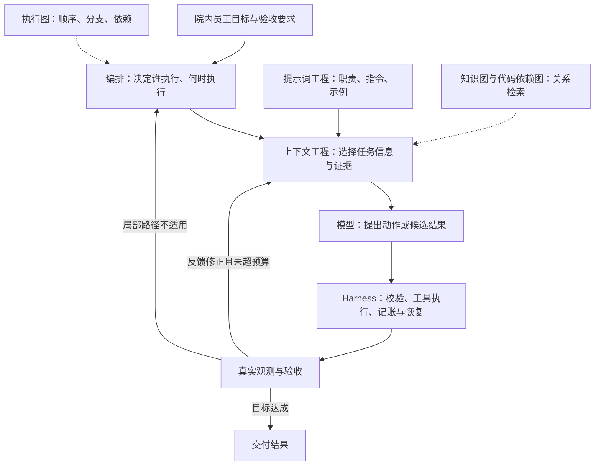

**示例术语与字段译注：** `Harness`(智能体运行约束环境)；`flowchart`(流程图)。


#### full-00-example-002

**1. 提示词工程：把任务说明写成可执行的沟通契约**

原文位置：仓库根目录下的本地原件 `artifacts/medagent_upgrade_20261013/原始资料/00-Agent工程范式与编排总览.txt` 第 105 行。该路径指保留的 .txt 原件，当前同名 .md 是适配稿；本地原件不随克隆分发。

用途：ToB(面向机构业务) 原理示例 / 扩展设计，不表示代码已落地。

归属：章节概览，位于本章首题之前；无对应问答，不计为漏关联。

```text
任务：根据提供的患者记录事实和适用院内转诊规则，判断是否符合转诊申请条件。
边界：只评估资格，不提交转诊申请。
依据：只采用可定位的患者记录字段和规则条款；缺失关键证据时说明缺口。
输出：patient_id、eligible、evidence_refs、missing_conditions。
验收：患者记录对象一致，条件与证据对应，不能把评估通过说成转诊申请已成功。
```

**示例术语与字段译注：** `patient_id`(患者标识)。


#### full-00-example-003

**2. 上下文工程：每一轮重新选择有效信息**

原文位置：仓库根目录下的本地原件 `artifacts/medagent_upgrade_20261013/原始资料/00-Agent工程范式与编排总览.txt` 第 128 行。该路径指保留的 .txt 原件，当前同名 .md 是适配稿；本地原件不随克隆分发。

用途：ToB(面向机构业务) 原理示例 / 扩展设计，不表示代码已落地。

归属：章节概览，位于本章首题之前；无对应问答，不计为漏关联。

```text
持久化状态和产物仓库
    → 权限与任务范围过滤
    → 选择当前步骤需要的证据
    → 保留来源、版本、关键条件与未知项
    → 预算内组装上下文
    → 模型调用
    → 新观测更新状态，再组装下一轮
```


#### full-00-example-004

**1. 同一需求，六种设计责任**

原文位置：仓库根目录下的本地原件 `artifacts/medagent_upgrade_20261013/原始资料/00-Agent工程范式与编排总览.txt` 第 271 行。该路径指保留的 .txt 原件，当前同名 .md 是适配稿；本地原件不随克隆分发。

用途：ToB(面向机构业务) 原理示例 / 扩展设计，不表示代码已落地。

归属：章节概览，位于本章首题之前；无对应问答，不计为漏关联。

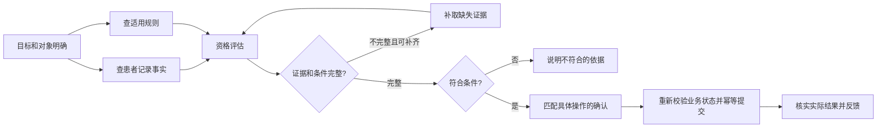

**示例术语与字段译注：** `flowchart`(流程图)。


#### full-00-example-005

**2. 一段带注释的系统伪代码**

原文位置：仓库根目录下的本地原件 `artifacts/medagent_upgrade_20261013/原始资料/00-Agent工程范式与编排总览.txt` 第 293 行。该路径指保留的 .txt 原件，当前同名 .md 是适配稿；本地原件不随克隆分发。

用途：ToB(面向机构业务) 原理示例 / 扩展设计，不表示代码已落地。

归属：章节概览，位于本章首题之前；无对应问答，不计为漏关联。

```python
def run_step(step, runtime):
    # Harness：恢复执行进度；预算和任务版本来自服务端，不能由模型自报。
    state = runtime.restore(step)
    while runtime.budget.can_continue(step):
        if runtime.cancelled_or_superseded(step):
            return stopped("任务取消或步骤版本已失效")

        # 图与编排：依赖未满足就等待，不让模型凭空补上游结果。
        if not runtime.graph.dependencies_satisfied(step):
            return waiting("等待必要前置步骤")

        # 上下文工程：读取有权访问的输入和新观测，按本轮预算组装。
        context = runtime.context.build(step, state.evidence_refs, state.feedback)
        if context.blocked:
            return blocked(context.reason)

        # 提示词工程：职责、指令和输出约束是模型输入的一部分。
        prompt = runtime.prompts.for_role(step.role)
        proposal = runtime.model.propose_accounted(prompt, context, step)
        # propose_accounted 同时检查父子预算，并结算本次模型调用。

        if proposal.kind == "action":
            # Harness：校验动作、参数、权限和操作确认后，才调用真实工具。
            observed = runtime.harness.execute_and_record(step, proposal)
            if observed.side_effect_unknown:
                return needs_reconciliation(observed.operation_id)
            state.add_observation(observed)      # 新证据回流到下一轮上下文
        else:
            # 循环工程：用固定验收条件和证据检查候选产物。
            verdict = runtime.verifier.check_accounted(step, proposal.result, state)
            if verdict.passed:
                # 图与编排：只提交当前版本产物，之后才能释放依赖它的节点。
                return runtime.commit_if_current(step, proposal.result)
            if not verdict.repairable:
                return blocked(verdict.failures)
            state.add_feedback(verdict.failures) # 返回具体缺口，不是泛泛要求反思

        # 以新增证据或减少验收缺口判断进展，不以输出长度判断。
        if state.no_progress_limit_reached():
            return needs_replan(state.verified_partial)
        runtime.checkpoint(step, state)         # 计数与进度跨重启保留

    return budget_exhausted(state.verified_partial)
```

**示例术语与字段译注：** `Harness`(智能体运行约束环境)；`action`(动作)；`add_feedback`(追加反馈)；`add_observation`(追加工具观察结果)；`blocked`(已阻断)；`budget`(预算)；`build`(构建)；`checkpoint`(检查点)；`commit_if_current`(任务仍有效时提交)；`context`(上下文)；`failures`(失败列表)；`graph`(图式流程)；`harness`(智能体运行约束环境)；`model`(模型)；`observed`(已观察)；`operation_id`(写操作标识)；`prompt`(提示词)；`prompts`(提示模板)；`proposal`(提议)；`reason`(原因)；`result`(结果)；`run_step`(运行步骤)；`runtime`(运行环境)；`side_effect_unknown`(写入结果未知)；`state`(状态)；`step`(步骤)；`verifier`(校验器)。

## full-01

**01-项目主线与软技能：项目适配问答**

### full-01-q-001

#### 主问题｜说下你理解的 Agent(智能体)

原文位置：仓库根目录下的本地原件 `artifacts/medagent_upgrade_20261013/原始资料/01-项目主线与软技能.txt` 第 27 行。当前同名 .md 是适配稿；本地原件不随克隆分发。

**项目口述：** 我把 Agent(智能体) 的运行约束落在服务端：任务输入结构、专科和工具白名单、患者授权、模型与工具调用上限、超时熔断、重复调用阻断、工具依据覆盖和持久化完成确认。Prompt(提示词) 描述职责，代码决定一次动作能否执行。

**针对本题的设计展开（原文原理，作为方案解释）：**

Agent(智能体) 不是"大模型换了个名字"，而是"大模型 + 工程化闭环"。可以分三层理解：

- 内核层：LLM（大语言模型）负责理解和生成，是"大脑"；

- 能力层：Function Calling(函数调用) 让模型表达结构化调用意图，MCP(模型上下文协议) 标准化外部能力的接入，记忆/状态让模型在多轮中有连续性；

- 工程层：任务拆解、状态管理、结果校验、异常兜底，保证模型不是"裸奔"，而是可控的执行体。

一句话总结：普通大模型调用是"一问一答"，Agent(智能体) 是"带着目标和工具去完成任务"。面试时先给这个定义，再讲你项目里 Agent(智能体) 具体做了什么，不要停留在概念层面。

**在 MedAgent(医疗智能体项目) 中怎么补全：** 进一步的长任务运行环境需要统一任务预算、持久执行队列、节点状态和验收器。框架能提供组件，业务权限和副作用状态仍由应用负责，不能仅靠装一个框架完成生产治理。

**代码依据：** [backend/agents.py](../backend/agents.py)、[backend/mcp_security.py](../backend/mcp_security.py)、[backend/resilience.py](../backend/resilience.py)

### full-01-q-002

#### 追问｜Agent(智能体) 和普通大模型调用有什么区别？

原文位置：仓库根目录下的本地原件 `artifacts/medagent_upgrade_20261013/原始资料/01-项目主线与软技能.txt` 第 39 行。当前同名 .md 是适配稿；本地原件不随克隆分发。

**项目口述：** 我把 Agent(智能体) 的运行约束落在服务端：任务输入结构、专科和工具白名单、患者授权、模型与工具调用上限、超时熔断、重复调用阻断、工具依据覆盖和持久化完成确认。Prompt(提示词) 描述职责，代码决定一次动作能否执行。

**针对本题的设计展开（原文原理，作为方案解释）：**

普通大模型调用：输入 prompt（提示词） → 输出文本，无状态、无工具、无循环，一轮结束。Agent(智能体)：有目标、有循环的执行体——会拆任务、按需调工具、根据工具结果调整下一步，直到完成或触发兜底。可以举三个直观区别：(1) 大模型调用不会主动查数据库，Agent(智能体) 会；(2) 大模型调用多轮之间互相不记得，Agent(智能体) 有状态管理；(3) 大模型调用失败就失败，Agent(智能体) 会重试、降级。本质区别是"有没有自主执行的闭环"。

**在 MedAgent(医疗智能体项目) 中怎么补全：** 进一步的长任务运行环境需要统一任务预算、持久执行队列、节点状态和验收器。框架能提供组件，业务权限和副作用状态仍由应用负责，不能仅靠装一个框架完成生产治理。

**代码依据：** [backend/agents.py](../backend/agents.py)、[backend/mcp_security.py](../backend/mcp_security.py)、[backend/resilience.py](../backend/resilience.py)

### full-01-q-003

#### 追问｜Agent(智能体) 是否具备任务理解、任务拆解、工具调用、状态管理、结果校验、异常兜底？

原文位置：仓库根目录下的本地原件 `artifacts/medagent_upgrade_20261013/原始资料/01-项目主线与软技能.txt` 第 43 行。当前同名 .md 是适配稿；本地原件不随克隆分发。

**项目口述：** 我把 Agent(智能体) 的运行约束落在服务端：任务输入结构、专科和工具白名单、患者授权、模型与工具调用上限、超时熔断、重复调用阻断、工具依据覆盖和持久化完成确认。Prompt(提示词) 描述职责，代码决定一次动作能否执行。

**针对本题的设计展开（原文原理，作为方案解释）：**

这是面试官最想听的框架，逐条讲：

- 任务理解：意图识别 + 槽位抽取，把用户模糊输入变成结构化任务；

- 任务拆解：计划生成，把任务拆成带依赖关系的步骤；

- Function Calling(函数调用)：按 schema（参数结构）生成工具调用意图，由应用侧校验并执行；

- MCP(模型上下文协议)：通过标准协议接入 Tools(工具列表)、Resources(资源) 和 Prompts(提示模板) 等外部能力；

- 状态管理：全局 state（状态）存任务级信息，节点间传递；

- 结果校验：审查节点检查事实一致性、格式、安全；

- 异常兜底：重试、降级、转人工，保证链路不断。

这些是评估工程成熟度的检查项，不是 Agent(智能体) 必须同时具备的定义。最小 Agent(智能体) 可以只执行有界的模型—工具反馈循环；是否需要规划、长期记忆或独立审查，应由任务决定。

**在 MedAgent(医疗智能体项目) 中怎么补全：** 进一步的长任务运行环境需要统一任务预算、持久执行队列、节点状态和验收器。框架能提供组件，业务权限和副作用状态仍由应用负责，不能仅靠装一个框架完成生产治理。

**代码依据：** [backend/agents.py](../backend/agents.py)、[backend/mcp_security.py](../backend/mcp_security.py)、[backend/resilience.py](../backend/resilience.py)

### full-01-q-004

#### 主问题｜什么是 Multi-Agent(多智能体)？

原文位置：仓库根目录下的本地原件 `artifacts/medagent_upgrade_20261013/原始资料/01-项目主线与软技能.txt` 第 57 行。当前同名 .md 是适配稿；本地原件不随克隆分发。

**项目口述：** 项目是一个主协调器加三个专科：SymptomAgent(症状智能体) 做症状评估、院内分诊和转诊协同；DrugAgent(药品智能体) 查药品和审核用药；GuideAgent(指南智能体) 处理指南、检验、报告、随访与临床知识。Planning(任务规划)、SafetyGuard(安全守卫)、DomainGuard(业务范围守卫) 是协调流程中的职责模块，没有另建检索、通知或独立审查服务。

**针对本题的设计展开（原文原理，作为方案解释）：**

Multi-Agent(多智能体) 是把一个复杂任务拆给多个职责不同的 Agent(智能体) 协作完成。典型结构是"主 Agent(智能体) 调度、子 Agent(智能体) 执行"：主 Agent(智能体) 负责意图识别、计划生成、路由分发、结果聚合；子 Agent(智能体) 各自负责一类能力，比如检索 Agent(智能体)、查询 Agent(智能体)、工具 Agent(智能体)、审查 Agent(智能体)。可以类比：单 Agent(智能体) 是"全栈工程师"，Multi-Agent(多智能体) 是"项目经理 + 专业团队"——前者什么都会一点但深度有限，后者各司其职、职责清晰。面试时先讲这个结构，再用你项目里的实际分工举例，别只给定义。

**在 MedAgent(医疗智能体项目) 中怎么补全：** 按业务目标、可信数据和工具权限划分，而不是按每个 API(应用程序接口) 拆 Agent(智能体)。增加角色前，在同一任务集上比较完成率、交接损失、耗时与成本；不能假设多角色天然准确。

**代码依据：** [backend/agents.py](../backend/agents.py)、[backend/a2a_server.py](../backend/a2a_server.py)

### full-01-q-005

#### 追问｜多 Agent(智能体) 和单 Agent(智能体) 有什么区别？

原文位置：仓库根目录下的本地原件 `artifacts/medagent_upgrade_20261013/原始资料/01-项目主线与软技能.txt` 第 63 行。当前同名 .md 是适配稿；本地原件不随克隆分发。

**项目口述：** 项目是一个主协调器加三个专科：SymptomAgent(症状智能体) 做症状评估、院内分诊和转诊协同；DrugAgent(药品智能体) 查药品和审核用药；GuideAgent(指南智能体) 处理指南、检验、报告、随访与临床知识。Planning(任务规划)、SafetyGuard(安全守卫)、DomainGuard(业务范围守卫) 是协调流程中的职责模块，没有另建检索、通知或独立审查服务。

**针对本题的设计展开（原文原理，作为方案解释）：**

单 Agent(智能体) 由一个执行体处理任务，也可以按步骤筛选工具和隔离权限。多 Agent(智能体) 按职责拆成多个执行体，可以分别配置提示词、工具与运行状态；同样需要执行层权限校验和状态合并规则。设计时比较四个维度：

- 职责：单一职责 vs(对比) 全能型——全能 prompt(提示词) 越长越互相干扰；

- 权限：比较任务级工具范围与执行点校验；单 Agent(智能体) 和多 Agent(智能体) 都能实现最小权限，角色拆分本身不是安全边界；

- 状态：比较本轮状态隔离、共享事实与合并规则；独立执行体也可能共享历史或患者事实，不能仅看 Agent(智能体) 数量；

- 可定位性：比较步骤记录、工具轨迹与恢复契约；单 Agent(智能体) 也可以定位和重试具体调用，多 Agent(智能体) 不会自动获得这些能力。

回答时用这四个维度对比，比背定义有说服力。

**在 MedAgent(医疗智能体项目) 中怎么补全：** 按业务目标、可信数据和工具权限划分，而不是按每个 API(应用程序接口) 拆 Agent(智能体)。增加角色前，在同一任务集上比较完成率、交接损失、耗时与成本；不能假设多角色天然准确。

**代码依据：** [backend/agents.py](../backend/agents.py)、[backend/a2a_server.py](../backend/a2a_server.py)

### full-01-q-006

#### 追问｜为什么不把所有能力都写在一个 Agent(智能体) 里？拆分依据是什么？

原文位置：仓库根目录下的本地原件 `artifacts/medagent_upgrade_20261013/原始资料/01-项目主线与软技能.txt` 第 74 行。当前同名 .md 是适配稿；本地原件不随克隆分发。

**项目口述：** 项目是一个主协调器加三个专科：SymptomAgent(症状智能体) 做症状评估、院内分诊和转诊协同；DrugAgent(药品智能体) 查药品和审核用药；GuideAgent(指南智能体) 处理指南、检验、报告、随访与临床知识。Planning(任务规划)、SafetyGuard(安全守卫)、DomainGuard(业务范围守卫) 是协调流程中的职责模块，没有另建检索、通知或独立审查服务。

**针对本题的设计展开（原文原理，作为方案解释）：**

拆分依据是：业务复杂、工具多、权限不同、任务链路长。全塞一个 Agent(智能体) 的代价可以逐条讲：

1. prompt(提示词) 越长越互相干扰——一段 prompt(提示词) 管五个业务域，模型注意力被稀释，意图识别准确率直接下降；

2. 工具越多选错率越高——几十个工具平铺给模型，选错概率随工具数上升；

3. 如果一次暴露全部工具，会增大权限面；单 Agent(智能体) 也可按任务和步骤分别授予读写权限；

4. 缺少步骤记录和恢复契约时，失败难定位；这取决于执行器和可观测设计，不是单 Agent(智能体) 的必然限制。

拆分之后，这四类问题分别变成可独立开发、独立测试、独立降级的模块。

**在 MedAgent(医疗智能体项目) 中怎么补全：** 按业务目标、可信数据和工具权限划分，而不是按每个 API(应用程序接口) 拆 Agent(智能体)。增加角色前，在同一任务集上比较完成率、交接损失、耗时与成本；不能假设多角色天然准确。

**代码依据：** [backend/agents.py](../backend/agents.py)、[backend/a2a_server.py](../backend/a2a_server.py)

### full-01-q-007

#### 主问题｜你的项目为什么要用多 Agent(智能体)？

原文位置：仓库根目录下的本地原件 `artifacts/medagent_upgrade_20261013/原始资料/01-项目主线与软技能.txt` 第 85 行。当前同名 .md 是适配稿；本地原件不随克隆分发。

**项目口述：** 项目是一个主协调器加三个专科：SymptomAgent(症状智能体) 做症状评估、院内分诊和转诊协同；DrugAgent(药品智能体) 查药品和审核用药；GuideAgent(指南智能体) 处理指南、检验、报告、随访与临床知识。Planning(任务规划)、SafetyGuard(安全守卫)、DomainGuard(业务范围守卫) 是协调流程中的职责模块，没有另建检索、通知或独立审查服务。

**针对本题的设计展开（原文原理，作为方案解释）：**

从真实业务讲，不要只讲概念。标准回答结构是："这类设计的业务特点是 X，单 Agent(智能体) 会带来 Y 问题，所以拆成了 Z 个 Agent(智能体)"。比如：任务链路长（意图识别→数据查询→分析→生成→审查五步）、工具种类多且权限不同（读库、写库、发通知的权限必须分开）、不同环节需要不同的专业 prompt（检索要严谨带引用、生成要流畅有逻辑）。多 Agent(智能体) 让每一步可以独立开发、独立测试、独立降级——是否能局部降级取决于数据依赖、业务验收和副作用；必需环节失败仍应阻断下游，单 Agent(智能体) 也可实现按步骤降级。

**在 MedAgent(医疗智能体项目) 中怎么补全：** 按业务目标、可信数据和工具权限划分，而不是按每个 API(应用程序接口) 拆 Agent(智能体)。增加角色前，在同一任务集上比较完成率、交接损失、耗时与成本；不能假设多角色天然准确。

**代码依据：** [backend/agents.py](../backend/agents.py)、[backend/a2a_server.py](../backend/a2a_server.py)

### full-01-q-008

#### 追问｜是业务复杂、工具多、权限不同，还是任务链路长？

原文位置：仓库根目录下的本地原件 `artifacts/medagent_upgrade_20261013/原始资料/01-项目主线与软技能.txt` 第 91 行。当前同名 .md 是适配稿；本地原件不随克隆分发。

**项目口述：** 项目是一个主协调器加三个专科：SymptomAgent(症状智能体) 做症状评估、院内分诊和转诊协同；DrugAgent(药品智能体) 查药品和审核用药；GuideAgent(指南智能体) 处理指南、检验、报告、随访与临床知识。Planning(任务规划)、SafetyGuard(安全守卫)、DomainGuard(业务范围守卫) 是协调流程中的职责模块，没有另建检索、通知或独立审查服务。

**在 MedAgent(医疗智能体项目) 中怎么补全：** 按业务目标、可信数据和工具权限划分，而不是按每个 API(应用程序接口) 拆 Agent(智能体)。增加角色前，在同一任务集上比较完成率、交接损失、耗时与成本；不能假设多角色天然准确。

**代码依据：** [backend/agents.py](../backend/agents.py)、[backend/a2a_server.py](../backend/a2a_server.py)

### full-01-q-009

#### 追问｜如果只用一个 Agent(智能体)，会出现什么问题？

原文位置：仓库根目录下的本地原件 `artifacts/medagent_upgrade_20261013/原始资料/01-项目主线与软技能.txt` 第 95 行。当前同名 .md 是适配稿；本地原件不随克隆分发。

**项目口述：** 项目是一个主协调器加三个专科：SymptomAgent(症状智能体) 做症状评估、院内分诊和转诊协同；DrugAgent(药品智能体) 查药品和审核用药；GuideAgent(指南智能体) 处理指南、检验、报告、随访与临床知识。Planning(任务规划)、SafetyGuard(安全守卫)、DomainGuard(业务范围守卫) 是协调流程中的职责模块，没有另建检索、通知或独立审查服务。

**针对本题的设计展开（原文原理，作为方案解释）：**

四个具体问题：(1) prompt(提示词) 越长越互相干扰，各业务域的规则在 prompt(提示词) 里打架；(2) 工具越多选错率越高，模型面对几十个工具无所适从；(3) 同时暴露读写工具会增大权限面，应按任务和步骤筛选；(4) 如果没有步骤轨迹与恢复契约，定位和重试会困难；两项都可以在单 Agent(智能体) 执行器中改进。可以补一句判断力的话：如果场景简单，我也会直接说"这个场景单 Agent(智能体) 够了"，不为了拆而拆——面试官欣赏这种务实的判断。

**在 MedAgent(医疗智能体项目) 中怎么补全：** 按业务目标、可信数据和工具权限划分，而不是按每个 API(应用程序接口) 拆 Agent(智能体)。增加角色前，在同一任务集上比较完成率、交接损失、耗时与成本；不能假设多角色天然准确。

**代码依据：** [backend/agents.py](../backend/agents.py)、[backend/a2a_server.py](../backend/a2a_server.py)

### full-01-q-010

#### 主问题｜你们项目里有几个 Agent(智能体)？

原文位置：仓库根目录下的本地原件 `artifacts/medagent_upgrade_20261013/原始资料/01-项目主线与软技能.txt` 第 99 行。当前同名 .md 是适配稿；本地原件不随克隆分发。

**项目口述：** 项目是一个主协调器加三个专科：SymptomAgent(症状智能体) 做症状评估、院内分诊和转诊协同；DrugAgent(药品智能体) 查药品和审核用药；GuideAgent(指南智能体) 处理指南、检验、报告、随访与临床知识。Planning(任务规划)、SafetyGuard(安全守卫)、DomainGuard(业务范围守卫) 是协调流程中的职责模块，没有另建检索、通知或独立审查服务。

**针对本题的设计展开（原文原理，作为方案解释）：**

以下五角色是通用架构示例，不能直接当成 MedAgent(医疗智能体项目) 已实现清单。MedAgent(医疗智能体项目) 当前为协调器 + SymptomAgent(症状智能体)、DrugAgent(药品智能体)、GuideAgent(指南智能体) 三个 A2A(智能体间通信协议) 专科，跨专科按依赖关系执行，独立只读步骤可并行，包含批准写动作的计划串行，尚无独立 RAG(检索增强生成) 或审查 Agent(智能体) 服务。通用方案可按"主 + 子"结构介绍：主 Agent（意图识别、路由、聚合）+ 检索 Agent(智能体)（RAG(检索增强生成)）+ 查询 Agent（数据库/接口）+ 工具 Agent（操作执行）+ 审查 Agent（安全与事实校验）。介绍时按"职责—输入输出—协作关系"三层讲，最好画一张调度图：用户 → 主 Agent(智能体) → 并行分发 → 各子 Agent(智能体) → 聚合 → 审查 → 输出。数量不是重点，职责边界才是——五个职责清晰的 Agent(智能体) 比十个职责模糊的 Agent(智能体) 更有说服力。

**在 MedAgent(医疗智能体项目) 中怎么补全：** 按业务目标、可信数据和工具权限划分，而不是按每个 API(应用程序接口) 拆 Agent(智能体)。增加角色前，在同一任务集上比较完成率、交接损失、耗时与成本；不能假设多角色天然准确。

**代码依据：** [backend/agents.py](../backend/agents.py)、[backend/a2a_server.py](../backend/a2a_server.py)

### full-01-q-011

#### 追问｜主 Agent(智能体)、检索 Agent(智能体)、查询 Agent(智能体)、工具 Agent(智能体)、审查 Agent(智能体) 怎么分工？

原文位置：仓库根目录下的本地原件 `artifacts/medagent_upgrade_20261013/原始资料/01-项目主线与软技能.txt` 第 105 行。当前同名 .md 是适配稿；本地原件不随克隆分发。

**项目口述：** 项目是一个主协调器加三个专科：SymptomAgent(症状智能体) 做症状评估、院内分诊和转诊协同；DrugAgent(药品智能体) 查药品和审核用药；GuideAgent(指南智能体) 处理指南、检验、报告、随访与临床知识。Planning(任务规划)、SafetyGuard(安全守卫)、DomainGuard(业务范围守卫) 是协调流程中的职责模块，没有另建检索、通知或独立审查服务。

**针对本题的设计展开（原文原理，作为方案解释）：**

- 主 Agent(智能体)：系统入口，负责意图、计划、路由、聚合——"调度中枢，不生产结果"；

- 检索 Agent(智能体)：知识库召回，返回带引用的内容——"答案要有出处"；

- 查询 Agent(智能体)：结构化数据查询，返回字段化结果——"查数不编数"；

- 工具 Agent(智能体)：执行写操作类动作（下单、发通知、建工单）——"有副作用的操作集中在这里，便于权限控制和审计"；

- 审查 Agent(智能体)：对最终答案做安全、事实、格式校验——"最后一道防线，独立于生成过程"。

**在 MedAgent(医疗智能体项目) 中怎么补全：** 按业务目标、可信数据和工具权限划分，而不是按每个 API(应用程序接口) 拆 Agent(智能体)。增加角色前，在同一任务集上比较完成率、交接损失、耗时与成本；不能假设多角色天然准确。

**代码依据：** [backend/agents.py](../backend/agents.py)、[backend/a2a_server.py](../backend/a2a_server.py)

### full-01-q-012

#### 追问｜每个 Agent(智能体) 的输入、输出、工具权限、状态字段分别是什么？

原文位置：仓库根目录下的本地原件 `artifacts/medagent_upgrade_20261013/原始资料/01-项目主线与软技能.txt` 第 113 行。当前同名 .md 是适配稿；本地原件不随克隆分发。

**项目口述：** 项目是一个主协调器加三个专科：SymptomAgent(症状智能体) 做症状评估、院内分诊和转诊协同；DrugAgent(药品智能体) 查药品和审核用药；GuideAgent(指南智能体) 处理指南、检验、报告、随访与临床知识。Planning(任务规划)、SafetyGuard(安全守卫)、DomainGuard(业务范围守卫) 是协调流程中的职责模块，没有另建检索、通知或独立审查服务。

**针对本题的设计展开（原文原理，作为方案解释）：**

这是判断你有没有真做过的关键问题。每个 Agent(智能体) 说清四件事：输入 schema（主 Agent 传什么字段）、输出 schema（返回什么结构）、工具权限（绑定哪些工具，最小化）、状态字段（往 state(状态) 的哪个命名空间写）。举例：查询 Agent(智能体) 输入 `{query_sql, params}`(查询SQL；参数集合)，输出 `{data, row_count}`(数据；记录数量)，权限只有只读数据库连接，结果写入 `agent_results.query`(智能体结果集合；查询)。能答到这个颗粒度，比说"设计团队有五个 Agent(智能体)"强十倍——面试官据此判断你是设计者还是参与者。

**在 MedAgent(医疗智能体项目) 中怎么补全：** 按业务目标、可信数据和工具权限划分，而不是按每个 API(应用程序接口) 拆 Agent(智能体)。增加角色前，在同一任务集上比较完成率、交接损失、耗时与成本；不能假设多角色天然准确。

**代码依据：** [backend/agents.py](../backend/agents.py)、[backend/a2a_server.py](../backend/a2a_server.py)

### full-01-q-013

#### 主问题｜你这个项目是 Workflow(工作流) 还是 Agent(智能体)？

原文位置：仓库根目录下的本地原件 `artifacts/medagent_upgrade_20261013/原始资料/01-项目主线与软技能.txt` 第 117 行。当前同名 .md 是适配稿；本地原件不随克隆分发。

**项目口述：** 简单明确任务直接匹配专科；多意图或复杂任务由 Planner(规划器) 生成最多三步计划。服务端检查专科白名单、去重、意图要求的专科覆盖以及依赖只能指向已列出的前序步骤。结构或依赖非法时改用确定性短链，不能让模型添加未注册服务。

**针对本题的设计展开（原文原理，作为方案解释）：**

核心区别：Workflow(工作流) 的控制结构、节点边界和允许的分支预先定义，但一次运行实际走哪条分支可以由条件决定；Agent(智能体) 则允许模型根据上下文选择未在固定路径中写死的下一步动作。设计团队的项目是混合体：主干用固定编排保证稳定，关键决策点交给模型动态判断。面试官真正想听的是"你知道两者的代价，也知道在哪里用哪个"，而不是二选一的站队。

**在 MedAgent(医疗智能体项目) 中怎么补全：** 计划能表达依赖与独立查询，当前没有无限自主改计划：只读依据缺失最多一次重新识别，普通工具故障不等于意图错误。若扩展更多节点，增加节点超时、验收条件、输入引用和版本化节点状态，同时限制重规划预算。

**代码依据：** [backend/agents.py](../backend/agents.py)、[backend/evidence.py](../backend/evidence.py)

### full-01-q-014

#### 追问｜固定流程和动态决策有什么区别？

原文位置：仓库根目录下的本地原件 `artifacts/medagent_upgrade_20261013/原始资料/01-项目主线与软技能.txt` 第 123 行。当前同名 .md 是适配稿；本地原件不随克隆分发。

**项目口述：** 简单明确任务直接匹配专科；多意图或复杂任务由 Planner(规划器) 生成最多三步计划。服务端检查专科白名单、去重、意图要求的专科覆盖以及依赖只能指向已列出的前序步骤。结构或依赖非法时改用确定性短链，不能让模型添加未注册服务。

**针对本题的设计展开（原文原理，作为方案解释）：**

固定流程（Workflow(工作流)）：控制结构和可选分支由代码预先定义，因此更可预期、可测试，成本与延迟也更稳定；代价是新增长尾路径通常要修改流程。动态决策（Agent(智能体)）：模型可根据上下文选择下一步，灵活但更难验证，成本和延迟波动也更大。生产经验是：能用确定性控制流解决的地方优先不用模型，模型只放在必须理解语义或处理开放选择的环节。

**在 MedAgent(医疗智能体项目) 中怎么补全：** 计划能表达依赖与独立查询，当前没有无限自主改计划：只读依据缺失最多一次重新识别，普通工具故障不等于意图错误。若扩展更多节点，增加节点超时、验收条件、输入引用和版本化节点状态，同时限制重规划预算。

**代码依据：** [backend/agents.py](../backend/agents.py)、[backend/evidence.py](../backend/evidence.py)

### full-01-q-015

#### 追问｜哪些节点是固定编排？哪些节点是由模型动态判断？

原文位置：仓库根目录下的本地原件 `artifacts/medagent_upgrade_20261013/原始资料/01-项目主线与软技能.txt` 第 127 行。当前同名 .md 是适配稿；本地原件不随克隆分发。

**项目口述：** 简单明确任务直接匹配专科；多意图或复杂任务由 Planner(规划器) 生成最多三步计划。服务端检查专科白名单、去重、意图要求的专科覆盖以及依赖只能指向已列出的前序步骤。结构或依赖非法时改用确定性短链，不能让模型添加未注册服务。

**针对本题的设计展开（原文原理，作为方案解释）：**

固定编排：数据校验（schema(结构约束) 校验器）、格式转换（模板渲染）、结果聚合（规则拼接）、审查（规则为主 + 模型辅助）。模型动态判断：意图识别（判断用户要什么）、计划生成（拆成几步）、路由选择（找谁干）、是否追问（信息够不够）。原则：动态节点越少，系统越稳。可以补一句实践心得：如果某类任务上线后不稳定，优先排查它的动态节点，考虑改回固定编排。

**在 MedAgent(医疗智能体项目) 中怎么补全：** 计划能表达依赖与独立查询，当前没有无限自主改计划：只读依据缺失最多一次重新识别，普通工具故障不等于意图错误。若扩展更多节点，增加节点超时、验收条件、输入引用和版本化节点状态，同时限制重规划预算。

**代码依据：** [backend/agents.py](../backend/agents.py)、[backend/evidence.py](../backend/evidence.py)

### full-01-q-016

#### 主问题｜Agent(智能体) 和 Coze(智能体开发平台)/Dify(大模型应用开发平台) 有什么区别？

原文位置：仓库根目录下的本地原件 `artifacts/medagent_upgrade_20261013/原始资料/01-项目主线与软技能.txt` 第 131 行。当前同名 .md 是适配稿；本地原件不随克隆分发。

**项目口述：** 模型通过 Function Calling(函数调用) 选择工具并生成结构化参数，LangChain(大模型应用开发框架) 的 MCPAdapter(MCP工具适配器) 和 FastMCP(MCP服务框架) 客户端通过 MCP(模型上下文协议) 调用工具服务。FastMCP(MCP服务框架) 注册 14 个工具，包括真实医院查询以及本地病史、辅助材料存储；服务端再次检查委托、员工状态、患者范围和写动作权限。两者在同一链路中使用。

**针对本题的设计展开（原文原理，作为方案解释）：**

Coze(智能体开发平台)/Dify(大模型应用开发平台) 是低代码平台，拖拽搭 Agent(智能体) 和工作流，把意图、路由、工具、状态都封装成可视化组件——上手快，几天能出 demo(演示样例)，但深度定制受限：复杂状态管理、特殊异常处理、私有化集成都不好做。自研是基于 LangChain(大模型应用开发框架)/LangGraph(有状态智能体编排框架) 写代码，灵活但要自己解决全部工程问题。回答时先明确自己是哪一种，再讲清"为什么这么选"，不要只说平台不好或自研厉害——两者的适用场景不同，能讲出适用场景的边界才是真懂。

**在 MedAgent(医疗智能体项目) 中怎么补全：** 工具注册要同时维护参数、输出、错误、权限、读写属性和版本契约；新增工具先做契约测试和权限回归，再开放给对应专科。不能把工具描述中的 readOnlyHint(只读工具提示) 当真正的服务端授权。

**代码依据：** [backend/mcp_tools.py](../backend/mcp_tools.py)、[backend/mcp_security.py](../backend/mcp_security.py)、[backend/agents.py](../backend/agents.py)

### full-01-q-017

#### 追问｜你是低代码平台搭建，还是自己基于 LangChain(大模型应用开发框架)/LangGraph(有状态智能体编排框架) 开发？

原文位置：仓库根目录下的本地原件 `artifacts/medagent_upgrade_20261013/原始资料/01-项目主线与软技能.txt` 第 137 行。当前同名 .md 是适配稿；本地原件不随克隆分发。

**项目口述：** 模型通过 Function Calling(函数调用) 选择工具并生成结构化参数，LangChain(大模型应用开发框架) 的 MCPAdapter(MCP工具适配器) 和 FastMCP(MCP服务框架) 客户端通过 MCP(模型上下文协议) 调用工具服务。FastMCP(MCP服务框架) 注册 14 个工具，包括真实医院查询以及本地病史、辅助材料存储；服务端再次检查委托、员工状态、患者范围和写动作权限。两者在同一链路中使用。

**针对本题的设计展开（原文原理，作为方案解释）：**

如实说，两种都有经验更好。自研就强调你掌控了细节（状态、路由、异常都是自己实现的）；用过平台就讲清它帮你省掉了什么（可视化编排、内置工具市场、快速原型验证）、限制了什么（定制状态、特殊兜底逻辑做不了）——能对比说明，反而是加分项，说明你做过技术选型而非只会一种。

**在 MedAgent(医疗智能体项目) 中怎么补全：** 工具注册要同时维护参数、输出、错误、权限、读写属性和版本契约；新增工具先做契约测试和权限回归，再开放给对应专科。不能把工具描述中的 readOnlyHint(只读工具提示) 当真正的服务端授权。

**代码依据：** [backend/mcp_tools.py](../backend/mcp_tools.py)、[backend/mcp_security.py](../backend/mcp_security.py)、[backend/agents.py](../backend/agents.py)

### full-01-q-018

#### 追问｜自研部分在哪里？工具封装、状态管理、路由、异常处理是否自己实现？

原文位置：仓库根目录下的本地原件 `artifacts/medagent_upgrade_20261013/原始资料/01-项目主线与软技能.txt` 第 141 行。当前同名 .md 是适配稿；本地原件不随克隆分发。

**项目口述：** 模型通过 Function Calling(函数调用) 选择工具并生成结构化参数，LangChain(大模型应用开发框架) 的 MCPAdapter(MCP工具适配器) 和 FastMCP(MCP服务框架) 客户端通过 MCP(模型上下文协议) 调用工具服务。FastMCP(MCP服务框架) 注册 14 个工具，包括真实医院查询以及本地病史、辅助材料存储；服务端再次检查委托、员工状态、患者范围和写动作权限。两者在同一链路中使用。

**针对本题的设计展开（原文原理，作为方案解释）：**

平台封装掉的能力，自研全部要自己做，这六块逐块讲：

1. 工具封装：schema(结构约束) 定义与校验，参数不合法不进执行；

2. 状态管理：全局/局部 state(状态)、命名空间隔离、reducer（状态合并函数）策略；

3. 路由：规则表优先 + 模型 fallback（兜底） + 置信度阈值；

4. 异常处理：重试/熔断/降级分层设计；

5. checkpoint(检查点)：每节点快照，支持断点续跑；

6. 可观测：trace（调用链追踪）/日志/指标三件套。

能把这六块讲清"自己怎么实现的"，就是面试官想看到的工程深度。

面试官真实意图（本章考点）：

#### full-01-example-001

**Q6｜Agent(智能体) 和 Coze(智能体开发平台)/Dify(大模型应用开发平台) 有什么区别？**

原文位置：仓库根目录下的本地原件 `artifacts/medagent_upgrade_20261013/原始资料/01-项目主线与软技能.txt` 第 156 行。该路径指保留的 .txt 原件，当前同名 .md 是适配稿；本地原件不随克隆分发。

用途：ToB(面向机构业务) 原理示例 / 扩展设计，不表示代码已落地。

[返回对应问答](#full-01-q-018)

```text
不是想听"Agent = 智能体"，而是判断你有没有真正理解：
1. Agent 为什么要拆。
2. 主 Agent 怎么调度。
3. 子 Agent 怎么协作。
4. 状态怎么传递。
5. 工具怎么调用。
6. 异常怎么兜底。
7. 链路怎么可观测。
```

**示例术语与字段译注：** `Agent`(智能体)。


**在 MedAgent(医疗智能体项目) 中怎么补全：** 工具注册要同时维护参数、输出、错误、权限、读写属性和版本契约；新增工具先做契约测试和权限回归，再开放给对应专科。不能把工具描述中的 readOnlyHint(只读工具提示) 当真正的服务端授权。

**代码依据：** [backend/mcp_tools.py](../backend/mcp_tools.py)、[backend/mcp_security.py](../backend/mcp_security.py)、[backend/agents.py](../backend/agents.py)

**本题图与结构示例：** [example-001](#full-01-example-001)

### full-01-q-019

#### 主问题｜为什么从上一家公司离职？

原文位置：仓库根目录下的本地原件 `artifacts/medagent_upgrade_20261013/原始资料/01-项目主线与软技能.txt` 第 169 行。当前同名 .md 是适配稿；本地原件不随克隆分发。

**项目口述：** 这类题不能由代码证明个人经历。我的项目表达围绕院内需求、具体负责模块和可展示交付物：意图路由、专科编排、工具权限、回归与文档；实际只参与修订的部分就说明参与了哪些改动。离职、薪资、团队分工与对客经历要按本人事实回答。

**针对本题的设计展开（原文原理，作为方案解释）：**

三条原则：只讲客观、可验证的原因（发展空间、技术栈方向、业务前景）；不贬低前司，不抱怨前同事——抱怨是最大的减分项；重点放在"我想要什么、新公司能给我什么"。示范话术："我在上家主要做单点工具，一直想做多 Agent(智能体) 系统，但业务没有这个场景，所以看机会。"——把离职原因和新岗位直接连起来，让面试官看到"你来这里是早有打算"。

**在 MedAgent(医疗智能体项目) 中怎么补全：** 如果被问客户交付，结合医生/药师用药审核流程讲需求澄清、原型确认、范围变更、验收样本和复核反馈；没有真实医院客户案例时，用工程方案或本地修复案例回答，不编造合同、线上事故、采购成果或任职年限。

**代码依据：** [docs/MedAgent_AI_多Agent项目话术.md](MedAgent_AI_多Agent项目话术.md)、[README.md](../README.md)

### full-01-q-020

#### 追问｜是薪资、发展、地域、团队还是技术栈原因？

原文位置：仓库根目录下的本地原件 `artifacts/medagent_upgrade_20261013/原始资料/01-项目主线与软技能.txt` 第 175 行。当前同名 .md 是适配稿；本地原件不随克隆分发。

**项目口述：** 这类题不能由代码证明个人经历。我的项目表达围绕院内需求、具体负责模块和可展示交付物：意图路由、专科编排、工具权限、回归与文档；实际只参与修订的部分就说明参与了哪些改动。离职、薪资、团队分工与对客经历要按本人事实回答。

**针对本题的设计展开（原文原理，作为方案解释）：**

从这五类里选一个真实主因，并说清楚它如何影响你的决策。切忌笼统说"个人发展"——等于没答。可以叠加次要原因，但主线只能有一条，比如"主线是想做 Agent(智能体) 方向，辅因是薪资倒挂"。原因要具体到能验证："设计团队部门两年没有新项目立项，技术栈停留在三年前"。

**在 MedAgent(医疗智能体项目) 中怎么补全：** 如果被问客户交付，结合医生/药师用药审核流程讲需求澄清、原型确认、范围变更、验收样本和复核反馈；没有真实医院客户案例时，用工程方案或本地修复案例回答，不编造合同、线上事故、采购成果或任职年限。

**代码依据：** [docs/MedAgent_AI_多Agent项目话术.md](MedAgent_AI_多Agent项目话术.md)、[README.md](../README.md)

### full-01-q-021

#### 追问｜你来我们这，会不会也因为同样的原因走？

原文位置：仓库根目录下的本地原件 `artifacts/medagent_upgrade_20261013/原始资料/01-项目主线与软技能.txt` 第 179 行。当前同名 .md 是适配稿；本地原件不随克隆分发。

**项目口述：** 这类题不能由代码证明个人经历。我的项目表达围绕院内需求、具体负责模块和可展示交付物：意图路由、专科编排、工具权限、回归与文档；实际只参与修订的部分就说明参与了哪些改动。离职、薪资、团队分工与对客经历要按本人事实回答。

**针对本题的设计展开（原文原理，作为方案解释）：**

核心是证明"同样的原因不会重演"。把你离职的原因和新岗位特点一一对应起来讲：因"想做 Agent(智能体) 工程化"离职 → 贵司有多 Agent(智能体) 业务，正好命中；因"业务没增长"离职 → 贵司这个业务线在扩张。如果原因在贵司也可能存在（比如同样涨薪有限），诚实说明并讲清自己如何管理预期——诚实比完美话术更安全，面试官听得出来。

**在 MedAgent(医疗智能体项目) 中怎么补全：** 如果被问客户交付，结合医生/药师用药审核流程讲需求澄清、原型确认、范围变更、验收样本和复核反馈；没有真实医院客户案例时，用工程方案或本地修复案例回答，不编造合同、线上事故、采购成果或任职年限。

**代码依据：** [docs/MedAgent_AI_多Agent项目话术.md](MedAgent_AI_多Agent项目话术.md)、[README.md](../README.md)

### full-01-q-022

#### 主问题｜你的期望薪资是多少？

原文位置：仓库根目录下的本地原件 `artifacts/medagent_upgrade_20261013/原始资料/01-项目主线与软技能.txt` 第 183 行。当前同名 .md 是适配稿；本地原件不随克隆分发。

**项目口述：** 这类题不能由代码证明个人经历。我的项目表达围绕院内需求、具体负责模块和可展示交付物：意图路由、专科编排、工具权限、回归与文档；实际只参与修订的部分就说明参与了哪些改动。离职、薪资、团队分工与对客经历要按本人事实回答。

**针对本题的设计展开（原文原理，作为方案解释）：**

三步：先理清自己上一家的薪资结构（base(基础配置) 即底薪、年终、补贴、股票——只说 base(基础配置) 会被低估总包）；再查目标城市、同规模公司、同定级岗位的市场行情；最后报一个可谈的区间，而不是报一个死数。区间的下限是你真正能接受的数，上限留出谈判空间。

**在 MedAgent(医疗智能体项目) 中怎么补全：** 如果被问客户交付，结合医生/药师用药审核流程讲需求澄清、原型确认、范围变更、验收样本和复核反馈；没有真实医院客户案例时，用工程方案或本地修复案例回答，不编造合同、线上事故、采购成果或任职年限。

**代码依据：** [docs/MedAgent_AI_多Agent项目话术.md](MedAgent_AI_多Agent项目话术.md)、[README.md](../README.md)

### full-01-q-023

#### 追问｜上一家薪资结构（base(基础配置)、年终、补贴、股票）是什么？

原文位置：仓库根目录下的本地原件 `artifacts/medagent_upgrade_20261013/原始资料/01-项目主线与软技能.txt` 第 189 行。当前同名 .md 是适配稿；本地原件不随克隆分发。

**项目口述：** 这类题不能由代码证明个人经历。我的项目表达围绕院内需求、具体负责模块和可展示交付物：意图路由、专科编排、工具权限、回归与文档；实际只参与修订的部分就说明参与了哪些改动。离职、薪资、团队分工与对客经历要按本人事实回答。

**针对本题的设计展开（原文原理，作为方案解释）：**

把自己的薪资构成拆清楚，方便 HR(人力资源) 对标：base(基础配置) 是基准，年终看系数（几个月），补贴股票是补充。两个注意点：期权没兑现的不要算成收入，虚报在背调时会被戳穿；总包和 base(基础配置) 分开报，避免 HR(人力资源) 把总包当 base(基础配置) 来砍。

**在 MedAgent(医疗智能体项目) 中怎么补全：** 如果被问客户交付，结合医生/药师用药审核流程讲需求澄清、原型确认、范围变更、验收样本和复核反馈；没有真实医院客户案例时，用工程方案或本地修复案例回答，不编造合同、线上事故、采购成果或任职年限。

**代码依据：** [docs/MedAgent_AI_多Agent项目话术.md](MedAgent_AI_多Agent项目话术.md)、[README.md](../README.md)

### full-01-q-024

#### 追问｜如何按岗位、城市、公司规模合理报价？

原文位置：仓库根目录下的本地原件 `artifacts/medagent_upgrade_20261013/原始资料/01-项目主线与软技能.txt` 第 193 行。当前同名 .md 是适配稿；本地原件不随克隆分发。

**项目口述：** 这类题不能由代码证明个人经历。我的项目表达围绕院内需求、具体负责模块和可展示交付物：意图路由、专科编排、工具权限、回归与文档；实际只参与修订的部分就说明参与了哪些改动。离职、薪资、团队分工与对客经历要按本人事实回答。

**针对本题的设计展开（原文原理，作为方案解释）：**

报价 = 市场行情 × 个人稀缺性。行情：同城市同级别岗位的薪资区间，从招聘平台和同行交流获取；稀缺性：你的 Agent(智能体) 项目经验是否难替代——生产级多 Agent(智能体) 经验在市场上是稀缺的，这是溢价依据。报区间（如 25-30k）并说清区间的依据（行情 + 经验 + 上家基数），显得专业而不是漫天要价。

**在 MedAgent(医疗智能体项目) 中怎么补全：** 如果被问客户交付，结合医生/药师用药审核流程讲需求澄清、原型确认、范围变更、验收样本和复核反馈；没有真实医院客户案例时，用工程方案或本地修复案例回答，不编造合同、线上事故、采购成果或任职年限。

**代码依据：** [docs/MedAgent_AI_多Agent项目话术.md](MedAgent_AI_多Agent项目话术.md)、[README.md](../README.md)

### full-01-q-025

#### 主问题｜未来两三年的工作规划是什么？

原文位置：仓库根目录下的本地原件 `artifacts/medagent_upgrade_20261013/原始资料/01-项目主线与软技能.txt` 第 197 行。当前同名 .md 是适配稿；本地原件不随克隆分发。

**项目口述：** 这类题不能由代码证明个人经历。我的项目表达围绕院内需求、具体负责模块和可展示交付物：意图路由、专科编排、工具权限、回归与文档；实际只参与修订的部分就说明参与了哪些改动。离职、薪资、团队分工与对客经历要按本人事实回答。

**针对本题的设计展开（原文原理，作为方案解释）：**

规划要和应聘岗位匹配，分技术线和管理线两条路径答。技术线：多 Agent(智能体) 架构 → 工具链与状态管理 → 稳定性与容错 → 多模态，逐层深入；管理线：带项目交付 → 带小团队 → 定技术方向。先说自己未来 2-3 年的主线，再说这个岗位在你的路径上处于哪一环——让面试官看到你留下的理由。

**在 MedAgent(医疗智能体项目) 中怎么补全：** 如果被问客户交付，结合医生/药师用药审核流程讲需求澄清、原型确认、范围变更、验收样本和复核反馈；没有真实医院客户案例时，用工程方案或本地修复案例回答，不编造合同、线上事故、采购成果或任职年限。

**代码依据：** [docs/MedAgent_AI_多Agent项目话术.md](MedAgent_AI_多Agent项目话术.md)、[README.md](../README.md)

### full-01-q-026

#### 追问｜Agent(智能体) 方向深耕还是转管理？

原文位置：仓库根目录下的本地原件 `artifacts/medagent_upgrade_20261013/原始资料/01-项目主线与软技能.txt` 第 203 行。当前同名 .md 是适配稿；本地原件不随克隆分发。

**项目口述：** 这类题不能由代码证明个人经历。我的项目表达围绕院内需求、具体负责模块和可展示交付物：意图路由、专科编排、工具权限、回归与文档；实际只参与修订的部分就说明参与了哪些改动。离职、薪资、团队分工与对客经历要按本人事实回答。

**针对本题的设计展开（原文原理，作为方案解释）：**

明确选一个，不要说"都行"。技术线，面试官期待深度——能深挖到状态机、容错、工具链细节；管理线，面试官期待交付经验——项目怎么推、人怎么带、目标怎么拆。选错线整个面试的追问方向就偏了，后续问题你都接不住。如果确实两条都考虑，可以说"近两年深耕技术，积累够了再考虑带人"——这也是一个明确回答。

**在 MedAgent(医疗智能体项目) 中怎么补全：** 如果被问客户交付，结合医生/药师用药审核流程讲需求澄清、原型确认、范围变更、验收样本和复核反馈；没有真实医院客户案例时，用工程方案或本地修复案例回答，不编造合同、线上事故、采购成果或任职年限。

**代码依据：** [docs/MedAgent_AI_多Agent项目话术.md](MedAgent_AI_多Agent项目话术.md)、[README.md](../README.md)

### full-01-q-027

#### 追问｜你的规划与这个岗位的发展空间是否匹配？

原文位置：仓库根目录下的本地原件 `artifacts/medagent_upgrade_20261013/原始资料/01-项目主线与软技能.txt` 第 207 行。当前同名 .md 是适配稿；本地原件不随克隆分发。

**项目口述：** 这类题不能由代码证明个人经历。我的项目表达围绕院内需求、具体负责模块和可展示交付物：意图路由、专科编排、工具权限、回归与文档；实际只参与修订的部分就说明参与了哪些改动。离职、薪资、团队分工与对客经历要按本人事实回答。

**针对本题的设计展开（原文原理，作为方案解释）：**

说明这个岗位正好在你规划的路径上："岗位要做的生产级多 Agent(智能体) 系统，正是我规划里下一阶段要补齐的能力，我在上家只做过单点 Agent(智能体)，到这里正好补上完整链路。"同时留一点弹性（团队需要也可以带人），别把话说死——规划是方向，不是军令状。

**在 MedAgent(医疗智能体项目) 中怎么补全：** 如果被问客户交付，结合医生/药师用药审核流程讲需求澄清、原型确认、范围变更、验收样本和复核反馈；没有真实医院客户案例时，用工程方案或本地修复案例回答，不编造合同、线上事故、采购成果或任职年限。

**代码依据：** [docs/MedAgent_AI_多Agent项目话术.md](MedAgent_AI_多Agent项目话术.md)、[README.md](../README.md)

### full-01-q-028

#### 主问题｜你们对接过客户吗？有没有对客经验？

原文位置：仓库根目录下的本地原件 `artifacts/medagent_upgrade_20261013/原始资料/01-项目主线与软技能.txt` 第 211 行。当前同名 .md 是适配稿；本地原件不随克隆分发。

**项目口述：** 这类题不能由代码证明个人经历。我的项目表达围绕院内需求、具体负责模块和可展示交付物：意图路由、专科编排、工具权限、回归与文档；实际只参与修订的部分就说明参与了哪些改动。离职、薪资、团队分工与对客经历要按本人事实回答。

**针对本题的设计展开（原文原理，作为方案解释）：**

区分场景讲：内部用户还是外部客户、to B（面向企业客户）还是 to C（面向个人用户），沟通方式完全不同。举一个真实对客案例：需求是什么、你怎么沟通、结果如何——有具体案例才有说服力。没有直接对客经验就讲"对内服务业务部门"的类似经验，诚实但不要干巴巴地说"没有"。

**在 MedAgent(医疗智能体项目) 中怎么补全：** 如果被问客户交付，结合医生/药师用药审核流程讲需求澄清、原型确认、范围变更、验收样本和复核反馈；没有真实医院客户案例时，用工程方案或本地修复案例回答，不编造合同、线上事故、采购成果或任职年限。

**代码依据：** [docs/MedAgent_AI_多Agent项目话术.md](MedAgent_AI_多Agent项目话术.md)、[README.md](../README.md)

### full-01-q-029

#### 追问｜内部/外部用户、to B/to C？

原文位置：仓库根目录下的本地原件 `artifacts/medagent_upgrade_20261013/原始资料/01-项目主线与软技能.txt` 第 217 行。当前同名 .md 是适配稿；本地原件不随克隆分发。

**项目口述：** 这类题不能由代码证明个人经历。我的项目表达围绕院内需求、具体负责模块和可展示交付物：意图路由、专科编排、工具权限、回归与文档；实际只参与修订的部分就说明参与了哪些改动。离职、薪资、团队分工与对客经历要按本人事实回答。

**针对本题的设计展开（原文原理，作为方案解释）：**

说清你的对客场景，不同场景的沟通差异本身就是答题内容：内部用户重效率——直接对齐目标和排期，没有商务成本；to B 重预期管理和交付——书面记录、里程碑、验收标准一样不能少；to C 重体验——响应快、解释清楚、容错友好。能讲出这三种场景的差异，说明你真的和"人"打过交道。

**在 MedAgent(医疗智能体项目) 中怎么补全：** 如果被问客户交付，结合医生/药师用药审核流程讲需求澄清、原型确认、范围变更、验收样本和复核反馈；没有真实医院客户案例时，用工程方案或本地修复案例回答，不编造合同、线上事故、采购成果或任职年限。

**代码依据：** [docs/MedAgent_AI_多Agent项目话术.md](MedAgent_AI_多Agent项目话术.md)、[README.md](../README.md)

### full-01-q-030

#### 追问｜如何把模糊需求转成 Agent(智能体) 能力边界？

原文位置：仓库根目录下的本地原件 `artifacts/medagent_upgrade_20261013/原始资料/01-项目主线与软技能.txt` 第 221 行。当前同名 .md 是适配稿；本地原件不随克隆分发。

**项目口述：** 这类题不能由代码证明个人经历。我的项目表达围绕院内需求、具体负责模块和可展示交付物：意图路由、专科编排、工具权限、回归与文档；实际只参与修订的部分就说明参与了哪些改动。离职、薪资、团队分工与对客经历要按本人事实回答。

**在 MedAgent(医疗智能体项目) 中怎么补全：** 如果被问客户交付，结合医生/药师用药审核流程讲需求澄清、原型确认、范围变更、验收样本和复核反馈；没有真实医院客户案例时，用工程方案或本地修复案例回答，不编造合同、线上事故、采购成果或任职年限。

**代码依据：** [docs/MedAgent_AI_多Agent项目话术.md](MedAgent_AI_多Agent项目话术.md)、[README.md](../README.md)

### full-01-q-031

#### 主问题｜项目交付时甲方不满意，工期已到必须交付，怎么处理？

原文位置：仓库根目录下的本地原件 `artifacts/medagent_upgrade_20261013/原始资料/01-项目主线与软技能.txt` 第 225 行。当前同名 .md 是适配稿；本地原件不随克隆分发。

**项目口述：** 这类题不能由代码证明个人经历。我的项目表达围绕院内需求、具体负责模块和可展示交付物：意图路由、专科编排、工具权限、回归与文档；实际只参与修订的部分就说明参与了哪些改动。离职、薪资、团队分工与对客经历要按本人事实回答。

**针对本题的设计展开（原文原理，作为方案解释）：**

四步走：先确认不满意点和验收标准（别猜，逐条问清）；再展示已完成的交付价值（让甲方看到不是白干）；然后谈取舍——原型先行、锁定范围、按优先级排序；最后必要时提出延期或分期迭代。核心原则：核心价值先交付，长尾需求进二期，硬交付半成品比延期更伤信任。

**在 MedAgent(医疗智能体项目) 中怎么补全：** 如果被问客户交付，结合医生/药师用药审核流程讲需求澄清、原型确认、范围变更、验收样本和复核反馈；没有真实医院客户案例时，用工程方案或本地修复案例回答，不编造合同、线上事故、采购成果或任职年限。

**代码依据：** [docs/MedAgent_AI_多Agent项目话术.md](MedAgent_AI_多Agent项目话术.md)、[README.md](../README.md)

### full-01-q-032

#### 追问｜原型、范围、优先级、延期或迭代如何取舍？

原文位置：仓库根目录下的本地原件 `artifacts/medagent_upgrade_20261013/原始资料/01-项目主线与软技能.txt` 第 231 行。当前同名 .md 是适配稿；本地原件不随克隆分发。

**项目口述：** 这类题不能由代码证明个人经历。我的项目表达围绕院内需求、具体负责模块和可展示交付物：意图路由、专科编排、工具权限、回归与文档；实际只参与修订的部分就说明参与了哪些改动。离职、薪资、团队分工与对客经历要按本人事实回答。

**针对本题的设计展开（原文原理，作为方案解释）：**

取舍逻辑：原型尽早对齐预期——避免最后一刻才让甲方见真容，前期每轮都拿原型对齐一次；范围按优先级砍——核心价值一个都不能少，锦上添花的先砍；确实做不完，明确提延期或分期迭代，并给出新的时间点。原则是"透明":宁可当面谈延期，不要背地里砍需求。

**在 MedAgent(医疗智能体项目) 中怎么补全：** 如果被问客户交付，结合医生/药师用药审核流程讲需求澄清、原型确认、范围变更、验收样本和复核反馈；没有真实医院客户案例时，用工程方案或本地修复案例回答，不编造合同、线上事故、采购成果或任职年限。

**代码依据：** [docs/MedAgent_AI_多Agent项目话术.md](MedAgent_AI_多Agent项目话术.md)、[README.md](../README.md)

### full-01-q-033

#### 追问｜如何定义任务完成率、人工干预率等验收标准？

原文位置：仓库根目录下的本地原件 `artifacts/medagent_upgrade_20261013/原始资料/01-项目主线与软技能.txt` 第 235 行。当前同名 .md 是适配稿；本地原件不随克隆分发。

**项目口述：** 这类题不能由代码证明个人经历。我的项目表达围绕院内需求、具体负责模块和可展示交付物：意图路由、专科编排、工具权限、回归与文档；实际只参与修订的部分就说明参与了哪些改动。离职、薪资、团队分工与对客经历要按本人事实回答。

**针对本题的设计展开（原文原理，作为方案解释）：**

验收标准必须前置：项目开始时就把"什么算做完"定义成可量化指标——任务完成率（不需人工介入完成的占比）、人工干预率（转人工占比）、响应时间，写进书面文档双方确认。交付时以指标说话："任务完成率 92%，达到约定的 90%"，而不是双方各执一词。没有前置标准的项目，交付期就是扯皮期。

**在 MedAgent(医疗智能体项目) 中怎么补全：** 如果被问客户交付，结合医生/药师用药审核流程讲需求澄清、原型确认、范围变更、验收样本和复核反馈；没有真实医院客户案例时，用工程方案或本地修复案例回答，不编造合同、线上事故、采购成果或任职年限。

**代码依据：** [docs/MedAgent_AI_多Agent项目话术.md](MedAgent_AI_多Agent项目话术.md)、[README.md](../README.md)

### full-01-q-034

#### 主问题｜客户说智能体不好用，怎么沟通？

原文位置：仓库根目录下的本地原件 `artifacts/medagent_upgrade_20261013/原始资料/01-项目主线与软技能.txt` 第 239 行。当前同名 .md 是适配稿；本地原件不随克隆分发。

**项目口述：** 这类题不能由代码证明个人经历。我的项目表达围绕院内需求、具体负责模块和可展示交付物：意图路由、专科编排、工具权限、回归与文档；实际只参与修订的部分就说明参与了哪些改动。离职、薪资、团队分工与对客经历要按本人事实回答。

**针对本题的设计展开（原文原理，作为方案解释）：**

先定位问题层级再沟通：意图识别（答非所问）、工具能力（该做的做不了）、响应速度（等太久）、结果质量（答案不对），逐层排查。用数据说话——"近 30 天意图识别准确率 88%，10 类问题中 3 类拉低"，给出明确的改进时间点，不空承诺"设计团队会优化"。

**在 MedAgent(医疗智能体项目) 中怎么补全：** 如果被问客户交付，结合医生/药师用药审核流程讲需求澄清、原型确认、范围变更、验收样本和复核反馈；没有真实医院客户案例时，用工程方案或本地修复案例回答，不编造合同、线上事故、采购成果或任职年限。

**代码依据：** [docs/MedAgent_AI_多Agent项目话术.md](MedAgent_AI_多Agent项目话术.md)、[README.md](../README.md)

### full-01-q-035

#### 追问｜先定位意图、工具、速度还是结果问题？

原文位置：仓库根目录下的本地原件 `artifacts/medagent_upgrade_20261013/原始资料/01-项目主线与软技能.txt` 第 245 行。当前同名 .md 是适配稿；本地原件不随克隆分发。

**项目口述：** 这类题不能由代码证明个人经历。我的项目表达围绕院内需求、具体负责模块和可展示交付物：意图路由、专科编排、工具权限、回归与文档；实际只参与修订的部分就说明参与了哪些改动。离职、薪资、团队分工与对客经历要按本人事实回答。

**针对本题的设计展开（原文原理，作为方案解释）：**

按"意图→工具→速度→结果"的顺序排查，哪层出问题修哪层：先看是不是没听懂（意图），再看能不能做（工具），再看做得快不快（速度），最后看做得对不对（结果）。定位清楚本身就是专业性的体现——客户最烦的不是问题没解决，而是"设计团队回去看看"然后没下文。

**在 MedAgent(医疗智能体项目) 中怎么补全：** 如果被问客户交付，结合医生/药师用药审核流程讲需求澄清、原型确认、范围变更、验收样本和复核反馈；没有真实医院客户案例时，用工程方案或本地修复案例回答，不编造合同、线上事故、采购成果或任职年限。

**代码依据：** [docs/MedAgent_AI_多Agent项目话术.md](MedAgent_AI_多Agent项目话术.md)、[README.md](../README.md)

### full-01-q-036

#### 追问｜如何解释能力边界和局限？

原文位置：仓库根目录下的本地原件 `artifacts/medagent_upgrade_20261013/原始资料/01-项目主线与软技能.txt` 第 249 行。当前同名 .md 是适配稿；本地原件不随克隆分发。

**项目口述：** 这类题不能由代码证明个人经历。我的项目表达围绕院内需求、具体负责模块和可展示交付物：意图路由、专科编排、工具权限、回归与文档；实际只参与修订的部分就说明参与了哪些改动。离职、薪资、团队分工与对客经历要按本人事实回答。

**针对本题的设计展开（原文原理，作为方案解释）：**

讲清三类边界：模型局限（幻觉、时效性——短期难根治，只能缓解）；工程可解（路由、工具、速度——给出具体排期）；需要时间（数据积累、效果调优——给出路线图）。诚实讲边界 + 给出可落地的改进路径，比承诺"马上变好"更可信。客户能接受"这个月底前解决"，不能接受"这个一定行"然后打脸。

**在 MedAgent(医疗智能体项目) 中怎么补全：** 如果被问客户交付，结合医生/药师用药审核流程讲需求澄清、原型确认、范围变更、验收样本和复核反馈；没有真实医院客户案例时，用工程方案或本地修复案例回答，不编造合同、线上事故、采购成果或任职年限。

**代码依据：** [docs/MedAgent_AI_多Agent项目话术.md](MedAgent_AI_多Agent项目话术.md)、[README.md](../README.md)

### full-01-q-037

#### 主问题｜对接 B 端客户时，哪些沟通技巧比较重要？

原文位置：仓库根目录下的本地原件 `artifacts/medagent_upgrade_20261013/原始资料/01-项目主线与软技能.txt` 第 253 行。当前同名 .md 是适配稿；本地原件不随克隆分发。

**项目口述：** 这类题不能由代码证明个人经历。我的项目表达围绕院内需求、具体负责模块和可展示交付物：意图路由、专科编排、工具权限、回归与文档；实际只参与修订的部分就说明参与了哪些改动。离职、薪资、团队分工与对客经历要按本人事实回答。

**针对本题的设计展开（原文原理，作为方案解释）：**

四个关键词：需求翻译（业务语言↔技术语言互译）、预期管理（提前说清边界）、效果演示（用 demo(演示样例) 对齐认知）、迭代节奏（小步快跑，每轮有可见成果）。这四个词每轮客户沟通都在用，讲的时候每个配一个你的真实案例。

**在 MedAgent(医疗智能体项目) 中怎么补全：** 如果被问客户交付，结合医生/药师用药审核流程讲需求澄清、原型确认、范围变更、验收样本和复核反馈；没有真实医院客户案例时，用工程方案或本地修复案例回答，不编造合同、线上事故、采购成果或任职年限。

**代码依据：** [docs/MedAgent_AI_多Agent项目话术.md](MedAgent_AI_多Agent项目话术.md)、[README.md](../README.md)

### full-01-q-038

#### 追问｜需求翻译、预期管理、效果演示、迭代节奏怎么落地？

原文位置：仓库根目录下的本地原件 `artifacts/medagent_upgrade_20261013/原始资料/01-项目主线与软技能.txt` 第 259 行。当前同名 .md 是适配稿；本地原件不随克隆分发。

**项目口述：** 这类题不能由代码证明个人经历。我的项目表达围绕院内需求、具体负责模块和可展示交付物：意图路由、专科编排、工具权限、回归与文档；实际只参与修订的部分就说明参与了哪些改动。离职、薪资、团队分工与对客经历要按本人事实回答。

**针对本题的设计展开（原文原理，作为方案解释）：**

逐个落地：需求翻译——把"能不能像人一样聪明"翻译成具体场景和指标（三个场景、完成率 90%）；预期管理——提前说清"什么情况会转人工、什么数据不出现在回答里"，丑话说在前头；效果演示——用真实数据跑通一个场景给客户看，比十页 PPT(演示文稿) 强；迭代节奏——两周一个可用版本，每轮都有能演示的东西，避免憋大招三个月没声音。

**在 MedAgent(医疗智能体项目) 中怎么补全：** 如果被问客户交付，结合医生/药师用药审核流程讲需求澄清、原型确认、范围变更、验收样本和复核反馈；没有真实医院客户案例时，用工程方案或本地修复案例回答，不编造合同、线上事故、采购成果或任职年限。

**代码依据：** [docs/MedAgent_AI_多Agent项目话术.md](MedAgent_AI_多Agent项目话术.md)、[README.md](../README.md)

### full-01-q-039

#### 追问｜如何避免双方对效果标准理解不同？

原文位置：仓库根目录下的本地原件 `artifacts/medagent_upgrade_20261013/原始资料/01-项目主线与软技能.txt` 第 263 行。当前同名 .md 是适配稿；本地原件不随克隆分发。

**项目口述：** 这类题不能由代码证明个人经历。我的项目表达围绕院内需求、具体负责模块和可展示交付物：意图路由、专科编排、工具权限、回归与文档；实际只参与修订的部分就说明参与了哪些改动。离职、薪资、团队分工与对客经历要按本人事实回答。

**针对本题的设计展开（原文原理，作为方案解释）：**

关键是尽早用 demo(演示样例) 和指标把"效果好"从主观变客观。客户说"好用"是主观的，任务完成率 90%、人工干预率 10% 是客观的。做法：第一版 demo(演示样例) 出来就拉着客户一起定义指标，之后每轮迭代都拿指标对齐。把主观翻译成客观，验收时才不会扯皮。

**在 MedAgent(医疗智能体项目) 中怎么补全：** 如果被问客户交付，结合医生/药师用药审核流程讲需求澄清、原型确认、范围变更、验收样本和复核反馈；没有真实医院客户案例时，用工程方案或本地修复案例回答，不编造合同、线上事故、采购成果或任职年限。

**代码依据：** [docs/MedAgent_AI_多Agent项目话术.md](MedAgent_AI_多Agent项目话术.md)、[README.md](../README.md)

### full-01-q-040

#### 主问题｜开发中客户提出新增需求，如何沟通？

原文位置：仓库根目录下的本地原件 `artifacts/medagent_upgrade_20261013/原始资料/01-项目主线与软技能.txt` 第 267 行。当前同名 .md 是适配稿；本地原件不随克隆分发。

**项目口述：** 这类题不能由代码证明个人经历。我的项目表达围绕院内需求、具体负责模块和可展示交付物：意图路由、专科编排、工具权限、回归与文档；实际只参与修订的部分就说明参与了哪些改动。离职、薪资、团队分工与对客经历要按本人事实回答。

**针对本题的设计展开（原文原理，作为方案解释）：**

三步：评估兼容性（是否需要新增 Agent(智能体)/工具/槽位，对现有状态结构的影响）→ 评估工作量和优先级 → 给出明确排期。不要口头答应，能进当期就进当期，进不了明确说进哪一期。含糊的"我看看"是大忌，客户要的是确定性。

**在 MedAgent(医疗智能体项目) 中怎么补全：** 如果被问客户交付，结合医生/药师用药审核流程讲需求澄清、原型确认、范围变更、验收样本和复核反馈；没有真实医院客户案例时，用工程方案或本地修复案例回答，不编造合同、线上事故、采购成果或任职年限。

**代码依据：** [docs/MedAgent_AI_多Agent项目话术.md](MedAgent_AI_多Agent项目话术.md)、[README.md](../README.md)

### full-01-q-041

#### 追问｜判断与现有路由/状态的兼容性、评估排期和优先级怎么做？

原文位置：仓库根目录下的本地原件 `artifacts/medagent_upgrade_20261013/原始资料/01-项目主线与软技能.txt` 第 273 行。当前同名 .md 是适配稿；本地原件不随克隆分发。

**项目口述：** 这类题不能由代码证明个人经历。我的项目表达围绕院内需求、具体负责模块和可展示交付物：意图路由、专科编排、工具权限、回归与文档；实际只参与修订的部分就说明参与了哪些改动。离职、薪资、团队分工与对客经历要按本人事实回答。

**针对本题的设计展开（原文原理，作为方案解释）：**

技术评估具体做三件事：新需求映射到现有能力还是全新能力？新槽位要不要动 schema（动了影响面多大）？对现有路由有没有冲击（会不会误路由）？排期按工作量给时间（新增 Agent(智能体) 和改槽位的工作量差一个量级）；优先级和客户确认——是阻塞项（不做无法验收）还是优化项（可进二期）。

**在 MedAgent(医疗智能体项目) 中怎么补全：** 如果被问客户交付，结合医生/药师用药审核流程讲需求澄清、原型确认、范围变更、验收样本和复核反馈；没有真实医院客户案例时，用工程方案或本地修复案例回答，不编造合同、线上事故、采购成果或任职年限。

**代码依据：** [docs/MedAgent_AI_多Agent项目话术.md](MedAgent_AI_多Agent项目话术.md)、[README.md](../README.md)

### full-01-q-042

#### 追问｜是否需要走变更流程？

原文位置：仓库根目录下的本地原件 `artifacts/medagent_upgrade_20261013/原始资料/01-项目主线与软技能.txt` 第 277 行。当前同名 .md 是适配稿；本地原件不随克隆分发。

**项目口述：** 这类题不能由代码证明个人经历。我的项目表达围绕院内需求、具体负责模块和可展示交付物：意图路由、专科编排、工具权限、回归与文档；实际只参与修订的部分就说明参与了哪些改动。离职、薪资、团队分工与对客经历要按本人事实回答。

**针对本题的设计展开（原文原理，作为方案解释）：**

取决于影响范围：大改动（动架构、动状态结构、加新 Agent(智能体)）走变更流程，留书面记录——范围、工期、成本都变了，口头承诺后患无穷；小改动（调 prompt(提示词)、改参数）走迭代，确认后进 backlog（需求池）。原则一句话：对风险、边界和变更保留书面记录，这是对双方的保护。

**在 MedAgent(医疗智能体项目) 中怎么补全：** 如果被问客户交付，结合医生/药师用药审核流程讲需求澄清、原型确认、范围变更、验收样本和复核反馈；没有真实医院客户案例时，用工程方案或本地修复案例回答，不编造合同、线上事故、采购成果或任职年限。

**代码依据：** [docs/MedAgent_AI_多Agent项目话术.md](MedAgent_AI_多Agent项目话术.md)、[README.md](../README.md)

### full-01-q-043

#### 主问题｜业务部门不配合、需求频繁变，怎么推进 Agent(智能体) 项目？

原文位置：仓库根目录下的本地原件 `artifacts/medagent_upgrade_20261013/原始资料/01-项目主线与软技能.txt` 第 281 行。当前同名 .md 是适配稿；本地原件不随克隆分发。

**项目口述：** 这类题不能由代码证明个人经历。我的项目表达围绕院内需求、具体负责模块和可展示交付物：意图路由、专科编排、工具权限、回归与文档；实际只参与修订的部分就说明参与了哪些改动。离职、薪资、团队分工与对客经历要按本人事实回答。

**针对本题的设计展开（原文原理，作为方案解释）：**

三板斧：原型验证价值（一个场景跑通证明可行）、为当前迭代建立 MVP（最小可行产品）范围基线、让业务方参与测试验收（从"被通知"变"参与者"）。新增需求先进入 backlog(待处理积压)，再按价值、风险和交付节奏决定进入本期还是后续版本，避免边做边无界扩张。

**在 MedAgent(医疗智能体项目) 中怎么补全：** 如果被问客户交付，结合医生/药师用药审核流程讲需求澄清、原型确认、范围变更、验收样本和复核反馈；没有真实医院客户案例时，用工程方案或本地修复案例回答，不编造合同、线上事故、采购成果或任职年限。

**代码依据：** [docs/MedAgent_AI_多Agent项目话术.md](MedAgent_AI_多Agent项目话术.md)、[README.md](../README.md)

### full-01-q-044

#### 追问｜原型验证、锁定 MVP(最小可用版本)、让业务方参与测试怎么落地？

原文位置：仓库根目录下的本地原件 `artifacts/medagent_upgrade_20261013/原始资料/01-项目主线与软技能.txt` 第 287 行。当前同名 .md 是适配稿；本地原件不随克隆分发。

**项目口述：** 这类题不能由代码证明个人经历。我的项目表达围绕院内需求、具体负责模块和可展示交付物：意图路由、专科编排、工具权限、回归与文档；实际只参与修订的部分就说明参与了哪些改动。离职、薪资、团队分工与对客经历要按本人事实回答。

**针对本题的设计展开（原文原理，作为方案解释）：**

展开讲：原型解决"信不信"——业务方看到真实效果才会投入，PPT(演示文稿) 说服不了人；范围基线解决"本期做什么"——把目标、验收标准和变更机制写清楚，新需求先评估影响再进入当前迭代或后续 backlog(待处理积压)，而不是口头插单；参与测试解决"用不用"——业务方亲手使用后产生的反馈比口述需求更可靠，也更有利于后续推广。MVP(最小可用版本) 可以继续演进，冻结的是当前迭代范围，不是产品未来。

**在 MedAgent(医疗智能体项目) 中怎么补全：** 如果被问客户交付，结合医生/药师用药审核流程讲需求澄清、原型确认、范围变更、验收样本和复核反馈；没有真实医院客户案例时，用工程方案或本地修复案例回答，不编造合同、线上事故、采购成果或任职年限。

**代码依据：** [docs/MedAgent_AI_多Agent项目话术.md](MedAgent_AI_多Agent项目话术.md)、[README.md](../README.md)

### full-01-q-045

#### 追问｜如何避免做好后没人用？

原文位置：仓库根目录下的本地原件 `artifacts/medagent_upgrade_20261013/原始资料/01-项目主线与软技能.txt` 第 291 行。当前同名 .md 是适配稿；本地原件不随克隆分发。

**项目口述：** 这类题不能由代码证明个人经历。我的项目表达围绕院内需求、具体负责模块和可展示交付物：意图路由、专科编排、工具权限、回归与文档；实际只参与修订的部分就说明参与了哪些改动。离职、薪资、团队分工与对客经历要按本人事实回答。

**针对本题的设计展开（原文原理，作为方案解释）：**

没人用的根因通常是"需求是你猜的"，而不是"产品做得差"。解法：从立项就拉业务方一起定义场景和验收标准，让他们有参与感；上线后持续反馈迭代，让业务方的每一条意见都变成下个版本的改进。当业务方说"这个系统是设计团队一起做的"，项目就不可能没人用。

**在 MedAgent(医疗智能体项目) 中怎么补全：** 如果被问客户交付，结合医生/药师用药审核流程讲需求澄清、原型确认、范围变更、验收样本和复核反馈；没有真实医院客户案例时，用工程方案或本地修复案例回答，不编造合同、线上事故、采购成果或任职年限。

**代码依据：** [docs/MedAgent_AI_多Agent项目话术.md](MedAgent_AI_多Agent项目话术.md)、[README.md](../README.md)

### full-01-q-046

#### 主问题｜跨部门推动 Agent(智能体) 项目，有哪些协作方法？

原文位置：仓库根目录下的本地原件 `artifacts/medagent_upgrade_20261013/原始资料/01-项目主线与软技能.txt` 第 295 行。当前同名 .md 是适配稿；本地原件不随克隆分发。

**项目口述：** 这类题不能由代码证明个人经历。我的项目表达围绕院内需求、具体负责模块和可展示交付物：意图路由、专科编排、工具权限、回归与文档；实际只参与修订的部分就说明参与了哪些改动。离职、薪资、团队分工与对客经历要按本人事实回答。

**针对本题的设计展开（原文原理，作为方案解释）：**

两条主线：用业务痛点和量化收益对齐各方目标——不讲"多 Agent(智能体) 架构"，讲"响应时间从 5 分钟降到 30 秒"；分阶段交付，每阶段有可见成果，让成果自己说话。技术语言换成业务语言，是跨部门沟通的第一课。

**在 MedAgent(医疗智能体项目) 中怎么补全：** 如果被问客户交付，结合医生/药师用药审核流程讲需求澄清、原型确认、范围变更、验收样本和复核反馈；没有真实医院客户案例时，用工程方案或本地修复案例回答，不编造合同、线上事故、采购成果或任职年限。

**代码依据：** [docs/MedAgent_AI_多Agent项目话术.md](MedAgent_AI_多Agent项目话术.md)、[README.md](../README.md)

### full-01-q-047

#### 追问｜以业务痛点和量化收益对齐、分阶段交付怎么做？

原文位置：仓库根目录下的本地原件 `artifacts/medagent_upgrade_20261013/原始资料/01-项目主线与软技能.txt` 第 301 行。当前同名 .md 是适配稿；本地原件不随克隆分发。

**项目口述：** 这类题不能由代码证明个人经历。我的项目表达围绕院内需求、具体负责模块和可展示交付物：意图路由、专科编排、工具权限、回归与文档；实际只参与修订的部分就说明参与了哪些改动。离职、薪资、团队分工与对客经历要按本人事实回答。

**在 MedAgent(医疗智能体项目) 中怎么补全：** 如果被问客户交付，结合医生/药师用药审核流程讲需求澄清、原型确认、范围变更、验收样本和复核反馈；没有真实医院客户案例时，用工程方案或本地修复案例回答，不编造合同、线上事故、采购成果或任职年限。

**代码依据：** [docs/MedAgent_AI_多Agent项目话术.md](MedAgent_AI_多Agent项目话术.md)、[README.md](../README.md)

### full-01-q-048

#### 追问｜如何处理受影响团队的顾虑？

原文位置：仓库根目录下的本地原件 `artifacts/medagent_upgrade_20261013/原始资料/01-项目主线与软技能.txt` 第 305 行。当前同名 .md 是适配稿；本地原件不随克隆分发。

**项目口述：** 这类题不能由代码证明个人经历。我的项目表达围绕院内需求、具体负责模块和可展示交付物：意图路由、专科编排、工具权限、回归与文档；实际只参与修订的部分就说明参与了哪些改动。离职、薪资、团队分工与对客经历要按本人事实回答。

**针对本题的设计展开（原文原理，作为方案解释）：**

受影响团队最大的顾虑通常是"会不会替代我"。提前沟通角色变化：把 Agent(智能体) 定位成"提效工具"而非"替代者"，并给出转型路径——人从重复执行转到审核、异常处理、复杂场景兜底。可以举具体话术："系统上线后，实施团队组 80% 的重复工单被自动处理，人力转到疑难工单，这是升级不是淘汰。"顾虑来自未知，路径讲清楚，顾虑自然消解。

**在 MedAgent(医疗智能体项目) 中怎么补全：** 如果被问客户交付，结合医生/药师用药审核流程讲需求澄清、原型确认、范围变更、验收样本和复核反馈；没有真实医院客户案例时，用工程方案或本地修复案例回答，不编造合同、线上事故、采购成果或任职年限。

**代码依据：** [docs/MedAgent_AI_多Agent项目话术.md](MedAgent_AI_多Agent项目话术.md)、[README.md](../README.md)

### full-01-q-049

#### 主问题｜上一个 Agent(智能体) 项目不足的地方是什么？

原文位置：仓库根目录下的本地原件 `artifacts/medagent_upgrade_20261013/原始资料/01-项目主线与软技能.txt` 第 309 行。当前同名 .md 是适配稿；本地原件不随克隆分发。

**项目口述：** 我把交付验收拆成院内权限、安全边界、工具契约、路由覆盖、故障分支和真实医院接口联调。仓库有配置、部署和工程回归记录，说明已有实现可核对；真实医院试点、临床收益和全链路容量不能直接从合成评测推导。

**针对本题的设计展开（原文原理，作为方案解释）：**

坦诚讲 1-2 个真实不足 + 现在的改进。完美项目没人信，有复盘才值钱。回答结构："当时 X 没做好（有数据），原因是 Y，现在用 Z 改进"。面试官要的不是你的自我批评，是你的复盘能力。

**在 MedAgent(医疗智能体项目) 中怎么补全：** 上线时明确医生/药师典型任务与责任人，先小范围灰度，再测成功率、复核耗时、人工纠错及院内流程接受度；准备模型/Prompt(提示词)/工具联合回滚和数据恢复演练。范围变更先评估权限、状态和验收，不把新增患者服务混入 ToB(面向机构业务) 交付。

**代码依据：** [docs/production-readiness.md](production-readiness.md)、[README.md](../README.md)、[deploy/k8s/medagent-api.yaml](../deploy/k8s/medagent-api.yaml)

### full-01-q-050

#### 追问｜路由准确率、稳定性、响应速度、状态恢复、幻觉，哪一个是短板？

原文位置：仓库根目录下的本地原件 `artifacts/medagent_upgrade_20261013/原始资料/01-项目主线与软技能.txt` 第 315 行。当前同名 .md 是适配稿；本地原件不随克隆分发。

**项目口述：** 我把交付验收拆成院内权限、安全边界、工具契约、路由覆盖、故障分支和真实医院接口联调。仓库有配置、部署和工程回归记录，说明已有实现可核对；真实医院试点、临床收益和全链路容量不能直接从合成评测推导。

**针对本题的设计展开（原文原理，作为方案解释）：**

从这几个维度选真实短板，别挑一个和你无关的。选完要能讲出数据："路由准确率 85%，长尾意图拉低了整体"、"高峰期响应速度翻倍，因为查询没做缓存"。有数据说明你真的量过，而不是编一个缺点出来应付。

**在 MedAgent(医疗智能体项目) 中怎么补全：** 上线时明确医生/药师典型任务与责任人，先小范围灰度，再测成功率、复核耗时、人工纠错及院内流程接受度；准备模型/Prompt(提示词)/工具联合回滚和数据恢复演练。范围变更先评估权限、状态和验收，不把新增患者服务混入 ToB(面向机构业务) 交付。

**代码依据：** [docs/production-readiness.md](production-readiness.md)、[README.md](../README.md)、[deploy/k8s/medagent-api.yaml](../deploy/k8s/medagent-api.yaml)

### full-01-q-051

#### 追问｜如果重做一次会改什么？

原文位置：仓库根目录下的本地原件 `artifacts/medagent_upgrade_20261013/原始资料/01-项目主线与软技能.txt` 第 319 行。当前同名 .md 是适配稿；本地原件不随克隆分发。

**项目口述：** 我把交付验收拆成院内权限、安全边界、工具契约、路由覆盖、故障分支和真实医院接口联调。仓库有配置、部署和工程回归记录，说明已有实现可核对；真实医院试点、临床收益和全链路容量不能直接从合成评测推导。

**针对本题的设计展开（原文原理，作为方案解释）：**

考察复盘能力，要答出具体重构方案，不是"会更认真"：例"状态管理重做——全局大字典改成命名空间隔离，并行 Agent(智能体) 覆盖问题就不会出现"；"审查节点前置——从最后补一道校验，改成每个环节都过审查"。方案越具体，复盘越真。最好讲一个你真实踩过的坑和真实的重构。

**在 MedAgent(医疗智能体项目) 中怎么补全：** 上线时明确医生/药师典型任务与责任人，先小范围灰度，再测成功率、复核耗时、人工纠错及院内流程接受度；准备模型/Prompt(提示词)/工具联合回滚和数据恢复演练。范围变更先评估权限、状态和验收，不把新增患者服务混入 ToB(面向机构业务) 交付。

**代码依据：** [docs/production-readiness.md](production-readiness.md)、[README.md](../README.md)、[deploy/k8s/medagent-api.yaml](../deploy/k8s/medagent-api.yaml)

### full-01-q-052

#### 主问题｜你遇到的最大难点是什么，怎么解决的？

原文位置：仓库根目录下的本地原件 `artifacts/medagent_upgrade_20261013/原始资料/01-项目主线与软技能.txt` 第 323 行。当前同名 .md 是适配稿；本地原件不随克隆分发。

**项目口述：** 我按识别前、执行中和执行后处理：前三路发现分歧时二次识别；执行前校验关键参数和权限；执行后检查每个意图是否有对应的成功工具依据，例如病史读取不能代替药品说明书查询。只读任务覆盖不匹配时最多复核并重路由一次；批准写动作或出现写调用时禁止自动重跑。

**针对本题的设计展开（原文原理，作为方案解释）：**

讲一个具体工程问题：死循环、通信、状态污染、输出不稳定，任选一个你真实经历过的。按"现象→定位→方案→验证"四步讲：什么现象（用户反馈还是监控报警）、怎么定位（trace(链路追踪)/日志/二分排查）、什么方案（改架构还是加防护）、验证结果（指标恢复）。重点在方法论，不在结果的戏剧性。

**在 MedAgent(医疗智能体项目) 中怎么补全：** 工作台已能提交意图纠错，服务端重新核验患者权限和原请求所属员工，保存为待临床复核记录，不自动作为训练标签。完整闭环还需要结论与目标的语义核验、复核工单及标注发布流程。工具成功不是医学正确证明；写入不明先查状态、核对 HIS(医院信息系统)，跨系统补偿取决于医院接口。

**代码依据：** [backend/evidence.py](../backend/evidence.py)、[backend/agents.py](../backend/agents.py)、[backend/mcp_security.py](../backend/mcp_security.py)、[backend/main.py](../backend/main.py)

### full-01-q-053

#### 追问｜死循环、通信、状态污染、输出不稳定，你遇到过哪个？

原文位置：仓库根目录下的本地原件 `artifacts/medagent_upgrade_20261013/原始资料/01-项目主线与软技能.txt` 第 329 行。当前同名 .md 是适配稿；本地原件不随克隆分发。

**项目口述：** 我按识别前、执行中和执行后处理：前三路发现分歧时二次识别；执行前校验关键参数和权限；执行后检查每个意图是否有对应的成功工具依据，例如病史读取不能代替药品说明书查询。只读任务覆盖不匹配时最多复核并重路由一次；批准写动作或出现写调用时禁止自动重跑。

**针对本题的设计展开（原文原理，作为方案解释）：**

从这些高频难点里选一个真实经历，准备一个完整案例：现象（"Agent(智能体) 在查询和改写之间反复横跳，一次任务跑了 40 轮"）→ 定位（"看 trace(链路追踪) 发现同一 action(动作)+input(输入) 重复出现"）→ 方案（"加了重复检测 + max_steps(最大执行步数) 熔断"）→ 验证（"复现 case(案例) 跑通，线上零复发"）。四步齐全就是一个满分回答。

**在 MedAgent(医疗智能体项目) 中怎么补全：** 工作台已能提交意图纠错，服务端重新核验患者权限和原请求所属员工，保存为待临床复核记录，不自动作为训练标签。完整闭环还需要结论与目标的语义核验、复核工单及标注发布流程。工具成功不是医学正确证明；写入不明先查状态、核对 HIS(医院信息系统)，跨系统补偿取决于医院接口。

**代码依据：** [backend/evidence.py](../backend/evidence.py)、[backend/agents.py](../backend/agents.py)、[backend/mcp_security.py](../backend/mcp_security.py)、[backend/main.py](../backend/main.py)

### full-01-q-054

#### 追问｜面试官要验证你的工程排障思路。

原文位置：仓库根目录下的本地原件 `artifacts/medagent_upgrade_20261013/原始资料/01-项目主线与软技能.txt` 第 333 行。当前同名 .md 是适配稿；本地原件不随克隆分发。

**项目口述：** 我按识别前、执行中和执行后处理：前三路发现分歧时二次识别；执行前校验关键参数和权限；执行后检查每个意图是否有对应的成功工具依据，例如病史读取不能代替药品说明书查询。只读任务覆盖不匹配时最多复核并重路由一次；批准写动作或出现写调用时禁止自动重跑。

**针对本题的设计展开（原文原理，作为方案解释）：**

面试官不在乎你解决了什么问题，在乎你怎么解决问题：有没有先复现（把问题收敛成最小 case(案例)）、有没有分而治之（逐步缩小范围定位到节点）、有没有验证修复（用指标确认，而不是"应该好了"）。把这套思路讲出来就是满分——结果反而不重要，因为面试官也知道问题千奇百怪，方法论才是可迁移的。

**在 MedAgent(医疗智能体项目) 中怎么补全：** 工作台已能提交意图纠错，服务端重新核验患者权限和原请求所属员工，保存为待临床复核记录，不自动作为训练标签。完整闭环还需要结论与目标的语义核验、复核工单及标注发布流程。工具成功不是医学正确证明；写入不明先查状态、核对 HIS(医院信息系统)，跨系统补偿取决于医院接口。

**代码依据：** [backend/evidence.py](../backend/evidence.py)、[backend/agents.py](../backend/agents.py)、[backend/mcp_security.py](../backend/mcp_security.py)、[backend/main.py](../backend/main.py)

### full-01-q-055

#### 主问题｜怎么判断 Agent(智能体) 项目做完之后符合需求？

原文位置：仓库根目录下的本地原件 `artifacts/medagent_upgrade_20261013/原始资料/01-项目主线与软技能.txt` 第 337 行。当前同名 .md 是适配稿；本地原件不随克隆分发。

**项目口述：** 我把路由、工具执行、端到端完成与临床结论质量分开评估。BERT(双向编码语言模型) 的 1340 条合成测试集合匹配率 100%，400 条合成挑战为 87%，Micro-F1(微平均F1) 0.9461；多意图子集 250 条匹配率 97.2%。这些是不同任务分组，不能代替真实医院准确率。

**针对本题的设计展开（原文原理，作为方案解释）：**

四个指标一起看：任务完成率、人工干预率、响应时间、用户满意度。单一指标都会失真——完成率高可能是任务太简单，满意度高可能样本太少。四个指标互相印证，才敢说项目符合需求。

**在 MedAgent(医疗智能体项目) 中怎么补全：** 系统评测按单意图、多意图、否定、短句、长上下文、范围外、权限撤销和工具故障分层。定义 gold(人工标准答案) 输入、期望路由、参数、证据与允许副作用；固定模型、数据与预算再比较。临床结论由有依据的标注和医生抽检验证，模型裁判也要独立校准。

**代码依据：** [evaluation(评估)/bert_multilabel_challenge_summary.json](../evaluation/bert_multilabel_challenge_summary.json)、[tests/test_task_contracts.py](../tests/test_task_contracts.py)、[docs/bert-threshold-evaluation-2026-10-12.md](bert-threshold-evaluation-2026-10-12.md)

### full-01-q-056

#### 追问｜任务完成率、人工干预率、响应时间、满意度分别怎么定义？

原文位置：仓库根目录下的本地原件 `artifacts/medagent_upgrade_20261013/原始资料/01-项目主线与软技能.txt` 第 343 行。当前同名 .md 是适配稿；本地原件不随克隆分发。

**项目口述：** 我把路由、工具执行、端到端完成与临床结论质量分开评估。BERT(双向编码语言模型) 的 1340 条合成测试集合匹配率 100%，400 条合成挑战为 87%，Micro-F1(微平均F1) 0.9461；多意图子集 250 条匹配率 97.2%。这些是不同任务分组，不能代替真实医院准确率。

**针对本题的设计展开（原文原理，作为方案解释）：**

口径先定义再统计，不然数字没有意义：任务完成率 = 不需人工介入就完成的占比；人工干预率 = 转人工/人工修正的占比；响应时间 = 从提问到首条有效回复；满意度 = 用户主观评分（问卷/评分卡）。注意口径的坑：完成率要排除"用户中途放弃"的样本，否则数字虚高。

**在 MedAgent(医疗智能体项目) 中怎么补全：** 系统评测按单意图、多意图、否定、短句、长上下文、范围外、权限撤销和工具故障分层。定义 gold(人工标准答案) 输入、期望路由、参数、证据与允许副作用；固定模型、数据与预算再比较。临床结论由有依据的标注和医生抽检验证，模型裁判也要独立校准。

**代码依据：** [evaluation(评估)/bert_multilabel_challenge_summary.json](../evaluation/bert_multilabel_challenge_summary.json)、[tests/test_task_contracts.py](../tests/test_task_contracts.py)、[docs/bert-threshold-evaluation-2026-10-12.md](bert-threshold-evaluation-2026-10-12.md)

### full-01-q-057

#### 追问｜指标达标但业务方不满意怎么办？

原文位置：仓库根目录下的本地原件 `artifacts/medagent_upgrade_20261013/原始资料/01-项目主线与软技能.txt` 第 347 行。当前同名 .md 是适配稿；本地原件不随克隆分发。

**项目口述：** 我把路由、工具执行、端到端完成与临床结论质量分开评估。BERT(双向编码语言模型) 的 1340 条合成测试集合匹配率 100%，400 条合成挑战为 87%，Micro-F1(微平均F1) 0.9461；多意图子集 250 条匹配率 97.2%。这些是不同任务分组，不能代替真实医院准确率。

**针对本题的设计展开（原文原理，作为方案解释）：**

说明指标没覆盖真实诉求。大概率是：指标只统计了简单场景，业务方在意的是复杂场景的表现。解法：回到验收标准重新对齐——"设计团队统计的完成率 95% 主要是查询类，您关注的投诉类场景完成率只有 70%，设计团队把这个也纳入考核"。补业务视角指标，而不是争论现有指标本身。

**在 MedAgent(医疗智能体项目) 中怎么补全：** 系统评测按单意图、多意图、否定、短句、长上下文、范围外、权限撤销和工具故障分层。定义 gold(人工标准答案) 输入、期望路由、参数、证据与允许副作用；固定模型、数据与预算再比较。临床结论由有依据的标注和医生抽检验证，模型裁判也要独立校准。

**代码依据：** [evaluation(评估)/bert_multilabel_challenge_summary.json](../evaluation/bert_multilabel_challenge_summary.json)、[tests/test_task_contracts.py](../tests/test_task_contracts.py)、[docs/bert-threshold-evaluation-2026-10-12.md](bert-threshold-evaluation-2026-10-12.md)

### full-01-q-058

#### 主问题｜在企业内部遇到搞不定的 Agent(智能体) 问题，怎么求助？

原文位置：仓库根目录下的本地原件 `artifacts/medagent_upgrade_20261013/原始资料/01-项目主线与软技能.txt` 第 351 行。当前同名 .md 是适配稿；本地原件不随克隆分发。

**项目口述：** 我用现有仓库的工具失败、授权撤销、重复写和断流案例说明工程验证。AI(人工智能) 可以帮助生成改动、定位日志和补回归，人仍负责需求、医疗边界、权限设计和最终检查；新代码要跑对应行为测试，而不是只检查格式。

**针对本题的设计展开（原文原理，作为方案解释）：**

先做最小复现，再逐级求助：文档 → 同事 → 社区 → 模型厂商支持 → 升级汇报。带问题求助和带结论求助是两回事——能说出"问题已复现，疑似 X 环节"的人，别人愿意花十倍时间帮。

**在 MedAgent(医疗智能体项目) 中怎么补全：** Mock(模拟对象) 外部医院、模型和传输可以稳定验证失败分支，仍要有独立契约及真实组件联调。覆盖率只说明执行到分支，不证明断言充分；把修改范围、回归条件和终止标准写清楚，不能靠不断让模型改代码保证可靠。

**代码依据：** [tests/test_task_contracts.py](../tests/test_task_contracts.py)、[tests/test_enterprise_boundaries.py](../tests/test_enterprise_boundaries.py)、[tests/test_audit_regressions.py](../tests/test_audit_regressions.py)

### full-01-q-059

#### 追问｜文档、同事、社区、模型厂商支持、升级汇报的路径是什么？

原文位置：仓库根目录下的本地原件 `artifacts/medagent_upgrade_20261013/原始资料/01-项目主线与软技能.txt` 第 357 行。当前同名 .md 是适配稿；本地原件不随克隆分发。

**项目口述：** 我用现有仓库的工具失败、授权撤销、重复写和断流案例说明工程验证。AI(人工智能) 可以帮助生成改动、定位日志和补回归，人仍负责需求、医疗边界、权限设计和最终检查；新代码要跑对应行为测试，而不是只检查格式。

**针对本题的设计展开（原文原理，作为方案解释）：**

具体路径：先查内部文档（有没有人踩过同样的坑）→ 问组内同事（最快，10 分钟能确认方向）→ 查社区（GitHub(代码托管平台) issue(问题记录)、官方社区，适合长期疑难问题）→ 联系模型厂商支持（模型层问题，如输出异常、API(应用程序接口) 行为不符合预期）→ 影响业务时及时升级汇报（不硬扛也不隐瞒，超过半天没进展就该升级）。

**在 MedAgent(医疗智能体项目) 中怎么补全：** Mock(模拟对象) 外部医院、模型和传输可以稳定验证失败分支，仍要有独立契约及真实组件联调。覆盖率只说明执行到分支，不证明断言充分；把修改范围、回归条件和终止标准写清楚，不能靠不断让模型改代码保证可靠。

**代码依据：** [tests/test_task_contracts.py](../tests/test_task_contracts.py)、[tests/test_enterprise_boundaries.py](../tests/test_enterprise_boundaries.py)、[tests/test_audit_regressions.py](../tests/test_audit_regressions.py)

### full-01-q-060

#### 追问｜如何先完成最小复现再求助？

原文位置：仓库根目录下的本地原件 `artifacts/medagent_upgrade_20261013/原始资料/01-项目主线与软技能.txt` 第 361 行。当前同名 .md 是适配稿；本地原件不随克隆分发。

**项目口述：** 我用现有仓库的工具失败、授权撤销、重复写和断流案例说明工程验证。AI(人工智能) 可以帮助生成改动、定位日志和补回归，人仍负责需求、医疗边界、权限设计和最终检查；新代码要跑对应行为测试，而不是只检查格式。

**针对本题的设计展开（原文原理，作为方案解释）：**

最小复现是工程素养：把问题收敛到一个最小可复现的 case(案例)——哪个输入、哪个节点、什么异常输出，三要素齐了才算复现。好处：求助时别人 30 秒看懂你的问题，回复效率翻倍；不复现就求助，别人还得先花半小时帮你复现，或者直接回复你"先复现再说"。顺手还能排除偶发因素——很多"玄学问题"在最小复现时自己就现形了。

**在 MedAgent(医疗智能体项目) 中怎么补全：** Mock(模拟对象) 外部医院、模型和传输可以稳定验证失败分支，仍要有独立契约及真实组件联调。覆盖率只说明执行到分支，不证明断言充分；把修改范围、回归条件和终止标准写清楚，不能靠不断让模型改代码保证可靠。

**代码依据：** [tests/test_task_contracts.py](../tests/test_task_contracts.py)、[tests/test_enterprise_boundaries.py](../tests/test_enterprise_boundaries.py)、[tests/test_audit_regressions.py](../tests/test_audit_regressions.py)

### full-01-q-061

#### 主问题｜你对 Agent(智能体)/AI(人工智能) 领域最自信的是什么？

原文位置：仓库根目录下的本地原件 `artifacts/medagent_upgrade_20261013/原始资料/01-项目主线与软技能.txt` 第 365 行。当前同名 .md 是适配稿；本地原件不随克隆分发。

**项目口述：** 这类题不能由代码证明个人经历。我的项目表达围绕院内需求、具体负责模块和可展示交付物：意图路由、专科编排、工具权限、回归与文档；实际只参与修订的部分就说明参与了哪些改动。离职、薪资、团队分工与对客经历要按本人事实回答。

**针对本题的设计展开（原文原理，作为方案解释）：**

选一个自己最强的点：架构、工具调用、状态管理或原型能力。只答自己真擅长的——面试官会顺着这个方向深挖半小时，答了就要接得住。可以用项目经历锚定："状态管理，我做过全局/局部 state(状态) 的命名空间隔离设计，解决了并行 Agent(智能体) 互相覆盖的问题。"

**在 MedAgent(医疗智能体项目) 中怎么补全：** 如果被问客户交付，结合医生/药师用药审核流程讲需求澄清、原型确认、范围变更、验收样本和复核反馈；没有真实医院客户案例时，用工程方案或本地修复案例回答，不编造合同、线上事故、采购成果或任职年限。

**代码依据：** [docs/MedAgent_AI_多Agent项目话术.md](MedAgent_AI_多Agent项目话术.md)、[README.md](../README.md)

### full-01-q-062

#### 追问｜架构、工具调用、状态管理或原型？

原文位置：仓库根目录下的本地原件 `artifacts/medagent_upgrade_20261013/原始资料/01-项目主线与软技能.txt` 第 371 行。当前同名 .md 是适配稿；本地原件不随克隆分发。

**项目口述：** 这类题不能由代码证明个人经历。我的项目表达围绕院内需求、具体负责模块和可展示交付物：意图路由、专科编排、工具权限、回归与文档；实际只参与修订的部分就说明参与了哪些改动。离职、薪资、团队分工与对客经历要按本人事实回答。

**针对本题的设计展开（原文原理，作为方案解释）：**

明确选一个方向，并用项目经历佐证：选架构就讲你怎么拆 Agent(智能体)、怎么定边界；选工具调用就讲 Function Calling(函数调用)/MCP(模型上下文协议) 的实践经验；选状态管理就讲 state(状态) 设计；选原型就讲快速验证能力。选完立刻跟上具体案例，不要停在"我架构还不错"的层面。

**在 MedAgent(医疗智能体项目) 中怎么补全：** 如果被问客户交付，结合医生/药师用药审核流程讲需求澄清、原型确认、范围变更、验收样本和复核反馈；没有真实医院客户案例时，用工程方案或本地修复案例回答，不编造合同、线上事故、采购成果或任职年限。

**代码依据：** [docs/MedAgent_AI_多Agent项目话术.md](MedAgent_AI_多Agent项目话术.md)、[README.md](../README.md)

### full-01-q-063

#### 追问｜这决定后续深挖方向。

原文位置：仓库根目录下的本地原件 `artifacts/medagent_upgrade_20261013/原始资料/01-项目主线与软技能.txt` 第 375 行。当前同名 .md 是适配稿；本地原件不随克隆分发。

**项目口述：** 这类题不能由代码证明个人经历。我的项目表达围绕院内需求、具体负责模块和可展示交付物：意图路由、专科编排、工具权限、回归与文档；实际只参与修订的部分就说明参与了哪些改动。离职、薪资、团队分工与对客经历要按本人事实回答。

**针对本题的设计展开（原文原理，作为方案解释）：**

这个回答是给面试官递"深挖邀请"：你答什么，接下来半小时就聊什么。所以两个策略：宁可选窄而深的点，不要选宽而浅的面——深挖之下，浅的面三问就穿帮；答了就要能接住连续追问，提前把该方向的三层追问过一遍（是什么→怎么做→踩过什么坑）。

回答框架（软技能类通用）：

#### full-01-example-002

**Q21｜你对 Agent(智能体)/AI(人工智能) 领域最自信的是什么？**

原文位置：仓库根目录下的本地原件 `artifacts/medagent_upgrade_20261013/原始资料/01-项目主线与软技能.txt` 第 381 行。该路径指保留的 .txt 原件，当前同名 .md 是适配稿；本地原件不随克隆分发。

用途：ToB(面向机构业务) 原理示例 / 扩展设计，不表示代码已落地。

[返回对应问答](#full-01-q-063)

```text
先确认事实与验收标准，再用最小闭环对齐预期；
对风险、边界和变更保留书面记录。
```


**在 MedAgent(医疗智能体项目) 中怎么补全：** 如果被问客户交付，结合医生/药师用药审核流程讲需求澄清、原型确认、范围变更、验收样本和复核反馈；没有真实医院客户案例时，用工程方案或本地修复案例回答，不编造合同、线上事故、采购成果或任职年限。

**代码依据：** [docs/MedAgent_AI_多Agent项目话术.md](MedAgent_AI_多Agent项目话术.md)、[README.md](../README.md)

**本题图与结构示例：** [example-002](#full-01-example-002)

## full-02

**02-场景设计与系统架构：项目适配问答**

### full-02-q-001

#### 主问题｜面对用户比较抽象的指令，Agent(智能体) 如何执行任务？

原文位置：仓库根目录下的本地原件 `artifacts/medagent_upgrade_20261013/原始资料/02-场景设计与系统架构.txt` 第 28 行。当前同名 .md 是适配稿；本地原件不随克隆分发。

**项目口述：** 可信身份和患者档案由服务端读取。业务参数由模型按工具 schema(结构约束) 提出，执行前代码检查空值、占位值、列表和检验内容；药名必须能在当前任务原始输入或可信用药档案中找到依据，相互作用检查至少两种药。参数记录 raw_value(原始值)、normalized_value(规范化值)、source(来源)、turn_id(对话轮次标识)、evidence_span(原文证据片段)、schema_version(结构约束版本) 和 validation_status(校验状态)。

**针对本题的设计展开（原文原理，作为方案解释）：**

主 Agent(智能体) 先判断指令是否可执行：可执行的直接拆解执行；模糊的先追问澄清；仍缺少非关键条件且风险可控时，可以在明确告知假设后保守执行。这里是“带假设执行”，不是系统故障时的降级。

**在 MedAgent(医疗智能体项目) 中怎么补全：** 现在没有训练过医疗 NER(命名实体识别)，也没有声称语义校验能识别全部错槽。扩展方案是为十类意图注册必填字段，规则抽固定格式，LLM(大语言模型) 只提取有原文跨度的实体，再用药品目录校正通用名、单位和枚举。缺关键字段询问医生或药师，临床数值和药名不凭默认值补齐。

**代码依据：** [backend/clinical_slots.py](../backend/clinical_slots.py)、[backend/schemas.py](../backend/schemas.py)、[backend/agents.py](../backend/agents.py)

### full-02-q-002

#### 追问｜追问澄清、拆解子任务、在确认后保守执行怎么落地？

原文位置：仓库根目录下的本地原件 `artifacts/medagent_upgrade_20261013/原始资料/02-场景设计与系统架构.txt` 第 34 行。当前同名 .md 是适配稿；本地原件不随克隆分发。

**项目口述：** 可信身份和患者档案由服务端读取。业务参数由模型按工具 schema(结构约束) 提出，执行前代码检查空值、占位值、列表和检验内容；药名必须能在当前任务原始输入或可信用药档案中找到依据，相互作用检查至少两种药。参数记录 raw_value(原始值)、normalized_value(规范化值)、source(来源)、turn_id(对话轮次标识)、evidence_span(原文证据片段)、schema_version(结构约束版本) 和 validation_status(校验状态)。

**针对本题的设计展开（原文原理，作为方案解释）：**

三步：先澄清——缺关键信息就问（对象、范围、格式）；再拆解——把确认后的任务拆成子任务；最后保守执行——仅在缺失项不影响权限、安全和不可逆操作时，基于合理假设继续，并明确告知“我理解为 XX，按此执行”。

**在 MedAgent(医疗智能体项目) 中怎么补全：** 现在没有训练过医疗 NER(命名实体识别)，也没有声称语义校验能识别全部错槽。扩展方案是为十类意图注册必填字段，规则抽固定格式，LLM(大语言模型) 只提取有原文跨度的实体，再用药品目录校正通用名、单位和枚举。缺关键字段询问医生或药师，临床数值和药名不凭默认值补齐。

**代码依据：** [backend/clinical_slots.py](../backend/clinical_slots.py)、[backend/schemas.py](../backend/schemas.py)、[backend/agents.py](../backend/agents.py)

### full-02-q-003

#### 追问｜澄清无效时，拒绝还是基于假设执行？

原文位置：仓库根目录下的本地原件 `artifacts/medagent_upgrade_20261013/原始资料/02-场景设计与系统架构.txt` 第 38 行。当前同名 .md 是适配稿；本地原件不随克隆分发。

**项目口述：** 可信身份和患者档案由服务端读取。业务参数由模型按工具 schema(结构约束) 提出，执行前代码检查空值、占位值、列表和检验内容；药名必须能在当前任务原始输入或可信用药档案中找到依据，相互作用检查至少两种药。参数记录 raw_value(原始值)、normalized_value(规范化值)、source(来源)、turn_id(对话轮次标识)、evidence_span(原文证据片段)、schema_version(结构约束版本) 和 validation_status(校验状态)。

**针对本题的设计展开（原文原理，作为方案解释）：**

分场景：高风险操作（涉及资金、权限、不可逆动作）明确拒绝并说明缺什么；低风险场景可以基于假设执行，但必须把假设写在输出里，给用户纠正的机会。

判断标准不是"用户态度"，而是"风险是否可控、错误是否可回退"：不可逆动作（转账、删数据、发外链）一旦按错误假设执行就无补救机会，必须拒绝；可逆的查询/生成类任务，用"回显假设"换取不打断用户，才值得降级执行。

**在 MedAgent(医疗智能体项目) 中怎么补全：** 现在没有训练过医疗 NER(命名实体识别)，也没有声称语义校验能识别全部错槽。扩展方案是为十类意图注册必填字段，规则抽固定格式，LLM(大语言模型) 只提取有原文跨度的实体，再用药品目录校正通用名、单位和枚举。缺关键字段询问医生或药师，临床数值和药名不凭默认值补齐。

**代码依据：** [backend/clinical_slots.py](../backend/clinical_slots.py)、[backend/schemas.py](../backend/schemas.py)、[backend/agents.py](../backend/agents.py)

### full-02-q-004

#### 主问题｜用智能体进行数据清洗怎么做？

原文位置：仓库根目录下的本地原件 `artifacts/medagent_upgrade_20261013/原始资料/02-场景设计与系统架构.txt` 第 44 行。当前同名 .md 是适配稿；本地原件不随克隆分发。

**项目口述：** 如果对院内医学材料做清洗，固定格式、编码、单位、日期和去重用确定性代码；异常病例描述才让模型协助分类，并保留原文和人工抽检。当前 BERT(双向编码语言模型) 数据处理脚本是已实现例子，医院批量数据清洗 Agent(智能体) 需要另建任务和验收，不能改写患者原始记录后直接覆盖。

**针对本题的设计展开（原文原理，作为方案解释）：**

链路：规则清洗 → 异常识别 → 分类处理 → 人工抽检。LLM(大语言模型) 只负责语义判断环节，确定性处理交给规则和代码。

**在 MedAgent(医疗智能体项目) 中怎么补全：** 若路由错，先看规则、训练覆盖、原型、阈值和否定边界；若生成错，先核对工具资料与上下文，再考虑 SFT(监督微调) 改稳定行为。实时知识用受控检索，不把医院事实靠微调固化；训练、调参和最终测试必须隔离。

**代码依据：** [scripts/train_intent_bert.py](../scripts/train_intent_bert.py)、[scripts/calibrate_intent_bert.py](../scripts/calibrate_intent_bert.py)、[docs/bert-threshold-evaluation-2026-10-12.md](bert-threshold-evaluation-2026-10-12.md)

### full-02-q-005

#### 追问｜规则清洗、异常识别、分类处理、人工抽检分别做什么？

原文位置：仓库根目录下的本地原件 `artifacts/medagent_upgrade_20261013/原始资料/02-场景设计与系统架构.txt` 第 50 行。当前同名 .md 是适配稿；本地原件不随克隆分发。

**项目口述：** 项目实际训练的是十类意图 BERT(双向编码语言模型) 多标签分类器，使用多热标签、BCEWithLogitsLoss(含逻辑值的二元交叉熵损失) 和 Sigmoid(逐标签概率)，训练/验证/测试为 3100/640/1340 条合成数据。独立验证集扫描统一与逐类阈值后，当前保留每类 0.5；没有在这个项目训练专科 LLM(大语言模型)、RLHF(基于人类反馈的强化学习) 或 GRPO(组相对策略优化)。

**针对本题的设计展开（原文原理，作为方案解释）：**

规则清洗：格式校验、去重、正则替换；异常识别：规则发现不了的脏数据（同义词、错位字段）；分类处理：LLM(大语言模型) 对异常数据分类并给出处理建议；人工抽检：按比例抽样复核，控制质量。

这条链路的本质是"确定性交给规则、不确定性交给 LLM(大语言模型)、最终质量交给人工"：规则又快又稳但覆盖面有限，所以用"异常识别"兜住规则漏掉的脏数据，再让 LLM(大语言模型) 只处理这批"不规则"的少数，最后人工抽检兜底质量——而不是让 LLM(大语言模型) 从头清洗全量数据。

**在 MedAgent(医疗智能体项目) 中怎么补全：** 若路由错，先看规则、训练覆盖、原型、阈值和否定边界；若生成错，先核对工具资料与上下文，再考虑 SFT(监督微调) 改稳定行为。实时知识用受控检索，不把医院事实靠微调固化；训练、调参和最终测试必须隔离。

**代码依据：** [scripts/train_intent_bert.py](../scripts/train_intent_bert.py)、[scripts/calibrate_intent_bert.py](../scripts/calibrate_intent_bert.py)、[docs/bert-threshold-evaluation-2026-10-12.md](bert-threshold-evaluation-2026-10-12.md)

### full-02-q-006

#### 追问｜哪些步骤不该用 LLM(大语言模型)？

原文位置：仓库根目录下的本地原件 `artifacts/medagent_upgrade_20261013/原始资料/02-场景设计与系统架构.txt` 第 56 行。当前同名 .md 是适配稿；本地原件不随克隆分发。

**项目口述：** 项目实际训练的是十类意图 BERT(双向编码语言模型) 多标签分类器，使用多热标签、BCEWithLogitsLoss(含逻辑值的二元交叉熵损失) 和 Sigmoid(逐标签概率)，训练/验证/测试为 3100/640/1340 条合成数据。独立验证集扫描统一与逐类阈值后，当前保留每类 0.5；没有在这个项目训练专科 LLM(大语言模型)、RLHF(基于人类反馈的强化学习) 或 GRPO(组相对策略优化)。

**针对本题的设计展开（原文原理，作为方案解释）：**

格式校验、去重、正则替换这类确定性规则任务用代码/规则，不用 LLM(大语言模型)——LLM(大语言模型) 慢、贵且有随机性。LLM(大语言模型) 只处理语义判断：异常分类、值归一化、字段语义纠错。

**在 MedAgent(医疗智能体项目) 中怎么补全：** 若路由错，先看规则、训练覆盖、原型、阈值和否定边界；若生成错，先核对工具资料与上下文，再考虑 SFT(监督微调) 改稳定行为。实时知识用受控检索，不把医院事实靠微调固化；训练、调参和最终测试必须隔离。

**代码依据：** [scripts/train_intent_bert.py](../scripts/train_intent_bert.py)、[scripts/calibrate_intent_bert.py](../scripts/calibrate_intent_bert.py)、[docs/bert-threshold-evaluation-2026-10-12.md](bert-threshold-evaluation-2026-10-12.md)

### full-02-q-007

#### 主问题｜Agent(智能体) 链路过长导致用户等待时间过长怎么处理？

原文位置：仓库根目录下的本地原件 `artifacts/medagent_upgrade_20261013/原始资料/02-场景设计与系统架构.txt` 第 60 行。当前同名 .md 是适配稿；本地原件不随克隆分发。

**项目口述：** 带依赖的计划按依赖调度，独立只读步骤用 asyncio(Python异步并发库).gather(汇集并发任务结果) 同批执行；批准了写动作时整个计划保持串行。前序的脱敏工具依据在预算内传给依赖节点，过长时明确提示重新查询，不截断后冒充完整资料。同批出错仍等待在途调用结束，再传播失败，避免解锁后留后台动作。

**针对本题的设计展开（原文原理，作为方案解释）：**

四个手段：并行化独立节点、异步处理耗时任务、缓存高频结果、先给阶段性结果。

**在 MedAgent(医疗智能体项目) 中怎么补全：** 并发只解决互不依赖的 IO(输入输出) 等待，不能把串行数据依赖打散。CPU(中央处理器) 推理要在线程或独立模型服务中运行，并控制 GPU(图形处理器) 与连接池并发；后台长任务应采用持久队列和状态查询，不能把 async(异步) 函数当成可靠任务队列。

**代码依据：** [backend/agents.py](../backend/agents.py)、[backend/a2a_context.py](../backend/a2a_context.py)

### full-02-q-008

#### 追问｜并行、异步、缓存、阶段性结果怎么落地？

原文位置：仓库根目录下的本地原件 `artifacts/medagent_upgrade_20261013/原始资料/02-场景设计与系统架构.txt` 第 66 行。当前同名 .md 是适配稿；本地原件不随克隆分发。

**项目口述：** 带依赖的计划按依赖调度，独立只读步骤用 asyncio(Python异步并发库).gather(汇集并发任务结果) 同批执行；批准了写动作时整个计划保持串行。前序的脱敏工具依据在预算内传给依赖节点，过长时明确提示重新查询，不截断后冒充完整资料。同批出错仍等待在途调用结束，再传播失败，避免解锁后留后台动作。

**在 MedAgent(医疗智能体项目) 中怎么补全：** 并发只解决互不依赖的 IO(输入输出) 等待，不能把串行数据依赖打散。CPU(中央处理器) 推理要在线程或独立模型服务中运行，并控制 GPU(图形处理器) 与连接池并发；后台长任务应采用持久队列和状态查询，不能把 async(异步) 函数当成可靠任务队列。

**代码依据：** [backend/agents.py](../backend/agents.py)、[backend/a2a_context.py](../backend/a2a_context.py)

### full-02-q-009

#### 追问｜哪些节点可并行，哪些必须串行？

原文位置：仓库根目录下的本地原件 `artifacts/medagent_upgrade_20261013/原始资料/02-场景设计与系统架构.txt` 第 70 行。当前同名 .md 是适配稿；本地原件不随克隆分发。

**项目口述：** 带依赖的计划按依赖调度，独立只读步骤用 asyncio(Python异步并发库).gather(汇集并发任务结果) 同批执行；批准了写动作时整个计划保持串行。前序的脱敏工具依据在预算内传给依赖节点，过长时明确提示重新查询，不截断后冒充完整资料。同批出错仍等待在途调用结束，再传播失败，避免解锁后留后台动作。

**针对本题的设计展开（原文原理，作为方案解释）：**

判断标准是依赖关系：后一步依赖前一步结果的必须串行（意图识别→槽位补全→查询）；相互独立的可以并行（多数据源查询）。依赖决定执行模式。

补一个坑：并行不是越多越好——并行节点会放大失败面和聚合复杂度，有数据依赖的路径必须按依赖执行，但串行本身不保证数据事实一致。独立且无写冲突的节点即使都必须成功，也可并行；聚合时任一必需分支失败就阻断下游。

**在 MedAgent(医疗智能体项目) 中怎么补全：** 并发只解决互不依赖的 IO(输入输出) 等待，不能把串行数据依赖打散。CPU(中央处理器) 推理要在线程或独立模型服务中运行，并控制 GPU(图形处理器) 与连接池并发；后台长任务应采用持久队列和状态查询，不能把 async(异步) 函数当成可靠任务队列。

**代码依据：** [backend/agents.py](../backend/agents.py)、[backend/a2a_context.py](../backend/a2a_context.py)

### full-02-q-010

#### 主问题｜主 Agent(智能体) 拆解后发现意图错或执行异常，怎么处理？

原文位置：仓库根目录下的本地原件 `artifacts/medagent_upgrade_20261013/原始资料/02-场景设计与系统架构.txt` 第 76 行。当前同名 .md 是适配稿；本地原件不随克隆分发。

**项目口述：** 我按识别前、执行中和执行后处理：前三路发现分歧时二次识别；执行前校验关键参数和权限；执行后检查每个意图是否有对应的成功工具依据，例如病史读取不能代替药品说明书查询。只读任务覆盖不匹配时最多复核并重路由一次；批准写动作或出现写调用时禁止自动重跑。

**针对本题的设计展开（原文原理，作为方案解释）：**

四种处理：回滚已执行节点、重新路由、保留可复用中间结果、降级执行。

**在 MedAgent(医疗智能体项目) 中怎么补全：** 工作台已能提交意图纠错，服务端重新核验患者权限和原请求所属员工，保存为待临床复核记录，不自动作为训练标签。完整闭环还需要结论与目标的语义核验、复核工单及标注发布流程。工具成功不是医学正确证明；写入不明先查状态、核对 HIS(医院信息系统)，跨系统补偿取决于医院接口。

**代码依据：** [backend/evidence.py](../backend/evidence.py)、[backend/agents.py](../backend/agents.py)、[backend/mcp_security.py](../backend/mcp_security.py)、[backend/main.py](../backend/main.py)

### full-02-q-011

#### 追问｜回滚、重新路由、保留部分结果、降级分别怎么用？

原文位置：仓库根目录下的本地原件 `artifacts/medagent_upgrade_20261013/原始资料/02-场景设计与系统架构.txt` 第 82 行。当前同名 .md 是适配稿；本地原件不随克隆分发。

**项目口述：** 我按识别前、执行中和执行后处理：前三路发现分歧时二次识别；执行前校验关键参数和权限；执行后检查每个意图是否有对应的成功工具依据，例如病史读取不能代替药品说明书查询。只读任务覆盖不匹配时最多复核并重路由一次；批准写动作或出现写调用时禁止自动重跑。

**针对本题的设计展开（原文原理，作为方案解释）：**

回滚：只撤销支持事务回滚或有明确补偿动作的副作用；已经外发、通知或被外部系统接收的动作不能假设都可回滚，必须先核实状态再补偿。重新路由：用修正后的意图重新分发；保留部分结果：输入、版本和证据仍有效时复用已完成的查询结果；降级：复杂任务退到更简单、确定性更高的路径，先提供可用结果。

**在 MedAgent(医疗智能体项目) 中怎么补全：** 工作台已能提交意图纠错，服务端重新核验患者权限和原请求所属员工，保存为待临床复核记录，不自动作为训练标签。完整闭环还需要结论与目标的语义核验、复核工单及标注发布流程。工具成功不是医学正确证明；写入不明先查状态、核对 HIS(医院信息系统)，跨系统补偿取决于医院接口。

**代码依据：** [backend/evidence.py](../backend/evidence.py)、[backend/agents.py](../backend/agents.py)、[backend/mcp_security.py](../backend/mcp_security.py)、[backend/main.py](../backend/main.py)

### full-02-q-012

#### 追问｜如何判定重试还是终止？

原文位置：仓库根目录下的本地原件 `artifacts/medagent_upgrade_20261013/原始资料/02-场景设计与系统架构.txt` 第 86 行。当前同名 .md 是适配稿；本地原件不随克隆分发。

**项目口述：** 我按识别前、执行中和执行后处理：前三路发现分歧时二次识别；执行前校验关键参数和权限；执行后检查每个意图是否有对应的成功工具依据，例如病史读取不能代替药品说明书查询。只读任务覆盖不匹配时最多复核并重路由一次；批准写动作或出现写调用时禁止自动重跑。

**针对本题的设计展开（原文原理，作为方案解释）：**

错误分类决定处理方式：只读调用的临时超时 → 在预算内受控重试；发送后的写操作超时 → 先核对结果或依赖已验收的幂等契约；参数错误、槽位缺失 → 不能原样重试，但补槽/修正参数后可以重新执行；意图本身错误、连续失败达到阈值、高风险操作出问题 → 终止，转澄清或人工。

判断标准不是"错误重不重"，而是"不改输入再试一次，有没有机会变对"：只读临时故障可能适合重试，但写超时不能据此判断未执行；参数错、槽位缺不改就一直错，必须先修正输入再执行——这是"修正后重新执行"，不是"重试"；意图错、连续失败到阈值，改也改不对，就该终止止损。

**在 MedAgent(医疗智能体项目) 中怎么补全：** 工作台已能提交意图纠错，服务端重新核验患者权限和原请求所属员工，保存为待临床复核记录，不自动作为训练标签。完整闭环还需要结论与目标的语义核验、复核工单及标注发布流程。工具成功不是医学正确证明；写入不明先查状态、核对 HIS(医院信息系统)，跨系统补偿取决于医院接口。

**代码依据：** [backend/evidence.py](../backend/evidence.py)、[backend/agents.py](../backend/agents.py)、[backend/mcp_security.py](../backend/mcp_security.py)、[backend/main.py](../backend/main.py)

### full-02-q-013

#### 主问题｜如果让你设计售后系统的 Agent(智能体)，怎么搭建？

原文位置：仓库根目录下的本地原件 `artifacts/medagent_upgrade_20261013/原始资料/02-场景设计与系统架构.txt` 第 92 行。当前同名 .md 是适配稿；本地原件不随克隆分发。

**项目口述：** 这题问的是跨业务架构设计。我会借鉴主协调器、业务专科和受控工具的分层，但在 MedAgent(医疗智能体项目) 内只实现院内临床辅助；售后退款、订单处理不是这个项目的功能。如果面试官要求独立设计售后系统，可以在另一个系统中按身份、业务查询、问题分类、权限动作和人工服务设计。

**在 MedAgent(医疗智能体项目) 中怎么补全：** 设计上优先固定授权和执行边界，模型只在范围内做分类、规划、工具选择和解释。新能力必须有明确院内使用人、数据来源、权限与验收标准；患者挂号、预约、缴费、退费均不接入。

**代码依据：** [backend/main.py](../backend/main.py)、[backend/agents.py](../backend/agents.py)、[backend/access.py](../backend/access.py)

### full-02-q-014

#### 追问｜用户识别、订单/知识查询、问题分类、自动处理分别怎么做？

原文位置：仓库根目录下的本地原件 `artifacts/medagent_upgrade_20261013/原始资料/02-场景设计与系统架构.txt` 第 98 行。当前同名 .md 是适配稿；本地原件不随克隆分发。

**项目口述：** 我做的是面向院内医生、药师和管理人员的临床辅助工作台。FastAPI(Python接口服务框架) 入口核对员工与患者权限，主协调器检查安全、范围、意图和计划，再交给症状、药品、指南三个专科，通过 MCP(模型上下文协议) 查询真实数据，最后保存咨询和审计后发送完成事件。最终诊疗由医生复核。

**在 MedAgent(医疗智能体项目) 中怎么补全：** 设计上优先固定授权和执行边界，模型只在范围内做分类、规划、工具选择和解释。新能力必须有明确院内使用人、数据来源、权限与验收标准；患者挂号、预约、缴费、退费均不接入。

**代码依据：** [backend/main.py](../backend/main.py)、[backend/agents.py](../backend/agents.py)、[backend/access.py](../backend/access.py)

### full-02-q-015

#### 追问｜什么条件下必须转人工？

原文位置：仓库根目录下的本地原件 `artifacts/medagent_upgrade_20261013/原始资料/02-场景设计与系统架构.txt` 第 102 行。当前同名 .md 是适配稿；本地原件不随克隆分发。

**项目口述：** 我做的是面向院内医生、药师和管理人员的临床辅助工作台。FastAPI(Python接口服务框架) 入口核对员工与患者权限，主协调器检查安全、范围、意图和计划，再交给症状、药品、指南三个专科，通过 MCP(模型上下文协议) 查询真实数据，最后保存咨询和审计后发送完成事件。最终诊疗由医生复核。

**在 MedAgent(医疗智能体项目) 中怎么补全：** 设计上优先固定授权和执行边界，模型只在范围内做分类、规划、工具选择和解释。新能力必须有明确院内使用人、数据来源、权限与验收标准；患者挂号、预约、缴费、退费均不接入。

**代码依据：** [backend/main.py](../backend/main.py)、[backend/agents.py](../backend/agents.py)、[backend/access.py](../backend/access.py)

### full-02-q-016

#### 主问题｜用户要求出一个月数据总结并给出改进方案，Agent(智能体) 如何闭环？

原文位置：仓库根目录下的本地原件 `artifacts/medagent_upgrade_20261013/原始资料/02-场景设计与系统架构.txt` 第 108 行。当前同名 .md 是适配稿；本地原件不随克隆分发。

**项目口述：** 当前院内工作台通过 SSE(服务器推送事件) 持续展示同一请求的结果，服务代码使用 async(异步)，A2A(智能体间通信协议) 同步客户端在线程执行；近期状态在 Redis(内存键值数据库) 或本地 TTL(生存时间) 中。没有已经部署的长期后台报告队列、邮件通知或断点输出重放服务。

**针对本题的设计展开（原文原理，作为方案解释）：**

闭环：查询 → 分析 → 建议 → 审查 → 输出。中间结果要可复用，失败节点可单独重跑。

**在 MedAgent(医疗智能体项目) 中怎么补全：** 若做院内月度审核报告，入口登记员工与数据权限，创建持久 task_id(任务标识) 后入队；worker(工作单元) 保存节点结果并按 operation_id(写操作标识) 去重，工作台通过授权状态接口或 SSE(服务器推送事件) 查看进度。断线不等于任务取消；取消要先判断有没有已经提交的院内写操作。

**代码依据：** [backend/main.py](../backend/main.py)、[backend/memory.py](../backend/memory.py)、[backend/agents.py](../backend/agents.py)

### full-02-q-017

#### 追问｜查询、分析、建议、审查、输出五个环节怎么串？

原文位置：仓库根目录下的本地原件 `artifacts/medagent_upgrade_20261013/原始资料/02-场景设计与系统架构.txt` 第 114 行。当前同名 .md 是适配稿；本地原件不随克隆分发。

**项目口述：** 当前院内工作台通过 SSE(服务器推送事件) 持续展示同一请求的结果，服务代码使用 async(异步)，A2A(智能体间通信协议) 同步客户端在线程执行；近期状态在 Redis(内存键值数据库) 或本地 TTL(生存时间) 中。没有已经部署的长期后台报告队列、邮件通知或断点输出重放服务。

**针对本题的设计展开（原文原理，作为方案解释）：**

查询 Agent(智能体) 取月度数据 → 分析 Agent(智能体) 算指标、找趋势 → 建议 Agent(智能体) 基于分析生成改进方案 → 审查 Agent(智能体) 校验数据引用和事实 → 主 Agent(智能体) 聚合输出。

**在 MedAgent(医疗智能体项目) 中怎么补全：** 若做院内月度审核报告，入口登记员工与数据权限，创建持久 task_id(任务标识) 后入队；worker(工作单元) 保存节点结果并按 operation_id(写操作标识) 去重，工作台通过授权状态接口或 SSE(服务器推送事件) 查看进度。断线不等于任务取消；取消要先判断有没有已经提交的院内写操作。

**代码依据：** [backend/main.py](../backend/main.py)、[backend/memory.py](../backend/memory.py)、[backend/agents.py](../backend/agents.py)

### full-02-q-018

#### 追问｜中间失败是重跑还是复用已有结果？

原文位置：仓库根目录下的本地原件 `artifacts/medagent_upgrade_20261013/原始资料/02-场景设计与系统架构.txt` 第 118 行。当前同名 .md 是适配稿；本地原件不随克隆分发。

**项目口述：** 当前院内工作台通过 SSE(服务器推送事件) 持续展示同一请求的结果，服务代码使用 async(异步)，A2A(智能体间通信协议) 同步客户端在线程执行；近期状态在 Redis(内存键值数据库) 或本地 TTL(生存时间) 中。没有已经部署的长期后台报告队列、邮件通知或断点输出重放服务。

**针对本题的设计展开（原文原理，作为方案解释）：**

看成本 + 时效性：查询结果在"数据未变化"的前提下可直接复用，但"未变化"不能拍脑袋假定——要查快照版本号/更新时间/TTL（time-to-live，存活时间），或对比下游输入是否变化；分析/建议失败只重跑失败节点及依赖它的节点（配合 checkpoint(检查点)，即检查点），不整体重跑。

判断标准是"结果是否还新鲜、是否有副作用"：查询结果无副作用但可能因数据更新而失效，复用前必须确认时效性；分析/建议应基于已验证仍有效的数据快照重新计算；重算成本和是否与当前数据一致需要分别核对，所以只重跑失败节点及其下游，而不是把整条链路从头跑一遍。

**在 MedAgent(医疗智能体项目) 中怎么补全：** 若做院内月度审核报告，入口登记员工与数据权限，创建持久 task_id(任务标识) 后入队；worker(工作单元) 保存节点结果并按 operation_id(写操作标识) 去重，工作台通过授权状态接口或 SSE(服务器推送事件) 查看进度。断线不等于任务取消；取消要先判断有没有已经提交的院内写操作。

**代码依据：** [backend/main.py](../backend/main.py)、[backend/memory.py](../backend/memory.py)、[backend/agents.py](../backend/agents.py)

### full-02-q-019

#### 主问题｜模型突然挂掉/返回错误，Agent(智能体) 系统怎么处理？

原文位置：仓库根目录下的本地原件 `artifacts/medagent_upgrade_20261013/原始资料/02-场景设计与系统架构.txt` 第 124 行。当前同名 .md 是适配稿；本地原件不随克隆分发。

**项目口述：** 把权限失败、参数缺失、依赖故障和写入未知分开。权限失败拒绝；缺信息先询问；安全只读医院查询对瞬时网络错误及 429/部分 5xx 最多三次指数退避，转诊写调用不自动重试；连续依赖失败进入熔断。专科或工具失败不会被包装成成功答案。

**针对本题的设计展开（原文原理，作为方案解释）：**

按错误类型分层：瞬时错误重试、持续失败切换备用模型、规则降级、触发告警。

**在 MedAgent(医疗智能体项目) 中怎么补全：** 备用模型、备用数据源或跳过非关键步骤必须有已验证契约，不能凭空说存在。只有确实可逆的本地事务能回滚；外部写入走查询、对账、补偿或责任医生复核。对于无法确认的临床问题，应给出失败原因和人工核对路径。

**代码依据：** [backend/mcp_tools.py](../backend/mcp_tools.py)、[backend/resilience.py](../backend/resilience.py)、[backend/mcp_security.py](../backend/mcp_security.py)

### full-02-q-020

#### 追问｜按错误类型重试、切换备用模型、规则降级、告警分别怎么做？

原文位置：仓库根目录下的本地原件 `artifacts/medagent_upgrade_20261013/原始资料/02-场景设计与系统架构.txt` 第 130 行。当前同名 .md 是适配稿；本地原件不随克隆分发。

**项目口述：** 把权限失败、参数缺失、依赖故障和写入未知分开。权限失败拒绝；缺信息先询问；安全只读医院查询对瞬时网络错误及 429/部分 5xx 最多三次指数退避，转诊写调用不自动重试；连续依赖失败进入熔断。专科或工具失败不会被包装成成功答案。

**针对本题的设计展开（原文原理，作为方案解释）：**

超时/限流/网络抖动 → 重试（指数退避）；持续失败 → 切备用模型；备用模型也不可用 → 规则降级（模板回答/FAQ(常见问答)）；同时触发告警，值班介入。

**在 MedAgent(医疗智能体项目) 中怎么补全：** 备用模型、备用数据源或跳过非关键步骤必须有已验证契约，不能凭空说存在。只有确实可逆的本地事务能回滚；外部写入走查询、对账、补偿或责任医生复核。对于无法确认的临床问题，应给出失败原因和人工核对路径。

**代码依据：** [backend/mcp_tools.py](../backend/mcp_tools.py)、[backend/resilience.py](../backend/resilience.py)、[backend/mcp_security.py](../backend/mcp_security.py)

### full-02-q-021

#### 追问｜哪些错误是瞬时的？

原文位置：仓库根目录下的本地原件 `artifacts/medagent_upgrade_20261013/原始资料/02-场景设计与系统架构.txt` 第 134 行。当前同名 .md 是适配稿；本地原件不随克隆分发。

**项目口述：** 把权限失败、参数缺失、依赖故障和写入未知分开。权限失败拒绝；缺信息先询问；安全只读医院查询对瞬时网络错误及 429/部分 5xx 最多三次指数退避，转诊写调用不自动重试；连续依赖失败进入熔断。专科或工具失败不会被包装成成功答案。

**针对本题的设计展开（原文原理，作为方案解释）：**

超时、限流（429）、网络抖动、服务过载（529）是瞬时的，值得原样重试；参数错误、权限拒绝不是瞬时的，原样重试无意义，直接降级或告警；输出格式错误要单独看——相同输入盲目重试价值有限（模型大概率还是给同样错误格式），但把校验错误反馈给模型后做一次修复重试是有意义的（详见模块 3 Q15、模块 8 Q5）。

判断标准一句话："不改输入再试一次，会不会变好"——瞬时错误（网络、限流、过载）会恢复，值得原样重试；确定性错误（参数错、权限拒）不会因为重试就变对；格式错误属于"可反馈修复"的特殊类，靠"反馈错误 + 有限重试"而非"原样重试"。

**在 MedAgent(医疗智能体项目) 中怎么补全：** 备用模型、备用数据源或跳过非关键步骤必须有已验证契约，不能凭空说存在。只有确实可逆的本地事务能回滚；外部写入走查询、对账、补偿或责任医生复核。对于无法确认的临床问题，应给出失败原因和人工核对路径。

**代码依据：** [backend/mcp_tools.py](../backend/mcp_tools.py)、[backend/resilience.py](../backend/resilience.py)、[backend/mcp_security.py](../backend/mcp_security.py)

### full-02-q-022

#### 主问题｜有几千个 API(应用程序接口)，你有什么思路组织 Agent(智能体) 框架？

原文位置：仓库根目录下的本地原件 `artifacts/medagent_upgrade_20261013/原始资料/02-场景设计与系统架构.txt` 第 142 行。当前同名 .md 是适配稿；本地原件不随克隆分发。

**项目口述：** 模型通过 Function Calling(函数调用) 选择工具并生成结构化参数，LangChain(大模型应用开发框架) 的 MCPAdapter(MCP工具适配器) 和 FastMCP(MCP服务框架) 客户端通过 MCP(模型上下文协议) 调用工具服务。FastMCP(MCP服务框架) 注册 14 个工具，包括真实医院查询以及本地病史、辅助材料存储；服务端再次检查委托、员工状态、患者范围和写动作权限。两者在同一链路中使用。

**针对本题的设计展开（原文原理，作为方案解释）：**

几千个 API(应用程序接口) 的核心问题不是“模型能不能调用”，而是工具空间过大、路由困难、权限难治理、版本难控制。不能把几千个 API(应用程序接口) 的完整 schema（结构定义）一次性塞给模型，而应该采用“业务域 → 工具集 → 具体 API(应用程序接口)”的分层架构。

可以设计成四层：

#### full-02-example-001

**Q8｜有几千个 API(应用程序接口)，你有什么思路组织 Agent(智能体) 框架？**

原文位置：仓库根目录下的本地原件 `artifacts/medagent_upgrade_20261013/原始资料/02-场景设计与系统架构.txt` 第 150 行。该路径指保留的 .txt 原件，当前同名 .md 是适配稿；本地原件不随克隆分发。

用途：ToB(面向机构业务) 原理示例 / 扩展设计，不表示代码已落地。

[返回对应问答](#full-02-q-022)

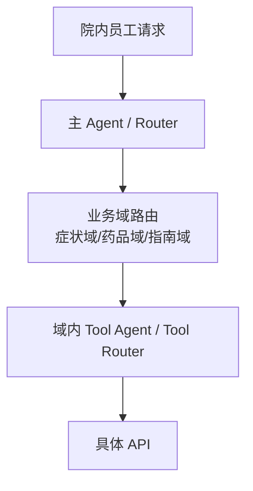

**示例术语与字段译注：** `API`(应用程序接口)；`Agent`(智能体)；`Router`(路由器)；`Tool`(工具)；`flowchart`(流程图)。


同时建立统一的 Tool Registry（工具注册中心），管理工具名称、描述、输入输出 schema(结构约束)、版本、权限、超时、幂等性和负责人等元数据。

这样做的价值是：减少模型上下文、降低错误调用概率、提高路由稳定性，同时方便权限和版本治理。

**在 MedAgent(医疗智能体项目) 中怎么补全：** 工具注册要同时维护参数、输出、错误、权限、读写属性和版本契约；新增工具先做契约测试和权限回归，再开放给对应专科。不能把工具描述中的 readOnlyHint(只读工具提示) 当真正的服务端授权。

**代码依据：** [backend/mcp_tools.py](../backend/mcp_tools.py)、[backend/mcp_security.py](../backend/mcp_security.py)、[backend/agents.py](../backend/agents.py)

**本题图与结构示例：** [example-001](#full-02-example-001)

### full-02-q-023

#### 追问｜按业务域聚合、统一工具注册、主 Agent(智能体) 路由怎么落地？

原文位置：仓库根目录下的本地原件 `artifacts/medagent_upgrade_20261013/原始资料/02-场景设计与系统架构.txt` 第 164 行。当前同名 .md 是适配稿；本地原件不随克隆分发。

**项目口述：** 模型通过 Function Calling(函数调用) 选择工具并生成结构化参数，LangChain(大模型应用开发框架) 的 MCPAdapter(MCP工具适配器) 和 FastMCP(MCP服务框架) 客户端通过 MCP(模型上下文协议) 调用工具服务。FastMCP(MCP服务框架) 注册 14 个工具，包括真实医院查询以及本地病史、辅助材料存储；服务端再次检查委托、员工状态、患者范围和写动作权限。两者在同一链路中使用。

**针对本题的设计展开（原文原理，作为方案解释）：**

可以按“静态治理 + 动态路由”两部分落地。

第一步是静态治理：

- 每个 API(应用程序接口) 在 Tool(工具) Registry(能力注册表) 中注册统一 schema(结构约束)；

- schema(结构约束) 至少包含：功能描述、参数、返回值、权限要求、超时、版本、幂等性；

- 对工具做版本管理，例如 `query_order_v1`(查询订单的第一版示例接口)、`query_order_v2`(查询订单的第二版示例接口)，避免接口变化直接影响线上 Agent(智能体)。

第二步是动态路由：

#### full-02-example-002

**Q8｜有几千个 API(应用程序接口)，你有什么思路组织 Agent(智能体) 框架？**

原文位置：仓库根目录下的本地原件 `artifacts/medagent_upgrade_20261013/原始资料/02-场景设计与系统架构.txt` 第 177 行。该路径指保留的 .txt 原件，当前同名 .md 是适配稿；本地原件不随克隆分发。

用途：ToB(面向机构业务) 原理示例 / 扩展设计，不表示代码已落地。

[返回对应问答](#full-02-q-023)

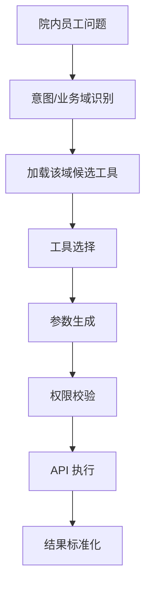

**示例术语与字段译注：** `API`(应用程序接口)；`flowchart`(流程图)。


这里最好把“选工具”和“执行工具”分开。模型负责判断调用哪个能力、生成参数；真正执行之前由系统做 schema(结构约束) 校验、权限校验、参数校验和风险控制，不能完全相信模型输出。

对于高频、重要 API(应用程序接口)，还可以把工具进一步封装成稳定的业务能力，例如不要让模型直接操作底层几十个库存接口，而是提供一个“查询可售库存”的业务工具，让底层 API(应用程序接口) 变化对 Agent(智能体) 透明。

**在 MedAgent(医疗智能体项目) 中怎么补全：** 工具注册要同时维护参数、输出、错误、权限、读写属性和版本契约；新增工具先做契约测试和权限回归，再开放给对应专科。不能把工具描述中的 readOnlyHint(只读工具提示) 当真正的服务端授权。

**代码依据：** [backend/mcp_tools.py](../backend/mcp_tools.py)、[backend/mcp_security.py](../backend/mcp_security.py)、[backend/agents.py](../backend/agents.py)

**本题图与结构示例：** [example-002](#full-02-example-002)

### full-02-q-024

#### 追问｜新增 API(应用程序接口) 的治理和回归如何做？

原文位置：仓库根目录下的本地原件 `artifacts/medagent_upgrade_20261013/原始资料/02-场景设计与系统架构.txt` 第 192 行。当前同名 .md 是适配稿；本地原件不随克隆分发。

**项目口述：** 模型通过 Function Calling(函数调用) 选择工具并生成结构化参数，LangChain(大模型应用开发框架) 的 MCPAdapter(MCP工具适配器) 和 FastMCP(MCP服务框架) 客户端通过 MCP(模型上下文协议) 调用工具服务。FastMCP(MCP服务框架) 注册 14 个工具，包括真实医院查询以及本地病史、辅助材料存储；服务端再次检查委托、员工状态、患者范围和写动作权限。两者在同一链路中使用。

**针对本题的设计展开（原文原理，作为方案解释）：**

新增 API(应用程序接口) 不能只是“注册一下就上线”，建议经过：

#### full-02-example-003

**Q8｜有几千个 API(应用程序接口)，你有什么思路组织 Agent(智能体) 框架？**

原文位置：仓库根目录下的本地原件 `artifacts/medagent_upgrade_20261013/原始资料/02-场景设计与系统架构.txt` 第 196 行。该路径指保留的 .txt 原件，当前同名 .md 是适配稿；本地原件不随克隆分发。

用途：ToB(面向机构业务) 原理示例 / 扩展设计，不表示代码已落地。

[返回对应问答](#full-02-q-024)

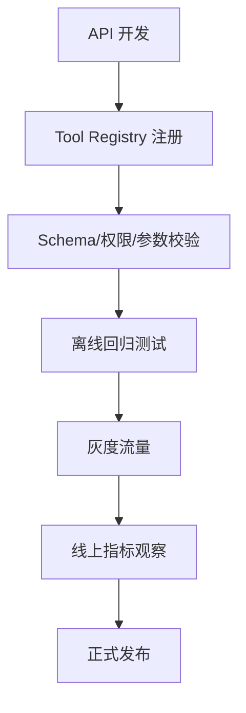

**示例术语与字段译注：** `API`(应用程序接口)；`Registry`(能力注册表)；`Schema`(结构约束)；`Tool`(工具)；`flowchart`(流程图)。


回归测试至少覆盖三层：

1. 工具级：参数是否正确、返回值是否符合 schema(结构约束)；

2. 路由级：典型用户问题能否正确选到新工具，同时不会抢错已有工具；

3. 业务级：真实任务链路能否完成。

另外要特别防止“工具描述冲突”。如果两个 API(应用程序接口) 的描述非常相似，模型容易随机选择，因此注册中心需要统一命名规范和工具描述模板，必要时增加路由规则、示例和人工配置。

**在 MedAgent(医疗智能体项目) 中怎么补全：** 工具注册要同时维护参数、输出、错误、权限、读写属性和版本契约；新增工具先做契约测试和权限回归，再开放给对应专科。不能把工具描述中的 readOnlyHint(只读工具提示) 当真正的服务端授权。

**代码依据：** [backend/mcp_tools.py](../backend/mcp_tools.py)、[backend/mcp_security.py](../backend/mcp_security.py)、[backend/agents.py](../backend/agents.py)

**本题图与结构示例：** [example-003](#full-02-example-003)

### full-02-q-025

#### 主问题｜让你设计一个生产级的多 Agent(智能体) 系统，你会怎么考虑？

原文位置：仓库根目录下的本地原件 `artifacts/medagent_upgrade_20261013/原始资料/02-场景设计与系统架构.txt` 第 214 行。当前同名 .md 是适配稿；本地原件不随克隆分发。

**项目口述：** 我把交付验收拆成院内权限、安全边界、工具契约、路由覆盖、故障分支和真实医院接口联调。仓库有配置、部署和工程回归记录，说明已有实现可核对；真实医院试点、临床收益和全链路容量不能直接从合成评测推导。

**针对本题的设计展开（原文原理，作为方案解释）：**

生产级多 Agent(智能体) 不能只考虑“Agent(智能体) 怎么协作”，还要考虑状态、通信、权限、可靠性、数据一致性、可观测性和故障恢复。我通常先把系统拆成四层：

#### full-02-example-004

**Q9｜让你设计一个生产级的多 Agent(智能体) 系统，你会怎么考虑？**

原文位置：仓库根目录下的本地原件 `artifacts/medagent_upgrade_20261013/原始资料/02-场景设计与系统架构.txt` 第 220 行。该路径指保留的 .txt 原件，当前同名 .md 是适配稿；本地原件不随克隆分发。

用途：ToB(面向机构业务) 原理示例 / 扩展设计，不表示代码已落地。

[返回对应问答](#full-02-q-025)

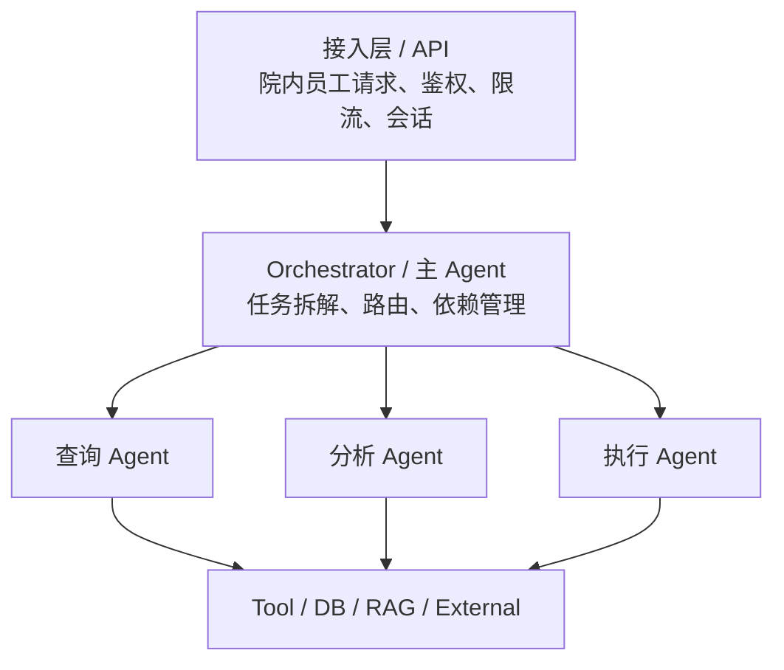

**示例术语与字段译注：** `API`(应用程序接口)；`Agent`(智能体)；`DB`(数据库)；`RAG`(检索增强生成)；`Tool`(工具)；`flowchart`(流程图)。


横向基础设施：State(状态) / Checkpoint(检查点) / Queue(队列) / Cache(缓存)；Auth(认证授权) / Rate Limit(限流) / Circuit Breaker(熔断器)；Log(日志) / Metric(指标) / Trace(链路追踪)，以及独立的 Audit(审计) 记录。

至少要重点设计以下能力：

1. 状态管理

不要依赖单个 Agent(智能体) 的内存保存任务状态。应该把关键状态持久化，例如：

全局状态由编排层管理，Agent(智能体) 只拥有自己需要的局部状态，避免多个 Agent(智能体) 随意修改同一份上下文。

2. 通信机制

Agent(智能体) 间不要依赖自然语言随意传递信息，最好定义统一的消息 schema(结构约束)，例如：

短链路、强依赖任务可以同步调用；耗时任务适合通过消息队列异步执行。

3. 权限隔离

4. 超时、重试和熔断

不能所有节点都无限重试。应该针对节点设置：

5. Checkpoint(检查点)

每个关键节点完成后保存 checkpoint(检查点)：

特别适合长任务、耗时任务和需要人工审批的任务。

6. 可观测性

至少需要三类数据：

- Log(日志)：记录发生了什么；

- Metric(指标)：统计成功率、延迟、Token(词元)、错误率等；

- Trace(链路追踪)：追踪一次请求经过了哪些 Agent(智能体)、工具和外部服务。

所有节点统一携带 `trace_id`(链路追踪标识) / `task_id`(任务标识)，否则多 Agent(智能体) 出问题时很难定位。

**在 MedAgent(医疗智能体项目) 中怎么补全：** 上线时明确医生/药师典型任务与责任人，先小范围灰度，再测成功率、复核耗时、人工纠错及院内流程接受度；准备模型/Prompt(提示词)/工具联合回滚和数据恢复演练。范围变更先评估权限、状态和验收，不把新增患者服务混入 ToB(面向机构业务) 交付。

**代码依据：** [docs/production-readiness.md](production-readiness.md)、[README.md](../README.md)、[deploy/k8s/medagent-api.yaml](../deploy/k8s/medagent-api.yaml)

#### full-02-example-005

**Q9｜让你设计一个生产级的多 Agent(智能体) 系统，你会怎么考虑？**

原文位置：仓库根目录下的本地原件 `artifacts/medagent_upgrade_20261013/原始资料/02-场景设计与系统架构.txt` 第 239 行。该路径指保留的 .txt 原件，当前同名 .md 是适配稿；本地原件不随克隆分发。

用途：ToB(面向机构业务) 原理示例 / 扩展设计，不表示代码已落地。

[返回对应问答](#full-02-q-025)

```text
conversation_id
task_id
current_step
completed_steps
tool_results
approval_status
retry_count
```

**示例术语与字段译注：** `completed_steps`(已完成步骤列表)；`conversation_id`(会话标识)；`current_step`(当前步骤)；`retry_count`(重试数量)；`task_id`(任务标识)；`tool_results`(工具结果列表)。


#### full-02-example-006

**Q9｜让你设计一个生产级的多 Agent(智能体) 系统，你会怎么考虑？**

原文位置：仓库根目录下的本地原件 `artifacts/medagent_upgrade_20261013/原始资料/02-场景设计与系统架构.txt` 第 255 行。该路径指保留的 .txt 原件，当前同名 .md 是适配稿；本地原件不随克隆分发。

用途：ToB(面向机构业务) 原理示例 / 扩展设计，不表示代码已落地。

[返回对应问答](#full-02-q-025)

```json
{
  "task_id": "T123",
  "trace_id": "xxx",
  "from": "planner",
  "to": "query_agent",
  "action": "query_patient_record",
  "payload": {},
  "status": "pending"
}
```

**示例术语与字段译注：** `action`(动作)；`payload`(载荷)；`pending`(待处理)；`planner`(规划器)；`query_agent`(查询智能体)；`query_patient_record`(查询患者记录)；`status`(状态)；`task_id`(任务标识)；`trace_id`(链路追踪标识)。


#### full-02-example-007

**Q9｜让你设计一个生产级的多 Agent(智能体) 系统，你会怎么考虑？**

原文位置：仓库根目录下的本地原件 `artifacts/medagent_upgrade_20261013/原始资料/02-场景设计与系统架构.txt` 第 277 行。该路径指保留的 .txt 原件，当前同名 .md 是适配稿；本地原件不随克隆分发。

用途：ToB(面向机构业务) 原理示例 / 扩展设计，不表示代码已落地。

[返回对应问答](#full-02-q-025)

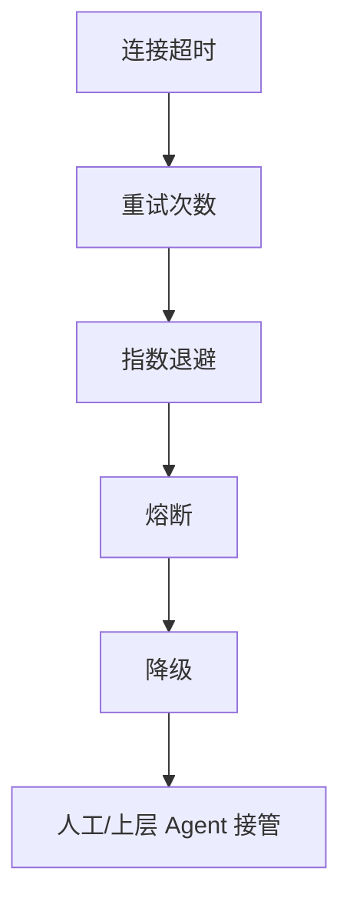

**示例术语与字段译注：** `Agent`(智能体)；`flowchart`(流程图)。


#### full-02-example-008

**Q9｜让你设计一个生产级的多 Agent(智能体) 系统，你会怎么考虑？**

原文位置：仓库根目录下的本地原件 `artifacts/medagent_upgrade_20261013/原始资料/02-场景设计与系统架构.txt` 第 292 行。该路径指保留的 .txt 原件，当前同名 .md 是适配稿；本地原件不随克隆分发。

用途：ToB(面向机构业务) 原理示例 / 扩展设计，不表示代码已落地。

[返回对应问答](#full-02-q-025)

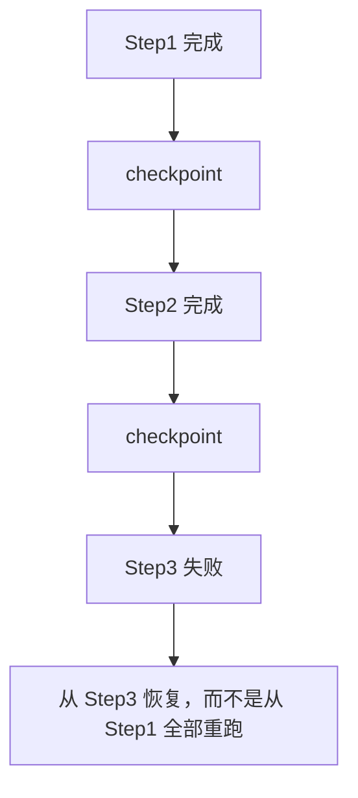

**示例术语与字段译注：** `checkpoint`(检查点)；`flowchart`(流程图)。


**本题图与结构示例：** [example-004](#full-02-example-004)、[example-005](#full-02-example-005)、[example-006](#full-02-example-006)、[example-007](#full-02-example-007)、[example-008](#full-02-example-008)

### full-02-q-026

#### 追问｜状态、通信、权限、超时熔断、Checkpoint(检查点)、可观测分别怎么设计？

原文位置：仓库根目录下的本地原件 `artifacts/medagent_upgrade_20261013/原始资料/02-场景设计与系统架构.txt` 第 312 行。当前同名 .md 是适配稿；本地原件不随克隆分发。

**项目口述：** 我把交付验收拆成院内权限、安全边界、工具契约、路由覆盖、故障分支和真实医院接口联调。仓库有配置、部署和工程回归记录，说明已有实现可核对；真实医院试点、临床收益和全链路容量不能直接从合成评测推导。

**针对本题的设计展开（原文原理，作为方案解释）：**

可以把它们理解成生产系统的六个“护栏”：

真正上线时还要补充一个点：版本管理。不仅模型有版本，Prompt（提示词）、Agent workflow（工作流）、Tool(工具) schema(结构约束)、RAG(检索增强生成) 索引都应该可追踪。否则线上出现问题时，无法判断到底是哪个版本导致的。

**在 MedAgent(医疗智能体项目) 中怎么补全：** 上线时明确医生/药师典型任务与责任人，先小范围灰度，再测成功率、复核耗时、人工纠错及院内流程接受度；准备模型/Prompt(提示词)/工具联合回滚和数据恢复演练。范围变更先评估权限、状态和验收，不把新增患者服务混入 ToB(面向机构业务) 交付。

**代码依据：** [docs/production-readiness.md](production-readiness.md)、[README.md](../README.md)、[deploy/k8s/medagent-api.yaml](../deploy/k8s/medagent-api.yaml)

### full-02-q-027

#### 追问｜从开发版到上线版补哪些能力？

原文位置：仓库根目录下的本地原件 `artifacts/medagent_upgrade_20261013/原始资料/02-场景设计与系统架构.txt` 第 327 行。当前同名 .md 是适配稿；本地原件不随克隆分发。

**项目口述：** 我把交付验收拆成院内权限、安全边界、工具契约、路由覆盖、故障分支和真实医院接口联调。仓库有配置、部署和工程回归记录，说明已有实现可核对；真实医院试点、临床收益和全链路容量不能直接从合成评测推导。

**针对本题的设计展开（原文原理，作为方案解释）：**

开发版主要验证“任务是否能跑通”，上线版重点验证“异常时是否可控”。

可以按下面的方向补齐：

#### full-02-example-009

**Q9｜让你设计一个生产级的多 Agent(智能体) 系统，你会怎么考虑？**

原文位置：仓库根目录下的本地原件 `artifacts/medagent_upgrade_20261013/原始资料/02-场景设计与系统架构.txt` 第 333 行。该路径指保留的 .txt 原件，当前同名 .md 是适配稿；本地原件不随克隆分发。

用途：ToB(面向机构业务) 原理示例 / 扩展设计，不表示代码已落地。

[返回对应问答](#full-02-q-027)

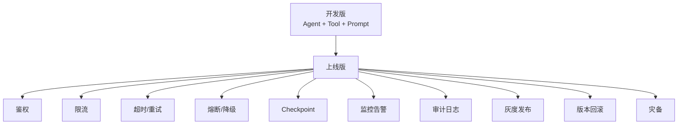

**示例术语与字段译注：** `Agent`(智能体)；`Checkpoint`(检查点)；`Prompt`(提示词)；`Tool`(工具)；`flowchart`(流程图)。


面试时可以强调：生产系统并不是把 Demo(演示样例) 代码部署到服务器，而是要补齐可靠性、安全性、可观测性和运维能力。

**在 MedAgent(医疗智能体项目) 中怎么补全：** 上线时明确医生/药师典型任务与责任人，先小范围灰度，再测成功率、复核耗时、人工纠错及院内流程接受度；准备模型/Prompt(提示词)/工具联合回滚和数据恢复演练。范围变更先评估权限、状态和验收，不把新增患者服务混入 ToB(面向机构业务) 交付。

**代码依据：** [docs/production-readiness.md](production-readiness.md)、[README.md](../README.md)、[deploy/k8s/medagent-api.yaml](../deploy/k8s/medagent-api.yaml)

**本题图与结构示例：** [example-009](#full-02-example-009)

### full-02-q-028

#### 主问题｜弄一个语音打电话功能，用户通过电话让 AI(人工智能) 完成操作，怎么设计？

原文位置：仓库根目录下的本地原件 `artifacts/medagent_upgrade_20261013/原始资料/02-场景设计与系统架构.txt` 第 350 行。当前同名 .md 是适配稿；本地原件不随克隆分发。

**项目口述：** 当前 MedAgent(医疗智能体项目) 是院内文字工作台，没有 ASR(自动语音识别)、TTS(语音合成)、电话或 OCR(光学字符识别) 服务。这类题可结合‘医生语音录入临床辅助任务’解释设计，不能扩展成患者电话挂号、预约、付费或自动问诊。

**针对本题的设计展开（原文原理，作为方案解释）：**

电话 Agent(智能体) 可以看成“实时语音入口 + Agent(智能体) 执行中枢 + 实时语音输出”，核心不是把普通 Agent(智能体) 接上 ASR（自动语音识别）/TTS（语音合成）就结束，而是需要解决低延迟、全双工打断、语音误识别、上下文管理和高风险操作确认。

整体链路：

#### full-02-example-010

**Q10｜弄一个语音打电话功能，用户通过电话让 AI(人工智能) 完成操作，怎么设计？**

原文位置：仓库根目录下的本地原件 `artifacts/medagent_upgrade_20261013/原始资料/02-场景设计与系统架构.txt` 第 358 行。该路径指保留的 .txt 原件，当前同名 .md 是适配稿；本地原件不随克隆分发。

用途：ToB(面向机构业务) 原理示例 / 扩展设计，不表示代码已落地。

[返回对应问答](#full-02-q-028)

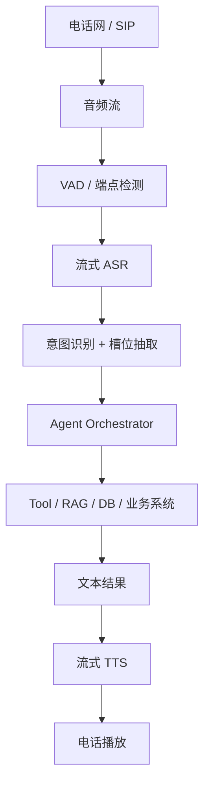

**示例术语与字段译注：** `ASR`(自动语音识别)；`Agent`(智能体)；`DB`(数据库)；`RAG`(检索增强生成)；`TTS`(语音合成)；`Tool`(工具)；`VAD`(语音活动检测)；`flowchart`(流程图)。


其中 Agent(智能体) 核心能力尽量与普通文本 Agent(智能体) 复用，语音层负责解决实时输入输出问题。

**在 MedAgent(医疗智能体项目) 中怎么补全：** 院内语音方案：员工登录授权后，ASR(自动语音识别) 识别、展示原文和关键药名供确认，再进入现有安全/意图/工具链，结果由工作台或 TTS(语音合成) 呈现。看医疗实体错误率、嘈杂环境表现、端点延迟和打断；转诊及病史写入要单独确认具体目标与参数。

**代码依据：** [streamlit_app.py](../streamlit_app.py)、[backend/main.py](../backend/main.py)、[backend/access.py](../backend/access.py)

**本题图与结构示例：** [example-010](#full-02-example-010)

### full-02-q-029

#### 追问｜ASR(自动语音识别)、意图/槽位、任务执行、TTS(语音合成) 四段怎么串？

原文位置：仓库根目录下的本地原件 `artifacts/medagent_upgrade_20261013/原始资料/02-场景设计与系统架构.txt` 第 373 行。当前同名 .md 是适配稿；本地原件不随克隆分发。

**项目口述：** 当前 MedAgent(医疗智能体项目) 是院内文字工作台，没有 ASR(自动语音识别)、TTS(语音合成)、电话或 OCR(光学字符识别) 服务。这类题可结合‘医生语音录入临床辅助任务’解释设计，不能扩展成患者电话挂号、预约、付费或自动问诊。

**针对本题的设计展开（原文原理，作为方案解释）：**

不要设计成“用户说完一句 → ASR(自动语音识别) 全部识别 → Agent(智能体) 全部处理 → TTS(语音合成) 一次性回答”的纯串行模式，否则电话场景延迟会比较高。

更合理的是流式处理：

#### full-02-example-011

**Q10｜弄一个语音打电话功能，用户通过电话让 AI(人工智能) 完成操作，怎么设计？**

原文位置：仓库根目录下的本地原件 `artifacts/medagent_upgrade_20261013/原始资料/02-场景设计与系统架构.txt` 第 379 行。该路径指保留的 .txt 原件，当前同名 .md 是适配稿；本地原件不随克隆分发。

用途：ToB(面向机构业务) 原理示例 / 扩展设计，不表示代码已落地。

[返回对应问答](#full-02-q-029)

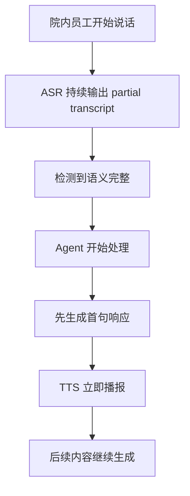

**示例术语与字段译注：** `ASR`(自动语音识别)；`Agent`(智能体)；`TTS`(语音合成)；`flowchart`(流程图)；`partial`(部分完成)。


**在 MedAgent(医疗智能体项目) 中怎么补全：** 院内语音方案：员工登录授权后，ASR(自动语音识别) 识别、展示原文和关键药名供确认，再进入现有安全/意图/工具链，结果由工作台或 TTS(语音合成) 呈现。看医疗实体错误率、嘈杂环境表现、端点延迟和打断；转诊及病史写入要单独确认具体目标与参数。

**代码依据：** [streamlit_app.py](../streamlit_app.py)、[backend/main.py](../backend/main.py)、[backend/access.py](../backend/access.py)

**本题图与结构示例：** [example-011](#full-02-example-011)

### full-02-q-030

#### 追问｜打断、延迟、误识别和高风险操作如何处理？

原文位置：仓库根目录下的本地原件 `artifacts/medagent_upgrade_20261013/原始资料/02-场景设计与系统架构.txt` 第 391 行。当前同名 .md 是适配稿；本地原件不随克隆分发。

**项目口述：** 当前 MedAgent(医疗智能体项目) 是院内文字工作台，没有 ASR(自动语音识别)、TTS(语音合成)、电话或 OCR(光学字符识别) 服务。这类题可结合‘医生语音录入临床辅助任务’解释设计，不能扩展成患者电话挂号、预约、付费或自动问诊。

**针对本题的设计展开（原文原理，作为方案解释）：**

打断：

用户开始说话后，通过 VAD(语音活动检测)/能量检测识别人声，立即停止当前 TTS(语音合成) 播放，并取消正在生成的非必要输出，让 Agent(智能体) 转入新的用户输入。

延迟：

主要从三个位置优化：

#### full-02-example-012

**Q10｜弄一个语音打电话功能，用户通过电话让 AI(人工智能) 完成操作，怎么设计？**

原文位置：仓库根目录下的本地原件 `artifacts/medagent_upgrade_20261013/原始资料/02-场景设计与系统架构.txt` 第 401 行。该路径指保留的 .txt 原件，当前同名 .md 是适配稿；本地原件不随克隆分发。

用途：ToB(面向机构业务) 原理示例 / 扩展设计，不表示代码已落地。

[返回对应问答](#full-02-q-030)

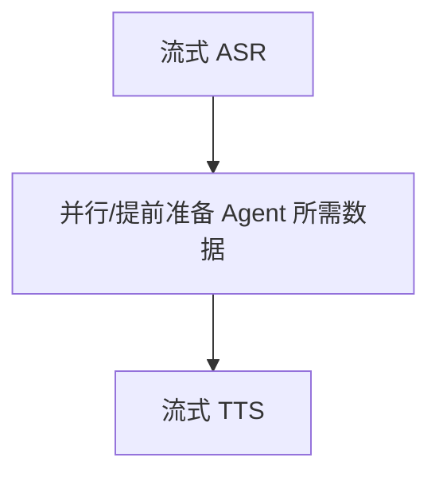

**示例术语与字段译注：** `ASR`(自动语音识别)；`Agent`(智能体)；`TTS`(语音合成)；`flowchart`(流程图)。


同时控制 Prompt(提示词)、工具调用和上下文长度，避免每轮电话都把大量历史重新送入模型。

误识别：

高风险操作：

**在 MedAgent(医疗智能体项目) 中怎么补全：** 院内语音方案：员工登录授权后，ASR(自动语音识别) 识别、展示原文和关键药名供确认，再进入现有安全/意图/工具链，结果由工作台或 TTS(语音合成) 呈现。看医疗实体错误率、嘈杂环境表现、端点延迟和打断；转诊及病史写入要单独确认具体目标与参数。

**代码依据：** [streamlit_app.py](../streamlit_app.py)、[backend/main.py](../backend/main.py)、[backend/access.py](../backend/access.py)

**本题图与结构示例：** [example-012](#full-02-example-012)

### full-02-q-031

#### 主问题｜设计 RAG+Agent(检索增强生成与智能体结合) 系统应考虑什么因素？

原文位置：仓库根目录下的本地原件 `artifacts/medagent_upgrade_20261013/原始资料/02-场景设计与系统架构.txt` 第 417 行。当前同名 .md 是适配稿；本地原件不随克隆分发。

**项目口述：** MedAgent(医疗智能体项目) 目前通过 GuideAgent(指南智能体) 的 search_guidelines(检索临床指南)、get_treatment_protocol(查询治疗方案) 等工具调用医院知识接口，不是在这个仓库内完成切块、建向量库和 rerank(重排序)。BGE-M3(多语言多粒度多功能嵌入模型) 在本项目用于意图原型匹配。简历里的 med_rag(医疗检索增强生成项目) 是独立项目，不能把它的指标直接算作 MedAgent(医疗智能体项目) 结果。

**针对本题的设计展开（原文原理，作为方案解释）：**

RAG+Agent(检索增强生成与智能体结合) 的难点不是简单地把“向量数据库”接到 Agent(智能体) 后面，而是要解决什么时候检索、检索什么、如何保证召回质量、如何控制权限、知识是否最新，以及模型是否真正依据检索结果回答。

可以把系统分成：

#### full-02-example-013

**Q11｜设计 RAG+Agent(检索增强生成与智能体结合) 系统应考虑什么因素？**

原文位置：仓库根目录下的本地原件 `artifacts/medagent_upgrade_20261013/原始资料/02-场景设计与系统架构.txt` 第 425 行。该路径指保留的 .txt 原件，当前同名 .md 是适配稿；本地原件不随克隆分发。

用途：ToB(面向机构业务) 原理示例 / 扩展设计，不表示代码已落地。

[返回对应问答](#full-02-q-031)

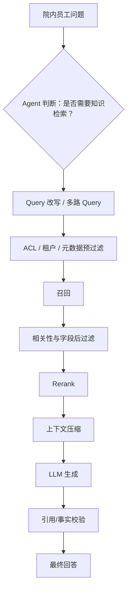

**示例术语与字段译注：** `ACL`(访问控制列表)；`Agent`(智能体)；`LLM`(大语言模型)；`Query`(查询)；`Rerank`(重排序)；`flowchart`(流程图)。


权限过滤应尽量在检索前或检索条件内完成，防止未授权文档进入候选集；召回后的过滤用于相关性、字段最小化和二次防御，不能替代前置授权。

在 Agent(智能体) 系统中，RAG(检索增强生成) 最好不是一个固定步骤，而是由 Agent(智能体) 根据任务决定是否调用。

例如：

- “1+1 等于多少”不需要 RAG(检索增强生成)；

- “根据公司制度，出差住宿标准是多少”需要 RAG(检索增强生成)；

- “根据这个制度和当前员工职级，判断这笔报销是否合规”则可能需要多次检索 + 业务规则判断。

**在 MedAgent(医疗智能体项目) 中怎么补全：** 接入 RAG(检索增强生成) 时将授权后的医学检索封装为 GuideAgent(指南智能体) 工具，返回原文片段、文档标识、页码、版本日期和检索状态；按员工和院内数据范围过滤后再召回。正常空结果可改写或询问，依赖故障停止生成，缺证据不让模型凭记忆替代。

**代码依据：** [backend/mcp_tools.py](../backend/mcp_tools.py)、[backend/agents.py](../backend/agents.py)

**本题图与结构示例：** [example-013](#full-02-example-013)

### full-02-q-032

#### 追问｜检索、调用频率、权限、更新、幻觉防控分别考虑什么？

原文位置：仓库根目录下的本地原件 `artifacts/medagent_upgrade_20261013/原始资料/02-场景设计与系统架构.txt` 第 449 行。当前同名 .md 是适配稿；本地原件不随克隆分发。

**项目口述：** MedAgent(医疗智能体项目) 目前通过 GuideAgent(指南智能体) 的 search_guidelines(检索临床指南)、get_treatment_protocol(查询治疗方案) 等工具调用医院知识接口，不是在这个仓库内完成切块、建向量库和 rerank(重排序)。BGE-M3(多语言多粒度多功能嵌入模型) 在本项目用于意图原型匹配。简历里的 med_rag(医疗检索增强生成项目) 是独立项目，不能把它的指标直接算作 MedAgent(医疗智能体项目) 结果。

**针对本题的设计展开（原文原理，作为方案解释）：**

检索质量：

不能只看向量召回。生产 RAG(检索增强生成) 通常需要综合考虑关键词检索、向量召回、元数据过滤、Rerank（重排）和上下文压缩。

评价至少要拆成：

#### full-02-example-014

**Q11｜设计 RAG+Agent(检索增强生成与智能体结合) 系统应考虑什么因素？**

原文位置：仓库根目录下的本地原件 `artifacts/medagent_upgrade_20261013/原始资料/02-场景设计与系统架构.txt` 第 457 行。该路径指保留的 .txt 原件，当前同名 .md 是适配稿；本地原件不随克隆分发。

用途：ToB(面向机构业务) 原理示例 / 扩展设计，不表示代码已落地。

[返回对应问答](#full-02-q-032)

```text
召回阶段：相关文档有没有被召回？
排序阶段：最相关文档有没有排在前面？
生成阶段：模型有没有基于这些文档回答？
```


所以“回答错了”不一定都是 LLM(大语言模型) 的问题，也可能是检索阶段没有把正确文档召回。

调用频率：

Agent(智能体) 每次遇到问题都调用 RAG(检索增强生成)，会造成延迟和成本上升。可以根据意图做路由：

必要时增加缓存，例如相同问题或高度相似问题复用检索结果。

权限：

权限不能只在 Agent(智能体) 层做一次。更可靠的是：

即使用户有访问知识库的权限，也要确保检索结果不会混入其他部门、租户或密级的数据。这里画的是 ACL(访问控制列表)/元数据预过滤；前面的完整链路另外保留了召回后的相关性与字段过滤，二者位置和职责不同。

知识更新：

知识库需要有增量更新机制：

同时保留文档版本和生效时间，避免旧知识覆盖新制度。

幻觉防控：

不能只靠 Prompt(提示词) 说“不要幻觉”。应该建立约束：

对于金融、法务、医疗、企业制度等高风险场景，还应该限制“无证据生成”。

**在 MedAgent(医疗智能体项目) 中怎么补全：** 接入 RAG(检索增强生成) 时将授权后的医学检索封装为 GuideAgent(指南智能体) 工具，返回原文片段、文档标识、页码、版本日期和检索状态；按员工和院内数据范围过滤后再召回。正常空结果可改写或询问，依赖故障停止生成，缺证据不让模型凭记忆替代。

**代码依据：** [backend/mcp_tools.py](../backend/mcp_tools.py)、[backend/agents.py](../backend/agents.py)

#### full-02-example-015

**Q11｜设计 RAG+Agent(检索增强生成与智能体结合) 系统应考虑什么因素？**

原文位置：仓库根目录下的本地原件 `artifacts/medagent_upgrade_20261013/原始资料/02-场景设计与系统架构.txt` 第 469 行。该路径指保留的 .txt 原件，当前同名 .md 是适配稿；本地原件不随克隆分发。

用途：ToB(面向机构业务) 原理示例 / 扩展设计，不表示代码已落地。

[返回对应问答](#full-02-q-032)

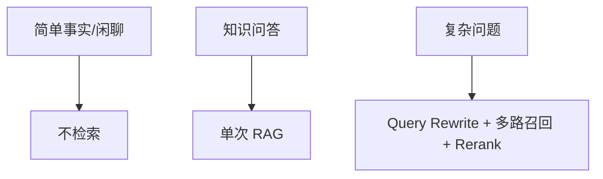

**示例术语与字段译注：** `Query`(查询)；`RAG`(检索增强生成)；`Rerank`(重排序)；`Rewrite`(改写)；`flowchart`(流程图)。


#### full-02-example-016

**Q11｜设计 RAG+Agent(检索增强生成与智能体结合) 系统应考虑什么因素？**

原文位置：仓库根目录下的本地原件 `artifacts/medagent_upgrade_20261013/原始资料/02-场景设计与系统架构.txt` 第 482 行。该路径指保留的 .txt 原件，当前同名 .md 是适配稿；本地原件不随克隆分发。

用途：ToB(面向机构业务) 原理示例 / 扩展设计，不表示代码已落地。

[返回对应问答](#full-02-q-032)

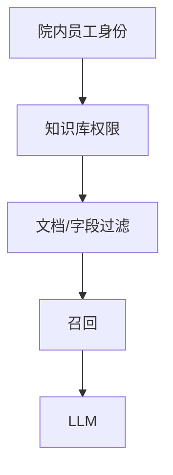

**示例术语与字段译注：** `LLM`(大语言模型)；`flowchart`(流程图)。


#### full-02-example-017

**Q11｜设计 RAG+Agent(检索增强生成与智能体结合) 系统应考虑什么因素？**

原文位置：仓库根目录下的本地原件 `artifacts/medagent_upgrade_20261013/原始资料/02-场景设计与系统架构.txt` 第 496 行。该路径指保留的 .txt 原件，当前同名 .md 是适配稿；本地原件不随克隆分发。

用途：ToB(面向机构业务) 原理示例 / 扩展设计，不表示代码已落地。

[返回对应问答](#full-02-q-032)

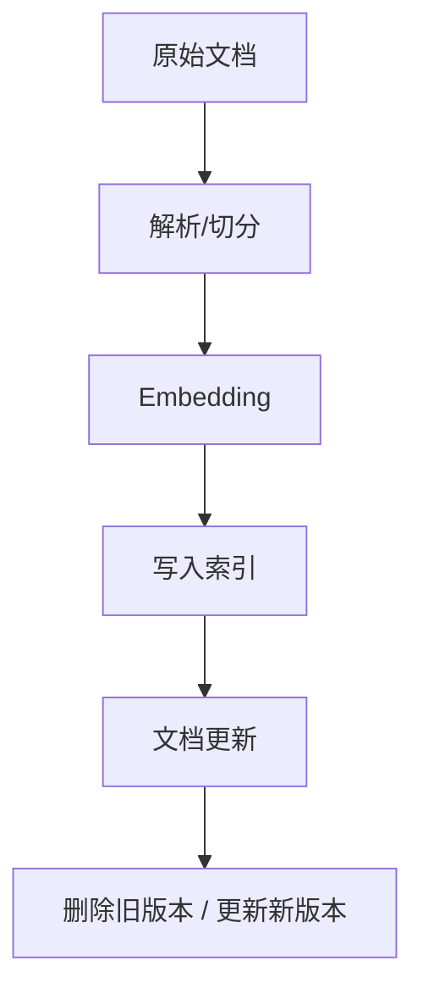

**示例术语与字段译注：** `Embedding`(向量嵌入)；`flowchart`(流程图)。


#### full-02-example-018

**Q11｜设计 RAG+Agent(检索增强生成与智能体结合) 系统应考虑什么因素？**

原文位置：仓库根目录下的本地原件 `artifacts/medagent_upgrade_20261013/原始资料/02-场景设计与系统架构.txt` 第 511 行。该路径指保留的 .txt 原件，当前同名 .md 是适配稿；本地原件不随克隆分发。

用途：ToB(面向机构业务) 原理示例 / 扩展设计，不表示代码已落地。

[返回对应问答](#full-02-q-032)

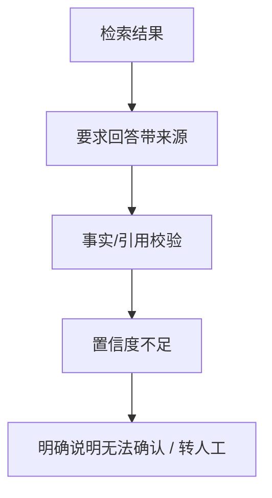

**示例术语与字段译注：** `flowchart`(流程图)。


**本题图与结构示例：** [example-014](#full-02-example-014)、[example-015](#full-02-example-015)、[example-016](#full-02-example-016)、[example-017](#full-02-example-017)、[example-018](#full-02-example-018)

### full-02-q-033

#### 追问｜RAG(检索增强生成) 是工具还是子 Agent(智能体)？

原文位置：仓库根目录下的本地原件 `artifacts/medagent_upgrade_20261013/原始资料/02-场景设计与系统架构.txt` 第 521 行。当前同名 .md 是适配稿；本地原件不随克隆分发。

**项目口述：** MedAgent(医疗智能体项目) 目前通过 GuideAgent(指南智能体) 的 search_guidelines(检索临床指南)、get_treatment_protocol(查询治疗方案) 等工具调用医院知识接口，不是在这个仓库内完成切块、建向量库和 rerank(重排序)。BGE-M3(多语言多粒度多功能嵌入模型) 在本项目用于意图原型匹配。简历里的 med_rag(医疗检索增强生成项目) 是独立项目，不能把它的指标直接算作 MedAgent(医疗智能体项目) 结果。

**针对本题的设计展开（原文原理，作为方案解释）：**

主要看检索流程复杂度和是否需要自主决策。

适合做工具：

#### full-02-example-019

**Q11｜设计 RAG+Agent(检索增强生成与智能体结合) 系统应考虑什么因素？**

原文位置：仓库根目录下的本地原件 `artifacts/medagent_upgrade_20261013/原始资料/02-场景设计与系统架构.txt` 第 527 行。该路径指保留的 .txt 原件，当前同名 .md 是适配稿；本地原件不随克隆分发。

用途：ToB(面向机构业务) 原理示例 / 扩展设计，不表示代码已落地。

[返回对应问答](#full-02-q-033)

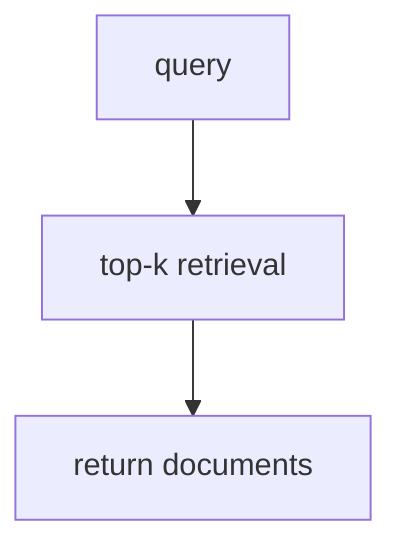

**示例术语与字段译注：** `flowchart`(流程图)；`query`(查询)；`top-k`(排名前K项)。


调用一次就能得到结果，流程稳定、参数明确，这种适合作为 Tool(工具)。

适合做子 Agent(智能体)：

当检索本身已经包含复杂决策、重试和多步推理时，可以把 RAG(检索增强生成) 封装成独立的 Retrieval Agent（检索子 Agent）。

选择标准可以概括为：

**在 MedAgent(医疗智能体项目) 中怎么补全：** 接入 RAG(检索增强生成) 时将授权后的医学检索封装为 GuideAgent(指南智能体) 工具，返回原文片段、文档标识、页码、版本日期和检索状态；按员工和院内数据范围过滤后再召回。正常空结果可改写或询问，依赖故障停止生成，缺证据不让模型凭记忆替代。

**代码依据：** [backend/mcp_tools.py](../backend/mcp_tools.py)、[backend/agents.py](../backend/agents.py)

#### full-02-example-020

**Q11｜设计 RAG+Agent(检索增强生成与智能体结合) 系统应考虑什么因素？**

原文位置：仓库根目录下的本地原件 `artifacts/medagent_upgrade_20261013/原始资料/02-场景设计与系统架构.txt` 第 537 行。该路径指保留的 .txt 原件，当前同名 .md 是适配稿；本地原件不随克隆分发。

用途：ToB(面向机构业务) 原理示例 / 扩展设计，不表示代码已落地。

[返回对应问答](#full-02-q-033)

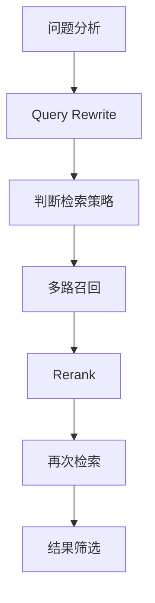

**示例术语与字段译注：** `Query`(查询)；`Rerank`(重排序)；`Rewrite`(改写)；`flowchart`(流程图)。


**本题图与结构示例：** [example-019](#full-02-example-019)、[example-020](#full-02-example-020)

### full-02-q-034

#### 主问题｜生产级 Agent(智能体) 系统从开发版转为上线版需要补充什么？

原文位置：仓库根目录下的本地原件 `artifacts/medagent_upgrade_20261013/原始资料/02-场景设计与系统架构.txt` 第 553 行。当前同名 .md 是适配稿；本地原件不随克隆分发。

**项目口述：** 我把交付验收拆成院内权限、安全边界、工具契约、路由覆盖、故障分支和真实医院接口联调。仓库有配置、部署和工程回归记录，说明已有实现可核对；真实医院试点、临床收益和全链路容量不能直接从合成评测推导。

**针对本题的设计展开（原文原理，作为方案解释）：**

从开发版到生产版，核心不是“部署到更大的服务器”，而是把 Demo(演示样例) 中依赖人工保证的部分变成系统能力。

我通常按 安全与审计、稳定性、可观测性、发布与版本、性能与容量、灾备 六类补齐：

#### full-02-example-021

**Q12｜生产级 Agent(智能体) 系统从开发版转为上线版需要补充什么？**

原文位置：仓库根目录下的本地原件 `artifacts/medagent_upgrade_20261013/原始资料/02-场景设计与系统架构.txt` 第 561 行。该路径指保留的 .txt 原件，当前同名 .md 是适配稿；本地原件不随克隆分发。

用途：ToB(面向机构业务) 原理示例 / 扩展设计，不表示代码已落地。

[返回对应问答](#full-02-q-034)

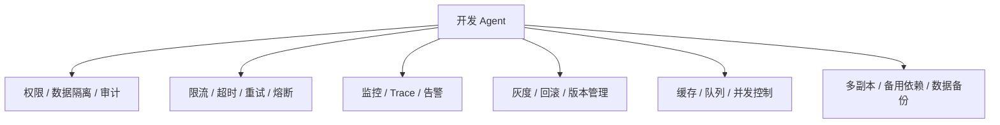

**示例术语与字段译注：** `Agent`(智能体)；`Trace`(链路追踪)；`flowchart`(流程图)。


其中最容易被忽略的是：Agent(智能体) 是一个动态系统，除了 API(应用程序接口) 和数据库版本，Prompt(提示词)、模型、Tool(工具) schema(结构约束)、知识库版本和 workflow(工作流) 都可能变化，因此这些也要纳入版本管理。

**在 MedAgent(医疗智能体项目) 中怎么补全：** 上线时明确医生/药师典型任务与责任人，先小范围灰度，再测成功率、复核耗时、人工纠错及院内流程接受度；准备模型/Prompt(提示词)/工具联合回滚和数据恢复演练。范围变更先评估权限、状态和验收，不把新增患者服务混入 ToB(面向机构业务) 交付。

**代码依据：** [docs/production-readiness.md](production-readiness.md)、[README.md](../README.md)、[deploy/k8s/medagent-api.yaml](../deploy/k8s/medagent-api.yaml)

**本题图与结构示例：** [example-021](#full-02-example-021)

### full-02-q-035

#### 追问｜权限、监控告警、灰度、限流、灾备分别补什么？

原文位置：仓库根目录下的本地原件 `artifacts/medagent_upgrade_20261013/原始资料/02-场景设计与系统架构.txt` 第 573 行。当前同名 .md 是适配稿；本地原件不随克隆分发。

**项目口述：** 我把交付验收拆成院内权限、安全边界、工具契约、路由覆盖、故障分支和真实医院接口联调。仓库有配置、部署和工程回归记录，说明已有实现可核对；真实医院试点、临床收益和全链路容量不能直接从合成评测推导。

**针对本题的设计展开（原文原理，作为方案解释）：**

权限：

至少需要：

#### full-02-example-022

**Q12｜生产级 Agent(智能体) 系统从开发版转为上线版需要补充什么？**

原文位置：仓库根目录下的本地原件 `artifacts/medagent_upgrade_20261013/原始资料/02-场景设计与系统架构.txt` 第 579 行。该路径指保留的 .txt 原件，当前同名 .md 是适配稿；本地原件不随克隆分发。

用途：ToB(面向机构业务) 原理示例 / 扩展设计，不表示代码已落地。

[返回对应问答](#full-02-q-035)

```mermaid
flowchart TD
    A[院内员工身份认证] --> B[角色/租户权限]
    B --> C[Agent 权限]
    C --> D[Tool 权限]
    D --> E[数据权限]
```

**示例术语与字段译注：** `Agent`(智能体)；`Tool`(工具)；`flowchart`(流程图)。


不能因为 Agent(智能体) 有调用某个 API(应用程序接口) 的能力，就默认所有用户都能调用。

监控告警：

不要只监控 HTTP(超文本传输协议) 500，还应该监控 Agent(智能体) 特有指标：

- 请求成功率、P95(第95百分位延迟)/P99(第99百分位延迟) 延迟；

- Agent(智能体) 任务完成率；

- Tool(工具) 调用成功率；

- 模型超时/限流率；

- Token(词元) 消耗与单次任务成本；

- RAG(检索增强生成) 命中率、引用覆盖率；

- 人工转接率。

最好能通过 `trace_id`(链路追踪标识) 从一次用户请求一直追踪到 Agent(智能体) → Tool(工具) → DB(数据库)/API(应用程序接口)。

灰度：

新模型、新 Prompt(提示词)、新 workflow(工作流) 不应该一次性全量切换。可以按用户、租户、流量比例做灰度，并比较新旧版本的：

出现明显回退就自动或人工回滚。

限流：

Agent(智能体) 往往一次请求会产生多次模型和工具调用，因此不能只限制“HTTP(超文本传输协议) 请求 QPS（每秒查询数）”，还要限制：

对耗时任务可以使用消息队列，把突发流量削峰。

灾备：

需要考虑的不只是“服务器挂了”，还包括：

同时要明确哪些任务可以恢复、哪些任务必须人工接管。

**在 MedAgent(医疗智能体项目) 中怎么补全：** 上线时明确医生/药师典型任务与责任人，先小范围灰度，再测成功率、复核耗时、人工纠错及院内流程接受度；准备模型/Prompt(提示词)/工具联合回滚和数据恢复演练。范围变更先评估权限、状态和验收，不把新增患者服务混入 ToB(面向机构业务) 交付。

**代码依据：** [docs/production-readiness.md](production-readiness.md)、[README.md](../README.md)、[deploy/k8s/medagent-api.yaml](../deploy/k8s/medagent-api.yaml)

#### full-02-example-023

**Q12｜生产级 Agent(智能体) 系统从开发版转为上线版需要补充什么？**

原文位置：仓库根目录下的本地原件 `artifacts/medagent_upgrade_20261013/原始资料/02-场景设计与系统架构.txt` 第 607 行。该路径指保留的 .txt 原件，当前同名 .md 是适配稿；本地原件不随克隆分发。

用途：ToB(面向机构业务) 原理示例 / 扩展设计，不表示代码已落地。

[返回对应问答](#full-02-q-035)

```text
成功率
延迟
成本
人工转接率
业务指标
```


#### full-02-example-024

**Q12｜生产级 Agent(智能体) 系统从开发版转为上线版需要补充什么？**

原文位置：仓库根目录下的本地原件 `artifacts/medagent_upgrade_20261013/原始资料/02-场景设计与系统架构.txt` 第 621 行。该路径指保留的 .txt 原件，当前同名 .md 是适配稿；本地原件不随克隆分发。

用途：ToB(面向机构业务) 原理示例 / 扩展设计，不表示代码已落地。

[返回对应问答](#full-02-q-035)

```text
院内员工并发
Agent 任务并发
模型并发
Tool 并发
队列长度
```

**示例术语与字段译注：** `Agent`(智能体)；`Tool`(工具)。


#### full-02-example-025

**Q12｜生产级 Agent(智能体) 系统从开发版转为上线版需要补充什么？**

原文位置：仓库根目录下的本地原件 `artifacts/medagent_upgrade_20261013/原始资料/02-场景设计与系统架构.txt` 第 635 行。该路径指保留的 .txt 原件，当前同名 .md 是适配稿；本地原件不随克隆分发。

用途：ToB(面向机构业务) 原理示例 / 扩展设计，不表示代码已落地。

[返回对应问答](#full-02-q-035)

```mermaid
flowchart TD
    A[模型服务不可用] --> B[备用模型]
    C[Tool/API 不可用] --> D[重试 / 缓存 / 降级]
    E[单实例故障] --> F[多副本]
    G[数据库故障] --> H[备份 / 主从 / 恢复方案]
```

**示例术语与字段译注：** `API`(应用程序接口)；`Tool`(工具)；`flowchart`(流程图)。


**本题图与结构示例：** [example-022](#full-02-example-022)、[example-023](#full-02-example-023)、[example-024](#full-02-example-024)、[example-025](#full-02-example-025)

### full-02-q-036

#### 追问｜哪些环节最容易开发可用、上线失效？

原文位置：仓库根目录下的本地原件 `artifacts/medagent_upgrade_20261013/原始资料/02-场景设计与系统架构.txt` 第 645 行。当前同名 .md 是适配稿；本地原件不随克隆分发。

**项目口述：** 我把交付验收拆成院内权限、安全边界、工具契约、路由覆盖、故障分支和真实医院接口联调。仓库有配置、部署和工程回归记录，说明已有实现可核对；真实医院试点、临床收益和全链路容量不能直接从合成评测推导。

**针对本题的设计展开（原文原理，作为方案解释）：**

设计上可以重点说四类：

第一类：权限。

Demo(演示样例) 中可能所有请求都用同一个账号，生产环境一旦涉及多租户、部门权限和敏感数据，最容易出现越权。

第二类：高并发。

单用户测试时链路完全正常，但流量上来以后，一个请求可能触发多个 Agent(智能体)、多个 Tool(工具) 和多次 LLM(大语言模型) 调用，最终把模型服务或数据库打满。

第三类：外部依赖。

本地开发时所有 API(应用程序接口) 都可用，但线上总会遇到超时、限流、网络异常。因此必须提前设计超时、重试、熔断和降级。

第四类：状态与任务恢复。

Agent(智能体) 长任务不能只把 session（会话）放在单机内存里。多实例部署后必须有共享状态；服务重启后还要能够通过 checkpoint(检查点) 恢复任务，否则用户会出现“任务做到一半消失”的问题。

所以从面试角度，设计上可以把“开发版 → 生产版”总结成一句话：

**在 MedAgent(医疗智能体项目) 中怎么补全：** 上线时明确医生/药师典型任务与责任人，先小范围灰度，再测成功率、复核耗时、人工纠错及院内流程接受度；准备模型/Prompt(提示词)/工具联合回滚和数据恢复演练。范围变更先评估权限、状态和验收，不把新增患者服务混入 ToB(面向机构业务) 交付。

**代码依据：** [docs/production-readiness.md](production-readiness.md)、[README.md](../README.md)、[deploy/k8s/medagent-api.yaml](../deploy/k8s/medagent-api.yaml)

## full-03

**03-主Agent(智能体)调度：项目适配问答**

### full-03-q-001

#### 主问题｜主 Agent(智能体) 是做什么的？

原文位置：仓库根目录下的本地原件 `artifacts/medagent_upgrade_20261013/原始资料/03-主Agent调度.txt` 第 28 行。当前同名 .md 是适配稿；本地原件不随克隆分发。

**项目口述：** 我做的是面向院内医生、药师和管理人员的临床辅助工作台。FastAPI(Python接口服务框架) 入口核对员工与患者权限，主协调器检查安全、范围、意图和计划，再交给症状、药品、指南三个专科，通过 MCP(模型上下文协议) 查询真实数据，最后保存咨询和审计后发送完成事件。最终诊疗由医生复核。

**针对本题的设计展开（原文原理，作为方案解释）：**

主 Agent(智能体) 是整个系统的调度中枢：意图识别、槽位抽取、任务计划、路由分发、异常处理、结果聚合。本模块采用主 Agent(智能体) 组织业务执行、子 Agent(智能体) 完成具体业务的分工；主 Agent(智能体) 也可以汇总结果并生成最终回答，并非不能生产任何结果。

**在 MedAgent(医疗智能体项目) 中怎么补全：** 设计上优先固定授权和执行边界，模型只在范围内做分类、规划、工具选择和解释。新能力必须有明确院内使用人、数据来源、权限与验收标准；患者挂号、预约、缴费、退费均不接入。

**代码依据：** [backend/main.py](../backend/main.py)、[backend/agents.py](../backend/agents.py)、[backend/access.py](../backend/access.py)

### full-03-q-002

#### 追问｜是只做意图识别，还是还负责任务拆解、路由、结果聚合？

原文位置：仓库根目录下的本地原件 `artifacts/medagent_upgrade_20261013/原始资料/03-主Agent调度.txt` 第 34 行。当前同名 .md 是适配稿；本地原件不随克隆分发。

**项目口述：** 我做的是面向院内医生、药师和管理人员的临床辅助工作台。FastAPI(Python接口服务框架) 入口核对员工与患者权限，主协调器检查安全、范围、意图和计划，再交给症状、药品、指南三个专科，通过 MCP(模型上下文协议) 查询真实数据，最后保存咨询和审计后发送完成事件。最终诊疗由医生复核。

**针对本题的设计展开（原文原理，作为方案解释）：**

取决于架构设计，主流是"全管"：意图识别只是入口，任务拆解、路由分发、结果聚合都由主 Agent(智能体) 负责。回答时明确自己的架构选型，并说明为什么这么分。

**在 MedAgent(医疗智能体项目) 中怎么补全：** 设计上优先固定授权和执行边界，模型只在范围内做分类、规划、工具选择和解释。新能力必须有明确院内使用人、数据来源、权限与验收标准；患者挂号、预约、缴费、退费均不接入。

**代码依据：** [backend/main.py](../backend/main.py)、[backend/agents.py](../backend/agents.py)、[backend/access.py](../backend/access.py)

### full-03-q-003

#### 追问｜主 Agent(智能体) 本身是否调用工具？还是只负责调度子 Agent(智能体)？

原文位置：仓库根目录下的本地原件 `artifacts/medagent_upgrade_20261013/原始资料/03-主Agent调度.txt` 第 38 行。当前同名 .md 是适配稿；本地原件不随克隆分发。

**项目口述：** 我做的是面向院内医生、药师和管理人员的临床辅助工作台。FastAPI(Python接口服务框架) 入口核对员工与患者权限，主协调器检查安全、范围、意图和计划，再交给症状、药品、指南三个专科，通过 MCP(模型上下文协议) 查询真实数据，最后保存咨询和审计后发送完成事件。最终诊疗由医生复核。

**针对本题的设计展开（原文原理，作为方案解释）：**

一般只调用"路由/计划"类轻工具，业务工具（查库、检索、执行操作）全部交给子 Agent(智能体)。职责清晰：主 Agent(智能体) 管"往哪走"，子 Agent(智能体) 管"怎么干"。

**在 MedAgent(医疗智能体项目) 中怎么补全：** 设计上优先固定授权和执行边界，模型只在范围内做分类、规划、工具选择和解释。新能力必须有明确院内使用人、数据来源、权限与验收标准；患者挂号、预约、缴费、退费均不接入。

**代码依据：** [backend/main.py](../backend/main.py)、[backend/agents.py](../backend/agents.py)、[backend/access.py](../backend/access.py)

### full-03-q-004

#### 主问题｜用户意图识别怎么做？

原文位置：仓库根目录下的本地原件 `artifacts/medagent_upgrade_20261013/原始资料/03-主Agent调度.txt` 第 42 行。当前同名 .md 是适配稿；本地原件不随克隆分发。

**项目口述：** 十类院内意图由正则、本地 BERT(双向编码语言模型) Sigmoid(逐标签概率) 多标签和 BGE-M3(多语言多粒度多功能嵌入模型) 三路都识别，再统一融合。BERT(双向编码语言模型) 当前逐类阈值 0.5，向量默认 0.78，BERT(双向编码语言模型) 边界范围 0.08。分歧、否定、边界、空候选或通道不可用才触发 LLM(大语言模型) 复核；不是三路必须完全一致，也不是按分数投票。

**针对本题的设计展开（原文原理，作为方案解释）：**

一种通用方案是“规则 + 分类模型 + Embedding（向量化表示）+ LLM(大语言模型) 兜底”的成本级联。以下四层举例说明这种可选设计；MedAgent(医疗智能体项目) 的实际实现是前三路都运行后融合，并按冲突和不确定性条件调用 LLM(大语言模型) 复核。

第二层是轻量分类模型，处理高频且边界比较稳定的业务意图，可以把大部分请求在低成本阶段解决。

最后才使用 LLM(大语言模型) 做复杂分类，尤其是长文本、多意图、边界模糊或者新增意图。LLM(大语言模型) 的输出必须结构化，例如返回 `intent`(意图)、`confidence`(置信度)、`reason`(原因)，再进入后续校验。

这样设计的核心不是“谁最聪明”，而是把确定性问题尽量放在便宜、稳定的层，把真正需要语义理解的问题交给 LLM(大语言模型)，同时控制成本和误路由风险。

**在 MedAgent(医疗智能体项目) 中怎么补全：** 阈值通过独立验证集选择，测试和挑战集只评估冻结结果。医疗急症由独立安全入口处理；意图置信分数不代表患者低风险。LLM(大语言模型) 复核失败停止分派，不悄悄回到冲突候选。

**代码依据：** [backend/intent_fusion.py](../backend/intent_fusion.py)、[backend/agents.py](../backend/agents.py)、[backend/config.py](../backend/config.py)

### full-03-q-005

#### 追问｜规则、分类模型、Embedding(向量嵌入) 相似度、大模型 JSON(结构化数据格式) 分类怎么结合？

原文位置：仓库根目录下的本地原件 `artifacts/medagent_upgrade_20261013/原始资料/03-主Agent调度.txt` 第 58 行。当前同名 .md 是适配稿；本地原件不随克隆分发。

**项目口述：** 十类院内意图由正则、本地 BERT(双向编码语言模型) Sigmoid(逐标签概率) 多标签和 BGE-M3(多语言多粒度多功能嵌入模型) 三路都识别，再统一融合。BERT(双向编码语言模型) 当前逐类阈值 0.5，向量默认 0.78，BERT(双向编码语言模型) 边界范围 0.08。分歧、否定、边界、空候选或通道不可用才触发 LLM(大语言模型) 复核；不是三路必须完全一致，也不是按分数投票。

**针对本题的设计展开（原文原理，作为方案解释）：**

可以按照“确定性从高到低、成本从低到高”的顺序处理：

1. 规则命中且没有歧义，直接路由。

2. 规则未命中，进入轻量分类模型。

3. 分类模型置信度不足，再做 Embedding(向量嵌入) 相似度匹配。

4. 仍然无法确定，调用 LLM(大语言模型) 做结构化分类。

5. 最终置信度仍低于阈值，不强行路由，而是进入澄清或人工。

**在 MedAgent(医疗智能体项目) 中怎么补全：** 阈值通过独立验证集选择，测试和挑战集只评估冻结结果。医疗急症由独立安全入口处理；意图置信分数不代表患者低风险。LLM(大语言模型) 复核失败停止分派，不悄悄回到冲突候选。

**代码依据：** [backend/intent_fusion.py](../backend/intent_fusion.py)、[backend/agents.py](../backend/agents.py)、[backend/config.py](../backend/config.py)

### full-03-q-006

#### 追问｜置信度低的时候怎么处理？是否进入澄清追问或人工兜底？

原文位置：仓库根目录下的本地原件 `artifacts/medagent_upgrade_20261013/原始资料/03-主Agent调度.txt` 第 70 行。当前同名 .md 是适配稿；本地原件不随克隆分发。

**项目口述：** 十类院内意图由正则、本地 BERT(双向编码语言模型) Sigmoid(逐标签概率) 多标签和 BGE-M3(多语言多粒度多功能嵌入模型) 三路都识别，再统一融合。BERT(双向编码语言模型) 当前逐类阈值 0.5，向量默认 0.78，BERT(双向编码语言模型) 边界范围 0.08。分歧、否定、边界、空候选或通道不可用才触发 LLM(大语言模型) 复核；不是三路必须完全一致，也不是按分数投票。

**针对本题的设计展开（原文原理，作为方案解释）：**

是。一般设置明确的决策阈值：

- 高置信度：直接进入任务执行。

- 中间区域：向用户确认候选意图或补充关键信息。

- 极低置信度：无法可靠判断时进入兜底或人工。

**在 MedAgent(医疗智能体项目) 中怎么补全：** 阈值通过独立验证集选择，测试和挑战集只评估冻结结果。医疗急症由独立安全入口处理；意图置信分数不代表患者低风险。LLM(大语言模型) 复核失败停止分派，不悄悄回到冲突候选。

**代码依据：** [backend/intent_fusion.py](../backend/intent_fusion.py)、[backend/agents.py](../backend/agents.py)、[backend/config.py](../backend/config.py)

### full-03-q-007

#### 主问题｜意图分了几类？

原文位置：仓库根目录下的本地原件 `artifacts/medagent_upgrade_20261013/原始资料/03-主Agent调度.txt` 第 80 行。当前同名 .md 是适配稿；本地原件不随克隆分发。

**项目口述：** 我分了十类院内意图：症状评估、药品信息查询、临床指南检索、检验结果辅助解读、院内分诊建议、随访管理、用药审核、临床知识查询、转诊协同、检查报告辅助解读。三专科按意图映射调用；医疗急症和范围外请求由守卫处理，不作为患者自助服务意图。

**针对本题的设计展开（原文原理，作为方案解释）：**

常见七类：查询类、分析类、生成类、操作类、知识问答类、闲聊类、异常类。每类意图对应明确的路由表。

**在 MedAgent(医疗智能体项目) 中怎么补全：** 阈值通过独立验证集选择，测试和挑战集只评估冻结结果。医疗急症由独立安全入口处理；意图置信分数不代表患者低风险。LLM(大语言模型) 复核失败停止分派，不悄悄回到冲突候选。

**代码依据：** [backend/intent_fusion.py](../backend/intent_fusion.py)、[backend/agents.py](../backend/agents.py)、[backend/config.py](../backend/config.py)

### full-03-q-008

#### 追问｜查询类、分析类、生成类、操作类、知识问答类、闲聊类、异常类？

原文位置：仓库根目录下的本地原件 `artifacts/medagent_upgrade_20261013/原始资料/03-主Agent调度.txt` 第 86 行。当前同名 .md 是适配稿；本地原件不随克隆分发。

**项目口述：** 十类院内意图由正则、本地 BERT(双向编码语言模型) Sigmoid(逐标签概率) 多标签和 BGE-M3(多语言多粒度多功能嵌入模型) 三路都识别，再统一融合。BERT(双向编码语言模型) 当前逐类阈值 0.5，向量默认 0.78，BERT(双向编码语言模型) 边界范围 0.08。分歧、否定、边界、空候选或通道不可用才触发 LLM(大语言模型) 复核；不是三路必须完全一致，也不是按分数投票。

**针对本题的设计展开（原文原理，作为方案解释）：**

按业务实际划分，不必生搬硬套。关键不是分几类，而是每类都有明确处理路径：查询类→查询 Agent(智能体)，分析类→分析 Agent(智能体)，异常类→兜底节点。

**在 MedAgent(医疗智能体项目) 中怎么补全：** 阈值通过独立验证集选择，测试和挑战集只评估冻结结果。医疗急症由独立安全入口处理；意图置信分数不代表患者低风险。LLM(大语言模型) 复核失败停止分派，不悄悄回到冲突候选。

**代码依据：** [backend/intent_fusion.py](../backend/intent_fusion.py)、[backend/agents.py](../backend/agents.py)、[backend/config.py](../backend/config.py)

### full-03-q-009

#### 追问｜不同意图对应哪些子 Agent(智能体)？是否有路由表？

原文位置：仓库根目录下的本地原件 `artifacts/medagent_upgrade_20261013/原始资料/03-主Agent调度.txt` 第 90 行。当前同名 .md 是适配稿；本地原件不随克隆分发。

**项目口述：** 十类院内意图由正则、本地 BERT(双向编码语言模型) Sigmoid(逐标签概率) 多标签和 BGE-M3(多语言多粒度多功能嵌入模型) 三路都识别，再统一融合。BERT(双向编码语言模型) 当前逐类阈值 0.5，向量默认 0.78，BERT(双向编码语言模型) 边界范围 0.08。分歧、否定、边界、空候选或通道不可用才触发 LLM(大语言模型) 复核；不是三路必须完全一致，也不是按分数投票。

**针对本题的设计展开（原文原理，作为方案解释）：**

有显式路由表：意图 → 目标 Agent(智能体) 的映射（规则表），维护在配置里。执行目标由校验后的意图决定；MedAgent(医疗智能体项目) 的规则只是融合证据，不绕过模型通道。

例如可以把路由配置写成可版本化的 JSON(结构化数据格式)：

#### full-03-example-001

**Q3｜意图分了几类？**

原文位置：仓库根目录下的本地原件 `artifacts/medagent_upgrade_20261013/原始资料/03-主Agent调度.txt` 第 96 行。该路径指保留的 .txt 原件，当前同名 .md 是适配稿；本地原件不随克隆分发。

用途：ToB(面向机构业务) 原理示例 / 扩展设计，不表示代码已落地。

[返回对应问答](#full-03-q-009)

```json
{
  "version": "1.0",
  "routes": [
    {
      "intent": "patient_record_query",
      "target_agent": "query_agent",
      "required_slots": ["patient_id"],
      "risk_level": "low"
    },
    {
      "intent": "referral_request",
      "target_agent": "tool_agent",
      "required_slots": ["patient_id", "referral_reason"],
      "risk_level": "high",
      "require_confirmation": true
    }
  ],
  "fallback": {
    "target_node": "clarification_node",
    "min_confidence": 0.75
  }
}
```

**示例术语与字段译注：** `clarification_node`(澄清节点)；`fallback`(兜底)；`intent`(意图)；`patient_id`(患者标识)；`patient_record_query`(患者记录查询)；`query_agent`(查询智能体)；`referral_reason`(院内转诊原因)；`referral_request`(院内转诊请求)；`required_slots`(必填业务参数槽位)；`risk_level`(风险等级)；`target_agent`(目标智能体)；`target_node`(目标节点)；`tool_agent`(工具智能体)；`version`(版本)。


**在 MedAgent(医疗智能体项目) 中怎么补全：** 阈值通过独立验证集选择，测试和挑战集只评估冻结结果。医疗急症由独立安全入口处理；意图置信分数不代表患者低风险。LLM(大语言模型) 复核失败停止分派，不悄悄回到冲突候选。

**代码依据：** [backend/intent_fusion.py](../backend/intent_fusion.py)、[backend/agents.py](../backend/agents.py)、[backend/config.py](../backend/config.py)

**本题图与结构示例：** [example-001](#full-03-example-001)

### full-03-q-010

#### 主问题｜意图识别错了怎么办？

原文位置：仓库根目录下的本地原件 `artifacts/medagent_upgrade_20261013/原始资料/03-主Agent调度.txt` 第 121 行。当前同名 .md 是适配稿；本地原件不随克隆分发。

**项目口述：** 我把意图错误作为一个受控闭环处理：发现问题、判断副作用、修正识别、重建计划、核对结果，再由院内人员复核。事前看三路分歧和阈值边界，事中看参数缺失、权限或工具异常，事后看目标所需工具是否覆盖，最终看医生或药师纠正。置信度只能表示可疑，接口失败也可能是服务故障，不能单凭一个信号判定识别错。

**针对本题的设计展开（原文原理，作为方案解释）：**

设计上可以把“意图识别错误”当成一个完整的闭环问题，而不是简单地重新调用一次模型。一般分成：

`发现错误 → 判断是否已产生副作用 → 回滚/补偿 → 重新路由 → 结果校验 → 必要时人工兜底`

第三步是保留已有的有效中间结果。例如前面的用户身份识别已经完成，就不需要重新做一遍，只重建错误的意图和后续计划。

最终重新路由后，还需要做结果校验，确认“执行结果是否真的符合用户原始目标”，而不是仅仅看到工具调用成功就认为任务成功。

**在 MedAgent(医疗智能体项目) 中怎么补全：** 工作台已能提交意图纠错，服务端重新核验患者权限和原请求所属员工，保存为待临床复核记录，不自动作为训练标签。完整闭环还需要结论与目标的语义核验、复核工单及标注发布流程。工具成功不是医学正确证明；写入不明先查状态、核对 HIS(医院信息系统)，跨系统补偿取决于医院接口。

**代码依据：** [backend/evidence.py](../backend/evidence.py)、[backend/agents.py](../backend/agents.py)、[backend/mcp_security.py](../backend/mcp_security.py)、[backend/main.py](../backend/main.py)

### full-03-q-011

#### 追问｜二次识别、执行结果校验、异常回滚、转人工、重新路由分别怎么做？

原文位置：仓库根目录下的本地原件 `artifacts/medagent_upgrade_20261013/原始资料/03-主Agent调度.txt` 第 137 行。当前同名 .md 是适配稿；本地原件不随克隆分发。

**项目口述：** 我按识别前、执行中和执行后处理：前三路发现分歧时二次识别；执行前校验关键参数和权限；执行后检查每个意图是否有对应的成功工具依据，例如病史读取不能代替药品说明书查询。只读任务覆盖不匹配时最多复核并重路由一次；批准写动作或出现写调用时禁止自动重跑。

**针对本题的设计展开（原文原理，作为方案解释）：**

二次识别：当首次意图置信度低，或者执行结果暴露出明显矛盾时，用上下文和已获得信息再次判断，但不要无限循环。

异常回滚：对于有副作用的操作，需要有事务回滚、补偿接口或者业务撤销流程。不能假设所有 Agent(智能体) 操作都能够真正回滚。

重新路由：修正意图后，重新生成任务计划，但复用已经可信的上下文、身份和查询结果。

转人工：连续修正失败、高风险操作出现不一致、系统无法判断真实业务状态时，交给人工，不继续让 Agent(智能体) 猜。

**在 MedAgent(医疗智能体项目) 中怎么补全：** 工作台已能提交意图纠错，服务端重新核验患者权限和原请求所属员工，保存为待临床复核记录，不自动作为训练标签。完整闭环还需要结论与目标的语义核验、复核工单及标注发布流程。工具成功不是医学正确证明；写入不明先查状态、核对 HIS(医院信息系统)，跨系统补偿取决于医院接口。

**代码依据：** [backend/evidence.py](../backend/evidence.py)、[backend/agents.py](../backend/agents.py)、[backend/mcp_security.py](../backend/mcp_security.py)、[backend/main.py](../backend/main.py)

### full-03-q-012

#### 追问｜如何判断“识别错了”？靠置信度、工具返回、结果校验还是人工反馈？

原文位置：仓库根目录下的本地原件 `artifacts/medagent_upgrade_20261013/原始资料/03-主Agent调度.txt` 第 149 行。当前同名 .md 是适配稿；本地原件不随克隆分发。

**项目口述：** 我按识别前、执行中和执行后处理：前三路发现分歧时二次识别；执行前校验关键参数和权限；执行后检查每个意图是否有对应的成功工具依据，例如病史读取不能代替药品说明书查询。只读任务覆盖不匹配时最多复核并重路由一次；批准写动作或出现写调用时禁止自动重跑。

**针对本题的设计展开（原文原理，作为方案解释）：**

四个信号都可以使用，但作用不同：

- 置信度：事前判断，发现“可能识别错”。

- 工具返回：执行过程中发现参数与目标不匹配。

- 结果校验：事后判断“虽然执行成功，但结果不是用户要的”。

- 用户反馈：最终确认，比如用户说“我问的不是这个”。

因此生产系统最好采用“事前置信度 + 事中异常 + 事后结果校验 + 用户反馈”的闭环，而不是只依赖模型自己的判断。

**在 MedAgent(医疗智能体项目) 中怎么补全：** 工作台已能提交意图纠错，服务端重新核验患者权限和原请求所属员工，保存为待临床复核记录，不自动作为训练标签。完整闭环还需要结论与目标的语义核验、复核工单及标注发布流程。工具成功不是医学正确证明；写入不明先查状态、核对 HIS(医院信息系统)，跨系统补偿取决于医院接口。

**代码依据：** [backend/evidence.py](../backend/evidence.py)、[backend/agents.py](../backend/agents.py)、[backend/mcp_security.py](../backend/mcp_security.py)、[backend/main.py](../backend/main.py)

### full-03-q-013

#### 主问题｜用户问题短且模糊怎么办？

原文位置：仓库根目录下的本地原件 `artifacts/medagent_upgrade_20261013/原始资料/03-主Agent调度.txt` 第 160 行。当前同名 .md 是适配稿；本地原件不随克隆分发。

**项目口述：** 可信身份和患者档案由服务端读取。业务参数由模型按工具 schema(结构约束) 提出，执行前代码检查空值、占位值、列表和检验内容；药名必须能在当前任务原始输入或可信用药档案中找到依据，相互作用检查至少两种药。参数记录 raw_value(原始值)、normalized_value(规范化值)、source(来源)、turn_id(对话轮次标识)、evidence_span(原文证据片段)、schema_version(结构约束版本) 和 validation_status(校验状态)。

**针对本题的设计展开（原文原理，作为方案解释）：**

四个手段：槽位追问、结合上下文、query(查询) 改写、候选意图确认。

**在 MedAgent(医疗智能体项目) 中怎么补全：** 现在没有训练过医疗 NER(命名实体识别)，也没有声称语义校验能识别全部错槽。扩展方案是为十类意图注册必填字段，规则抽固定格式，LLM(大语言模型) 只提取有原文跨度的实体，再用药品目录校正通用名、单位和枚举。缺关键字段询问医生或药师，临床数值和药名不凭默认值补齐。

**代码依据：** [backend/clinical_slots.py](../backend/clinical_slots.py)、[backend/schemas.py](../backend/schemas.py)、[backend/agents.py](../backend/agents.py)

### full-03-q-014

#### 追问｜槽位追问、结合上下文、query(查询) 改写、候选意图确认怎么用？

原文位置：仓库根目录下的本地原件 `artifacts/medagent_upgrade_20261013/原始资料/03-主Agent调度.txt` 第 166 行。当前同名 .md 是适配稿；本地原件不随克隆分发。

**项目口述：** 可信身份和患者档案由服务端读取。业务参数由模型按工具 schema(结构约束) 提出，执行前代码检查空值、占位值、列表和检验内容；药名必须能在当前任务原始输入或可信用药档案中找到依据，相互作用检查至少两种药。参数记录 raw_value(原始值)、normalized_value(规范化值)、source(来源)、turn_id(对话轮次标识)、evidence_span(原文证据片段)、schema_version(结构约束版本) 和 validation_status(校验状态)。

**在 MedAgent(医疗智能体项目) 中怎么补全：** 现在没有训练过医疗 NER(命名实体识别)，也没有声称语义校验能识别全部错槽。扩展方案是为十类意图注册必填字段，规则抽固定格式，LLM(大语言模型) 只提取有原文跨度的实体，再用药品目录校正通用名、单位和枚举。缺关键字段询问医生或药师，临床数值和药名不凭默认值补齐。

**代码依据：** [backend/clinical_slots.py](../backend/clinical_slots.py)、[backend/schemas.py](../backend/schemas.py)、[backend/agents.py](../backend/agents.py)

### full-03-q-015

#### 追问｜"查一下这个""帮我分析下"这类问题怎么处理？

原文位置：仓库根目录下的本地原件 `artifacts/medagent_upgrade_20261013/原始资料/03-主Agent调度.txt` 第 170 行。当前同名 .md 是适配稿；本地原件不随克隆分发。

**项目口述：** 可信身份和患者档案由服务端读取。业务参数由模型按工具 schema(结构约束) 提出，执行前代码检查空值、占位值、列表和检验内容；药名必须能在当前任务原始输入或可信用药档案中找到依据，相互作用检查至少两种药。参数记录 raw_value(原始值)、normalized_value(规范化值)、source(来源)、turn_id(对话轮次标识)、evidence_span(原文证据片段)、schema_version(结构约束版本) 和 validation_status(校验状态)。

**针对本题的设计展开（原文原理，作为方案解释）：**

"查一下这个"：结合上一轮上下文补全指代，补不了就追问"您要查什么"；"帮我分析下"：追问分析对象和角度，或列候选问题让用户选。原则：能定位就定位，定位不了就澄清。

**在 MedAgent(医疗智能体项目) 中怎么补全：** 现在没有训练过医疗 NER(命名实体识别)，也没有声称语义校验能识别全部错槽。扩展方案是为十类意图注册必填字段，规则抽固定格式，LLM(大语言模型) 只提取有原文跨度的实体，再用药品目录校正通用名、单位和枚举。缺关键字段询问医生或药师，临床数值和药名不凭默认值补齐。

**代码依据：** [backend/clinical_slots.py](../backend/clinical_slots.py)、[backend/schemas.py](../backend/schemas.py)、[backend/agents.py](../backend/agents.py)

### full-03-q-016

#### 主问题｜意图漂移怎么处理？

原文位置：仓库根目录下的本地原件 `artifacts/medagent_upgrade_20261013/原始资料/03-主Agent调度.txt` 第 174 行。当前同名 .md 是适配稿；本地原件不随克隆分发。

**项目口述：** 每轮有 request_id(请求标识)，任务还有 task_id(任务标识) 和 plan_version(计划版本)。员工可选新任务、补充或更正；自动模式只续接待澄清问题，明确新请求切新任务并隔离旧历史。完整更正递增版本、丢弃旧业务输入；只有指代或局部含糊更正时先追问。A2A(智能体间通信协议) 返回必须匹配签名委托中的任务、计划版本和步骤，旧结果不能写回新计划。

**针对本题的设计展开（原文原理，作为方案解释）：**

多轮 Agent(智能体) 最容易出现的问题之一，就是“上一轮任务还没完成，用户突然换了目标”。

我的处理方式不是简单地把整个上下文都继续塞给模型，而是给每个任务建立独立的 `task_id`(任务标识) 和任务状态。

例如：

#### full-03-example-002

**Q6｜意图漂移怎么处理？**

原文位置：仓库根目录下的本地原件 `artifacts/medagent_upgrade_20261013/原始资料/03-主Agent调度.txt` 第 184 行。该路径指保留的 .txt 原件，当前同名 .md 是适配稿；本地原件不随克隆分发。

用途：ToB(面向机构业务) 原理示例 / 扩展设计，不表示代码已落地。

[返回对应问答](#full-03-q-016)

```mermaid
flowchart TD
    A[task-001：查询患者记录 12345] --> B[院内员工：顺便帮我查一下本科室本月用药审核记录]
    B --> C[检测到意图发生明显变化]
    C --> D[新建 task-002：销售数据查询/分析]
```

**示例术语与字段译注：** `flowchart`(流程图)；`task`(任务)。


这样可以避免两个任务的槽位、工具结果和执行状态相互污染。

所以核心判断标准是：用户是在修改当前任务，还是开启一个新的任务。

**在 MedAgent(医疗智能体项目) 中怎么补全：** 当前补充仍是有界的原问题与本轮信息组合，并非完整按字段合并。设计上把槽位按任务保存来源和时效，同任务只继承仍适用的字段，明确新值只覆盖对应字段；换患者或换任务不继承业务槽，身份始终重新从可信会话核验。

**代码依据：** [backend/task_context.py](../backend/task_context.py)、[backend/main.py](../backend/main.py)、[backend/a2a_server.py](../backend/a2a_server.py)

**本题图与结构示例：** [example-002](#full-03-example-002)

### full-03-q-017

#### 追问｜多轮对话中用户突然换问题，是否重置任务状态？

原文位置：仓库根目录下的本地原件 `artifacts/medagent_upgrade_20261013/原始资料/03-主Agent调度.txt` 第 197 行。当前同名 .md 是适配稿；本地原件不随克隆分发。

**项目口述：** 每轮有 request_id(请求标识)，任务还有 task_id(任务标识) 和 plan_version(计划版本)。员工可选新任务、补充或更正；自动模式只续接待澄清问题，明确新请求切新任务并隔离旧历史。完整更正递增版本、丢弃旧业务输入；只有指代或局部含糊更正时先追问。A2A(智能体间通信协议) 返回必须匹配签名委托中的任务、计划版本和步骤，旧结果不能写回新计划。

**针对本题的设计展开（原文原理，作为方案解释）：**

不能一律重置，要区分三种情况：

1. 同一任务继续补充信息：保留 task(任务)。

2. 同一任务修改部分目标：更新槽位和计划。

3. 完全无关的新任务：新建 task(任务)。

例如：

#### full-03-example-003

**Q6｜意图漂移怎么处理？**

原文位置：仓库根目录下的本地原件 `artifacts/medagent_upgrade_20261013/原始资料/03-主Agent调度.txt` 第 207 行。该路径指保留的 .txt 原件，当前同名 .md 是适配稿；本地原件不随克隆分发。

用途：ToB(面向机构业务) 原理示例 / 扩展设计，不表示代码已落地。

[返回对应问答](#full-03-q-017)

```mermaid
flowchart TD
    A[院内员工：查患者阿司匹林说明书] --> B[task-001]
    C[院内员工：改查华法林说明书] --> D[仍然是 task-001，只更新药品名称]
    E[院内员工：另外帮我看看本月销售额] --> F[新建 task-002]
```

**示例术语与字段译注：** `flowchart`(流程图)；`task`(任务)。


**在 MedAgent(医疗智能体项目) 中怎么补全：** 当前补充仍是有界的原问题与本轮信息组合，并非完整按字段合并。设计上把槽位按任务保存来源和时效，同任务只继承仍适用的字段，明确新值只覆盖对应字段；换患者或换任务不继承业务槽，身份始终重新从可信会话核验。

**代码依据：** [backend/task_context.py](../backend/task_context.py)、[backend/main.py](../backend/main.py)、[backend/a2a_server.py](../backend/a2a_server.py)

**本题图与结构示例：** [example-003](#full-03-example-003)

### full-03-q-018

#### 追问｜如何防止上一轮任务状态污染新任务？

原文位置：仓库根目录下的本地原件 `artifacts/medagent_upgrade_20261013/原始资料/03-主Agent调度.txt` 第 214 行。当前同名 .md 是适配稿；本地原件不随克隆分发。

**项目口述：** 每轮有 request_id(请求标识)，任务还有 task_id(任务标识) 和 plan_version(计划版本)。员工可选新任务、补充或更正；自动模式只续接待澄清问题，明确新请求切新任务并隔离旧历史。完整更正递增版本、丢弃旧业务输入；只有指代或局部含糊更正时先追问。A2A(智能体间通信协议) 返回必须匹配签名委托中的任务、计划版本和步骤，旧结果不能写回新计划。

**针对本题的设计展开（原文原理，作为方案解释）：**

核心是状态隔离：

- 用 `task_id`(任务标识) 隔离不同任务。

- 用结构化状态保存意图、槽位、计划和执行结果，不依赖整段聊天记录作为唯一状态。

- 新任务不默认继承旧槽位。

- 只有用户明确延续，或者系统能证明该信息属于当前任务时，才继承历史信息。

- 工具调用结果也绑定 `task_id`(任务标识)，避免把旧任务结果误拿给新任务。

对于长流程任务，还应该配合 checkpoint(检查点)，这样新任务不会影响原任务，原任务也可以暂停后继续。

**在 MedAgent(医疗智能体项目) 中怎么补全：** 当前补充仍是有界的原问题与本轮信息组合，并非完整按字段合并。设计上把槽位按任务保存来源和时效，同任务只继承仍适用的字段，明确新值只覆盖对应字段；换患者或换任务不继承业务槽，身份始终重新从可信会话核验。

**代码依据：** [backend/task_context.py](../backend/task_context.py)、[backend/main.py](../backend/main.py)、[backend/a2a_server.py](../backend/a2a_server.py)

### full-03-q-019

#### 主问题｜槽位识别怎么做？

原文位置：仓库根目录下的本地原件 `artifacts/medagent_upgrade_20261013/原始资料/03-主Agent调度.txt` 第 228 行。当前同名 .md 是适配稿；本地原件不随克隆分发。

**项目口述：** 可信身份和患者档案由服务端读取。业务参数由模型按工具 schema(结构约束) 提出，执行前代码检查空值、占位值、列表和检验内容；药名必须能在当前任务原始输入或可信用药档案中找到依据，相互作用检查至少两种药。参数记录 raw_value(原始值)、normalized_value(规范化值)、source(来源)、turn_id(对话轮次标识)、evidence_span(原文证据片段)、schema_version(结构约束版本) 和 validation_status(校验状态)。

**针对本题的设计展开（原文原理，作为方案解释）：**

分层结合：规则正则、NER（Named Entity Recognition，命名实体识别）、LLM(大语言模型) 抽取、表单约束、历史上下文补全。规则层处理明确格式，模型层处理自然语言，校验层保证质量（见下方口径）。

**在 MedAgent(医疗智能体项目) 中怎么补全：** 现在没有训练过医疗 NER(命名实体识别)，也没有声称语义校验能识别全部错槽。扩展方案是为十类意图注册必填字段，规则抽固定格式，LLM(大语言模型) 只提取有原文跨度的实体，再用药品目录校正通用名、单位和枚举。缺关键字段询问医生或药师，临床数值和药名不凭默认值补齐。

**代码依据：** [backend/clinical_slots.py](../backend/clinical_slots.py)、[backend/schemas.py](../backend/schemas.py)、[backend/agents.py](../backend/agents.py)

### full-03-q-020

#### 追问｜规则正则、NER(命名实体识别)、LLM(大语言模型) 抽取、表单约束、历史上下文补全怎么结合？

原文位置：仓库根目录下的本地原件 `artifacts/medagent_upgrade_20261013/原始资料/03-主Agent调度.txt` 第 234 行。当前同名 .md 是适配稿；本地原件不随克隆分发。

**项目口述：** 可信身份和患者档案由服务端读取。业务参数由模型按工具 schema(结构约束) 提出，执行前代码检查空值、占位值、列表和检验内容；药名必须能在当前任务原始输入或可信用药档案中找到依据，相互作用检查至少两种药。参数记录 raw_value(原始值)、normalized_value(规范化值)、source(来源)、turn_id(对话轮次标识)、evidence_span(原文证据片段)、schema_version(结构约束版本) 和 validation_status(校验状态)。

**针对本题的设计展开（原文原理，作为方案解释）：**

规则正则：时间、编号、金额、手机号、ID(标识) 这类固定格式；NER(命名实体识别)：人名、地名、机构等实体；LLM(大语言模型) 抽取：业务对象和复杂表述；表单约束：选项类信息让用户点选；历史上下文：上一轮已提供的槽位自动补全。

**在 MedAgent(医疗智能体项目) 中怎么补全：** 现在没有训练过医疗 NER(命名实体识别)，也没有声称语义校验能识别全部错槽。扩展方案是为十类意图注册必填字段，规则抽固定格式，LLM(大语言模型) 只提取有原文跨度的实体，再用药品目录校正通用名、单位和枚举。缺关键字段询问医生或药师，临床数值和药名不凭默认值补齐。

**代码依据：** [backend/clinical_slots.py](../backend/clinical_slots.py)、[backend/schemas.py](../backend/schemas.py)、[backend/agents.py](../backend/agents.py)

### full-03-q-021

#### 追问｜哪些槽位是必填？哪些槽位可选？缺失后怎么追问？

原文位置：仓库根目录下的本地原件 `artifacts/medagent_upgrade_20261013/原始资料/03-主Agent调度.txt` 第 238 行。当前同名 .md 是适配稿；本地原件不随克隆分发。

**项目口述：** 可信身份和患者档案由服务端读取。业务参数由模型按工具 schema(结构约束) 提出，执行前代码检查空值、占位值、列表和检验内容；药名必须能在当前任务原始输入或可信用药档案中找到依据，相互作用检查至少两种药。参数记录 raw_value(原始值)、normalized_value(规范化值)、source(来源)、turn_id(对话轮次标识)、evidence_span(原文证据片段)、schema_version(结构约束版本) 和 validation_status(校验状态)。

**在 MedAgent(医疗智能体项目) 中怎么补全：** 现在没有训练过医疗 NER(命名实体识别)，也没有声称语义校验能识别全部错槽。扩展方案是为十类意图注册必填字段，规则抽固定格式，LLM(大语言模型) 只提取有原文跨度的实体，再用药品目录校正通用名、单位和枚举。缺关键字段询问医生或药师，临床数值和药名不凭默认值补齐。

**代码依据：** [backend/clinical_slots.py](../backend/clinical_slots.py)、[backend/schemas.py](../backend/schemas.py)、[backend/agents.py](../backend/agents.py)

### full-03-q-022

#### 主问题｜用户问题模糊怎么办？

原文位置：仓库根目录下的本地原件 `artifacts/medagent_upgrade_20261013/原始资料/03-主Agent调度.txt` 第 242 行。当前同名 .md 是适配稿；本地原件不随克隆分发。

**项目口述：** 可信身份和患者档案由服务端读取。业务参数由模型按工具 schema(结构约束) 提出，执行前代码检查空值、占位值、列表和检验内容；药名必须能在当前任务原始输入或可信用药档案中找到依据，相互作用检查至少两种药。参数记录 raw_value(原始值)、normalized_value(规范化值)、source(来源)、turn_id(对话轮次标识)、evidence_span(原文证据片段)、schema_version(结构约束版本) 和 validation_status(校验状态)。

**针对本题的设计展开（原文原理，作为方案解释）：**

判断槽位是否影响执行：影响就补槽，不影响就直接回答。

**在 MedAgent(医疗智能体项目) 中怎么补全：** 现在没有训练过医疗 NER(命名实体识别)，也没有声称语义校验能识别全部错槽。扩展方案是为十类意图注册必填字段，规则抽固定格式，LLM(大语言模型) 只提取有原文跨度的实体，再用药品目录校正通用名、单位和枚举。缺关键字段询问医生或药师，临床数值和药名不凭默认值补齐。

**代码依据：** [backend/clinical_slots.py](../backend/clinical_slots.py)、[backend/schemas.py](../backend/schemas.py)、[backend/agents.py](../backend/agents.py)

### full-03-q-023

#### 追问｜是直接回答，还是先补槽？

原文位置：仓库根目录下的本地原件 `artifacts/medagent_upgrade_20261013/原始资料/03-主Agent调度.txt` 第 248 行。当前同名 .md 是适配稿；本地原件不随克隆分发。

**项目口述：** 可信身份和患者档案由服务端读取。业务参数由模型按工具 schema(结构约束) 提出，执行前代码检查空值、占位值、列表和检验内容；药名必须能在当前任务原始输入或可信用药档案中找到依据，相互作用检查至少两种药。参数记录 raw_value(原始值)、normalized_value(规范化值)、source(来源)、turn_id(对话轮次标识)、evidence_span(原文证据片段)、schema_version(结构约束版本) 和 validation_status(校验状态)。

**针对本题的设计展开（原文原理，作为方案解释）：**

看任务类型：闲聊、通用问答直接回答；任务型问题缺关键槽位必须先补槽。

**在 MedAgent(医疗智能体项目) 中怎么补全：** 现在没有训练过医疗 NER(命名实体识别)，也没有声称语义校验能识别全部错槽。扩展方案是为十类意图注册必填字段，规则抽固定格式，LLM(大语言模型) 只提取有原文跨度的实体，再用药品目录校正通用名、单位和枚举。缺关键字段询问医生或药师，临床数值和药名不凭默认值补齐。

**代码依据：** [backend/clinical_slots.py](../backend/clinical_slots.py)、[backend/schemas.py](../backend/schemas.py)、[backend/agents.py](../backend/agents.py)

### full-03-q-024

#### 追问｜怎么判断这个问题必须补槽，不能直接执行？

原文位置：仓库根目录下的本地原件 `artifacts/medagent_upgrade_20261013/原始资料/03-主Agent调度.txt` 第 252 行。当前同名 .md 是适配稿；本地原件不随克隆分发。

**项目口述：** 可信身份和患者档案由服务端读取。业务参数由模型按工具 schema(结构约束) 提出，执行前代码检查空值、占位值、列表和检验内容；药名必须能在当前任务原始输入或可信用药档案中找到依据，相互作用检查至少两种药。参数记录 raw_value(原始值)、normalized_value(规范化值)、source(来源)、turn_id(对话轮次标识)、evidence_span(原文证据片段)、schema_version(结构约束版本) 和 validation_status(校验状态)。

**在 MedAgent(医疗智能体项目) 中怎么补全：** 现在没有训练过医疗 NER(命名实体识别)，也没有声称语义校验能识别全部错槽。扩展方案是为十类意图注册必填字段，规则抽固定格式，LLM(大语言模型) 只提取有原文跨度的实体，再用药品目录校正通用名、单位和枚举。缺关键字段询问医生或药师，临床数值和药名不凭默认值补齐。

**代码依据：** [backend/clinical_slots.py](../backend/clinical_slots.py)、[backend/schemas.py](../backend/schemas.py)、[backend/agents.py](../backend/agents.py)

### full-03-q-025

#### 主问题｜多轮对话中槽位怎么继承？

原文位置：仓库根目录下的本地原件 `artifacts/medagent_upgrade_20261013/原始资料/03-主Agent调度.txt` 第 256 行。当前同名 .md 是适配稿；本地原件不随克隆分发。

**项目口述：** 每轮有 request_id(请求标识)，任务还有 task_id(任务标识) 和 plan_version(计划版本)。员工可选新任务、补充或更正；自动模式只续接待澄清问题，明确新请求切新任务并隔离旧历史。完整更正递增版本、丢弃旧业务输入；只有指代或局部含糊更正时先追问。A2A(智能体间通信协议) 返回必须匹配签名委托中的任务、计划版本和步骤，旧结果不能写回新计划。

**针对本题的设计展开（原文原理，作为方案解释）：**

同一任务内，上一轮用户提供的信息默认继承到下一轮，但要检测冲突。

**在 MedAgent(医疗智能体项目) 中怎么补全：** 当前补充仍是有界的原问题与本轮信息组合，并非完整按字段合并。设计上把槽位按任务保存来源和时效，同任务只继承仍适用的字段，明确新值只覆盖对应字段；换患者或换任务不继承业务槽，身份始终重新从可信会话核验。

**代码依据：** [backend/task_context.py](../backend/task_context.py)、[backend/main.py](../backend/main.py)、[backend/a2a_server.py](../backend/a2a_server.py)

### full-03-q-026

#### 追问｜上一轮用户提供的信息，下一轮是否继续使用？

原文位置：仓库根目录下的本地原件 `artifacts/medagent_upgrade_20261013/原始资料/03-主Agent调度.txt` 第 262 行。当前同名 .md 是适配稿；本地原件不随克隆分发。

**项目口述：** 每轮有 request_id(请求标识)，任务还有 task_id(任务标识) 和 plan_version(计划版本)。员工可选新任务、补充或更正；自动模式只续接待澄清问题，明确新请求切新任务并隔离旧历史。完整更正递增版本、丢弃旧业务输入；只有指代或局部含糊更正时先追问。A2A(智能体间通信协议) 返回必须匹配签名委托中的任务、计划版本和步骤，旧结果不能写回新计划。

**在 MedAgent(医疗智能体项目) 中怎么补全：** 当前补充仍是有界的原问题与本轮信息组合，并非完整按字段合并。设计上把槽位按任务保存来源和时效，同任务只继承仍适用的字段，明确新值只覆盖对应字段；换患者或换任务不继承业务槽，身份始终重新从可信会话核验。

**代码依据：** [backend/task_context.py](../backend/task_context.py)、[backend/main.py](../backend/main.py)、[backend/a2a_server.py](../backend/a2a_server.py)

### full-03-q-027

#### 追问｜如果新一轮槽位和历史槽位冲突，以哪个为准？

原文位置：仓库根目录下的本地原件 `artifacts/medagent_upgrade_20261013/原始资料/03-主Agent调度.txt` 第 266 行。当前同名 .md 是适配稿；本地原件不随克隆分发。

**项目口述：** 每轮有 request_id(请求标识)，任务还有 task_id(任务标识) 和 plan_version(计划版本)。员工可选新任务、补充或更正；自动模式只续接待澄清问题，明确新请求切新任务并隔离旧历史。完整更正递增版本、丢弃旧业务输入；只有指代或局部含糊更正时先追问。A2A(智能体间通信协议) 返回必须匹配签名委托中的任务、计划版本和步骤，旧结果不能写回新计划。

**针对本题的设计展开（原文原理，作为方案解释）：**

以用户最新明确输入为准。用户最新的表述代表最新意图，历史槽位只是补充。

**在 MedAgent(医疗智能体项目) 中怎么补全：** 当前补充仍是有界的原问题与本轮信息组合，并非完整按字段合并。设计上把槽位按任务保存来源和时效，同任务只继承仍适用的字段，明确新值只覆盖对应字段；换患者或换任务不继承业务槽，身份始终重新从可信会话核验。

**代码依据：** [backend/task_context.py](../backend/task_context.py)、[backend/main.py](../backend/main.py)、[backend/a2a_server.py](../backend/a2a_server.py)

### full-03-q-028

#### 主问题｜槽位识别错误怎么办？

原文位置：仓库根目录下的本地原件 `artifacts/medagent_upgrade_20261013/原始资料/03-主Agent调度.txt` 第 272 行。当前同名 .md 是适配稿；本地原件不随克隆分发。

**项目口述：** 可信身份和患者档案由服务端读取。业务参数由模型按工具 schema(结构约束) 提出，执行前代码检查空值、占位值、列表和检验内容；药名必须能在当前任务原始输入或可信用药档案中找到依据，相互作用检查至少两种药。参数记录 raw_value(原始值)、normalized_value(规范化值)、source(来源)、turn_id(对话轮次标识)、evidence_span(原文证据片段)、schema_version(结构约束版本) 和 validation_status(校验状态)。

**针对本题的设计展开（原文原理，作为方案解释）：**

校验层兜底：枚举约束、类型检查、二次确认。

**在 MedAgent(医疗智能体项目) 中怎么补全：** 现在没有训练过医疗 NER(命名实体识别)，也没有声称语义校验能识别全部错槽。扩展方案是为十类意图注册必填字段，规则抽固定格式，LLM(大语言模型) 只提取有原文跨度的实体，再用药品目录校正通用名、单位和枚举。缺关键字段询问医生或药师，临床数值和药名不凭默认值补齐。

**代码依据：** [backend/clinical_slots.py](../backend/clinical_slots.py)、[backend/schemas.py](../backend/schemas.py)、[backend/agents.py](../backend/agents.py)

### full-03-q-029

#### 追问｜校验、枚举约束、类型检查、二次确认怎么做？

原文位置：仓库根目录下的本地原件 `artifacts/medagent_upgrade_20261013/原始资料/03-主Agent调度.txt` 第 278 行。当前同名 .md 是适配稿；本地原件不随克隆分发。

**项目口述：** 可信身份和患者档案由服务端读取。业务参数由模型按工具 schema(结构约束) 提出，执行前代码检查空值、占位值、列表和检验内容；药名必须能在当前任务原始输入或可信用药档案中找到依据，相互作用检查至少两种药。参数记录 raw_value(原始值)、normalized_value(规范化值)、source(来源)、turn_id(对话轮次标识)、evidence_span(原文证据片段)、schema_version(结构约束版本) 和 validation_status(校验状态)。

**针对本题的设计展开（原文原理，作为方案解释）：**

枚举约束：城市必须在城市表里；类型检查：金额必须是数字；校验不过就二次确认，让用户纠错。

**在 MedAgent(医疗智能体项目) 中怎么补全：** 现在没有训练过医疗 NER(命名实体识别)，也没有声称语义校验能识别全部错槽。扩展方案是为十类意图注册必填字段，规则抽固定格式，LLM(大语言模型) 只提取有原文跨度的实体，再用药品目录校正通用名、单位和枚举。缺关键字段询问医生或药师，临床数值和药名不凭默认值补齐。

**代码依据：** [backend/clinical_slots.py](../backend/clinical_slots.py)、[backend/schemas.py](../backend/schemas.py)、[backend/agents.py](../backend/agents.py)

### full-03-q-030

#### 追问｜比如时间、城市、岗位、产品编号识别错了怎么发现？

原文位置：仓库根目录下的本地原件 `artifacts/medagent_upgrade_20261013/原始资料/03-主Agent调度.txt` 第 284 行。当前同名 .md 是适配稿；本地原件不随克隆分发。

**项目口述：** 可信身份和患者档案由服务端读取。业务参数由模型按工具 schema(结构约束) 提出，执行前代码检查空值、占位值、列表和检验内容；药名必须能在当前任务原始输入或可信用药档案中找到依据，相互作用检查至少两种药。参数记录 raw_value(原始值)、normalized_value(规范化值)、source(来源)、turn_id(对话轮次标识)、evidence_span(原文证据片段)、schema_version(结构约束版本) 和 validation_status(校验状态)。

**在 MedAgent(医疗智能体项目) 中怎么补全：** 现在没有训练过医疗 NER(命名实体识别)，也没有声称语义校验能识别全部错槽。扩展方案是为十类意图注册必填字段，规则抽固定格式，LLM(大语言模型) 只提取有原文跨度的实体，再用药品目录校正通用名、单位和枚举。缺关键字段询问医生或药师，临床数值和药名不凭默认值补齐。

**代码依据：** [backend/clinical_slots.py](../backend/clinical_slots.py)、[backend/schemas.py](../backend/schemas.py)、[backend/agents.py](../backend/agents.py)

### full-03-q-031

#### 主问题｜槽位和意图是什么关系？

原文位置：仓库根目录下的本地原件 `artifacts/medagent_upgrade_20261013/原始资料/03-主Agent调度.txt` 第 288 行。当前同名 .md 是适配稿；本地原件不随克隆分发。

**项目口述：** 可信身份和患者档案由服务端读取。业务参数由模型按工具 schema(结构约束) 提出，执行前代码检查空值、占位值、列表和检验内容；药名必须能在当前任务原始输入或可信用药档案中找到依据，相互作用检查至少两种药。参数记录 raw_value(原始值)、normalized_value(规范化值)、source(来源)、turn_id(对话轮次标识)、evidence_span(原文证据片段)、schema_version(结构约束版本) 和 validation_status(校验状态)。

**针对本题的设计展开（原文原理，作为方案解释）：**

先识别意图，再按意图对应的槽位 schema(结构约束) 抽取，避免无目标的抽取。

**在 MedAgent(医疗智能体项目) 中怎么补全：** 现在没有训练过医疗 NER(命名实体识别)，也没有声称语义校验能识别全部错槽。扩展方案是为十类意图注册必填字段，规则抽固定格式，LLM(大语言模型) 只提取有原文跨度的实体，再用药品目录校正通用名、单位和枚举。缺关键字段询问医生或药师，临床数值和药名不凭默认值补齐。

**代码依据：** [backend/clinical_slots.py](../backend/clinical_slots.py)、[backend/schemas.py](../backend/schemas.py)、[backend/agents.py](../backend/agents.py)

### full-03-q-032

#### 追问｜先识别意图再抽槽，还是同时抽取？

原文位置：仓库根目录下的本地原件 `artifacts/medagent_upgrade_20261013/原始资料/03-主Agent调度.txt` 第 294 行。当前同名 .md 是适配稿；本地原件不随克隆分发。

**项目口述：** 可信身份和患者档案由服务端读取。业务参数由模型按工具 schema(结构约束) 提出，执行前代码检查空值、占位值、列表和检验内容；药名必须能在当前任务原始输入或可信用药档案中找到依据，相互作用检查至少两种药。参数记录 raw_value(原始值)、normalized_value(规范化值)、source(来源)、turn_id(对话轮次标识)、evidence_span(原文证据片段)、schema_version(结构约束版本) 和 validation_status(校验状态)。

**针对本题的设计展开（原文原理，作为方案解释）：**

本模块采用先意图后槽位：意图决定需要哪些槽位，抽取有目标、有边界。也可以在一次模型调用中联合识别意图和抽取槽位，以减少调用延迟；但仍要按最终意图对应的 schema(结构约束) 校验字段，意图变化后重新检查已有槽位是否适用。

**在 MedAgent(医疗智能体项目) 中怎么补全：** 现在没有训练过医疗 NER(命名实体识别)，也没有声称语义校验能识别全部错槽。扩展方案是为十类意图注册必填字段，规则抽固定格式，LLM(大语言模型) 只提取有原文跨度的实体，再用药品目录校正通用名、单位和枚举。缺关键字段询问医生或药师，临床数值和药名不凭默认值补齐。

**代码依据：** [backend/clinical_slots.py](../backend/clinical_slots.py)、[backend/schemas.py](../backend/schemas.py)、[backend/agents.py](../backend/agents.py)

### full-03-q-033

#### 追问｜不同意图是否有不同槽位 schema(结构约束)？

原文位置：仓库根目录下的本地原件 `artifacts/medagent_upgrade_20261013/原始资料/03-主Agent调度.txt` 第 298 行。当前同名 .md 是适配稿；本地原件不随克隆分发。

**项目口述：** 可信身份和患者档案由服务端读取。业务参数由模型按工具 schema(结构约束) 提出，执行前代码检查空值、占位值、列表和检验内容；药名必须能在当前任务原始输入或可信用药档案中找到依据，相互作用检查至少两种药。参数记录 raw_value(原始值)、normalized_value(规范化值)、source(来源)、turn_id(对话轮次标识)、evidence_span(原文证据片段)、schema_version(结构约束版本) 和 validation_status(校验状态)。

**针对本题的设计展开（原文原理，作为方案解释）：**

这样做的价值是"抽取有目标"：先定意图，就锁定了要抽哪几个字段、各自必填与否，而不是对整句无差别抽实体——后者会抽出一堆无关字段，既浪费又容易抽错。

**在 MedAgent(医疗智能体项目) 中怎么补全：** 现在没有训练过医疗 NER(命名实体识别)，也没有声称语义校验能识别全部错槽。扩展方案是为十类意图注册必填字段，规则抽固定格式，LLM(大语言模型) 只提取有原文跨度的实体，再用药品目录校正通用名、单位和枚举。缺关键字段询问医生或药师，临床数值和药名不凭默认值补齐。

**代码依据：** [backend/clinical_slots.py](../backend/clinical_slots.py)、[backend/schemas.py](../backend/schemas.py)、[backend/agents.py](../backend/agents.py)

### full-03-q-034

#### 主问题｜槽位不完整怎么办？

原文位置：仓库根目录下的本地原件 `artifacts/medagent_upgrade_20261013/原始资料/03-主Agent调度.txt` 第 304 行。当前同名 .md 是适配稿；本地原件不随克隆分发。

**项目口述：** 可信身份和患者档案由服务端读取。业务参数由模型按工具 schema(结构约束) 提出，执行前代码检查空值、占位值、列表和检验内容；药名必须能在当前任务原始输入或可信用药档案中找到依据，相互作用检查至少两种药。参数记录 raw_value(原始值)、normalized_value(规范化值)、source(来源)、turn_id(对话轮次标识)、evidence_span(原文证据片段)、schema_version(结构约束版本) 和 validation_status(校验状态)。

**针对本题的设计展开（原文原理，作为方案解释）：**

四个手段：追问用户、默认值、历史补全、转人工。

**在 MedAgent(医疗智能体项目) 中怎么补全：** 现在没有训练过医疗 NER(命名实体识别)，也没有声称语义校验能识别全部错槽。扩展方案是为十类意图注册必填字段，规则抽固定格式，LLM(大语言模型) 只提取有原文跨度的实体，再用药品目录校正通用名、单位和枚举。缺关键字段询问医生或药师，临床数值和药名不凭默认值补齐。

**代码依据：** [backend/clinical_slots.py](../backend/clinical_slots.py)、[backend/schemas.py](../backend/schemas.py)、[backend/agents.py](../backend/agents.py)

### full-03-q-035

#### 追问｜追问用户、默认值、历史补全、转人工分别怎么用？

原文位置：仓库根目录下的本地原件 `artifacts/medagent_upgrade_20261013/原始资料/03-主Agent调度.txt` 第 310 行。当前同名 .md 是适配稿；本地原件不随克隆分发。

**项目口述：** 可信身份和患者档案由服务端读取。业务参数由模型按工具 schema(结构约束) 提出，执行前代码检查空值、占位值、列表和检验内容；药名必须能在当前任务原始输入或可信用药档案中找到依据，相互作用检查至少两种药。参数记录 raw_value(原始值)、normalized_value(规范化值)、source(来源)、turn_id(对话轮次标识)、evidence_span(原文证据片段)、schema_version(结构约束版本) 和 validation_status(校验状态)。

**在 MedAgent(医疗智能体项目) 中怎么补全：** 现在没有训练过医疗 NER(命名实体识别)，也没有声称语义校验能识别全部错槽。扩展方案是为十类意图注册必填字段，规则抽固定格式，LLM(大语言模型) 只提取有原文跨度的实体，再用药品目录校正通用名、单位和枚举。缺关键字段询问医生或药师，临床数值和药名不凭默认值补齐。

**代码依据：** [backend/clinical_slots.py](../backend/clinical_slots.py)、[backend/schemas.py](../backend/schemas.py)、[backend/agents.py](../backend/agents.py)

### full-03-q-036

#### 追问｜缺必填槽位就问；默认值：可选项给默认（排序默认按时间）；历史补全：从上一轮继承；转人工：追问多轮仍缺失，转人工处理。

原文位置：仓库根目录下的本地原件 `artifacts/medagent_upgrade_20261013/原始资料/03-主Agent调度.txt` 第 312 行。当前同名 .md 是适配稿；本地原件不随克隆分发。

**项目口述：** 可信身份和患者档案由服务端读取。业务参数由模型按工具 schema(结构约束) 提出，执行前代码检查空值、占位值、列表和检验内容；药名必须能在当前任务原始输入或可信用药档案中找到依据，相互作用检查至少两种药。参数记录 raw_value(原始值)、normalized_value(规范化值)、source(来源)、turn_id(对话轮次标识)、evidence_span(原文证据片段)、schema_version(结构约束版本) 和 validation_status(校验状态)。

**在 MedAgent(医疗智能体项目) 中怎么补全：** 现在没有训练过医疗 NER(命名实体识别)，也没有声称语义校验能识别全部错槽。扩展方案是为十类意图注册必填字段，规则抽固定格式，LLM(大语言模型) 只提取有原文跨度的实体，再用药品目录校正通用名、单位和枚举。缺关键字段询问医生或药师，临床数值和药名不凭默认值补齐。

**代码依据：** [backend/clinical_slots.py](../backend/clinical_slots.py)、[backend/schemas.py](../backend/schemas.py)、[backend/agents.py](../backend/agents.py)

### full-03-q-037

#### 追问｜哪些槽位缺失时允许继续执行？哪些必须中断？

原文位置：仓库根目录下的本地原件 `artifacts/medagent_upgrade_20261013/原始资料/03-主Agent调度.txt` 第 314 行。当前同名 .md 是适配稿；本地原件不随克隆分发。

**项目口述：** 可信身份和患者档案由服务端读取。业务参数由模型按工具 schema(结构约束) 提出，执行前代码检查空值、占位值、列表和检验内容；药名必须能在当前任务原始输入或可信用药档案中找到依据，相互作用检查至少两种药。参数记录 raw_value(原始值)、normalized_value(规范化值)、source(来源)、turn_id(对话轮次标识)、evidence_span(原文证据片段)、schema_version(结构约束版本) 和 validation_status(校验状态)。

**针对本题的设计展开（原文原理，作为方案解释）：**

允许继续：可选槽位、有默认值的、低风险场景。必须中断：关键槽位缺失（身份、金额、目标对象），硬执行会出错。

槽位识别的标准回答口径（可背）：

#### full-03-example-004

**Q12｜槽位不完整怎么办？**

原文位置：仓库根目录下的本地原件 `artifacts/medagent_upgrade_20261013/原始资料/03-主Agent调度.txt` 第 322 行。该路径指保留的 .txt 原件，当前同名 .md 是适配稿；本地原件不随克隆分发。

用途：ToB(面向机构业务) 原理示例 / 扩展设计，不表示代码已落地。

[返回对应问答](#full-03-q-037)

```text
槽位识别不是只靠大模型抽字段。

一般会分三层：
1. 规则层：处理明确格式，比如时间、编号、金额、手机号、ID。
2. 模型层：处理自然语言中的实体和业务对象。
3. 校验层：根据 schema 检查字段类型、枚举范围、必填项。

如果缺少关键槽位，主 Agent 不会直接分发任务，而是进入澄清追问。
如果槽位置信度低，会让院内员工确认。
如果槽位与历史上下文冲突，以院内员工最新明确输入为准。
```

**示例术语与字段译注：** `Agent`(智能体)；`ID`(标识)；`schema`(结构约束)。


**在 MedAgent(医疗智能体项目) 中怎么补全：** 现在没有训练过医疗 NER(命名实体识别)，也没有声称语义校验能识别全部错槽。扩展方案是为十类意图注册必填字段，规则抽固定格式，LLM(大语言模型) 只提取有原文跨度的实体，再用药品目录校正通用名、单位和枚举。缺关键字段询问医生或药师，临床数值和药名不凭默认值补齐。

**代码依据：** [backend/clinical_slots.py](../backend/clinical_slots.py)、[backend/schemas.py](../backend/schemas.py)、[backend/agents.py](../backend/agents.py)

**本题图与结构示例：** [example-004](#full-03-example-004)

### full-03-q-038

#### 主问题｜主 Agent(智能体) 如何分发路由？

原文位置：仓库根目录下的本地原件 `artifacts/medagent_upgrade_20261013/原始资料/03-主Agent调度.txt` 第 337 行。当前同名 .md 是适配稿；本地原件不随克隆分发。

**项目口述：** 简单明确任务直接匹配专科；多意图或复杂任务由 Planner(规划器) 生成最多三步计划。服务端检查专科白名单、去重、意图要求的专科覆盖以及依赖只能指向已列出的前序步骤。结构或依赖非法时改用确定性短链，不能让模型添加未注册服务。

**针对本题的设计展开（原文原理，作为方案解释）：**

设计上可以把路由看成一个“约束下的任务决策”问题，而不是单纯让 LLM(大语言模型) 选择 Agent(智能体)。

主 Agent(智能体) 首先根据 `intent`(意图) 判断业务方向，再根据 `slots`(业务参数槽位) 确定调用参数；之后检查用户权限、Agent(智能体) 是否可用、任务复杂度以及依赖关系，最后生成任务计划。

可以概括成：

#### full-03-example-005

**Q13｜主 Agent(智能体) 如何分发路由？**

原文位置：仓库根目录下的本地原件 `artifacts/medagent_upgrade_20261013/原始资料/03-主Agent调度.txt` 第 347 行。该路径指保留的 .txt 原件，当前同名 .md 是适配稿；本地原件不随克隆分发。

用途：ToB(面向机构业务) 原理示例 / 扩展设计，不表示代码已落地。

[返回对应问答](#full-03-q-038)

```mermaid
flowchart TD
    A[院内员工请求] --> B[意图识别]
    B --> C[槽位补全]
    C --> D[权限过滤]
    D --> E[Agent 能力匹配]
    E --> F[判断单Agent / 多Agent]
    F --> G[生成执行计划]
    G --> H[Schema校验]
    H --> I[执行]
```

**示例术语与字段译注：** `Agent`(智能体)；`Schema`(结构约束)；`flowchart`(流程图)。


其中最重要的是“路由约束优先于模型自由发挥”。例如用户没有权限访问财务数据，那么即使 LLM(大语言模型) 判断财务 Agent(智能体) 最适合，也不能调用。

生产上通常采用“规则优先 + LLM(大语言模型) 规划兜底”：稳定的业务路径通过规则控制，复杂、多步骤的新场景才允许 LLM(大语言模型) 参与规划。

**在 MedAgent(医疗智能体项目) 中怎么补全：** 计划能表达依赖与独立查询，当前没有无限自主改计划：只读依据缺失最多一次重新识别，普通工具故障不等于意图错误。若扩展更多节点，增加节点超时、验收条件、输入引用和版本化节点状态，同时限制重规划预算。

**代码依据：** [backend/agents.py](../backend/agents.py)、[backend/evidence.py](../backend/evidence.py)

**本题图与结构示例：** [example-005](#full-03-example-005)

### full-03-q-039

#### 追问｜根据意图、槽位、权限、工具可用性、任务复杂度路由怎么做？

原文位置：仓库根目录下的本地原件 `artifacts/medagent_upgrade_20261013/原始资料/03-主Agent调度.txt` 第 363 行。当前同名 .md 是适配稿；本地原件不随克隆分发。

**项目口述：** 简单明确任务直接匹配专科；多意图或复杂任务由 Planner(规划器) 生成最多三步计划。服务端检查专科白名单、去重、意图要求的专科覆盖以及依赖只能指向已列出的前序步骤。结构或依赖非法时改用确定性短链，不能让模型添加未注册服务。

**针对本题的设计展开（原文原理，作为方案解释）：**

意图决定“去哪里”；槽位决定“带什么参数”；权限决定“能不能去”；工具可用性决定“当前能不能去”；任务复杂度决定“一个 Agent(智能体) 能不能完成”。

例如用户提出一个数据分析请求：

#### full-03-example-006

**Q13｜主 Agent(智能体) 如何分发路由？**

原文位置：仓库根目录下的本地原件 `artifacts/medagent_upgrade_20261013/原始资料/03-主Agent调度.txt` 第 369 行。该路径指保留的 .txt 原件，当前同名 .md 是适配稿；本地原件不随克隆分发。

用途：ToB(面向机构业务) 原理示例 / 扩展设计，不表示代码已落地。

[返回对应问答](#full-03-q-039)

```text
intent = sales_analysis
slots = {time_range, region}
permission = allow_sales_data
agent_status = healthy
complexity = multi_step
```

**示例术语与字段译注：** `agent_status`(智能体状态)；`intent`(意图)；`permission`(权限)；`region`(区域)；`slots`(业务参数槽位)。


此时可以路由到分析 Agent(智能体)，并进一步拆成数据查询、指标分析、结论生成等步骤。

如果 `permission = deny`(权限；拒绝)，则在路由阶段直接拦截；如果目标 Agent(智能体) 熔断，则应该选择备用 Agent(智能体) 或降级路径，而不是继续调用失败节点。

**在 MedAgent(医疗智能体项目) 中怎么补全：** 计划能表达依赖与独立查询，当前没有无限自主改计划：只读依据缺失最多一次重新识别，普通工具故障不等于意图错误。若扩展更多节点，增加节点超时、验收条件、输入引用和版本化节点状态，同时限制重规划预算。

**代码依据：** [backend/agents.py](../backend/agents.py)、[backend/evidence.py](../backend/evidence.py)

**本题图与结构示例：** [example-006](#full-03-example-006)

### full-03-q-040

#### 追问｜是规则路由，还是大模型规划路由？

原文位置：仓库根目录下的本地原件 `artifacts/medagent_upgrade_20261013/原始资料/03-主Agent调度.txt` 第 381 行。当前同名 .md 是适配稿；本地原件不随克隆分发。

**项目口述：** 简单明确任务直接匹配专科；多意图或复杂任务由 Planner(规划器) 生成最多三步计划。服务端检查专科白名单、去重、意图要求的专科覆盖以及依赖只能指向已列出的前序步骤。结构或依赖非法时改用确定性短链，不能让模型添加未注册服务。

**针对本题的设计展开（原文原理，作为方案解释）：**

生产系统设计上可以采用组合方式。

规则适合稳定路径，因为可测试、可审计、可灰度、可回滚。LLM(大语言模型) 更适合复杂任务规划，比如一个用户问题需要组合多个 Agent(智能体)，而且组合关系不是提前完全枚举好的。

因此不是“二选一”，而是：

#### full-03-example-007

**Q13｜主 Agent(智能体) 如何分发路由？**

原文位置：仓库根目录下的本地原件 `artifacts/medagent_upgrade_20261013/原始资料/03-主Agent调度.txt` 第 389 行。该路径指保留的 .txt 原件，当前同名 .md 是适配稿；本地原件不随克隆分发。

用途：ToB(面向机构业务) 原理示例 / 扩展设计，不表示代码已落地。

[返回对应问答](#full-03-q-040)

```text
固定、高风险、强约束路径
→ 规则路由

复杂、长尾、需要动态拆解路径
→ LLM 规划

最终
→ Schema + 权限 + 能力检查再次约束
```

**示例术语与字段译注：** `LLM`(大语言模型)；`Schema`(结构约束)。


即使是 LLM(大语言模型) 规划出的任务，也不能绕过工程校验层。

**在 MedAgent(医疗智能体项目) 中怎么补全：** 计划能表达依赖与独立查询，当前没有无限自主改计划：只读依据缺失最多一次重新识别，普通工具故障不等于意图错误。若扩展更多节点，增加节点超时、验收条件、输入引用和版本化节点状态，同时限制重规划预算。

**代码依据：** [backend/agents.py](../backend/agents.py)、[backend/evidence.py](../backend/evidence.py)

**本题图与结构示例：** [example-007](#full-03-example-007)

### full-03-q-041

#### 主问题｜你的任务分发字段怎么设计？

原文位置：仓库根目录下的本地原件 `artifacts/medagent_upgrade_20261013/原始资料/03-主Agent调度.txt` 第 402 行。当前同名 .md 是适配稿；本地原件不随克隆分发。

**项目口述：** 主协调器用 python-a2a(Python智能体通信库) 向三个专科发送 task(任务)、patient_id(患者标识)、有界历史和原始任务。短期签名委托绑定员工、患者、请求、目标专科和工具范围，并用摘要绑定原始输入。专科重读患者档案，返回回答、调用轨迹、脱敏工具 Observation(工具观察结果) 以及 task_id(任务标识)、plan_version(计划版本)、step_id(步骤标识)；主协调器检查身份、格式与版本。

**针对本题的设计展开（原文原理，作为方案解释）：**

设计上可以把任务分发字段分成四类：身份字段、业务字段、调度字段、可靠性字段。

身份字段用于关联任务、计划和一次执行尝试，例如 `task_id`(任务标识)、`session_id`(会话标识)、`trace_id`(链路追踪标识)、`user_id`(员工标识)、`plan_version`(计划版本)、`step_id`(步骤标识)、`attempt_id`(执行尝试标识)。计划级信封可以不带 step(步骤)/attempt(执行尝试)；派发到具体节点时必须补齐。

业务字段描述“要做什么”，例如 `intent`(意图)、`slots`(业务参数槽位)、`target_agents`(目标智能体列表)。

调度字段描述“怎么执行”，例如 `execution_mode`(执行模式)、`dependencies`(依赖列表)、`priority`(优先级)。

可靠性字段描述“失败怎么办”，例如 `timeout_ms`(超时毫秒数)、`retry_policy`(重试策略)、`fallback_policy`(兜底策略)。

这样设计的好处是：业务信息和工程控制信息分开，后续增加监控、重试、异步执行时不需要破坏原来的业务 schema(结构约束)。

补充一句"是谁生成的"：这份任务分发 JSON(结构化数据格式) 由主 Agent(智能体) 所在的调度服务组装：Planner(规划器) 产生业务计划，服务端注入身份、追踪和重试策略等受控字段。子 Agent(智能体) 按自己的输入 schema(结构约束) 接收、执行并返回结构化结果，不反向改写原计划。面试官常会顺着"这个 JSON(结构化数据格式) 谁生成"往下问，应区分模型提出的计划与服务端负责的可信字段。

一个具体任务分发对象可以这样表示：

#### full-03-example-008

**Q14｜你的任务分发字段怎么设计？**

原文位置：仓库根目录下的本地原件 `artifacts/medagent_upgrade_20261013/原始资料/03-主Agent调度.txt` 第 422 行。该路径指保留的 .txt 原件，当前同名 .md 是适配稿；本地原件不随克隆分发。

用途：ToB(面向机构业务) 原理示例 / 扩展设计，不表示代码已落地。

[返回对应问答](#full-03-q-041)

```json
{
  "task_id": "task-20260820-001",
  "plan_version": 1,
  "session_id": "session-1001",
  "trace_id": "trace-8f3a",
  "user_id": "user-1001",
  "intent": "monthly_sales_analysis",
  "slots": {
    "month": "2026-07",
    "region": "华东"
  },
  "target_agents": ["query_agent", "analysis_agent"],
  "execution_mode": "serial",
  "dependencies": {
    "analysis_agent": ["query_agent"]
  },
  "priority": "normal",
  "timeout_ms": 15000,
  "retry_policy": {
    "max_attempts": 2,
    "backoff": "exponential",
    "retry_on": ["timeout", "rate_limited"]
  },
  "fallback_policy": {
    "on_failure": "return_partial",
    "handoff": "human"
  }
}
```

**示例术语与字段译注：** `backoff`(退避重试)；`dependencies`(依赖列表)；`execution_mode`(执行模式)；`fallback_policy`(兜底策略)；`intent`(意图)；`max_attempts`(上限执行尝试列表)；`plan_version`(计划版本)；`priority`(优先级)；`query_agent`(查询智能体)；`region`(区域)；`retry_policy`(重试策略)；`session`(会话)；`session_id`(会话标识)；`slots`(业务参数槽位)；`target_agents`(目标智能体列表)；`task`(任务)；`task_id`(任务标识)；`timeout`(超时)；`timeout_ms`(超时毫秒数)；`trace`(链路追踪)；`trace_id`(链路追踪标识)；`user_id`(员工标识)。


**在 MedAgent(医疗智能体项目) 中怎么补全：** 不用 A2A(智能体间通信协议) 也可通过进程内异步函数、自定义 HTTP(超文本传输协议) 或消息队列分派，核心仍是任务契约、授权、超时和业务状态。当前统一 deadline_at(绝对截止时间) 通过签名委托传到专科和 MCP(模型上下文协议)，新调用只用剩余预算；服务是主从式，专科不能任意互相调用。队列、回调和长期任务是扩展项。

**代码依据：** [backend/a2a_server.py](../backend/a2a_server.py)、[backend/service_auth.py](../backend/service_auth.py)、[backend/agents.py](../backend/agents.py)

**本题图与结构示例：** [example-008](#full-03-example-008)

### full-03-q-042

#### 追问｜task_id(任务标识)、intent(意图)、slots(业务参数槽位)、target_agent(目标智能体)、priority(优先级)、dependencies(依赖列表) 分别做什么？

原文位置：仓库根目录下的本地原件 `artifacts/medagent_upgrade_20261013/原始资料/03-主Agent调度.txt` 第 453 行。当前同名 .md 是适配稿；本地原件不随克隆分发。

**项目口述：** 主协调器用 python-a2a(Python智能体通信库) 向三个专科发送 task(任务)、patient_id(患者标识)、有界历史和原始任务。短期签名委托绑定员工、患者、请求、目标专科和工具范围，并用摘要绑定原始输入。专科重读患者档案，返回回答、调用轨迹、脱敏工具 Observation(工具观察结果) 以及 task_id(任务标识)、plan_version(计划版本)、step_id(步骤标识)；主协调器检查身份、格式与版本。

**针对本题的设计展开（原文原理，作为方案解释）：**

`task_id`(任务标识)：唯一标识一个业务任务，便于状态管理和断点续跑。

`target_agent`(目标智能体)：指定可能参与任务的 Agent(智能体)。

`priority`(优先级)：用于调度资源，例如高优先级用户请求优先执行。

`dependencies`(依赖列表)：描述 Agent(智能体) 之间的依赖关系，例如“报告生成必须等待数据查询完成”。

工程上通常还会使用 `trace_id`(链路追踪标识) 做全链路追踪，避免只靠 `task_id`(任务标识) 无法定位跨服务调用。

**在 MedAgent(医疗智能体项目) 中怎么补全：** 不用 A2A(智能体间通信协议) 也可通过进程内异步函数、自定义 HTTP(超文本传输协议) 或消息队列分派，核心仍是任务契约、授权、超时和业务状态。当前统一 deadline_at(绝对截止时间) 通过签名委托传到专科和 MCP(模型上下文协议)，新调用只用剩余预算；服务是主从式，专科不能任意互相调用。队列、回调和长期任务是扩展项。

**代码依据：** [backend/a2a_server.py](../backend/a2a_server.py)、[backend/service_auth.py](../backend/service_auth.py)、[backend/agents.py](../backend/agents.py)

### full-03-q-043

#### 追问｜字段缺失、类型错误、目标 Agent(智能体) 不存在怎么办？

原文位置：仓库根目录下的本地原件 `artifacts/medagent_upgrade_20261013/原始资料/03-主Agent调度.txt` 第 469 行。当前同名 .md 是适配稿；本地原件不随克隆分发。

**项目口述：** 主协调器用 python-a2a(Python智能体通信库) 向三个专科发送 task(任务)、patient_id(患者标识)、有界历史和原始任务。短期签名委托绑定员工、患者、请求、目标专科和工具范围，并用摘要绑定原始输入。专科重读患者档案，返回回答、调用轨迹、脱敏工具 Observation(工具观察结果) 以及 task_id(任务标识)、plan_version(计划版本)、step_id(步骤标识)；主协调器检查身份、格式与版本。

**针对本题的设计展开（原文原理，作为方案解释）：**

不能让错误任务直接进入执行层。

第一层用 JSON Schema（JSON 结构约束规范）做静态结构校验；第二层检查业务约束，例如目标 Agent(智能体) 是否存在、用户是否有权限、槽位是否满足必填要求；第三层检查 Agent(智能体) 当前状态。

如果只是字段缺失，可以让主 Agent(智能体) 补齐或者追问用户；如果类型错误则直接拒绝执行；如果 Agent(智能体) 不存在，属于路由配置错误，应进入兜底流程并告警，而不是让模型继续随机选择一个 Agent(智能体)。

**在 MedAgent(医疗智能体项目) 中怎么补全：** 不用 A2A(智能体间通信协议) 也可通过进程内异步函数、自定义 HTTP(超文本传输协议) 或消息队列分派，核心仍是任务契约、授权、超时和业务状态。当前统一 deadline_at(绝对截止时间) 通过签名委托传到专科和 MCP(模型上下文协议)，新调用只用剩余预算；服务是主从式，专科不能任意互相调用。队列、回调和长期任务是扩展项。

**代码依据：** [backend/a2a_server.py](../backend/a2a_server.py)、[backend/service_auth.py](../backend/service_auth.py)、[backend/agents.py](../backend/agents.py)

### full-03-q-044

#### 主问题｜JSON Schema(JSON结构约束) 怎么设计？

原文位置：仓库根目录下的本地原件 `artifacts/medagent_upgrade_20261013/原始资料/03-主Agent调度.txt` 第 477 行。当前同名 .md 是适配稿；本地原件不随克隆分发。

**项目口述：** 模型通过 Function Calling(函数调用) 选择工具并生成结构化参数，LangChain(大模型应用开发框架) 的 MCPAdapter(MCP工具适配器) 和 FastMCP(MCP服务框架) 客户端通过 MCP(模型上下文协议) 调用工具服务。FastMCP(MCP服务框架) 注册 14 个工具，包括真实医院查询以及本地病史、辅助材料存储；服务端再次检查委托、员工状态、患者范围和写动作权限。两者在同一链路中使用。

**针对本题的设计展开（原文原理，作为方案解释）：**

我通常会把 Agent(智能体) 通信设计成“契约式接口”，至少统一输入、输出和错误三种 schema(结构约束)。

输入 schema(结构约束) 解决“主 Agent(智能体) 能传什么”；输出 schema(结构约束) 解决“子 Agent(智能体) 必须返回什么”；错误 schema(结构约束) 解决“失败时怎么表达”。

例如：

#### full-03-example-009

**Q15｜JSON Schema(JSON结构约束) 怎么设计？**

原文位置：仓库根目录下的本地原件 `artifacts/medagent_upgrade_20261013/原始资料/03-主Agent调度.txt` 第 487 行。该路径指保留的 .txt 原件，当前同名 .md 是适配稿；本地原件不随克隆分发。

用途：ToB(面向机构业务) 原理示例 / 扩展设计，不表示代码已落地。

[返回对应问答](#full-03-q-044)

```mermaid
flowchart TD
    A[主Agent] --> B[TaskRequest Schema]
    B --> C[子Agent]
    C --> D[TaskResponse Schema]
    D --> A
    C --> E[失败]
    E --> F[ErrorResponse Schema]
```

**示例术语与字段译注：** `Agent`(智能体)；`Schema`(结构约束)；`flowchart`(流程图)。


Schema(结构约束) 不只是为了让 JSON(结构化数据格式) 格式好看，更重要的是把 Agent(智能体) 之间的接口从“自然语言约定”变成“机器可以校验的契约”。

一个生产级 schema(结构约束) 一般还需要定义：

- 字段类型

- 必填字段

- 枚举值

- 默认值

- 字段描述

- 版本号

- 错误码

- 可选扩展字段

这样后续 Agent(智能体) 升级时，可以通过版本管理避免直接破坏上下游。

例如统一返回协议可以直接用 JSON Schema(JSON结构约束) 表达：

上例是步骤级返回信封的结构约束。生产实现还要增加跨字段语义校验，例如 `success`(成功) 时 `data`(数据) 不应为空且 `error`(错误) 应为空，`failed`(失败)/`unknown`(未知) 时必须带结构化 `error`(错误)；JSON(结构化数据格式) 字段类型正确不等于业务结果有效。

**在 MedAgent(医疗智能体项目) 中怎么补全：** 工具注册要同时维护参数、输出、错误、权限、读写属性和版本契约；新增工具先做契约测试和权限回归，再开放给对应专科。不能把工具描述中的 readOnlyHint(只读工具提示) 当真正的服务端授权。

**代码依据：** [backend/mcp_tools.py](../backend/mcp_tools.py)、[backend/mcp_security.py](../backend/mcp_security.py)、[backend/agents.py](../backend/agents.py)

#### full-03-example-010

**Q15｜JSON Schema(JSON结构约束) 怎么设计？**

原文位置：仓库根目录下的本地原件 `artifacts/medagent_upgrade_20261013/原始资料/03-主Agent调度.txt` 第 514 行。该路径指保留的 .txt 原件，当前同名 .md 是适配稿；本地原件不随克隆分发。

用途：ToB(面向机构业务) 原理示例 / 扩展设计，不表示代码已落地。

[返回对应问答](#full-03-q-044)

```json
{
  "$schema": "https://json-schema.org/draft/2020-12/schema",
  "$id": "TaskResponse.schema.json",
  "type": "object",
  "required": [
    "task_id",
    "trace_id",
    "plan_version",
    "step_id",
    "attempt_id",
    "status",
    "data",
    "error"
  ],
  "properties": {
    "task_id": {
      "type": "string",
      "minLength": 1
    },
    "trace_id": {
      "type": "string",
      "minLength": 1
    },
    "plan_version": {
      "type": "integer",
      "minimum": 1
    },
    "step_id": {
      "type": "string",
      "minLength": 1
    },
    "attempt_id": {
      "type": "string",
      "minLength": 1
    },
    "status": {
      "type": "string",
      "enum": ["success", "failed", "partial", "blocked", "unknown", "cancelled"]
    },
    "data": {
      "type": ["object", "null"]
    },
    "error": {
      "type": ["object", "null"]
    },
    "operation_id": {
      "type": ["string", "null"]
    },
    "observed_at": {
      "type": ["string", "null"],
      "format": "date-time"
    },
    "evidence_refs": {
      "type": "array",
      "items": {"type": "string"},
      "default": []
    },
    "unresolved": {
      "type": "array",
      "items": {"type": "string"},
      "default": []
    }
  },
  "additionalProperties": false
}
```

**示例术语与字段译注：** `attempt_id`(执行尝试标识)；`blocked`(已阻断)；`cancelled`(已取消)；`data`(数据)；`draft`(草案)；`error`(错误)；`failed`(失败)；`format`(格式)；`https`(加密超文本传输协议)；`id`(标识)；`json`(结构化数据格式)；`observed_at`(观察时间)；`operation_id`(写操作标识)；`partial`(部分完成)；`plan_version`(计划版本)；`required`(必填)；`schema`(结构约束)；`status`(状态)；`step_id`(步骤标识)；`string`(字符串)；`success`(成功)；`task_id`(任务标识)；`trace_id`(链路追踪标识)；`type`(类型)；`unknown`(未知)。


**本题图与结构示例：** [example-009](#full-03-example-009)、[example-010](#full-03-example-010)

### full-03-q-045

#### 追问｜输入 schema(结构约束)、输出 schema(结构约束)、错误 schema(结构约束) 是否统一？

原文位置：仓库根目录下的本地原件 `artifacts/medagent_upgrade_20261013/原始资料/03-主Agent调度.txt` 第 584 行。当前同名 .md 是适配稿；本地原件不随克隆分发。

**项目口述：** 模型通过 Function Calling(函数调用) 选择工具并生成结构化参数，LangChain(大模型应用开发框架) 的 MCPAdapter(MCP工具适配器) 和 FastMCP(MCP服务框架) 客户端通过 MCP(模型上下文协议) 调用工具服务。FastMCP(MCP服务框架) 注册 14 个工具，包括真实医院查询以及本地病史、辅助材料存储；服务端再次检查委托、员工状态、患者范围和写动作权限。两者在同一链路中使用。

**针对本题的设计展开（原文原理，作为方案解释）：**

统一的是协议规范，不是所有 Agent(智能体) 使用完全相同的字段。

例如不同 Agent(智能体) 可以有自己的业务输入：

#### full-03-example-011

**Q15｜JSON Schema(JSON结构约束) 怎么设计？**

原文位置：仓库根目录下的本地原件 `artifacts/medagent_upgrade_20261013/原始资料/03-主Agent调度.txt` 第 590 行。该路径指保留的 .txt 原件，当前同名 .md 是适配稿；本地原件不随克隆分发。

用途：ToB(面向机构业务) 原理示例 / 扩展设计，不表示代码已落地。

[返回对应问答](#full-03-q-045)

```text
OrderAgentInput
AnalysisAgentInput
KnowledgeAgentInput
```


但它们都遵循统一的顶层通信协议。步骤级响应使用 `task_id + plan_version + step_id + attempt_id`(任务标识；计划版本；步骤标识；执行尝试标识) 关联到本次执行，`trace_id`(链路追踪标识) 贯穿链路，`status`(状态) / `data`(数据) / `error`(错误) 表达结果。这里明确拆成两层：`TASK_RESPONSE_SCHEMA`（也可称 `response_envelope_schema`）校验完整返回信封；能力注册表中的 `result_schema`(结果结构约束) 只校验 `response.data`(响应；数据) 的业务结果。各 Agent(智能体) 不能用同一个 `output_schema`(输出结构约束) 名称同时指代这两层。

这样既保留业务差异，又让主 Agent(智能体) 能用统一方式调度和处理错误。

**在 MedAgent(医疗智能体项目) 中怎么补全：** 工具注册要同时维护参数、输出、错误、权限、读写属性和版本契约；新增工具先做契约测试和权限回归，再开放给对应专科。不能把工具描述中的 readOnlyHint(只读工具提示) 当真正的服务端授权。

**代码依据：** [backend/mcp_tools.py](../backend/mcp_tools.py)、[backend/mcp_security.py](../backend/mcp_security.py)、[backend/agents.py](../backend/agents.py)

**本题图与结构示例：** [example-011](#full-03-example-011)

### full-03-q-046

#### 追问｜如何防止子 Agent(智能体) 返回格式不稳定？

原文位置：仓库根目录下的本地原件 `artifacts/medagent_upgrade_20261013/原始资料/03-主Agent调度.txt` 第 600 行。当前同名 .md 是适配稿；本地原件不随克隆分发。

**项目口述：** 模型通过 Function Calling(函数调用) 选择工具并生成结构化参数，LangChain(大模型应用开发框架) 的 MCPAdapter(MCP工具适配器) 和 FastMCP(MCP服务框架) 客户端通过 MCP(模型上下文协议) 调用工具服务。FastMCP(MCP服务框架) 注册 14 个工具，包括真实医院查询以及本地病史、辅助材料存储；服务端再次检查委托、员工状态、患者范围和写动作权限。两者在同一链路中使用。

**针对本题的设计展开（原文原理，作为方案解释）：**

至少做四层防护：

1. 生成阶段：使用结构化输出或 JSON Schema(JSON结构约束) 约束模型。

2. 解析阶段：使用 OutputParser(输出解析器) 或严格 JSON(结构化数据格式) 解析。

3. 修复阶段：格式错误时把校验错误反馈给模型，有限次数重试。

4. 执行阶段：审查节点再次校验，不符合 schema(结构约束) 就不进入后续链路。

重试也不能无限进行，否则格式错误会变成延迟和成本问题。一般设置上限，超过后降级或转人工。

**在 MedAgent(医疗智能体项目) 中怎么补全：** 工具注册要同时维护参数、输出、错误、权限、读写属性和版本契约；新增工具先做契约测试和权限回归，再开放给对应专科。不能把工具描述中的 readOnlyHint(只读工具提示) 当真正的服务端授权。

**代码依据：** [backend/mcp_tools.py](../backend/mcp_tools.py)、[backend/mcp_security.py](../backend/mcp_security.py)、[backend/agents.py](../backend/agents.py)

### full-03-q-047

#### 主问题｜主 Agent(智能体) 怎么判断调用哪个 Agent(智能体)？

原文位置：仓库根目录下的本地原件 `artifacts/medagent_upgrade_20261013/原始资料/03-主Agent调度.txt` 第 611 行。当前同名 .md 是适配稿；本地原件不随克隆分发。

**项目口述：** 十类院内意图由正则、本地 BERT(双向编码语言模型) Sigmoid(逐标签概率) 多标签和 BGE-M3(多语言多粒度多功能嵌入模型) 三路都识别，再统一融合。BERT(双向编码语言模型) 当前逐类阈值 0.5，向量默认 0.78，BERT(双向编码语言模型) 边界范围 0.08。分歧、否定、边界、空候选或通道不可用才触发 LLM(大语言模型) 复核；不是三路必须完全一致，也不是按分数投票。

**针对本题的设计展开（原文原理，作为方案解释）：**

核心是先建立“Agent(智能体) 能力描述”，再做任务与能力匹配，而不是让模型凭名字猜。

每个 Agent(智能体) 应该有明确的能力定义，例如：

#### full-03-example-012

**Q16｜主 Agent(智能体) 怎么判断调用哪个 Agent(智能体)？**

原文位置：仓库根目录下的本地原件 `artifacts/medagent_upgrade_20261013/原始资料/03-主Agent调度.txt` 第 619 行。该路径指保留的 .txt 原件，当前同名 .md 是适配稿；本地原件不随克隆分发。

用途：ToB(面向机构业务) 原理示例 / 扩展设计，不表示代码已落地。

[返回对应问答](#full-03-q-047)

```text
Agent名称
负责业务
输入Schema
输出Schema
支持的意图
需要的权限
可调用工具
当前健康状态
```

**示例术语与字段译注：** `Agent`(智能体)；`Schema`(结构约束)。


主 Agent(智能体) 拿到用户任务后，先识别意图和槽位，再从满足“业务能力 + 参数要求 + 权限 + 健康状态”的候选 Agent(智能体) 中选择。

对于固定业务，可以直接查路由表；对于复杂任务，再让 LLM(大语言模型) 在候选集合中做规划。这样比把所有 Agent(智能体) 的完整描述直接扔给 LLM(大语言模型) 更稳定。

**在 MedAgent(医疗智能体项目) 中怎么补全：** 阈值通过独立验证集选择，测试和挑战集只评估冻结结果。医疗急症由独立安全入口处理；意图置信分数不代表患者低风险。LLM(大语言模型) 复核失败停止分派，不悄悄回到冲突候选。

**代码依据：** [backend/intent_fusion.py](../backend/intent_fusion.py)、[backend/agents.py](../backend/agents.py)、[backend/config.py](../backend/config.py)

**本题图与结构示例：** [example-012](#full-03-example-012)

### full-03-q-048

#### 追问｜路由规则表 + LLM(大语言模型) fallback(兜底) + 置信度阈值怎么配合？

原文位置：仓库根目录下的本地原件 `artifacts/medagent_upgrade_20261013/原始资料/03-主Agent调度.txt` 第 634 行。当前同名 .md 是适配稿；本地原件不随克隆分发。

**项目口述：** 十类院内意图由正则、本地 BERT(双向编码语言模型) Sigmoid(逐标签概率) 多标签和 BGE-M3(多语言多粒度多功能嵌入模型) 三路都识别，再统一融合。BERT(双向编码语言模型) 当前逐类阈值 0.5，向量默认 0.78，BERT(双向编码语言模型) 边界范围 0.08。分歧、否定、边界、空候选或通道不可用才触发 LLM(大语言模型) 复核；不是三路必须完全一致，也不是按分数投票。

**针对本题的设计展开（原文原理，作为方案解释）：**

可以采用：

#### full-03-example-013

**Q16｜主 Agent(智能体) 怎么判断调用哪个 Agent(智能体)？**

原文位置：仓库根目录下的本地原件 `artifacts/medagent_upgrade_20261013/原始资料/03-主Agent调度.txt` 第 638 行。该路径指保留的 .txt 原件，当前同名 .md 是适配稿；本地原件不随克隆分发。

用途：ToB(面向机构业务) 原理示例 / 扩展设计，不表示代码已落地。

[返回对应问答](#full-03-q-048)

```mermaid
flowchart TD
    A[路由规则命中] --> B[直接执行]
    C[规则未命中] --> D[从候选Agent能力集合中让LLM选择]
    D --> E{LLM置信度足够？}
    E -->|是| F[进入Schema和权限校验]
    E -->|否| G[澄清 / 兜底]
```

**示例术语与字段译注：** `Agent`(智能体)；`LLM`(大语言模型)；`Schema`(结构约束)；`flowchart`(流程图)。


这里的关键不是让 LLM(大语言模型) “决定一切”，而是给 LLM(大语言模型) 一个受约束的候选空间。

**在 MedAgent(医疗智能体项目) 中怎么补全：** 阈值通过独立验证集选择，测试和挑战集只评估冻结结果。医疗急症由独立安全入口处理；意图置信分数不代表患者低风险。LLM(大语言模型) 复核失败停止分派，不悄悄回到冲突候选。

**代码依据：** [backend/intent_fusion.py](../backend/intent_fusion.py)、[backend/agents.py](../backend/agents.py)、[backend/config.py](../backend/config.py)

**本题图与结构示例：** [example-013](#full-03-example-013)

### full-03-q-049

#### 追问｜当规则和模型判断冲突时，听谁的？

原文位置：仓库根目录下的本地原件 `artifacts/medagent_upgrade_20261013/原始资料/03-主Agent调度.txt` 第 649 行。当前同名 .md 是适配稿；本地原件不随克隆分发。

**项目口述：** 十类院内意图由正则、本地 BERT(双向编码语言模型) Sigmoid(逐标签概率) 多标签和 BGE-M3(多语言多粒度多功能嵌入模型) 三路都识别，再统一融合。BERT(双向编码语言模型) 当前逐类阈值 0.5，向量默认 0.78，BERT(双向编码语言模型) 边界范围 0.08。分歧、否定、边界、空候选或通道不可用才触发 LLM(大语言模型) 复核；不是三路必须完全一致，也不是按分数投票。

**针对本题的设计展开（原文原理，作为方案解释）：**

默认以规则和工程约束为准。

例如某个 Agent(智能体) 明确要求管理员权限，而用户没有权限，即使 LLM(大语言模型) 认为它最适合，也不能调用。

但规则本身也可能过时，所以在长期运行中需要通过日志、人工反馈和线上数据持续更新路由规则。模型可以提供候选建议，但不能绕过硬约束。

**在 MedAgent(医疗智能体项目) 中怎么补全：** 阈值通过独立验证集选择，测试和挑战集只评估冻结结果。医疗急症由独立安全入口处理；意图置信分数不代表患者低风险。LLM(大语言模型) 复核失败停止分派，不悄悄回到冲突候选。

**代码依据：** [backend/intent_fusion.py](../backend/intent_fusion.py)、[backend/agents.py](../backend/agents.py)、[backend/config.py](../backend/config.py)

### full-03-q-050

#### 主问题｜什么是语义路由？

原文位置：仓库根目录下的本地原件 `artifacts/medagent_upgrade_20261013/原始资料/03-主Agent调度.txt` 第 657 行。当前同名 .md 是适配稿；本地原件不随克隆分发。

**项目口述：** 十类院内意图由正则、本地 BERT(双向编码语言模型) Sigmoid(逐标签概率) 多标签和 BGE-M3(多语言多粒度多功能嵌入模型) 三路都识别，再统一融合。BERT(双向编码语言模型) 当前逐类阈值 0.5，向量默认 0.78，BERT(双向编码语言模型) 边界范围 0.08。分歧、否定、边界、空候选或通道不可用才触发 LLM(大语言模型) 复核；不是三路必须完全一致，也不是按分数投票。

**在 MedAgent(医疗智能体项目) 中怎么补全：** 阈值通过独立验证集选择，测试和挑战集只评估冻结结果。医疗急症由独立安全入口处理；意图置信分数不代表患者低风险。LLM(大语言模型) 复核失败停止分派，不悄悄回到冲突候选。

**代码依据：** [backend/intent_fusion.py](../backend/intent_fusion.py)、[backend/agents.py](../backend/agents.py)、[backend/config.py](../backend/config.py)

### full-03-q-051

#### 追问｜怎么用它做意图分流？

原文位置：仓库根目录下的本地原件 `artifacts/medagent_upgrade_20261013/原始资料/03-主Agent调度.txt` 第 665 行。当前同名 .md 是适配稿；本地原件不随克隆分发。

**项目口述：** 十类院内意图由正则、本地 BERT(双向编码语言模型) Sigmoid(逐标签概率) 多标签和 BGE-M3(多语言多粒度多功能嵌入模型) 三路都识别，再统一融合。BERT(双向编码语言模型) 当前逐类阈值 0.5，向量默认 0.78，BERT(双向编码语言模型) 边界范围 0.08。分歧、否定、边界、空候选或通道不可用才触发 LLM(大语言模型) 复核；不是三路必须完全一致，也不是按分数投票。

**针对本题的设计展开（原文原理，作为方案解释）：**

为每个意图维护经过审核的正反样例或能力原型；线上召回 top-k(排名前K项) 候选，同时检查最高分、候选间隔和域外阈值。高置信且无硬约束冲突时才直接路由；低置信、多意图或高风险请求进入 LLM(大语言模型) 判定、澄清或人工。阈值应基于离线混淆矩阵和线上错路由代价校准，不是凭经验写一个固定数。

**在 MedAgent(医疗智能体项目) 中怎么补全：** 阈值通过独立验证集选择，测试和挑战集只评估冻结结果。医疗急症由独立安全入口处理；意图置信分数不代表患者低风险。LLM(大语言模型) 复核失败停止分派，不悄悄回到冲突候选。

**代码依据：** [backend/intent_fusion.py](../backend/intent_fusion.py)、[backend/agents.py](../backend/agents.py)、[backend/config.py](../backend/config.py)

### full-03-q-052

#### 追问｜与规则路由、LLM(大语言模型) 路由怎么配合？

原文位置：仓库根目录下的本地原件 `artifacts/medagent_upgrade_20261013/原始资料/03-主Agent调度.txt` 第 669 行。当前同名 .md 是适配稿；本地原件不随克隆分发。

**项目口述：** 十类院内意图由正则、本地 BERT(双向编码语言模型) Sigmoid(逐标签概率) 多标签和 BGE-M3(多语言多粒度多功能嵌入模型) 三路都识别，再统一融合。BERT(双向编码语言模型) 当前逐类阈值 0.5，向量默认 0.78，BERT(双向编码语言模型) 边界范围 0.08。分歧、否定、边界、空候选或通道不可用才触发 LLM(大语言模型) 复核；不是三路必须完全一致，也不是按分数投票。

**针对本题的设计展开（原文原理，作为方案解释）：**

规则路由优先处理明确标识、合规和权限等硬条件；语义路由低成本召回候选；LLM(大语言模型) 只在候选内处理长文本、组合意图和模糊边界。三者的输出都不能越过后续的参数、权限和业务校验。不同路由层如何分配模型与成本，见 对应主题。

**在 MedAgent(医疗智能体项目) 中怎么补全：** 阈值通过独立验证集选择，测试和挑战集只评估冻结结果。医疗急症由独立安全入口处理；意图置信分数不代表患者低风险。LLM(大语言模型) 复核失败停止分派，不悄悄回到冲突候选。

**代码依据：** [backend/intent_fusion.py](../backend/intent_fusion.py)、[backend/agents.py](../backend/agents.py)、[backend/config.py](../backend/config.py)

### full-03-q-053

#### 主问题｜一个任务是否可以调用多个 Agent(智能体)？

原文位置：仓库根目录下的本地原件 `artifacts/medagent_upgrade_20261013/原始资料/03-主Agent调度.txt` 第 673 行。当前同名 .md 是适配稿；本地原件不随克隆分发。

**项目口述：** 带依赖的计划按依赖调度，独立只读步骤用 asyncio(Python异步并发库).gather(汇集并发任务结果) 同批执行；批准了写动作时整个计划保持串行。前序的脱敏工具依据在预算内传给依赖节点，过长时明确提示重新查询，不截断后冒充完整资料。同批出错仍等待在途调用结束，再传播失败，避免解锁后留后台动作。

**针对本题的设计展开（原文原理，作为方案解释）：**

可以，而且实际复杂任务通常不是“一个 Agent(智能体) 从头干到尾”，而是根据依赖关系采用单 Agent(智能体)、串行、并行或循环执行。

例如用户让系统“分析本月销售下降原因并给出改进方案”，可以拆成：

#### full-03-example-014

**Q18｜一个任务是否可以调用多个 Agent(智能体)？**

原文位置：仓库根目录下的本地原件 `artifacts/medagent_upgrade_20261013/原始资料/03-主Agent调度.txt` 第 681 行。该路径指保留的 .txt 原件，当前同名 .md 是适配稿；本地原件不随克隆分发。

用途：ToB(面向机构业务) 原理示例 / 扩展设计，不表示代码已落地。

[返回对应问答](#full-03-q-053)

```mermaid
flowchart TD
    A[调度器] --> B[step-1：销售数据查询]
    A --> C[step-2：库存数据查询]
    A --> D[step-3：客诉数据查询]
    B --> E[分析 Agent]
    C --> E
    D --> E
    E --> F[建议 Agent]
    F --> G[审查 Agent]
```

**示例术语与字段译注：** `Agent`(智能体)；`flowchart`(流程图)；`step`(步骤)。


其中三个数据查询彼此独立，可以并行；分析依赖查询结果，因此必须串行；如果分析结果不满足质量要求，还可以进入有限循环重新分析。

所以重点不是“能不能多个 Agent(智能体)”，而是主 Agent(智能体) 能不能正确判断依赖关系、并行边界和最大执行深度。

**在 MedAgent(医疗智能体项目) 中怎么补全：** 并发只解决互不依赖的 IO(输入输出) 等待，不能把串行数据依赖打散。CPU(中央处理器) 推理要在线程或独立模型服务中运行，并控制 GPU(图形处理器) 与连接池并发；后台长任务应采用持久队列和状态查询，不能把 async(异步) 函数当成可靠任务队列。

**代码依据：** [backend/agents.py](../backend/agents.py)、[backend/a2a_context.py](../backend/a2a_context.py)

**本题图与结构示例：** [example-014](#full-03-example-014)

### full-03-q-054

#### 追问｜单 Agent(智能体)、串行多 Agent(智能体)、并行多 Agent(智能体)、循环 Agent(智能体) 分别是什么场景？

原文位置：仓库根目录下的本地原件 `artifacts/medagent_upgrade_20261013/原始资料/03-主Agent调度.txt` 第 697 行。当前同名 .md 是适配稿；本地原件不随克隆分发。

**项目口述：** 带依赖的计划按依赖调度，独立只读步骤用 asyncio(Python异步并发库).gather(汇集并发任务结果) 同批执行；批准了写动作时整个计划保持串行。前序的脱敏工具依据在预算内传给依赖节点，过长时明确提示重新查询，不截断后冒充完整资料。同批出错仍等待在途调用结束，再传播失败，避免解锁后留后台动作。

**针对本题的设计展开（原文原理，作为方案解释）：**

串行多 Agent(智能体)：后一个 Agent(智能体) 需要前一个结果，例如“查询数据 → 分析 → 生成报告”。

并行多 Agent(智能体)：多个任务互不依赖，例如同时查销售、库存、客诉数据。

循环 Agent(智能体)：存在“执行 → 评估 → 再执行”的迭代，例如“查询 → 评估召回质量 → 改写 query(查询) → 再查询”。

循环必须设置最大次数和退出条件，否则容易出现无限调用。

**在 MedAgent(医疗智能体项目) 中怎么补全：** 并发只解决互不依赖的 IO(输入输出) 等待，不能把串行数据依赖打散。CPU(中央处理器) 推理要在线程或独立模型服务中运行，并控制 GPU(图形处理器) 与连接池并发；后台长任务应采用持久队列和状态查询，不能把 async(异步) 函数当成可靠任务队列。

**代码依据：** [backend/agents.py](../backend/agents.py)、[backend/a2a_context.py](../backend/a2a_context.py)

### full-03-q-055

#### 追问｜什么场景只调用一个？什么场景调用多个？

原文位置：仓库根目录下的本地原件 `artifacts/medagent_upgrade_20261013/原始资料/03-主Agent调度.txt` 第 709 行。当前同名 .md 是适配稿；本地原件不随克隆分发。

**项目口述：** 带依赖的计划按依赖调度，独立只读步骤用 asyncio(Python异步并发库).gather(汇集并发任务结果) 同批执行；批准了写动作时整个计划保持串行。前序的脱敏工具依据在预算内传给依赖节点，过长时明确提示重新查询，不截断后冒充完整资料。同批出错仍等待在途调用结束，再传播失败，避免解锁后留后台动作。

**针对本题的设计展开（原文原理，作为方案解释）：**

判断标准是任务是否存在明显的能力边界和数据依赖。

如果一个 Agent(智能体) 自己就能可靠完成，而且拆分反而增加通信开销，就没必要多 Agent(智能体)。

只有当不同步骤需要不同领域能力、需要并行降低延迟、或者需要独立校验时，多 Agent(智能体) 才真正有价值。

**在 MedAgent(医疗智能体项目) 中怎么补全：** 并发只解决互不依赖的 IO(输入输出) 等待，不能把串行数据依赖打散。CPU(中央处理器) 推理要在线程或独立模型服务中运行，并控制 GPU(图形处理器) 与连接池并发；后台长任务应采用持久队列和状态查询，不能把 async(异步) 函数当成可靠任务队列。

**代码依据：** [backend/agents.py](../backend/agents.py)、[backend/a2a_context.py](../backend/a2a_context.py)

### full-03-q-056

#### 主问题｜路由失败怎么办？

原文位置：仓库根目录下的本地原件 `artifacts/medagent_upgrade_20261013/原始资料/03-主Agent调度.txt` 第 717 行。当前同名 .md 是适配稿；本地原件不随克隆分发。

**项目口述：** 把权限失败、参数缺失、依赖故障和写入未知分开。权限失败拒绝；缺信息先询问；安全只读医院查询对瞬时网络错误及 429/部分 5xx 最多三次指数退避，转诊写调用不自动重试；连续依赖失败进入熔断。专科或工具失败不会被包装成成功答案。

**针对本题的设计展开（原文原理，作为方案解释）：**

路由失败首先要区分原因，而不是统一重试。

常见情况有四类：

#### full-03-example-015

**Q19｜路由失败怎么办？**

原文位置：仓库根目录下的本地原件 `artifacts/medagent_upgrade_20261013/原始资料/03-主Agent调度.txt` 第 725 行。该路径指保留的 .txt 原件，当前同名 .md 是适配稿；本地原件不随克隆分发。

用途：ToB(面向机构业务) 原理示例 / 扩展设计，不表示代码已落地。

[返回对应问答](#full-03-q-056)

```mermaid
flowchart TD
    A[信息不足] --> B[澄清院内员工]
    C[临时故障] --> D[重试 / 备用Agent]
    E[路由配置错误] --> F[兜底Agent + 告警]
    G[无法安全处理] --> H[人工介入]
```

**示例术语与字段译注：** `Agent`(智能体)；`flowchart`(流程图)。


如果目标 Agent(智能体) 暂时超时或者限流，可以在有幂等保障的前提下重试，或者切换备用 Agent(智能体)。

如果是目标 Agent(智能体) 不存在、schema(结构约束) 不匹配等配置错误，继续重试没有意义，应直接进入兜底路径并告警。

如果是用户信息不足导致无法判断，则应该返回明确的澄清问题，而不是让模型随机选择一个 Agent(智能体)。

另外，对于已经产生副作用的任务，重试之前必须确认幂等性，否则可能出现“第一次实际上成功，第二次再次执行”的重复操作。

**在 MedAgent(医疗智能体项目) 中怎么补全：** 备用模型、备用数据源或跳过非关键步骤必须有已验证契约，不能凭空说存在。只有确实可逆的本地事务能回滚；外部写入走查询、对账、补偿或责任医生复核。对于无法确认的临床问题，应给出失败原因和人工核对路径。

**代码依据：** [backend/mcp_tools.py](../backend/mcp_tools.py)、[backend/resilience.py](../backend/resilience.py)、[backend/mcp_security.py](../backend/mcp_security.py)

**本题图与结构示例：** [example-015](#full-03-example-015)

### full-03-q-057

#### 追问｜异常路由、重试、降级、转人工、返回澄清问题怎么用？

原文位置：仓库根目录下的本地原件 `artifacts/medagent_upgrade_20261013/原始资料/03-主Agent调度.txt` 第 741 行。当前同名 .md 是适配稿；本地原件不随克隆分发。

**项目口述：** 把权限失败、参数缺失、依赖故障和写入未知分开。权限失败拒绝；缺信息先询问；安全只读医院查询对瞬时网络错误及 429/部分 5xx 最多三次指数退避，转诊写调用不自动重试；连续依赖失败进入熔断。专科或工具失败不会被包装成成功答案。

**针对本题的设计展开（原文原理，作为方案解释）：**

异常路由：进入专门的异常处理节点，统一记录错误并判断下一步。

重试：只针对超时、网络抖动、限流等瞬时错误，并设置最大次数和退避策略。

降级：主路径不可用时改用能力更弱但稳定的路径，例如复杂分析降级成基础查询。

转人工：涉及资金、权限、数据修改等高风险场景，或者系统连续失败时使用。

澄清：当失败原因来自用户信息不足，而不是系统故障时，直接向用户补充询问。

**在 MedAgent(医疗智能体项目) 中怎么补全：** 备用模型、备用数据源或跳过非关键步骤必须有已验证契约，不能凭空说存在。只有确实可逆的本地事务能回滚；外部写入走查询、对账、补偿或责任医生复核。对于无法确认的临床问题，应给出失败原因和人工核对路径。

**代码依据：** [backend/mcp_tools.py](../backend/mcp_tools.py)、[backend/resilience.py](../backend/resilience.py)、[backend/mcp_security.py](../backend/mcp_security.py)

### full-03-q-058

#### 追问｜是否有兜底 Agent(智能体) 或人工处理节点？

原文位置：仓库根目录下的本地原件 `artifacts/medagent_upgrade_20261013/原始资料/03-主Agent调度.txt` 第 753 行。当前同名 .md 是适配稿；本地原件不随克隆分发。

**项目口述：** 把权限失败、参数缺失、依赖故障和写入未知分开。权限失败拒绝；缺信息先询问；安全只读医院查询对瞬时网络错误及 429/部分 5xx 最多三次指数退避，转诊写调用不自动重试；连续依赖失败进入熔断。专科或工具失败不会被包装成成功答案。

**针对本题的设计展开（原文原理，作为方案解释）：**

必须有，而且建议将兜底设计成系统级能力，而不是某一个业务 Agent(智能体) 的私有逻辑。

兜底节点至少要能拿到：

#### full-03-example-016

**Q19｜路由失败怎么办？**

原文位置：仓库根目录下的本地原件 `artifacts/medagent_upgrade_20261013/原始资料/03-主Agent调度.txt` 第 759 行。该路径指保留的 .txt 原件，当前同名 .md 是适配稿；本地原件不随克隆分发。

用途：ToB(面向机构业务) 原理示例 / 扩展设计，不表示代码已落地。

[返回对应问答](#full-03-q-058)

```text
task_id
当前意图
已抽取槽位
已经执行的步骤
失败原因
工具返回
院内员工上下文
```

**示例术语与字段译注：** `task_id`(任务标识)。


这样人工接管时能够直接看到任务已经执行到哪一步，而不是让用户重新描述整个问题。

另外，兜底节点本身也要设置超时和告警，不能因为“所有问题都丢给兜底”而形成新的单点故障。

**在 MedAgent(医疗智能体项目) 中怎么补全：** 备用模型、备用数据源或跳过非关键步骤必须有已验证契约，不能凭空说存在。只有确实可逆的本地事务能回滚；外部写入走查询、对账、补偿或责任医生复核。对于无法确认的临床问题，应给出失败原因和人工核对路径。

**代码依据：** [backend/mcp_tools.py](../backend/mcp_tools.py)、[backend/resilience.py](../backend/resilience.py)、[backend/mcp_security.py](../backend/mcp_security.py)

**本题图与结构示例：** [example-016](#full-03-example-016)

### full-03-q-059

#### 主问题｜主 Agent(智能体) 和子 Agent(智能体) 的模型怎么分配？

原文位置：仓库根目录下的本地原件 `artifacts/medagent_upgrade_20261013/原始资料/03-主Agent调度.txt` 第 773 行。当前同名 .md 是适配稿；本地原件不随克隆分发。

**项目口述：** 项目用本地路由减少不必要的云端意图复核，简单任务直接派专科；每轮限制最多三步专科以及模型、工具调用次数，并限制工具依据和历史长度。专科和汇总当前使用同一云端模型配置，未实测完整任务降本百分比。

**针对本题的设计展开（原文原理，作为方案解释）：**

不按“主 Agent(智能体) 一定用最强模型、子 Agent(智能体) 一定用小模型”分配，而是按每个步骤的认知难度、错误代价、上下文长度、延迟 SLO(服务水平目标)、结构化输出能力和单次成本分配。例如，明确意图分类、格式转换和规则内审查可以用小模型或确定性程序；跨域任务分解、冲突证据综合和复杂代码修改才升级到更强模型。

模型选择必须受能力和风险下限约束：不支持所需上下文、工具调用或结构化输出的模型不能入选；高风险动作即使使用强模型，也不能绕过服务端鉴权和确认。在满足质量底线的候选中，再根据延迟与成本选型，并通过真实任务集和线上数据校准。

**在 MedAgent(医疗智能体项目) 中怎么补全：** 进一步按角色实测模型分级，统计每个成功院内任务的 Token(词元)、费用和耗时，并同时看漏检、错误路由与人工纠错量。缓存必须包含权限、患者对象、输入与数据版本，患者数据和临床实时状态不能跨用户复用。

**代码依据：** [backend/config.py](../backend/config.py)、[backend/agents.py](../backend/agents.py)、[backend/observability.py](../backend/observability.py)

### full-03-q-060

#### 追问｜为什么不一定都用同一个大模型？

原文位置：仓库根目录下的本地原件 `artifacts/medagent_upgrade_20261013/原始资料/03-主Agent调度.txt` 第 781 行。当前同名 .md 是适配稿；本地原件不随克隆分发。

**项目口述：** 项目用本地路由减少不必要的云端意图复核，简单任务直接派专科；每轮限制最多三步专科以及模型、工具调用次数，并限制工具依据和历史长度。专科和汇总当前使用同一云端模型配置，未实测完整任务降本百分比。

**针对本题的设计展开（原文原理，作为方案解释）：**

不同步骤的难度和风险不同，全部使用最大模型会放大延迟和成本，也不会自动修复工具、契约和权限问题。但模型分级也不能只为了便宜：小模型在长尾样本上达不到验收线时，必须升级或转人工。

**在 MedAgent(医疗智能体项目) 中怎么补全：** 进一步按角色实测模型分级，统计每个成功院内任务的 Token(词元)、费用和耗时，并同时看漏检、错误路由与人工纠错量。缓存必须包含权限、患者对象、输入与数据版本，患者数据和临床实时状态不能跨用户复用。

**代码依据：** [backend/config.py](../backend/config.py)、[backend/agents.py](../backend/agents.py)、[backend/observability.py](../backend/observability.py)

### full-03-q-061

#### 追问｜怎么验证分配是合理的？

原文位置：仓库根目录下的本地原件 `artifacts/medagent_upgrade_20261013/原始资料/03-主Agent调度.txt` 第 785 行。当前同名 .md 是适配稿；本地原件不随克隆分发。

**项目口述：** 项目用本地路由减少不必要的云端意图复核，简单任务直接派专科；每轮限制最多三步专科以及模型、工具调用次数，并限制工具依据和历史长度。专科和汇总当前使用同一云端模型配置，未实测完整任务降本百分比。

**针对本题的设计展开（原文原理，作为方案解释）：**

按步骤建立保留集，在同一工具数据、Prompt(提示词)/上下文策略和预算下对比候选模型的验收通过率、误执行率、p95(第95百分位延迟) 延迟和单个成功任务成本。线上只在低风险流量中灰度，质量或长尾指标越界就回滚。更完整的分层降本口径见 对应主题。

**在 MedAgent(医疗智能体项目) 中怎么补全：** 进一步按角色实测模型分级，统计每个成功院内任务的 Token(词元)、费用和耗时，并同时看漏检、错误路由与人工纠错量。缓存必须包含权限、患者对象、输入与数据版本，患者数据和临床实时状态不能跨用户复用。

**代码依据：** [backend/config.py](../backend/config.py)、[backend/agents.py](../backend/agents.py)、[backend/observability.py](../backend/observability.py)

### 章节附录示例（无对应问答）

以下示例按原文独立章节保留，属于 ToB(面向机构业务) 原理或扩展设计，不表示当前产品功能。

#### full-03-example-017

**1. 总入口：主 Agent(智能体) 本质上是带状态的控制流程**

原文位置：仓库根目录下的本地原件 `artifacts/medagent_upgrade_20261013/原始资料/03-主Agent调度.txt` 第 799 行。该路径指保留的 .txt 原件，当前同名 .md 是适配稿；本地原件不随克隆分发。

用途：ToB(面向机构业务) 原理示例 / 扩展设计，不表示代码已落地。

归属：章节附录「四、课堂伪代码：把主 Agent(智能体) 的职责串起来」；不强行关联前一题。

```python
# 每次收到一条院内员工消息进入此函数；返回最终回答、澄清问题或处理状态。
def handle_turn(message, session_id, auth_context):
    # 身份来自服务端认证；不能采用模型输出的 user_id / permissions。
    user = authenticate(auth_context)
    # 按院内员工和会话读取当前任务，避免跨院内员工读取状态。
    previous = store.load_active_task(user.id, session_id)
    task = select_task(message, previous, user, session_id)  # 见第 3 节
    # 任务归属尚不明确时先问清楚，不能把消息写入错误任务。
    if task.needs_clarification:
        return task.question

    decision = recognize_intent(message, task)              # 见第 2 节
    # 未达到可接受条件时停止执行；低置信度不等于可以随便选一个意图。
    if decision.action != "accept":
        return clarification_or_handoff(decision)

    # 例如从“查患者记录”改为“转诊申请”：重新检查槽位，并废弃旧执行计划。
    if task.intent != decision.intent:
        task.change_intent(decision.intent)
        task.revalidate_slots_and_invalidate_plan()
        # 只保留适用于新意图且来源可信的字段；旧确认随计划失效。

    slot_result = fill_slots(message, task)                 # 见第 3 节
    # 保存当前进度，下一轮对话或恢复执行时继续使用。
    store.save(task)
    # ready 表示执行必需的参数已经齐全且通过校验。
    if slot_result.action != "ready":
        return slot_result.question_or_handoff

    plan = build_plan(task, user)                           # 见第 4 节
    # 没有合法可执行的计划时，返回阻塞原因，不调用子 Agent。
    if plan.action != "ready":
        return plan.explanation

    # 展示具体操作供确认，确认记录绑定院内员工、任务及操作参数摘要。
    # 下一轮“确认”应延续当前任务，不能被识别成无关闲聊。
    if plan.has_write and not confirmation_matches(task, plan, user):
        store.save_pending_confirmation(task, plan)
        return render_confirmation(plan)

    # 先记录计划再执行，便于追踪本次实际派发了哪些操作。
    store.save_plan(task, plan)
    result = executor.run(plan, user)                       # 边界见第 5、6 节
    # 失败和部分成功分别呈现，不能包装成任务全部完成。
    if result.status != "success":
        return render_failure_or_partial(result)
    # 业务验收：院内员工要转诊状态，只返回患者记录存在还不算完成目标。
    if not satisfies_goal(result, task.intent, task.slots):
        return recover_wrong_route(task, result, user)      # 见第 6 节
    # 基于真实执行结果组织回答，保留依据，不凭空补充业务结论。
    return summarize_with_evidence(result)
```

**示例术语与字段译注：** `Agent`(智能体)；`action`(动作)；`auth_context`(认证授权上下文)；`build_plan`(构建计划)；`executor`(执行器)；`id`(标识)；`intent`(意图)；`message`(消息)；`plan`(计划)；`previous`(前序)；`ready`(就绪)；`result`(结果)；`run`(运行)；`save`(保存)；`save_plan`(保存计划)；`select_task`(选择任务)；`session_id`(会话标识)；`slot_result`(业务参数槽位结果)；`slots`(业务参数槽位)；`status`(状态)；`store`(存储器)；`success`(成功)；`task`(任务)；`user_id`(员工标识)。


#### full-03-example-018

**2. 意图识别：逐层尝试，允许拒绝判断**

原文位置：仓库根目录下的本地原件 `artifacts/medagent_upgrade_20261013/原始资料/03-主Agent调度.txt` 第 859 行。该路径指保留的 .txt 原件，当前同名 .md 是适配稿；本地原件不随克隆分发。

用途：ToB(面向机构业务) 原理示例 / 扩展设计，不表示代码已落地。

归属：章节附录「四、课堂伪代码：把主 Agent(智能体) 的职责串起来」；不强行关联前一题。

```python
# 意图白名单：患者记录查询、转诊申请申请、知识问答；未知标签不得直接执行。
INTENTS = {"patient_record_query", "referral_request", "knowledge_qa"}

# 输入本轮消息和任务上下文；输出接受、澄清等结构化决策。
def recognize_intent(message, task):
    # 补槽或确认中的“12345”“确认”，必须结合当前待答问题理解。
    text = resolve_reference(message, task.pending_question, task.context)
    # 例如“这个”对应多个患者记录：指代未消解，先追问具体对象。
    if text.ambiguous:
        return Decision(action="clarify", question=text.question)

    # 按层尝试：规则 → 分类模型 → 语义匹配 → LLM；可靠命中后提前返回。
    for stage in [rules, classifier, embedding_matcher, llm_classifier]:
        candidate = stage.predict(text, allowed_intents=INTENTS)
        # 检查返回结构和意图标签；非法结果交给下一层处理。
        if not valid_intent_output(candidate, INTENTS):
            continue
        # 本示例一次聚焦一个目标，多意图先让院内员工确定先后。
        if candidate.multiple_intents:
            return Decision(action="clarify", question="先查询患者记录，还是申请转诊申请？")

        # 每层使用自己的验证集阈值；相似度不是概率。
        # LLM 自报 confidence（置信度）不能直接当成已校准的正确率。
        if acceptance_policy[stage.name].accept(candidate):
            return Decision(action="accept", intent=candidate.intent)

    # 所有层都无法可靠判断，显式追问，避免默认误路由。
    return Decision(action="clarify", question="您想查询患者记录，还是申请转诊申请？")
```

**示例术语与字段译注：** `LLM`(大语言模型)；`acceptance_policy`(验收条件策略)；`action`(动作)；`candidate`(候选项)；`confidence`(置信度)；`context`(上下文)；`continue`(继续当前任务)；`intent`(意图)；`message`(消息)；`name`(名称)；`patient_record_query`(患者记录查询)；`referral_request`(院内转诊请求)；`task`(任务)；`text`(文本)；`valid_intent_output`(有效意图输出)。


#### full-03-example-019

**3. 任务隔离与补槽：先确定归属，再更新字段**

原文位置：仓库根目录下的本地原件 `artifacts/medagent_upgrade_20261013/原始资料/03-主Agent调度.txt` 第 896 行。该路径指保留的 .txt 原件，当前同名 .md 是适配稿；本地原件不随克隆分发。

用途：ToB(面向机构业务) 原理示例 / 扩展设计，不表示代码已落地。

归属：章节附录「四、课堂伪代码：把主 Agent(智能体) 的职责串起来」；不强行关联前一题。

```python
# 按意图定义必填/可选字段；此处简写，完整 schema 还需字段类型等约束。
SLOT_SCHEMAS = {
    "patient_record_query": {"required": ["patient_id"], "optional": []},
    "referral_request": {
        "required": ["patient_id", "referral_reason"], "optional": []
    },
    "knowledge_qa": {"required": [], "optional": []},
}

# 判断新消息属于旧任务还是新任务；task_id 隔离业务状态。
def select_task(message, previous, user, session_id):
    # 会话没有进行中的任务时，创建独立任务及空槽位。
    if previous is None:
        return new_task(user.id, session_id)
    # 四种关系依次表示：继续补充、修改目标、另起任务、无法确定。
    relation = classify_relation(message, previous)  # continue / modify / new / unclear
    if relation == "unclear":
        return NeedClarification("您是在继续刚才的任务，还是要处理新的事情？")
    if relation == "new":
        # 保存旧任务的可恢复进度；保存检查点本身不等于取消已发出的操作。
        store.checkpoint(previous)
        return new_task(user.id, session_id)         # 不自动复制旧槽位
    return previous                                 # 继续补充，或修改同一任务


# 仅抽取当前意图需要的参数，返回可执行状态或补充问题。
def fill_slots(message, task):
    schema = SLOT_SCHEMAS[task.intent]
    # 规则识别编号；NER / LLM 处理自然语言。冲突交给校验，不能静默覆盖。
    proposals = extract_slot_candidates(message, schema, task.context)
    # 统一字段格式并校验类型、取值和歧义；不能把规范化变成猜测。
    checked = normalize_and_validate(proposals, schema)
    # 抽取结果不可靠则追问；最多 3 轮的计数由任务状态持久化维护。
    if checked.invalid_or_ambiguous:
        return ask_or_handoff(task, checked.first_question, max_rounds=3)

    for field, candidate in checked.fields.items():
        # 只接受院内员工明确给出的完整字段，不能用“改成别的”覆盖患者标识。
        if candidate.explicit_and_complete:
            if task.slots.get(field) != candidate.value:
                # 参数变了，院内员工对旧参数的确认不再适用于新操作。
                task.invalidate_plan_and_confirmation()
            # 记录字段值、来源和对话轮次，便于解释覆盖依据与排查错误。
            task.set_slot(field, candidate.value, source="user", turn=task.turn)
        # 未提到的字段继续保留；残缺指代不能清空或覆盖原值。

    # 检查合并后的槽位，历史已提供的有效字段不用重复询问。
    missing = required_fields_missing(task.slots, schema)
    # 一次追问最关键的缺失字段；多轮仍缺失则交由兜底处理。
    if missing:
        return ask_or_handoff(task, question_for(missing[0]), max_rounds=3)
    return SlotResult(action="ready")
```

**示例术语与字段译注：** `LLM`(大语言模型)；`NER`(命名实体识别)；`action`(动作)；`candidate`(候选项)；`checkpoint`(检查点)；`context`(上下文)；`continue`(继续当前任务)；`get`(读取请求)；`id`(标识)；`intent`(意图)；`message`(消息)；`modify`(修改当前任务)；`new`(新任务)；`new_task`(新任务任务)；`optional`(可选)；`patient_id`(患者标识)；`patient_record_query`(患者记录查询)；`previous`(前序)；`ready`(就绪)；`referral_reason`(院内转诊原因)；`referral_request`(院内转诊请求)；`required`(必填)；`schema`(结构约束)；`select_task`(选择任务)；`session_id`(会话标识)；`set_slot`(集合业务参数槽位)；`slots`(业务参数槽位)；`source`(来源)；`store`(存储器)；`task`(任务)；`task_id`(任务标识)；`unclear`(待澄清)；`value`(价值)。


#### full-03-example-020

**4. 路由与契约：模型提建议，服务端把关**

原文位置：仓库根目录下的本地原件 `artifacts/medagent_upgrade_20261013/原始资料/03-主Agent调度.txt` 第 957 行。该路径指保留的 .txt 原件，当前同名 .md 是适配稿；本地原件不随克隆分发。

用途：ToB(面向机构业务) 原理示例 / 扩展设计，不表示代码已落地。

归属：章节附录「四、课堂伪代码：把主 Agent(智能体) 的职责串起来」；不强行关联前一题。

```python
# 显式维护意图到 Agent 的映射，固定业务优先走可审计的规则。
ROUTES = {
    "patient_record_query": "patient_record_agent",
    "referral_request": "referral_agent",
    "knowledge_qa": "knowledge_agent",
}

# 生成并校验执行计划；registry 是能力注册表，policy 是权限策略接口。
def build_plan(task, user):
    # 先筛选具备该业务能力的 Agent，避免仅凭名称选择。
    candidates = registry.find_capable(task.intent)
    # 再过滤无调用权限或不健康的 Agent，缩小可选范围。
    candidates = [a for a in candidates
                  if policy.can_invoke(user, a, task.slots) and a.healthy]
    if not candidates:
        return PlanResult(action="blocked", explanation="当前没有可用且有权限的处理路径")

    target = ROUTES.get(task.intent)
    if target is not None:
        # 固定路由目标不满足约束时，不能改用 LLM 绕过规则。
        if target not in ids(candidates):
            return configured_fallback_or_block(task, candidates)
        # 固定路径只生成一个执行步骤，槽位作为该步骤的输入参数。
        draft = single_step_plan(target, task.slots)
    else:
        # 无固定路由时，让模型在候选集合内规划；输出仍须独立校验。
        draft = llm.plan(task, allowed_agents=descriptions(candidates))

    # 结构校验只判断契约是否满足，不证明计划业务上正确或已获授权。
    validate_schema(draft, PLAN_SCHEMA)
    validate_step_ids_and_dependencies(draft)       # 引用存在、step_id 唯一、无环
    for step in draft.steps:
        # require 表示强制检查，失败即抛错；防止模型编造或越权选择 Agent。
        require(step.agent in ids(candidates))
        validate_schema(step.input, registry[step.agent].input_schema)
        # 按每一步的实际参数再鉴权，防止整体任务有权限但具体资源无权限。
        require(policy.can_invoke(user, step.agent, step.input))

    # 外层协议由服务端组装，不相信 LLM 生成的身份或无限重试配置。
    # 封装分发协议：task_id 标识任务，trace_id 追踪调用链，超时单位为毫秒。
    return envelope(
        draft, action="ready", task_id=task.id, user_id=user.id,
        trace_id=new_trace_id(), plan_version=task.plan_version,
        timeout_ms=15000, max_attempts=2,
        has_write=registry.any_write_step(draft),
    )
```

**示例术语与字段译注：** `Agent`(智能体)；`LLM`(大语言模型)；`PLAN_SCHEMA`(计划结构约束)；`action`(动作)；`agent`(智能体)；`blocked`(已阻断)；`build_plan`(构建计划)；`candidates`(候选项列表)；`draft`(草案)；`get`(读取请求)；`id`(标识)；`input`(输入)；`input_schema`(输入结构约束)；`intent`(意图)；`llm`(大语言模型)；`max_attempts`(上限执行尝试列表)；`new_trace_id`(新任务链路追踪标识)；`patient_record_agent`(患者记录智能体)；`patient_record_query`(患者记录查询)；`plan`(计划)；`plan_version`(计划版本)；`policy`(策略)；`ready`(就绪)；`referral_agent`(院内转诊智能体)；`referral_request`(院内转诊请求)；`registry`(能力注册表)；`slots`(业务参数槽位)；`step`(步骤)；`step_id`(步骤标识)；`steps`(步骤列表)；`target`(目标)；`task`(任务)；`task_id`(任务标识)；`timeout_ms`(超时毫秒数)；`trace_id`(链路追踪标识)；`user_id`(员工标识)；`validate_schema`(校验数据结构)。


#### full-03-example-021

**生成并校验执行计划；registry(能力注册表) 是能力注册表，policy(策略) 是权限策略接口。**

原文位置：仓库根目录下的本地原件 `artifacts/medagent_upgrade_20261013/原始资料/03-主Agent调度.txt` 第 1010 行。该路径指保留的 .txt 原件，当前同名 .md 是适配稿；本地原件不随克隆分发。

用途：ToB(面向机构业务) 原理示例 / 扩展设计，不表示代码已落地。

归属：章节附录「四、课堂伪代码：把主 Agent(智能体) 的职责串起来」；不强行关联前一题。

```python
# 步骤 id 是本次调用的唯一标识；agent 是执行者，同一执行者可出现多次。
plan.steps = [
    # 无前置依赖，患者记录查询可以立即开始。
    Step(id="read_patient_record", agent="patient_record_agent", depends_on=[],
         input={"patient_id": "12345"}),
    # 同样无前置依赖，可与患者记录查询并行。
    Step(id="read_policy", agent="knowledge_agent", depends_on=[],
         input={"query": "院内转诊规则"}),
    # 必须等两个查询成功；input_refs 表示引用上游真实结果，不是复制占位文本。
    Step(id="assess_referral", agent="referral_assessment_agent",
         depends_on=["read_patient_record", "read_policy"],
         input_refs={"order": "read_patient_record.data", "policy": "read_policy.data"}),
]
# 这是“评估能否转诊申请”的只读计划，不等于院内员工已经授权执行转诊申请。
```

**示例术语与字段译注：** `Step`(步骤)；`agent`(智能体)；`data`(数据)；`depends_on`(依赖步骤)；`id`(标识)；`input`(输入)；`input_refs`(输入依据引用)；`patient_id`(患者标识)；`patient_record_agent`(患者记录智能体)；`plan`(计划)；`policy`(策略)；`query`(查询)；`read_patient_record`(读取患者记录)；`read_policy`(读取策略)；`steps`(步骤列表)。


#### full-03-example-022

**5. 多 Agent(智能体) 执行：只派发依赖已满足的节点**

原文位置：仓库根目录下的本地原件 `artifacts/medagent_upgrade_20261013/原始资料/03-主Agent调度.txt` 第 1031 行。该路径指保留的 .txt 原件，当前同名 .md 是适配稿；本地原件不随克隆分发。

用途：ToB(面向机构业务) 原理示例 / 扩展设计，不表示代码已落地。

归属：章节附录「四、课堂伪代码：把主 Agent(智能体) 的职责串起来」；不强行关联前一题。

```python
# 执行只读有向无环图：前置步骤成功后，下游步骤才允许进入就绪队列。
def run_readonly_dag(plan, user):
    # 提前拒绝循环依赖，例如 A 等 B、B 又等 A，否则流程无法推进。
    validate_acyclic(plan)
    # pending 保存未完成步骤；results 按 step_id 保存通过校验的成功结果。
    pending, results = index_by_step_id(plan.steps), {}
    # 使用单调时钟计算整条计划的截止时间，避免系统时间调整影响超时判断。
    deadline = monotonic_now() + plan.timeout_ms / 1000

    while pending:
        if monotonic_now() >= deadline:
            return failed_or_partial(results, error="deadline_exceeded")
        # 筛出所有依赖都已成功的节点；空依赖列表自动满足条件。
        ready = [s for s in pending.values()
                 if all(dep in results for dep in s.depends_on)]
        # 仍有待执行步骤却没有就绪节点，说明依赖无法满足，停止而非空转。
        if not ready:
            return failed_or_partial(results, error="dependency_blocked")

        # 示例限流：最多同时派发 3 个只读步骤；失败时不放行下游。
        batch = parallel_map(
            ready, max_concurrency=3, deadline=deadline,
            fn=lambda s: dispatch_readonly_step(s, results, plan, user, deadline),
        )
        # parallel_map 约定返回步骤与响应的配对，便于将结果写回对应节点。
        # 即使实现因 deadline 或取消提前返回，也不能静默遗漏步骤，
        # 否则遗漏节点仍在 pending，下一轮会被再次派发。
        require(
            len(batch) == len(ready)
            and {step.id for step, _ in batch} == {step.id for step in ready}
        )
        for step, response in batch:
            if response.status != "success":
                # 不把 blocked / unknown / cancelled 压成 failed；保留步骤返回的六值语义。
                return stop_plan_preserving_status(
                    response,
                    completed_results=results,
                )
            # 只有成功结果进入依赖表；失败或部分结果不能释放下游。
            results[step.id] = response
            # 从待执行集合移除，避免后续循环重复派发同一步骤。
            del pending[step.id]
    # 所有步骤完成后返回聚合结果，由主入口继续做业务目标验收。
    return success(results)


# 单步派发边界：绑定输入、执行前校验、调用、返回结果校验。
def dispatch_readonly_step(step, results, plan, user, deadline):
    # 把 read_patient_record.data 等引用替换成已完成步骤的实际数据。
    args = resolve_input_refs(step, results)
    validate_schema(args, registry[step.agent].input_schema)
    # 该执行器只接受只读能力；写操作需走带操作确认的执行路径。
    require(registry[step.agent].read_only)
    # 用最终参数再次鉴权，避免规划后权限变化或上游结果引入越权对象。
    require(policy.can_invoke(user, step.agent, args))
    # DispatchRequest 是运行时派发信封；input 已由 input_refs 解析成实际参数。
    request = DispatchRequest(
        task_id=plan.task_id,
        trace_id=plan.trace_id,
        plan_version=plan.plan_version,
        step_id=step.id,
        input=args,
    )
    response = dispatch_with_resilience_policy(
        step, request, user, deadline
    )  # 重试、熔断与对账策略以模块 05 为准
    # 检查子 Agent 返回契约，格式正确之后还要核对任务与步骤归属。
    validate_schema(response, TASK_RESPONSE_SCHEMA)              # 顶层通信信封
    if response.data is not None:
        validate_schema(response.data, registry[step.agent].result_schema)
    # 防止异步旧响应或其他任务的结果混入当前任务。
    require(
        response.task_id == plan.task_id
        and response.trace_id == plan.trace_id
        and response.plan_version == plan.plan_version
        and response.step_id == step.id
        and execution_log.is_current_result_attempt(
            plan.task_id, step.id, response.attempt_id
        )
    )
    return response
```

**示例术语与字段译注：** `Agent`(智能体)；`DispatchRequest`(任务派发请求)；`TASK_RESPONSE_SCHEMA`(任务响应结构约束)；`agent`(智能体)；`args`(参数)；`attempt_id`(执行尝试标识)；`batch`(批次)；`blocked`(已阻断)；`cancelled`(已取消)；`completed_results`(已完成结果列表)；`data`(数据)；`deadline`(截止时间)；`dependency_blocked`(依赖已阻断)；`depends_on`(依赖步骤)；`dispatch_readonly_step`(派发任务只读步骤)；`error`(错误)；`failed`(失败)；`fn`(假负例)；`id`(标识)；`input`(输入)；`input_refs`(输入依据引用)；`input_schema`(输入结构约束)；`max_concurrency`(最大并发数)；`pending`(待处理)；`plan`(计划)；`plan_version`(计划版本)；`policy`(策略)；`read_patient_record`(读取患者记录)；`ready`(就绪)；`registry`(能力注册表)；`request`(请求)；`response`(响应)；`result_schema`(结果结构约束)；`results`(结果列表)；`run_readonly_dag`(运行只读有向无环图)；`status`(状态)；`step`(步骤)；`step_id`(步骤标识)；`steps`(步骤列表)；`success`(成功)；`task_id`(任务标识)；`timeout_ms`(超时毫秒数)；`trace_id`(链路追踪标识)；`unknown`(未知)；`validate_schema`(校验数据结构)；`values`(值集合)。


#### full-03-example-023

**6. 错路由与调用失败：按结构化状态分支**

原文位置：仓库根目录下的本地原件 `artifacts/medagent_upgrade_20261013/原始资料/03-主Agent调度.txt` 第 1121 行。该路径指保留的 .txt 原件，当前同名 .md 是适配稿；本地原件不随克隆分发。

用途：ToB(面向机构业务) 原理示例 / 扩展设计，不表示代码已落地。

归属：章节附录「四、课堂伪代码：把主 Agent(智能体) 的职责串起来」；不强行关联前一题。

```python
# 03 只展示调度器与稳定性执行器的交接，不复制重试、熔断和幂等实现。
def dispatch_with_resilience_policy(step, request, principal, deadline):
    # 函数名和参数形状与模块 05 的权威实现一致。
    response = execute_resilient_step(step, request, principal, deadline)

    # unknown 表示写操作可能已经生效，只进入对账队列，绝不能自动重提。
    if response.status == "unknown":
        reconciliation_queue.enqueue(response)
    # blocked 表示缺少输入、授权或预算；交给上层澄清/审批，而不是技术重试。
    elif response.status == "blocked":
        blocking_router.record_requirement(response)
    return response


# 工具调用成功但业务目标不匹配时进入这里，区别于网络故障重试。
def recover_wrong_route(task, result, user):
    # 业务账本/执行日志判断副作用，不能只问 LLM“是否已经执行”。
    state = execution_log.side_effect_state(task.id)
    # 已产生副作用或状态未知时，先补偿/核实，不能直接重跑整个任务。
    if state in {"committed", "unknown"}:
        return compensation_or_handoff(task, result)
    # 本例最多自动修正一次路由，防止识别和执行反复循环。
    if task.replan_count >= 1:
        return handoff_with_checkpoint(task, reason="修正后仍未满足目标")
    task.replan_count += 1
    task.invalidate_plan_and_confirmation()
    # 只复用来源可靠、仍适用的上下文，移除错误意图引出的中间假设。
    task.keep_only_verified_reusable_context()
    # 保存当前进度，下一轮对话或恢复执行时继续使用。
    store.save(task)
    return restart_from_intent_with_evidence(task, result, user)
    # 重新经过意图、槽位、权限及确认检查，不能直接跳回执行节点。
```

**示例术语与字段译注：** `LLM`(大语言模型)；`blocked`(已阻断)；`deadline`(截止时间)；`id`(标识)；`principal`(认证主体)；`reason`(原因)；`replan_count`(重新规划数量)；`request`(请求)；`response`(响应)；`result`(结果)；`save`(保存)；`state`(状态)；`status`(状态)；`step`(步骤)；`store`(存储器)；`task`(任务)；`unknown`(未知)。

## full-04

**04-子Agent(智能体)与任务编排：项目适配问答**

### full-04-q-001

#### 主问题｜子 Agent(智能体) 有哪些？

原文位置：仓库根目录下的本地原件 `artifacts/medagent_upgrade_20261013/原始资料/04-子Agent与任务编排.txt` 第 64 行。当前同名 .md 是适配稿；本地原件不随克隆分发。

**项目口述：** 项目是一个主协调器加三个专科：SymptomAgent(症状智能体) 做症状评估、院内分诊和转诊协同；DrugAgent(药品智能体) 查药品和审核用药；GuideAgent(指南智能体) 处理指南、检验、报告、随访与临床知识。Planning(任务规划)、SafetyGuard(安全守卫)、DomainGuard(业务范围守卫) 是协调流程中的职责模块，没有另建检索、通知或独立审查服务。

**针对本题的设计展开（原文原理，作为方案解释）：**

按职责划分：检索 Agent(智能体)、数据库查询 Agent(智能体)、工具调用 Agent(智能体)、内容生成 Agent(智能体)、审查 Agent(智能体)、通知 Agent(智能体)、工单 Agent(智能体) 等。数量不是重点，职责边界才是。

**在 MedAgent(医疗智能体项目) 中怎么补全：** 按业务目标、可信数据和工具权限划分，而不是按每个 API(应用程序接口) 拆 Agent(智能体)。增加角色前，在同一任务集上比较完成率、交接损失、耗时与成本；不能假设多角色天然准确。

**代码依据：** [backend/agents.py](../backend/agents.py)、[backend/a2a_server.py](../backend/a2a_server.py)

### full-04-q-002

#### 追问｜检索、数据库查询、工具调用、内容生成、审查、通知、工单等怎么定位？

原文位置：仓库根目录下的本地原件 `artifacts/medagent_upgrade_20261013/原始资料/04-子Agent与任务编排.txt` 第 70 行。当前同名 .md 是适配稿；本地原件不随克隆分发。

**项目口述：** 项目是一个主协调器加三个专科：SymptomAgent(症状智能体) 做症状评估、院内分诊和转诊协同；DrugAgent(药品智能体) 查药品和审核用药；GuideAgent(指南智能体) 处理指南、检验、报告、随访与临床知识。Planning(任务规划)、SafetyGuard(安全守卫)、DomainGuard(业务范围守卫) 是协调流程中的职责模块，没有另建检索、通知或独立审查服务。

**针对本题的设计展开（原文原理，作为方案解释）：**

检索 Agent(智能体)：知识库召回；查询 Agent(智能体)：结构化数据查询；工具 Agent(智能体)：执行写操作；生成 Agent(智能体)：内容产出；审查 Agent(智能体)：结果校验；通知/工单 Agent(智能体)：消息触达与工单流转。每个都是一类能力。

**在 MedAgent(医疗智能体项目) 中怎么补全：** 按业务目标、可信数据和工具权限划分，而不是按每个 API(应用程序接口) 拆 Agent(智能体)。增加角色前，在同一任务集上比较完成率、交接损失、耗时与成本；不能假设多角色天然准确。

**代码依据：** [backend/agents.py](../backend/agents.py)、[backend/a2a_server.py](../backend/a2a_server.py)

### full-04-q-003

#### 追问｜每个子 Agent(智能体) 的边界怎么划分？

原文位置：仓库根目录下的本地原件 `artifacts/medagent_upgrade_20261013/原始资料/04-子Agent与任务编排.txt` 第 74 行。当前同名 .md 是适配稿；本地原件不随克隆分发。

**项目口述：** 项目是一个主协调器加三个专科：SymptomAgent(症状智能体) 做症状评估、院内分诊和转诊协同；DrugAgent(药品智能体) 查药品和审核用药；GuideAgent(指南智能体) 处理指南、检验、报告、随访与临床知识。Planning(任务规划)、SafetyGuard(安全守卫)、DomainGuard(业务范围守卫) 是协调流程中的职责模块，没有另建检索、通知或独立审查服务。

**针对本题的设计展开（原文原理，作为方案解释）：**

一个 Agent(智能体) 只负责一类业务能力或一类工具，职责单一。判断标准：能不能用一句话说清它做什么、不能做什么。

**在 MedAgent(医疗智能体项目) 中怎么补全：** 按业务目标、可信数据和工具权限划分，而不是按每个 API(应用程序接口) 拆 Agent(智能体)。增加角色前，在同一任务集上比较完成率、交接损失、耗时与成本；不能假设多角色天然准确。

**代码依据：** [backend/agents.py](../backend/agents.py)、[backend/a2a_server.py](../backend/a2a_server.py)

### full-04-q-004

#### 主问题｜子 Agent(智能体) 负责什么？

原文位置：仓库根目录下的本地原件 `artifacts/medagent_upgrade_20261013/原始资料/04-子Agent与任务编排.txt` 第 78 行。当前同名 .md 是适配稿；本地原件不随克隆分发。

**项目口述：** 项目是一个主协调器加三个专科：SymptomAgent(症状智能体) 做症状评估、院内分诊和转诊协同；DrugAgent(药品智能体) 查药品和审核用药；GuideAgent(指南智能体) 处理指南、检验、报告、随访与临床知识。Planning(任务规划)、SafetyGuard(安全守卫)、DomainGuard(业务范围守卫) 是协调流程中的职责模块，没有另建检索、通知或独立审查服务。

**针对本题的设计展开（原文原理，作为方案解释）：**

负责一类业务能力（如检索）或一类工具（如数据库操作），不跨界。业务能力和工具集的组合要内聚。

**在 MedAgent(医疗智能体项目) 中怎么补全：** 按业务目标、可信数据和工具权限划分，而不是按每个 API(应用程序接口) 拆 Agent(智能体)。增加角色前，在同一任务集上比较完成率、交接损失、耗时与成本；不能假设多角色天然准确。

**代码依据：** [backend/agents.py](../backend/agents.py)、[backend/a2a_server.py](../backend/a2a_server.py)

### full-04-q-005

#### 追问｜是负责一个业务能力，还是负责一类工具？

原文位置：仓库根目录下的本地原件 `artifacts/medagent_upgrade_20261013/原始资料/04-子Agent与任务编排.txt` 第 84 行。当前同名 .md 是适配稿；本地原件不随克隆分发。

**项目口述：** 项目是一个主协调器加三个专科：SymptomAgent(症状智能体) 做症状评估、院内分诊和转诊协同；DrugAgent(药品智能体) 查药品和审核用药；GuideAgent(指南智能体) 处理指南、检验、报告、随访与临床知识。Planning(任务规划)、SafetyGuard(安全守卫)、DomainGuard(业务范围守卫) 是协调流程中的职责模块，没有另建检索、通知或独立审查服务。

**在 MedAgent(医疗智能体项目) 中怎么补全：** 按业务目标、可信数据和工具权限划分，而不是按每个 API(应用程序接口) 拆 Agent(智能体)。增加角色前，在同一任务集上比较完成率、交接损失、耗时与成本；不能假设多角色天然准确。

**代码依据：** [backend/agents.py](../backend/agents.py)、[backend/a2a_server.py](../backend/a2a_server.py)

### full-04-q-006

#### 追问｜是否允许子 Agent(智能体) 再调用其他子 Agent(智能体)？

原文位置：仓库根目录下的本地原件 `artifacts/medagent_upgrade_20261013/原始资料/04-子Agent与任务编排.txt` 第 88 行。当前同名 .md 是适配稿；本地原件不随克隆分发。

**项目口述：** 项目是一个主协调器加三个专科：SymptomAgent(症状智能体) 做症状评估、院内分诊和转诊协同；DrugAgent(药品智能体) 查药品和审核用药；GuideAgent(指南智能体) 处理指南、检验、报告、随访与临床知识。Planning(任务规划)、SafetyGuard(安全守卫)、DomainGuard(业务范围守卫) 是协调流程中的职责模块，没有另建检索、通知或独立审查服务。

**针对本题的设计展开（原文原理，作为方案解释）：**

本模块选择由调度器统一派发，子 Agent(智能体) 可以提出委派请求，但不能自行扩大权限或调用预算。受控的层级委派也是可行架构，需要限制深度、扇出和总预算，并继承取消信号与追踪信息；不能把“不允许子 Agent(智能体) 互调”当作所有系统的通则。

**在 MedAgent(医疗智能体项目) 中怎么补全：** 按业务目标、可信数据和工具权限划分，而不是按每个 API(应用程序接口) 拆 Agent(智能体)。增加角色前，在同一任务集上比较完成率、交接损失、耗时与成本；不能假设多角色天然准确。

**代码依据：** [backend/agents.py](../backend/agents.py)、[backend/a2a_server.py](../backend/a2a_server.py)

### full-04-q-007

#### 主问题｜子 Agent(智能体) 之间如何通信？

原文位置：仓库根目录下的本地原件 `artifacts/medagent_upgrade_20261013/原始资料/04-子Agent与任务编排.txt` 第 92 行。当前同名 .md 是适配稿；本地原件不随克隆分发。

**项目口述：** 主协调器用 python-a2a(Python智能体通信库) 向三个专科发送 task(任务)、patient_id(患者标识)、有界历史和原始任务。短期签名委托绑定员工、患者、请求、目标专科和工具范围，并用摘要绑定原始输入。专科重读患者档案，返回回答、调用轨迹、脱敏工具 Observation(工具观察结果) 以及 task_id(任务标识)、plan_version(计划版本)、step_id(步骤标识)；主协调器检查身份、格式与版本。

**针对本题的设计展开（原文原理，作为方案解释）：**

子 Agent(智能体) 的通信方式主要看两个维度：是否需要实时返回，以及通信双方希望保持多强的耦合。

同步场景可以使用 HTTP(超文本传输协议)/RPC(远程过程调用)，由主 Agent(智能体) 发起调用并等待结果；异步场景可以通过消息队列或事件总线解耦，让发送方不必一直等待。共享状态适合在同一个任务上下文中传递中间结果，但需要严格限制写入范围；A2A（Agent-to-Agent，Agent 间通信协议）或自定义通信协议则重点解决 Agent(智能体) 之间消息格式统一的问题。

在当前这种“主 Agent(智能体) 统一调度”的架构里，通常不会让子 Agent(智能体) 自由互相调用，而是由主 Agent(智能体) 负责路由和协调。这样做的核心价值不是通信更简单，而是让调用关系、权限、超时、重试和故障定位都集中可控。

无论采用哪种通信方式，消息都应该带 `task_id`(任务标识) / `trace_id`(链路追踪标识) / `plan_version`(计划版本) / `step_id`(步骤标识) / `attempt_id`(执行尝试标识)，并明确 source(来源)、target(目标)、input(输入)、context(上下文)、status(状态) 等字段。这样一个任务跨多个 Agent(智能体) 后，仍然可以还原完整执行链路并拒绝旧计划、旧尝试的迟到结果。

统一通信消息可以这样表示：

#### full-04-example-002

**Q3｜子 Agent(智能体) 之间如何通信？**

原文位置：仓库根目录下的本地原件 `artifacts/medagent_upgrade_20261013/原始资料/04-子Agent与任务编排.txt` 第 106 行。该路径指保留的 .txt 原件，当前同名 .md 是适配稿；本地原件不随克隆分发。

用途：ToB(面向机构业务) 原理示例 / 扩展设计，不表示代码已落地。

[返回对应问答](#full-04-q-007)

```json
{
  "message_id": "msg-001",
  "task_id": "task-20260820-001",
  "trace_id": "trace-8f3a",
  "plan_version": 1,
  "step_id": "query_patient_record",
  "attempt_id": "attempt-001",
  "source": "planner",
  "target": "query_agent",
  "input": {
    "patient_id": "12345"
  },
  "context": {
    "user_id": "user-1001",
    "locale": "zh-CN"
  },
  "status": "pending",
  "deadline": "2026-08-20T10:30:00+08:00",
  "schema_version": "1.0"
}
```

**示例术语与字段译注：** `attempt`(执行尝试)；`attempt_id`(执行尝试标识)；`context`(上下文)；`deadline`(截止时间)；`input`(输入)；`message_id`(消息标识)；`patient_id`(患者标识)；`pending`(待处理)；`plan_version`(计划版本)；`planner`(规划器)；`query_agent`(查询智能体)；`query_patient_record`(查询患者记录)；`schema_version`(结构约束版本)；`source`(来源)；`status`(状态)；`step_id`(步骤标识)；`target`(目标)；`task`(任务)；`task_id`(任务标识)；`trace`(链路追踪)；`trace_id`(链路追踪标识)；`user_id`(员工标识)。


**在 MedAgent(医疗智能体项目) 中怎么补全：** 不用 A2A(智能体间通信协议) 也可通过进程内异步函数、自定义 HTTP(超文本传输协议) 或消息队列分派，核心仍是任务契约、授权、超时和业务状态。当前统一 deadline_at(绝对截止时间) 通过签名委托传到专科和 MCP(模型上下文协议)，新调用只用剩余预算；服务是主从式，专科不能任意互相调用。队列、回调和长期任务是扩展项。

**代码依据：** [backend/a2a_server.py](../backend/a2a_server.py)、[backend/service_auth.py](../backend/service_auth.py)、[backend/agents.py](../backend/agents.py)

**本题图与结构示例：** [example-002](#full-04-example-002)

### full-04-q-008

#### 追问｜共享状态、消息队列、HTTP(超文本传输协议) API(应用程序接口)、事件总线、A2A(智能体间通信协议) 协议分别是什么？

原文位置：仓库根目录下的本地原件 `artifacts/medagent_upgrade_20261013/原始资料/04-子Agent与任务编排.txt` 第 129 行。当前同名 .md 是适配稿；本地原件不随克隆分发。

**项目口述：** 主协调器用 python-a2a(Python智能体通信库) 向三个专科发送 task(任务)、patient_id(患者标识)、有界历史和原始任务。短期签名委托绑定员工、患者、请求、目标专科和工具范围，并用摘要绑定原始输入。专科重读患者档案，返回回答、调用轨迹、脱敏工具 Observation(工具观察结果) 以及 task_id(任务标识)、plan_version(计划版本)、step_id(步骤标识)；主协调器检查身份、格式与版本。

**针对本题的设计展开（原文原理，作为方案解释）：**

共享状态：通过全局 state(状态) 传递；消息队列：异步解耦；HTTP(超文本传输协议) API(应用程序接口)：同步服务间调用；事件总线：发布订阅；A2A(智能体间通信协议)：Agent(智能体) 间通信协议。选择取决于同步/异步和耦合度要求。

**在 MedAgent(医疗智能体项目) 中怎么补全：** 不用 A2A(智能体间通信协议) 也可通过进程内异步函数、自定义 HTTP(超文本传输协议) 或消息队列分派，核心仍是任务契约、授权、超时和业务状态。当前统一 deadline_at(绝对截止时间) 通过签名委托传到专科和 MCP(模型上下文协议)，新调用只用剩余预算；服务是主从式，专科不能任意互相调用。队列、回调和长期任务是扩展项。

**代码依据：** [backend/a2a_server.py](../backend/a2a_server.py)、[backend/service_auth.py](../backend/service_auth.py)、[backend/agents.py](../backend/agents.py)

### full-04-q-009

#### 追问｜通信数据结构是什么？有没有 trace_id(链路追踪标识)？

原文位置：仓库根目录下的本地原件 `artifacts/medagent_upgrade_20261013/原始资料/04-子Agent与任务编排.txt` 第 133 行。当前同名 .md 是适配稿；本地原件不随克隆分发。

**项目口述：** 主协调器用 python-a2a(Python智能体通信库) 向三个专科发送 task(任务)、patient_id(患者标识)、有界历史和原始任务。短期签名委托绑定员工、患者、请求、目标专科和工具范围，并用摘要绑定原始输入。专科重读患者档案，返回回答、调用轨迹、脱敏工具 Observation(工具观察结果) 以及 task_id(任务标识)、plan_version(计划版本)、step_id(步骤标识)；主协调器检查身份、格式与版本。

**针对本题的设计展开（原文原理，作为方案解释）：**

统一任务消息结构至少包含 task(任务)/plan(计划)/step(步骤)/attempt(执行尝试) 身份、source(来源)、target(目标)、input(输入)、context(上下文)，并用 trace_id(链路追踪标识) 串联全链路。`schema_version`(结构约束版本) 表示协议版本，不能和 `plan_version`(计划版本) 混用。

**在 MedAgent(医疗智能体项目) 中怎么补全：** 不用 A2A(智能体间通信协议) 也可通过进程内异步函数、自定义 HTTP(超文本传输协议) 或消息队列分派，核心仍是任务契约、授权、超时和业务状态。当前统一 deadline_at(绝对截止时间) 通过签名委托传到专科和 MCP(模型上下文协议)，新调用只用剩余预算；服务是主从式，专科不能任意互相调用。队列、回调和长期任务是扩展项。

**代码依据：** [backend/a2a_server.py](../backend/a2a_server.py)、[backend/service_auth.py](../backend/service_auth.py)、[backend/agents.py](../backend/agents.py)

### full-04-q-010

#### 主问题｜子 Agent(智能体) 有自己的状态吗？

原文位置：仓库根目录下的本地原件 `artifacts/medagent_upgrade_20261013/原始资料/04-子Agent与任务编排.txt` 第 137 行。当前同名 .md 是适配稿；本地原件不随克隆分发。

**项目口述：** 全局层保存当前员工、患者、会话、请求与任务版本，局部层由各专科维护本轮消息和工具轨迹。会话缓存按员工关联会话与患者隔离，并用会话锁阻止同一会话同时执行。专科只返回结果，不能随意覆盖入口的授权上下文。

**针对本题的设计展开（原文原理，作为方案解释）：**

有，但建议做“任务级状态”和“Agent(智能体) 级状态”两层隔离。

全局 state(状态) 保存主流程真正需要共享的信息，例如用户输入、intent(意图)、slots(业务参数槽位)、plan(计划)、各节点的执行状态以及最终结果；局部 state(状态) 保存某个 Agent(智能体) 的中间变量、工具调用参数、检索结果、局部重试次数等，不应该把所有细节都污染到全局状态中。

这样设计有两个好处：第一，主 Agent(智能体) 可以看到任务全貌并做下一步调度；第二，子 Agent(智能体) 的内部实现可以独立变化，不会因为修改一个局部字段就影响其他 Agent(智能体)。

更重要的是状态更新要可控。尤其是并行执行时，不能让多个 Agent(智能体) 随意修改同一个字段，而应该按命名空间或 step_id(步骤标识) 写入自己的结果，再由主 Agent(智能体) 做合并。对于需要断点续跑的生产系统，还应该给关键步骤保存 checkpoint(检查点)，而不是只把状态存在进程内存里。

**在 MedAgent(医疗智能体项目) 中怎么补全：** 独立档案编辑已要求先读取 revision(修订号)，再以 expected_revision(预期状态修订号) 保存，服务端核对内容快照并以 SQL(结构化查询语言) 比较全部原字段后更新；冲突返回 409，重载并核对后再保存。会话锁和档案保护是两层机制。图框架的 Reducer(状态归并器) 可以管理 state(状态)，但不替代数据库并发与写操作幂等。

**代码依据：** [backend/memory.py](../backend/memory.py)、[backend/task_context.py](../backend/task_context.py)、[backend/main.py](../backend/main.py)

### full-04-q-011

#### 追问｜全局 state(状态) 和局部 state(状态) 如何区分？

原文位置：仓库根目录下的本地原件 `artifacts/medagent_upgrade_20261013/原始资料/04-子Agent与任务编排.txt` 第 149 行。当前同名 .md 是适配稿；本地原件不随克隆分发。

**项目口述：** 全局层保存当前员工、患者、会话、请求与任务版本，局部层由各专科维护本轮消息和工具轨迹。会话缓存按员工关联会话与患者隔离，并用会话锁阻止同一会话同时执行。专科只返回结果，不能随意覆盖入口的授权上下文。

**针对本题的设计展开（原文原理，作为方案解释）：**

全局 state(状态)：input(输入)、intent(意图)、slots(业务参数槽位)、plan(计划)、final_answer(最终回答)，任务级；局部 state(状态)：每个子 Agent(智能体) 自己的中间变量和执行记录。详见模块 6。

**在 MedAgent(医疗智能体项目) 中怎么补全：** 独立档案编辑已要求先读取 revision(修订号)，再以 expected_revision(预期状态修订号) 保存，服务端核对内容快照并以 SQL(结构化查询语言) 比较全部原字段后更新；冲突返回 409，重载并核对后再保存。会话锁和档案保护是两层机制。图框架的 Reducer(状态归并器) 可以管理 state(状态)，但不替代数据库并发与写操作幂等。

**代码依据：** [backend/memory.py](../backend/memory.py)、[backend/task_context.py](../backend/task_context.py)、[backend/main.py](../backend/main.py)

### full-04-q-012

#### 追问｜子 Agent(智能体) 修改状态时如何避免互相覆盖？

原文位置：仓库根目录下的本地原件 `artifacts/medagent_upgrade_20261013/原始资料/04-子Agent与任务编排.txt` 第 153 行。当前同名 .md 是适配稿；本地原件不随克隆分发。

**项目口述：** 全局层保存当前员工、患者、会话、请求与任务版本，局部层由各专科维护本轮消息和工具轨迹。会话缓存按员工关联会话与患者隔离，并用会话锁阻止同一会话同时执行。专科只返回结果，不能随意覆盖入口的授权上下文。

**针对本题的设计展开（原文原理，作为方案解释）：**

按 task_id(任务标识) / plan_version(计划版本) / step_id(步骤标识) 隔离结果，由调度器以条件更新提交。命名空间只能减少不同节点的覆盖，不能解决同一步重试、重复投递或旧 worker(工作单元) 迟到写入；这些还需要 attempt_id(执行尝试标识)、租约令牌和状态版本检查。

**在 MedAgent(医疗智能体项目) 中怎么补全：** 独立档案编辑已要求先读取 revision(修订号)，再以 expected_revision(预期状态修订号) 保存，服务端核对内容快照并以 SQL(结构化查询语言) 比较全部原字段后更新；冲突返回 409，重载并核对后再保存。会话锁和档案保护是两层机制。图框架的 Reducer(状态归并器) 可以管理 state(状态)，但不替代数据库并发与写操作幂等。

**代码依据：** [backend/memory.py](../backend/memory.py)、[backend/task_context.py](../backend/task_context.py)、[backend/main.py](../backend/main.py)

### full-04-q-013

#### 主问题｜子 Agent(智能体) 失败怎么办？

原文位置：仓库根目录下的本地原件 `artifacts/medagent_upgrade_20261013/原始资料/04-子Agent与任务编排.txt` 第 157 行。当前同名 .md 是适配稿；本地原件不随克隆分发。

**项目口述：** 把权限失败、参数缺失、依赖故障和写入未知分开。权限失败拒绝；缺信息先询问；安全只读医院查询对瞬时网络错误及 429/部分 5xx 最多三次指数退避，转诊写调用不自动重试；连续依赖失败进入熔断。专科或工具失败不会被包装成成功答案。

**针对本题的设计展开（原文原理，作为方案解释）：**

子 Agent(智能体) 失败不能简单理解成“重试一次”。生产环境里要先判断失败属于哪一类，再决定处理策略。

可以把失败大致分成四类：瞬时故障，例如网络抖动、限流、临时超时，适合有限次数重试；持续性故障，例如依赖服务长期不可用，应该快速失败并切换降级路径；业务性失败，例如参数不合法、数据不存在，通常重试没有意义，应重新补槽、改路由或直接返回业务错误；副作用已经发生但后续失败，则要考虑回滚或补偿。

因此主 Agent(智能体) 接收到的最好不是简单的“success(成功)=false(假)”，而是统一的错误码、错误类型、是否可重试、是否可补偿、已执行到哪一步等结构化信息。这样它才能判断是 retry（重试）、replan（重规划）、skip（跳过）、rollback（回滚）还是人工接管，而不是再次调用模型猜原因。

结构化错误返回示例：

#### full-04-example-003

**Q5｜子 Agent(智能体) 失败怎么办？**

原文位置：仓库根目录下的本地原件 `artifacts/medagent_upgrade_20261013/原始资料/04-子Agent与任务编排.txt` 第 169 行。该路径指保留的 .txt 原件，当前同名 .md 是适配稿；本地原件不随克隆分发。

用途：ToB(面向机构业务) 原理示例 / 扩展设计，不表示代码已落地。

[返回对应问答](#full-04-q-013)

```json
{
  "task_id": "task-20260820-001",
  "trace_id": "trace-8f3a",
  "plan_version": 1,
  "step_id": "s2",
  "attempt_id": "attempt-002",
  "status": "failed",
  "data": null,
  "error": {
    "code": "UPSTREAM_TIMEOUT",
    "type": "transient",
    "message": "患者记录服务响应超时",
    "retryable": true,
    "compensatable": false,
    "retry_count": 1,
    "completed_steps": ["s1"]
  }
}
```

**示例术语与字段译注：** `attempt`(执行尝试)；`attempt_id`(执行尝试标识)；`code`(代码)；`completed_steps`(已完成步骤列表)；`data`(数据)；`error`(错误)；`failed`(失败)；`message`(消息)；`plan_version`(计划版本)；`retry_count`(重试数量)；`retryable`(是否可重试)；`status`(状态)；`step_id`(步骤标识)；`task`(任务)；`task_id`(任务标识)；`trace`(链路追踪)；`trace_id`(链路追踪标识)；`type`(类型)。


另外要限制重试次数和总耗时，避免“失败 → 重试 → 再失败”的无限循环。

**在 MedAgent(医疗智能体项目) 中怎么补全：** 备用模型、备用数据源或跳过非关键步骤必须有已验证契约，不能凭空说存在。只有确实可逆的本地事务能回滚；外部写入走查询、对账、补偿或责任医生复核。对于无法确认的临床问题，应给出失败原因和人工核对路径。

**代码依据：** [backend/mcp_tools.py](../backend/mcp_tools.py)、[backend/resilience.py](../backend/resilience.py)、[backend/mcp_security.py](../backend/mcp_security.py)

**本题图与结构示例：** [example-003](#full-04-example-003)

### full-04-q-014

#### 追问｜重试、超时、降级、跳过、回滚、转人工分别什么时候用？

原文位置：仓库根目录下的本地原件 `artifacts/medagent_upgrade_20261013/原始资料/04-子Agent与任务编排.txt` 第 192 行。当前同名 .md 是适配稿；本地原件不随克隆分发。

**项目口述：** 把权限失败、参数缺失、依赖故障和写入未知分开。权限失败拒绝；缺信息先询问；安全只读医院查询对瞬时网络错误及 429/部分 5xx 最多三次指数退避，转诊写调用不自动重试；连续依赖失败进入熔断。专科或工具失败不会被包装成成功答案。

**针对本题的设计展开（原文原理，作为方案解释）：**

瞬时错误→有限重试；响应慢→超时保护；可接受的能力缩减→降级；可选且下游允许缺失的节点→跳过；副作用已发生→先核实业务状态，再按条件补偿或转人工。并非所有副作用都能回滚。详见模块 5。

**在 MedAgent(医疗智能体项目) 中怎么补全：** 备用模型、备用数据源或跳过非关键步骤必须有已验证契约，不能凭空说存在。只有确实可逆的本地事务能回滚；外部写入走查询、对账、补偿或责任医生复核。对于无法确认的临床问题，应给出失败原因和人工核对路径。

**代码依据：** [backend/mcp_tools.py](../backend/mcp_tools.py)、[backend/resilience.py](../backend/resilience.py)、[backend/mcp_security.py](../backend/mcp_security.py)

### full-04-q-015

#### 追问｜主 Agent(智能体) 如何知道失败原因？

原文位置：仓库根目录下的本地原件 `artifacts/medagent_upgrade_20261013/原始资料/04-子Agent与任务编排.txt` 第 196 行。当前同名 .md 是适配稿；本地原件不随克隆分发。

**项目口述：** 把权限失败、参数缺失、依赖故障和写入未知分开。权限失败拒绝；缺信息先询问；安全只读医院查询对瞬时网络错误及 429/部分 5xx 最多三次指数退避，转诊写调用不自动重试；连续依赖失败进入熔断。专科或工具失败不会被包装成成功答案。

**针对本题的设计展开（原文原理，作为方案解释）：**

靠结构化错误返回：子 Agent(智能体) 失败时返回统一错误结构（错误码 + 原因 + 上下文），主 Agent(智能体) 据此决策，而不是靠猜。

**在 MedAgent(医疗智能体项目) 中怎么补全：** 备用模型、备用数据源或跳过非关键步骤必须有已验证契约，不能凭空说存在。只有确实可逆的本地事务能回滚；外部写入走查询、对账、补偿或责任医生复核。对于无法确认的临床问题，应给出失败原因和人工核对路径。

**代码依据：** [backend/mcp_tools.py](../backend/mcp_tools.py)、[backend/resilience.py](../backend/resilience.py)、[backend/mcp_security.py](../backend/mcp_security.py)

### full-04-q-016

#### 主问题｜子 Agent(智能体) 工具权限怎么控制？

原文位置：仓库根目录下的本地原件 `artifacts/medagent_upgrade_20261013/原始资料/04-子Agent与任务编排.txt` 第 200 行。当前同名 .md 是适配稿；本地原件不随克隆分发。

**项目口述：** 权限在入口、A2A(智能体间通信协议) 专科和 MCP(模型上下文协议) 工具执行点重复核验；数据库中的员工状态、角色和患者授权优先于旧令牌。专科只得到受限工具，患者 ID(标识) 服务端注入；原始任务摘要与签名委托绑定。外部文档和工具文字是数据，不允许改变授权、目标患者或写动作范围。

**针对本题的设计展开（原文原理，作为方案解释）：**

不同 Agent(智能体) 应该绑定不同工具集，并且遵循最小权限原则。核心不是“每个 Agent(智能体) 都有一套 tools(工具列表)”，而是让职责、工具和数据访问范围有明确的对应关系；多个 Agent(智能体) 可以在各自授权范围内共享同一种工具。

工程上可以在 Agent(智能体) 注册时声明 allowed_tools(允许调用的工具)，再在执行层做一次实际鉴权，而不能只相信 Prompt(提示词) 中写的“不要调用某工具”。也就是说，Prompt(提示词) 是行为约束，权限系统才是真正的安全边界。

**在 MedAgent(医疗智能体项目) 中怎么补全：** Prompt(提示词) 可以提示忽略注入，但真正防线是白名单、schema(结构约束)、可信身份、固定数据源、写入确认和审计。进一步对最终参数做审批绑定、限制外部域名和文件权限、加入注入回归；不将未测试的‘万能注入检测’写成已有能力。

**代码依据：** [backend/service_auth.py](../backend/service_auth.py)、[backend/mcp_security.py](../backend/mcp_security.py)、[backend/access.py](../backend/access.py)、[backend/agents.py](../backend/agents.py)

### full-04-q-017

#### 追问｜不同 Agent(智能体) 绑定不同工具集怎么做？

原文位置：仓库根目录下的本地原件 `artifacts/medagent_upgrade_20261013/原始资料/04-子Agent与任务编排.txt` 第 212 行。当前同名 .md 是适配稿；本地原件不随克隆分发。

**项目口述：** 权限在入口、A2A(智能体间通信协议) 专科和 MCP(模型上下文协议) 工具执行点重复核验；数据库中的员工状态、角色和患者授权优先于旧令牌。专科只得到受限工具，患者 ID(标识) 服务端注入；原始任务摘要与签名委托绑定。外部文档和工具文字是数据，不允许改变授权、目标患者或写动作范围。

**针对本题的设计展开（原文原理，作为方案解释）：**

每个子 Agent(智能体) 定义自己的 tools(工具列表) 列表，注册时绑定。查询 Agent(智能体) 只有读工具，工具 Agent(智能体) 才有写工具。

**在 MedAgent(医疗智能体项目) 中怎么补全：** Prompt(提示词) 可以提示忽略注入，但真正防线是白名单、schema(结构约束)、可信身份、固定数据源、写入确认和审计。进一步对最终参数做审批绑定、限制外部域名和文件权限、加入注入回归；不将未测试的‘万能注入检测’写成已有能力。

**代码依据：** [backend/service_auth.py](../backend/service_auth.py)、[backend/mcp_security.py](../backend/mcp_security.py)、[backend/access.py](../backend/access.py)、[backend/agents.py](../backend/agents.py)

### full-04-q-018

#### 追问｜是否所有 Agent(智能体) 都能访问数据库？是否有权限边界？

原文位置：仓库根目录下的本地原件 `artifacts/medagent_upgrade_20261013/原始资料/04-子Agent与任务编排.txt` 第 216 行。当前同名 .md 是适配稿；本地原件不随克隆分发。

**项目口述：** 权限在入口、A2A(智能体间通信协议) 专科和 MCP(模型上下文协议) 工具执行点重复核验；数据库中的员工状态、角色和患者授权优先于旧令牌。专科只得到受限工具，患者 ID(标识) 服务端注入；原始任务摘要与签名委托绑定。外部文档和工具文字是数据，不允许改变授权、目标患者或写动作范围。

**针对本题的设计展开（原文原理，作为方案解释）：**

不是。只有需要数据的 Agent（查询 Agent）有数据库权限，其他 Agent(智能体) 只能拿结果。职责用于决定所需能力，实际权限还要取用户授权、Agent(智能体) 能力范围和当前资源策略的交集。

子 Agent(智能体) 设计原则（可背）：

#### full-04-example-004

**Q6｜子 Agent(智能体) 工具权限怎么控制？**

原文位置：仓库根目录下的本地原件 `artifacts/medagent_upgrade_20261013/原始资料/04-子Agent与任务编排.txt` 第 222 行。该路径指保留的 .txt 原件，当前同名 .md 是适配稿；本地原件不随克隆分发。

用途：ToB(面向机构业务) 原理示例 / 扩展设计，不表示代码已落地。

[返回对应问答](#full-04-q-018)

```text
1. 单一职责：一个 Agent 只负责一类任务。
2. 输入输出稳定：必须有明确 schema。
3. 工具权限最小化：只开放它需要的工具。
4. 状态隔离：只读全局状态，写入自己的结果区域。
5. 可观测：每个 Agent 执行前后都记录日志和 trace。
6. 可降级：失败后有 fallback，不影响整个系统崩溃。
```

**示例术语与字段译注：** `Agent`(智能体)；`fallback`(兜底)；`schema`(结构约束)；`trace`(链路追踪)。


**在 MedAgent(医疗智能体项目) 中怎么补全：** Prompt(提示词) 可以提示忽略注入，但真正防线是白名单、schema(结构约束)、可信身份、固定数据源、写入确认和审计。进一步对最终参数做审批绑定、限制外部域名和文件权限、加入注入回归；不将未测试的‘万能注入检测’写成已有能力。

**代码依据：** [backend/service_auth.py](../backend/service_auth.py)、[backend/mcp_security.py](../backend/mcp_security.py)、[backend/access.py](../backend/access.py)、[backend/agents.py](../backend/agents.py)

**本题图与结构示例：** [example-004](#full-04-example-004)

### full-04-q-019

#### 主问题｜什么情况下串行执行？

原文位置：仓库根目录下的本地原件 `artifacts/medagent_upgrade_20261013/原始资料/04-子Agent与任务编排.txt` 第 233 行。当前同名 .md 是适配稿；本地原件不随克隆分发。

**项目口述：** 带依赖的计划按依赖调度，独立只读步骤用 asyncio(Python异步并发库).gather(汇集并发任务结果) 同批执行；批准了写动作时整个计划保持串行。前序的脱敏工具依据在预算内传给依赖节点，过长时明确提示重新查询，不截断后冒充完整资料。同批出错仍等待在途调用结束，再传播失败，避免解锁后留后台动作。

**针对本题的设计展开（原文原理，作为方案解释）：**

后一步依赖前一步结果时必须串行。依赖关系决定执行模式。

**在 MedAgent(医疗智能体项目) 中怎么补全：** 并发只解决互不依赖的 IO(输入输出) 等待，不能把串行数据依赖打散。CPU(中央处理器) 推理要在线程或独立模型服务中运行，并控制 GPU(图形处理器) 与连接池并发；后台长任务应采用持久队列和状态查询，不能把 async(异步) 函数当成可靠任务队列。

**代码依据：** [backend/agents.py](../backend/agents.py)、[backend/a2a_context.py](../backend/a2a_context.py)

### full-04-q-020

#### 追问｜后一步依赖前一步结果时必须串行怎么理解？

原文位置：仓库根目录下的本地原件 `artifacts/medagent_upgrade_20261013/原始资料/04-子Agent与任务编排.txt` 第 239 行。当前同名 .md 是适配稿；本地原件不随克隆分发。

**项目口述：** 带依赖的计划按依赖调度，独立只读步骤用 asyncio(Python异步并发库).gather(汇集并发任务结果) 同批执行；批准了写动作时整个计划保持串行。前序的脱敏工具依据在预算内传给依赖节点，过长时明确提示重新查询，不截断后冒充完整资料。同批出错仍等待在途调用结束，再传播失败，避免解锁后留后台动作。

**针对本题的设计展开（原文原理，作为方案解释）：**

串行确保按依赖顺序执行：前一步输出供后一步使用。事实一致性还需核对快照、版本和并发更新，不能仅靠执行顺序保证。

**在 MedAgent(医疗智能体项目) 中怎么补全：** 并发只解决互不依赖的 IO(输入输出) 等待，不能把串行数据依赖打散。CPU(中央处理器) 推理要在线程或独立模型服务中运行，并控制 GPU(图形处理器) 与连接池并发；后台长任务应采用持久队列和状态查询，不能把 async(异步) 函数当成可靠任务队列。

**代码依据：** [backend/agents.py](../backend/agents.py)、[backend/a2a_context.py](../backend/a2a_context.py)

### full-04-q-021

#### 追问｜举例？

原文位置：仓库根目录下的本地原件 `artifacts/medagent_upgrade_20261013/原始资料/04-子Agent与任务编排.txt` 第 243 行。当前同名 .md 是适配稿；本地原件不随克隆分发。

**项目口述：** 带依赖的计划按依赖调度，独立只读步骤用 asyncio(Python异步并发库).gather(汇集并发任务结果) 同批执行；批准了写动作时整个计划保持串行。前序的脱敏工具依据在预算内传给依赖节点，过长时明确提示重新查询，不截断后冒充完整资料。同批出错仍等待在途调用结束，再传播失败，避免解锁后留后台动作。

**针对本题的设计展开（原文原理，作为方案解释）：**

比如先意图识别，再槽位补全，再数据库查询，再结果生成——每步都依赖上一步，必须串行。反过来，如果两个步骤没有依赖，还硬串行，就是白白拖慢响应。注意：数据依赖是串行最常见的理由，但不是唯一理由——副作用顺序（先记账再发通知）、锁/限流、事务边界也会强制串行。

**在 MedAgent(医疗智能体项目) 中怎么补全：** 并发只解决互不依赖的 IO(输入输出) 等待，不能把串行数据依赖打散。CPU(中央处理器) 推理要在线程或独立模型服务中运行，并控制 GPU(图形处理器) 与连接池并发；后台长任务应采用持久队列和状态查询，不能把 async(异步) 函数当成可靠任务队列。

**代码依据：** [backend/agents.py](../backend/agents.py)、[backend/a2a_context.py](../backend/a2a_context.py)

### full-04-q-022

#### 主问题｜什么情况下并行执行？

原文位置：仓库根目录下的本地原件 `artifacts/medagent_upgrade_20261013/原始资料/04-子Agent与任务编排.txt` 第 247 行。当前同名 .md 是适配稿；本地原件不随克隆分发。

**项目口述：** 带依赖的计划按依赖调度，独立只读步骤用 asyncio(Python异步并发库).gather(汇集并发任务结果) 同批执行；批准了写动作时整个计划保持串行。前序的脱敏工具依据在预算内传给依赖节点，过长时明确提示重新查询，不截断后冒充完整资料。同批出错仍等待在途调用结束，再传播失败，避免解锁后留后台动作。

**针对本题的设计展开（原文原理，作为方案解释）：**

多个任务相互独立时可以并行，提高响应速度。

**在 MedAgent(医疗智能体项目) 中怎么补全：** 并发只解决互不依赖的 IO(输入输出) 等待，不能把串行数据依赖打散。CPU(中央处理器) 推理要在线程或独立模型服务中运行，并控制 GPU(图形处理器) 与连接池并发；后台长任务应采用持久队列和状态查询，不能把 async(异步) 函数当成可靠任务队列。

**代码依据：** [backend/agents.py](../backend/agents.py)、[backend/a2a_context.py](../backend/a2a_context.py)

### full-04-q-023

#### 追问｜多个任务相互独立时可以并行怎么理解？

原文位置：仓库根目录下的本地原件 `artifacts/medagent_upgrade_20261013/原始资料/04-子Agent与任务编排.txt` 第 253 行。当前同名 .md 是适配稿；本地原件不随克隆分发。

**项目口述：** 带依赖的计划按依赖调度，独立只读步骤用 asyncio(Python异步并发库).gather(汇集并发任务结果) 同批执行；批准了写动作时整个计划保持串行。前序的脱敏工具依据在预算内传给依赖节点，过长时明确提示重新查询，不截断后冒充完整资料。同批出错仍等待在途调用结束，再传播失败，避免解锁后留后台动作。

**针对本题的设计展开（原文原理，作为方案解释）：**

并行任务之间没有数据依赖，谁先谁后不影响结果，同时执行缩短总耗时。

**在 MedAgent(医疗智能体项目) 中怎么补全：** 并发只解决互不依赖的 IO(输入输出) 等待，不能把串行数据依赖打散。CPU(中央处理器) 推理要在线程或独立模型服务中运行，并控制 GPU(图形处理器) 与连接池并发；后台长任务应采用持久队列和状态查询，不能把 async(异步) 函数当成可靠任务队列。

**代码依据：** [backend/agents.py](../backend/agents.py)、[backend/a2a_context.py](../backend/a2a_context.py)

### full-04-q-024

#### 追问｜举例？

原文位置：仓库根目录下的本地原件 `artifacts/medagent_upgrade_20261013/原始资料/04-子Agent与任务编排.txt` 第 257 行。当前同名 .md 是适配稿；本地原件不随克隆分发。

**项目口述：** 带依赖的计划按依赖调度，独立只读步骤用 asyncio(Python异步并发库).gather(汇集并发任务结果) 同批执行；批准了写动作时整个计划保持串行。前序的脱敏工具依据在预算内传给依赖节点，过长时明确提示重新查询，不截断后冒充完整资料。同批出错仍等待在途调用结束，再传播失败，避免解锁后留后台动作。

**针对本题的设计展开（原文原理，作为方案解释）：**

比如同时查知识库、查数据库、查缓存，再统一聚合——三个数据源互不依赖，可以并行。但并行有代价：资源竞争、失败处理和聚合都更复杂。先检查数据依赖、写冲突与配额，再决定并发；即使所有分支都必须成功，也可以并行，只是失败时需阻断下游（详见 Q10）。

**在 MedAgent(医疗智能体项目) 中怎么补全：** 并发只解决互不依赖的 IO(输入输出) 等待，不能把串行数据依赖打散。CPU(中央处理器) 推理要在线程或独立模型服务中运行，并控制 GPU(图形处理器) 与连接池并发；后台长任务应采用持久队列和状态查询，不能把 async(异步) 函数当成可靠任务队列。

**代码依据：** [backend/agents.py](../backend/agents.py)、[backend/a2a_context.py](../backend/a2a_context.py)

### full-04-q-025

#### 主问题｜什么情况下异步执行？

原文位置：仓库根目录下的本地原件 `artifacts/medagent_upgrade_20261013/原始资料/04-子Agent与任务编排.txt` 第 261 行。当前同名 .md 是适配稿；本地原件不随克隆分发。

**项目口述：** 当前院内工作台通过 SSE(服务器推送事件) 持续展示同一请求的结果，服务代码使用 async(异步)，A2A(智能体间通信协议) 同步客户端在线程执行；近期状态在 Redis(内存键值数据库) 或本地 TTL(生存时间) 中。没有已经部署的长期后台报告队列、邮件通知或断点输出重放服务。

**针对本题的设计展开（原文原理，作为方案解释）：**

耗时长、不要求立即返回的任务可以异步。提交任务后立即返回 task_id(任务标识)，后台执行。

**在 MedAgent(医疗智能体项目) 中怎么补全：** 若做院内月度审核报告，入口登记员工与数据权限，创建持久 task_id(任务标识) 后入队；worker(工作单元) 保存节点结果并按 operation_id(写操作标识) 去重，工作台通过授权状态接口或 SSE(服务器推送事件) 查看进度。断线不等于任务取消；取消要先判断有没有已经提交的院内写操作。

**代码依据：** [backend/main.py](../backend/main.py)、[backend/memory.py](../backend/memory.py)、[backend/agents.py](../backend/agents.py)

### full-04-q-026

#### 追问｜耗时长、不要求立即返回的任务可以异步怎么理解？

原文位置：仓库根目录下的本地原件 `artifacts/medagent_upgrade_20261013/原始资料/04-子Agent与任务编排.txt` 第 267 行。当前同名 .md 是适配稿；本地原件不随克隆分发。

**项目口述：** 当前院内工作台通过 SSE(服务器推送事件) 持续展示同一请求的结果，服务代码使用 async(异步)，A2A(智能体间通信协议) 同步客户端在线程执行；近期状态在 Redis(内存键值数据库) 或本地 TTL(生存时间) 中。没有已经部署的长期后台报告队列、邮件通知或断点输出重放服务。

**针对本题的设计展开（原文原理，作为方案解释）：**

异步避免用户长时间等待：任务进队列后台跑，用户先拿到"已受理"反馈。

**在 MedAgent(医疗智能体项目) 中怎么补全：** 若做院内月度审核报告，入口登记员工与数据权限，创建持久 task_id(任务标识) 后入队；worker(工作单元) 保存节点结果并按 operation_id(写操作标识) 去重，工作台通过授权状态接口或 SSE(服务器推送事件) 查看进度。断线不等于任务取消；取消要先判断有没有已经提交的院内写操作。

**代码依据：** [backend/main.py](../backend/main.py)、[backend/memory.py](../backend/memory.py)、[backend/agents.py](../backend/agents.py)

### full-04-q-027

#### 追问｜举例？

原文位置：仓库根目录下的本地原件 `artifacts/medagent_upgrade_20261013/原始资料/04-子Agent与任务编排.txt` 第 271 行。当前同名 .md 是适配稿；本地原件不随克隆分发。

**项目口述：** 当前院内工作台通过 SSE(服务器推送事件) 持续展示同一请求的结果，服务代码使用 async(异步)，A2A(智能体间通信协议) 同步客户端在线程执行；近期状态在 Redis(内存键值数据库) 或本地 TTL(生存时间) 中。没有已经部署的长期后台报告队列、邮件通知或断点输出重放服务。

**针对本题的设计展开（原文原理，作为方案解释）：**

比如报告生成、批量分析、数据入库、后台画像更新——都是耗时长且不需要立即拿结果的任务。反过来，用户要即时答案的查询类任务不能做成"后台任务"（detached background task(任务)），否则用户要的是结果、你只回一个 task_id(任务标识)，体验反而更差；但它可以用异步 I/O(输入输出) 非阻塞地等外部依赖——要区分"异步 I/O(输入输出)"和"后台任务"：前者是并发实现手段，后者是交互模式。

**在 MedAgent(医疗智能体项目) 中怎么补全：** 若做院内月度审核报告，入口登记员工与数据权限，创建持久 task_id(任务标识) 后入队；worker(工作单元) 保存节点结果并按 operation_id(写操作标识) 去重，工作台通过授权状态接口或 SSE(服务器推送事件) 查看进度。断线不等于任务取消；取消要先判断有没有已经提交的院内写操作。

**代码依据：** [backend/main.py](../backend/main.py)、[backend/memory.py](../backend/memory.py)、[backend/agents.py](../backend/agents.py)

### full-04-q-028

#### 主问题｜并行结果怎么合并？

原文位置：仓库根目录下的本地原件 `artifacts/medagent_upgrade_20261013/原始资料/04-子Agent与任务编排.txt` 第 275 行。当前同名 .md 是适配稿；本地原件不随克隆分发。

**项目口述：** 带依赖的计划按依赖调度，独立只读步骤用 asyncio(Python异步并发库).gather(汇集并发任务结果) 同批执行；批准了写动作时整个计划保持串行。前序的脱敏工具依据在预算内传给依赖节点，过长时明确提示重新查询，不截断后冒充完整资料。同批出错仍等待在途调用结束，再传播失败，避免解锁后留后台动作。

**针对本题的设计展开（原文原理，作为方案解释）：**

并行执行真正难的地方不在“同时调用”，而在于多个结果到齐之后怎么判断整个任务是否成功。

通常会定义一个聚合策略：哪些子任务是必须成功的，哪些是可选的；等待多久算超时；部分成功时是否允许生成最终结果。不能所有任务都简单地使用“全部成功才成功”。

例如三个独立数据源查询中，核心数据库是必选项，推荐数据源只是增强项，那么核心查询失败应该阻止最终答案，而增强项失败可以标记为“部分数据不可用”。因此并行节点最好为每个 step(步骤) 定义 status(状态)、required(必填)、timeout(超时)、fallback(兜底) 等元数据，聚合器再根据策略决定继续、降级还是失败。

同时要注意超时后的迟到结果：如果主流程已经基于降级结果完成，迟到结果不能再次无条件覆盖最终结果，需要通过 task_id(任务标识) / step_id(步骤标识) / version(版本) 控制结果写入。

**在 MedAgent(医疗智能体项目) 中怎么补全：** 并发只解决互不依赖的 IO(输入输出) 等待，不能把串行数据依赖打散。CPU(中央处理器) 推理要在线程或独立模型服务中运行，并控制 GPU(图形处理器) 与连接池并发；后台长任务应采用持久队列和状态查询，不能把 async(异步) 函数当成可靠任务队列。

**代码依据：** [backend/agents.py](../backend/agents.py)、[backend/a2a_context.py](../backend/a2a_context.py)

### full-04-q-029

#### 追问｜等待全部完成、设置超时、部分成功也返回怎么做？

原文位置：仓库根目录下的本地原件 `artifacts/medagent_upgrade_20261013/原始资料/04-子Agent与任务编排.txt` 第 287 行。当前同名 .md 是适配稿；本地原件不随克隆分发。

**项目口述：** 带依赖的计划按依赖调度，独立只读步骤用 asyncio(Python异步并发库).gather(汇集并发任务结果) 同批执行；批准了写动作时整个计划保持串行。前序的脱敏工具依据在预算内传给依赖节点，过长时明确提示重新查询，不截断后冒充完整资料。同批出错仍等待在途调用结束，再传播失败，避免解锁后留后台动作。

**针对本题的设计展开（原文原理，作为方案解释）：**

正常：全部完成再聚合；兜底：每个并行任务设超时，超时视为失败；容错：部分成功时先返回成功部分，失败的标注"未获取"。

**在 MedAgent(医疗智能体项目) 中怎么补全：** 并发只解决互不依赖的 IO(输入输出) 等待，不能把串行数据依赖打散。CPU(中央处理器) 推理要在线程或独立模型服务中运行，并控制 GPU(图形处理器) 与连接池并发；后台长任务应采用持久队列和状态查询，不能把 async(异步) 函数当成可靠任务队列。

**代码依据：** [backend/agents.py](../backend/agents.py)、[backend/a2a_context.py](../backend/a2a_context.py)

### full-04-q-030

#### 追问｜某个子 Agent(智能体) 慢或失败时是否阻塞整体？

原文位置：仓库根目录下的本地原件 `artifacts/medagent_upgrade_20261013/原始资料/04-子Agent与任务编排.txt` 第 291 行。当前同名 .md 是适配稿；本地原件不随克隆分发。

**项目口述：** 带依赖的计划按依赖调度，独立只读步骤用 asyncio(Python异步并发库).gather(汇集并发任务结果) 同批执行；批准了写动作时整个计划保持串行。前序的脱敏工具依据在预算内传给依赖节点，过长时明确提示重新查询，不截断后冒充完整资料。同批出错仍等待在途调用结束，再传播失败，避免解锁后留后台动作。

**针对本题的设计展开（原文原理，作为方案解释）：**

分情况，不能一律"不阻塞"：必需节点（required(必填)）失败会阻断依赖它的下游，不能简单跳过；可选节点超时或失败才降级/部分返回。是否阻塞由 required(必填) + dependency(依赖) + partial(部分完成)-success(成功) 策略三者共同决定——慢 Agent(智能体) 不能拖垮快 Agent(智能体)，但关键 Agent(智能体) 失败也不能被"部分成功"糊弄过去。

**在 MedAgent(医疗智能体项目) 中怎么补全：** 并发只解决互不依赖的 IO(输入输出) 等待，不能把串行数据依赖打散。CPU(中央处理器) 推理要在线程或独立模型服务中运行，并控制 GPU(图形处理器) 与连接池并发；后台长任务应采用持久队列和状态查询，不能把 async(异步) 函数当成可靠任务队列。

**代码依据：** [backend/agents.py](../backend/agents.py)、[backend/a2a_context.py](../backend/a2a_context.py)

### full-04-q-031

#### 主问题｜异步任务如何通知用户？

原文位置：仓库根目录下的本地原件 `artifacts/medagent_upgrade_20261013/原始资料/04-子Agent与任务编排.txt` 第 295 行。当前同名 .md 是适配稿；本地原件不随克隆分发。

**项目口述：** 当前院内工作台通过 SSE(服务器推送事件) 持续展示同一请求的结果，服务代码使用 async(异步)，A2A(智能体间通信协议) 同步客户端在线程执行；近期状态在 Redis(内存键值数据库) 或本地 TTL(生存时间) 中。没有已经部署的长期后台报告队列、邮件通知或断点输出重放服务。

**针对本题的设计展开（原文原理，作为方案解释）：**

异步任务通知最好分成“任务状态存储”和“用户通知通道”两部分理解。

状态表或任务存储是事实来源，至少记录 task_id(任务标识)、status(状态)、progress(执行进度)、current_step(当前步骤)、result(结果)、error(错误)、created_at(创建时间)、updated_at(更新时间) 等；轮询、WebSocket(双向实时通信协议)、消息通知只是把这些状态变化告知用户。

提交异步任务时，任务记录和待投递事件可在同一数据库事务中写入（transactional outbox(事务消息表)，事务发件箱），再由投递器可靠送入队列；否则可能出现“状态已保存但未入队”的双写窗口。消费者仍需处理重复投递。这样即使前端断开、服务重启，任务仍然存在。WebSocket(双向实时通信协议) 更适合实时展示进度，轮询更简单可靠，站内信或消息通知适合任务结束后的提醒。

因此“异步”不等于“后台跑完就不管了”，必须有可查询的生命周期状态，否则用户无法判断任务到底是在排队、执行、失败还是已经完成。

**在 MedAgent(医疗智能体项目) 中怎么补全：** 若做院内月度审核报告，入口登记员工与数据权限，创建持久 task_id(任务标识) 后入队；worker(工作单元) 保存节点结果并按 operation_id(写操作标识) 去重，工作台通过授权状态接口或 SSE(服务器推送事件) 查看进度。断线不等于任务取消；取消要先判断有没有已经提交的院内写操作。

**代码依据：** [backend/main.py](../backend/main.py)、[backend/memory.py](../backend/memory.py)、[backend/agents.py](../backend/agents.py)

### full-04-q-032

#### 追问｜任务 ID(标识)、轮询、WebSocket(双向实时通信协议)、消息通知、状态表分别怎么做？

原文位置：仓库根目录下的本地原件 `artifacts/medagent_upgrade_20261013/原始资料/04-子Agent与任务编排.txt` 第 307 行。当前同名 .md 是适配稿；本地原件不随克隆分发。

**项目口述：** 当前院内工作台通过 SSE(服务器推送事件) 持续展示同一请求的结果，服务代码使用 async(异步)，A2A(智能体间通信协议) 同步客户端在线程执行；近期状态在 Redis(内存键值数据库) 或本地 TTL(生存时间) 中。没有已经部署的长期后台报告队列、邮件通知或断点输出重放服务。

**针对本题的设计展开（原文原理，作为方案解释）：**

提交时返回 task_id(任务标识)；前端轮询查状态；长连接用 WebSocket(双向实时通信协议) 推送；完成后发站内信/短信；状态表记录任务生命周期，是前几种方式的数据底座。

**在 MedAgent(医疗智能体项目) 中怎么补全：** 若做院内月度审核报告，入口登记员工与数据权限，创建持久 task_id(任务标识) 后入队；worker(工作单元) 保存节点结果并按 operation_id(写操作标识) 去重，工作台通过授权状态接口或 SSE(服务器推送事件) 查看进度。断线不等于任务取消；取消要先判断有没有已经提交的院内写操作。

**代码依据：** [backend/main.py](../backend/main.py)、[backend/memory.py](../backend/memory.py)、[backend/agents.py](../backend/agents.py)

### full-04-q-033

#### 追问｜用户刷新页面后如何继续看到任务进度？

原文位置：仓库根目录下的本地原件 `artifacts/medagent_upgrade_20261013/原始资料/04-子Agent与任务编排.txt` 第 311 行。当前同名 .md 是适配稿；本地原件不随克隆分发。

**项目口述：** 当前院内工作台通过 SSE(服务器推送事件) 持续展示同一请求的结果，服务代码使用 async(异步)，A2A(智能体间通信协议) 同步客户端在线程执行；近期状态在 Redis(内存键值数据库) 或本地 TTL(生存时间) 中。没有已经部署的长期后台报告队列、邮件通知或断点输出重放服务。

**针对本题的设计展开（原文原理，作为方案解释）：**

靠 task_id(任务标识) 查状态表恢复进度（配合 checkpoint(检查点)）。刷新不丢任务，重连后继续显示。

**在 MedAgent(医疗智能体项目) 中怎么补全：** 若做院内月度审核报告，入口登记员工与数据权限，创建持久 task_id(任务标识) 后入队；worker(工作单元) 保存节点结果并按 operation_id(写操作标识) 去重，工作台通过授权状态接口或 SSE(服务器推送事件) 查看进度。断线不等于任务取消；取消要先判断有没有已经提交的院内写操作。

**代码依据：** [backend/main.py](../backend/main.py)、[backend/memory.py](../backend/memory.py)、[backend/agents.py](../backend/agents.py)

### full-04-q-034

#### 主问题｜同步任务阻塞异步任务怎么办？

原文位置：仓库根目录下的本地原件 `artifacts/medagent_upgrade_20261013/原始资料/04-子Agent与任务编排.txt` 第 315 行。当前同名 .md 是适配稿；本地原件不随克隆分发。

**项目口述：** 带依赖的计划按依赖调度，独立只读步骤用 asyncio(Python异步并发库).gather(汇集并发任务结果) 同批执行；批准了写动作时整个计划保持串行。前序的脱敏工具依据在预算内传给依赖节点，过长时明确提示重新查询，不截断后冒充完整资料。同批出错仍等待在途调用结束，再传播失败，避免解锁后留后台动作。

**针对本题的设计展开（原文原理，作为方案解释）：**

核心目标是把不同类型的工作从同一个执行资源池里隔离出来，避免一个慢任务把整个 Agent(智能体) 系统拖死。

可以把任务分成至少两类：IO(输入输出) 密集型任务主要等待数据库、HTTP(超文本传输协议)、模型服务返回，适合异步 IO(输入输出) / 协程提高并发；CPU(中央处理器) 密集型任务主要消耗计算资源，应该使用独立进程或受控线程池，并限制并发数。

任务队列负责排队和削峰，消息队列负责跨服务异步解耦，线程池/进程池负责控制实际执行并发，资源隔离则保证报告生成、批量分析这类重任务不会和在线查询抢同一批资源。

进一步还需要设置优先级和配额，例如在线用户请求优先于后台批处理；单个用户或单类任务不能无限占用 worker(工作单元)。这样做的本质是把“Agent(智能体) 调度”进一步变成“任务调度 + 资源调度”。

**在 MedAgent(医疗智能体项目) 中怎么补全：** 并发只解决互不依赖的 IO(输入输出) 等待，不能把串行数据依赖打散。CPU(中央处理器) 推理要在线程或独立模型服务中运行，并控制 GPU(图形处理器) 与连接池并发；后台长任务应采用持久队列和状态查询，不能把 async(异步) 函数当成可靠任务队列。

**代码依据：** [backend/agents.py](../backend/agents.py)、[backend/a2a_context.py](../backend/a2a_context.py)

### full-04-q-035

#### 追问｜任务队列、线程池、协程、消息队列、资源隔离分别做什么？

原文位置：仓库根目录下的本地原件 `artifacts/medagent_upgrade_20261013/原始资料/04-子Agent与任务编排.txt` 第 327 行。当前同名 .md 是适配稿；本地原件不随克隆分发。

**项目口述：** 带依赖的计划按依赖调度，独立只读步骤用 asyncio(Python异步并发库).gather(汇集并发任务结果) 同批执行；批准了写动作时整个计划保持串行。前序的脱敏工具依据在预算内传给依赖节点，过长时明确提示重新查询，不截断后冒充完整资料。同批出错仍等待在途调用结束，再传播失败，避免解锁后留后台动作。

**针对本题的设计展开（原文原理，作为方案解释）：**

任务队列：排队削峰；线程池：控制并发；协程：高并发 IO(输入输出)；消息队列：异步解耦；资源隔离：不同类型任务分开执行，互不抢占。

**在 MedAgent(医疗智能体项目) 中怎么补全：** 并发只解决互不依赖的 IO(输入输出) 等待，不能把串行数据依赖打散。CPU(中央处理器) 推理要在线程或独立模型服务中运行，并控制 GPU(图形处理器) 与连接池并发；后台长任务应采用持久队列和状态查询，不能把 async(异步) 函数当成可靠任务队列。

**代码依据：** [backend/agents.py](../backend/agents.py)、[backend/a2a_context.py](../backend/a2a_context.py)

### full-04-q-036

#### 追问｜CPU(中央处理器) 密集和 IO(输入输出) 密集任务怎么分开处理？

原文位置：仓库根目录下的本地原件 `artifacts/medagent_upgrade_20261013/原始资料/04-子Agent与任务编排.txt` 第 331 行。当前同名 .md 是适配稿；本地原件不随克隆分发。

**项目口述：** 带依赖的计划按依赖调度，独立只读步骤用 asyncio(Python异步并发库).gather(汇集并发任务结果) 同批执行；批准了写动作时整个计划保持串行。前序的脱敏工具依据在预算内传给依赖节点，过长时明确提示重新查询，不截断后冒充完整资料。同批出错仍等待在途调用结束，再传播失败，避免解锁后留后台动作。

**针对本题的设计展开（原文原理，作为方案解释）：**

CPU(中央处理器) 密集工作使用适合语言运行时的进程或线程池；例如 CPython(Python的C语言实现) 的纯 Python(编程语言) CPU(中央处理器) 计算通常考虑进程池，释放 GIL(全局解释器锁) 的原生计算另论。IO(输入输出) 密集工作用异步 IO(输入输出)，但仍要限制连接数、并发数和请求速率，不能无限放开。

**在 MedAgent(医疗智能体项目) 中怎么补全：** 并发只解决互不依赖的 IO(输入输出) 等待，不能把串行数据依赖打散。CPU(中央处理器) 推理要在线程或独立模型服务中运行，并控制 GPU(图形处理器) 与连接池并发；后台长任务应采用持久队列和状态查询，不能把 async(异步) 函数当成可靠任务队列。

**代码依据：** [backend/agents.py](../backend/agents.py)、[backend/a2a_context.py](../backend/a2a_context.py)

### full-04-q-037

#### 主问题｜怎么实现多工具并行调用？

原文位置：仓库根目录下的本地原件 `artifacts/medagent_upgrade_20261013/原始资料/04-子Agent与任务编排.txt` 第 335 行。当前同名 .md 是适配稿；本地原件不随克隆分发。

**项目口述：** 带依赖的计划按依赖调度，独立只读步骤用 asyncio(Python异步并发库).gather(汇集并发任务结果) 同批执行；批准了写动作时整个计划保持串行。前序的脱敏工具依据在预算内传给依赖节点，过长时明确提示重新查询，不截断后冒充完整资料。同批出错仍等待在途调用结束，再传播失败，避免解锁后留后台动作。

**针对本题的设计展开（原文原理，作为方案解释）：**

先根据数据依赖和副作用判断哪些调用真正独立，再由调度器同时派发。对 IO(输入输出) 型工具，可以使用 `asyncio.TaskGroup`(Python异步并发库) 或等价的结构化并发；每个调用仍然要带 `step_id`(步骤标识) / `attempt_id`(执行尝试标识) / `deadline`(截止时间)，并在统一结果表中按 `step_id`(步骤标识) 归集，不依赖完成顺序。

#### full-04-example-005

**Q13｜怎么实现多工具并行调用？**

原文位置：仓库根目录下的本地原件 `artifacts/medagent_upgrade_20261013/原始资料/04-子Agent与任务编排.txt` 第 341 行。该路径指保留的 .txt 原件，当前同名 .md 是适配稿；本地原件不随克隆分发。

用途：ToB(面向机构业务) 原理示例 / 扩展设计，不表示代码已落地。

[返回对应问答](#full-04-q-037)

```python
async def call_independent_tools(steps, deadline):
    results = {}

    async def run(step):
        timeout = remaining_seconds(deadline)
        request = build_step_request(step, deadline=deadline)
        try:
            results[step.id] = await asyncio.wait_for(
                tool_registry.call(step.tool, request),
                timeout=timeout,
            )
        except Exception as exc:
            # 转成结构化结果；是否取消其他步骤由 required/fallback 决定。
            results[step.id] = classify_tool_failure(step, exc)

    async with asyncio.TaskGroup() as group:
        for step in steps:
            group.create_task(run(step))

    require(results.keys() == {step.id for step in steps})
    return results
```

**示例术语与字段译注：** `asyncio`(Python异步并发库)；`build_step_request`(构建步骤请求)；`deadline`(截止时间)；`fallback`(兜底)；`group`(分组)；`id`(标识)；`request`(请求)；`required`(必填)；`results`(结果列表)；`run`(运行)；`step`(步骤)；`steps`(步骤列表)；`timeout`(超时)；`tool`(工具)；`tool_registry`(工具能力注册表)。


生产上还要限制全局和单依赖并发度，传递剩余 deadline(截止时间)，定义必选/可选结果及部分失败策略。并行只降低独立步骤的等待时间，不会自动降低总调用成本，还可能更快触发下游限流。

**在 MedAgent(医疗智能体项目) 中怎么补全：** 并发只解决互不依赖的 IO(输入输出) 等待，不能把串行数据依赖打散。CPU(中央处理器) 推理要在线程或独立模型服务中运行，并控制 GPU(图形处理器) 与连接池并发；后台长任务应采用持久队列和状态查询，不能把 async(异步) 函数当成可靠任务队列。

**代码依据：** [backend/agents.py](../backend/agents.py)、[backend/a2a_context.py](../backend/a2a_context.py)

**本题图与结构示例：** [example-005](#full-04-example-005)

### full-04-q-038

#### 追问｜哪些工具不能直接并行？

原文位置：仓库根目录下的本地原件 `artifacts/medagent_upgrade_20261013/原始资料/04-子Agent与任务编排.txt` 第 367 行。当前同名 .md 是适配稿；本地原件不随克隆分发。

**项目口述：** 带依赖的计划按依赖调度，独立只读步骤用 asyncio(Python异步并发库).gather(汇集并发任务结果) 同批执行；批准了写动作时整个计划保持串行。前序的脱敏工具依据在预算内传给依赖节点，过长时明确提示重新查询，不截断后冒充完整资料。同批出错仍等待在途调用结束，再传播失败，避免解锁后留后台动作。

**针对本题的设计展开（原文原理，作为方案解释）：**

存在读写依赖、共享可变对象、顺序性要求，或会对同一业务对象产生冲突副作用的调用不能仅因为“都 ready(就绪)”就并行。必须先用 DAG(有向无环图)、业务锁/版本和提交规则明确关系。

**在 MedAgent(医疗智能体项目) 中怎么补全：** 并发只解决互不依赖的 IO(输入输出) 等待，不能把串行数据依赖打散。CPU(中央处理器) 推理要在线程或独立模型服务中运行，并控制 GPU(图形处理器) 与连接池并发；后台长任务应采用持久队列和状态查询，不能把 async(异步) 函数当成可靠任务队列。

**代码依据：** [backend/agents.py](../backend/agents.py)、[backend/a2a_context.py](../backend/a2a_context.py)

### full-04-q-039

#### 追问｜某个工具慢或失败怎么办？

原文位置：仓库根目录下的本地原件 `artifacts/medagent_upgrade_20261013/原始资料/04-子Agent与任务编排.txt` 第 371 行。当前同名 .md 是适配稿；本地原件不随克隆分发。

**项目口述：** 带依赖的计划按依赖调度，独立只读步骤用 asyncio(Python异步并发库).gather(汇集并发任务结果) 同批执行；批准了写动作时整个计划保持串行。前序的脱敏工具依据在预算内传给依赖节点，过长时明确提示重新查询，不截断后冒充完整资料。同批出错仍等待在途调用结束，再传播失败，避免解锁后留后台动作。

**针对本题的设计展开（原文原理，作为方案解释）：**

不一定因为一个可选步骤失败就取消所有成功结果。由计划的 `required`(必填)、deadline(截止时间) 和 fallback(兜底) policy(策略) 决定是否 fail-fast(快速失败)、等待全部或返回 partial(部分完成)；汇总时保留每个 step(步骤) 的错误和未解决项。

**在 MedAgent(医疗智能体项目) 中怎么补全：** 并发只解决互不依赖的 IO(输入输出) 等待，不能把串行数据依赖打散。CPU(中央处理器) 推理要在线程或独立模型服务中运行，并控制 GPU(图形处理器) 与连接池并发；后台长任务应采用持久队列和状态查询，不能把 async(异步) 函数当成可靠任务队列。

**代码依据：** [backend/agents.py](../backend/agents.py)、[backend/a2a_context.py](../backend/a2a_context.py)

### full-04-q-040

#### 主问题｜Python(编程语言) 多核并行和 GIL(全局解释器锁) 怎么理解？

原文位置：仓库根目录下的本地原件 `artifacts/medagent_upgrade_20261013/原始资料/04-子Agent与任务编排.txt` 第 375 行。当前同名 .md 是适配稿；本地原件不随克隆分发。

**项目口述：** 对一般启用 GIL(全局解释器锁) 的 CPython(Python的C语言实现)，线程适合等待网络 IO(输入输出)，CPU(中央处理器) 密集的 Python(编程语言) 计算通常用进程或专门推理服务；PyTorch(深度学习框架) 等原生算子与 GPU(图形处理器) 执行还取决于底层实现。Lock(互斥锁) 不可同线程重复获取，RLock(可重入锁) 可重入，但异步协程临界区应用 asyncio(Python异步并发库).Lock(互斥锁)，不能拿线程锁替代。项目用 to_thread(将同步函数放到线程执行) 隔离同步客户端和本地推理，不声称线程等于多核推理加速。

**针对本题的设计展开（原文原理，作为方案解释）：**

GIL(全局解释器锁) 是 CPython(Python的C语言实现) 解释器对 Python(编程语言) 字节码执行的互斥机制。在常见 GIL(全局解释器锁) 构建中，多线程适合并发等待 IO(输入输出)，但通常不能让纯 Python(编程语言) CPU(中央处理器) 计算按核数线性加速。CPU(中央处理器) 密集的纯 Python(编程语言) 任务通常使用多进程、分布式 worker(工作单元)，或把热点交给会释放 GIL(全局解释器锁) 的原生库。

也不能把“有 GIL(全局解释器锁)”等同于“线程没用”：网络、数据库和模型 API(应用程序接口) 调用大部分时间在等待 IO(输入输出)，线程或异步 IO(输入输出) 仍能提高并发。另外，从 Python(编程语言) 3.13 开始存在可选的 free-threaded CPython(Python的C语言实现) 构建，但它不是默认构建，且扩展模块可能因不兼容而重新启用 GIL(全局解释器锁)。是否可用及实际扩展效率都要在目标环境验证，不能用一句“Python(编程语言) 已经没有 GIL(全局解释器锁)”概括。[Python(编程语言) 官方：Free-threaded CPython(Python的C语言实现)](https://docs.python.org/3/howto/free-threading-python.html)

**在 MedAgent(医疗智能体项目) 中怎么补全：** 并发只解决互不依赖的 IO(输入输出) 等待，不能把串行数据依赖打散。CPU(中央处理器) 推理要在线程或独立模型服务中运行，并控制 GPU(图形处理器) 与连接池并发；后台长任务应采用持久队列和状态查询，不能把 async(异步) 函数当成可靠任务队列。

**代码依据：** [backend/agents.py](../backend/agents.py)、[backend/a2a_context.py](../backend/a2a_context.py)

### full-04-q-041

#### 追问｜Lock(互斥锁) 和 RLock(可重入锁) 有什么区别？

原文位置：仓库根目录下的本地原件 `artifacts/medagent_upgrade_20261013/原始资料/04-子Agent与任务编排.txt` 第 383 行。当前同名 .md 是适配稿；本地原件不随克隆分发。

**项目口述：** 带依赖的计划按依赖调度，独立只读步骤用 asyncio(Python异步并发库).gather(汇集并发任务结果) 同批执行；批准了写动作时整个计划保持串行。前序的脱敏工具依据在预算内传给依赖节点，过长时明确提示重新查询，不截断后冒充完整资料。同批出错仍等待在途调用结束，再传播失败，避免解锁后留后台动作。

**针对本题的设计展开（原文原理，作为方案解释）：**

`Lock`(互斥锁) 不记录同一线程的递归获取，已持有时再次获取会自己阻塞；`RLock`(可重入锁) 记录拥有者和递归次数，同一线程可重入，但必须对应次数释放。只在调用链确实需要重入时使用 `RLock`(可重入锁)；它不能解决进程间或分布式并发。

**在 MedAgent(医疗智能体项目) 中怎么补全：** 并发只解决互不依赖的 IO(输入输出) 等待，不能把串行数据依赖打散。CPU(中央处理器) 推理要在线程或独立模型服务中运行，并控制 GPU(图形处理器) 与连接池并发；后台长任务应采用持久队列和状态查询，不能把 async(异步) 函数当成可靠任务队列。

**代码依据：** [backend/agents.py](../backend/agents.py)、[backend/a2a_context.py](../backend/a2a_context.py)

### full-04-q-042

#### 追问｜Agent(智能体) 服务怎么选并发模型？

原文位置：仓库根目录下的本地原件 `artifacts/medagent_upgrade_20261013/原始资料/04-子Agent与任务编排.txt` 第 387 行。当前同名 .md 是适配稿；本地原件不随克隆分发。

**项目口述：** 带依赖的计划按依赖调度，独立只读步骤用 asyncio(Python异步并发库).gather(汇集并发任务结果) 同批执行；批准了写动作时整个计划保持串行。前序的脱敏工具依据在预算内传给依赖节点，过长时明确提示重新查询，不截断后冒充完整资料。同批出错仍等待在途调用结束，再传播失败，避免解锁后留后台动作。

**针对本题的设计展开（原文原理，作为方案解释）：**

HTTP(超文本传输协议)/数据库/模型调用优先异步 IO(输入输出) 或受控线程池；纯 Python(编程语言) CPU(中央处理器) 计算使用进程池或独立 worker(工作单元)；NumPy(数值计算库)、PyTorch(深度学习框架) 等原生算子是否释放 GIL(全局解释器锁)、自身是否已启用多线程，需通过监控和压测确认。不论选哪种方式，都要有界队列、并发上限和超时。

串行、并行、异步的面试回答口径（可背）：

#### full-04-example-006

**Q14｜Python(编程语言) 多核并行和 GIL(全局解释器锁) 怎么理解？**

原文位置：仓库根目录下的本地原件 `artifacts/medagent_upgrade_20261013/原始资料/04-子Agent与任务编排.txt` 第 393 行。该路径指保留的 .txt 原件，当前同名 .md 是适配稿；本地原件不随克隆分发。

用途：ToB(面向机构业务) 原理示例 / 扩展设计，不表示代码已落地。

[返回对应问答](#full-04-q-042)

```text
串行：用于强依赖流程，按顺序传递结果；数据一致性另靠快照、版本或事务约束。
并行：用于独立子任务，提高响应速度。
异步：用于耗时任务，避免院内员工长时间等待。

这不是三个互斥选项，而是两个维度：
- 执行依赖：serial / parallel / DAG，决定步骤先后。
- 交互方式：inline / background，决定院内员工当前等待结果还是稍后查询。
后台任务内部同样可以串行或并行；在线请求也可以使用异步 IO。
```

**示例术语与字段译注：** `DAG`(有向无环图)；`IO`(输入输出)。


**在 MedAgent(医疗智能体项目) 中怎么补全：** 并发只解决互不依赖的 IO(输入输出) 等待，不能把串行数据依赖打散。CPU(中央处理器) 推理要在线程或独立模型服务中运行，并控制 GPU(图形处理器) 与连接池并发；后台长任务应采用持久队列和状态查询，不能把 async(异步) 函数当成可靠任务队列。

**代码依据：** [backend/agents.py](../backend/agents.py)、[backend/a2a_context.py](../backend/a2a_context.py)

**本题图与结构示例：** [example-006](#full-04-example-006)

### full-04-q-043

#### 主问题｜主 Agent(智能体) 是直接执行还是先规划？

原文位置：仓库根目录下的本地原件 `artifacts/medagent_upgrade_20261013/原始资料/04-子Agent与任务编排.txt` 第 406 行。当前同名 .md 是适配稿；本地原件不随克隆分发。

**项目口述：** 简单明确任务直接匹配专科；多意图或复杂任务由 Planner(规划器) 生成最多三步计划。服务端检查专科白名单、去重、意图要求的专科覆盖以及依赖只能指向已列出的前序步骤。结构或依赖非法时改用确定性短链，不能让模型添加未注册服务。

**针对本题的设计展开（原文原理，作为方案解释）：**

简单任务直接执行，复杂任务先生成计划再执行。

**在 MedAgent(医疗智能体项目) 中怎么补全：** 计划能表达依赖与独立查询，当前没有无限自主改计划：只读依据缺失最多一次重新识别，普通工具故障不等于意图错误。若扩展更多节点，增加节点超时、验收条件、输入引用和版本化节点状态，同时限制重规划预算。

**代码依据：** [backend/agents.py](../backend/agents.py)、[backend/evidence.py](../backend/evidence.py)

### full-04-q-044

#### 追问｜简单任务直接执行，复杂任务先生成计划怎么理解？

原文位置：仓库根目录下的本地原件 `artifacts/medagent_upgrade_20261013/原始资料/04-子Agent与任务编排.txt` 第 412 行。当前同名 .md 是适配稿；本地原件不随克隆分发。

**项目口述：** 简单明确任务直接匹配专科；多意图或复杂任务由 Planner(规划器) 生成最多三步计划。服务端检查专科白名单、去重、意图要求的专科覆盖以及依赖只能指向已列出的前序步骤。结构或依赖非法时改用确定性短链，不能让模型添加未注册服务。

**针对本题的设计展开（原文原理，作为方案解释）：**

简单任务（查一个数）规划反而浪费；复杂任务（多步骤、多依赖）先规划能避免乱序和遗漏。

**在 MedAgent(医疗智能体项目) 中怎么补全：** 计划能表达依赖与独立查询，当前没有无限自主改计划：只读依据缺失最多一次重新识别，普通工具故障不等于意图错误。若扩展更多节点，增加节点超时、验收条件、输入引用和版本化节点状态，同时限制重规划预算。

**代码依据：** [backend/agents.py](../backend/agents.py)、[backend/evidence.py](../backend/evidence.py)

### full-04-q-045

#### 追问｜如何判断任务复杂度？

原文位置：仓库根目录下的本地原件 `artifacts/medagent_upgrade_20261013/原始资料/04-子Agent与任务编排.txt` 第 416 行。当前同名 .md 是适配稿；本地原件不随克隆分发。

**项目口述：** 简单明确任务直接匹配专科；多意图或复杂任务由 Planner(规划器) 生成最多三步计划。服务端检查专科白名单、去重、意图要求的专科覆盖以及依赖只能指向已列出的前序步骤。结构或依赖非法时改用确定性短链，不能让模型添加未注册服务。

**针对本题的设计展开（原文原理，作为方案解释）：**

先看路径是否确定、是否存在跨能力依赖和运行时信息缺口。固定的多步骤流程可以直接走工作流；只有步骤选择需要随任务变化时，动态规划才有价值，不能只用“超过 2 步”判断。

**在 MedAgent(医疗智能体项目) 中怎么补全：** 计划能表达依赖与独立查询，当前没有无限自主改计划：只读依据缺失最多一次重新识别，普通工具故障不等于意图错误。若扩展更多节点，增加节点超时、验收条件、输入引用和版本化节点状态，同时限制重规划预算。

**代码依据：** [backend/agents.py](../backend/agents.py)、[backend/evidence.py](../backend/evidence.py)

### full-04-q-046

#### 主问题｜Plan-and-Execute(先规划再执行) 怎么做？

原文位置：仓库根目录下的本地原件 `artifacts/medagent_upgrade_20261013/原始资料/04-子Agent与任务编排.txt` 第 420 行。当前同名 .md 是适配稿；本地原件不随克隆分发。

**项目口述：** 简单明确任务直接匹配专科；多意图或复杂任务由 Planner(规划器) 生成最多三步计划。服务端检查专科白名单、去重、意图要求的专科覆盖以及依赖只能指向已列出的前序步骤。结构或依赖非法时改用确定性短链，不能让模型添加未注册服务。

**针对本题的设计展开（原文原理，作为方案解释）：**

Plan-and-Execute(先规划再执行) 可以理解为把“想做什么”和“具体执行”拆开：Planner(规划器) 负责把用户目标转成结构化计划，Executor(执行器) 负责按计划调用具体 Agent(智能体) / 工具并反馈执行结果。

典型流程是：用户请求 → Planner(规划器) 生成步骤和依赖 → 对计划做 schema(结构约束)、能力白名单和依赖合法性校验 → Executor(执行器) 按 DAG(有向无环图)/步骤执行 → 每一步返回结构化结果 → 根据结果判断继续、重试、降级或 replan(重新规划)。

这种方式比让一个 Agent(智能体) 从头到尾自由调用更容易控制，因为计划本身就是一个可以检查、记录和审计的中间产物。尤其是复杂任务，可以在真正执行有副作用的操作前先检查计划是否合理。

但计划不能被理解成“模型生成以后永远不变”。执行过程中的真实结果可能和模型预期不同，所以要允许针对未执行步骤做局部 replan(重新规划)，同时保留已经成功完成的结果。

**在 MedAgent(医疗智能体项目) 中怎么补全：** 计划能表达依赖与独立查询，当前没有无限自主改计划：只读依据缺失最多一次重新识别，普通工具故障不等于意图错误。若扩展更多节点，增加节点超时、验收条件、输入引用和版本化节点状态，同时限制重规划预算。

**代码依据：** [backend/agents.py](../backend/agents.py)、[backend/evidence.py](../backend/evidence.py)

### full-04-q-047

#### 追问｜Planner(规划器) 生成步骤，Executor(执行器) 按步骤调用 Agent(智能体)/工具怎么做？

原文位置：仓库根目录下的本地原件 `artifacts/medagent_upgrade_20261013/原始资料/04-子Agent与任务编排.txt` 第 432 行。当前同名 .md 是适配稿；本地原件不随克隆分发。

**项目口述：** 简单明确任务直接匹配专科；多意图或复杂任务由 Planner(规划器) 生成最多三步计划。服务端检查专科白名单、去重、意图要求的专科覆盖以及依赖只能指向已列出的前序步骤。结构或依赖非法时改用确定性短链，不能让模型添加未注册服务。

**针对本题的设计展开（原文原理，作为方案解释）：**

Planner（主 Agent）输出计划 JSON（步骤、依赖、目标 Agent）；Executor(执行器) 按计划执行，每步执行后检查结果。

**在 MedAgent(医疗智能体项目) 中怎么补全：** 计划能表达依赖与独立查询，当前没有无限自主改计划：只读依据缺失最多一次重新识别，普通工具故障不等于意图错误。若扩展更多节点，增加节点超时、验收条件、输入引用和版本化节点状态，同时限制重规划预算。

**代码依据：** [backend/agents.py](../backend/agents.py)、[backend/evidence.py](../backend/evidence.py)

### full-04-q-048

#### 追问｜执行中发现计划不合理怎么办？

原文位置：仓库根目录下的本地原件 `artifacts/medagent_upgrade_20261013/原始资料/04-子Agent与任务编排.txt` 第 436 行。当前同名 .md 是适配稿；本地原件不随克隆分发。

**项目口述：** 简单明确任务直接匹配专科；多意图或复杂任务由 Planner(规划器) 生成最多三步计划。服务端检查专科白名单、去重、意图要求的专科覆盖以及依赖只能指向已列出的前序步骤。结构或依赖非法时改用确定性短链，不能让模型添加未注册服务。

**针对本题的设计展开（原文原理，作为方案解释）：**

动态 replan(重新规划)：重新规划未执行部分，已完成结果仅在目标、输入和证据版本仍适用时复用。发布新计划版本后拒收旧版本结果；不能把“保留已完成步骤”理解成永久相信过期数据。

**在 MedAgent(医疗智能体项目) 中怎么补全：** 计划能表达依赖与独立查询，当前没有无限自主改计划：只读依据缺失最多一次重新识别，普通工具故障不等于意图错误。若扩展更多节点，增加节点超时、验收条件、输入引用和版本化节点状态，同时限制重规划预算。

**代码依据：** [backend/agents.py](../backend/agents.py)、[backend/evidence.py](../backend/evidence.py)

### full-04-q-049

#### 主问题｜任务计划里包含什么？

原文位置：仓库根目录下的本地原件 `artifacts/medagent_upgrade_20261013/原始资料/04-子Agent与任务编排.txt` 第 440 行。当前同名 .md 是适配稿；本地原件不随克隆分发。

**项目口述：** 简单明确任务直接匹配专科；多意图或复杂任务由 Planner(规划器) 生成最多三步计划。服务端检查专科白名单、去重、意图要求的专科覆盖以及依赖只能指向已列出的前序步骤。结构或依赖非法时改用确定性短链，不能让模型添加未注册服务。

**针对本题的设计展开（原文原理，作为方案解释）：**

一个生产级任务计划至少应该描述“做什么、谁来做、先后关系以及失败怎么办”。

除了任务目标和步骤本身，比较关键的是依赖关系。依赖关系实际上把计划组织成一个 DAG(有向无环图)：没有依赖的节点可以并行，有依赖的节点等待前置结果。目标 Agent(智能体) 决定具体由谁执行，timeout(超时) 控制单步最长等待时间，回滚/补偿策略决定出现副作用失败时如何恢复。

工程上还可以增加 step_type(步骤类型)、required(必填)、retry_policy(重试策略)、fallback(兜底)、input_ref(输入引用)、output_ref(输出引用)、status(状态) 等字段。这样一个 step(步骤) 不只是“调用某 Agent(智能体)”，而是一个可以独立执行、重试、审计和恢复的任务单元。

因此计划设计得好不好，不是看 JSON(结构化数据格式) 有多少字段，而是看它能不能支持调度器真正执行和恢复。

**在 MedAgent(医疗智能体项目) 中怎么补全：** 计划能表达依赖与独立查询，当前没有无限自主改计划：只读依据缺失最多一次重新识别，普通工具故障不等于意图错误。若扩展更多节点，增加节点超时、验收条件、输入引用和版本化节点状态，同时限制重规划预算。

**代码依据：** [backend/agents.py](../backend/agents.py)、[backend/evidence.py](../backend/evidence.py)

### full-04-q-050

#### 追问｜任务目标、执行步骤、依赖关系、目标 Agent(智能体)、超时、回滚策略分别做什么？

原文位置：仓库根目录下的本地原件 `artifacts/medagent_upgrade_20261013/原始资料/04-子Agent与任务编排.txt` 第 452 行。当前同名 .md 是适配稿；本地原件不随克隆分发。

**项目口述：** 简单明确任务直接匹配专科；多意图或复杂任务由 Planner(规划器) 生成最多三步计划。服务端检查专科白名单、去重、意图要求的专科覆盖以及依赖只能指向已列出的前序步骤。结构或依赖非法时改用确定性短链，不能让模型添加未注册服务。

**针对本题的设计展开（原文原理，作为方案解释）：**

目标：计划要达成的结果；步骤：step_id(步骤标识) 标识的执行单元；依赖：步骤间顺序；目标 Agent(智能体)：每步由谁执行；超时：每步时限；回滚策略：失败怎么办。

**在 MedAgent(医疗智能体项目) 中怎么补全：** 计划能表达依赖与独立查询，当前没有无限自主改计划：只读依据缺失最多一次重新识别，普通工具故障不等于意图错误。若扩展更多节点，增加节点超时、验收条件、输入引用和版本化节点状态，同时限制重规划预算。

**代码依据：** [backend/agents.py](../backend/agents.py)、[backend/evidence.py](../backend/evidence.py)

### full-04-q-051

#### 追问｜每一步是否可以单独失败和重试？

原文位置：仓库根目录下的本地原件 `artifacts/medagent_upgrade_20261013/原始资料/04-子Agent与任务编排.txt` 第 456 行。当前同名 .md 是适配稿；本地原件不随克隆分发。

**项目口述：** 简单明确任务直接匹配专科；多意图或复杂任务由 Planner(规划器) 生成最多三步计划。服务端检查专科白名单、去重、意图要求的专科覆盖以及依赖只能指向已列出的前序步骤。结构或依赖非法时改用确定性短链，不能让模型添加未注册服务。

**针对本题的设计展开（原文原理，作为方案解释）：**

可以按步骤恢复，但只重跑失败步骤及受其结果变化影响的下游。仍然有效的成功结果可复用；写操作要先查业务状态并复用幂等键，不能一概重跑所有后继。

**在 MedAgent(医疗智能体项目) 中怎么补全：** 计划能表达依赖与独立查询，当前没有无限自主改计划：只读依据缺失最多一次重新识别，普通工具故障不等于意图错误。若扩展更多节点，增加节点超时、验收条件、输入引用和版本化节点状态，同时限制重规划预算。

**代码依据：** [backend/agents.py](../backend/agents.py)、[backend/evidence.py](../backend/evidence.py)

### full-04-q-052

#### 主问题｜计划由大模型生成可靠吗？

原文位置：仓库根目录下的本地原件 `artifacts/medagent_upgrade_20261013/原始资料/04-子Agent与任务编排.txt` 第 460 行。当前同名 .md 是适配稿；本地原件不随克隆分发。

**项目口述：** 简单明确任务直接匹配专科；多意图或复杂任务由 Planner(规划器) 生成最多三步计划。服务端检查专科白名单、去重、意图要求的专科覆盖以及依赖只能指向已列出的前序步骤。结构或依赖非法时改用确定性短链，不能让模型添加未注册服务。

**针对本题的设计展开（原文原理，作为方案解释）：**

不应该把模型生成的计划直接当成可执行指令。Planner(规划器) 的输出本质上仍然是模型推理结果，可能出现不存在的 Agent(智能体)、错误依赖、重复步骤、参数不完整甚至危险操作。

所以通常至少经过四层校验：

1. Schema(结构约束) 校验：保证 JSON(结构化数据格式) 结构、字段类型、必填项正确。

2. 能力白名单：Agent(智能体)、工具、action(动作) 必须存在于注册中心，模型不能凭空创造能力。

3. 计划规则校验：检查依赖关系是否形成环、参数是否满足前置条件、是否超出最大步骤数、是否包含不允许的工具组合。

通过后才进入 Executor(执行器)。也就是说，LLM(大语言模型) 负责“提出计划”，真正的执行权限仍然掌握在确定性的调度和权限系统里。

**在 MedAgent(医疗智能体项目) 中怎么补全：** 计划能表达依赖与独立查询，当前没有无限自主改计划：只读依据缺失最多一次重新识别，普通工具故障不等于意图错误。若扩展更多节点，增加节点超时、验收条件、输入引用和版本化节点状态，同时限制重规划预算。

**代码依据：** [backend/agents.py](../backend/agents.py)、[backend/evidence.py](../backend/evidence.py)

### full-04-q-053

#### 追问｜schema(结构约束) 约束、白名单、规则校验、人工兜底怎么做？

原文位置：仓库根目录下的本地原件 `artifacts/medagent_upgrade_20261013/原始资料/04-子Agent与任务编排.txt` 第 475 行。当前同名 .md 是适配稿；本地原件不随克隆分发。

**项目口述：** 简单明确任务直接匹配专科；多意图或复杂任务由 Planner(规划器) 生成最多三步计划。服务端检查专科白名单、去重、意图要求的专科覆盖以及依赖只能指向已列出的前序步骤。结构或依赖非法时改用确定性短链，不能让模型添加未注册服务。

**针对本题的设计展开（原文原理，作为方案解释）：**

schema(结构约束) 约束：计划必须符合计划 JSON(结构化数据格式) 格式；白名单：步骤里的 Agent(智能体)/工具必须在注册表里；规则校验：依赖关系合法（无环）；人工兜底：高风险任务人工审批。

**在 MedAgent(医疗智能体项目) 中怎么补全：** 计划能表达依赖与独立查询，当前没有无限自主改计划：只读依据缺失最多一次重新识别，普通工具故障不等于意图错误。若扩展更多节点，增加节点超时、验收条件、输入引用和版本化节点状态，同时限制重规划预算。

**代码依据：** [backend/agents.py](../backend/agents.py)、[backend/evidence.py](../backend/evidence.py)

### full-04-q-054

#### 追问｜如何避免模型规划出不存在的工具或 Agent(智能体)？

原文位置：仓库根目录下的本地原件 `artifacts/medagent_upgrade_20261013/原始资料/04-子Agent与任务编排.txt` 第 479 行。当前同名 .md 是适配稿；本地原件不随克隆分发。

**项目口述：** 简单明确任务直接匹配专科；多意图或复杂任务由 Planner(规划器) 生成最多三步计划。服务端检查专科白名单、去重、意图要求的专科覆盖以及依赖只能指向已列出的前序步骤。结构或依赖非法时改用确定性短链，不能让模型添加未注册服务。

**针对本题的设计展开（原文原理，作为方案解释）：**

白名单校验：计划生成后逐项核对 Agent(智能体)/工具是否在注册表里，不存在的直接拒绝执行并降级。模型只能规划"存在的能力"。

**在 MedAgent(医疗智能体项目) 中怎么补全：** 计划能表达依赖与独立查询，当前没有无限自主改计划：只读依据缺失最多一次重新识别，普通工具故障不等于意图错误。若扩展更多节点，增加节点超时、验收条件、输入引用和版本化节点状态，同时限制重规划预算。

**代码依据：** [backend/agents.py](../backend/agents.py)、[backend/evidence.py](../backend/evidence.py)

### full-04-q-055

#### 主问题｜执行过程中能否动态改计划？

原文位置：仓库根目录下的本地原件 `artifacts/medagent_upgrade_20261013/原始资料/04-子Agent与任务编排.txt` 第 483 行。当前同名 .md 是适配稿；本地原件不随克隆分发。

**项目口述：** 我按识别前、执行中和执行后处理：前三路发现分歧时二次识别；执行前校验关键参数和权限；执行后检查每个意图是否有对应的成功工具依据，例如病史读取不能代替药品说明书查询。只读任务覆盖不匹配时最多复核并重路由一次；批准写动作或出现写调用时禁止自动重跑。

**针对本题的设计展开（原文原理，作为方案解释）：**

可以，但更准确地说应该是“局部 replan(重新规划)”，而不是每次失败都把整个任务重新生成一遍。

例如计划原本是 A → B → C，A 已成功，B 返回的数据说明原来的 C 不再适用，这时应该保留 A 的结果，只重新规划 B 之后未完成的部分。这样既节约模型调用，也避免已经完成的步骤被重复执行。

replan(重新规划) 最好有触发条件，例如关键结果偏离预期、发现新信息、依赖服务返回新的可用能力、原计划中的 Agent(智能体) 不可用等。同时需要限制 replan(重新规划) 次数，防止出现“规划失败 → 重规划 → 再失败”的循环。

因此动态规划和稳定执行并不矛盾：规划可以动态，但需要在明确的版本边界上交接。

#### full-04-example-007

**Q19｜执行过程中能否动态改计划？**

原文位置：仓库根目录下的本地原件 `artifacts/medagent_upgrade_20261013/原始资料/04-子Agent与任务编排.txt` 第 495 行。该路径指保留的 .txt 原件，当前同名 .md 是适配稿；本地原件不随克隆分发。

用途：ToB(面向机构业务) 原理示例 / 扩展设计，不表示代码已落地。

[返回对应问答](#full-04-q-055)

```python
def publish_replan(task, observations):
    old = store.load_plan(task.id)
    # 先确认在途写操作状态；计划失效不能撤销已经发生的业务副作用。
    if operations.has_unresolved_write(task.id):
        return needs_reconciliation(task.id)
    reusable = select_results_still_valid(old, task.goal, observations)
    draft = planner.plan_remaining(task, reusable, observations)
    validate_plan_and_budget(draft, task)         # 重新校验依赖、权限、预算及目标覆盖
    # 原子替换当前版本，并标记旧版本的未完成步骤失效。
    if not store.publish_if_version(task.id, expected=old.version, new=draft):
        return conflict("期间任务已变化，需要按最新状态重新判断")
    # 请求取消旧 worker；迟到响应仍由版本与租约校验拒收。
    scheduler.cancel_superseded_attempts(task.id, old.version)
    return ready(draft)
```

**示例术语与字段译注：** `conflict`(冲突)；`draft`(草案)；`goal`(目标)；`id`(标识)；`load_plan`(读取计划)；`new`(新任务)；`observations`(工具观察结果列表)；`planner`(规划器)；`publish_if_version`(版本匹配后发布)；`ready`(就绪)；`scheduler`(调度器)；`store`(存储器)；`task`(任务)；`version`(版本)；`worker`(工作单元)。


`publish_if_version`(版本匹配后发布) 同时保证新版本递增、可复用产物显式登记、受影响的确认失效及派发事件可靠记录；不能先更新数据库再无保障地发一条队列消息。正在执行写操作的发布与执行入口还需通过服务端状态协调，避免检查后又发起旧操作。

**在 MedAgent(医疗智能体项目) 中怎么补全：** 工作台已能提交意图纠错，服务端重新核验患者权限和原请求所属员工，保存为待临床复核记录，不自动作为训练标签。完整闭环还需要结论与目标的语义核验、复核工单及标注发布流程。工具成功不是医学正确证明；写入不明先查状态、核对 HIS(医院信息系统)，跨系统补偿取决于医院接口。

**代码依据：** [backend/evidence.py](../backend/evidence.py)、[backend/agents.py](../backend/agents.py)、[backend/mcp_security.py](../backend/mcp_security.py)、[backend/main.py](../backend/main.py)

**本题图与结构示例：** [example-007](#full-04-example-007)

### full-04-q-056

#### 追问｜可以根据工具返回结果重新规划怎么理解？

原文位置：仓库根目录下的本地原件 `artifacts/medagent_upgrade_20261013/原始资料/04-子Agent与任务编排.txt` 第 514 行。当前同名 .md 是适配稿；本地原件不随克隆分发。

**项目口述：** 我按识别前、执行中和执行后处理：前三路发现分歧时二次识别；执行前校验关键参数和权限；执行后检查每个意图是否有对应的成功工具依据，例如病史读取不能代替药品说明书查询。只读任务覆盖不匹配时最多复核并重路由一次；批准写动作或出现写调用时禁止自动重跑。

**针对本题的设计展开（原文原理，作为方案解释）：**

执行结果与预期不符但任务仍可完成 → replan（调整后续步骤）；结果提供了新信息 → 顺带优化计划。

**在 MedAgent(医疗智能体项目) 中怎么补全：** 工作台已能提交意图纠错，服务端重新核验患者权限和原请求所属员工，保存为待临床复核记录，不自动作为训练标签。完整闭环还需要结论与目标的语义核验、复核工单及标注发布流程。工具成功不是医学正确证明；写入不明先查状态、核对 HIS(医院信息系统)，跨系统补偿取决于医院接口。

**代码依据：** [backend/evidence.py](../backend/evidence.py)、[backend/agents.py](../backend/agents.py)、[backend/mcp_security.py](../backend/mcp_security.py)、[backend/main.py](../backend/main.py)

### full-04-q-057

#### 追问｜什么时候允许 replan(重新规划)？什么时候直接失败？

原文位置：仓库根目录下的本地原件 `artifacts/medagent_upgrade_20261013/原始资料/04-子Agent与任务编排.txt` 第 518 行。当前同名 .md 是适配稿；本地原件不随克隆分发。

**项目口述：** 我按识别前、执行中和执行后处理：前三路发现分歧时二次识别；执行前校验关键参数和权限；执行后检查每个意图是否有对应的成功工具依据，例如病史读取不能代替药品说明书查询。只读任务覆盖不匹配时最多复核并重路由一次；批准写动作或出现写调用时禁止自动重跑。

**针对本题的设计展开（原文原理，作为方案解释）：**

允许 replan(重新规划)：结果偏差可修正、任务仍可完成。直接失败：关键前置条件不满足、连续失败达到阈值——再规划也是浪费时间。

**在 MedAgent(医疗智能体项目) 中怎么补全：** 工作台已能提交意图纠错，服务端重新核验患者权限和原请求所属员工，保存为待临床复核记录，不自动作为训练标签。完整闭环还需要结论与目标的语义核验、复核工单及标注发布流程。工具成功不是医学正确证明；写入不明先查状态、核对 HIS(医院信息系统)，跨系统补偿取决于医院接口。

**代码依据：** [backend/evidence.py](../backend/evidence.py)、[backend/agents.py](../backend/agents.py)、[backend/mcp_security.py](../backend/mcp_security.py)、[backend/main.py](../backend/main.py)

### full-04-q-058

#### 主问题｜计划和工作流有什么区别？

原文位置：仓库根目录下的本地原件 `artifacts/medagent_upgrade_20261013/原始资料/04-子Agent与任务编排.txt` 第 522 行。当前同名 .md 是适配稿；本地原件不随克隆分发。

**项目口述：** 简单明确任务直接匹配专科；多意图或复杂任务由 Planner(规划器) 生成最多三步计划。服务端检查专科白名单、去重、意图要求的专科覆盖以及依赖只能指向已列出的前序步骤。结构或依赖非法时改用确定性短链，不能让模型添加未注册服务。

**针对本题的设计展开（原文原理，作为方案解释）：**

工作流和 Plan-and-Execute(先规划再执行) 都是在编排任务，但控制权来源不同。

所以判断标准不是“哪个更先进”，而是看任务的不确定性和风险等级。越高风险、越强合规要求的动作，越应该把执行路径固定下来。

**在 MedAgent(医疗智能体项目) 中怎么补全：** 计划能表达依赖与独立查询，当前没有无限自主改计划：只读依据缺失最多一次重新识别，普通工具故障不等于意图错误。若扩展更多节点，增加节点超时、验收条件、输入引用和版本化节点状态，同时限制重规划预算。

**代码依据：** [backend/agents.py](../backend/agents.py)、[backend/evidence.py](../backend/evidence.py)

### full-04-q-059

#### 追问｜工作流固定，计划可以动态生成怎么理解？

原文位置：仓库根目录下的本地原件 `artifacts/medagent_upgrade_20261013/原始资料/04-子Agent与任务编排.txt` 第 534 行。当前同名 .md 是适配稿；本地原件不随克隆分发。

**项目口述：** 简单明确任务直接匹配专科；多意图或复杂任务由 Planner(规划器) 生成最多三步计划。服务端检查专科白名单、去重、意图要求的专科覆盖以及依赖只能指向已列出的前序步骤。结构或依赖非法时改用确定性短链，不能让模型添加未注册服务。

**针对本题的设计展开（原文原理，作为方案解释）：**

工作流的控制结构由工程人员预先定义，可以包含条件分支和有界循环，每次实际路径未必相同；动态计划则由模型在运行时提出步骤，仍需校验后执行。

**在 MedAgent(医疗智能体项目) 中怎么补全：** 计划能表达依赖与独立查询，当前没有无限自主改计划：只读依据缺失最多一次重新识别，普通工具故障不等于意图错误。若扩展更多节点，增加节点超时、验收条件、输入引用和版本化节点状态，同时限制重规划预算。

**代码依据：** [backend/agents.py](../backend/agents.py)、[backend/evidence.py](../backend/evidence.py)

### full-04-q-060

#### 追问｜生产环境是否允许完全动态规划？

原文位置：仓库根目录下的本地原件 `artifacts/medagent_upgrade_20261013/原始资料/04-子Agent与任务编排.txt` 第 538 行。当前同名 .md 是适配稿；本地原件不随克隆分发。

**项目口述：** 简单明确任务直接匹配专科；多意图或复杂任务由 Planner(规划器) 生成最多三步计划。服务端检查专科白名单、去重、意图要求的专科覆盖以及依赖只能指向已列出的前序步骤。结构或依赖非法时改用确定性短链，不能让模型添加未注册服务。

**针对本题的设计展开（原文原理，作为方案解释）：**

不鼓励。完全动态规划不可控、难测试。生产采用"固定主干 + 动态子计划"：主干固定保证稳定，子计划动态保证灵活。

计划对象可以这样设计（可背）：

#### full-04-example-008

**Q20｜计划和工作流有什么区别？**

原文位置：仓库根目录下的本地原件 `artifacts/medagent_upgrade_20261013/原始资料/04-子Agent与任务编排.txt` 第 544 行。该路径指保留的 .txt 原件，当前同名 .md 是适配稿；本地原件不随克隆分发。

用途：ToB(面向机构业务) 原理示例 / 扩展设计，不表示代码已落地。

[返回对应问答](#full-04-q-060)

```json
{
  "task_id": "referral-task-001",
  "plan_version": 1,
  "goal": "查询患者记录并给出转诊申请资格评估，不提交转诊申请",
  "interaction_mode": "inline",
  "steps": [
    {
      "step_id": "read_patient_record",
      "agent": "patient_record_agent",
      "action": "query_patient_record",
      "input": {"patient_id": "12345"},
      "depends_on": [],
      "required": true,
      "timeout_ms": 3000
    },
    {
      "step_id": "assess_referral",
      "agent": "referral_assessment_agent",
      "action": "assess_with_applicable_policy",
      "input_refs": {"order": "read_patient_record.data"},
      "depends_on": ["read_patient_record"],
      "required": true,
      "timeout_ms": 8000
    }
  ],
  "fallback_policy": {
    "on_missing_evidence": "blocked",
    "on_required_step_failure": "fail",
    "allow_partial": false,
    "allow_write": false
  }
}
```

**示例术语与字段译注：** `action`(动作)；`agent`(智能体)；`blocked`(已阻断)；`data`(数据)；`depends_on`(依赖步骤)；`fail`(失败)；`fallback_policy`(兜底策略)；`goal`(目标)；`input`(输入)；`input_refs`(输入依据引用)；`patient_id`(患者标识)；`patient_record_agent`(患者记录智能体)；`plan_version`(计划版本)；`query_patient_record`(查询患者记录)；`read_patient_record`(读取患者记录)；`referral`(院内转诊)；`required`(必填)；`step_id`(步骤标识)；`steps`(步骤列表)；`task`(任务)；`task_id`(任务标识)；`timeout_ms`(超时毫秒数)。


**在 MedAgent(医疗智能体项目) 中怎么补全：** 计划能表达依赖与独立查询，当前没有无限自主改计划：只读依据缺失最多一次重新识别，普通工具故障不等于意图错误。若扩展更多节点，增加节点超时、验收条件、输入引用和版本化节点状态，同时限制重规划预算。

**代码依据：** [backend/agents.py](../backend/agents.py)、[backend/evidence.py](../backend/evidence.py)

**本题图与结构示例：** [example-008](#full-04-example-008)

### full-04-q-061

#### 主问题｜ReAct(前端组件框架) 框架的原理是什么？

原文位置：仓库根目录下的本地原件 `artifacts/medagent_upgrade_20261013/原始资料/04-子Agent与任务编排.txt` 第 581 行。当前同名 .md 是适配稿；本地原件不随克隆分发。

**项目口述：** 专科由 LangChain(大模型应用开发框架) create_agent(创建智能体) 运行工具循环，模型和工具调用各有上限；同一专科本轮相同工具与参数被指纹去重。主计划最多三个不同专科，不允许 A 调 B、B 再调 A。修正意图也只有一次只读重路由预算。

**针对本题的设计展开（原文原理，作为方案解释）：**

ReAct(前端组件框架) 把“根据当前信息决定下一步”和“调用外部能力获得新观测”交替进行，可抽象为 Reason(原因)/Decide(作出决策) → Action(动作) → Observation(工具观察结果) → 更新状态 的有界循环。工程上不需要保存或暴露模型的私有思维链；真正需要记录的是选择的动作、结构化参数、工具观测、状态变化和停止原因。

ReAct(前端组件框架) 适合路径不能预先确定、需要边查边决定的局部任务；但它不等于无限自由调工具。生产实现必须有工具白名单、schema(结构约束) 与权限校验、步数/时间/费用预算、无进展检测和高风险操作确认。

**在 MedAgent(医疗智能体项目) 中怎么补全：** 更长任务还应检测相同业务状态下的重复动作和证据没有增量，达到步数、时间或费用预算就停止。验收检查真实工具状态和目标覆盖，不能只让同一模型判断‘我已经成功’。

**代码依据：** [backend/agents.py](../backend/agents.py)、[backend/evidence.py](../backend/evidence.py)

### full-04-q-062

#### 追问｜与 Plan-and-Execute(先规划再执行) 的区别？

原文位置：仓库根目录下的本地原件 `artifacts/medagent_upgrade_20261013/原始资料/04-子Agent与任务编排.txt` 第 589 行。当前同名 .md 是适配稿；本地原件不随克隆分发。

**项目口述：** 专科由 LangChain(大模型应用开发框架) create_agent(创建智能体) 运行工具循环，模型和工具调用各有上限；同一专科本轮相同工具与参数被指纹去重。主计划最多三个不同专科，不允许 A 调 B、B 再调 A。修正意图也只有一次只读重路由预算。

**针对本题的设计展开（原文原理，作为方案解释）：**

Plan-and-Execute(先规划再执行) 先产生可校验的多步计划，再按依赖执行，更适合目标可拆解、依赖较稳定的长任务；ReAct(前端组件框架) 每轮根据最新观测选择下一动作，对未知路径更灵活，但更容易发生重复调用、上下文增长和成本失控。实际系统可以在受控计划的某个节点内使用 ReAct(前端组件框架) 循环，两者不必二选一。

**在 MedAgent(医疗智能体项目) 中怎么补全：** 更长任务还应检测相同业务状态下的重复动作和证据没有增量，达到步数、时间或费用预算就停止。验收检查真实工具状态和目标覆盖，不能只让同一模型判断‘我已经成功’。

**代码依据：** [backend/agents.py](../backend/agents.py)、[backend/evidence.py](../backend/evidence.py)

### full-04-q-063

#### 追问｜ReAct(前端组件框架) 循环什么时候应该停止？

原文位置：仓库根目录下的本地原件 `artifacts/medagent_upgrade_20261013/原始资料/04-子Agent与任务编排.txt` 第 593 行。当前同名 .md 是适配稿；本地原件不随克隆分发。

**项目口述：** 专科由 LangChain(大模型应用开发框架) create_agent(创建智能体) 运行工具循环，模型和工具调用各有上限；同一专科本轮相同工具与参数被指纹去重。主计划最多三个不同专科，不允许 A 调 B、B 再调 A。修正意图也只有一次只读重路由预算。

**针对本题的设计展开（原文原理，作为方案解释）：**

目标与验收条件已满足时正常停止；达到步数、时间或费用预算时强制停止；连续出现相同动作且没有新观测、所需证据无法获得或风险动作缺少授权时，返回 `blocked`(已阻断) / `failed`(失败) 或转人工。不能只依赖模型自己输出“完成”，停止条件必须由外层状态机根据结构化状态判断。

**在 MedAgent(医疗智能体项目) 中怎么补全：** 更长任务还应检测相同业务状态下的重复动作和证据没有增量，达到步数、时间或费用预算就停止。验收检查真实工具状态和目标覆盖，不能只让同一模型判断‘我已经成功’。

**代码依据：** [backend/agents.py](../backend/agents.py)、[backend/evidence.py](../backend/evidence.py)

### full-04-q-064

#### 主问题｜Plan-and-Solve(先规划再求解) 和 ReAct(前端组件框架) 有什么区别？为什么选 ReAct(前端组件框架) 而不是 Plan-and-Execute(先规划再执行)/Multi-Agent(多智能体)？

原文位置：仓库根目录下的本地原件 `artifacts/medagent_upgrade_20261013/原始资料/04-子Agent与任务编排.txt` 第 597 行。当前同名 .md 是适配稿；本地原件不随克隆分发。

**项目口述：** 简单明确任务直接匹配专科；多意图或复杂任务由 Planner(规划器) 生成最多三步计划。服务端检查专科白名单、去重、意图要求的专科覆盖以及依赖只能指向已列出的前序步骤。结构或依赖非法时改用确定性短链，不能让模型添加未注册服务。

**针对本题的设计展开（原文原理，作为方案解释）：**

Plan-and-Solve(先规划再求解) 是先分解、后求解的推理策略；Plan-and-Execute(先规划再执行) 进一步把计划变成可调度、可校验的执行步骤；ReAct(前端组件框架) 在每次真实观测后再决定下一动作；Multi-Agent(多智能体) 描述的是角色与能力如何分工。它们不在同一层，不应被当成四个互斥产品。

只有当任务的下一步高度依赖刚获得的外部观测，且很难预先列出稳定计划时，才优先在局部使用 ReAct(前端组件框架)。如果路径固定或风险高，优先工作流；如果依赖可拆解，优先受控计划；只有职责、权限、上下文或独立验收需要分离时才引入多 Agent(智能体)。面试中应说清项目的实际特征和对照基线，不能只因为“ReAct(前端组件框架) 更智能”就做选型。

**在 MedAgent(医疗智能体项目) 中怎么补全：** 计划能表达依赖与独立查询，当前没有无限自主改计划：只读依据缺失最多一次重新识别，普通工具故障不等于意图错误。若扩展更多节点，增加节点超时、验收条件、输入引用和版本化节点状态，同时限制重规划预算。

**代码依据：** [backend/agents.py](../backend/agents.py)、[backend/evidence.py](../backend/evidence.py)

### full-04-q-065

#### 追问｜长任务下谁更稳定？

原文位置：仓库根目录下的本地原件 `artifacts/medagent_upgrade_20261013/原始资料/04-子Agent与任务编排.txt` 第 605 行。当前同名 .md 是适配稿；本地原件不随克隆分发。

**项目口述：** 简单明确任务直接匹配专科；多意图或复杂任务由 Planner(规划器) 生成最多三步计划。服务端检查专科白名单、去重、意图要求的专科覆盖以及依赖只能指向已列出的前序步骤。结构或依赖非法时改用确定性短链，不能让模型添加未注册服务。

**针对本题的设计展开（原文原理，作为方案解释）：**

没有脱离任务的固定答案。依赖清晰时，先计划更容易做预算、恢复和覆盖校验；未知信息会频繁改变路径时，纯计划会反复过期。常见做法是顶层计划管目标和预算，节点内用有界 ReAct(前端组件框架) 解决局部未知。

**在 MedAgent(医疗智能体项目) 中怎么补全：** 计划能表达依赖与独立查询，当前没有无限自主改计划：只读依据缺失最多一次重新识别，普通工具故障不等于意图错误。若扩展更多节点，增加节点超时、验收条件、输入引用和版本化节点状态，同时限制重规划预算。

**代码依据：** [backend/agents.py](../backend/agents.py)、[backend/evidence.py](../backend/evidence.py)

### full-04-q-066

#### 追问｜选型后怎么证明对？

原文位置：仓库根目录下的本地原件 `artifacts/medagent_upgrade_20261013/原始资料/04-子Agent与任务编排.txt` 第 609 行。当前同名 .md 是适配稿；本地原件不随克隆分发。

**项目口述：** 简单明确任务直接匹配专科；多意图或复杂任务由 Planner(规划器) 生成最多三步计划。服务端检查专科白名单、去重、意图要求的专科覆盖以及依赖只能指向已列出的前序步骤。结构或依赖非法时改用确定性短链，不能让模型添加未注册服务。

**针对本题的设计展开（原文原理，作为方案解释）：**

在同一任务集、模型、工具快照和预算下，对比固定工作流、单 Agent(智能体) ReAct(前端组件框架)、Plan-and-Execute(先规划再执行) 以及多 Agent(智能体) 方案的端到端成功率、误执行、无效循环、p95(第95百分位延迟) 延迟和单个成功任务成本。

**在 MedAgent(医疗智能体项目) 中怎么补全：** 计划能表达依赖与独立查询，当前没有无限自主改计划：只读依据缺失最多一次重新识别，普通工具故障不等于意图错误。若扩展更多节点，增加节点超时、验收条件、输入引用和版本化节点状态，同时限制重规划预算。

**代码依据：** [backend/agents.py](../backend/agents.py)、[backend/evidence.py](../backend/evidence.py)

### full-04-q-067

#### 主问题｜子 Agent(智能体) 之间如何协同？

原文位置：仓库根目录下的本地原件 `artifacts/medagent_upgrade_20261013/原始资料/04-子Agent与任务编排.txt` 第 615 行。当前同名 .md 是适配稿；本地原件不随克隆分发。

**项目口述：** 主协调器用 python-a2a(Python智能体通信库) 向三个专科发送 task(任务)、patient_id(患者标识)、有界历史和原始任务。短期签名委托绑定员工、患者、请求、目标专科和工具范围，并用摘要绑定原始输入。专科重读患者档案，返回回答、调用轨迹、脱敏工具 Observation(工具观察结果) 以及 task_id(任务标识)、plan_version(计划版本)、step_id(步骤标识)；主协调器检查身份、格式与版本。

**针对本题的设计展开（原文原理，作为方案解释）：**

多 Agent(智能体) 协同可以有多种模式，但每种模式解决的问题不同。

主从式由主 Agent(智能体) 统一编排，适合希望集中控制路由、权限、超时和结果聚合的系统；点对点让 Agent(智能体) 直接通信，减少中央中转，但增加参与者之间的接口依赖并可能形成复杂调用图；黑板模式让多个 Agent(智能体) 围绕共享状态协作，适合反复读写同一任务上下文；事件驱动通过事件总线解耦生产者和消费者，更适合异步流程。

如果系统核心诉求是可控性和可观测性，通常优先主从式；如果任务很多且天然异步，可以在主从式之外引入消息队列或事件总线。

面试时不需要把四种模式全部吹一遍，更重要的是说明为什么当前项目选择一种模式，以及它牺牲了什么、换来了什么。

**在 MedAgent(医疗智能体项目) 中怎么补全：** 不用 A2A(智能体间通信协议) 也可通过进程内异步函数、自定义 HTTP(超文本传输协议) 或消息队列分派，核心仍是任务契约、授权、超时和业务状态。当前统一 deadline_at(绝对截止时间) 通过签名委托传到专科和 MCP(模型上下文协议)，新调用只用剩余预算；服务是主从式，专科不能任意互相调用。队列、回调和长期任务是扩展项。

**代码依据：** [backend/a2a_server.py](../backend/a2a_server.py)、[backend/service_auth.py](../backend/service_auth.py)、[backend/agents.py](../backend/agents.py)

### full-04-q-068

#### 追问｜主从式、点对点、黑板模式、事件驱动分别是什么？

原文位置：仓库根目录下的本地原件 `artifacts/medagent_upgrade_20261013/原始资料/04-子Agent与任务编排.txt` 第 627 行。当前同名 .md 是适配稿；本地原件不随克隆分发。

**项目口述：** 主协调器用 python-a2a(Python智能体通信库) 向三个专科发送 task(任务)、patient_id(患者标识)、有界历史和原始任务。短期签名委托绑定员工、患者、请求、目标专科和工具范围，并用摘要绑定原始输入。专科重读患者档案，返回回答、调用轨迹、脱敏工具 Observation(工具观察结果) 以及 task_id(任务标识)、plan_version(计划版本)、step_id(步骤标识)；主协调器检查身份、格式与版本。

**针对本题的设计展开（原文原理，作为方案解释）：**

主从式：主 Agent(智能体) 统一调度；点对点：Agent(智能体) 直接通信；黑板模式：共享空间读写；事件驱动：事件总线松耦合。

**在 MedAgent(医疗智能体项目) 中怎么补全：** 不用 A2A(智能体间通信协议) 也可通过进程内异步函数、自定义 HTTP(超文本传输协议) 或消息队列分派，核心仍是任务契约、授权、超时和业务状态。当前统一 deadline_at(绝对截止时间) 通过签名委托传到专科和 MCP(模型上下文协议)，新调用只用剩余预算；服务是主从式，专科不能任意互相调用。队列、回调和长期任务是扩展项。

**代码依据：** [backend/a2a_server.py](../backend/a2a_server.py)、[backend/service_auth.py](../backend/service_auth.py)、[backend/agents.py](../backend/agents.py)

### full-04-q-069

#### 追问｜你们项目属于哪一种？

原文位置：仓库根目录下的本地原件 `artifacts/medagent_upgrade_20261013/原始资料/04-子Agent与任务编排.txt` 第 631 行。当前同名 .md 是适配稿；本地原件不随克隆分发。

**项目口述：** 主协调器用 python-a2a(Python智能体通信库) 向三个专科发送 task(任务)、patient_id(患者标识)、有界历史和原始任务。短期签名委托绑定员工、患者、请求、目标专科和工具范围，并用摘要绑定原始输入。专科重读患者档案，返回回答、调用轨迹、脱敏工具 Observation(工具观察结果) 以及 task_id(任务标识)、plan_version(计划版本)、step_id(步骤标识)；主协调器检查身份、格式与版本。

**针对本题的设计展开（原文原理，作为方案解释）：**

如实说明项目选型。本模块采用主 Agent(智能体) 规划、调度器执行的集中编排，便于统一控制；代价是中央状态协调和调度器可靠性要求更高，也仍需限制重规划循环。

**在 MedAgent(医疗智能体项目) 中怎么补全：** 不用 A2A(智能体间通信协议) 也可通过进程内异步函数、自定义 HTTP(超文本传输协议) 或消息队列分派，核心仍是任务契约、授权、超时和业务状态。当前统一 deadline_at(绝对截止时间) 通过签名委托传到专科和 MCP(模型上下文协议)，新调用只用剩余预算；服务是主从式，专科不能任意互相调用。队列、回调和长期任务是扩展项。

**代码依据：** [backend/a2a_server.py](../backend/a2a_server.py)、[backend/service_auth.py](../backend/service_auth.py)、[backend/agents.py](../backend/agents.py)

### full-04-q-070

#### 主问题｜主 Agent(智能体) 如何协调多个子 Agent(智能体)？

原文位置：仓库根目录下的本地原件 `artifacts/medagent_upgrade_20261013/原始资料/04-子Agent与任务编排.txt` 第 635 行。当前同名 .md 是适配稿；本地原件不随克隆分发。

**项目口述：** 主协调器用 python-a2a(Python智能体通信库) 向三个专科发送 task(任务)、patient_id(患者标识)、有界历史和原始任务。短期签名委托绑定员工、患者、请求、目标专科和工具范围，并用摘要绑定原始输入。专科重读患者档案，返回回答、调用轨迹、脱敏工具 Observation(工具观察结果) 以及 task_id(任务标识)、plan_version(计划版本)、step_id(步骤标识)；主协调器检查身份、格式与版本。

**针对本题的设计展开（原文原理，作为方案解释）：**

主 Agent(智能体) 协调多个子 Agent(智能体) 时，本质上承担的是一个任务调度器的职责。

第一步根据意图、槽位、权限和任务计划决定调用哪些 Agent(智能体)；第二步为每个子任务分配 `task_id`(任务标识) / `step_id`(步骤标识)，并跟踪 `pending`(待处理) / `running`(运行中) / `terminal`(终止状态) 调度生命周期；进入 terminal(终止状态) 时再记录 03 统一的六值结果 `status`(状态)，超时根据副作用是否可确认映射为 `failed`(失败) 或 `unknown`(未知)；第三步根据结构化错误决定 retry(重试)、replan(重新规划)、fallback(兜底) 或人工接管；最后对多个结果做聚合、冲突处理和最终输出审查。

这里有一个容易被忽略的问题：多个子 Agent(智能体) 返回的结果可能互相矛盾。主 Agent(智能体) 不能简单把文本拼起来，而应该根据数据源优先级、结果状态和业务规则进行判断，必要时重新查询或标记冲突。

所以“主 Agent(智能体) 是调度中心”并不等于“它只负责调用”，它还负责整个任务生命周期的控制。

**在 MedAgent(医疗智能体项目) 中怎么补全：** 不用 A2A(智能体间通信协议) 也可通过进程内异步函数、自定义 HTTP(超文本传输协议) 或消息队列分派，核心仍是任务契约、授权、超时和业务状态。当前统一 deadline_at(绝对截止时间) 通过签名委托传到专科和 MCP(模型上下文协议)，新调用只用剩余预算；服务是主从式，专科不能任意互相调用。队列、回调和长期任务是扩展项。

**代码依据：** [backend/a2a_server.py](../backend/a2a_server.py)、[backend/service_auth.py](../backend/service_auth.py)、[backend/agents.py](../backend/agents.py)

### full-04-q-071

#### 追问｜分发任务、监听结果、处理异常、聚合答案怎么做？

原文位置：仓库根目录下的本地原件 `artifacts/medagent_upgrade_20261013/原始资料/04-子Agent与任务编排.txt` 第 647 行。当前同名 .md 是适配稿；本地原件不随克隆分发。

**项目口述：** 主协调器用 python-a2a(Python智能体通信库) 向三个专科发送 task(任务)、patient_id(患者标识)、有界历史和原始任务。短期签名委托绑定员工、患者、请求、目标专科和工具范围，并用摘要绑定原始输入。专科重读患者档案，返回回答、调用轨迹、脱敏工具 Observation(工具观察结果) 以及 task_id(任务标识)、plan_version(计划版本)、step_id(步骤标识)；主协调器检查身份、格式与版本。

**针对本题的设计展开（原文原理，作为方案解释）：**

分发：按计划把子任务派给对应 Agent(智能体)；监听：跟踪每个子 Agent(智能体) 的执行状态；处理异常：失败时按策略重试/降级/转人工；聚合：合并结果生成最终答案。

**在 MedAgent(医疗智能体项目) 中怎么补全：** 不用 A2A(智能体间通信协议) 也可通过进程内异步函数、自定义 HTTP(超文本传输协议) 或消息队列分派，核心仍是任务契约、授权、超时和业务状态。当前统一 deadline_at(绝对截止时间) 通过签名委托传到专科和 MCP(模型上下文协议)，新调用只用剩余预算；服务是主从式，专科不能任意互相调用。队列、回调和长期任务是扩展项。

**代码依据：** [backend/a2a_server.py](../backend/a2a_server.py)、[backend/service_auth.py](../backend/service_auth.py)、[backend/agents.py](../backend/agents.py)

### full-04-q-072

#### 追问｜是否允许子 Agent(智能体) 之间直接通信？

原文位置：仓库根目录下的本地原件 `artifacts/medagent_upgrade_20261013/原始资料/04-子Agent与任务编排.txt` 第 651 行。当前同名 .md 是适配稿；本地原件不随克隆分发。

**项目口述：** 主协调器用 python-a2a(Python智能体通信库) 向三个专科发送 task(任务)、patient_id(患者标识)、有界历史和原始任务。短期签名委托绑定员工、患者、请求、目标专科和工具范围，并用摘要绑定原始输入。专科重读患者档案，返回回答、调用轨迹、脱敏工具 Observation(工具观察结果) 以及 task_id(任务标识)、plan_version(计划版本)、step_id(步骤标识)；主协调器检查身份、格式与版本。

**针对本题的设计展开（原文原理，作为方案解释）：**

本模块由调度器转交结构化结果。受控直连或委派也可以，但不能绕过权限、预算和生命周期管理；统一中转本身也无法消除无限重规划。

**在 MedAgent(医疗智能体项目) 中怎么补全：** 不用 A2A(智能体间通信协议) 也可通过进程内异步函数、自定义 HTTP(超文本传输协议) 或消息队列分派，核心仍是任务契约、授权、超时和业务状态。当前统一 deadline_at(绝对截止时间) 通过签名委托传到专科和 MCP(模型上下文协议)，新调用只用剩余预算；服务是主从式，专科不能任意互相调用。队列、回调和长期任务是扩展项。

**代码依据：** [backend/a2a_server.py](../backend/a2a_server.py)、[backend/service_auth.py](../backend/service_auth.py)、[backend/agents.py](../backend/agents.py)

### full-04-q-073

#### 主问题｜Agent(智能体) 怎么知道什么时候和另一个 Agent(智能体) 对话？

原文位置：仓库根目录下的本地原件 `artifacts/medagent_upgrade_20261013/原始资料/04-子Agent与任务编排.txt` 第 655 行。当前同名 .md 是适配稿；本地原件不随克隆分发。

**项目口述：** 简单明确任务直接匹配专科；多意图或复杂任务由 Planner(规划器) 生成最多三步计划。服务端检查专科白名单、去重、意图要求的专科覆盖以及依赖只能指向已列出的前序步骤。结构或依赖非法时改用确定性短链，不能让模型添加未注册服务。

**针对本题的设计展开（原文原理，作为方案解释）：**

什么时候调用另一个 Agent(智能体)，应该由任务计划和调度器决定，而不是让子 Agent(智能体) 在执行过程中无限自由扩展调用链。

一种方式是路由触发：主 Agent(智能体) 根据当前意图直接把任务发给目标 Agent(智能体)；另一种方式是依赖触发：计划中已经定义了 depends_on(依赖步骤)，只有前置步骤完成后，后续 Agent(智能体) 才会被唤起。

在允许动态规划的场景里，模型可以参与“提出下一步”，但提出之后仍然要经过能力白名单、权限和依赖检查。也就是说，模型可以建议调用谁，但不能绕过调度器直接获得执行权限。

这样才能把“模型决策”和“系统执行”分开，避免模型因为一次错误判断而无限扩张调用范围。

**在 MedAgent(医疗智能体项目) 中怎么补全：** 计划能表达依赖与独立查询，当前没有无限自主改计划：只读依据缺失最多一次重新识别，普通工具故障不等于意图错误。若扩展更多节点，增加节点超时、验收条件、输入引用和版本化节点状态，同时限制重规划预算。

**代码依据：** [backend/agents.py](../backend/agents.py)、[backend/evidence.py](../backend/evidence.py)

### full-04-q-074

#### 追问｜由主 Agent(智能体) 路由，或由计划中的依赖关系触发怎么理解？

原文位置：仓库根目录下的本地原件 `artifacts/medagent_upgrade_20261013/原始资料/04-子Agent与任务编排.txt` 第 667 行。当前同名 .md 是适配稿；本地原件不随克隆分发。

**项目口述：** 简单明确任务直接匹配专科；多意图或复杂任务由 Planner(规划器) 生成最多三步计划。服务端检查专科白名单、去重、意图要求的专科覆盖以及依赖只能指向已列出的前序步骤。结构或依赖非法时改用确定性短链，不能让模型添加未注册服务。

**针对本题的设计展开（原文原理，作为方案解释）：**

路由触发：主 Agent(智能体) 判断需要哪个 Agent(智能体) 就派谁；依赖触发：计划里 step(步骤) 的 depends_on(依赖步骤) 决定顺序。

**在 MedAgent(医疗智能体项目) 中怎么补全：** 计划能表达依赖与独立查询，当前没有无限自主改计划：只读依据缺失最多一次重新识别，普通工具故障不等于意图错误。若扩展更多节点，增加节点超时、验收条件、输入引用和版本化节点状态，同时限制重规划预算。

**代码依据：** [backend/agents.py](../backend/agents.py)、[backend/evidence.py](../backend/evidence.py)

### full-04-q-075

#### 追问｜是否允许模型自由决定调用？

原文位置：仓库根目录下的本地原件 `artifacts/medagent_upgrade_20261013/原始资料/04-子Agent与任务编排.txt` 第 671 行。当前同名 .md 是适配稿；本地原件不随克隆分发。

**项目口述：** 简单明确任务直接匹配专科；多意图或复杂任务由 Planner(规划器) 生成最多三步计划。服务端检查专科白名单、去重、意图要求的专科覆盖以及依赖只能指向已列出的前序步骤。结构或依赖非法时改用确定性短链，不能让模型添加未注册服务。

**针对本题的设计展开（原文原理，作为方案解释）：**

不鼓励。模型自由调用会导致死循环和职责混乱。调用关系由计划和路由表决定，模型只参与计划生成。

**在 MedAgent(医疗智能体项目) 中怎么补全：** 计划能表达依赖与独立查询，当前没有无限自主改计划：只读依据缺失最多一次重新识别，普通工具故障不等于意图错误。若扩展更多节点，增加节点超时、验收条件、输入引用和版本化节点状态，同时限制重规划预算。

**代码依据：** [backend/agents.py](../backend/agents.py)、[backend/evidence.py](../backend/evidence.py)

### full-04-q-076

#### 主问题｜A2A(智能体间通信协议) 通信怎么做？

原文位置：仓库根目录下的本地原件 `artifacts/medagent_upgrade_20261013/原始资料/04-子Agent与任务编排.txt` 第 675 行。当前同名 .md 是适配稿；本地原件不随克隆分发。

**项目口述：** 主协调器用 python-a2a(Python智能体通信库) 向三个专科发送 task(任务)、patient_id(患者标识)、有界历史和原始任务。短期签名委托绑定员工、患者、请求、目标专科和工具范围，并用摘要绑定原始输入。专科重读患者档案，返回回答、调用轨迹、脱敏工具 Observation(工具观察结果) 以及 task_id(任务标识)、plan_version(计划版本)、step_id(步骤标识)；主协调器检查身份、格式与版本。

**针对本题的设计展开（原文原理，作为方案解释）：**

先区分层次：A2A(智能体间通信协议) 是 Agent(智能体) 互操作协议，HTTP(超文本传输协议) 和消息队列是通信实现选择，不能当成同一层的互斥选项。本节只讨论任务通信需要的通用契约，下述自定义 JSON(结构化数据格式) 不宣称符合特定 A2A(智能体间通信协议) 版本。

消息至少需要有任务身份、发送方、接收方、输入参数和链路上下文。对于生产系统，还建议增加 `message_id`(消息标识)、`plan_version`(计划版本)、`step_id`(步骤标识)、`attempt_id`(执行尝试标识)、`status`(状态)、`deadline`(截止时间) 等工程字段。有副作用时另行持久化稳定的 `operation_id`(写操作标识)，并可将它作为下游接口的 `idempotency_key`(幂等键)。

鉴权应该由服务层完成，而不是依靠消息里的 source(来源) 字段自我声明；超时应该按调用跳数和整个任务分别控制；幂等应该确保同一个 task(任务)/step(步骤) 重复投递时不会造成重复副作用；失败也应该通过统一 error(错误) schema(结构约束) 回传，让上游知道“失败是临时的还是业务性的”。

所以通信协议设计的重点并不只是字段多少，而是让消息具备可追踪、可重试、可幂等和可恢复的能力。

**在 MedAgent(医疗智能体项目) 中怎么补全：** 不用 A2A(智能体间通信协议) 也可通过进程内异步函数、自定义 HTTP(超文本传输协议) 或消息队列分派，核心仍是任务契约、授权、超时和业务状态。当前统一 deadline_at(绝对截止时间) 通过签名委托传到专科和 MCP(模型上下文协议)，新调用只用剩余预算；服务是主从式，专科不能任意互相调用。队列、回调和长期任务是扩展项。

**代码依据：** [backend/a2a_server.py](../backend/a2a_server.py)、[backend/service_auth.py](../backend/service_auth.py)、[backend/agents.py](../backend/agents.py)

### full-04-q-077

#### 追问｜任务消息应包含 task_id(任务标识)、source(来源)、target(目标)、input(输入)、context(上下文)、trace_id(链路追踪标识) 做什么？

原文位置：仓库根目录下的本地原件 `artifacts/medagent_upgrade_20261013/原始资料/04-子Agent与任务编排.txt` 第 687 行。当前同名 .md 是适配稿；本地原件不随克隆分发。

**项目口述：** 主协调器用 python-a2a(Python智能体通信库) 向三个专科发送 task(任务)、patient_id(患者标识)、有界历史和原始任务。短期签名委托绑定员工、患者、请求、目标专科和工具范围，并用摘要绑定原始输入。专科重读患者档案，返回回答、调用轨迹、脱敏工具 Observation(工具观察结果) 以及 task_id(任务标识)、plan_version(计划版本)、step_id(步骤标识)；主协调器检查身份、格式与版本。

**针对本题的设计展开（原文原理，作为方案解释）：**

task_id(任务标识) 标识任务；source(来源) 发送方；target(目标) 接收方；input(输入) 输入参数；context(上下文) 上下文；trace_id(链路追踪标识) 链路追踪。这些字段提供关联基础；实现幂等还需要操作级标识、后端原子去重和结果记录。

**在 MedAgent(医疗智能体项目) 中怎么补全：** 不用 A2A(智能体间通信协议) 也可通过进程内异步函数、自定义 HTTP(超文本传输协议) 或消息队列分派，核心仍是任务契约、授权、超时和业务状态。当前统一 deadline_at(绝对截止时间) 通过签名委托传到专科和 MCP(模型上下文协议)，新调用只用剩余预算；服务是主从式，专科不能任意互相调用。队列、回调和长期任务是扩展项。

**代码依据：** [backend/a2a_server.py](../backend/a2a_server.py)、[backend/service_auth.py](../backend/service_auth.py)、[backend/agents.py](../backend/agents.py)

### full-04-q-078

#### 追问｜如何做鉴权、超时、幂等和失败回传？

原文位置：仓库根目录下的本地原件 `artifacts/medagent_upgrade_20261013/原始资料/04-子Agent与任务编排.txt` 第 691 行。当前同名 .md 是适配稿；本地原件不随克隆分发。

**项目口述：** 主协调器用 python-a2a(Python智能体通信库) 向三个专科发送 task(任务)、patient_id(患者标识)、有界历史和原始任务。短期签名委托绑定员工、患者、请求、目标专科和工具范围，并用摘要绑定原始输入。专科重读患者档案，返回回答、调用轨迹、脱敏工具 Observation(工具观察结果) 以及 task_id(任务标识)、plan_version(计划版本)、step_id(步骤标识)；主协调器检查身份、格式与版本。

**针对本题的设计展开（原文原理，作为方案解释）：**

鉴权：服务间 token(词元) 校验；超时：每跳设时限；幂等：同一逻辑业务操作使用稳定 operation_id(写操作标识)，后端原子去重；不能只按 task_id(任务标识)，否则同一任务的不同合法步骤会被误去重；失败回传：错误结构体回传，而不是静默失败。

**在 MedAgent(医疗智能体项目) 中怎么补全：** 不用 A2A(智能体间通信协议) 也可通过进程内异步函数、自定义 HTTP(超文本传输协议) 或消息队列分派，核心仍是任务契约、授权、超时和业务状态。当前统一 deadline_at(绝对截止时间) 通过签名委托传到专科和 MCP(模型上下文协议)，新调用只用剩余预算；服务是主从式，专科不能任意互相调用。队列、回调和长期任务是扩展项。

**代码依据：** [backend/a2a_server.py](../backend/a2a_server.py)、[backend/service_auth.py](../backend/service_auth.py)、[backend/agents.py](../backend/agents.py)

### full-04-q-079

#### 主问题｜多 Agent(智能体) 会不会互相甩锅？

原文位置：仓库根目录下的本地原件 `artifacts/medagent_upgrade_20261013/原始资料/04-子Agent与任务编排.txt` 第 695 行。当前同名 .md 是适配稿；本地原件不随克隆分发。

**项目口述：** 项目有 HTTP(超文本传输协议)、A2A(智能体间通信协议)、MCP(模型上下文协议) 调用指标和脱敏排障日志，可以按请求标识关联阶段。新增意图复核原因、候选分数与路线随成功咨询审计保存。HTTP(超文本传输协议) 指标主要是响应建立，不应当作整个 SSE(服务器推送事件) 任务耗时；完整长任务与依赖状态要另外统计。

**针对本题的设计展开（原文原理，作为方案解释）：**

会，尤其在 Agent(智能体) 数量增加以后，如果没有明确的输入输出契约，很容易出现“上游以为下游会补字段，下游又以为上游已经校验过”的问题。

治理的核心是把每个 Agent(智能体) 看成一个边界明确的服务：定义它负责什么、不负责什么、输入 schema(结构约束) 是什么、成功输出是什么、失败输出是什么。这样错误一出现，就能根据实际执行节点和返回状态判断责任归属。

此外不要只记录最终回答，还应该记录每个 step(步骤) 的输入、输出、状态和耗时。这样一个最终结果错误时，可以沿 trace(链路追踪) 逐节点定位：是 Planner(规划器) 规划错了、Router(路由器) 路由错了、子 Agent(智能体) 执行错了，还是 Aggregator(结果汇总器) 聚合错了。

这比单纯增加日志更重要，因为它建立的是“责任可定位”的系统。

**在 MedAgent(医疗智能体项目) 中怎么补全：** 生产方案按员工/院内业务做脱敏 Trace(链路追踪)，区分路由、工具、模型与保存失败，监控超时、错误、熔断与任务成功率，并配置告警、值班与反馈闭环。不能把代码里有 /metrics(评测指标) 说成医院已部署线上监控。

**代码依据：** [backend/observability.py](../backend/observability.py)、[backend/main.py](../backend/main.py)、[backend/agents.py](../backend/agents.py)

### full-04-q-080

#### 追问｜明确职责边界、输出契约、失败原因归属怎么做？

原文位置：仓库根目录下的本地原件 `artifacts/medagent_upgrade_20261013/原始资料/04-子Agent与任务编排.txt` 第 707 行。当前同名 .md 是适配稿；本地原件不随克隆分发。

**项目口述：** 项目有 HTTP(超文本传输协议)、A2A(智能体间通信协议)、MCP(模型上下文协议) 调用指标和脱敏排障日志，可以按请求标识关联阶段。新增意图复核原因、候选分数与路线随成功咨询审计保存。HTTP(超文本传输协议) 指标主要是响应建立，不应当作整个 SSE(服务器推送事件) 任务耗时；完整长任务与依赖状态要另外统计。

**针对本题的设计展开（原文原理，作为方案解释）：**

职责边界写清输入前提和输出承诺；契约异常先定位到边界，再检查是生产者输出错误、消费者版本不兼容，还是上游输入错误。失败节点是诊断入口，不一定是根因。

**在 MedAgent(医疗智能体项目) 中怎么补全：** 生产方案按员工/院内业务做脱敏 Trace(链路追踪)，区分路由、工具、模型与保存失败，监控超时、错误、熔断与任务成功率，并配置告警、值班与反馈闭环。不能把代码里有 /metrics(评测指标) 说成医院已部署线上监控。

**代码依据：** [backend/observability.py](../backend/observability.py)、[backend/main.py](../backend/main.py)、[backend/agents.py](../backend/agents.py)

### full-04-q-081

#### 追问｜如何定位哪个 Agent(智能体) 失败？

原文位置：仓库根目录下的本地原件 `artifacts/medagent_upgrade_20261013/原始资料/04-子Agent与任务编排.txt` 第 711 行。当前同名 .md 是适配稿；本地原件不随克隆分发。

**项目口述：** 项目有 HTTP(超文本传输协议)、A2A(智能体间通信协议)、MCP(模型上下文协议) 调用指标和脱敏排障日志，可以按请求标识关联阶段。新增意图复核原因、候选分数与路线随成功咨询审计保存。HTTP(超文本传输协议) 指标主要是响应建立，不应当作整个 SSE(服务器推送事件) 任务耗时；完整长任务与依赖状态要另外统计。

**针对本题的设计展开（原文原理，作为方案解释）：**

靠 trace_id(链路追踪标识) 和节点日志：每个节点执行前后记录状态，失败节点在 trace(链路追踪) 上直接可见，定位效率需用实际故障数据评估，不能在面试中虚报提升幅度。

**在 MedAgent(医疗智能体项目) 中怎么补全：** 生产方案按员工/院内业务做脱敏 Trace(链路追踪)，区分路由、工具、模型与保存失败，监控超时、错误、熔断与任务成功率，并配置告警、值班与反馈闭环。不能把代码里有 /metrics(评测指标) 说成医院已部署线上监控。

**代码依据：** [backend/observability.py](../backend/observability.py)、[backend/main.py](../backend/main.py)、[backend/agents.py](../backend/agents.py)

### full-04-q-082

#### 主问题｜多 Agent(智能体) 会不会死循环？

原文位置：仓库根目录下的本地原件 `artifacts/medagent_upgrade_20261013/原始资料/04-子Agent与任务编排.txt` 第 715 行。当前同名 .md 是适配稿；本地原件不随克隆分发。

**项目口述：** 专科由 LangChain(大模型应用开发框架) create_agent(创建智能体) 运行工具循环，模型和工具调用各有上限；同一专科本轮相同工具与参数被指纹去重。主计划最多三个不同专科，不允许 A 调 B、B 再调 A。修正意图也只有一次只读重路由预算。

**针对本题的设计展开（原文原理，作为方案解释）：**

会，而且死循环通常不只是简单的 A→B→A，还可能表现为“重复查询、重复规划、不断 replan(重新规划)”等隐性循环。

因此至少需要三层保护：限制整个任务最大 step(步骤) 数；记录当前调用链和已访问节点，检测明显的环；对 replan(重新规划) 次数、单 Agent(智能体) 连续调用次数也设置上限。

另外，从架构上减少子 Agent(智能体) 直接互相调用比单纯依赖防护更重要。让调用关系回到主 Agent(智能体) / Scheduler(调度器) 手中，可以把调用图变成可控的 DAG(有向无环图) 或受限状态机；即使模型判断失误，也很难无限扩张调用链。

因此面试时最好不要只回答“加 max_steps(最大执行步数)”，还要说明“架构上限制自由调用 + 运行时设置硬上限”两层防护。

**在 MedAgent(医疗智能体项目) 中怎么补全：** 更长任务还应检测相同业务状态下的重复动作和证据没有增量，达到步数、时间或费用预算就停止。验收检查真实工具状态和目标覆盖，不能只让同一模型判断‘我已经成功’。

**代码依据：** [backend/agents.py](../backend/agents.py)、[backend/evidence.py](../backend/evidence.py)

### full-04-q-083

#### 追问｜max_steps(最大执行步数)、visited_agents(已访问智能体)、调用链检测怎么做？

原文位置：仓库根目录下的本地原件 `artifacts/medagent_upgrade_20261013/原始资料/04-子Agent与任务编排.txt` 第 727 行。当前同名 .md 是适配稿；本地原件不随克隆分发。

**项目口述：** 专科由 LangChain(大模型应用开发框架) create_agent(创建智能体) 运行工具循环，模型和工具调用各有上限；同一专科本轮相同工具与参数被指纹去重。主计划最多三个不同专科，不允许 A 调 B、B 再调 A。修正意图也只有一次只读重路由预算。

**针对本题的设计展开（原文原理，作为方案解释）：**

max_steps(最大执行步数) 限制总执行量；活动调用栈用于发现递归环；动作指纹结合证据版本用于检测无进展重复。不能仅凭 Agent(智能体) 名称重复就判死循环，合法流程也可能多次调用同一个查询 Agent(智能体)。

**在 MedAgent(医疗智能体项目) 中怎么补全：** 更长任务还应检测相同业务状态下的重复动作和证据没有增量，达到步数、时间或费用预算就停止。验收检查真实工具状态和目标覆盖，不能只让同一模型判断‘我已经成功’。

**代码依据：** [backend/agents.py](../backend/agents.py)、[backend/evidence.py](../backend/evidence.py)

### full-04-q-084

#### 追问｜如果 A 调 B，B 又调 A，怎么防？

原文位置：仓库根目录下的本地原件 `artifacts/medagent_upgrade_20261013/原始资料/04-子Agent与任务编排.txt` 第 731 行。当前同名 .md 是适配稿；本地原件不随克隆分发。

**项目口述：** 专科由 LangChain(大模型应用开发框架) create_agent(创建智能体) 运行工具循环，模型和工具调用各有上限；同一专科本轮相同工具与参数被指纹去重。主计划最多三个不同专科，不允许 A 调 B、B 再调 A。修正意图也只有一次只读重路由预算。

**针对本题的设计展开（原文原理，作为方案解释）：**

检查当前活动调用栈中的请求/委派关系，并限制委派深度；对于顺序发生的 A→B→A，再判断输入、证据和目标是否变化。重复但有新信息可以是合法迭代，无进展重复才应停止或换策略。

**在 MedAgent(医疗智能体项目) 中怎么补全：** 更长任务还应检测相同业务状态下的重复动作和证据没有增量，达到步数、时间或费用预算就停止。验收检查真实工具状态和目标覆盖，不能只让同一模型判断‘我已经成功’。

**代码依据：** [backend/agents.py](../backend/agents.py)、[backend/evidence.py](../backend/evidence.py)

### full-04-q-085

#### 主问题｜多 Agent(智能体) 协同如何保证稳定？

原文位置：仓库根目录下的本地原件 `artifacts/medagent_upgrade_20261013/原始资料/04-子Agent与任务编排.txt` 第 735 行。当前同名 .md 是适配稿；本地原件不随克隆分发。

**项目口述：** 把权限失败、参数缺失、依赖故障和写入未知分开。权限失败拒绝；缺信息先询问；安全只读医院查询对瞬时网络错误及 429/部分 5xx 最多三次指数退避，转诊写调用不自动重试；连续依赖失败进入熔断。专科或工具失败不会被包装成成功答案。

**针对本题的设计展开（原文原理，作为方案解释）：**

多 Agent(智能体) 系统稳定性不是靠某一个组件解决，而是任务编排、资源控制和故障恢复共同完成。

状态机解决“任务现在处于什么阶段”，任务队列解决“任务如何排队和削峰”，超时避免单节点长期占用资源，重试处理短暂故障，熔断防止某个坏掉的依赖不断被调用，日志和 trace(链路追踪) 则负责事后定位。

再往生产环境走，还需要考虑幂等和 checkpoint(检查点)。因为一旦发生重试或服务重启，系统可能再次执行同一个 step(步骤)；如果这个 step(步骤) 有副作用，就必须通过幂等键或状态检查避免重复执行。checkpoint(检查点) 则保证任务中断后可以从最近一个已完成节点继续，而不是从头开始。

最终目标不是“所有 Agent(智能体) 永远不失败”，而是“单个 Agent(智能体) 失败时，故障不会扩散成整个任务不可控”。

**在 MedAgent(医疗智能体项目) 中怎么补全：** 备用模型、备用数据源或跳过非关键步骤必须有已验证契约，不能凭空说存在。只有确实可逆的本地事务能回滚；外部写入走查询、对账、补偿或责任医生复核。对于无法确认的临床问题，应给出失败原因和人工核对路径。

**代码依据：** [backend/mcp_tools.py](../backend/mcp_tools.py)、[backend/resilience.py](../backend/resilience.py)、[backend/mcp_security.py](../backend/mcp_security.py)

### full-04-q-086

#### 追问｜状态机、任务队列、超时、重试、熔断、日志分别做什么？

原文位置：仓库根目录下的本地原件 `artifacts/medagent_upgrade_20261013/原始资料/04-子Agent与任务编排.txt` 第 747 行。当前同名 .md 是适配稿；本地原件不随克隆分发。

**项目口述：** 把权限失败、参数缺失、依赖故障和写入未知分开。权限失败拒绝；缺信息先询问；安全只读医院查询对瞬时网络错误及 429/部分 5xx 最多三次指数退避，转诊写调用不自动重试；连续依赖失败进入熔断。专科或工具失败不会被包装成成功答案。

**针对本题的设计展开（原文原理，作为方案解释）：**

状态机：任务状态流转可控；任务队列：削峰；顺序性取决于分区、消费者并发与重试策略，并非天然全局有序；超时/重试/熔断：单点失败不扩散；日志：事后可排查。详见模块 5。

**在 MedAgent(医疗智能体项目) 中怎么补全：** 备用模型、备用数据源或跳过非关键步骤必须有已验证契约，不能凭空说存在。只有确实可逆的本地事务能回滚；外部写入走查询、对账、补偿或责任医生复核。对于无法确认的临床问题，应给出失败原因和人工核对路径。

**代码依据：** [backend/mcp_tools.py](../backend/mcp_tools.py)、[backend/resilience.py](../backend/resilience.py)、[backend/mcp_security.py](../backend/mcp_security.py)

### full-04-q-087

#### 追问｜有没有全链路 trace(链路追踪)？

原文位置：仓库根目录下的本地原件 `artifacts/medagent_upgrade_20261013/原始资料/04-子Agent与任务编排.txt` 第 751 行。当前同名 .md 是适配稿；本地原件不随克隆分发。

**项目口述：** 把权限失败、参数缺失、依赖故障和写入未知分开。权限失败拒绝；缺信息先询问；安全只读医院查询对瞬时网络错误及 429/部分 5xx 最多三次指数退避，转诊写调用不自动重试；连续依赖失败进入熔断。专科或工具失败不会被包装成成功答案。

**针对本题的设计展开（原文原理，作为方案解释）：**

必须有。trace_id(链路追踪标识) 贯穿主 Agent(智能体) 和所有子 Agent(智能体)，全链路可观测是协同稳定的前提。

协同模式可以这样回答（可背）：

#### full-04-example-009

**Q29｜多 Agent(智能体) 协同如何保证稳定？**

原文位置：仓库根目录下的本地原件 `artifacts/medagent_upgrade_20261013/原始资料/04-子Agent与任务编排.txt` 第 757 行。该路径指保留的 .txt 原件，当前同名 .md 是适配稿；本地原件不随克隆分发。

用途：ToB(面向机构业务) 原理示例 / 扩展设计，不表示代码已落地。

[返回对应问答](#full-04-q-087)

```text
生产里一般不建议让子 Agent 完全自由互相调用。
更稳的方式是主 Agent 统一调度：

1. 主 Agent 识别任务。
2. 主 Agent 生成计划。
3. 主 Agent 根据计划调用子 Agent。
4. 子 Agent 只返回结构化结果。
5. 主 Agent 聚合结果并决定下一步。

这样可以减少死循环、重复调用和职责不清的问题。
```

**示例术语与字段译注：** `Agent`(智能体)。


**在 MedAgent(医疗智能体项目) 中怎么补全：** 备用模型、备用数据源或跳过非关键步骤必须有已验证契约，不能凭空说存在。只有确实可逆的本地事务能回滚；外部写入走查询、对账、补偿或责任医生复核。对于无法确认的临床问题，应给出失败原因和人工核对路径。

**代码依据：** [backend/mcp_tools.py](../backend/mcp_tools.py)、[backend/resilience.py](../backend/resilience.py)、[backend/mcp_security.py](../backend/mcp_security.py)

**本题图与结构示例：** [example-009](#full-04-example-009)

### full-04-q-088

#### 主问题｜交给子 Agent(智能体) 的应该是一句话，还是一份任务契约？

原文位置：仓库根目录下的本地原件 `artifacts/medagent_upgrade_20261013/原始资料/04-子Agent与任务编排.txt` 第 776 行。当前同名 .md 是适配稿；本地原件不随克隆分发。

**项目口述：** 主协调器用 python-a2a(Python智能体通信库) 向三个专科发送 task(任务)、patient_id(患者标识)、有界历史和原始任务。短期签名委托绑定员工、患者、请求、目标专科和工具范围，并用摘要绑定原始输入。专科重读患者档案，返回回答、调用轨迹、脱敏工具 Observation(工具观察结果) 以及 task_id(任务标识)、plan_version(计划版本)、step_id(步骤标识)；主协调器检查身份、格式与版本。

**针对本题的设计展开（原文原理，作为方案解释）：**

设计上可以区分三种身份：`task_id`(任务标识) 标识完整用户任务，`step_id`(步骤标识) 标识计划中的一次工作，`attempt_id`(执行尝试标识) 标识该工作的一次执行尝试。同一个 Agent(智能体) 可承担多个 step(步骤)，同一个 step(步骤) 也可有多个 attempt(执行尝试)；它们都不能简单用 Agent(智能体) 名称替代。

#### full-04-example-010

**Q30｜交给子 Agent(智能体) 的应该是一句话，还是一份任务契约？**

原文位置：仓库根目录下的本地原件 `artifacts/medagent_upgrade_20261013/原始资料/04-子Agent与任务编排.txt` 第 784 行。该路径指保留的 .txt 原件，当前同名 .md 是适配稿；本地原件不随克隆分发。

用途：ToB(面向机构业务) 原理示例 / 扩展设计，不表示代码已落地。

[返回对应问答](#full-04-q-088)

```python
# 调度器生成的步骤契约；输入引用必须指向经过权限检查的产物。
request = StepRequest(
    task_id="referral-task-001",
    trace_id="trace-8f3a",              # 跨服务、模型与工具的链路关联标识
    plan_version=3,                  # 院内员工改目标或重规划后推进计划版本
    step_id="assess_referral",         # 本步只做评估，不负责实际转诊申请
    agent="referral_assessment_agent", # 角色与步骤身份分开，同一角色可承担多个步骤
    attempt_id="attempt-002",        # 本次执行标识，不充当业务幂等键
    goal="根据患者记录与适用规则判断是否满足转诊申请条件",
    input_refs={
        "order": "artifact:patient-12345-v7",
        "policy": "artifact:referral-policy-v2",
    },
    acceptance=[
        "结论关联患者记录 12345",
        "每个判断条件有对应证据",
        "缺失关键证据时返回 blocked，不猜测通过",
    ],
    result_schema="ReferralAssessment.v1", # 只约束 StepResult.data，不是顶层返回信封
    budget=Budget(max_model_calls=6, max_tool_calls=4, max_output_tokens=1200),
    # 单步预算从父任务额度中分配，不能每个子 Agent 都拿一份完整总预算。
    allowed_tools=["read_artifact"],
)

# 子 Agent 交付结构化产物，不能只回一句“可以退”。
response = StepResult(
    task_id=request.task_id,
    trace_id=request.trace_id,
    plan_version=request.plan_version,
    step_id=request.step_id,
    attempt_id=request.attempt_id,
    status="success",                # 表示评估完成，不表示转诊申请已提交
    data={"patient_id": "12345", "eligible": True},
    evidence_refs=["artifact:patient-12345-v7", "artifact:referral-policy-v2"],
    unresolved=[],
    error=None,
)
```

**示例术语与字段译注：** `Agent`(智能体)；`Budget`(预算)；`StepRequest`(步骤请求)；`StepResult`(步骤结果)；`True`(真)；`acceptance`(验收条件)；`agent`(智能体)；`allowed_tools`(允许调用的工具)；`artifact`(产物)；`attempt`(执行尝试)；`attempt_id`(执行尝试标识)；`blocked`(已阻断)；`budget`(预算)；`data`(数据)；`error`(错误)；`goal`(目标)；`input_refs`(输入依据引用)；`patient`(患者)；`patient_id`(患者标识)；`plan_version`(计划版本)；`policy`(策略)；`read_artifact`(读取产物)；`referral`(院内转诊)；`request`(请求)；`response`(响应)；`result_schema`(结果结构约束)；`status`(状态)；`step_id`(步骤标识)；`success`(成功)；`task`(任务)；`task_id`(任务标识)；`trace`(链路追踪)；`trace_id`(链路追踪标识)。


**在 MedAgent(医疗智能体项目) 中怎么补全：** 不用 A2A(智能体间通信协议) 也可通过进程内异步函数、自定义 HTTP(超文本传输协议) 或消息队列分派，核心仍是任务契约、授权、超时和业务状态。当前统一 deadline_at(绝对截止时间) 通过签名委托传到专科和 MCP(模型上下文协议)，新调用只用剩余预算；服务是主从式，专科不能任意互相调用。队列、回调和长期任务是扩展项。

**代码依据：** [backend/a2a_server.py](../backend/a2a_server.py)、[backend/service_auth.py](../backend/service_auth.py)、[backend/agents.py](../backend/agents.py)

**本题图与结构示例：** [example-010](#full-04-example-010)

### full-04-q-089

#### 追问｜“评估不通过”和“Agent(智能体) 执行失败”是同一件事吗？

原文位置：仓库根目录下的本地原件 `artifacts/medagent_upgrade_20261013/原始资料/04-子Agent与任务编排.txt` 第 824 行。当前同名 .md 是适配稿；本地原件不随克隆分发。

**项目口述：** 主协调器用 python-a2a(Python智能体通信库) 向三个专科发送 task(任务)、patient_id(患者标识)、有界历史和原始任务。短期签名委托绑定员工、患者、请求、目标专科和工具范围，并用摘要绑定原始输入。专科重读患者档案，返回回答、调用轨迹、脱敏工具 Observation(工具观察结果) 以及 task_id(任务标识)、plan_version(计划版本)、step_id(步骤标识)；主协调器检查身份、格式与版本。

**在 MedAgent(医疗智能体项目) 中怎么补全：** 不用 A2A(智能体间通信协议) 也可通过进程内异步函数、自定义 HTTP(超文本传输协议) 或消息队列分派，核心仍是任务契约、授权、超时和业务状态。当前统一 deadline_at(绝对截止时间) 通过签名委托传到专科和 MCP(模型上下文协议)，新调用只用剩余预算；服务是主从式，专科不能任意互相调用。队列、回调和长期任务是扩展项。

**代码依据：** [backend/a2a_server.py](../backend/a2a_server.py)、[backend/service_auth.py](../backend/service_auth.py)、[backend/agents.py](../backend/agents.py)

### full-04-q-090

#### 主问题｜上下文工程和 Prompt(提示词) Engineering(工程实现) 有什么区别？

原文位置：仓库根目录下的本地原件 `artifacts/medagent_upgrade_20261013/原始资料/04-子Agent与任务编排.txt` 第 828 行。当前同名 .md 是适配稿；本地原件不随克隆分发。

**项目口述：** 可信患者档案来自数据库，近期对话与任务快照分开保存；工作台切换患者会清理上下文与未提交编辑。新任务隔离旧历史，待澄清任务只复用有界原问题和本轮补充，不把上轮助手猜测当临床事实。A2A(智能体间通信协议) 历史有条数、单条字节和总字节预算。

**针对本题的设计展开（原文原理，作为方案解释）：**

Prompt(提示词) Engineering(工程实现) 主要设计指令表达；上下文工程还要决定每次调用放入哪些任务状态、工具定义、证据和历史，以及何时检索、压缩或移除。它贯穿运行循环，而非只在开头写一次提示词。[Anthropic(大模型服务提供商) 的上下文工程说明](https://www.anthropic.com/engineering/effective-context-engineering-for-ai-agents)

04 只保留调用边界，不再维护第二份 Context(上下文) Builder(构建器) 实现：调度器传入 `StepRequest`(步骤请求)、调用主体、局部 state(状态) 和可用输入预算，接收 `ContextView`(受限上下文视图) 或明确的 blocked(已阻断) 结果。权限、证据时效、指令/数据分区、token(词元) 裁剪和 manifest(清单) 的权威实现见 对应主题。

#### full-04-example-011

**Q31｜上下文工程和 Prompt(提示词) Engineering(工程实现) 有什么区别？**

原文位置：仓库根目录下的本地原件 `artifacts/medagent_upgrade_20261013/原始资料/04-子Agent与任务编排.txt` 第 838 行。该路径指保留的 .txt 原件，当前同名 .md 是适配稿；本地原件不随克隆分发。

用途：ToB(面向机构业务) 原理示例 / 扩展设计，不表示代码已落地。

[返回对应问答](#full-04-q-090)

```python
ctx = context_builder.build_context(
    step=request,
    state=local_state,
    principal=principal,
    token_budget=model_spec.input_budget_for(request),
)
```

**示例术语与字段译注：** `build_context`(构建受限上下文)；`context_builder`(上下文构建器)；`local_state`(本地状态)；`principal`(认证主体)；`request`(请求)；`state`(状态)；`step`(步骤)；`token_budget`(词元预算)。


讲解重点：完整 state(状态) 是系统事实来源，prompt(提示词) 是当前步骤的受限视图。输入不足就明确阻塞或补取信息，不能为了节约 token(词元) 删除关键否定条件。

**在 MedAgent(医疗智能体项目) 中怎么补全：** 进一步做 Context(上下文) Builder(构建器)：固定职责与授权先保留，当前目标和关键临床事实次之，然后按任务需要选工具证据，最后才是历史摘要。摘要保留来源、时间和原文引用，压缩策略要用多轮任务完成率和错误继承率验证。

**代码依据：** [backend/a2a_context.py](../backend/a2a_context.py)、[backend/memory.py](../backend/memory.py)、[backend/task_context.py](../backend/task_context.py)

**本题图与结构示例：** [example-011](#full-04-example-011)

### full-04-q-091

#### 主问题｜子 Agent(智能体) 如何交换信息，又不污染上下文？

原文位置：仓库根目录下的本地原件 `artifacts/medagent_upgrade_20261013/原始资料/04-子Agent与任务编排.txt` 第 849 行。当前同名 .md 是适配稿；本地原件不随克隆分发。

**项目口述：** 可信患者档案来自数据库，近期对话与任务快照分开保存；工作台切换患者会清理上下文与未提交编辑。新任务隔离旧历史，待澄清任务只复用有界原问题和本轮补充，不把上轮助手猜测当临床事实。A2A(智能体间通信协议) 历史有条数、单条字节和总字节预算。

**针对本题的设计展开（原文原理，作为方案解释）：**

交换“结果、证据和未解决问题”，不广播全部聊天历史与内部推演。原始大产物外置保存，通过带版本的引用按需取回；摘要只是视图，不能替代权威数据和原始证据。

**在 MedAgent(医疗智能体项目) 中怎么补全：** 进一步做 Context(上下文) Builder(构建器)：固定职责与授权先保留，当前目标和关键临床事实次之，然后按任务需要选工具证据，最后才是历史摘要。摘要保留来源、时间和原文引用，压缩策略要用多轮任务完成率和错误继承率验证。

**代码依据：** [backend/a2a_context.py](../backend/a2a_context.py)、[backend/memory.py](../backend/memory.py)、[backend/task_context.py](../backend/task_context.py)

### full-04-q-092

#### 追问｜上游已经总结过了，下游还需要原文吗？

原文位置：仓库根目录下的本地原件 `artifacts/medagent_upgrade_20261013/原始资料/04-子Agent与任务编排.txt` 第 863 行。当前同名 .md 是适配稿；本地原件不随克隆分发。

**项目口述：** 可信患者档案来自数据库，近期对话与任务快照分开保存；工作台切换患者会清理上下文与未提交编辑。新任务隔离旧历史，待澄清任务只复用有界原问题和本轮补充，不把上轮助手猜测当临床事实。A2A(智能体间通信协议) 历史有条数、单条字节和总字节预算。

**针对本题的设计展开（原文原理，作为方案解释）：**

不一定每次读取，但要能回源。关键数字、条件和否定词应保留结构化值及来源；存在争议或即将写操作时，读取权威数据重新核实。不可读的证据引用不算有效交接。

**在 MedAgent(医疗智能体项目) 中怎么补全：** 进一步做 Context(上下文) Builder(构建器)：固定职责与授权先保留，当前目标和关键临床事实次之，然后按任务需要选工具证据，最后才是历史摘要。摘要保留来源、时间和原文引用，压缩策略要用多轮任务完成率和错误继承率验证。

**代码依据：** [backend/a2a_context.py](../backend/a2a_context.py)、[backend/memory.py](../backend/memory.py)、[backend/task_context.py](../backend/task_context.py)

### full-04-q-093

#### 追问｜事实变更怎么处理？

原文位置：仓库根目录下的本地原件 `artifacts/medagent_upgrade_20261013/原始资料/04-子Agent与任务编排.txt` 第 867 行。当前同名 .md 是适配稿；本地原件不随克隆分发。

**项目口述：** 可信患者档案来自数据库，近期对话与任务快照分开保存；工作台切换患者会清理上下文与未提交编辑。新任务隔离旧历史，待澄清任务只复用有界原问题和本轮补充，不把上轮助手猜测当临床事实。A2A(智能体间通信协议) 历史有条数、单条字节和总字节预算。

**在 MedAgent(医疗智能体项目) 中怎么补全：** 进一步做 Context(上下文) Builder(构建器)：固定职责与授权先保留，当前目标和关键临床事实次之，然后按任务需要选工具证据，最后才是历史摘要。摘要保留来源、时间和原文引用，压缩策略要用多轮任务完成率和错误继承率验证。

**代码依据：** [backend/a2a_context.py](../backend/a2a_context.py)、[backend/memory.py](../backend/memory.py)、[backend/task_context.py](../backend/task_context.py)

### full-04-q-094

#### 追问｜怎样知道压缩伤害了效果？

原文位置：仓库根目录下的本地原件 `artifacts/medagent_upgrade_20261013/原始资料/04-子Agent与任务编排.txt` 第 871 行。当前同名 .md 是适配稿；本地原件不随克隆分发。

**项目口述：** 可信患者档案来自数据库，近期对话与任务快照分开保存；工作台切换患者会清理上下文与未提交编辑。新任务隔离旧历史，待澄清任务只复用有界原问题和本轮补充，不把上轮助手猜测当临床事实。A2A(智能体间通信协议) 历史有条数、单条字节和总字节预算。

**在 MedAgent(医疗智能体项目) 中怎么补全：** 进一步做 Context(上下文) Builder(构建器)：固定职责与授权先保留，当前目标和关键临床事实次之，然后按任务需要选工具证据，最后才是历史摘要。摘要保留来源、时间和原文引用，压缩策略要用多轮任务完成率和错误继承率验证。

**代码依据：** [backend/a2a_context.py](../backend/a2a_context.py)、[backend/memory.py](../backend/memory.py)、[backend/task_context.py](../backend/task_context.py)

### full-04-q-095

#### 主问题｜系统层面怎样同时管理依赖、预算和异步可靠性？

原文位置：仓库根目录下的本地原件 `artifacts/medagent_upgrade_20261013/原始资料/04-子Agent与任务编排.txt` 第 875 行。当前同名 .md 是适配稿；本地原件不随克隆分发。

**项目口述：** 我把 Agent(智能体) 的运行约束落在服务端：任务输入结构、专科和工具白名单、患者授权、模型与工具调用上限、超时熔断、重复调用阻断、工具依据覆盖和持久化完成确认。Prompt(提示词) 描述职责，代码决定一次动作能否执行。

**针对本题的设计展开（原文原理，作为方案解释）：**

调度器同时检查“依赖是否满足”和“资源是否允许”：就绪节点不等于立即执行。模型并发、工具 QPS(每秒请求数)、连接池和用户配额都可能是瓶颈。重试、评估器和重规划也消耗同一个父任务预算。

假设两个独立查询耗时分别为 `t1、t2`，并行阶段耗时近似为 `max(t1,t2) + 调度与排队开销`(上限)。整个 DAG(有向无环图) 的延迟还受关键路径和共享资源制约；并行减少等待，通常不会减少总调用成本。

#### full-04-example-012

**Q33｜系统层面怎样同时管理依赖、预算和异步可靠性？**

原文位置：仓库根目录下的本地原件 `artifacts/medagent_upgrade_20261013/原始资料/04-子Agent与任务编排.txt` 第 883 行。该路径指保留的 .txt 原件，当前同名 .md 是适配稿；本地原件不随克隆分发。

用途：ToB(面向机构业务) 原理示例 / 扩展设计，不表示代码已落地。

[返回对应问答](#full-04-q-095)

```python
def submit_background(task_spec, principal):
    # 同一事务落下任务和待发送事件，消除“保存成功但忘记入队”的窗口。
    with db.transaction() as tx:
        task = tx.create_task(task_spec, owner=principal.id, status="queued")
        tx.outbox_add(event_id=new_id(), kind="task_ready", task_id=task.id)
    return {"task_id": task.id, "status": "queued"}  # 已受理，不宣称已完成


def consume_step_event(event):
    # 原子领取本步骤当前版本的租约；重复消息遇到已完成/已有有效租约则不执行。
    lease = store.claim_if_runnable(event.task_id, event.plan_version, event.step_id)
    if lease is None:
        return acknowledge(event)
    try:
        # 原子预留父任务额度，所有 worker 共享计数，不能各自读后再减。
        allocation = budgets.reserve_for_step(lease)
        result = run_step_with_harness(lease, allocation)
        # 只接受当前计划、当前 attempt 和有效租约的结果；旧 worker 不能覆盖。
        store.commit_if_current(lease, result)
        acknowledge(event)                         # 先持久化，再确认消费
    finally:
        budgets.settle_usage_and_release_unused(lease)
        store.release_lease_if_owned(lease)
```

**示例术语与字段译注：** `attempt`(执行尝试)；`budgets`(预算集合)；`commit_if_current`(任务仍有效时提交)；`db`(数据库)；`event`(事件)；`event_id`(事件标识)；`id`(标识)；`lease`(执行租约)；`new_id`(新任务标识)；`plan_version`(计划版本)；`principal`(认证主体)；`result`(结果)；`status`(状态)；`step_id`(步骤标识)；`store`(存储器)；`task`(任务)；`task_id`(任务标识)；`task_ready`(任务就绪)；`worker`(工作单元)。


讲解重点：此处只展示消费协议骨架。Outbox(待发送事件表) 投递器需要重复发送未确认事件；worker(工作单元) 崩溃后由租约过期与恢复器接续，长任务需续租。`commit_if_current`(任务仍有效时提交) 必须是原子条件更新，而不是普通 `if` 后写数据库。输入非法或预算不足要记录终态/等待状态，不能靠队列无限重投。跨进程期限需传递可比较的截止时间或剩余 TTL(生存时间)，不能直接传递本机单调时钟读数。

**在 MedAgent(医疗智能体项目) 中怎么补全：** 进一步的长任务运行环境需要统一任务预算、持久执行队列、节点状态和验收器。框架能提供组件，业务权限和副作用状态仍由应用负责，不能仅靠装一个框架完成生产治理。

**代码依据：** [backend/agents.py](../backend/agents.py)、[backend/mcp_security.py](../backend/mcp_security.py)、[backend/resilience.py](../backend/resilience.py)

**本题图与结构示例：** [example-012](#full-04-example-012)

### full-04-q-096

#### 主问题｜驾驭工程（Harness(智能体运行约束环境) Engineering(工程实现)）到底设计什么？

原文位置：仓库根目录下的本地原件 `artifacts/medagent_upgrade_20261013/原始资料/04-子Agent与任务编排.txt` 第 911 行。当前同名 .md 是适配稿；本地原件不随克隆分发。

**项目口述：** 我把 Agent(智能体) 的运行约束落在服务端：任务输入结构、专科和工具白名单、患者授权、模型与工具调用上限、超时熔断、重复调用阻断、工具依据覆盖和持久化完成确认。Prompt(提示词) 描述职责，代码决定一次动作能否执行。

**针对本题的设计展开（原文原理，作为方案解释）：**

在这里，Harness(智能体运行约束环境) 指包围 Agent（包括模型）的可执行环境与工程控制：如何准备任务与上下文、开放工具、执行动作、提供反馈、保存进度和恢复。测试与验收属于其中一部分。OpenAI(人工智能服务提供商) 的工程实践把环境、工具、约束与反馈循环放在一起讨论；Anthropic(大模型服务提供商) 的长任务实践也强调初始化、进度记录与跨上下文恢复。[OpenAI(人工智能服务提供商)：Harness(智能体运行约束环境) engineering(工程实现)](https://openai.com/index/harness-engineering/)、[Anthropic(大模型服务提供商)：长任务 Harness(智能体运行约束环境)](https://www.anthropic.com/engineering/effective-harnesses-for-long-running-agents)

**在 MedAgent(医疗智能体项目) 中怎么补全：** 进一步的长任务运行环境需要统一任务预算、持久执行队列、节点状态和验收器。框架能提供组件，业务权限和副作用状态仍由应用负责，不能仅靠装一个框架完成生产治理。

**代码依据：** [backend/agents.py](../backend/agents.py)、[backend/mcp_security.py](../backend/mcp_security.py)、[backend/resilience.py](../backend/resilience.py)

#### full-04-example-013

**Q34｜驾驭工程（Harness(智能体运行约束环境) Engineering(工程实现)）到底设计什么？**

原文位置：仓库根目录下的本地原件 `artifacts/medagent_upgrade_20261013/原始资料/04-子Agent与任务编排.txt` 第 929 行。该路径指保留的 .txt 原件，当前同名 .md 是适配稿；本地原件不随克隆分发。

用途：ToB(面向机构业务) 原理示例 / 扩展设计，不表示代码已落地。

[返回对应问答](#full-04-q-096)

```python
def execute_action(action, request, principal, lease):
    # 该入口统一处理模型提出的工具动作；模型不能直接连接业务后端。
    tool = registry.require_tool(action.tool)
    require(tool.name in request.allowed_tools)
    validate_schema(action.args, tool.input_schema)
    require(policy.authorized(principal, tool, action.args))
    require(store.is_current_and_not_cancelled(lease))
    budgets.reserve_tool_call(request.task_id, request.step_id)      # 执行前从共享额度中扣除

    if tool.has_write:
        # 确认绑定具体业务操作，不因出现一句“确认”就对所有写操作放行。
        operation = operations.load_bound_operation(request, action)
        require(confirmation.valid_for(principal, operation))
        # 操作 ID 跨网络重试保持稳定；改了业务参数则重新生成操作并重新授权。
        return tool.invoke_transactionally(
            action.args,
            operation_id=operation.id,
            expected_resource_version=operation.resource_version,
            principal=principal,
        )
        # 后端仍需原子去重、检查资源版本及业务前置条件，并保存执行结果。

    # 只读动作同样受权限、大小与超时限制，防止慢查询耗尽 worker。
    return tool.invoke(action.args, timeout=lease.remaining_time, max_bytes=64000)
```

**示例术语与字段译注：** `ID`(标识)；`action`(动作)；`allowed_tools`(允许调用的工具)；`args`(参数)；`budgets`(预算集合)；`execute_action`(执行动作)；`id`(标识)；`input_schema`(输入结构约束)；`lease`(执行租约)；`max_bytes`(上限字节)；`name`(名称)；`operation_id`(写操作标识)；`policy`(策略)；`principal`(认证主体)；`registry`(能力注册表)；`request`(请求)；`resource_version`(受控资源版本)；`step_id`(步骤标识)；`store`(存储器)；`task_id`(任务标识)；`timeout`(超时)；`tool`(工具)；`validate_schema`(校验数据结构)；`worker`(工作单元)。


**本题图与结构示例：** [example-013](#full-04-example-013)

### full-04-q-097

#### 追问｜为什么写在 Prompt(提示词) 里的限制不够？

原文位置：仓库根目录下的本地原件 `artifacts/medagent_upgrade_20261013/原始资料/04-子Agent与任务编排.txt` 第 956 行。当前同名 .md 是适配稿；本地原件不随克隆分发。

**项目口述：** 我把 Agent(智能体) 的运行约束落在服务端：任务输入结构、专科和工具白名单、患者授权、模型与工具调用上限、超时熔断、重复调用阻断、工具依据覆盖和持久化完成确认。Prompt(提示词) 描述职责，代码决定一次动作能否执行。

**针对本题的设计展开（原文原理，作为方案解释）：**

因为模型可能误解或被外部文本误导。Prompt(提示词) 描述期望行为，网关与后端决定实际能执行什么。工具列表过滤和文档分区有帮助，但不能代替服务端鉴权。取消也不是撤销：动作已经提交后，要核实业务结果并走适用的补偿流程。

**在 MedAgent(医疗智能体项目) 中怎么补全：** 进一步的长任务运行环境需要统一任务预算、持久执行队列、节点状态和验收器。框架能提供组件，业务权限和副作用状态仍由应用负责，不能仅靠装一个框架完成生产治理。

**代码依据：** [backend/agents.py](../backend/agents.py)、[backend/mcp_security.py](../backend/mcp_security.py)、[backend/resilience.py](../backend/resilience.py)

### full-04-q-098

#### 主问题｜checkpoint(检查点) 能不能保证恢复时不会重复退款？

原文位置：仓库根目录下的本地原件 `artifacts/medagent_upgrade_20261013/原始资料/04-子Agent与任务编排.txt` 第 960 行。当前同名 .md 是适配稿；本地原件不随克隆分发。

**项目口述：** 病史更新、辅助材料保存和转诊草稿都需要院内角色、患者授权及本轮动作批准。工具层按员工＋请求标识＋工具建立唯一 operation_id(写操作标识)，同时核对参数摘要；同键同参数完成结果可重放，冲突拒绝，pending(待处理)/unknown(未知) 阻止重发。转诊只创建待医生确认的草稿，超时不自动重试。

**针对本题的设计展开（原文原理，作为方案解释）：**

本节只保留结论：结果写回去重与业务副作用幂等是两个问题；租约能拒绝旧 worker(工作单元) 写回，不能撤销已发出的业务请求。完整恢复状态机和伪代码见 对应主题。

**在 MedAgent(医疗智能体项目) 中怎么补全：** 批准动作范围不等于对模型最终每个参数都完成确认；参数级审批仍需预览和有期限的规范参数摘要绑定。独立档案表单已实现 expected_revision(预期状态修订号) 条件更新、409 冲突拒绝与修改字段名审计，不能套用 MCP(模型上下文协议) 的操作状态表。外部 HIS(医院信息系统) 的一致性仍需对账、补偿契约和人工核对。

**代码依据：** [backend/mcp_security.py](../backend/mcp_security.py)、[backend/schemas.py](../backend/schemas.py)、[backend/mcp_tools.py](../backend/mcp_tools.py)

### full-04-q-099

#### 主问题｜循环工程怎样让 Agent(智能体) 逐步完成任务，而不是反复调用？

原文位置：仓库根目录下的本地原件 `artifacts/medagent_upgrade_20261013/原始资料/04-子Agent与任务编排.txt` 第 968 行。当前同名 .md 是适配稿；本地原件不随克隆分发。

**项目口述：** 专科由 LangChain(大模型应用开发框架) create_agent(创建智能体) 运行工具循环，模型和工具调用各有上限；同一专科本轮相同工具与参数被指纹去重。主计划最多三个不同专科，不允许 A 调 B、B 再调 A。修正意图也只有一次只读重路由预算。

**针对本题的设计展开（原文原理，作为方案解释）：**

本模块把循环工程定义为：明确验收条件 → 采取动作 → 取得真实观测 → 验收 → 根据缺口修正 → 达标或明确停止。这是教学上的工程归纳，不把某个固定“五要素”说成行业标准。

要区分三种变化：重试保持同一动作，只处理瞬时故障；局部修正根据失败证据改变当前步骤的输入或策略；重规划改变剩余任务图，由主 Agent(智能体) / Planner(规划器) 提出、调度器校验。不要让工具层、子 Agent(智能体) 和主 Agent(智能体) 各自无限重试。

#### full-04-example-014

**Q36｜循环工程怎样让 Agent(智能体) 逐步完成任务，而不是反复调用？**

原文位置：仓库根目录下的本地原件 `artifacts/medagent_upgrade_20261013/原始资料/04-子Agent与任务编排.txt` 第 976 行。该路径指保留的 .txt 原件，当前同名 .md 是适配稿；本地原件不随克隆分发。

用途：ToB(面向机构业务) 原理示例 / 扩展设计，不表示代码已落地。

[返回对应问答](#full-04-q-099)

```python
def run_local_loop(request, principal, model_spec):
    # 单步局部循环；有副作用且结果未知的动作交给恢复流程，不在这里猜测重做。
    state = checkpoints.load_local(request)        # 恢复已用额度、历史观测和失败项
    best = state.best_verified_partial             # 只保存有证据支撑的部分产物

    while budgets.can_continue(request.task_id, request.step_id):
        if store.cancelled_or_superseded(request):
            return stopped("任务已取消或计划已更新")
        ctx = context_builder.build_context(
            step=request,
            state=state,
            principal=principal,
            token_budget=model_spec.input_budget_for(request),
        )
        if ctx.blocked:
            return blocked(ctx.reason)

        # 每次模型调用都记账，验收器若调用模型也使用同一总预算。
        ticket = budgets.reserve_model_call(request.task_id, request.step_id)
        proposal = model.propose(ctx.render_for_model(), allocation=ticket)
        validate_schema(proposal, ACTION_OR_RESULT_SCHEMA)

        if proposal.kind == "tool_call":
            # 同动作、同参数、同证据版本连续重复，提示没有获得新信息。
            fingerprint = action_fingerprint(proposal, state.evidence_version)
            if state.repeats_without_progress(fingerprint, limit=2):
                return needs_replan("重复动作未产生新证据", best)
            observation = harness.execute_and_record(proposal, request, principal)
            if observation.side_effect_unknown:
                return needs_reconciliation(observation.operation_id)
            state.add_observation(fingerprint, observation)
            # 同步更新 evidence_refs / evidence_version，供下一轮组装上下文。
            # 真实工具结果进入下一轮上下文；成功调用不直接等于目标完成。
        else:
            # 子 Agent 只能交候选结果；是否通过由外部验收器决定。
            verdict = verifier.check(proposal.result, request.acceptance, state.evidence)
            best = keep_verified_partial(best, proposal.result, verdict)
            if verdict.passed:
                return success(proposal.result)
            if not verdict.repairable:
                return blocked(verdict.failures)
            state.add_feedback(verdict.failures)  # 如“缺少规则生效日期”，而非“再想想”
            if state.no_progress_rounds >= 2:
                return needs_replan("连续修正没有减少验收缺口", best)

        state.best_verified_partial = best
        checkpoints.save_local(request, state)   # 累计计数跨重启保留，不能重启清零
    return budget_exhausted(best)                 # 部分成果不能伪装成完整成功
```

**示例术语与字段译注：** `Agent`(智能体)；`acceptance`(验收条件)；`add_feedback`(追加反馈)；`add_observation`(追加工具观察结果)；`best`(最佳)；`blocked`(已阻断)；`budgets`(预算集合)；`build_context`(构建受限上下文)；`context_builder`(上下文构建器)；`evidence`(证据)；`evidence_version`(证据版本)；`failures`(失败列表)；`harness`(智能体运行约束环境)；`limit`(上限)；`load_local`(读取本地)；`model`(模型)；`observation`(工具观察结果)；`operation_id`(写操作标识)；`principal`(认证主体)；`proposal`(提议)；`propose`(提出候选)；`reason`(原因)；`request`(请求)；`result`(结果)；`run_local_loop`(运行本地执行循环)；`save_local`(保存本地)；`side_effect_unknown`(写入结果未知)；`state`(状态)；`step`(步骤)；`step_id`(步骤标识)；`store`(存储器)；`success`(成功)；`task_id`(任务标识)；`token_budget`(词元预算)；`tool_call`(工具调用)；`validate_schema`(校验数据结构)；`verifier`(校验器)。


讲解重点：这里的 `state.add_observation / add_feedback`(状态；追加工具观察结果；追加反馈) 负责记录可验证进展，例如新增有效证据、减少未满足条件；不能用模型自报“我更有信心”当进展。涉及动态数据的有界轮询应按业务策略处理，不能仅凭参数一样判循环。异常由 Harness(智能体运行约束环境) 转成结构化失败；预算服务结算实际 token(词元)，用量异常时也不能绕过上限。预算服务同时检查父任务和当前步骤的额度；`model.propose`(模型；提出候选) 的适配器须在 finally 中结算或保守记账，进程崩溃则由过期预留的恢复机制接管。

**在 MedAgent(医疗智能体项目) 中怎么补全：** 更长任务还应检测相同业务状态下的重复动作和证据没有增量，达到步数、时间或费用预算就停止。验收检查真实工具状态和目标覆盖，不能只让同一模型判断‘我已经成功’。

**代码依据：** [backend/agents.py](../backend/agents.py)、[backend/evidence.py](../backend/evidence.py)

**本题图与结构示例：** [example-014](#full-04-example-014)

### full-04-q-100

#### 追问｜用同一个模型评价自己的答案可靠吗？

原文位置：仓库根目录下的本地原件 `artifacts/medagent_upgrade_20261013/原始资料/04-子Agent与任务编排.txt` 第 1029 行。当前同名 .md 是适配稿；本地原件不随克隆分发。

**项目口述：** 专科由 LangChain(大模型应用开发框架) create_agent(创建智能体) 运行工具循环，模型和工具调用各有上限；同一专科本轮相同工具与参数被指纹去重。主计划最多三个不同专科，不允许 A 调 B、B 再调 A。修正意图也只有一次只读重路由预算。

**针对本题的设计展开（原文原理，作为方案解释）：**

可以作为信号，但不应作为唯一验收依据。结构、数值和业务状态优先程序校验；语义质量可用 rubric(评价标准) 和评估模型辅助，争议样本人工标注。换一个 Agent(智能体) 名字并不保证独立判断：共享模型、证据和提示方式仍可能产生相关错误。执行者不能为了“通过”而修改既定验收标准。

**在 MedAgent(医疗智能体项目) 中怎么补全：** 更长任务还应检测相同业务状态下的重复动作和证据没有增量，达到步数、时间或费用预算就停止。验收检查真实工具状态和目标覆盖，不能只让同一模型判断‘我已经成功’。

**代码依据：** [backend/agents.py](../backend/agents.py)、[backend/evidence.py](../backend/evidence.py)

### full-04-q-101

#### 主问题｜单次任务的循环与系统改进循环有什么区别？

原文位置：仓库根目录下的本地原件 `artifacts/medagent_upgrade_20261013/原始资料/04-子Agent与任务编排.txt` 第 1033 行。当前同名 .md 是适配稿；本地原件不随克隆分发。

**项目口述：** 我把路由、工具执行、端到端完成与临床结论质量分开评估。BERT(双向编码语言模型) 的 1340 条合成测试集合匹配率 100%，400 条合成挑战为 87%，Micro-F1(微平均F1) 0.9461；多意图子集 250 条匹配率 97.2%。这些是不同任务分组，不能代替真实医院准确率。

**针对本题的设计展开（原文原理，作为方案解释）：**

任务内循环解决“这一次如何完成”；系统改进循环解决“这类失败以后如何更少发生”。线上出现失败后，应沿 trace(链路追踪) 找到最早的证据或控制缺口，形成可复现样本，再改上下文策略、工具接口、调度逻辑或验收标准。

#### full-04-example-015

**Q37｜单次任务的循环与系统改进循环有什么区别？**

原文位置：仓库根目录下的本地原件 `artifacts/medagent_upgrade_20261013/原始资料/04-子Agent与任务编排.txt` 第 1039 行。该路径指保留的 .txt 原件，当前同名 .md 是适配稿；本地原件不随克隆分发。

用途：ToB(面向机构业务) 原理示例 / 扩展设计，不表示代码已落地。

[返回对应问答](#full-04-q-101)

```text
线上失败记录（脱敏，保留必要版本与证据）
→ 人工确认期望结果与失败类型
→ 固化为可重复回放的评测样本
→ 一次改变一个主要因素，如上下文筛选或工具返回格式
→ 相同任务、模型和预算下对照测试
→ 检查成功率、误执行、延迟、成本与回归
→ 小范围发布；指标恶化则回滚
```


**在 MedAgent(医疗智能体项目) 中怎么补全：** 系统评测按单意图、多意图、否定、短句、长上下文、范围外、权限撤销和工具故障分层。定义 gold(人工标准答案) 输入、期望路由、参数、证据与允许副作用；固定模型、数据与预算再比较。临床结论由有依据的标注和医生抽检验证，模型裁判也要独立校准。

**代码依据：** [evaluation(评估)/bert_multilabel_challenge_summary.json](../evaluation/bert_multilabel_challenge_summary.json)、[tests/test_task_contracts.py](../tests/test_task_contracts.py)、[docs/bert-threshold-evaluation-2026-10-12.md](bert-threshold-evaluation-2026-10-12.md)

**本题图与结构示例：** [example-015](#full-04-example-015)

### full-04-q-102

#### 追问｜怎么证明是上下文工程改善了效果，而不是模型升级？

原文位置：仓库根目录下的本地原件 `artifacts/medagent_upgrade_20261013/原始资料/04-子Agent与任务编排.txt` 第 1049 行。当前同名 .md 是适配稿；本地原件不随克隆分发。

**项目口述：** 我把路由、工具执行、端到端完成与临床结论质量分开评估。BERT(双向编码语言模型) 的 1340 条合成测试集合匹配率 100%，400 条合成挑战为 87%，Micro-F1(微平均F1) 0.9461；多意图子集 250 条匹配率 97.2%。这些是不同任务分组，不能代替真实医院准确率。

**针对本题的设计展开（原文原理，作为方案解释）：**

固定模型版本、任务集、预算和工具数据，先只改变上下文策略；多次运行观察波动。开发样本用于调参，保留样本用于检验泛化。不能把失败样本原答案全部塞进提示词，再拿同一批样本宣称提升。

**在 MedAgent(医疗智能体项目) 中怎么补全：** 系统评测按单意图、多意图、否定、短句、长上下文、范围外、权限撤销和工具故障分层。定义 gold(人工标准答案) 输入、期望路由、参数、证据与允许副作用；固定模型、数据与预算再比较。临床结论由有依据的标注和医生抽检验证，模型裁判也要独立校准。

**代码依据：** [evaluation(评估)/bert_multilabel_challenge_summary.json](../evaluation/bert_multilabel_challenge_summary.json)、[tests/test_task_contracts.py](../tests/test_task_contracts.py)、[docs/bert-threshold-evaluation-2026-10-12.md](bert-threshold-evaluation-2026-10-12.md)

### full-04-q-103

#### 追问｜哪些东西需要版本化？

原文位置：仓库根目录下的本地原件 `artifacts/medagent_upgrade_20261013/原始资料/04-子Agent与任务编排.txt` 第 1053 行。当前同名 .md 是适配稿；本地原件不随克隆分发。

**项目口述：** 我把路由、工具执行、端到端完成与临床结论质量分开评估。BERT(双向编码语言模型) 的 1340 条合成测试集合匹配率 100%，400 条合成挑战为 87%，Micro-F1(微平均F1) 0.9461；多意图子集 250 条匹配率 97.2%。这些是不同任务分组，不能代替真实医院准确率。

**在 MedAgent(医疗智能体项目) 中怎么补全：** 系统评测按单意图、多意图、否定、短句、长上下文、范围外、权限撤销和工具故障分层。定义 gold(人工标准答案) 输入、期望路由、参数、证据与允许副作用；固定模型、数据与预算再比较。临床结论由有依据的标注和医生抽检验证，模型裁判也要独立校准。

**代码依据：** [evaluation(评估)/bert_multilabel_challenge_summary.json](../evaluation/bert_multilabel_challenge_summary.json)、[tests/test_task_contracts.py](../tests/test_task_contracts.py)、[docs/bert-threshold-evaluation-2026-10-12.md](bert-threshold-evaluation-2026-10-12.md)

### full-04-q-104

#### 主问题｜怎样从系统角度评价多 Agent(智能体) 是否值得？

原文位置：仓库根目录下的本地原件 `artifacts/medagent_upgrade_20261013/原始资料/04-子Agent与任务编排.txt` 第 1057 行。当前同名 .md 是适配稿；本地原件不随克隆分发。

**项目口述：** 项目是一个主协调器加三个专科：SymptomAgent(症状智能体) 做症状评估、院内分诊和转诊协同；DrugAgent(药品智能体) 查药品和审核用药；GuideAgent(指南智能体) 处理指南、检验、报告、随访与临床知识。Planning(任务规划)、SafetyGuard(安全守卫)、DomainGuard(业务范围守卫) 是协调流程中的职责模块，没有另建检索、通知或独立审查服务。

**针对本题的设计展开（原文原理，作为方案解释）：**

先定义端到端任务成功，再看拆分是否改善它。Agent(智能体) 数量、消息数量和单节点成功率都不是最终目标；一个局部表现更好的 Agent(智能体)，也可能因上下文交接错误使整个任务变差。

本题只回答“是否值得拆成多 Agent(智能体)”的架构判断；项目级指标定义、测试集与抽检方法以 对应主题 为准，稳定性专项指标见 对应主题。

**在 MedAgent(医疗智能体项目) 中怎么补全：** 按业务目标、可信数据和工具权限划分，而不是按每个 API(应用程序接口) 拆 Agent(智能体)。增加角色前，在同一任务集上比较完成率、交接损失、耗时与成本；不能假设多角色天然准确。

**代码依据：** [backend/agents.py](../backend/agents.py)、[backend/a2a_server.py](../backend/a2a_server.py)

### full-04-q-105

#### 追问｜什么情况下减少 Agent(智能体)？

原文位置：仓库根目录下的本地原件 `artifacts/medagent_upgrade_20261013/原始资料/04-子Agent与任务编排.txt` 第 1075 行。当前同名 .md 是适配稿；本地原件不随克隆分发。

**项目口述：** 项目是一个主协调器加三个专科：SymptomAgent(症状智能体) 做症状评估、院内分诊和转诊协同；DrugAgent(药品智能体) 查药品和审核用药；GuideAgent(指南智能体) 处理指南、检验、报告、随访与临床知识。Planning(任务规划)、SafetyGuard(安全守卫)、DomainGuard(业务范围守卫) 是协调流程中的职责模块，没有另建检索、通知或独立审查服务。

**针对本题的设计展开（原文原理，作为方案解释）：**

两个角色长期使用相同上下文与工具，拆开后没有独立验收收益，却增加通信、排队和摘要损失，就考虑合并。固定查库或事务操作可以直接实现成工具/工作流节点，不需要为了“多 Agent(智能体)”再包一层 LLM(大语言模型)。

**在 MedAgent(医疗智能体项目) 中怎么补全：** 按业务目标、可信数据和工具权限划分，而不是按每个 API(应用程序接口) 拆 Agent(智能体)。增加角色前，在同一任务集上比较完成率、交接损失、耗时与成本；不能假设多角色天然准确。

**代码依据：** [backend/agents.py](../backend/agents.py)、[backend/a2a_server.py](../backend/a2a_server.py)

### full-04-q-106

#### 追问｜有哪些取舍必须说出来？

原文位置：仓库根目录下的本地原件 `artifacts/medagent_upgrade_20261013/原始资料/04-子Agent与任务编排.txt` 第 1079 行。当前同名 .md 是适配稿；本地原件不随克隆分发。

**项目口述：** 项目是一个主协调器加三个专科：SymptomAgent(症状智能体) 做症状评估、院内分诊和转诊协同；DrugAgent(药品智能体) 查药品和审核用药；GuideAgent(指南智能体) 处理指南、检验、报告、随访与临床知识。Planning(任务规划)、SafetyGuard(安全守卫)、DomainGuard(业务范围守卫) 是协调流程中的职责模块，没有另建检索、通知或独立审查服务。

**针对本题的设计展开（原文原理，作为方案解释）：**

上下文隔离提高专注度，但增加证据交接成本；并行降低部分等待，但可能加重限流；增加评估提高发现错误的机会，但增加时延且评估器也会误判；动态规划覆盖长尾，但使恢复和回归测试更复杂。通过单 Agent(智能体) / 固定工作流基线与多 Agent(智能体) 方案对照，才能判断额外复杂度是否值得。

**在 MedAgent(医疗智能体项目) 中怎么补全：** 按业务目标、可信数据和工具权限划分，而不是按每个 API(应用程序接口) 拆 Agent(智能体)。增加角色前，在同一任务集上比较完成率、交接损失、耗时与成本；不能假设多角色天然准确。

**代码依据：** [backend/agents.py](../backend/agents.py)、[backend/a2a_server.py](../backend/a2a_server.py)

### 章节概览示例（无对应问答）

以下示例按原文独立章节保留，属于 ToB(面向机构业务) 原理或扩展设计，不表示当前产品功能。

#### full-04-example-001

**导读：先看系统，再逐题展开**

原文位置：仓库根目录下的本地原件 `artifacts/medagent_upgrade_20261013/原始资料/04-子Agent与任务编排.txt` 第 30 行。该路径指保留的 .txt 原件，当前同名 .md 是适配稿；本地原件不随克隆分发。

用途：ToB(面向机构业务) 原理示例 / 扩展设计，不表示代码已落地。

归属：章节概览，位于本章首题之前；无对应问答，不计为漏关联。

```mermaid
flowchart TD
    P[03 主 Agent：目标、槽位、计划] --> S[调度器：依赖、版本、任务总预算]
    S --> C[上下文组装：只交付当前步骤所需信息]
    C --> A[子 Agent：提出动作或候选结果]
    A --> H[Harness：动作校验、工具执行、超时与记录]
    H --> O[真实观测与产物]
    O --> V[验收器：契约、证据、业务条件]
    V -->|可修正且预算允许| C
    V -->|局部目标无法完成| P
    V -->|通过| R[版本化提交与结果聚合]
    R --> S
    S --> F[全部必要目标达成后返回]
    D[(任务状态、产物、业务操作账本)] --- S
    D --- C
    D --- H
    D --- R
```

**示例术语与字段译注：** `Agent`(智能体)；`Harness`(智能体运行约束环境)；`flowchart`(流程图)。


### 章节附录示例（无对应问答）

以下示例按原文独立章节保留，属于 ToB(面向机构业务) 原理或扩展设计，不表示当前产品功能。

#### full-04-example-016

**3. 面试串讲口径**

原文位置：仓库根目录下的本地原件 `artifacts/medagent_upgrade_20261013/原始资料/04-子Agent与任务编排.txt` 第 1120 行。该路径指保留的 .txt 原件，当前同名 .md 是适配稿；本地原件不随克隆分发。

用途：ToB(面向机构业务) 原理示例 / 扩展设计，不表示代码已落地。

归属：章节附录「3. 面试串讲口径」；不强行关联前一题。

```text
我先按局部目标和验收边界拆任务，不按模型数量拆系统。
主 Agent 提出计划，调度器管理依赖、版本、预算和生命周期。
每个子 Agent 拿到受限任务契约，Context Builder 按需组装证据与状态。
模型提出动作，Harness 在执行前检查权限和参数，并返回真实工具观测。
验收器检查结果是否满足业务条件；缺口可修正才继续循环，且受总预算约束。
不能局部解决就提交重规划请求，已经完成的结果只在仍然有效时复用。
写操作通过业务后端幂等和状态核对恢复，不能只依赖 checkpoint。
最后用端到端成功率、成本、延迟和故障恢复验证，判断多 Agent 是否值得。
```

**示例术语与字段译注：** `Agent`(智能体)；`Builder`(构建器)；`Context`(上下文)；`Harness`(智能体运行约束环境)；`checkpoint`(检查点)。

## full-05

**05-稳定性与异常保障：项目适配问答**

### full-05-q-001

#### 主问题｜异常路由怎么做？

原文位置：仓库根目录下的本地原件 `artifacts/medagent_upgrade_20261013/原始资料/05-稳定性与异常保障.txt` 第 56 行。当前同名 .md 是适配稿；本地原件不随克隆分发。

**项目口述：** 把权限失败、参数缺失、依赖故障和写入未知分开。权限失败拒绝；缺信息先询问；安全只读医院查询对瞬时网络错误及 429/部分 5xx 最多三次指数退避，转诊写调用不自动重试；连续依赖失败进入熔断。专科或工具失败不会被包装成成功答案。

**针对本题的设计展开（原文原理，作为方案解释）：**

按异常的语义和可恢复性分流，不只按抛出异常的组件分类。同一个工具可能返回限流、参数错误、权限错误或业务拒绝，处理策略完全不同。

路由依据应由结构化错误提供，不让主 Agent(智能体) 从自然语言报错里猜：

#### full-05-example-002

**Q1｜异常路由怎么做？**

原文位置：仓库根目录下的本地原件 `artifacts/medagent_upgrade_20261013/原始资料/05-稳定性与异常保障.txt` 第 74 行。该路径指保留的 .txt 原件，当前同名 .md 是适配稿；本地原件不随克隆分发。

用途：ToB(面向机构业务) 原理示例 / 扩展设计，不表示代码已落地。

[返回对应问答](#full-05-q-001)

```json
{
  "task_id": "task-001",
  "trace_id": "trace-8f3a",
  "plan_version": 3,
  "step_id": "submit_referral",
  "attempt_id": "attempt-002",
  "status": "unknown",
  "data": null,
  "error": {
    "code": "RESPONSE_TIMEOUT_AFTER_SEND",
    "category": "side_effect_unknown",
    "retryable": false,
    "message": "请求已发出，未收到服务端最终结果"
  },
  "operation_id": "referral-patient-12345-v1",
  "observed_at": "2026-09-14T10:00:00+08:00"
}
```

**示例术语与字段译注：** `attempt`(执行尝试)；`attempt_id`(执行尝试标识)；`code`(代码)；`data`(数据)；`error`(错误)；`message`(消息)；`observed_at`(观察时间)；`operation_id`(写操作标识)；`patient`(患者)；`plan_version`(计划版本)；`referral`(院内转诊)；`retryable`(是否可重试)；`side_effect_unknown`(写入结果未知)；`status`(状态)；`step_id`(步骤标识)；`task`(任务)；`task_id`(任务标识)；`trace`(链路追踪)；`trace_id`(链路追踪标识)；`unknown`(未知)。


**在 MedAgent(医疗智能体项目) 中怎么补全：** 备用模型、备用数据源或跳过非关键步骤必须有已验证契约，不能凭空说存在。只有确实可逆的本地事务能回滚；外部写入走查询、对账、补偿或责任医生复核。对于无法确认的临床问题，应给出失败原因和人工核对路径。

**代码依据：** [backend/mcp_tools.py](../backend/mcp_tools.py)、[backend/resilience.py](../backend/resilience.py)、[backend/mcp_security.py](../backend/mcp_security.py)

**本题图与结构示例：** [example-002](#full-05-example-002)

### full-05-q-002

#### 追问｜识别失败、槽位缺失、工具失败、权限不足、模型超时分别怎么处理？

原文位置：仓库根目录下的本地原件 `artifacts/medagent_upgrade_20261013/原始资料/05-稳定性与异常保障.txt` 第 94 行。当前同名 .md 是适配稿；本地原件不随克隆分发。

**项目口述：** 把权限失败、参数缺失、依赖故障和写入未知分开。权限失败拒绝；缺信息先询问；安全只读医院查询对瞬时网络错误及 429/部分 5xx 最多三次指数退避，转诊写调用不自动重试；连续依赖失败进入熔断。专科或工具失败不会被包装成成功答案。

**针对本题的设计展开（原文原理，作为方案解释）：**

识别失败→澄清或转人工；槽位缺失→追问补槽；权限不足→拒绝、重新认证或申请授权。工具/模型失败还要继续按错误语义分类：只对可恢复的瞬时故障做有界重试；写请求超时且业务状态未知时先对账；备用工具或模型只有在能力、权限和输出契约等价时才能切换。

**在 MedAgent(医疗智能体项目) 中怎么补全：** 备用模型、备用数据源或跳过非关键步骤必须有已验证契约，不能凭空说存在。只有确实可逆的本地事务能回滚；外部写入走查询、对账、补偿或责任医生复核。对于无法确认的临床问题，应给出失败原因和人工核对路径。

**代码依据：** [backend/mcp_tools.py](../backend/mcp_tools.py)、[backend/resilience.py](../backend/resilience.py)、[backend/mcp_security.py](../backend/mcp_security.py)

### full-05-q-003

#### 追问｜不同异常是否进入不同兜底节点？

原文位置：仓库根目录下的本地原件 `artifacts/medagent_upgrade_20261013/原始资料/05-稳定性与异常保障.txt` 第 98 行。当前同名 .md 是适配稿；本地原件不随克隆分发。

**项目口述：** 把权限失败、参数缺失、依赖故障和写入未知分开。权限失败拒绝；缺信息先询问；安全只读医院查询对瞬时网络错误及 429/部分 5xx 最多三次指数退避，转诊写调用不自动重试；连续依赖失败进入熔断。专科或工具失败不会被包装成成功答案。

**针对本题的设计展开（原文原理，作为方案解释）：**

是。澄清、重试、降级、对账和人工节点分开设计。兜底节点也不是万能 Agent(智能体)：它只能在显式允许的策略中选择，不能绕过权限、确认和预算继续“尝试一下”。

**在 MedAgent(医疗智能体项目) 中怎么补全：** 备用模型、备用数据源或跳过非关键步骤必须有已验证契约，不能凭空说存在。只有确实可逆的本地事务能回滚；外部写入走查询、对账、补偿或责任医生复核。对于无法确认的临床问题，应给出失败原因和人工核对路径。

**代码依据：** [backend/mcp_tools.py](../backend/mcp_tools.py)、[backend/resilience.py](../backend/resilience.py)、[backend/mcp_security.py](../backend/mcp_security.py)

### full-05-q-004

#### 主问题｜用户问题无法识别怎么办？

原文位置：仓库根目录下的本地原件 `artifacts/medagent_upgrade_20261013/原始资料/05-稳定性与异常保障.txt` 第 102 行。当前同名 .md 是适配稿；本地原件不随克隆分发。

**项目口述：** 可信身份和患者档案由服务端读取。业务参数由模型按工具 schema(结构约束) 提出，执行前代码检查空值、占位值、列表和检验内容；药名必须能在当前任务原始输入或可信用药档案中找到依据，相互作用检查至少两种药。参数记录 raw_value(原始值)、normalized_value(规范化值)、source(来源)、turn_id(对话轮次标识)、evidence_span(原文证据片段)、schema_version(结构约束版本) 和 validation_status(校验状态)。

**针对本题的设计展开（原文原理，作为方案解释）：**

三个手段：澄清追问、候选问题推荐、转人工。

**在 MedAgent(医疗智能体项目) 中怎么补全：** 现在没有训练过医疗 NER(命名实体识别)，也没有声称语义校验能识别全部错槽。扩展方案是为十类意图注册必填字段，规则抽固定格式，LLM(大语言模型) 只提取有原文跨度的实体，再用药品目录校正通用名、单位和枚举。缺关键字段询问医生或药师，临床数值和药名不凭默认值补齐。

**代码依据：** [backend/clinical_slots.py](../backend/clinical_slots.py)、[backend/schemas.py](../backend/schemas.py)、[backend/agents.py](../backend/agents.py)

### full-05-q-005

#### 追问｜澄清追问、候选问题推荐、转人工怎么做？

原文位置：仓库根目录下的本地原件 `artifacts/medagent_upgrade_20261013/原始资料/05-稳定性与异常保障.txt` 第 108 行。当前同名 .md 是适配稿；本地原件不随克隆分发。

**项目口述：** 可信身份和患者档案由服务端读取。业务参数由模型按工具 schema(结构约束) 提出，执行前代码检查空值、占位值、列表和检验内容；药名必须能在当前任务原始输入或可信用药档案中找到依据，相互作用检查至少两种药。参数记录 raw_value(原始值)、normalized_value(规范化值)、source(来源)、turn_id(对话轮次标识)、evidence_span(原文证据片段)、schema_version(结构约束版本) 和 validation_status(校验状态)。

**针对本题的设计展开（原文原理，作为方案解释）：**

澄清：直接问用户想做什么；候选推荐：列出可能的意图让用户选；转人工：多轮仍无法识别时。

**在 MedAgent(医疗智能体项目) 中怎么补全：** 现在没有训练过医疗 NER(命名实体识别)，也没有声称语义校验能识别全部错槽。扩展方案是为十类意图注册必填字段，规则抽固定格式，LLM(大语言模型) 只提取有原文跨度的实体，再用药品目录校正通用名、单位和枚举。缺关键字段询问医生或药师，临床数值和药名不凭默认值补齐。

**代码依据：** [backend/clinical_slots.py](../backend/clinical_slots.py)、[backend/schemas.py](../backend/schemas.py)、[backend/agents.py](../backend/agents.py)

### full-05-q-006

#### 追问｜是否允许模型自由发挥？

原文位置：仓库根目录下的本地原件 `artifacts/medagent_upgrade_20261013/原始资料/05-稳定性与异常保障.txt` 第 112 行。当前同名 .md 是适配稿；本地原件不随克隆分发。

**项目口述：** 可信身份和患者档案由服务端读取。业务参数由模型按工具 schema(结构约束) 提出，执行前代码检查空值、占位值、列表和检验内容；药名必须能在当前任务原始输入或可信用药档案中找到依据，相互作用检查至少两种药。参数记录 raw_value(原始值)、normalized_value(规范化值)、source(来源)、turn_id(对话轮次标识)、evidence_span(原文证据片段)、schema_version(结构约束版本) 和 validation_status(校验状态)。

**针对本题的设计展开（原文原理，作为方案解释）：**

不允许模型在不确定时自行扩大目标或执行高风险动作。它可以生成受 schema(结构约束) 约束的澄清问题或候选意图，但最终路由、权限和动作仍由服务端校验。

**在 MedAgent(医疗智能体项目) 中怎么补全：** 现在没有训练过医疗 NER(命名实体识别)，也没有声称语义校验能识别全部错槽。扩展方案是为十类意图注册必填字段，规则抽固定格式，LLM(大语言模型) 只提取有原文跨度的实体，再用药品目录校正通用名、单位和枚举。缺关键字段询问医生或药师，临床数值和药名不凭默认值补齐。

**代码依据：** [backend/clinical_slots.py](../backend/clinical_slots.py)、[backend/schemas.py](../backend/schemas.py)、[backend/agents.py](../backend/agents.py)

### full-05-q-007

#### 主问题｜子 Agent(智能体) 执行失败怎么办？

原文位置：仓库根目录下的本地原件 `artifacts/medagent_upgrade_20261013/原始资料/05-稳定性与异常保障.txt` 第 116 行。当前同名 .md 是适配稿；本地原件不随克隆分发。

**项目口述：** 把权限失败、参数缺失、依赖故障和写入未知分开。权限失败拒绝；缺信息先询问；安全只读医院查询对瞬时网络错误及 429/部分 5xx 最多三次指数退避，转诊写调用不自动重试；连续依赖失败进入熔断。专科或工具失败不会被包装成成功答案。

**针对本题的设计展开（原文原理，作为方案解释）：**

先区分失败类型，再决定重试、切换、降级还是终止，而不是所有异常都重跑。生产上通常按“瞬时故障 → 重试，依赖不可用 → 备用 Agent(智能体)/工具，非关键任务 → 跳过或降级，有副作用且已执行 → 回滚/补偿，关键任务连续失败 → 人工兜底”的方式处理。核心是把单节点失败控制在节点边界内，不能让一个子 Agent(智能体) 的失败把整个任务拖垮。

**在 MedAgent(医疗智能体项目) 中怎么补全：** 备用模型、备用数据源或跳过非关键步骤必须有已验证契约，不能凭空说存在。只有确实可逆的本地事务能回滚；外部写入走查询、对账、补偿或责任医生复核。对于无法确认的临床问题，应给出失败原因和人工核对路径。

**代码依据：** [backend/mcp_tools.py](../backend/mcp_tools.py)、[backend/resilience.py](../backend/resilience.py)、[backend/mcp_security.py](../backend/mcp_security.py)

### full-05-q-008

#### 追问｜重试、切换备用 Agent(智能体)、跳过、降级、回滚分别怎么用？

原文位置：仓库根目录下的本地原件 `artifacts/medagent_upgrade_20261013/原始资料/05-稳定性与异常保障.txt` 第 122 行。当前同名 .md 是适配稿；本地原件不随克隆分发。

**项目口述：** 把权限失败、参数缺失、依赖故障和写入未知分开。权限失败拒绝；缺信息先询问；安全只读医院查询对瞬时网络错误及 429/部分 5xx 最多三次指数退避，转诊写调用不自动重试；连续依赖失败进入熔断。专科或工具失败不会被包装成成功答案。

**针对本题的设计展开（原文原理，作为方案解释）：**

重试适合超时、网络抖动、限流这类瞬时错误；切备用 Agent(智能体)/工具适合当前实现持续不可用且存在语义等价的备用能力时；跳过只适用于非关键节点，且必须确认不影响最终结果；降级是把复杂能力换成简单能力，例如精排失败退回粗排。已产生的副作用未必可以原子回滚，更常见的是按业务条件执行补偿或转人工。

**在 MedAgent(医疗智能体项目) 中怎么补全：** 备用模型、备用数据源或跳过非关键步骤必须有已验证契约，不能凭空说存在。只有确实可逆的本地事务能回滚；外部写入走查询、对账、补偿或责任医生复核。对于无法确认的临床问题，应给出失败原因和人工核对路径。

**代码依据：** [backend/mcp_tools.py](../backend/mcp_tools.py)、[backend/resilience.py](../backend/resilience.py)、[backend/mcp_security.py](../backend/mcp_security.py)

### full-05-q-009

#### 追问｜怎么保证不会影响其他 Agent(智能体)？

原文位置：仓库根目录下的本地原件 `artifacts/medagent_upgrade_20261013/原始资料/05-稳定性与异常保障.txt` 第 126 行。当前同名 .md 是适配稿；本地原件不随克隆分发。

**项目口述：** 把权限失败、参数缺失、依赖故障和写入未知分开。权限失败拒绝；缺信息先询问；安全只读医院查询对瞬时网络错误及 429/部分 5xx 最多三次指数退避，转诊写调用不自动重试；连续依赖失败进入熔断。专科或工具失败不会被包装成成功答案。

**针对本题的设计展开（原文原理，作为方案解释）：**

通过任务级和节点级隔离。每个节点有独立状态、超时和重试计数；并行节点失败时，只把该节点标记为 failed(失败)，其他独立节点继续执行；最后由主 Agent(智能体) 根据依赖关系决定是“部分成功返回、重新规划，还是整体终止”。如果一个失败节点是关键前置节点，才阻断其下游，而不是全局阻断。

**在 MedAgent(医疗智能体项目) 中怎么补全：** 备用模型、备用数据源或跳过非关键步骤必须有已验证契约，不能凭空说存在。只有确实可逆的本地事务能回滚；外部写入走查询、对账、补偿或责任医生复核。对于无法确认的临床问题，应给出失败原因和人工核对路径。

**代码依据：** [backend/mcp_tools.py](../backend/mcp_tools.py)、[backend/resilience.py](../backend/resilience.py)、[backend/mcp_security.py](../backend/mcp_security.py)

### full-05-q-010

#### 主问题｜工具调用失败怎么办？

原文位置：仓库根目录下的本地原件 `artifacts/medagent_upgrade_20261013/原始资料/05-稳定性与异常保障.txt` 第 130 行。当前同名 .md 是适配稿；本地原件不随克隆分发。

**项目口述：** 把权限失败、参数缺失、依赖故障和写入未知分开。权限失败拒绝；缺信息先询问；安全只读医院查询对瞬时网络错误及 429/部分 5xx 最多三次指数退避，转诊写调用不自动重试；连续依赖失败进入熔断。专科或工具失败不会被包装成成功答案。

**针对本题的设计展开（原文原理，作为方案解释）：**

工具调用要分成“调用前校验 → 调用中保护 → 调用后校验”三层。调用前检查参数 schema(结构约束)、权限和工具状态；调用中设置超时、重试、熔断；调用后检查返回结构和业务结果是否符合预期。这样可以避免“HTTP(超文本传输协议) 200 但业务实际上失败”这种问题。

**在 MedAgent(医疗智能体项目) 中怎么补全：** 备用模型、备用数据源或跳过非关键步骤必须有已验证契约，不能凭空说存在。只有确实可逆的本地事务能回滚；外部写入走查询、对账、补偿或责任医生复核。对于无法确认的临床问题，应给出失败原因和人工核对路径。

**代码依据：** [backend/mcp_tools.py](../backend/mcp_tools.py)、[backend/resilience.py](../backend/resilience.py)、[backend/mcp_security.py](../backend/mcp_security.py)

### full-05-q-011

#### 追问｜参数校验、重试、备用工具、返回可解释错误怎么做？

原文位置：仓库根目录下的本地原件 `artifacts/medagent_upgrade_20261013/原始资料/05-稳定性与异常保障.txt` 第 136 行。当前同名 .md 是适配稿；本地原件不随克隆分发。

**项目口述：** 把权限失败、参数缺失、依赖故障和写入未知分开。权限失败拒绝；缺信息先询问；安全只读医院查询对瞬时网络错误及 429/部分 5xx 最多三次指数退避，转诊写调用不自动重试；连续依赖失败进入熔断。专科或工具失败不会被包装成成功答案。

**针对本题的设计展开（原文原理，作为方案解释）：**

参数校验主要防止模型生成非法参数，比如金额类型错误、枚举值不存在；瞬时错误才进入重试；主工具连续失败时，只有备用能力满足相同业务语义、权限和新鲜度要求才能切换；所有路径都失败后，返回统一错误码、失败原因和是否可重试的信息。对于写操作，还要由后端对稳定幂等键执行原子去重，不能只是在请求中多带一个字段。

**在 MedAgent(医疗智能体项目) 中怎么补全：** 备用模型、备用数据源或跳过非关键步骤必须有已验证契约，不能凭空说存在。只有确实可逆的本地事务能回滚；外部写入走查询、对账、补偿或责任医生复核。对于无法确认的临床问题，应给出失败原因和人工核对路径。

**代码依据：** [backend/mcp_tools.py](../backend/mcp_tools.py)、[backend/resilience.py](../backend/resilience.py)、[backend/mcp_security.py](../backend/mcp_security.py)

### full-05-q-012

#### 追问｜工具失败是返回给用户，还是内部消化？

原文位置：仓库根目录下的本地原件 `artifacts/medagent_upgrade_20261013/原始资料/05-稳定性与异常保障.txt` 第 140 行。当前同名 .md 是适配稿；本地原件不随克隆分发。

**项目口述：** 把权限失败、参数缺失、依赖故障和写入未知分开。权限失败拒绝；缺信息先询问；安全只读医院查询对瞬时网络错误及 429/部分 5xx 最多三次指数退避，转诊写调用不自动重试；连续依赖失败进入熔断。专科或工具失败不会被包装成成功答案。

**针对本题的设计展开（原文原理，作为方案解释）：**

先内部消化可恢复故障，例如重试、切备用工具、走缓存；如果最终仍影响结果，就必须明确告诉用户失败发生在哪里、哪些结果可用、系统采取了什么替代方案。不能把失败伪装成正常结果。生产系统尤其要区分“技术成功”和“业务成功”。

**在 MedAgent(医疗智能体项目) 中怎么补全：** 备用模型、备用数据源或跳过非关键步骤必须有已验证契约，不能凭空说存在。只有确实可逆的本地事务能回滚；外部写入走查询、对账、补偿或责任医生复核。对于无法确认的临床问题，应给出失败原因和人工核对路径。

**代码依据：** [backend/mcp_tools.py](../backend/mcp_tools.py)、[backend/resilience.py](../backend/resilience.py)、[backend/mcp_security.py](../backend/mcp_security.py)

### full-05-q-013

#### 主问题｜权限不足怎么办？

原文位置：仓库根目录下的本地原件 `artifacts/medagent_upgrade_20261013/原始资料/05-稳定性与异常保障.txt` 第 144 行。当前同名 .md 是适配稿；本地原件不随克隆分发。

**项目口述：** 权限在入口、A2A(智能体间通信协议) 专科和 MCP(模型上下文协议) 工具执行点重复核验；数据库中的员工状态、角色和患者授权优先于旧令牌。专科只得到受限工具，患者 ID(标识) 服务端注入；原始任务摘要与签名委托绑定。外部文档和工具文字是数据，不允许改变授权、目标患者或写动作范围。

**针对本题的设计展开（原文原理，作为方案解释）：**

三个手段：拒绝访问、提示申请权限、转管理员。

**在 MedAgent(医疗智能体项目) 中怎么补全：** Prompt(提示词) 可以提示忽略注入，但真正防线是白名单、schema(结构约束)、可信身份、固定数据源、写入确认和审计。进一步对最终参数做审批绑定、限制外部域名和文件权限、加入注入回归；不将未测试的‘万能注入检测’写成已有能力。

**代码依据：** [backend/service_auth.py](../backend/service_auth.py)、[backend/mcp_security.py](../backend/mcp_security.py)、[backend/access.py](../backend/access.py)、[backend/agents.py](../backend/agents.py)

### full-05-q-014

#### 追问｜拒绝访问、提示申请权限、转管理员怎么做？

原文位置：仓库根目录下的本地原件 `artifacts/medagent_upgrade_20261013/原始资料/05-稳定性与异常保障.txt` 第 150 行。当前同名 .md 是适配稿；本地原件不随克隆分发。

**项目口述：** 权限在入口、A2A(智能体间通信协议) 专科和 MCP(模型上下文协议) 工具执行点重复核验；数据库中的员工状态、角色和患者授权优先于旧令牌。专科只得到受限工具，患者 ID(标识) 服务端注入；原始任务摘要与签名委托绑定。外部文档和工具文字是数据，不允许改变授权、目标患者或写动作范围。

**针对本题的设计展开（原文原理，作为方案解释）：**

拒绝：明确告知无权操作；提示：给出申请权限的路径；转管理员：需要授权处理的事务转给有权限的人。

**在 MedAgent(医疗智能体项目) 中怎么补全：** Prompt(提示词) 可以提示忽略注入，但真正防线是白名单、schema(结构约束)、可信身份、固定数据源、写入确认和审计。进一步对最终参数做审批绑定、限制外部域名和文件权限、加入注入回归；不将未测试的‘万能注入检测’写成已有能力。

**代码依据：** [backend/service_auth.py](../backend/service_auth.py)、[backend/mcp_security.py](../backend/mcp_security.py)、[backend/access.py](../backend/access.py)、[backend/agents.py](../backend/agents.py)

### full-05-q-015

#### 追问｜是否记录越权访问日志？

原文位置：仓库根目录下的本地原件 `artifacts/medagent_upgrade_20261013/原始资料/05-稳定性与异常保障.txt` 第 154 行。当前同名 .md 是适配稿；本地原件不随克隆分发。

**项目口述：** 权限在入口、A2A(智能体间通信协议) 专科和 MCP(模型上下文协议) 工具执行点重复核验；数据库中的员工状态、角色和患者授权优先于旧令牌。专科只得到受限工具，患者 ID(标识) 服务端注入；原始任务摘要与签名委托绑定。外部文档和工具文字是数据，不允许改变授权、目标患者或写动作范围。

**针对本题的设计展开（原文原理，作为方案解释）：**

必须记录。越权尝试本身就是风险信号，日志用于审计和风控；但只记录定位所需的 principal(认证主体)、资源摘要、策略结果和 trace(链路追踪)，不把 token(词元)、完整隐私数据或未脱敏的模型上下文写入日志。

**在 MedAgent(医疗智能体项目) 中怎么补全：** Prompt(提示词) 可以提示忽略注入，但真正防线是白名单、schema(结构约束)、可信身份、固定数据源、写入确认和审计。进一步对最终参数做审批绑定、限制外部域名和文件权限、加入注入回归；不将未测试的‘万能注入检测’写成已有能力。

**代码依据：** [backend/service_auth.py](../backend/service_auth.py)、[backend/mcp_security.py](../backend/mcp_security.py)、[backend/access.py](../backend/access.py)、[backend/agents.py](../backend/agents.py)

### full-05-q-016

#### 主问题｜数据冲突怎么办？

原文位置：仓库根目录下的本地原件 `artifacts/medagent_upgrade_20261013/原始资料/05-稳定性与异常保障.txt` 第 158 行。当前同名 .md 是适配稿；本地原件不随克隆分发。

**项目口述：** 专科返回辅助回答和脱敏的真实工具 Observation(工具观察结果)；协调器汇总时优先依据 Observation(工具观察结果)，并查看截断标记和调用状态。执行前后都限制权限和格式，每个意图检查对应工具覆盖。最终医学结论仍需要医生复核，当前没有独立临床审查模型证明结论正确。

**针对本题的设计展开（原文原理，作为方案解释）：**

数据冲突不能只靠 LLM(大语言模型) 自己判断，而要先建立数据源优先级和一致性规则，再决定是否需要人工确认。处理流程一般是：发现冲突 → 判断数据源可信度 → 按规则选主 → 保留冲突证据 → 高风险场景让用户确认。关键是让系统的决策过程可解释、可追溯。

**在 MedAgent(医疗智能体项目) 中怎么补全：** 完整审查要核对结论逐条引用、药名、指标单位、指南版本和请求目标。来源冲突按数据类型与版本处理：当前患者事实看授权业务库，医学规范看有效指南；冲突无法消除就展示差异并要求医生确认，不能一律由用户最新输入覆盖权威事实。

**代码依据：** [backend/evidence.py](../backend/evidence.py)、[backend/agents.py](../backend/agents.py)

### full-05-q-017

#### 追问｜设置信任优先级、返回冲突信息、让用户确认怎么做？

原文位置：仓库根目录下的本地原件 `artifacts/medagent_upgrade_20261013/原始资料/05-稳定性与异常保障.txt` 第 164 行。当前同名 .md 是适配稿；本地原件不随克隆分发。

**项目口述：** 专科返回辅助回答和脱敏的真实工具 Observation(工具观察结果)；协调器汇总时优先依据 Observation(工具观察结果)，并查看截断标记和调用状态。执行前后都限制权限和格式，每个意图检查对应工具覆盖。最终医学结论仍需要医生复核，当前没有独立临床审查模型证明结论正确。

**针对本题的设计展开（原文原理，作为方案解释）：**

先在系统层定义 source(来源) priority(优先级)，例如实时业务数据库通常高于历史缓存，经过权限控制的结构化数据高于普通知识文本；发现冲突时不要直接覆盖，而是记录不同来源及时间。高风险字段按性质分流：金额或操作参数向用户展示已核实值并二次确认；身份冲突重新认证；权限冲突以授权系统为准；仍无法确定的制度或业务异常再进入相应管理者审批或人工审核。

**在 MedAgent(医疗智能体项目) 中怎么补全：** 完整审查要核对结论逐条引用、药名、指标单位、指南版本和请求目标。来源冲突按数据类型与版本处理：当前患者事实看授权业务库，医学规范看有效指南；冲突无法消除就展示差异并要求医生确认，不能一律由用户最新输入覆盖权威事实。

**代码依据：** [backend/evidence.py](../backend/evidence.py)、[backend/agents.py](../backend/agents.py)

### full-05-q-018

#### 追问｜用户输入、数据库、RAG(检索增强生成)、历史上下文冲突时以谁为准？

原文位置：仓库根目录下的本地原件 `artifacts/medagent_upgrade_20261013/原始资料/05-稳定性与异常保障.txt` 第 168 行。当前同名 .md 是适配稿；本地原件不随克隆分发。

**项目口述：** 专科返回辅助回答和脱敏的真实工具 Observation(工具观察结果)；协调器汇总时优先依据 Observation(工具观察结果)，并查看截断标记和调用状态。执行前后都限制权限和格式，每个意图检查对应工具覆盖。最终医学结论仍需要医生复核，当前没有独立临床审查模型证明结论正确。

**针对本题的设计展开（原文原理，作为方案解释）：**

不靠一条全局优先级序列，而是按"字段语义"裁决：

1. 用户意图/偏好/槽位修正 → 以用户最新明确输入为准（这是"用户想干什么"，用户说了算）。

3. 制度规则/知识依据 → 以当前生效的权威文档为准；RAG(检索增强生成) 召回的是文档，不是独立权威等级。

4. 历史摘要 → 在判断“用户当时说了什么”时低于可回溯原文；两者都不能替代当前业务系统中的动态事实。

高风险字段冲突不能一刀切"让用户确认或转人工"，要按风险类型分开处理：金额/操作意图 → 用户二次确认（业务确认）；身份冲突 → 重新认证或 step(步骤)-up 认证（身份是认证问题，不是确认问题）；权限冲突 → 以授权系统为准，用户确认不能授予权限，越权或异常授权只能走管理员审批。

RAG(检索增强生成) 场景如何给召回文档补充发布主体、生效时间和版本等证据属性，见 对应主题。

**在 MedAgent(医疗智能体项目) 中怎么补全：** 完整审查要核对结论逐条引用、药名、指标单位、指南版本和请求目标。来源冲突按数据类型与版本处理：当前患者事实看授权业务库，医学规范看有效指南；冲突无法消除就展示差异并要求医生确认，不能一律由用户最新输入覆盖权威事实。

**代码依据：** [backend/evidence.py](../backend/evidence.py)、[backend/agents.py](../backend/agents.py)

### full-05-q-019

#### 主问题｜任务执行过程中的熔断机制怎么做？

原文位置：仓库根目录下的本地原件 `artifacts/medagent_upgrade_20261013/原始资料/05-稳定性与异常保障.txt` 第 183 行。当前同名 .md 是适配稿；本地原件不随克隆分发。

**项目口述：** 默认整轮 120 秒、模型 30 秒、医院接口单次 10 秒，专科模型与工具各最多六次。入口设置绝对 deadline_at(绝对截止时间)，签名委托传到 A2A(智能体间通信协议) 与 MCP(模型上下文协议)；新调用取阶段上限和剩余时间的较小值，过期任务不再执行工具。已有只读退避、超时和熔断。超时不证明已提交的医院写入未发生，未知结果先核对。

**针对本题的设计展开（原文原理，作为方案解释）：**

熔断解决的不是“单次调用失败”，而是下游持续不健康时继续调用会形成故障放大的问题。通常以依赖为粒度设置熔断器，并配合超时、重试和降级：正常状态持续调用；失败率或连续失败超过阈值进入 Open（打开），Open(熔断开启) 状态直接快速失败并走备用路径；经过冷却时间后进入 Half-Open（半开），放少量探测流量，成功再恢复 Closed（关闭），失败继续熔断。

**在 MedAgent(医疗智能体项目) 中怎么补全：** 上线按节点 p95(第95百分位延迟)/p99(第99百分位延迟) 与医院契约配置预算，并同步服务时钟；还需并发配额、准入控制和统一成本预算。取消只能结束本地等待，外部已提交动作能否取消取决于医院接口，不承诺自动回滚。

**代码依据：** [backend/task_budget.py](../backend/task_budget.py)、[backend/service_auth.py](../backend/service_auth.py)、[backend/mcp_security.py](../backend/mcp_security.py)、[backend/resilience.py](../backend/resilience.py)

### full-05-q-020

#### 追问｜模型、工具、数据库、子 Agent(智能体) 是否分别设置熔断？

原文位置：仓库根目录下的本地原件 `artifacts/medagent_upgrade_20261013/原始资料/05-稳定性与异常保障.txt` 第 189 行。当前同名 .md 是适配稿；本地原件不随克隆分发。

**项目口述：** 默认整轮 120 秒、模型 30 秒、医院接口单次 10 秒，专科模型与工具各最多六次。入口设置绝对 deadline_at(绝对截止时间)，签名委托传到 A2A(智能体间通信协议) 与 MCP(模型上下文协议)；新调用取阶段上限和剩余时间的较小值，过期任务不再执行工具。已有只读退避、超时和熔断。超时不证明已提交的医院写入未发生，未知结果先核对。

**针对本题的设计展开（原文原理，作为方案解释）：**

原则上分别设置，因为它们的故障特征和恢复时间不同。模型熔断后可在重新校验能力、策略和输出契约后切换备用模型；数据库只有在缓存或只读副本满足一致性与新鲜度要求时才能降级读取；某个子 Agent(智能体) 熔断后则可以重新规划任务。不能只做一个全局熔断器，否则一个依赖异常会误伤整个系统。

**在 MedAgent(医疗智能体项目) 中怎么补全：** 上线按节点 p95(第95百分位延迟)/p99(第99百分位延迟) 与医院契约配置预算，并同步服务时钟；还需并发配额、准入控制和统一成本预算。取消只能结束本地等待，外部已提交动作能否取消取决于医院接口，不承诺自动回滚。

**代码依据：** [backend/task_budget.py](../backend/task_budget.py)、[backend/service_auth.py](../backend/service_auth.py)、[backend/mcp_security.py](../backend/mcp_security.py)、[backend/resilience.py](../backend/resilience.py)

### full-05-q-021

#### 追问｜连续失败多少次触发熔断？熔断后多久恢复？

原文位置：仓库根目录下的本地原件 `artifacts/medagent_upgrade_20261013/原始资料/05-稳定性与异常保障.txt` 第 193 行。当前同名 .md 是适配稿；本地原件不随克隆分发。

**项目口述：** 默认整轮 120 秒、模型 30 秒、医院接口单次 10 秒，专科模型与工具各最多六次。入口设置绝对 deadline_at(绝对截止时间)，签名委托传到 A2A(智能体间通信协议) 与 MCP(模型上下文协议)；新调用取阶段上限和剩余时间的较小值，过期任务不再执行工具。已有只读退避、超时和熔断。超时不证明已提交的医院写入未发生，未知结果先核对。

**针对本题的设计展开（原文原理，作为方案解释）：**

不要简单背一个固定数字，生产上应根据调用量、错误率和业务容忍度配置。低流量场景可按连续失败次数，高流量场景更适合看滑动时间窗口内的错误率，并设最小请求数，避免两次请求失败就误熔断。超时、5xx（服务端错误）可计入故障，参数错误和业务拒绝通常不应计入依赖健康度。熔断后先冷却，再进入 Half-Open(半开探测) 状态放少量探测流量，而不是一次性全部恢复。

熔断粒度：应对准“真正共享故障域”，例如 `provider + model + region`(服务提供方；模型；区域) 或 `tool + endpoint`(工具；服务地址)。粒度太粗会误伤健康能力，粒度太细则样本不足、无法及时熔断。

**在 MedAgent(医疗智能体项目) 中怎么补全：** 上线按节点 p95(第95百分位延迟)/p99(第99百分位延迟) 与医院契约配置预算，并同步服务时钟；还需并发配额、准入控制和统一成本预算。取消只能结束本地等待，外部已提交动作能否取消取决于医院接口，不承诺自动回滚。

**代码依据：** [backend/task_budget.py](../backend/task_budget.py)、[backend/service_auth.py](../backend/service_auth.py)、[backend/mcp_security.py](../backend/mcp_security.py)、[backend/resilience.py](../backend/resilience.py)

### full-05-q-022

#### 主问题｜最大超时时间怎么设置？

原文位置：仓库根目录下的本地原件 `artifacts/medagent_upgrade_20261013/原始资料/05-稳定性与异常保障.txt` 第 199 行。当前同名 .md 是适配稿；本地原件不随克隆分发。

**项目口述：** 默认整轮 120 秒、模型 30 秒、医院接口单次 10 秒，专科模型与工具各最多六次。入口设置绝对 deadline_at(绝对截止时间)，签名委托传到 A2A(智能体间通信协议) 与 MCP(模型上下文协议)；新调用取阶段上限和剩余时间的较小值，过期任务不再执行工具。已有只读退避、超时和熔断。超时不证明已提交的医院写入未发生，未知结果先核对。

**针对本题的设计展开（原文原理，作为方案解释）：**

超时要从“总预算”倒推，而不是每一层随便设一个数字。入口生成端到端 `deadline`(截止时间)，下游传递截止时间或剩余 TTL（time-to-live，存活时间）；每层还要为排队、结果聚合和必要的重试预留时间。必须满足子调用超时 < 父任务剩余时间，否则父节点已超时，子节点还在继续占用资源。

跨进程不能直接传某台机器的单调时钟读数；可传 UTC(协调世界时) 截止时间并考虑时钟偏差，或在每一跳重新计算剩余 TTL(生存时间)。超时和取消也应向下传播，但取消不等于撤销已发出的写操作。

**在 MedAgent(医疗智能体项目) 中怎么补全：** 上线按节点 p95(第95百分位延迟)/p99(第99百分位延迟) 与医院契约配置预算，并同步服务时钟；还需并发配额、准入控制和统一成本预算。取消只能结束本地等待，外部已提交动作能否取消取决于医院接口，不承诺自动回滚。

**代码依据：** [backend/task_budget.py](../backend/task_budget.py)、[backend/service_auth.py](../backend/service_auth.py)、[backend/mcp_security.py](../backend/mcp_security.py)、[backend/resilience.py](../backend/resilience.py)

### full-05-q-023

#### 追问｜按 Agent(智能体)、工具、接口、任务整体分别设置怎么做？

原文位置：仓库根目录下的本地原件 `artifacts/medagent_upgrade_20261013/原始资料/05-稳定性与异常保障.txt` 第 207 行。当前同名 .md 是适配稿；本地原件不随克隆分发。

**项目口述：** 默认整轮 120 秒、模型 30 秒、医院接口单次 10 秒，专科模型与工具各最多六次。入口设置绝对 deadline_at(绝对截止时间)，签名委托传到 A2A(智能体间通信协议) 与 MCP(模型上下文协议)；新调用取阶段上限和剩余时间的较小值，过期任务不再执行工具。已有只读退避、超时和熔断。超时不证明已提交的医院写入未发生，未知结果先核对。

**针对本题的设计展开（原文原理，作为方案解释）：**

任务级是总超时，例如一次请求给整个任务一个总预算；Agent(智能体) 级是某个子任务的预算；工具级再拆到单次 API(应用程序接口)/数据库调用；接口层还要有连接、读取等更细粒度 timeout(超时)。父级预算应该始终大于子级，并预留结果聚合、重试和网络抖动的时间。

**在 MedAgent(医疗智能体项目) 中怎么补全：** 上线按节点 p95(第95百分位延迟)/p99(第99百分位延迟) 与医院契约配置预算，并同步服务时钟；还需并发配额、准入控制和统一成本预算。取消只能结束本地等待，外部已提交动作能否取消取决于医院接口，不承诺自动回滚。

**代码依据：** [backend/task_budget.py](../backend/task_budget.py)、[backend/service_auth.py](../backend/service_auth.py)、[backend/mcp_security.py](../backend/mcp_security.py)、[backend/resilience.py](../backend/resilience.py)

### full-05-q-024

#### 追问｜单个节点超时是否影响整体任务？

原文位置：仓库根目录下的本地原件 `artifacts/medagent_upgrade_20261013/原始资料/05-稳定性与异常保障.txt` 第 211 行。当前同名 .md 是适配稿；本地原件不随克隆分发。

**项目口述：** 默认整轮 120 秒、模型 30 秒、医院接口单次 10 秒，专科模型与工具各最多六次。入口设置绝对 deadline_at(绝对截止时间)，签名委托传到 A2A(智能体间通信协议) 与 MCP(模型上下文协议)；新调用取阶段上限和剩余时间的较小值，过期任务不再执行工具。已有只读退避、超时和熔断。超时不证明已提交的医院写入未发生，未知结果先核对。

**针对本题的设计展开（原文原理，作为方案解释）：**

看依赖关系。独立并行节点超时，可以标记该节点失败，其他节点继续；关键前置节点超时，则会阻塞它的下游，需要重试、降级或重新规划。不能简单回答“不会影响整体”，真正的判断依据是依赖关系 + 任务是否允许部分成功。

**在 MedAgent(医疗智能体项目) 中怎么补全：** 上线按节点 p95(第95百分位延迟)/p99(第99百分位延迟) 与医院契约配置预算，并同步服务时钟；还需并发配额、准入控制和统一成本预算。取消只能结束本地等待，外部已提交动作能否取消取决于医院接口，不承诺自动回滚。

**代码依据：** [backend/task_budget.py](../backend/task_budget.py)、[backend/service_auth.py](../backend/service_auth.py)、[backend/mcp_security.py](../backend/mcp_security.py)、[backend/resilience.py](../backend/resilience.py)

### full-05-q-025

#### 主问题｜如何重试？

原文位置：仓库根目录下的本地原件 `artifacts/medagent_upgrade_20261013/原始资料/05-稳定性与异常保障.txt` 第 215 行。当前同名 .md 是适配稿；本地原件不随克隆分发。

**项目口述：** 把权限失败、参数缺失、依赖故障和写入未知分开。权限失败拒绝；缺信息先询问；安全只读医院查询对瞬时网络错误及 429/部分 5xx 最多三次指数退避，转诊写调用不自动重试；连续依赖失败进入熔断。专科或工具失败不会被包装成成功答案。

**针对本题的设计展开（原文原理，作为方案解释）：**

重试必须建立在“这个错误大概率临时可恢复，而且再次执行不会造成重复副作用”的前提上。标准做法是：先分类错误，再设最大尝试次数、指数退避（exponential backoff(指数退避)）和抖动（jitter(随机抖动)），最后受同一个父任务的截止时间与重试预算约束。

多层服务不能各自默认重试 3 次；如果入口、Agent(智能体)、工具网关各尝试 3 次，一次用户请求最坏可能放大为 27 次下游调用。应明确由哪一层负责重试，其他层传递结构化失败。

**在 MedAgent(医疗智能体项目) 中怎么补全：** 备用模型、备用数据源或跳过非关键步骤必须有已验证契约，不能凭空说存在。只有确实可逆的本地事务能回滚；外部写入走查询、对账、补偿或责任医生复核。对于无法确认的临床问题，应给出失败原因和人工核对路径。

**代码依据：** [backend/mcp_tools.py](../backend/mcp_tools.py)、[backend/resilience.py](../backend/resilience.py)、[backend/mcp_security.py](../backend/mcp_security.py)

### full-05-q-026

#### 追问｜固定重试、指数退避、按错误类型重试怎么做？

原文位置：仓库根目录下的本地原件 `artifacts/medagent_upgrade_20261013/原始资料/05-稳定性与异常保障.txt` 第 223 行。当前同名 .md 是适配稿；本地原件不随克隆分发。

**项目口述：** 把权限失败、参数缺失、依赖故障和写入未知分开。权限失败拒绝；缺信息先询问；安全只读医院查询对瞬时网络错误及 429/部分 5xx 最多三次指数退避，转诊写调用不自动重试；连续依赖失败进入熔断。专科或工具失败不会被包装成成功答案。

**针对本题的设计展开（原文原理，作为方案解释）：**

固定重试简单但容易形成同步重试风暴；指数退避会逐渐拉长重试间隔，降低对故障下游的压力；生产上通常再加 jitter(随机抖动)，避免大量实例同时在 2s、4s、8s 时刻重试。真正重要的是“错误分类优先”，而不是所有异常统一重试。

**在 MedAgent(医疗智能体项目) 中怎么补全：** 备用模型、备用数据源或跳过非关键步骤必须有已验证契约，不能凭空说存在。只有确实可逆的本地事务能回滚；外部写入走查询、对账、补偿或责任医生复核。对于无法确认的临床问题，应给出失败原因和人工核对路径。

**代码依据：** [backend/mcp_tools.py](../backend/mcp_tools.py)、[backend/resilience.py](../backend/resilience.py)、[backend/mcp_security.py](../backend/mcp_security.py)

### full-05-q-027

#### 追问｜哪些错误可以重试？哪些不能重试？

原文位置：仓库根目录下的本地原件 `artifacts/medagent_upgrade_20261013/原始资料/05-稳定性与异常保障.txt` 第 227 行。当前同名 .md 是适配稿；本地原件不随克隆分发。

**项目口述：** 把权限失败、参数缺失、依赖故障和写入未知分开。权限失败拒绝；缺信息先询问；安全只读医院查询对瞬时网络错误及 429/部分 5xx 最多三次指数退避，转诊写调用不自动重试；连续依赖失败进入熔断。专科或工具失败不会被包装成成功答案。

**针对本题的设计展开（原文原理，作为方案解释）：**

只读调用遇到网络抖动、限流、明确可重试的部分 5xx 时通常可以重试，并尊重服务端 `Retry-After`(建议重试等待时间请求头)；参数错误、权限不足、业务校验失败通常不能重试。“超时”不能单独决定策略：连接建立前失败与写请求发出后回包超时的风险不同。写操作只有在后端原子幂等，或已确认原操作未开始时才能自动重提。

**在 MedAgent(医疗智能体项目) 中怎么补全：** 备用模型、备用数据源或跳过非关键步骤必须有已验证契约，不能凭空说存在。只有确实可逆的本地事务能回滚；外部写入走查询、对账、补偿或责任医生复核。对于无法确认的临床问题，应给出失败原因和人工核对路径。

**代码依据：** [backend/mcp_tools.py](../backend/mcp_tools.py)、[backend/resilience.py](../backend/resilience.py)、[backend/mcp_security.py](../backend/mcp_security.py)

### full-05-q-028

#### 主问题｜如何降级？

原文位置：仓库根目录下的本地原件 `artifacts/medagent_upgrade_20261013/原始资料/05-稳定性与异常保障.txt` 第 231 行。当前同名 .md 是适配稿；本地原件不随克隆分发。

**项目口述：** 把权限失败、参数缺失、依赖故障和写入未知分开。权限失败拒绝；缺信息先询问；安全只读医院查询对瞬时网络错误及 429/部分 5xx 最多三次指数退避，转诊写调用不自动重试；连续依赖失败进入熔断。专科或工具失败不会被包装成成功答案。

**针对本题的设计展开（原文原理，作为方案解释）：**

降级的核心不是“少做一点”，而是在部分能力不可用时仍保持核心业务可用。通常先定义业务优先级，把系统拆成核心路径和非核心能力，再为每个依赖准备替代方案：主模型失败切备用模型；复杂检索失败退到基础检索或静态知识；推荐/分析能力失败时返回基础结果。

**在 MedAgent(医疗智能体项目) 中怎么补全：** 备用模型、备用数据源或跳过非关键步骤必须有已验证契约，不能凭空说存在。只有确实可逆的本地事务能回滚；外部写入走查询、对账、补偿或责任医生复核。对于无法确认的临床问题，应给出失败原因和人工核对路径。

**代码依据：** [backend/mcp_tools.py](../backend/mcp_tools.py)、[backend/resilience.py](../backend/resilience.py)、[backend/mcp_security.py](../backend/mcp_security.py)

### full-05-q-029

#### 追问｜大模型失败走规则，RAG(检索增强生成) 失败走 FAQ(常见问答)，精排失败走粗排怎么理解？

原文位置：仓库根目录下的本地原件 `artifacts/medagent_upgrade_20261013/原始资料/05-稳定性与异常保障.txt` 第 237 行。当前同名 .md 是适配稿；本地原件不随克隆分发。

**项目口述：** 把权限失败、参数缺失、依赖故障和写入未知分开。权限失败拒绝；缺信息先询问；安全只读医院查询对瞬时网络错误及 429/部分 5xx 最多三次指数退避，转诊写调用不自动重试；连续依赖失败进入熔断。专科或工具失败不会被包装成成功答案。

**针对本题的设计展开（原文原理，作为方案解释）：**

本质上是能力分级：高质量能力不可用时，退回成本更低、确定性更高的能力。降级路径必须提前设计，而不是故障发生后临时让 LLM(大语言模型) 自己想替代方案。每个降级节点都应该明确“能保证什么、不能保证什么”。

**在 MedAgent(医疗智能体项目) 中怎么补全：** 备用模型、备用数据源或跳过非关键步骤必须有已验证契约，不能凭空说存在。只有确实可逆的本地事务能回滚；外部写入走查询、对账、补偿或责任医生复核。对于无法确认的临床问题，应给出失败原因和人工核对路径。

**代码依据：** [backend/mcp_tools.py](../backend/mcp_tools.py)、[backend/resilience.py](../backend/resilience.py)、[backend/mcp_security.py](../backend/mcp_security.py)

### full-05-q-030

#### 追问｜降级后是否提示用户结果可信度下降？

原文位置：仓库根目录下的本地原件 `artifacts/medagent_upgrade_20261013/原始资料/05-稳定性与异常保障.txt` 第 241 行。当前同名 .md 是适配稿；本地原件不随克隆分发。

**项目口述：** 把权限失败、参数缺失、依赖故障和写入未知分开。权限失败拒绝；缺信息先询问；安全只读医院查询对瞬时网络错误及 429/部分 5xx 最多三次指数退避，转诊写调用不自动重试；连续依赖失败进入熔断。专科或工具失败不会被包装成成功答案。

**针对本题的设计展开（原文原理，作为方案解释）：**

需要根据业务风险决定。对低风险场景可以提示“当前使用简化方案”；对高风险场景不能只提示，而应直接阻断或转人工。降级不是无限兜底，最终目标是“可用但不过度冒险”。

**在 MedAgent(医疗智能体项目) 中怎么补全：** 备用模型、备用数据源或跳过非关键步骤必须有已验证契约，不能凭空说存在。只有确实可逆的本地事务能回滚；外部写入走查询、对账、补偿或责任医生复核。对于无法确认的临床问题，应给出失败原因和人工核对路径。

**代码依据：** [backend/mcp_tools.py](../backend/mcp_tools.py)、[backend/resilience.py](../backend/resilience.py)、[backend/mcp_security.py](../backend/mcp_security.py)

### full-05-q-031

#### 主问题｜如何防止死循环？

原文位置：仓库根目录下的本地原件 `artifacts/medagent_upgrade_20261013/原始资料/05-稳定性与异常保障.txt` 第 245 行。当前同名 .md 是适配稿；本地原件不随克隆分发。

**项目口述：** 专科由 LangChain(大模型应用开发框架) create_agent(创建智能体) 运行工具循环，模型和工具调用各有上限；同一专科本轮相同工具与参数被指纹去重。主计划最多三个不同专科，不允许 A 调 B、B 再调 A。修正意图也只有一次只读重路由预算。

**针对本题的设计展开（原文原理，作为方案解释）：**

死循环通常来自三类问题：调用图递归且没有退出条件、模型在没有新观测时重复同一动作、任务规划不断 replan(重新规划) 却没有可验证进展。生产上要同时限制步数、重试/replan(重新规划) 次数、调用深度、扇出、时间和费用预算，并检测“相同规范化动作 + 相同关键业务状态 + 没有新证据”的停滞模式。

**在 MedAgent(医疗智能体项目) 中怎么补全：** 更长任务还应检测相同业务状态下的重复动作和证据没有增量，达到步数、时间或费用预算就停止。验收检查真实工具状态和目标覆盖，不能只让同一模型判断‘我已经成功’。

**代码依据：** [backend/agents.py](../backend/agents.py)、[backend/evidence.py](../backend/evidence.py)

### full-05-q-032

#### 追问｜max_steps(最大执行步数)、max_retries(最大重试次数)、活动调用栈、trace(链路追踪) 检测怎么做？

原文位置：仓库根目录下的本地原件 `artifacts/medagent_upgrade_20261013/原始资料/05-稳定性与异常保障.txt` 第 251 行。当前同名 .md 是适配稿；本地原件不随克隆分发。

**项目口述：** 专科由 LangChain(大模型应用开发框架) create_agent(创建智能体) 运行工具循环，模型和工具调用各有上限；同一专科本轮相同工具与参数被指纹去重。主计划最多三个不同专科，不允许 A 调 B、B 再调 A。修正意图也只有一次只读重路由预算。

**针对本题的设计展开（原文原理，作为方案解释）：**

`max_steps`(最大执行步数) 控制整个任务最多执行多少步；`max_retries`(最大重试次数) 控制单节点尝试次数；活动调用栈按 `plan_version + step_id`(计划版本；步骤标识) 或稳定的逻辑调用边检查尚未返回的递归环，`invocation_id`(工具调用标识) 只负责区分和追踪具体调用；trace(链路追踪) 用于识别跨轮次的停滞模式。不能仅凭 Agent(智能体) 名称重复或出现 A→B→A 就判死循环，因为同一 Agent(智能体) 可能合法处理不同 step(步骤)，轮询也可能在等待真实状态变化。动态规划还要限制 replan(重新规划) 次数，并要求每轮产生新证据、减少未满足条件或改变可执行状态。

**在 MedAgent(医疗智能体项目) 中怎么补全：** 更长任务还应检测相同业务状态下的重复动作和证据没有增量，达到步数、时间或费用预算就停止。验收检查真实工具状态和目标覆盖，不能只让同一模型判断‘我已经成功’。

**代码依据：** [backend/agents.py](../backend/agents.py)、[backend/evidence.py](../backend/evidence.py)

### full-05-q-033

#### 追问｜Agent(智能体) 反复调用同一个工具怎么办？

原文位置：仓库根目录下的本地原件 `artifacts/medagent_upgrade_20261013/原始资料/05-稳定性与异常保障.txt` 第 255 行。当前同名 .md 是适配稿；本地原件不随克隆分发。

**项目口述：** 专科由 LangChain(大模型应用开发框架) create_agent(创建智能体) 运行工具循环，模型和工具调用各有上限；同一专科本轮相同工具与参数被指纹去重。主计划最多三个不同专科，不允许 A 调 B、B 再调 A。修正意图也只有一次只读重路由预算。

**针对本题的设计展开（原文原理，作为方案解释）：**

可以把 `tool_name + normalized_input + relevant_state_version`(工具名称；规范化输入；相关状态版本) 作为候选指纹；只有它反复出现且没有新观测、状态变化或退避等待，才判定为停滞并阻止继续调用。轮询必须有状态变化判定、退避、deadline(截止时间) 和最大次数，不能因为参数相同就直接拦截，也不能无限放行。

**在 MedAgent(医疗智能体项目) 中怎么补全：** 更长任务还应检测相同业务状态下的重复动作和证据没有增量，达到步数、时间或费用预算就停止。验收检查真实工具状态和目标覆盖，不能只让同一模型判断‘我已经成功’。

**代码依据：** [backend/agents.py](../backend/agents.py)、[backend/evidence.py](../backend/evidence.py)

### full-05-q-034

#### 主问题｜如何快速排查问题？

原文位置：仓库根目录下的本地原件 `artifacts/medagent_upgrade_20261013/原始资料/05-稳定性与异常保障.txt` 第 259 行。当前同名 .md 是适配稿；本地原件不随克隆分发。

**项目口述：** 项目有 HTTP(超文本传输协议)、A2A(智能体间通信协议)、MCP(模型上下文协议) 调用指标和脱敏排障日志，可以按请求标识关联阶段。新增意图复核原因、候选分数与路线随成功咨询审计保存。HTTP(超文本传输协议) 指标主要是响应建立，不应当作整个 SSE(服务器推送事件) 任务耗时；完整长任务与依赖状态要另外统计。

**针对本题的设计展开（原文原理，作为方案解释）：**

生产排障首先不是看某一条日志，而是沿着 `trace_id`(链路追踪标识) 把一次请求的完整执行链串起来，再结合节点状态、耗时、错误码和工具返回定位故障层级。基本路径是：请求入口 → 主 Agent(智能体) 路由 → 子 Agent(智能体) → 工具/模型 → 状态持久化 → 最终输出。

**在 MedAgent(医疗智能体项目) 中怎么补全：** 生产方案按员工/院内业务做脱敏 Trace(链路追踪)，区分路由、工具、模型与保存失败，监控超时、错误、熔断与任务成功率，并配置告警、值班与反馈闭环。不能把代码里有 /metrics(评测指标) 说成医院已部署线上监控。

**代码依据：** [backend/observability.py](../backend/observability.py)、[backend/main.py](../backend/main.py)、[backend/agents.py](../backend/agents.py)

### full-05-q-035

#### 追问｜trace_id(链路追踪标识)、日志、状态快照、节点耗时、工具返回分别做什么？

原文位置：仓库根目录下的本地原件 `artifacts/medagent_upgrade_20261013/原始资料/05-稳定性与异常保障.txt` 第 265 行。当前同名 .md 是适配稿；本地原件不随克隆分发。

**项目口述：** 项目有 HTTP(超文本传输协议)、A2A(智能体间通信协议)、MCP(模型上下文协议) 调用指标和脱敏排障日志，可以按请求标识关联阶段。新增意图复核原因、候选分数与路线随成功咨询审计保存。HTTP(超文本传输协议) 指标主要是响应建立，不应当作整个 SSE(服务器推送事件) 任务耗时；完整长任务与依赖状态要另外统计。

**针对本题的设计展开（原文原理，作为方案解释）：**

trace_id(链路追踪标识) 解决“这一请求经过了哪些节点”；日志记录节点做了什么；状态快照说明故障发生时任务处于什么状态；耗时用于定位慢节点；经过脱敏的工具结果摘要或产物引用用于确认故障来自外部依赖还是内部逻辑。生产上最好再配合 metrics(评测指标)，把错误率、P95(第95百分位延迟)/P99(第99百分位延迟) 延迟、重试率、熔断次数做成监控指标；密钥、完整隐私数据和原始长上下文不能为了排障直接写日志。

**在 MedAgent(医疗智能体项目) 中怎么补全：** 生产方案按员工/院内业务做脱敏 Trace(链路追踪)，区分路由、工具、模型与保存失败，监控超时、错误、熔断与任务成功率，并配置告警、值班与反馈闭环。不能把代码里有 /metrics(评测指标) 说成医院已部署线上监控。

**代码依据：** [backend/observability.py](../backend/observability.py)、[backend/main.py](../backend/main.py)、[backend/agents.py](../backend/agents.py)

### full-05-q-036

#### 追问｜如何定位是主 Agent(智能体)、子 Agent(智能体)、工具还是模型的问题？

原文位置：仓库根目录下的本地原件 `artifacts/medagent_upgrade_20261013/原始资料/05-稳定性与异常保障.txt` 第 269 行。当前同名 .md 是适配稿；本地原件不随克隆分发。

**项目口述：** 项目有 HTTP(超文本传输协议)、A2A(智能体间通信协议)、MCP(模型上下文协议) 调用指标和脱敏排障日志，可以按请求标识关联阶段。新增意图复核原因、候选分数与路线随成功咨询审计保存。HTTP(超文本传输协议) 指标主要是响应建立，不应当作整个 SSE(服务器推送事件) 任务耗时；完整长任务与依赖状态要另外统计。

**针对本题的设计展开（原文原理，作为方案解释）：**

先看异常最早出现在哪个 span(证据跨度)：路由目标错误、计划错误通常从主 Agent(智能体)/Planner(规划器) 查起；子任务契约或输出错误从子 Agent(智能体) 查起；连接超时、5xx、数据库异常从工具/基础设施查起；模型输出结构或内容异常则检查模型、上下文和解析层。失败 span(证据跨度) 是诊断入口，不一定是根因：下游参数错误也可能源于上游错误抽取。应沿输入和证据链向前查到最早偏差。

**在 MedAgent(医疗智能体项目) 中怎么补全：** 生产方案按员工/院内业务做脱敏 Trace(链路追踪)，区分路由、工具、模型与保存失败，监控超时、错误、熔断与任务成功率，并配置告警、值班与反馈闭环。不能把代码里有 /metrics(评测指标) 说成医院已部署线上监控。

**代码依据：** [backend/observability.py](../backend/observability.py)、[backend/main.py](../backend/main.py)、[backend/agents.py](../backend/agents.py)

### full-05-q-037

#### 主问题｜输出稳定性差、波动大怎么排查？

原文位置：仓库根目录下的本地原件 `artifacts/medagent_upgrade_20261013/原始资料/05-稳定性与异常保障.txt` 第 273 行。当前同名 .md 是适配稿；本地原件不随克隆分发。

**项目口述：** 可信患者档案来自数据库，近期对话与任务快照分开保存；工作台切换患者会清理上下文与未提交编辑。新任务隔离旧历史，待澄清任务只复用有界原问题和本轮补充，不把上轮助手猜测当临床事实。A2A(智能体间通信协议) 历史有条数、单条字节和总字节预算。

**针对本题的设计展开（原文原理，作为方案解释）：**

先把“不稳定”定义成可重复的失败类型，如路由变动、工具选择错误、事实冲突、结构不合法或表达风格波动；然后固定任务集、模型版本、工具数据快照和预算，对同一输入多次回放。否则无法区分是采样随机性，还是上游数据和运行环境变了。

排查顺序按证据链进行：

1. Runtime(运行环境) / 工具层：先看是否有超时、重试、降级、索引/数据版本变化、工具返回顺序不稳定或并发竞争。

2. Context(上下文) 层：比较每次实际注入的证据 manifest(清单)，检查检索召回、压缩、历史继承、时效和冲突裁决是否变化。

3. Prompt(提示词) / 模型层：在前两层固定后，再检查指令歧义、few-shot(少样本示例) 覆盖、结构化输出约束、模型版本和采样参数。

最后将差异归因到最早偏离的节点，每次只改一个主要因素，在保留集上重复评测。不能只凭几个样例就宣称稳定性提升，改善幅度必须来自实际评测数据。

**在 MedAgent(医疗智能体项目) 中怎么补全：** 进一步做 Context(上下文) Builder(构建器)：固定职责与授权先保留，当前目标和关键临床事实次之，然后按任务需要选工具证据，最后才是历史摘要。摘要保留来源、时间和原文引用，压缩策略要用多轮任务完成率和错误继承率验证。

**代码依据：** [backend/a2a_context.py](../backend/a2a_context.py)、[backend/memory.py](../backend/memory.py)、[backend/task_context.py](../backend/task_context.py)

### full-05-q-038

#### 追问｜为什么先查 Runtime(运行环境) 和 Context(上下文)，再调 Prompt(提示词)？

原文位置：仓库根目录下的本地原件 `artifacts/medagent_upgrade_20261013/原始资料/05-稳定性与异常保障.txt` 第 287 行。当前同名 .md 是适配稿；本地原件不随克隆分发。

**项目口述：** 可信患者档案来自数据库，近期对话与任务快照分开保存；工作台切换患者会清理上下文与未提交编辑。新任务隔离旧历史，待澄清任务只复用有界原问题和本轮补充，不把上轮助手猜测当临床事实。A2A(智能体间通信协议) 历史有条数、单条字节和总字节预算。

**针对本题的设计展开（原文原理，作为方案解释）：**

因为相同 Prompt(提示词) 如果拿到的工具结果、检索证据或降级路径不同，输出可能随之变化，但不必然变化。这时盲目增加 Prompt(提示词) 规则会掩盖真正的数据或控制面问题，还可能引入新回归。

**在 MedAgent(医疗智能体项目) 中怎么补全：** 进一步做 Context(上下文) Builder(构建器)：固定职责与授权先保留，当前目标和关键临床事实次之，然后按任务需要选工具证据，最后才是历史摘要。摘要保留来源、时间和原文引用，压缩策略要用多轮任务完成率和错误继承率验证。

**代码依据：** [backend/a2a_context.py](../backend/a2a_context.py)、[backend/memory.py](../backend/memory.py)、[backend/task_context.py](../backend/task_context.py)

### full-05-q-039

#### 追问｜用什么指标衡量波动？

原文位置：仓库根目录下的本地原件 `artifacts/medagent_upgrade_20261013/原始资料/05-稳定性与异常保障.txt` 第 291 行。当前同名 .md 是适配稿；本地原件不随克隆分发。

**项目口述：** 可信患者档案来自数据库，近期对话与任务快照分开保存；工作台切换患者会清理上下文与未提交编辑。新任务隔离旧历史，待澄清任务只复用有界原问题和本轮补充，不把上轮助手猜测当临床事实。A2A(智能体间通信协议) 历史有条数、单条字节和总字节预算。

**针对本题的设计展开（原文原理，作为方案解释）：**

按任务分层看多次运行的路由一致率、工具选择/参数一致率、结构合法率、事实一致率、端到端成功率和成本/延迟分布。表达不同但都满足任务验收，不应误判为失败；真正需要控制的是决策、事实和契约波动。

**在 MedAgent(医疗智能体项目) 中怎么补全：** 进一步做 Context(上下文) Builder(构建器)：固定职责与授权先保留，当前目标和关键临床事实次之，然后按任务需要选工具证据，最后才是历史摘要。摘要保留来源、时间和原文引用，压缩策略要用多轮任务完成率和错误继承率验证。

**代码依据：** [backend/a2a_context.py](../backend/a2a_context.py)、[backend/memory.py](../backend/memory.py)、[backend/task_context.py](../backend/task_context.py)

### full-05-q-040

#### 主问题｜如何防止过载和故障扩散？

原文位置：仓库根目录下的本地原件 `artifacts/medagent_upgrade_20261013/原始资料/05-稳定性与异常保障.txt` 第 295 行。当前同名 .md 是适配稿；本地原件不随克隆分发。

**项目口述：** 我把交付验收拆成院内权限、安全边界、工具契约、路由覆盖、故障分支和真实医院接口联调。仓库有配置、部署和工程回归记录，说明已有实现可核对；真实医院试点、临床收益和全链路容量不能直接从合成评测推导。

**针对本题的设计展开（原文原理，作为方案解释）：**

熔断只解决“下游已经不健康”，不能代替并发控制。还需要舱壁隔离（bulkhead(资源隔离)）、有界队列、背压、限流、优先级和负载脱落（load(读取) shedding(负载丢弃)）。

例如，在线问答、批量报告、评估器和后台索引不应共用无上限的 worker(工作单元) 池。批处理涌入时，系统应延后或拒绝低优先级任务，保住在线核心路径。如果队列无上限，请求即使最终都执行，也会因排队超过 deadline(截止时间) 而全部失去价值。

**在 MedAgent(医疗智能体项目) 中怎么补全：** 上线时明确医生/药师典型任务与责任人，先小范围灰度，再测成功率、复核耗时、人工纠错及院内流程接受度；准备模型/Prompt(提示词)/工具联合回滚和数据恢复演练。范围变更先评估权限、状态和验收，不把新增患者服务混入 ToB(面向机构业务) 交付。

**代码依据：** [docs/production-readiness.md](production-readiness.md)、[README.md](../README.md)、[deploy/k8s/medagent-api.yaml](../deploy/k8s/medagent-api.yaml)

### full-05-q-041

#### 追问｜限流、并发限制、背压和熔断有什么区别？

原文位置：仓库根目录下的本地原件 `artifacts/medagent_upgrade_20261013/原始资料/05-稳定性与异常保障.txt` 第 303 行。当前同名 .md 是适配稿；本地原件不随克隆分发。

**项目口述：** 我把交付验收拆成院内权限、安全边界、工具契约、路由覆盖、故障分支和真实医院接口联调。仓库有配置、部署和工程回归记录，说明已有实现可核对；真实医院试点、临床收益和全链路容量不能直接从合成评测推导。

**针对本题的设计展开（原文原理，作为方案解释）：**

- 限流：控制单位时间接收多少请求。

- 并发限制：控制同时在飞请求数，保护连接池和 worker(工作单元)。

- 背压：当消费速度不足时，让上游减速、等待或停止生产。

- 熔断：根据下游故障信号暂停调用，避免继续放大失败。

**在 MedAgent(医疗智能体项目) 中怎么补全：** 上线时明确医生/药师典型任务与责任人，先小范围灰度，再测成功率、复核耗时、人工纠错及院内流程接受度；准备模型/Prompt(提示词)/工具联合回滚和数据恢复演练。范围变更先评估权限、状态和验收，不把新增患者服务混入 ToB(面向机构业务) 交付。

**代码依据：** [docs/production-readiness.md](production-readiness.md)、[README.md](../README.md)、[deploy/k8s/medagent-api.yaml](../deploy/k8s/medagent-api.yaml)

### full-05-q-042

#### 追问｜队列满了怎么办？

原文位置：仓库根目录下的本地原件 `artifacts/medagent_upgrade_20261013/原始资料/05-稳定性与异常保障.txt` 第 310 行。当前同名 .md 是适配稿；本地原件不随克隆分发。

**项目口述：** 我把交付验收拆成院内权限、安全边界、工具契约、路由覆盖、故障分支和真实医院接口联调。仓库有配置、部署和工程回归记录，说明已有实现可核对；真实医院试点、临床收益和全链路容量不能直接从合成评测推导。

**针对本题的设计展开（原文原理，作为方案解释）：**

必须有显式拒绝策略：在线请求可快速返回“系统繁忙，请稍后重试”；尚未接受的后台任务可延迟入队或按优先级拒绝；已经确认接收的持久化任务不能静默丢弃，必须保留可查询的延期、取消或失败状态。高风险写操作不能因过载转成未受控的其他路径。明确拒绝比让请求在队列中超时更可预测。

这段代码的核心不是 `try/except`，而是处理顺序：先校验和预留预算 → 再检查熔断/资源 → 登记当次 attempt(执行尝试) → 分类失败 → 只重试可安全重试的错误。真实实现中 `wait`(等待) 应由异步调度器或延迟队列承载，不用 worker(工作单元) 空等长退避。

**在 MedAgent(医疗智能体项目) 中怎么补全：** 上线时明确医生/药师典型任务与责任人，先小范围灰度，再测成功率、复核耗时、人工纠错及院内流程接受度；准备模型/Prompt(提示词)/工具联合回滚和数据恢复演练。范围变更先评估权限、状态和验收，不把新增患者服务混入 ToB(面向机构业务) 交付。

**代码依据：** [docs/production-readiness.md](production-readiness.md)、[README.md](../README.md)、[deploy/k8s/medagent-api.yaml](../deploy/k8s/medagent-api.yaml)

### full-05-q-043

#### 主问题｜Checkpoint(检查点) 是什么？

原文位置：仓库根目录下的本地原件 `artifacts/medagent_upgrade_20261013/原始资料/05-稳定性与异常保障.txt` 第 426 行。当前同名 .md 是适配稿；本地原件不随克隆分发。

**项目口述：** 现在保存 started(已开始)、agents_completed(智能体列表已完成)、completed(已完成)、failed(失败) 阶段以及任务标识、版本、缺失字段等近期快照。生产委托必须带任务、会话、版本、步骤和期限；MCP(模型上下文协议) 必须借助 Redis(内存键值数据库) 核对任务仍在执行且版本相符，缺配置或任务域拒绝。开发环境未配置 Redis(内存键值数据库) 时使用本地 TTL(生存时间)，不提供跨进程围栏；这不能撤销已提交的医院写入。会话默认 1800 秒，checkpoint(检查点) 默认一天，尚未实现节点持久恢复或 SSE(服务器推送事件) 重放。

**针对本题的设计展开（原文原理，作为方案解释）：**

Checkpoint(检查点) 是任务在可恢复边界上的持久化状态快照。它的价值不只是“记录做到哪了”，而是让系统能够在进程重启、节点失败、用户刷新、异步任务恢复后继续执行，而不是从头开始。

**在 MedAgent(医疗智能体项目) 中怎么补全：** 节点恢复要持久保存计划版本、已完成步骤、输入摘要、工具依据引用和操作状态，恢复时先重新鉴权。只读证据核验时效后才能复用；写任务先核对 operation_id(写操作标识)，结果未知绝不盲目再次执行。Checkpoint(检查点) 不提供跨 HIS(医院信息系统) 的恰好一次保证。

**代码依据：** [backend/memory.py](../backend/memory.py)、[backend/main.py](../backend/main.py)、[backend/mcp_security.py](../backend/mcp_security.py)

### full-05-q-044

#### 追问｜保存哪些状态？什么时候保存？

原文位置：仓库根目录下的本地原件 `artifacts/medagent_upgrade_20261013/原始资料/05-稳定性与异常保障.txt` 第 434 行。当前同名 .md 是适配稿；本地原件不随克隆分发。

**项目口述：** 现在保存 started(已开始)、agents_completed(智能体列表已完成)、completed(已完成)、failed(失败) 阶段以及任务标识、版本、缺失字段等近期快照。生产委托必须带任务、会话、版本、步骤和期限；MCP(模型上下文协议) 必须借助 Redis(内存键值数据库) 核对任务仍在执行且版本相符，缺配置或任务域拒绝。开发环境未配置 Redis(内存键值数据库) 时使用本地 TTL(生存时间)，不提供跨进程围栏；这不能撤销已提交的医院写入。会话默认 1800 秒，checkpoint(检查点) 默认一天，尚未实现节点持久恢复或 SSE(服务器推送事件) 重放。

**针对本题的设计展开（原文原理，作为方案解释）：**

至少保存任务与计划版本、当前可执行节点、状态值、产物引用、已用预算、重试/replan(重新规划) 计数、取消状态和错误信息。对有副作用的步骤，`operation_id`(写操作标识) 必须在首次外部调用前持久化，否则崩溃后无法用同一标识查询或接续。大文档、检索全文和模型原始输出宜放产物存储，checkpoint(检查点) 只保存不可变引用和校验摘要。

**在 MedAgent(医疗智能体项目) 中怎么补全：** 节点恢复要持久保存计划版本、已完成步骤、输入摘要、工具依据引用和操作状态，恢复时先重新鉴权。只读证据核验时效后才能复用；写任务先核对 operation_id(写操作标识)，结果未知绝不盲目再次执行。Checkpoint(检查点) 不提供跨 HIS(医院信息系统) 的恰好一次保证。

**代码依据：** [backend/memory.py](../backend/memory.py)、[backend/main.py](../backend/main.py)、[backend/mcp_security.py](../backend/mcp_security.py)

### full-05-q-045

#### 追问｜为什么说 Checkpoint(检查点) 是任务状态快照？

原文位置：仓库根目录下的本地原件 `artifacts/medagent_upgrade_20261013/原始资料/05-稳定性与异常保障.txt` 第 438 行。当前同名 .md 是适配稿；本地原件不随克隆分发。

**项目口述：** 现在保存 started(已开始)、agents_completed(智能体列表已完成)、completed(已完成)、failed(失败) 阶段以及任务标识、版本、缺失字段等近期快照。生产委托必须带任务、会话、版本、步骤和期限；MCP(模型上下文协议) 必须借助 Redis(内存键值数据库) 核对任务仍在执行且版本相符，缺配置或任务域拒绝。开发环境未配置 Redis(内存键值数据库) 时使用本地 TTL(生存时间)，不提供跨进程围栏；这不能撤销已提交的医院写入。会话默认 1800 秒，checkpoint(检查点) 默认一天，尚未实现节点持久恢复或 SSE(服务器推送事件) 重放。

**针对本题的设计展开（原文原理，作为方案解释）：**

因为它不是简单日志，而是恢复所需的最小完整状态。恢复程序拿到 checkpoint(检查点) 后，应该能判断“哪些节点已经完成、哪些还没有完成、当前任务需要从哪里继续”。因此 checkpoint(检查点) 的设计必须和任务状态机、节点依赖一起设计。

**在 MedAgent(医疗智能体项目) 中怎么补全：** 节点恢复要持久保存计划版本、已完成步骤、输入摘要、工具依据引用和操作状态，恢复时先重新鉴权。只读证据核验时效后才能复用；写任务先核对 operation_id(写操作标识)，结果未知绝不盲目再次执行。Checkpoint(检查点) 不提供跨 HIS(医院信息系统) 的恰好一次保证。

**代码依据：** [backend/memory.py](../backend/memory.py)、[backend/main.py](../backend/main.py)、[backend/mcp_security.py](../backend/mcp_security.py)

### full-05-q-046

#### 主问题｜LangGraph(有状态智能体编排框架) Checkpoint(检查点) 怎么用？

原文位置：仓库根目录下的本地原件 `artifacts/medagent_upgrade_20261013/原始资料/05-稳定性与异常保障.txt` 第 442 行。当前同名 .md 是适配稿；本地原件不随克隆分发。

**项目口述：** 现在保存 started(已开始)、agents_completed(智能体列表已完成)、completed(已完成)、failed(失败) 阶段以及任务标识、版本、缺失字段等近期快照。生产委托必须带任务、会话、版本、步骤和期限；MCP(模型上下文协议) 必须借助 Redis(内存键值数据库) 核对任务仍在执行且版本相符，缺配置或任务域拒绝。开发环境未配置 Redis(内存键值数据库) 时使用本地 TTL(生存时间)，不提供跨进程围栏；这不能撤销已提交的医院写入。会话默认 1800 秒，checkpoint(检查点) 默认一天，尚未实现节点持久恢复或 SSE(服务器推送事件) 重放。

**针对本题的设计展开（原文原理，作为方案解释）：**

在 LangGraph(有状态智能体编排框架) 中，给图配置 checkpointer(检查点存储器) 后，状态快照会按图执行的 super-step(步骤) 保存，并通过 `thread_id`(执行线程标识) 组织。`graph.get_state(config)`(图式流程；读取状态；配置类) 返回 `StateSnapshot`(状态快照)，其 `values`(值集合) 是当前状态，`next`(下一步) 表示下一批待执行节点。[LangGraph(有状态智能体编排框架) Checkpointers(检查点存储器)](https://docs.langchain.com/oss/python/langgraph/checkpointers)

从历史 checkpoint(检查点) replay(重放) 时，该点之后的节点会重新执行，包括相关的 LLM(大语言模型)、API(应用程序接口) 和 interrupt(中断)，因此外部副作用仍需幂等。[LangGraph(有状态智能体编排框架) Time Travel(按检查点回溯状态)](https://docs.langchain.com/oss/python/langgraph/use-time-travel)

#### full-05-example-004

**Q16｜LangGraph(有状态智能体编排框架) Checkpoint(检查点) 怎么用？**

原文位置：仓库根目录下的本地原件 `artifacts/medagent_upgrade_20261013/原始资料/05-稳定性与异常保障.txt` 第 450 行。该路径指保留的 .txt 原件，当前同名 .md 是适配稿；本地原件不随克隆分发。

用途：ToB(面向机构业务) 原理示例 / 扩展设计，不表示代码已落地。

[返回对应问答](#full-05-q-046)

```python
from langgraph.checkpoint.memory import InMemorySaver

# 开发环境示例；生产环境换成持久化 checkpointer。
checkpointer = InMemorySaver()

# compile 时绑定 checkpointer，图会在执行边界保存 StateSnapshot。
graph = builder.compile(checkpointer=checkpointer)

# thread_id 用于归组同一条图线程的 checkpoint，不是某个具体快照的游标。
config = {"configurable": {"thread_id": "task-001"}}

# 首次调用写入初始状态并推进图；后续可用同一 thread_id 接续。
graph.invoke(initial_state, config=config)

# 未指定 checkpoint_id 时读取该 thread 的最新快照。
snapshot = graph.get_state(config)
print(snapshot.values)  # 已持久化状态
print(snapshot.next)    # 下一批节点；空元组表示图已完成
```

**示例术语与字段译注：** `StateSnapshot`(状态快照)；`builder`(构建器)；`checkpoint`(检查点)；`checkpoint_id`(检查点标识)；`checkpointer`(检查点存储器)；`config`(配置类)；`get_state`(读取状态)；`graph`(图式流程)；`langgraph`(有状态智能体编排框架)；`memory`(记忆)；`next`(下一步)；`snapshot`(状态快照)；`task`(任务)；`thread`(线程)；`thread_id`(执行线程标识)；`values`(值集合)。


`thread_id`(执行线程标识) 是 LangGraph(有状态智能体编排框架) 用来组织和读取某条线程 checkpoint(检查点) 的标识，不是 checkpoint(检查点) 游标，也不必然等于业务 `task_id`(任务标识)；如果一个业务任务对应一条图线程，可以直接使用同一值，否则应显式建立映射。定位具体历史快照还需要 `checkpoint_id`(检查点标识)。

**在 MedAgent(医疗智能体项目) 中怎么补全：** 节点恢复要持久保存计划版本、已完成步骤、输入摘要、工具依据引用和操作状态，恢复时先重新鉴权。只读证据核验时效后才能复用；写任务先核对 operation_id(写操作标识)，结果未知绝不盲目再次执行。Checkpoint(检查点) 不提供跨 HIS(医院信息系统) 的恰好一次保证。

**代码依据：** [backend/memory.py](../backend/memory.py)、[backend/main.py](../backend/main.py)、[backend/mcp_security.py](../backend/mcp_security.py)

**本题图与结构示例：** [example-004](#full-05-example-004)

### full-05-q-047

#### 追问｜每个节点执行后保存 state(状态) 怎么做？

原文位置：仓库根目录下的本地原件 `artifacts/medagent_upgrade_20261013/原始资料/05-稳定性与异常保障.txt` 第 473 行。当前同名 .md 是适配稿；本地原件不随克隆分发。

**项目口述：** 现在保存 started(已开始)、agents_completed(智能体列表已完成)、completed(已完成)、failed(失败) 阶段以及任务标识、版本、缺失字段等近期快照。生产委托必须带任务、会话、版本、步骤和期限；MCP(模型上下文协议) 必须借助 Redis(内存键值数据库) 核对任务仍在执行且版本相符，缺配置或任务域拒绝。开发环境未配置 Redis(内存键值数据库) 时使用本地 TTL(生存时间)，不提供跨进程围栏；这不能撤销已提交的医院写入。会话默认 1800 秒，checkpoint(检查点) 默认一天，尚未实现节点持久恢复或 SSE(服务器推送事件) 重放。

**针对本题的设计展开（原文原理，作为方案解释）：**

核心思路是给图配置 checkpointer(检查点存储器)，业务代码重点设计 state(状态) schema(结构约束)、reducer(状态归并器) 和副作用边界，而不是在每个节点里手写一套 Redis(内存键值数据库)/数据库保存逻辑。并行节点的状态更新还要有合法 reducer(状态归并器)，否则同一 super-step(步骤) 的多路写入可能冲突。

**在 MedAgent(医疗智能体项目) 中怎么补全：** 节点恢复要持久保存计划版本、已完成步骤、输入摘要、工具依据引用和操作状态，恢复时先重新鉴权。只读证据核验时效后才能复用；写任务先核对 operation_id(写操作标识)，结果未知绝不盲目再次执行。Checkpoint(检查点) 不提供跨 HIS(医院信息系统) 的恰好一次保证。

**代码依据：** [backend/memory.py](../backend/memory.py)、[backend/main.py](../backend/main.py)、[backend/mcp_security.py](../backend/mcp_security.py)

### full-05-q-048

#### 追问｜中断后如何从上次节点继续？

原文位置：仓库根目录下的本地原件 `artifacts/medagent_upgrade_20261013/原始资料/05-稳定性与异常保障.txt` 第 477 行。当前同名 .md 是适配稿；本地原件不随克隆分发。

**项目口述：** 现在保存 started(已开始)、agents_completed(智能体列表已完成)、completed(已完成)、failed(失败) 阶段以及任务标识、版本、缺失字段等近期快照。生产委托必须带任务、会话、版本、步骤和期限；MCP(模型上下文协议) 必须借助 Redis(内存键值数据库) 核对任务仍在执行且版本相符，缺配置或任务域拒绝。开发环境未配置 Redis(内存键值数据库) 时使用本地 TTL(生存时间)，不提供跨进程围栏；这不能撤销已提交的医院写入。会话默认 1800 秒，checkpoint(检查点) 默认一天，尚未实现节点持久恢复或 SSE(服务器推送事件) 重放。

**针对本题的设计展开（原文原理，作为方案解释）：**

用同一 `thread_id`(执行线程标识) 加载最新快照并接续；如果从某个历史 `checkpoint_id`(检查点标识) replay(重放)，该 checkpoint(检查点) 之后的节点会重新执行，不能误以为只是读取旧结果。恢复前还应校验任务归属、取消状态、剩余预算、图/契约版本和外部证据时效性。LangGraph(有状态智能体编排框架) 现行文档说明，已持久化的 thread(线程) 在恢复时会运行当前部署的图代码，因此上线改图属于对存量 checkpoint(检查点) 的兼容性变更。[LangGraph(有状态智能体编排框架) Backward Compatibility(向后兼容)](https://docs.langchain.com/oss/python/langgraph/backward-compatibility)

**在 MedAgent(医疗智能体项目) 中怎么补全：** 节点恢复要持久保存计划版本、已完成步骤、输入摘要、工具依据引用和操作状态，恢复时先重新鉴权。只读证据核验时效后才能复用；写任务先核对 operation_id(写操作标识)，结果未知绝不盲目再次执行。Checkpoint(检查点) 不提供跨 HIS(医院信息系统) 的恰好一次保证。

**代码依据：** [backend/memory.py](../backend/memory.py)、[backend/main.py](../backend/main.py)、[backend/mcp_security.py](../backend/mcp_security.py)

### full-05-q-049

#### 主问题｜Checkpoint(检查点) 存哪里？

原文位置：仓库根目录下的本地原件 `artifacts/medagent_upgrade_20261013/原始资料/05-稳定性与异常保障.txt` 第 481 行。当前同名 .md 是适配稿；本地原件不随克隆分发。

**项目口述：** 现在保存 started(已开始)、agents_completed(智能体列表已完成)、completed(已完成)、failed(失败) 阶段以及任务标识、版本、缺失字段等近期快照。生产委托必须带任务、会话、版本、步骤和期限；MCP(模型上下文协议) 必须借助 Redis(内存键值数据库) 核对任务仍在执行且版本相符，缺配置或任务域拒绝。开发环境未配置 Redis(内存键值数据库) 时使用本地 TTL(生存时间)，不提供跨进程围栏；这不能撤销已提交的医院写入。会话默认 1800 秒，checkpoint(检查点) 默认一天，尚未实现节点持久恢复或 SSE(服务器推送事件) 重放。

**针对本题的设计展开（原文原理，作为方案解释）：**

选择 checkpoint(检查点) 存储要看持久性、一致性、并发更新、恢复时间、容量、加密及运维成本。开发环境可以使用内存；生产环境需要共享、持久化且能做条件更新的存储。不应机械回答“Redis(内存键值数据库) + 数据库”，而应先说明恢复目标和已有基础设施。

**在 MedAgent(医疗智能体项目) 中怎么补全：** 节点恢复要持久保存计划版本、已完成步骤、输入摘要、工具依据引用和操作状态，恢复时先重新鉴权。只读证据核验时效后才能复用；写任务先核对 operation_id(写操作标识)，结果未知绝不盲目再次执行。Checkpoint(检查点) 不提供跨 HIS(医院信息系统) 的恰好一次保证。

**代码依据：** [backend/memory.py](../backend/memory.py)、[backend/main.py](../backend/main.py)、[backend/mcp_security.py](../backend/mcp_security.py)

### full-05-q-050

#### 追问｜内存、Redis(内存键值数据库)、MySQL(关系型数据库)、PostgreSQL(关系型数据库)、MongoDB(文档数据库) 怎么选？

原文位置：仓库根目录下的本地原件 `artifacts/medagent_upgrade_20261013/原始资料/05-稳定性与异常保障.txt` 第 487 行。当前同名 .md 是适配稿；本地原件不随克隆分发。

**项目口述：** 现在保存 started(已开始)、agents_completed(智能体列表已完成)、completed(已完成)、failed(失败) 阶段以及任务标识、版本、缺失字段等近期快照。生产委托必须带任务、会话、版本、步骤和期限；MCP(模型上下文协议) 必须借助 Redis(内存键值数据库) 核对任务仍在执行且版本相符，缺配置或任务域拒绝。开发环境未配置 Redis(内存键值数据库) 时使用本地 TTL(生存时间)，不提供跨进程围栏；这不能撤销已提交的医院写入。会话默认 1800 秒，checkpoint(检查点) 默认一天，尚未实现节点持久恢复或 SSE(服务器推送事件) 重放。

**针对本题的设计展开（原文原理，作为方案解释）：**

内存只适合测试和单进程开发；Redis(内存键值数据库) 偏低延迟状态，但要单独评估持久化和故障转移语义；MySQL(关系型数据库)/PostgreSQL(关系型数据库) 适合需要事务、版本条件更新和审计的状态；文档库可容纳灵活结构，但仍要验证并发与事务需求。框架项目还必须选用与当前版本兼容的 checkpointer(检查点存储器) 实现，不能只因为团队有某个数据库就自行假设官方适配。[LangGraph(有状态智能体编排框架) Checkpointers(检查点存储器)](https://docs.langchain.com/oss/python/langgraph/checkpointers)

**在 MedAgent(医疗智能体项目) 中怎么补全：** 节点恢复要持久保存计划版本、已完成步骤、输入摘要、工具依据引用和操作状态，恢复时先重新鉴权。只读证据核验时效后才能复用；写任务先核对 operation_id(写操作标识)，结果未知绝不盲目再次执行。Checkpoint(检查点) 不提供跨 HIS(医院信息系统) 的恰好一次保证。

**代码依据：** [backend/memory.py](../backend/memory.py)、[backend/main.py](../backend/main.py)、[backend/mcp_security.py](../backend/mcp_security.py)

### full-05-q-051

#### 追问｜生产环境为什么不能只存在内存？

原文位置：仓库根目录下的本地原件 `artifacts/medagent_upgrade_20261013/原始资料/05-稳定性与异常保障.txt` 第 491 行。当前同名 .md 是适配稿；本地原件不随克隆分发。

**项目口述：** 现在保存 started(已开始)、agents_completed(智能体列表已完成)、completed(已完成)、failed(失败) 阶段以及任务标识、版本、缺失字段等近期快照。生产委托必须带任务、会话、版本、步骤和期限；MCP(模型上下文协议) 必须借助 Redis(内存键值数据库) 核对任务仍在执行且版本相符，缺配置或任务域拒绝。开发环境未配置 Redis(内存键值数据库) 时使用本地 TTL(生存时间)，不提供跨进程围栏；这不能撤销已提交的医院写入。会话默认 1800 秒，checkpoint(检查点) 默认一天，尚未实现节点持久恢复或 SSE(服务器推送事件) 重放。

**针对本题的设计展开（原文原理，作为方案解释）：**

因为服务重启、容器迁移或多实例负载均衡都会导致状态丢失或实例间不可见。生产必须保证 checkpoint(检查点) 至少具备持久化能力，并且多实例都可以访问同一份任务状态。若 Redis(内存键值数据库) 作为主要存储，还要考虑持久化策略、故障切换和数据恢复。

**在 MedAgent(医疗智能体项目) 中怎么补全：** 节点恢复要持久保存计划版本、已完成步骤、输入摘要、工具依据引用和操作状态，恢复时先重新鉴权。只读证据核验时效后才能复用；写任务先核对 operation_id(写操作标识)，结果未知绝不盲目再次执行。Checkpoint(检查点) 不提供跨 HIS(医院信息系统) 的恰好一次保证。

**代码依据：** [backend/memory.py](../backend/memory.py)、[backend/main.py](../backend/main.py)、[backend/mcp_security.py](../backend/mcp_security.py)

### full-05-q-052

#### 主问题｜用户刷新后任务怎么继续？

原文位置：仓库根目录下的本地原件 `artifacts/medagent_upgrade_20261013/原始资料/05-稳定性与异常保障.txt` 第 495 行。当前同名 .md 是适配稿；本地原件不随克隆分发。

**项目口述：** FastAPI(Python接口服务框架) 通过 SSE(服务器推送事件) 输出 session(会话)、meta(元数据)、trace(链路追踪)、card(能力卡)、delta(增量内容) 和 done(完成事件)。文字增量是展示状态；入口收到协调器完成后，还要保存咨询、审计、会话与快照，才发送最终 done(完成事件)。断流、工具失败或模型输出截断不会确认成功。

**针对本题的设计展开（原文原理，作为方案解释）：**

关键不是“刷新后重新跑”，而是让前端持有稳定的 `task_id`(任务标识)，服务端根据 `task_id`(任务标识) 读取任务状态和 checkpoint(检查点)。页面刷新、浏览器重连甚至切换实例，都可以重新订阅这个 task(任务)，而不依赖原来的 HTTP(超文本传输协议) 连接。

**在 MedAgent(医疗智能体项目) 中怎么补全：** 刷新恢复需要持久事件序号和已保存输出，再按员工、患者与任务授权查询或重放。当前没有这套事件重放，因此不能说刷新会自动接着输出。优化首字延迟可以先显示阶段状态，同时实测全链路首字、总耗时和模型/工具耗时。

**代码依据：** [backend/main.py](../backend/main.py)、[backend/agents.py](../backend/agents.py)、[streamlit_app.py](../streamlit_app.py)

### full-05-q-053

#### 追问｜根据 session_id(会话标识)/task_id(任务标识) 找到 checkpoint(检查点) 怎么做？

原文位置：仓库根目录下的本地原件 `artifacts/medagent_upgrade_20261013/原始资料/05-稳定性与异常保障.txt` 第 501 行。当前同名 .md 是适配稿；本地原件不随克隆分发。

**项目口述：** FastAPI(Python接口服务框架) 通过 SSE(服务器推送事件) 输出 session(会话)、meta(元数据)、trace(链路追踪)、card(能力卡)、delta(增量内容) 和 done(完成事件)。文字增量是展示状态；入口收到协调器完成后，还要保存咨询、审计、会话与快照，才发送最终 done(完成事件)。断流、工具失败或模型输出截断不会确认成功。

**针对本题的设计展开（原文原理，作为方案解释）：**

创建任务时生成唯一 task_id(任务标识)，并把 task_id(任务标识) 与 session_id(会话标识)、user_id(员工标识) 建立关联。刷新后前端带 task_id(任务标识) 查询任务状态，服务端校验用户是否有权访问该任务，再返回当前状态、已完成结果和后续进度。这里必须避免只靠 session_id(会话标识)，否则同一会话中多个任务容易串状态。

**在 MedAgent(医疗智能体项目) 中怎么补全：** 刷新恢复需要持久事件序号和已保存输出，再按员工、患者与任务授权查询或重放。当前没有这套事件重放，因此不能说刷新会自动接着输出。优化首字延迟可以先显示阶段状态，同时实测全链路首字、总耗时和模型/工具耗时。

**代码依据：** [backend/main.py](../backend/main.py)、[backend/agents.py](../backend/agents.py)、[streamlit_app.py](../streamlit_app.py)

### full-05-q-054

#### 追问｜是否能恢复流式输出？

原文位置：仓库根目录下的本地原件 `artifacts/medagent_upgrade_20261013/原始资料/05-稳定性与异常保障.txt` 第 505 行。当前同名 .md 是适配稿；本地原件不随克隆分发。

**项目口述：** FastAPI(Python接口服务框架) 通过 SSE(服务器推送事件) 输出 session(会话)、meta(元数据)、trace(链路追踪)、card(能力卡)、delta(增量内容) 和 done(完成事件)。文字增量是展示状态；入口收到协调器完成后，还要保存咨询、审计、会话与快照，才发送最终 done(完成事件)。断流、工具失败或模型输出截断不会确认成功。

**针对本题的设计展开（原文原理，作为方案解释）：**

可以，但要区分“恢复任务状态”和“恢复原来的网络连接”。原来的 SSE(服务器推送事件)/WebSocket(双向实时通信协议) 连接已经断了，不能继续原连接；正确做法是保存已经生成的消息/事件序号，用户重连后从最后一个 offset(读取偏移) 继续消费。任务已经完成时直接返回最终结果，避免重复生成。

**在 MedAgent(医疗智能体项目) 中怎么补全：** 刷新恢复需要持久事件序号和已保存输出，再按员工、患者与任务授权查询或重放。当前没有这套事件重放，因此不能说刷新会自动接着输出。优化首字延迟可以先显示阶段状态，同时实测全链路首字、总耗时和模型/工具耗时。

**代码依据：** [backend/main.py](../backend/main.py)、[backend/agents.py](../backend/agents.py)、[streamlit_app.py](../streamlit_app.py)

### full-05-q-055

#### 主问题｜异步任务失败后怎么恢复？

原文位置：仓库根目录下的本地原件 `artifacts/medagent_upgrade_20261013/原始资料/05-稳定性与异常保障.txt` 第 509 行。当前同名 .md 是适配稿；本地原件不随克隆分发。

**项目口述：** 现在保存 started(已开始)、agents_completed(智能体列表已完成)、completed(已完成)、failed(失败) 阶段以及任务标识、版本、缺失字段等近期快照。生产委托必须带任务、会话、版本、步骤和期限；MCP(模型上下文协议) 必须借助 Redis(内存键值数据库) 核对任务仍在执行且版本相符，缺配置或任务域拒绝。开发环境未配置 Redis(内存键值数据库) 时使用本地 TTL(生存时间)，不提供跨进程围栏；这不能撤销已提交的医院写入。会话默认 1800 秒，checkpoint(检查点) 默认一天，尚未实现节点持久恢复或 SSE(服务器推送事件) 重放。

**针对本题的设计展开（原文原理，作为方案解释）：**

异步任务恢复要同时依赖 checkpoint(检查点) + 任务状态机 + 幂等机制。失败后先读取任务状态，确认哪些节点已经成功，再从最近可恢复节点继续，而不是简单“从上一个节点重跑”。如果失败发生在一个有副作用的节点上，还要先确认它到底执行成功、失败还是状态未知，再决定是否重试。

#### full-05-example-005

**Q19｜异步任务失败后怎么恢复？**

原文位置：仓库根目录下的本地原件 `artifacts/medagent_upgrade_20261013/原始资料/05-稳定性与异常保障.txt` 第 515 行。该路径指保留的 .txt 原件，当前同名 .md 是适配稿；本地原件不随克隆分发。

用途：ToB(面向机构业务) 原理示例 / 扩展设计，不表示代码已落地。

[返回对应问答](#full-05-q-055)

```python
def recover_step(task_id, step_id, principal):
    # 不在数据库事务/行锁内调用外部后端；先读取快照并抢占有时限的恢复租约。
    step = store.load_step(task_id, step_id)

    # 抢租约前重做安全与新鲜度检查，不能默认旧 checkpoint 仍可执行。
    require(step.owner == principal.id)
    require(not step.task_cancelled)
    require(step.plan_version == store.current_plan_version(task_id))
    require(step.input_versions_still_valid())
    require(step.deadline_not_exceeded())
    require(policy.can_execute(principal, step))

    # CAS 租约保证同一 plan/attempt 只有一个恢复者获得提交资格。
    lease = store.claim_recovery_if_current(
        task_id, step_id,
        expected_plan_version=step.plan_version,
        expected_attempt_id=step.attempt_id,
    )

    # 只读步骤没有外部副作用，可以创建新 attempt 重新计算。
    if step.read_only:
        return resume_with_new_attempt(step, lease)

    # 写操作必须先查业务后端，不用 checkpoint 猜结果。
    require(step.operation_id is not None)
    operation = operations.load(step.operation_id)
    require(operation.task_id == task_id and operation.step_id == step_id)

    # 此处持有的是有时限的逻辑租约，不是跨网络调用的数据库行锁。
    status = backend.query_operation(operation.id, principal)
    if status == "succeeded":
        # 后端事实优先于本地 checkpoint，并仍以 CAS 条件提交恢复结果。
        return commit_recovered_result_if_current(step, lease, status.result)
    if status == "in_progress":
        return wait_with_deadline(step, lease)
    if status == "definitively_not_started":
        # 只有权威后端确认未开始，才复用原 operation_id 接续写操作。
        return resume_with_same_operation_id(step, lease)
    if status == "failed":
        return record_business_failure_if_current(step, lease, status.reason)
    return handoff_for_reconciliation(step, lease)  # unknown 绝不自动重提
```

**示例术语与字段译注：** `attempt`(执行尝试)；`attempt_id`(执行尝试标识)；`checkpoint`(检查点)；`current_plan_version`(当前计划版本)；`failed`(失败)；`id`(标识)；`lease`(执行租约)；`load`(读取)；`load_step`(读取步骤)；`operation_id`(写操作标识)；`plan`(计划)；`plan_version`(计划版本)；`policy`(策略)；`principal`(认证主体)；`reason`(原因)；`result`(结果)；`status`(状态)；`step`(步骤)；`step_id`(步骤标识)；`store`(存储器)；`task_cancelled`(任务已取消)；`task_id`(任务标识)；`unknown`(未知)。


**在 MedAgent(医疗智能体项目) 中怎么补全：** 节点恢复要持久保存计划版本、已完成步骤、输入摘要、工具依据引用和操作状态，恢复时先重新鉴权。只读证据核验时效后才能复用；写任务先核对 operation_id(写操作标识)，结果未知绝不盲目再次执行。Checkpoint(检查点) 不提供跨 HIS(医院信息系统) 的恰好一次保证。

**代码依据：** [backend/memory.py](../backend/memory.py)、[backend/main.py](../backend/main.py)、[backend/mcp_security.py](../backend/mcp_security.py)

**本题图与结构示例：** [example-005](#full-05-example-005)

### full-05-q-056

#### 追问｜从最近成功节点继续，不重复执行已完成节点怎么做？

原文位置：仓库根目录下的本地原件 `artifacts/medagent_upgrade_20261013/原始资料/05-稳定性与异常保障.txt` 第 559 行。当前同名 .md 是适配稿；本地原件不随克隆分发。

**项目口述：** 现在保存 started(已开始)、agents_completed(智能体列表已完成)、completed(已完成)、failed(失败) 阶段以及任务标识、版本、缺失字段等近期快照。生产委托必须带任务、会话、版本、步骤和期限；MCP(模型上下文协议) 必须借助 Redis(内存键值数据库) 核对任务仍在执行且版本相符，缺配置或任务域拒绝。开发环境未配置 Redis(内存键值数据库) 时使用本地 TTL(生存时间)，不提供跨进程围栏；这不能撤销已提交的医院写入。会话默认 1800 秒，checkpoint(检查点) 默认一天，尚未实现节点持久恢复或 SSE(服务器推送事件) 重放。

**针对本题的设计展开（原文原理，作为方案解释）：**

按 `plan_version + step_id`(计划版本；步骤标识) 记录每个节点的状态、产物版本和当前 attempt(执行尝试)，恢复时重新计算 DAG(有向无环图) 的就绪集合。只有输入、目标和证据仍然有效的成功结果才能复用；上游输入或计划版本变更后，受影响的下游产物必须失效。不能只靠一个 `completed_nodes`(已完成节点) 数组判断是否跳过执行。

**在 MedAgent(医疗智能体项目) 中怎么补全：** 节点恢复要持久保存计划版本、已完成步骤、输入摘要、工具依据引用和操作状态，恢复时先重新鉴权。只读证据核验时效后才能复用；写任务先核对 operation_id(写操作标识)，结果未知绝不盲目再次执行。Checkpoint(检查点) 不提供跨 HIS(医院信息系统) 的恰好一次保证。

**代码依据：** [backend/memory.py](../backend/memory.py)、[backend/main.py](../backend/main.py)、[backend/mcp_security.py](../backend/mcp_security.py)

### full-05-q-057

#### 追问｜如何避免重复写数据库、重复发消息？

原文位置：仓库根目录下的本地原件 `artifacts/medagent_upgrade_20261013/原始资料/05-稳定性与异常保障.txt` 第 563 行。当前同名 .md 是适配稿；本地原件不随克隆分发。

**项目口述：** 现在保存 started(已开始)、agents_completed(智能体列表已完成)、completed(已完成)、failed(失败) 阶段以及任务标识、版本、缺失字段等近期快照。生产委托必须带任务、会话、版本、步骤和期限；MCP(模型上下文协议) 必须借助 Redis(内存键值数据库) 核对任务仍在执行且版本相符，缺配置或任务域拒绝。开发环境未配置 Redis(内存键值数据库) 时使用本地 TTL(生存时间)，不提供跨进程围栏；这不能撤销已提交的医院写入。会话默认 1800 秒，checkpoint(检查点) 默认一天，尚未实现节点持久恢复或 SSE(服务器推送事件) 重放。

**针对本题的设计展开（原文原理，作为方案解释）：**

checkpoint(检查点) 负责告诉系统“流程最后可确认到哪一步”，业务后端的幂等和操作账本处理“实际已执行，但结果没来得及写回”。数据库写入可使用业务唯一约束或幂等键；可靠消息可使用事务发件箱（transactional outbox(事务消息表)）缩小“业务提交但消息未发送”的双写窗口，消费端仍需去重。如果外部系统无法区分 `not_started`(尚未开始) 和 `unknown`(未知)，就不能自动重提。

**在 MedAgent(医疗智能体项目) 中怎么补全：** 节点恢复要持久保存计划版本、已完成步骤、输入摘要、工具依据引用和操作状态，恢复时先重新鉴权。只读证据核验时效后才能复用；写任务先核对 operation_id(写操作标识)，结果未知绝不盲目再次执行。Checkpoint(检查点) 不提供跨 HIS(医院信息系统) 的恰好一次保证。

**代码依据：** [backend/memory.py](../backend/memory.py)、[backend/main.py](../backend/main.py)、[backend/mcp_security.py](../backend/mcp_security.py)

### full-05-q-058

#### 主问题｜Checkpoint(检查点) 和日志有什么区别？

原文位置：仓库根目录下的本地原件 `artifacts/medagent_upgrade_20261013/原始资料/05-稳定性与异常保障.txt` 第 567 行。当前同名 .md 是适配稿；本地原件不随克隆分发。

**项目口述：** 现在保存 started(已开始)、agents_completed(智能体列表已完成)、completed(已完成)、failed(失败) 阶段以及任务标识、版本、缺失字段等近期快照。生产委托必须带任务、会话、版本、步骤和期限；MCP(模型上下文协议) 必须借助 Redis(内存键值数据库) 核对任务仍在执行且版本相符，缺配置或任务域拒绝。开发环境未配置 Redis(内存键值数据库) 时使用本地 TTL(生存时间)，不提供跨进程围栏；这不能撤销已提交的医院写入。会话默认 1800 秒，checkpoint(检查点) 默认一天，尚未实现节点持久恢复或 SSE(服务器推送事件) 重放。

**针对本题的设计展开（原文原理，作为方案解释）：**

Checkpoint(检查点) 和日志的主要职责不同：Checkpoint(检查点) 为恢复服务，日志为观测和排障服务。 两者会共享 task(任务)、step(步骤)、trace(链路追踪) 等关联元数据，但不能互相替代。Checkpoint(检查点) 应该是结构化、可加载、足够让任务继续执行的状态；日志记录的是执行过程、脱敏后的输入输出摘要、错误和耗时等信息。

**在 MedAgent(医疗智能体项目) 中怎么补全：** 节点恢复要持久保存计划版本、已完成步骤、输入摘要、工具依据引用和操作状态，恢复时先重新鉴权。只读证据核验时效后才能复用；写任务先核对 operation_id(写操作标识)，结果未知绝不盲目再次执行。Checkpoint(检查点) 不提供跨 HIS(医院信息系统) 的恰好一次保证。

**代码依据：** [backend/memory.py](../backend/memory.py)、[backend/main.py](../backend/main.py)、[backend/mcp_security.py](../backend/mcp_security.py)

### full-05-q-059

#### 追问｜checkpoint(检查点) 用于恢复，日志用于排查怎么理解？

原文位置：仓库根目录下的本地原件 `artifacts/medagent_upgrade_20261013/原始资料/05-稳定性与异常保障.txt` 第 573 行。当前同名 .md 是适配稿；本地原件不随克隆分发。

**项目口述：** 现在保存 started(已开始)、agents_completed(智能体列表已完成)、completed(已完成)、failed(失败) 阶段以及任务标识、版本、缺失字段等近期快照。生产委托必须带任务、会话、版本、步骤和期限；MCP(模型上下文协议) 必须借助 Redis(内存键值数据库) 核对任务仍在执行且版本相符，缺配置或任务域拒绝。开发环境未配置 Redis(内存键值数据库) 时使用本地 TTL(生存时间)，不提供跨进程围栏；这不能撤销已提交的医院写入。会话默认 1800 秒，checkpoint(检查点) 默认一天，尚未实现节点持久恢复或 SSE(服务器推送事件) 重放。

**针对本题的设计展开（原文原理，作为方案解释）：**

当服务重启时，系统需要 checkpoint(检查点) 判断“任务现在是什么状态、下一步做什么”；而工程师排查问题时，需要日志回答“为什么会走到这个状态”。因此 checkpoint(检查点) 不应该承担完整日志职责，否则状态会膨胀；日志也不能替代 checkpoint(检查点)，因为日志通常不能直接恢复程序执行。

**在 MedAgent(医疗智能体项目) 中怎么补全：** 节点恢复要持久保存计划版本、已完成步骤、输入摘要、工具依据引用和操作状态，恢复时先重新鉴权。只读证据核验时效后才能复用；写任务先核对 operation_id(写操作标识)，结果未知绝不盲目再次执行。Checkpoint(检查点) 不提供跨 HIS(医院信息系统) 的恰好一次保证。

**代码依据：** [backend/memory.py](../backend/memory.py)、[backend/main.py](../backend/main.py)、[backend/mcp_security.py](../backend/mcp_security.py)

### full-05-q-060

#### 追问｜checkpoint(检查点) 是结构化状态，日志是执行记录怎么理解？

原文位置：仓库根目录下的本地原件 `artifacts/medagent_upgrade_20261013/原始资料/05-稳定性与异常保障.txt` 第 577 行。当前同名 .md 是适配稿；本地原件不随克隆分发。

**项目口述：** 现在保存 started(已开始)、agents_completed(智能体列表已完成)、completed(已完成)、failed(失败) 阶段以及任务标识、版本、缺失字段等近期快照。生产委托必须带任务、会话、版本、步骤和期限；MCP(模型上下文协议) 必须借助 Redis(内存键值数据库) 核对任务仍在执行且版本相符，缺配置或任务域拒绝。开发环境未配置 Redis(内存键值数据库) 时使用本地 TTL(生存时间)，不提供跨进程围栏；这不能撤销已提交的医院写入。会话默认 1800 秒，checkpoint(检查点) 默认一天，尚未实现节点持久恢复或 SSE(服务器推送事件) 重放。

**针对本题的设计展开（原文原理，作为方案解释）：**

Checkpoint(检查点) 更像“存档点”，必须保证结构稳定、可序列化和可恢复；日志更像“录像”，强调事件时间线和诊断信息。生产中两者通常通过 trace_id(链路追踪标识)/task_id(任务标识) 关联，这样既能从 checkpoint(检查点) 恢复任务，又能从日志追查故障原因。

Checkpoint(检查点) 保存内容（可背）：

#### full-05-example-006

**Q20｜Checkpoint(检查点) 和日志有什么区别？**

原文位置：仓库根目录下的本地原件 `artifacts/medagent_upgrade_20261013/原始资料/05-稳定性与异常保障.txt` 第 583 行。该路径指保留的 .txt 原件，当前同名 .md 是适配稿；本地原件不随克隆分发。

用途：ToB(面向机构业务) 原理示例 / 扩展设计，不表示代码已落地。

[返回对应问答](#full-05-q-060)

```json
{
  "task_id": "task-001",
  "thread_id": "thread-001",
  "plan_version": 3,
  "checkpoint_version": 12,
  "task_status": "waiting_reconciliation",
  "next_steps": ["verify_referral_operation"],
  "step_states": {
    "read_patient_record": {
      "status": "success",
      "artifact_ref": "artifact://order/12345/v8"
    },
    "submit_referral": {
      "status": "unknown",
      "attempt_id": "attempt-002",
      "operation_id": "referral-patient-12345-v1"
    }
  },
  "budget": {
    "model_calls_used": 3,
    "tool_calls_used": 5,
    "deadline": "2026-09-14T10:05:00+08:00"
  },
  "cancelled": false,
  "last_error": "RESPONSE_TIMEOUT_AFTER_SEND",
  "updated_at": "2026-09-14T10:03:00+08:00"
}
```

**示例术语与字段译注：** `artifact`(产物)；`attempt`(执行尝试)；`attempt_id`(执行尝试标识)；`budget`(预算)；`cancelled`(已取消)；`checkpoint_version`(检查点版本)；`deadline`(截止时间)；`next_steps`(下一步步骤列表)；`operation_id`(写操作标识)；`patient`(患者)；`plan_version`(计划版本)；`read_patient_record`(读取患者记录)；`referral`(院内转诊)；`status`(状态)；`success`(成功)；`task`(任务)；`task_id`(任务标识)；`task_status`(任务状态)；`thread`(线程)；`thread_id`(执行线程标识)；`unknown`(未知)；`updated_at`(更新时间)。


字段只是教学示例；具体状态应由 schema(结构约束) 和状态机定义。`completed_nodes`(已完成节点) 这种列表不足以支撑并行尝试、计划版本和写操作对账，因此示例改为按 `step_id`(步骤标识) 记录状态。

断点继续的回答口径（可背）：

**在 MedAgent(医疗智能体项目) 中怎么补全：** 节点恢复要持久保存计划版本、已完成步骤、输入摘要、工具依据引用和操作状态，恢复时先重新鉴权。只读证据核验时效后才能复用；写任务先核对 operation_id(写操作标识)，结果未知绝不盲目再次执行。Checkpoint(检查点) 不提供跨 HIS(医院信息系统) 的恰好一次保证。

**代码依据：** [backend/memory.py](../backend/memory.py)、[backend/main.py](../backend/main.py)、[backend/mcp_security.py](../backend/mcp_security.py)

#### full-05-example-007

**Q20｜Checkpoint(检查点) 和日志有什么区别？**

原文位置：仓库根目录下的本地原件 `artifacts/medagent_upgrade_20261013/原始资料/05-稳定性与异常保障.txt` 第 617 行。该路径指保留的 .txt 原件，当前同名 .md 是适配稿；本地原件不随克隆分发。

用途：ToB(面向机构业务) 原理示例 / 扩展设计，不表示代码已落地。

[返回对应问答](#full-05-q-060)

```text
Checkpoint 持久化的是可恢复流程状态，包括计划版本、节点状态、产物引用、
累计重试与预算。服务重启后先根据 task/thread 标识加载快照，然后重新校验归属、
取消状态、计划版本和证据时效性，只接续仍然有效的未完成步骤。
对于写数据库、转诊申请和提交院内通知等副作用，checkpoint 不能单独防重；
必须在外部调用前持久化 operation_id，并由业务后端原子去重、查询真实操作状态。
```

**示例术语与字段译注：** `Checkpoint`(检查点)；`checkpoint`(检查点)；`operation_id`(写操作标识)；`task`(任务)；`thread`(线程)。


**本题图与结构示例：** [example-006](#full-05-example-006)、[example-007](#full-05-example-007)

### 章节概览示例（无对应问答）

以下示例按原文独立章节保留，属于 ToB(面向机构业务) 原理或扩展设计，不表示当前产品功能。

#### full-05-example-001

**导读：稳定性的目标不是“永不失败”**

原文位置：仓库根目录下的本地原件 `artifacts/medagent_upgrade_20261013/原始资料/05-稳定性与异常保障.txt` 第 34 行。该路径指保留的 .txt 原件，当前同名 .md 是适配稿；本地原件不随克隆分发。

用途：ToB(面向机构业务) 原理示例 / 扩展设计，不表示代码已落地。

归属：章节概览，位于本章首题之前；无对应问答，不计为漏关联。

```mermaid
flowchart LR
    A[请求进入] --> B[截止时间、权限、参数校验]
    B --> C[资源隔离与并发限制]
    C --> D[单次调用]
    D --> E{结果分类}
    E -->|成功| F[业务验收]
    E -->|瞬时故障| G[有界重试]
    E -->|依赖持续异常| H[熔断、降级]
    E -->|业务拒绝| I[补槽、重规划或终止]
    E -->|副作用状态未知| J[业务对账、人工接管]
    G --> D
    F --> K[Checkpoint 与结果提交]
    H --> K
    I --> K
    J --> K
```

**示例术语与字段译注：** `Checkpoint`(检查点)；`flowchart`(流程图)。


### 章节附录示例（无对应问答）

以下示例按原文独立章节保留，属于 ToB(面向机构业务) 原理或扩展设计，不表示当前产品功能。

#### full-05-example-003

**课堂伪代码：把超时、重试、熔断和过载串成一条执行链**

原文位置：仓库根目录下的本地原件 `artifacts/medagent_upgrade_20261013/原始资料/05-稳定性与异常保障.txt` 第 318 行。该路径指保留的 .txt 原件，当前同名 .md 是适配稿；本地原件不随克隆分发。

用途：ToB(面向机构业务) 原理示例 / 扩展设计，不表示代码已落地。

归属：章节附录「课堂伪代码：把超时、重试、熔断和过载串成一条执行链」；不强行关联前一题。

```python
def execute_resilient_step(step, request, principal, task_deadline):
    # 先验证协议，再按服务端登记的 action/resource 做鉴权；不能信任请求自报权限。
    validate_envelope(request)
    authorize(principal, step.action, step.resource_scope)

    # 重试、超时和退避参数按依赖配置，不由模型临时生成。
    policy = resilience_policy.for_dependency(step.dependency)

    # 派发前检查总 deadline 和总预算；未发出的调用不记为在途（in-flight）。
    if remaining(task_deadline) <= 0:
        return failed_response(step, code="deadline_exceeded")
    reservation = budgets.try_reserve(
        task_id=request.task_id,
        tokens=step.max_tokens,
        calls=policy.max_attempts,
    )
    if reservation is None:
        return blocked_response(step, code="budget_exhausted")

    # 熔断是依赖健康判断；bulkhead 是并发资源隔离。
    if not breakers[step.dependency].allow_request():
        budgets.release_unused(reservation)
        return failed_response(step, code="dependency_circuit_open")

    lease = bulkheads[step.dependency].try_acquire()
    if lease is None:
        budgets.release_unused(reservation)
        return failed_response(step, code="overloaded", retry_after=policy.retry_after)

    operation_id = None
    try:
        for attempt_no in range(policy.max_attempts):
            # 每次尝试前重新计算剩余时间，避免局部重试突破父任务 deadline。
            if remaining(task_deadline) <= policy.min_call_timeout:
                return failed_response(step, code="deadline_exceeded")

            # 写操作的 operation_id 在首次外部调用前持久化，后续尝试复用。
            if step.has_side_effect and operation_id is None:
                operation_id = operations.get_or_create(
                    request.task_id, step.id, step.business_object
                )

            attempt_id = attempts.start_inflight(
                task_id=request.task_id,
                plan_version=request.plan_version,
                step_id=step.id,
                operation_id=operation_id,
            )
            try:
                # operation_id 是跨重试稳定的业务幂等键；attempt_id 只标识本次调用。
                raw = dependency_client.call(
                    action=step.action,
                    payload=request.input,
                    idempotency_key=operation_id,
                    timeout=min(policy.per_call_timeout, remaining(task_deadline)),
                )
            except Exception as exc:
                failure = classify_failure(exc, sent=attempts.was_sent(attempt_id))
                attempts.finish(attempt_id, failure=failure)

                # 只有依赖健康故障才进入熔断统计；参数、权限和业务拒绝不计入。
                if failure.counts_toward_dependency_health:
                    breakers[step.dependency].record_failure(failure)

                # 发送后写操作超时时业务状态未知，先对账，不直接重发。
                if step.has_side_effect and failure.side_effect_unknown:
                    return unknown_response(
                        step,
                        operation_id=operation_id,
                        code="write_outcome_unknown",
                    )

                if not failure.retryable or attempt_no + 1 >= policy.max_attempts:
                    return failed_response(step, code=failure.code)

                if not breakers[step.dependency].allow_request():
                    return failed_response(step, code="dependency_circuit_open")

                # 退避同时受 Retry-After、重试序号和父任务剩余时间约束。
                delay = bounded_backoff(attempt_no, failure.retry_after)
                if delay >= remaining(task_deadline):
                    return failed_response(step, code="deadline_exceeded")
                wait(delay)
                continue

            try:
                result = validate_business_result(step.result_schema, raw)
            except ContractError as exc:
                # 返回契约错误不是传输瞬时故障，不原样重试。
                failure = non_retryable_failure("invalid_dependency_result", exc)
                attempts.finish(attempt_id, failure=failure)
                if failure.counts_toward_dependency_health:
                    breakers[step.dependency].record_failure(failure)
                return failed_response(step, code=failure.code)
            attempts.finish(attempt_id, result=result)
            breakers[step.dependency].record_success()
            return success_response(step, data=result, operation_id=operation_id)
    finally:
        # 所有返回/异常路径都归还舱壁配额，并按实际消耗结算预留预算。
        lease.release()
        budgets.settle_and_release_unused(reservation)
```

**示例术语与字段译注：** `Retry-After`(建议重试等待时间请求头)；`action`(动作)；`attempt_id`(执行尝试标识)；`attempts`(执行尝试列表)；`blocked_response`(已阻断响应)；`breakers`(熔断器)；`budgets`(预算集合)；`bulkhead`(资源隔离)；`code`(代码)；`continue`(继续当前任务)；`data`(数据)；`deadline`(截止时间)；`dependency`(依赖)；`dependency_client`(依赖客户端)；`failed_response`(失败响应)；`failure`(失败)；`id`(标识)；`idempotency_key`(幂等键)；`input`(输入)；`invalid_dependency_result`(无效依赖结果)；`lease`(执行租约)；`max_attempts`(上限执行尝试列表)；`max_tokens`(最大生成词元数)；`operation_id`(写操作标识)；`payload`(载荷)；`plan_version`(计划版本)；`policy`(策略)；`principal`(认证主体)；`raw`(原始)；`record_failure`(记录失败)；`record_success`(记录成功)；`request`(请求)；`reservation`(预算预留)；`resource`(受控资源)；`resource_scope`(受控资源范围)；`result`(结果)；`result_schema`(结果结构约束)；`retryable`(是否可重试)；`sent`(已发送)；`side_effect_unknown`(写入结果未知)；`step`(步骤)；`step_id`(步骤标识)；`success_response`(成功响应)；`task_deadline`(任务截止时间)；`task_id`(任务标识)；`timeout`(超时)；`unknown_response`(未知响应)；`wait`(等待)。


#### full-05-example-008

**面试串讲口径**

原文位置：仓库根目录下的本地原件 `artifacts/medagent_upgrade_20261013/原始资料/05-稳定性与异常保障.txt` 第 654 行。该路径指保留的 .txt 原件，当前同名 .md 是适配稿；本地原件不随克隆分发。

用途：ToB(面向机构业务) 原理示例 / 扩展设计，不表示代码已落地。

归属：章节附录「面试串讲口径」；不强行关联前一题。

```text
我会先按契约、权限、业务、瞬时故障、持续故障和副作用未知对错误分类。
只有可恢复的瞬时故障进入有界重试，所有尝试共享父任务 deadline 和重试预算。
持续故障用熔断和降级止损，资源层用舱壁、限流、有界队列和背压防扩散。
Checkpoint 恢复流程进度，但不保证业务副作用只执行一次。
写操作通过稳定 operation_id、后端原子去重和恢复前对账保证正确性；
状态不明时停止自动重提。最后用故障注入验证重试、熔断、降级和断点恢复的实际行为。
```

**示例术语与字段译注：** `Checkpoint`(检查点)；`deadline`(截止时间)；`operation_id`(写操作标识)。

## full-06

**06-上下文与状态管理：项目适配问答**

### full-06-q-001

#### 主问题｜上下文怎么管理？

原文位置：仓库根目录下的本地原件 `artifacts/medagent_upgrade_20261013/原始资料/06-上下文与状态管理.txt` 第 55 行。当前同名 .md 是适配稿；本地原件不随克隆分发。

**项目口述：** 可信患者档案来自数据库，近期对话与任务快照分开保存；工作台切换患者会清理上下文与未提交编辑。新任务隔离旧历史，待澄清任务只复用有界原问题和本轮补充，不把上轮助手猜测当临床事实。A2A(智能体间通信协议) 历史有条数、单条字节和总字节预算。

**针对本题的设计展开（原文原理，作为方案解释）：**

分层管理的核心不是“把所有历史保存起来”，而是把对话内容、任务状态、外部结果、长期记忆分开管理，再按当前节点的需要组装 prompt(提示词)。

我一般会把上下文分成四层：

1. 短期上下文：当前会话最近几轮，用于理解当前对话。

2. 任务状态：intent(意图)、slots(业务参数槽位)、plan(计划)、当前节点、已完成结果，用于驱动任务继续执行。

3. 外部结果：数据库、RAG(检索增强生成)、工具调用得到的结果，不直接把原始大对象塞进 prompt(提示词)，而是先结构化、过滤。

4. 长期记忆：用户偏好、历史结论等跨任务信息，按需检索。

真正送给模型的是 Context(上下文) Builder(构建器) 根据“当前步骤契约 + 读权限 + 证据时效 + token(词元) 预算”生成的受限视图，而不是底层完整 state(状态)。每个关键事实应携带 `source_ref`(来源引用) / `observed_at`(观察时间) / `object_version`(对象版本) / `trust_class`(可信等级)，否则模型看到了内容，系统却无法判断它属于谁、是否过期以及能否支撑当前决策。

**在 MedAgent(医疗智能体项目) 中怎么补全：** 进一步做 Context(上下文) Builder(构建器)：固定职责与授权先保留，当前目标和关键临床事实次之，然后按任务需要选工具证据，最后才是历史摘要。摘要保留来源、时间和原文引用，压缩策略要用多轮任务完成率和错误继承率验证。

**代码依据：** [backend/a2a_context.py](../backend/a2a_context.py)、[backend/memory.py](../backend/memory.py)、[backend/task_context.py](../backend/task_context.py)

### full-06-q-002

#### 追问｜短期上下文、长期记忆、任务状态、工具结果分别怎么存？

原文位置：仓库根目录下的本地原件 `artifacts/medagent_upgrade_20261013/原始资料/06-上下文与状态管理.txt` 第 70 行。当前同名 .md 是适配稿；本地原件不随克隆分发。

**项目口述：** 可信患者档案来自数据库，近期对话与任务快照分开保存；工作台切换患者会清理上下文与未提交编辑。新任务隔离旧历史，待澄清任务只复用有界原问题和本轮补充，不把上轮助手猜测当临床事实。A2A(智能体间通信协议) 历史有条数、单条字节和总字节预算。

**针对本题的设计展开（原文原理，作为方案解释）：**

短期上下文放 thread-scoped（线程作用域）state(状态)/checkpoint(检查点)；长期记忆放跨 thread(线程) 的 memory store（记忆存储），并按用户/组织命名空间隔离；任务状态放可版本化的 state(状态)/checkpoint(检查点)；大型工具结果放产物存储，state(状态) 保留引用、摘要和校验信息。具体物理存储根据持久性、一致性、延迟、容量和保留周期选型，不把“Redis(内存键值数据库)/数据库”当成固定逻辑分层。

**在 MedAgent(医疗智能体项目) 中怎么补全：** 进一步做 Context(上下文) Builder(构建器)：固定职责与授权先保留，当前目标和关键临床事实次之，然后按任务需要选工具证据，最后才是历史摘要。摘要保留来源、时间和原文引用，压缩策略要用多轮任务完成率和错误继承率验证。

**代码依据：** [backend/a2a_context.py](../backend/a2a_context.py)、[backend/memory.py](../backend/memory.py)、[backend/task_context.py](../backend/task_context.py)

### full-06-q-003

#### 追问｜哪些内容进入 prompt(提示词)？哪些只存在 state(状态)？

原文位置：仓库根目录下的本地原件 `artifacts/medagent_upgrade_20261013/原始资料/06-上下文与状态管理.txt` 第 74 行。当前同名 .md 是适配稿；本地原件不随克隆分发。

**项目口述：** 可信患者档案来自数据库，近期对话与任务快照分开保存；工作台切换患者会清理上下文与未提交编辑。新任务隔离旧历史，待澄清任务只复用有界原问题和本轮补充，不把上轮助手猜测当临床事实。A2A(智能体间通信协议) 历史有条数、单条字节和总字节预算。

**针对本题的设计展开（原文原理，作为方案解释）：**

进 prompt(提示词)：当前输入、必要槽位、关键工具结果、精选历史。只存 state(状态)：完整中间结果、大文本引用、执行日志——需要时再取，不默认塞给模型。

**在 MedAgent(医疗智能体项目) 中怎么补全：** 进一步做 Context(上下文) Builder(构建器)：固定职责与授权先保留，当前目标和关键临床事实次之，然后按任务需要选工具证据，最后才是历史摘要。摘要保留来源、时间和原文引用，压缩策略要用多轮任务完成率和错误继承率验证。

**代码依据：** [backend/a2a_context.py](../backend/a2a_context.py)、[backend/memory.py](../backend/memory.py)、[backend/task_context.py](../backend/task_context.py)

### full-06-q-004

#### 主问题｜多轮对话如何保持准确？

原文位置：仓库根目录下的本地原件 `artifacts/medagent_upgrade_20261013/原始资料/06-上下文与状态管理.txt` 第 78 行。当前同名 .md 是适配稿；本地原件不随克隆分发。

**项目口述：** 每轮有 request_id(请求标识)，任务还有 task_id(任务标识) 和 plan_version(计划版本)。员工可选新任务、补充或更正；自动模式只续接待澄清问题，明确新请求切新任务并隔离旧历史。完整更正递增版本、丢弃旧业务输入；只有指代或局部含糊更正时先追问。A2A(智能体间通信协议) 返回必须匹配签名委托中的任务、计划版本和步骤，旧结果不能写回新计划。

**针对本题的设计展开（原文原理，作为方案解释）：**

多轮对话不能只靠聊天历史维持准确性，至少要把会话、任务、槽位、历史摘要分开。

- session(会话) state(状态)：记录当前会话的基础状态。

- 槽位状态：记录当前任务已经确认的业务字段。

- 任务状态：记录当前执行到哪一步、有哪些依赖和中间结果。

- 历史摘要：保存较早对话的压缩信息，避免无限堆积原始消息。

这样做的好处是：即使历史对话很长，主 Agent(智能体) 也可以先看结构化状态，再按需取历史，而不是依赖模型自己从几十轮聊天里重新推断当前状态。

**在 MedAgent(医疗智能体项目) 中怎么补全：** 当前补充仍是有界的原问题与本轮信息组合，并非完整按字段合并。设计上把槽位按任务保存来源和时效，同任务只继承仍适用的字段，明确新值只覆盖对应字段；换患者或换任务不继承业务槽，身份始终重新从可信会话核验。

**代码依据：** [backend/task_context.py](../backend/task_context.py)、[backend/main.py](../backend/main.py)、[backend/a2a_server.py](../backend/a2a_server.py)

### full-06-q-005

#### 追问｜维护 session(会话) state(状态)、槽位状态、任务状态、历史摘要怎么做？

原文位置：仓库根目录下的本地原件 `artifacts/medagent_upgrade_20261013/原始资料/06-上下文与状态管理.txt` 第 91 行。当前同名 .md 是适配稿；本地原件不随克隆分发。

**项目口述：** 每轮有 request_id(请求标识)，任务还有 task_id(任务标识) 和 plan_version(计划版本)。员工可选新任务、补充或更正；自动模式只续接待澄清问题，明确新请求切新任务并隔离旧历史。完整更正递增版本、丢弃旧业务输入；只有指代或局部含糊更正时先追问。A2A(智能体间通信协议) 返回必须匹配签名委托中的任务、计划版本和步骤，旧结果不能写回新计划。

**针对本题的设计展开（原文原理，作为方案解释）：**

session(会话) state(状态)：会话级信息；槽位状态：本任务已确认的槽位；任务状态：当前节点、进度；历史摘要：早期对话的压缩版。

**在 MedAgent(医疗智能体项目) 中怎么补全：** 当前补充仍是有界的原问题与本轮信息组合，并非完整按字段合并。设计上把槽位按任务保存来源和时效，同任务只继承仍适用的字段，明确新值只覆盖对应字段；换患者或换任务不继承业务槽，身份始终重新从可信会话核验。

**代码依据：** [backend/task_context.py](../backend/task_context.py)、[backend/main.py](../backend/main.py)、[backend/a2a_server.py](../backend/a2a_server.py)

### full-06-q-006

#### 追问｜历史信息是否全部塞给大模型？

原文位置：仓库根目录下的本地原件 `artifacts/medagent_upgrade_20261013/原始资料/06-上下文与状态管理.txt` 第 95 行。当前同名 .md 是适配稿；本地原件不随克隆分发。

**项目口述：** 每轮有 request_id(请求标识)，任务还有 task_id(任务标识) 和 plan_version(计划版本)。员工可选新任务、补充或更正；自动模式只续接待澄清问题，明确新请求切新任务并隔离旧历史。完整更正递增版本、丢弃旧业务输入；只有指代或局部含糊更正时先追问。A2A(智能体间通信协议) 返回必须匹配签名委托中的任务、计划版本和步骤，旧结果不能写回新计划。

**针对本题的设计展开（原文原理，作为方案解释）：**

不全塞。过滤无关历史、保留关键信息：当前任务相关的、影响结论的事实、用户强调过的。全塞 = 污染 + 浪费 token(词元)。

**在 MedAgent(医疗智能体项目) 中怎么补全：** 当前补充仍是有界的原问题与本轮信息组合，并非完整按字段合并。设计上把槽位按任务保存来源和时效，同任务只继承仍适用的字段，明确新值只覆盖对应字段；换患者或换任务不继承业务槽，身份始终重新从可信会话核验。

**代码依据：** [backend/task_context.py](../backend/task_context.py)、[backend/main.py](../backend/main.py)、[backend/a2a_server.py](../backend/a2a_server.py)

### full-06-q-007

#### 主问题｜上下文过长怎么办？

原文位置：仓库根目录下的本地原件 `artifacts/medagent_upgrade_20261013/原始资料/06-上下文与状态管理.txt` 第 99 行。当前同名 .md 是适配稿；本地原件不随克隆分发。

**项目口述：** 现有对话保留最近 20 条，A2A(智能体间通信协议) 历史单条最多 4 KiB(1024字节单位)、总预算 16 KiB(1024字节单位)。新加工具 Observation(工具观察结果) 有长度上限、内容摘要和 truncated(内容已截断) 标记，过长前序证据不会作为完整原文传递。当前没有实现可靠的长期摘要器、历史向量召回和父子块文档压缩。

**针对本题的设计展开（原文原理，作为方案解释）：**

上下文过长时，我不会只采用一种压缩方式，而是做分层处理：

1. 滑动窗口保留最近几轮原文，保证当前对话的细节和语气不丢。

2. 摘要压缩把较早的对话压成任务级摘要，保留脉络而不是保留全部原文。

3. 关键信息抽取把影响后续执行的事实转成结构化字段，例如用户已经确认的时间、金额、对象。

4. 历史检索对于可能影响当前任务、但不适合长期放在 prompt(提示词) 里的信息，按需取回。

所以真正的策略是“最近内容直接保留，历史内容压缩，关键事实结构化，非必要历史按需检索”。

**在 MedAgent(医疗智能体项目) 中怎么补全：** 医疗场景压缩必须保留药名、否定词、单位、参考范围、患者对象和版本来源。大文档放授权产物库，state(状态) 保存引用；对截断或摘要缺失的关键依据重新检索。用固定模型做原文与压缩对照，而不是拿模型升级掩盖压缩损失。

**代码依据：** [backend/a2a_context.py](../backend/a2a_context.py)、[backend/evidence.py](../backend/evidence.py)、[backend/agents.py](../backend/agents.py)

### full-06-q-008

#### 追问｜滑动窗口、摘要压缩、关键信息抽取、历史检索怎么做？

原文位置：仓库根目录下的本地原件 `artifacts/medagent_upgrade_20261013/原始资料/06-上下文与状态管理.txt` 第 112 行。当前同名 .md 是适配稿；本地原件不随克隆分发。

**项目口述：** 现有对话保留最近 20 条，A2A(智能体间通信协议) 历史单条最多 4 KiB(1024字节单位)、总预算 16 KiB(1024字节单位)。新加工具 Observation(工具观察结果) 有长度上限、内容摘要和 truncated(内容已截断) 标记，过长前序证据不会作为完整原文传递。当前没有实现可靠的长期摘要器、历史向量召回和父子块文档压缩。

**针对本题的设计展开（原文原理，作为方案解释）：**

滑动窗口：只保留最近 N 轮；摘要压缩：早期对话压成摘要；关键信息抽取：抽事实、结论、用户偏好；历史检索：需要时再按相关性检索历史。

**在 MedAgent(医疗智能体项目) 中怎么补全：** 医疗场景压缩必须保留药名、否定词、单位、参考范围、患者对象和版本来源。大文档放授权产物库，state(状态) 保存引用；对截断或摘要缺失的关键依据重新检索。用固定模型做原文与压缩对照，而不是拿模型升级掩盖压缩损失。

**代码依据：** [backend/a2a_context.py](../backend/a2a_context.py)、[backend/evidence.py](../backend/evidence.py)、[backend/agents.py](../backend/agents.py)

### full-06-q-009

#### 追问｜如何判断哪些历史重要？

原文位置：仓库根目录下的本地原件 `artifacts/medagent_upgrade_20261013/原始资料/06-上下文与状态管理.txt` 第 116 行。当前同名 .md 是适配稿；本地原件不随克隆分发。

**项目口述：** 现有对话保留最近 20 条，A2A(智能体间通信协议) 历史单条最多 4 KiB(1024字节单位)、总预算 16 KiB(1024字节单位)。新加工具 Observation(工具观察结果) 有长度上限、内容摘要和 truncated(内容已截断) 标记，过长前序证据不会作为完整原文传递。当前没有实现可靠的长期摘要器、历史向量召回和父子块文档压缩。

**针对本题的设计展开（原文原理，作为方案解释）：**

三个标准：与当前任务相关（意图/槽位匹配）、影响结论的事实（约束、偏好）、用户明确强调过的信息。重要历史优先保留，其余压缩或丢弃。

**在 MedAgent(医疗智能体项目) 中怎么补全：** 医疗场景压缩必须保留药名、否定词、单位、参考范围、患者对象和版本来源。大文档放授权产物库，state(状态) 保存引用；对截断或摘要缺失的关键依据重新检索。用固定模型做原文与压缩对照，而不是拿模型升级掩盖压缩损失。

**代码依据：** [backend/a2a_context.py](../backend/a2a_context.py)、[backend/evidence.py](../backend/evidence.py)、[backend/agents.py](../backend/agents.py)

### full-06-q-010

#### 主问题｜如何防止上下文污染？

原文位置：仓库根目录下的本地原件 `artifacts/medagent_upgrade_20261013/原始资料/06-上下文与状态管理.txt` 第 120 行。当前同名 .md 是适配稿；本地原件不随克隆分发。

**项目口述：** 每轮有 request_id(请求标识)，任务还有 task_id(任务标识) 和 plan_version(计划版本)。员工可选新任务、补充或更正；自动模式只续接待澄清问题，明确新请求切新任务并隔离旧历史。完整更正递增版本、丢弃旧业务输入；只有指代或局部含糊更正时先追问。A2A(智能体间通信协议) 返回必须匹配签名委托中的任务、计划版本和步骤，旧结果不能写回新计划。

**针对本题的设计展开（原文原理，作为方案解释）：**

防止上下文污染，本质上是控制“什么信息有资格进入当前任务”。

我一般做四层：

1. task_id(任务标识) 隔离：不同任务拥有独立的槽位、计划和中间结果。

2. 意图变化检测：用户明显换话题时，不继续沿用上一任务的执行状态。

3. 上下文白名单：每个 Agent(智能体) 明确哪些字段可以读取，避免无关信息进入 prompt(提示词)。

4. 冲突检测：当前输入与历史槽位、工具结果不一致时，不直接让模型自行猜，而是进入校验或澄清。

也就是说，污染防护不是在模型输出之后补救，而是在上下文组装之前就做隔离和过滤。

**在 MedAgent(医疗智能体项目) 中怎么补全：** 当前补充仍是有界的原问题与本轮信息组合，并非完整按字段合并。设计上把槽位按任务保存来源和时效，同任务只继承仍适用的字段，明确新值只覆盖对应字段；换患者或换任务不继承业务槽，身份始终重新从可信会话核验。

**代码依据：** [backend/task_context.py](../backend/task_context.py)、[backend/main.py](../backend/main.py)、[backend/a2a_server.py](../backend/a2a_server.py)

### full-06-q-011

#### 追问｜按任务隔离、按意图重置、上下文白名单、冲突检测怎么做？

原文位置：仓库根目录下的本地原件 `artifacts/medagent_upgrade_20261013/原始资料/06-上下文与状态管理.txt` 第 135 行。当前同名 .md 是适配稿；本地原件不随克隆分发。

**项目口述：** 每轮有 request_id(请求标识)，任务还有 task_id(任务标识) 和 plan_version(计划版本)。员工可选新任务、补充或更正；自动模式只续接待澄清问题，明确新请求切新任务并隔离旧历史。完整更正递增版本、丢弃旧业务输入；只有指代或局部含糊更正时先追问。A2A(智能体间通信协议) 返回必须匹配签名委托中的任务、计划版本和步骤，旧结果不能写回新计划。

**针对本题的设计展开（原文原理，作为方案解释）：**

按 task_id(任务标识) 隔离不同任务的上下文；意图变化明显时重置；白名单控制哪些字段能进 prompt(提示词)；冲突检测拦截互相矛盾的信息（详见本章"防止上下文污染"）。

**在 MedAgent(医疗智能体项目) 中怎么补全：** 当前补充仍是有界的原问题与本轮信息组合，并非完整按字段合并。设计上把槽位按任务保存来源和时效，同任务只继承仍适用的字段，明确新值只覆盖对应字段；换患者或换任务不继承业务槽，身份始终重新从可信会话核验。

**代码依据：** [backend/task_context.py](../backend/task_context.py)、[backend/main.py](../backend/main.py)、[backend/a2a_server.py](../backend/a2a_server.py)

### full-06-q-012

#### 追问｜用户换话题后如何处理旧上下文？

原文位置：仓库根目录下的本地原件 `artifacts/medagent_upgrade_20261013/原始资料/06-上下文与状态管理.txt` 第 139 行。当前同名 .md 是适配稿；本地原件不随克隆分发。

**项目口述：** 每轮有 request_id(请求标识)，任务还有 task_id(任务标识) 和 plan_version(计划版本)。员工可选新任务、补充或更正；自动模式只续接待澄清问题，明确新请求切新任务并隔离旧历史。完整更正递增版本、丢弃旧业务输入；只有指代或局部含糊更正时先追问。A2A(智能体间通信协议) 返回必须匹配签名委托中的任务、计划版本和步骤，旧结果不能写回新计划。

**针对本题的设计展开（原文原理，作为方案解释）：**

重新识别意图，必要时创建新 task(任务)。旧任务的槽位、状态不默认继承，旧上下文不进入新任务的 prompt(提示词)。

**在 MedAgent(医疗智能体项目) 中怎么补全：** 当前补充仍是有界的原问题与本轮信息组合，并非完整按字段合并。设计上把槽位按任务保存来源和时效，同任务只继承仍适用的字段，明确新值只覆盖对应字段；换患者或换任务不继承业务槽，身份始终重新从可信会话核验。

**代码依据：** [backend/task_context.py](../backend/task_context.py)、[backend/main.py](../backend/main.py)、[backend/a2a_server.py](../backend/a2a_server.py)

### full-06-q-013

#### 主问题｜长任务上下文怎么处理？

原文位置：仓库根目录下的本地原件 `artifacts/medagent_upgrade_20261013/原始资料/06-上下文与状态管理.txt` 第 143 行。当前同名 .md 是适配稿；本地原件不随克隆分发。

**项目口述：** 可信患者档案来自数据库，近期对话与任务快照分开保存；工作台切换患者会清理上下文与未提交编辑。新任务隔离旧历史，待澄清任务只复用有界原问题和本轮补充，不把上轮助手猜测当临床事实。A2A(智能体间通信协议) 历史有条数、单条字节和总字节预算。

**针对本题的设计展开（原文原理，作为方案解释）：**

长任务要避免“上游拿了什么，下游全部继承什么”。正确做法是按执行阶段裁剪上下文。

例如查询节点只需要用户身份和查询条件，分析节点只需要查询结果和分析目标，生成节点只需要分析结论和必要引用。每个节点只接收自己的输入 schema(结构约束) 和依赖节点的结果。

这样做有两个收益：一是降低 token(词元) 和模型噪声；二是把上下文访问边界固定下来，避免一个 Agent(智能体) 因为看到了太多历史而误用旧状态。

**在 MedAgent(医疗智能体项目) 中怎么补全：** 进一步做 Context(上下文) Builder(构建器)：固定职责与授权先保留，当前目标和关键临床事实次之，然后按任务需要选工具证据，最后才是历史摘要。摘要保留来源、时间和原文引用，压缩策略要用多轮任务完成率和错误继承率验证。

**代码依据：** [backend/a2a_context.py](../backend/a2a_context.py)、[backend/memory.py](../backend/memory.py)、[backend/task_context.py](../backend/task_context.py)

### full-06-q-014

#### 追问｜分阶段存储、每个节点只拿需要的上下文怎么做？

原文位置：仓库根目录下的本地原件 `artifacts/medagent_upgrade_20261013/原始资料/06-上下文与状态管理.txt` 第 153 行。当前同名 .md 是适配稿；本地原件不随克隆分发。

**项目口述：** 可信患者档案来自数据库，近期对话与任务快照分开保存；工作台切换患者会清理上下文与未提交编辑。新任务隔离旧历史，待澄清任务只复用有界原问题和本轮补充，不把上轮助手猜测当临床事实。A2A(智能体间通信协议) 历史有条数、单条字节和总字节预算。

**针对本题的设计展开（原文原理，作为方案解释）：**

长任务按节点分阶段：每个节点执行时只注入该节点需要的字段（自己的槽位、依赖节点的结果），不是全量传递。

**在 MedAgent(医疗智能体项目) 中怎么补全：** 进一步做 Context(上下文) Builder(构建器)：固定职责与授权先保留，当前目标和关键临床事实次之，然后按任务需要选工具证据，最后才是历史摘要。摘要保留来源、时间和原文引用，压缩策略要用多轮任务完成率和错误继承率验证。

**代码依据：** [backend/a2a_context.py](../backend/a2a_context.py)、[backend/memory.py](../backend/memory.py)、[backend/task_context.py](../backend/task_context.py)

### full-06-q-015

#### 追问｜是否所有 Agent(智能体) 都能看到全量上下文？

原文位置：仓库根目录下的本地原件 `artifacts/medagent_upgrade_20261013/原始资料/06-上下文与状态管理.txt` 第 157 行。当前同名 .md 是适配稿；本地原件不随克隆分发。

**项目口述：** 可信患者档案来自数据库，近期对话与任务快照分开保存；工作台切换患者会清理上下文与未提交编辑。新任务隔离旧历史，待澄清任务只复用有界原问题和本轮补充，不把上轮助手猜测当临床事实。A2A(智能体间通信协议) 历史有条数、单条字节和总字节预算。

**针对本题的设计展开（原文原理，作为方案解释）：**

不是。子 Agent(智能体) 只拿自己需要的字段——既是防污染，也是权限控制。全量可见 = 全量风险。

**在 MedAgent(医疗智能体项目) 中怎么补全：** 进一步做 Context(上下文) Builder(构建器)：固定职责与授权先保留，当前目标和关键临床事实次之，然后按任务需要选工具证据，最后才是历史摘要。摘要保留来源、时间和原文引用，压缩策略要用多轮任务完成率和错误继承率验证。

**代码依据：** [backend/a2a_context.py](../backend/a2a_context.py)、[backend/memory.py](../backend/memory.py)、[backend/task_context.py](../backend/task_context.py)

### full-06-q-016

#### 主问题｜历史会话怎么保存？

原文位置：仓库根目录下的本地原件 `artifacts/medagent_upgrade_20261013/原始资料/06-上下文与状态管理.txt` 第 161 行。当前同名 .md 是适配稿；本地原件不随克隆分发。

**项目口述：** 全局层保存当前员工、患者、会话、请求与任务版本，局部层由各专科维护本轮消息和工具轨迹。会话缓存按员工关联会话与患者隔离，并用会话锁阻止同一会话同时执行。专科只返回结果，不能随意覆盖入口的授权上下文。

**针对本题的设计展开（原文原理，作为方案解释）：**

先区分三类需求：恢复当前 thread(线程)、审计原始会话、以及跨任务召回长期记忆。它们的数据模型、保留周期和读写模式不同，不应只用“热数据放 Redis(内存键值数据库)，冷数据放数据库”概括。

- 当前 thread(线程) 状态：由 checkpointer（检查点器）管理，服务恢复时可接续。

- 原始会话/事件：按审计、隐私和保留策略存储，不默认永久保留。

- 长期记忆：只写入有明确主体、来源、时间、类型和失效策略的信息；不把模型推断或一次性任务内容默认升格为用户事实。

**在 MedAgent(医疗智能体项目) 中怎么补全：** 独立档案编辑已要求先读取 revision(修订号)，再以 expected_revision(预期状态修订号) 保存，服务端核对内容快照并以 SQL(结构化查询语言) 比较全部原字段后更新；冲突返回 409，重载并核对后再保存。会话锁和档案保护是两层机制。图框架的 Reducer(状态归并器) 可以管理 state(状态)，但不替代数据库并发与写操作幂等。

**代码依据：** [backend/memory.py](../backend/memory.py)、[backend/task_context.py](../backend/task_context.py)、[backend/main.py](../backend/main.py)

### full-06-q-017

#### 追问｜Redis(内存键值数据库) 存短期会话，数据库存长期记录怎么做？

原文位置：仓库根目录下的本地原件 `artifacts/medagent_upgrade_20261013/原始资料/06-上下文与状态管理.txt` 第 171 行。当前同名 .md 是适配稿；本地原件不随克隆分发。

**项目口述：** 全局层保存当前员工、患者、会话、请求与任务版本，局部层由各专科维护本轮消息和工具轨迹。会话缓存按员工关联会话与患者隔离，并用会话锁阻止同一会话同时执行。专科只返回结果，不能随意覆盖入口的授权上下文。

**针对本题的设计展开（原文原理，作为方案解释）：**

逻辑上先分 thread(线程) checkpoint(检查点)、会话事件和长期 memory(记忆)；物理上再根据 SLA(服务水平协议)、事务需求、TTL(生存时间)、数据规模和已有基础设施选 Redis(内存键值数据库)、关系数据库或其他后端。LangGraph(有状态智能体编排框架) 中 checkpointer(检查点存储器) 负责 thread(线程)-scoped state(状态)，store(存储器) 负责跨 thread(线程) 数据，两者不是同一对象。[LangGraph(有状态智能体编排框架) Persistence(持久化)](https://docs.langchain.com/oss/python/langgraph/persistence)

**在 MedAgent(医疗智能体项目) 中怎么补全：** 独立档案编辑已要求先读取 revision(修订号)，再以 expected_revision(预期状态修订号) 保存，服务端核对内容快照并以 SQL(结构化查询语言) 比较全部原字段后更新；冲突返回 409，重载并核对后再保存。会话锁和档案保护是两层机制。图框架的 Reducer(状态归并器) 可以管理 state(状态)，但不替代数据库并发与写操作幂等。

**代码依据：** [backend/memory.py](../backend/memory.py)、[backend/task_context.py](../backend/task_context.py)、[backend/main.py](../backend/main.py)

### full-06-q-018

#### 追问｜历史数据是否参与下一次任务？

原文位置：仓库根目录下的本地原件 `artifacts/medagent_upgrade_20261013/原始资料/06-上下文与状态管理.txt` 第 175 行。当前同名 .md 是适配稿；本地原件不随克隆分发。

**项目口述：** 全局层保存当前员工、患者、会话、请求与任务版本，局部层由各专科维护本轮消息和工具轨迹。会话缓存按员工关联会话与患者隔离，并用会话锁阻止同一会话同时执行。专科只返回结果，不能随意覆盖入口的授权上下文。

**针对本题的设计展开（原文原理，作为方案解释）：**

按需参与：作为摘要/记忆补充（用户偏好、历史结论），不默认全量参与。历史是参考，不是输入。

上下文不能简单全量传给模型。可以分四类（可背）：

#### full-06-example-002

**Q6｜历史会话怎么保存？**

原文位置：仓库根目录下的本地原件 `artifacts/medagent_upgrade_20261013/原始资料/06-上下文与状态管理.txt` 第 181 行。该路径指保留的 .txt 原件，当前同名 .md 是适配稿；本地原件不随克隆分发。

用途：ToB(面向机构业务) 原理示例 / 扩展设计，不表示代码已落地。

[返回对应问答](#full-06-q-018)

```text
1. 院内员工原始输入：当前轮问题。
2. 对话历史：最近几轮关键内容。
3. 任务状态：意图、槽位、当前节点、中间结果。
4. 外部知识：RAG 召回、数据库查询结果、工具返回结果。
```

**示例术语与字段译注：** `RAG`(检索增强生成)。


上下文进入模型前要做过滤（可背）：

**在 MedAgent(医疗智能体项目) 中怎么补全：** 独立档案编辑已要求先读取 revision(修订号)，再以 expected_revision(预期状态修订号) 保存，服务端核对内容快照并以 SQL(结构化查询语言) 比较全部原字段后更新；冲突返回 409，重载并核对后再保存。会话锁和档案保护是两层机制。图框架的 Reducer(状态归并器) 可以管理 state(状态)，但不替代数据库并发与写操作幂等。

**代码依据：** [backend/memory.py](../backend/memory.py)、[backend/task_context.py](../backend/task_context.py)、[backend/main.py](../backend/main.py)

#### full-06-example-003

**Q6｜历史会话怎么保存？**

原文位置：仓库根目录下的本地原件 `artifacts/medagent_upgrade_20261013/原始资料/06-上下文与状态管理.txt` 第 190 行。该路径指保留的 .txt 原件，当前同名 .md 是适配稿；本地原件不随克隆分发。

用途：ToB(面向机构业务) 原理示例 / 扩展设计，不表示代码已落地。

[返回对应问答](#full-06-q-018)

```text
1. 删除无关历史。
2. 保留当前任务相关槽位。
3. 保留必要工具结果。
4. 隔离失败工具的非法 payload，保留脱敏、结构化的错误类型和修正线索。
5. 对长文本做摘要。
6. 对敏感信息做脱敏。
7. 对不同任务的上下文做隔离。
```

**示例术语与字段译注：** `payload`(载荷)。


**本题图与结构示例：** [example-002](#full-06-example-002)、[example-003](#full-06-example-003)

### full-06-q-019

#### 主问题｜什么是上下文污染？

原文位置：仓库根目录下的本地原件 `artifacts/medagent_upgrade_20261013/原始资料/06-上下文与状态管理.txt` 第 202 行。当前同名 .md 是适配稿；本地原件不随克隆分发。

**项目口述：** 可信患者档案来自数据库，近期对话与任务快照分开保存；工作台切换患者会清理上下文与未提交编辑。新任务隔离旧历史，待澄清任务只复用有界原问题和本轮补充，不把上轮助手猜测当临床事实。A2A(智能体间通信协议) 历史有条数、单条字节和总字节预算。

**针对本题的设计展开（原文原理，作为方案解释）：**

旧任务残留、错误工具结果、无关历史混入当前上下文，影响当前回答。污染的表现是：答案答非所问、引用旧任务信息、被错误结果带偏。

**在 MedAgent(医疗智能体项目) 中怎么补全：** 进一步做 Context(上下文) Builder(构建器)：固定职责与授权先保留，当前目标和关键临床事实次之，然后按任务需要选工具证据，最后才是历史摘要。摘要保留来源、时间和原文引用，压缩策略要用多轮任务完成率和错误继承率验证。

**代码依据：** [backend/a2a_context.py](../backend/a2a_context.py)、[backend/memory.py](../backend/memory.py)、[backend/task_context.py](../backend/task_context.py)

### full-06-q-020

#### 追问｜旧任务、错误工具结果、无关历史影响当前回答怎么理解？

原文位置：仓库根目录下的本地原件 `artifacts/medagent_upgrade_20261013/原始资料/06-上下文与状态管理.txt` 第 208 行。当前同名 .md 是适配稿；本地原件不随克隆分发。

**项目口述：** 可信患者档案来自数据库，近期对话与任务快照分开保存；工作台切换患者会清理上下文与未提交编辑。新任务隔离旧历史，待澄清任务只复用有界原问题和本轮补充，不把上轮助手猜测当临床事实。A2A(智能体间通信协议) 历史有条数、单条字节和总字节预算。

**针对本题的设计展开（原文原理，作为方案解释）：**

三类污染源：旧任务（上一单的槽位混进这一单）、错误工具结果（失败查询的结果进了 prompt(提示词)）、无关历史（三天前的闲聊影响今天的问题）。

**在 MedAgent(医疗智能体项目) 中怎么补全：** 进一步做 Context(上下文) Builder(构建器)：固定职责与授权先保留，当前目标和关键临床事实次之，然后按任务需要选工具证据，最后才是历史摘要。摘要保留来源、时间和原文引用，压缩策略要用多轮任务完成率和错误继承率验证。

**代码依据：** [backend/a2a_context.py](../backend/a2a_context.py)、[backend/memory.py](../backend/memory.py)、[backend/task_context.py](../backend/task_context.py)

### full-06-q-021

#### 追问｜怎么发现污染？

原文位置：仓库根目录下的本地原件 `artifacts/medagent_upgrade_20261013/原始资料/06-上下文与状态管理.txt` 第 212 行。当前同名 .md 是适配稿；本地原件不随克隆分发。

**项目口述：** 可信患者档案来自数据库，近期对话与任务快照分开保存；工作台切换患者会清理上下文与未提交编辑。新任务隔离旧历史，待澄清任务只复用有界原问题和本轮补充，不把上轮助手猜测当临床事实。A2A(智能体间通信协议) 历史有条数、单条字节和总字节预算。

**针对本题的设计展开（原文原理，作为方案解释）：**

三个信号：答案与当前问题无关、引用了旧任务的信息、结果校验失败。发现后回查上下文组装环节，定位污染源。

**在 MedAgent(医疗智能体项目) 中怎么补全：** 进一步做 Context(上下文) Builder(构建器)：固定职责与授权先保留，当前目标和关键临床事实次之，然后按任务需要选工具证据，最后才是历史摘要。摘要保留来源、时间和原文引用，压缩策略要用多轮任务完成率和错误继承率验证。

**代码依据：** [backend/a2a_context.py](../backend/a2a_context.py)、[backend/memory.py](../backend/memory.py)、[backend/task_context.py](../backend/task_context.py)

### full-06-q-022

#### 主问题｜用户换话题怎么办？

原文位置：仓库根目录下的本地原件 `artifacts/medagent_upgrade_20261013/原始资料/06-上下文与状态管理.txt` 第 216 行。当前同名 .md 是适配稿；本地原件不随克隆分发。

**项目口述：** 每轮有 request_id(请求标识)，任务还有 task_id(任务标识) 和 plan_version(计划版本)。员工可选新任务、补充或更正；自动模式只续接待澄清问题，明确新请求切新任务并隔离旧历史。完整更正递增版本、丢弃旧业务输入；只有指代或局部含糊更正时先追问。A2A(智能体间通信协议) 返回必须匹配签名委托中的任务、计划版本和步骤，旧结果不能写回新计划。

**针对本题的设计展开（原文原理，作为方案解释）：**

意图重新识别，必要时创建新 task(任务)。

判断"改还是新建"的标准：用户是在修改当前任务，还是开启一个新任务——改槽位/改参数就更新当前 task(任务)；换话题、换目标对象就新建 task(任务)，旧任务状态不默认继承。

**在 MedAgent(医疗智能体项目) 中怎么补全：** 当前补充仍是有界的原问题与本轮信息组合，并非完整按字段合并。设计上把槽位按任务保存来源和时效，同任务只继承仍适用的字段，明确新值只覆盖对应字段；换患者或换任务不继承业务槽，身份始终重新从可信会话核验。

**代码依据：** [backend/task_context.py](../backend/task_context.py)、[backend/main.py](../backend/main.py)、[backend/a2a_server.py](../backend/a2a_server.py)

### full-06-q-023

#### 追问｜意图重新识别，必要时创建新 task(任务) 怎么做？

原文位置：仓库根目录下的本地原件 `artifacts/medagent_upgrade_20261013/原始资料/06-上下文与状态管理.txt` 第 224 行。当前同名 .md 是适配稿；本地原件不随克隆分发。

**项目口述：** 每轮有 request_id(请求标识)，任务还有 task_id(任务标识) 和 plan_version(计划版本)。员工可选新任务、补充或更正；自动模式只续接待澄清问题，明确新请求切新任务并隔离旧历史。完整更正递增版本、丢弃旧业务输入；只有指代或局部含糊更正时先追问。A2A(智能体间通信协议) 返回必须匹配签名委托中的任务、计划版本和步骤，旧结果不能写回新计划。

**针对本题的设计展开（原文原理，作为方案解释）：**

检测到话题切换 → 重新识别意图 → 话题完全无关就新建 task(任务)，重置状态；相关但目标变了就更新意图和计划。

**在 MedAgent(医疗智能体项目) 中怎么补全：** 当前补充仍是有界的原问题与本轮信息组合，并非完整按字段合并。设计上把槽位按任务保存来源和时效，同任务只继承仍适用的字段，明确新值只覆盖对应字段；换患者或换任务不继承业务槽，身份始终重新从可信会话核验。

**代码依据：** [backend/task_context.py](../backend/task_context.py)、[backend/main.py](../backend/main.py)、[backend/a2a_server.py](../backend/a2a_server.py)

### full-06-q-024

#### 追问｜是否继承上一轮槽位？

原文位置：仓库根目录下的本地原件 `artifacts/medagent_upgrade_20261013/原始资料/06-上下文与状态管理.txt` 第 228 行。当前同名 .md 是适配稿；本地原件不随克隆分发。

**项目口述：** 每轮有 request_id(请求标识)，任务还有 task_id(任务标识) 和 plan_version(计划版本)。员工可选新任务、补充或更正；自动模式只续接待澄清问题，明确新请求切新任务并隔离旧历史。完整更正递增版本、丢弃旧业务输入；只有指代或局部含糊更正时先追问。A2A(智能体间通信协议) 返回必须匹配签名委托中的任务、计划版本和步骤，旧结果不能写回新计划。

**针对本题的设计展开（原文原理，作为方案解释）：**

不默认继承。新话题 = 新任务状态，槽位从零开始。除非用户明确说"接着刚才的"，才恢复旧任务上下文。

**在 MedAgent(医疗智能体项目) 中怎么补全：** 当前补充仍是有界的原问题与本轮信息组合，并非完整按字段合并。设计上把槽位按任务保存来源和时效，同任务只继承仍适用的字段，明确新值只覆盖对应字段；换患者或换任务不继承业务槽，身份始终重新从可信会话核验。

**代码依据：** [backend/task_context.py](../backend/task_context.py)、[backend/main.py](../backend/main.py)、[backend/a2a_server.py](../backend/a2a_server.py)

### full-06-q-025

#### 主问题｜工具结果错误怎么办？

原文位置：仓库根目录下的本地原件 `artifacts/medagent_upgrade_20261013/原始资料/06-上下文与状态管理.txt` 第 232 行。当前同名 .md 是适配稿；本地原件不随克隆分发。

**项目口述：** 专科返回辅助回答和脱敏的真实工具 Observation(工具观察结果)；协调器汇总时优先依据 Observation(工具观察结果)，并查看截断标记和调用状态。执行前后都限制权限和格式，每个意图检查对应工具覆盖。最终医学结论仍需要医生复核，当前没有独立临床审查模型证明结论正确。

**针对本题的设计展开（原文原理，作为方案解释）：**

工具结果不能因为“工具返回了 JSON(结构化数据格式)”就默认可信。更稳的做法是：调用 → schema(结构约束) 校验 → 业务合理性校验 → 标记可信状态 → 再进入上下文。

schema(结构约束) 校验负责解决字段缺失、类型错误、格式异常；合理性校验负责发现空结果、明显冲突、超范围值等问题。只有通过校验的结果才进入后续 Agent(智能体) 的上下文。

如果工具失败或结果异常，应把它记为结构化观测，与正常业务数据分区：不合法 payload(载荷) 不能被当作业务事实，但错误类型、缺失字段和可重试性可以作为下一轮修正的必要反馈。一律删掉失败观测，Agent(智能体) 就可能不知道上次为什么失败而重复同一动作。

**在 MedAgent(医疗智能体项目) 中怎么补全：** 完整审查要核对结论逐条引用、药名、指标单位、指南版本和请求目标。来源冲突按数据类型与版本处理：当前患者事实看授权业务库，医学规范看有效指南；冲突无法消除就展示差异并要求医生确认，不能一律由用户最新输入覆盖权威事实。

**代码依据：** [backend/evidence.py](../backend/evidence.py)、[backend/agents.py](../backend/agents.py)

### full-06-q-026

#### 追问｜不直接写入最终上下文，先校验怎么做？

原文位置：仓库根目录下的本地原件 `artifacts/medagent_upgrade_20261013/原始资料/06-上下文与状态管理.txt` 第 242 行。当前同名 .md 是适配稿；本地原件不随克隆分发。

**项目口述：** 专科返回辅助回答和脱敏的真实工具 Observation(工具观察结果)；协调器汇总时优先依据 Observation(工具观察结果)，并查看截断标记和调用状态。执行前后都限制权限和格式，每个意图检查对应工具覆盖。最终医学结论仍需要医生复核，当前没有独立临床审查模型证明结论正确。

**针对本题的设计展开（原文原理，作为方案解释）：**

工具返回先过 schema(结构约束) 校验和业务合理性检查。通过后作为数据证据进入候选上下文；不通过时保留错误码、校验缺口和 trace(链路追踪)，但隔离非法 payload(载荷)，再决定修复、重试或降级。

**在 MedAgent(医疗智能体项目) 中怎么补全：** 完整审查要核对结论逐条引用、药名、指标单位、指南版本和请求目标。来源冲突按数据类型与版本处理：当前患者事实看授权业务库，医学规范看有效指南；冲突无法消除就展示差异并要求医生确认，不能一律由用户最新输入覆盖权威事实。

**代码依据：** [backend/evidence.py](../backend/evidence.py)、[backend/agents.py](../backend/agents.py)

### full-06-q-027

#### 追问｜错误结果是否会进入最终 prompt(提示词)？

原文位置：仓库根目录下的本地原件 `artifacts/medagent_upgrade_20261013/原始资料/06-上下文与状态管理.txt` 第 246 行。当前同名 .md 是适配稿；本地原件不随克隆分发。

**项目口述：** 专科返回辅助回答和脱敏的真实工具 Observation(工具观察结果)；协调器汇总时优先依据 Observation(工具观察结果)，并查看截断标记和调用状态。执行前后都限制权限和格式，每个意图检查对应工具覆盖。最终医学结论仍需要医生复核，当前没有独立临床审查模型证明结论正确。

**针对本题的设计展开（原文原理，作为方案解释）：**

非法 payload(载荷) 不作为正常数据进 prompt(提示词)；经过脱敏和结构化的失败观测可以进入局部修正上下文。例如模型可以看到“`order_id`(订单标识，原通用示例字段) 缺失”，但不应看到包含密钥、堆栈或大量上游数据的原始报错。

**在 MedAgent(医疗智能体项目) 中怎么补全：** 完整审查要核对结论逐条引用、药名、指标单位、指南版本和请求目标。来源冲突按数据类型与版本处理：当前患者事实看授权业务库，医学规范看有效指南；冲突无法消除就展示差异并要求医生确认，不能一律由用户最新输入覆盖权威事实。

**代码依据：** [backend/evidence.py](../backend/evidence.py)、[backend/agents.py](../backend/agents.py)

### full-06-q-028

#### 主问题｜多 Agent(智能体) 共享 state(状态) 会不会污染？

原文位置：仓库根目录下的本地原件 `artifacts/medagent_upgrade_20261013/原始资料/06-上下文与状态管理.txt` 第 250 行。当前同名 .md 是适配稿；本地原件不随克隆分发。

**项目口述：** 全局层保存当前员工、患者、会话、请求与任务版本，局部层由各专科维护本轮消息和工具轨迹。会话缓存按员工关联会话与患者隔离，并用会话锁阻止同一会话同时执行。专科只返回结果，不能随意覆盖入口的授权上下文。

**针对本题的设计展开（原文原理，作为方案解释）：**

会。多 Agent(智能体) 共享 state(状态) 最大的问题不是“能不能共享”，而是谁可以写什么。

因此设计上可以把全局 state(状态) 和 Agent(智能体) 局部结果分开：调度器是 intent(意图)、slots(业务参数槽位)、plan(计划) 和任务状态的单一提交者；子 Agent(智能体) 返回自己的 `StepResult`(步骤结果)，由执行层校验 `task_id`(任务标识) / `plan_version`(计划版本) / `step_id`(步骤标识) / `attempt_id`(执行尝试标识)、权限与 schema(结构约束) 后合并。命名空间只是数据建模，服务端写入白名单和条件更新才是实际边界。

如果确实存在多个 Agent(智能体) 都要产生同一类结果，则不要让它们直接覆盖，而是通过 reducer（状态合并函数）或明确的合并策略统一合并。

**在 MedAgent(医疗智能体项目) 中怎么补全：** 独立档案编辑已要求先读取 revision(修订号)，再以 expected_revision(预期状态修订号) 保存，服务端核对内容快照并以 SQL(结构化查询语言) 比较全部原字段后更新；冲突返回 409，重载并核对后再保存。会话锁和档案保护是两层机制。图框架的 Reducer(状态归并器) 可以管理 state(状态)，但不替代数据库并发与写操作幂等。

**代码依据：** [backend/memory.py](../backend/memory.py)、[backend/task_context.py](../backend/task_context.py)、[backend/main.py](../backend/main.py)

### full-06-q-029

#### 追问｜每个 step(步骤) 写自己的命名空间怎么做？

原文位置：仓库根目录下的本地原件 `artifacts/medagent_upgrade_20261013/原始资料/06-上下文与状态管理.txt` 第 260 行。当前同名 .md 是适配稿；本地原件不随克隆分发。

**项目口述：** 全局层保存当前员工、患者、会话、请求与任务版本，局部层由各专科维护本轮消息和工具轨迹。会话缓存按员工关联会话与患者隔离，并用会话锁阻止同一会话同时执行。专科只返回结果，不能随意覆盖入口的授权上下文。

**针对本题的设计展开（原文原理，作为方案解释）：**

state(状态) 结果按 `step_id`(步骤标识) 分区，不按 Agent(智能体) 名称分区。子 Agent(智能体) 不直接写 state(状态)，只返回带身份字段的 `StepResult`(步骤结果)；执行层校验后条件提交到对应 step(步骤) 区域。

**在 MedAgent(医疗智能体项目) 中怎么补全：** 独立档案编辑已要求先读取 revision(修订号)，再以 expected_revision(预期状态修订号) 保存，服务端核对内容快照并以 SQL(结构化查询语言) 比较全部原字段后更新；冲突返回 409，重载并核对后再保存。会话锁和档案保护是两层机制。图框架的 Reducer(状态归并器) 可以管理 state(状态)，但不替代数据库并发与写操作幂等。

**代码依据：** [backend/memory.py](../backend/memory.py)、[backend/task_context.py](../backend/task_context.py)、[backend/main.py](../backend/main.py)

### full-06-q-030

#### 追问｜如何避免子 Agent(智能体) 覆盖主 Agent(智能体) 状态？

原文位置：仓库根目录下的本地原件 `artifacts/medagent_upgrade_20261013/原始资料/06-上下文与状态管理.txt` 第 264 行。当前同名 .md 是适配稿；本地原件不随克隆分发。

**项目口述：** 全局层保存当前员工、患者、会话、请求与任务版本，局部层由各专科维护本轮消息和工具轨迹。会话缓存按员工关联会话与患者隔离，并用会话锁阻止同一会话同时执行。专科只返回结果，不能随意覆盖入口的授权上下文。

**针对本题的设计展开（原文原理，作为方案解释）：**

写入权限由执行层强制：子 Agent(智能体) 只能返回契约允许的局部更新，不拿状态存储的直接写权限。调度器校验后按字段白名单和预期版本提交。仅靠 Prompt(提示词) 或字段命名不能让子 Agent(智能体) “结构上就写不进去”。

**在 MedAgent(医疗智能体项目) 中怎么补全：** 独立档案编辑已要求先读取 revision(修订号)，再以 expected_revision(预期状态修订号) 保存，服务端核对内容快照并以 SQL(结构化查询语言) 比较全部原字段后更新；冲突返回 409，重载并核对后再保存。会话锁和档案保护是两层机制。图框架的 Reducer(状态归并器) 可以管理 state(状态)，但不替代数据库并发与写操作幂等。

**代码依据：** [backend/memory.py](../backend/memory.py)、[backend/task_context.py](../backend/task_context.py)、[backend/main.py](../backend/main.py)

### full-06-q-031

#### 主问题｜历史摘要会不会带偏？

原文位置：仓库根目录下的本地原件 `artifacts/medagent_upgrade_20261013/原始资料/06-上下文与状态管理.txt` 第 268 行。当前同名 .md 是适配稿；本地原件不随克隆分发。

**项目口述：** 现有对话保留最近 20 条，A2A(智能体间通信协议) 历史单条最多 4 KiB(1024字节单位)、总预算 16 KiB(1024字节单位)。新加工具 Observation(工具观察结果) 有长度上限、内容摘要和 truncated(内容已截断) 标记，过长前序证据不会作为完整原文传递。当前没有实现可靠的长期摘要器、历史向量召回和父子块文档压缩。

**针对本题的设计展开（原文原理，作为方案解释）：**

会。摘要本身也是一种“二次加工后的数据”，不能把它当成绝对事实。

这样可以把“摘要方便模型理解”和“原始记录保证事实准确”分开。

**在 MedAgent(医疗智能体项目) 中怎么补全：** 医疗场景压缩必须保留药名、否定词、单位、参考范围、患者对象和版本来源。大文档放授权产物库，state(状态) 保存引用；对截断或摘要缺失的关键依据重新检索。用固定模型做原文与压缩对照，而不是拿模型升级掩盖压缩损失。

**代码依据：** [backend/a2a_context.py](../backend/a2a_context.py)、[backend/evidence.py](../backend/evidence.py)、[backend/agents.py](../backend/agents.py)

### full-06-q-032

#### 追问｜摘要需要带来源和时间怎么做？

原文位置：仓库根目录下的本地原件 `artifacts/medagent_upgrade_20261013/原始资料/06-上下文与状态管理.txt` 第 278 行。当前同名 .md 是适配稿；本地原件不随克隆分发。

**项目口述：** 现有对话保留最近 20 条，A2A(智能体间通信协议) 历史单条最多 4 KiB(1024字节单位)、总预算 16 KiB(1024字节单位)。新加工具 Observation(工具观察结果) 有长度上限、内容摘要和 truncated(内容已截断) 标记，过长前序证据不会作为完整原文传递。当前没有实现可靠的长期摘要器、历史向量召回和父子块文档压缩。

**针对本题的设计展开（原文原理，作为方案解释）：**

每条摘要附上来源（哪轮对话、哪个工具）和时间戳。带偏时能追溯，也能按时间判断新旧。

**在 MedAgent(医疗智能体项目) 中怎么补全：** 医疗场景压缩必须保留药名、否定词、单位、参考范围、患者对象和版本来源。大文档放授权产物库，state(状态) 保存引用；对截断或摘要缺失的关键依据重新检索。用固定模型做原文与压缩对照，而不是拿模型升级掩盖压缩损失。

**代码依据：** [backend/a2a_context.py](../backend/a2a_context.py)、[backend/evidence.py](../backend/evidence.py)、[backend/agents.py](../backend/agents.py)

### full-06-q-033

#### 追问｜摘要错误如何纠正？

原文位置：仓库根目录下的本地原件 `artifacts/medagent_upgrade_20261013/原始资料/06-上下文与状态管理.txt` 第 282 行。当前同名 .md 是适配稿；本地原件不随克隆分发。

**项目口述：** 现有对话保留最近 20 条，A2A(智能体间通信协议) 历史单条最多 4 KiB(1024字节单位)、总预算 16 KiB(1024字节单位)。新加工具 Observation(工具观察结果) 有长度上限、内容摘要和 truncated(内容已截断) 标记，过长前序证据不会作为完整原文传递。当前没有实现可靠的长期摘要器、历史向量召回和父子块文档压缩。

**针对本题的设计展开（原文原理，作为方案解释）：**

保留可回源记录，摘要只作导航和压缩层；发现偏差时重建摘要。对话原文是“用户当时说了什么”的依据，业务数据和现行规则仍应从当前权威来源核实。

**在 MedAgent(医疗智能体项目) 中怎么补全：** 医疗场景压缩必须保留药名、否定词、单位、参考范围、患者对象和版本来源。大文档放授权产物库，state(状态) 保存引用；对截断或摘要缺失的关键依据重新检索。用固定模型做原文与压缩对照，而不是拿模型升级掩盖压缩损失。

**代码依据：** [backend/a2a_context.py](../backend/a2a_context.py)、[backend/evidence.py](../backend/evidence.py)、[backend/agents.py](../backend/agents.py)

### full-06-q-034

#### 主问题｜RAG(检索增强生成) 召回内容和用户输入冲突怎么办？

原文位置：仓库根目录下的本地原件 `artifacts/medagent_upgrade_20261013/原始资料/06-上下文与状态管理.txt` 第 286 行。当前同名 .md 是适配稿；本地原件不随克隆分发。

**项目口述：** MedAgent(医疗智能体项目) 目前通过 GuideAgent(指南智能体) 的 search_guidelines(检索临床指南)、get_treatment_protocol(查询治疗方案) 等工具调用医院知识接口，不是在这个仓库内完成切块、建向量库和 rerank(重排序)。BGE-M3(多语言多粒度多功能嵌入模型) 在本项目用于意图原型匹配。简历里的 med_rag(医疗检索增强生成项目) 是独立项目，不能把它的指标直接算作 MedAgent(医疗智能体项目) 结果。

**针对本题的设计展开（原文原理，作为方案解释）：**

按字段语义裁决，并保留冲突证据。

高风险冲突按性质分流：金额和操作参数向用户展示已核实值并二次确认；身份冲突重新认证；权限冲突以授权系统为准，用户的文本“确认”不能授予权限。

**在 MedAgent(医疗智能体项目) 中怎么补全：** 接入 RAG(检索增强生成) 时将授权后的医学检索封装为 GuideAgent(指南智能体) 工具，返回原文片段、文档标识、页码、版本日期和检索状态；按员工和院内数据范围过滤后再召回。正常空结果可改写或询问，依赖故障停止生成，缺证据不让模型凭记忆替代。

**代码依据：** [backend/mcp_tools.py](../backend/mcp_tools.py)、[backend/agents.py](../backend/agents.py)

### full-06-q-035

#### 追问｜设置信任优先级怎么做？

原文位置：仓库根目录下的本地原件 `artifacts/medagent_upgrade_20261013/原始资料/06-上下文与状态管理.txt` 第 296 行。当前同名 .md 是适配稿；本地原件不随克隆分发。

**项目口述：** MedAgent(医疗智能体项目) 目前通过 GuideAgent(指南智能体) 的 search_guidelines(检索临床指南)、get_treatment_protocol(查询治疗方案) 等工具调用医院知识接口，不是在这个仓库内完成切块、建向量库和 rerank(重排序)。BGE-M3(多语言多粒度多功能嵌入模型) 在本项目用于意图原型匹配。简历里的 med_rag(医疗检索增强生成项目) 是独立项目，不能把它的指标直接算作 MedAgent(医疗智能体项目) 结果。

**在 MedAgent(医疗智能体项目) 中怎么补全：** 接入 RAG(检索增强生成) 时将授权后的医学检索封装为 GuideAgent(指南智能体) 工具，返回原文片段、文档标识、页码、版本日期和检索状态；按员工和院内数据范围过滤后再召回。正常空结果可改写或询问，依赖故障停止生成，缺证据不让模型凭记忆替代。

**代码依据：** [backend/mcp_tools.py](../backend/mcp_tools.py)、[backend/agents.py](../backend/agents.py)

### full-06-q-036

#### 追问｜是否输出冲突提示？

原文位置：仓库根目录下的本地原件 `artifacts/medagent_upgrade_20261013/原始资料/06-上下文与状态管理.txt` 第 300 行。当前同名 .md 是适配稿；本地原件不随克隆分发。

**项目口述：** MedAgent(医疗智能体项目) 目前通过 GuideAgent(指南智能体) 的 search_guidelines(检索临床指南)、get_treatment_protocol(查询治疗方案) 等工具调用医院知识接口，不是在这个仓库内完成切块、建向量库和 rerank(重排序)。BGE-M3(多语言多粒度多功能嵌入模型) 在本项目用于意图原型匹配。简历里的 med_rag(医疗检索增强生成项目) 是独立项目，不能把它的指标直接算作 MedAgent(医疗智能体项目) 结果。

**针对本题的设计展开（原文原理，作为方案解释）：**

重大冲突应展示差异和处理依据，但不能一律交给用户决定：金额、操作意图等由用户确认；身份重新认证；权限以授权系统为准；制度版本冲突交由规则管理者确认。小冲突可按明确的字段优先级裁决，并保留来源记录。

**在 MedAgent(医疗智能体项目) 中怎么补全：** 接入 RAG(检索增强生成) 时将授权后的医学检索封装为 GuideAgent(指南智能体) 工具，返回原文片段、文档标识、页码、版本日期和检索状态；按员工和院内数据范围过滤后再召回。正常空结果可改写或询问，依赖故障停止生成，缺证据不让模型凭记忆替代。

**代码依据：** [backend/mcp_tools.py](../backend/mcp_tools.py)、[backend/agents.py](../backend/agents.py)

### full-06-q-037

#### 主问题｜上下文漂移（context(上下文) drift(漂移)）怎么解决？

原文位置：仓库根目录下的本地原件 `artifacts/medagent_upgrade_20261013/原始资料/06-上下文与状态管理.txt` 第 304 行。当前同名 .md 是适配稿；本地原件不随克隆分发。

**项目口述：** 可信患者档案来自数据库，近期对话与任务快照分开保存；工作台切换患者会清理上下文与未提交编辑。新任务隔离旧历史，待澄清任务只复用有界原问题和本轮补充，不把上轮助手猜测当临床事实。A2A(智能体间通信协议) 历史有条数、单条字节和总字节预算。

**针对本题的设计展开（原文原理，作为方案解释）：**

上下文漂移是指随着对话或执行轮次增加，模型实际依据的目标、约束、对象或证据逐渐偏离当前任务。它不一定是用户换了话题，也可能是旧摘要反复改写、无关工具结果累积、关键否定/例外被压缩丢失，或旧任务状态混入新步骤。

处理时不靠反复提醒模型“不要跑偏”，而是维护独立的结构化任务状态：当前 goal(目标)、acceptance(验收条件) criteria(验收条件)、plan_version(计划版本)、未满足条件和证据引用由系统持有；每个步骤由 Context(上下文) Builder(构建器) 按白名单重建上下文，不把全部对话和 scratchpad（草稿区）累加回放；在工具调用和结果提交前再校验对象、版本、权限和必要证据。

**在 MedAgent(医疗智能体项目) 中怎么补全：** 进一步做 Context(上下文) Builder(构建器)：固定职责与授权先保留，当前目标和关键临床事实次之，然后按任务需要选工具证据，最后才是历史摘要。摘要保留来源、时间和原文引用，压缩策略要用多轮任务完成率和错误继承率验证。

**代码依据：** [backend/a2a_context.py](../backend/a2a_context.py)、[backend/memory.py](../backend/memory.py)、[backend/task_context.py](../backend/task_context.py)

### full-06-q-038

#### 追问｜与意图漂移有什么区别？

原文位置：仓库根目录下的本地原件 `artifacts/medagent_upgrade_20261013/原始资料/06-上下文与状态管理.txt` 第 312 行。当前同名 .md 是适配稿；本地原件不随克隆分发。

**项目口述：** 可信患者档案来自数据库，近期对话与任务快照分开保存；工作台切换患者会清理上下文与未提交编辑。新任务隔离旧历史，待澄清任务只复用有界原问题和本轮补充，不把上轮助手猜测当临床事实。A2A(智能体间通信协议) 历史有条数、单条字节和总字节预算。

**针对本题的设计展开（原文原理，作为方案解释）：**

意图漂移是用户的当前需求真的发生了变化，系统应重新识别意图并创建新任务或发布新计划版本；上下文漂移是用户目标没变，但模型因信息组装和压缩偏差而跑偏。前者需要正确切换任务，后者需要修复 Context(上下文) Builder(构建器)、摘要或状态隔离。

**在 MedAgent(医疗智能体项目) 中怎么补全：** 进一步做 Context(上下文) Builder(构建器)：固定职责与授权先保留，当前目标和关键临床事实次之，然后按任务需要选工具证据，最后才是历史摘要。摘要保留来源、时间和原文引用，压缩策略要用多轮任务完成率和错误继承率验证。

**代码依据：** [backend/a2a_context.py](../backend/a2a_context.py)、[backend/memory.py](../backend/memory.py)、[backend/task_context.py](../backend/task_context.py)

### full-06-q-039

#### 追问｜如何防止工具调用出现幻觉？

原文位置：仓库根目录下的本地原件 `artifacts/medagent_upgrade_20261013/原始资料/06-上下文与状态管理.txt` 第 316 行。当前同名 .md 是适配稿；本地原件不随克隆分发。

**项目口述：** 可信患者档案来自数据库，近期对话与任务快照分开保存；工作台切换患者会清理上下文与未提交编辑。新任务隔离旧历史，待澄清任务只复用有界原问题和本轮补充，不把上轮助手猜测当临床事实。A2A(智能体间通信协议) 历史有条数、单条字节和总字节预算。

**针对本题的设计展开（原文原理，作为方案解释）：**

模型只能在当前步骤授权的工具集中提出结构化调用；服务端校验工具名、schema(结构约束)、业务前置条件、权限和幂等标识，并仅把真实执行结果写回 state(状态)。不存在的工具或参数不合法时拒绝执行，给出可修正的结构化错误；高风险动作还要重新鉴权和确认。这解决的是“模型提出了错误动作”，不是靠 Prompt(提示词) 保证模型永不出错。

防污染策略（可背）：

#### full-06-example-004

**Q13｜上下文漂移（context(上下文) drift(漂移)）怎么解决？**

原文位置：仓库根目录下的本地原件 `artifacts/medagent_upgrade_20261013/原始资料/06-上下文与状态管理.txt` 第 322 行。该路径指保留的 .txt 原件，当前同名 .md 是适配稿；本地原件不随克隆分发。

用途：ToB(面向机构业务) 原理示例 / 扩展设计，不表示代码已落地。

[返回对应问答](#full-06-q-039)

```text
1. 上下文按 task_id 隔离。
2. 每个子 Agent 只读取自己需要的字段。
3. 每个子 Agent 只能返回当前 step 契约允许的结果，由执行层提交。
4. 当前院内员工明确输入优先级高于历史摘要。
5. 工具返回必须通过 schema 校验后才能进入上下文。
6. 检索内容必须带来源、版本和检索分数；检索分数不直接当事实置信度。
7. 意图变化明显时，重新创建任务状态。
```

**示例术语与字段译注：** `Agent`(智能体)；`schema`(结构约束)；`step`(步骤)；`task_id`(任务标识)。


**在 MedAgent(医疗智能体项目) 中怎么补全：** 进一步做 Context(上下文) Builder(构建器)：固定职责与授权先保留，当前目标和关键临床事实次之，然后按任务需要选工具证据，最后才是历史摘要。摘要保留来源、时间和原文引用，压缩策略要用多轮任务完成率和错误继承率验证。

**代码依据：** [backend/a2a_context.py](../backend/a2a_context.py)、[backend/memory.py](../backend/memory.py)、[backend/task_context.py](../backend/task_context.py)

**本题图与结构示例：** [example-004](#full-06-example-004)

### full-06-q-040

#### 主问题｜如何压缩上下文？

原文位置：仓库根目录下的本地原件 `artifacts/medagent_upgrade_20261013/原始资料/06-上下文与状态管理.txt` 第 334 行。当前同名 .md 是适配稿；本地原件不随克隆分发。

**项目口述：** 现有对话保留最近 20 条，A2A(智能体间通信协议) 历史单条最多 4 KiB(1024字节单位)、总预算 16 KiB(1024字节单位)。新加工具 Observation(工具观察结果) 有长度上限、内容摘要和 truncated(内容已截断) 标记，过长前序证据不会作为完整原文传递。当前没有实现可靠的长期摘要器、历史向量召回和父子块文档压缩。

**针对本题的设计展开（原文原理，作为方案解释）：**

上下文压缩的重点不是单纯“删字”，而是把信息从原始对话形式转换成任务需要的最小信息集合。

常见做法是：

- 长对话先做摘要，保留任务脉络；

- 关键实体和约束抽成结构化字段；

- 已完成任务的细节只保留最终结论和必要引用；

- 历史中偶尔需要的信息不常驻 prompt(提示词)，而是通过检索按需恢复。

因此压缩后模型看到的应该是“任务状态 + 关键事实 + 当前需要的信息”，而不是一份越来越长的聊天记录。

**在 MedAgent(医疗智能体项目) 中怎么补全：** 医疗场景压缩必须保留药名、否定词、单位、参考范围、患者对象和版本来源。大文档放授权产物库，state(状态) 保存引用；对截断或摘要缺失的关键依据重新检索。用固定模型做原文与压缩对照，而不是拿模型升级掩盖压缩损失。

**代码依据：** [backend/a2a_context.py](../backend/a2a_context.py)、[backend/evidence.py](../backend/evidence.py)、[backend/agents.py](../backend/agents.py)

### full-06-q-041

#### 追问｜摘要压缩、关键词抽取、结构化状态、历史检索怎么做？

原文位置：仓库根目录下的本地原件 `artifacts/medagent_upgrade_20261013/原始资料/06-上下文与状态管理.txt` 第 348 行。当前同名 .md 是适配稿；本地原件不随克隆分发。

**项目口述：** 现有对话保留最近 20 条，A2A(智能体间通信协议) 历史单条最多 4 KiB(1024字节单位)、总预算 16 KiB(1024字节单位)。新加工具 Observation(工具观察结果) 有长度上限、内容摘要和 truncated(内容已截断) 标记，过长前序证据不会作为完整原文传递。当前没有实现可靠的长期摘要器、历史向量召回和父子块文档压缩。

**针对本题的设计展开（原文原理，作为方案解释）：**

摘要压缩：长文本压成要点；关键词抽取：只留关键实体和主题词；结构化状态：把散落信息转成字段（槽位化）；历史检索：不压缩，按需检索。

**在 MedAgent(医疗智能体项目) 中怎么补全：** 医疗场景压缩必须保留药名、否定词、单位、参考范围、患者对象和版本来源。大文档放授权产物库，state(状态) 保存引用；对截断或摘要缺失的关键依据重新检索。用固定模型做原文与压缩对照，而不是拿模型升级掩盖压缩损失。

**代码依据：** [backend/a2a_context.py](../backend/a2a_context.py)、[backend/evidence.py](../backend/evidence.py)、[backend/agents.py](../backend/agents.py)

### full-06-q-042

#### 追问｜压缩后如何保证不丢关键事实？

原文位置：仓库根目录下的本地原件 `artifacts/medagent_upgrade_20261013/原始资料/06-上下文与状态管理.txt` 第 352 行。当前同名 .md 是适配稿；本地原件不随克隆分发。

**项目口述：** 现有对话保留最近 20 条，A2A(智能体间通信协议) 历史单条最多 4 KiB(1024字节单位)、总预算 16 KiB(1024字节单位)。新加工具 Observation(工具观察结果) 有长度上限、内容摘要和 truncated(内容已截断) 标记，过长前序证据不会作为完整原文传递。当前没有实现可靠的长期摘要器、历史向量召回和父子块文档压缩。

**针对本题的设计展开（原文原理，作为方案解释）：**

压缩前先按当前步骤的验收条件生成“不可丢失清单”，至少包含对象身份、关键数值、否定词、例外条款、时间/地区适用范围、用户确认及来源引用。事实三元组只能表示一部分关系，不足以保留“仅当……时”、“不得……”这类决定性语义。

压缩后用程序或评测器检查关键字段保留率和引用可追溯性。“只丢表述、不丢事实”是验收目标，不是未经验证就可以宣称的结果。

**在 MedAgent(医疗智能体项目) 中怎么补全：** 医疗场景压缩必须保留药名、否定词、单位、参考范围、患者对象和版本来源。大文档放授权产物库，state(状态) 保存引用；对截断或摘要缺失的关键依据重新检索。用固定模型做原文与压缩对照，而不是拿模型升级掩盖压缩损失。

**代码依据：** [backend/a2a_context.py](../backend/a2a_context.py)、[backend/evidence.py](../backend/evidence.py)、[backend/agents.py](../backend/agents.py)

### full-06-q-043

#### 主问题｜长任务上下文怎么控制？

原文位置：仓库根目录下的本地原件 `artifacts/medagent_upgrade_20261013/原始资料/06-上下文与状态管理.txt` 第 358 行。当前同名 .md 是适配稿；本地原件不随克隆分发。

**项目口述：** 项目用本地路由减少不必要的云端意图复核，简单任务直接派专科；每轮限制最多三步专科以及模型、工具调用次数，并限制工具依据和历史长度。专科和汇总当前使用同一云端模型配置，未实测完整任务降本百分比。

**针对本题的设计展开（原文原理，作为方案解释）：**

长任务最好采用“节点级上下文裁剪”：不是把完整 state(状态) 逐节点传递，而是根据当前节点的输入 schema(结构约束) 选择需要的字段。

例如分析 Agent(智能体) 不需要知道上游完整聊天记录，只需要查询结果、用户要求的分析维度和必要约束。这样可以降低 token(词元)，也可以减少错误信息进入模型的机会。

在工程上通常还会给节点设置 token(词元) budget(预算)，接近上限时优先压缩历史或外置大对象，而不是无限扩大上下文。

**在 MedAgent(医疗智能体项目) 中怎么补全：** 进一步按角色实测模型分级，统计每个成功院内任务的 Token(词元)、费用和耗时，并同时看漏检、错误路由与人工纠错量。缓存必须包含权限、患者对象、输入与数据版本，患者数据和临床实时状态不能跨用户复用。

**代码依据：** [backend/config.py](../backend/config.py)、[backend/agents.py](../backend/agents.py)、[backend/observability.py](../backend/observability.py)

### full-06-q-044

#### 追问｜每个阶段只传递必要字段怎么做？

原文位置：仓库根目录下的本地原件 `artifacts/medagent_upgrade_20261013/原始资料/06-上下文与状态管理.txt` 第 368 行。当前同名 .md 是适配稿；本地原件不随克隆分发。

**项目口述：** 项目用本地路由减少不必要的云端意图复核，简单任务直接派专科；每轮限制最多三步专科以及模型、工具调用次数，并限制工具依据和历史长度。专科和汇总当前使用同一云端模型配置，未实测完整任务降本百分比。

**针对本题的设计展开（原文原理，作为方案解释）：**

按节点裁剪：当前节点需要什么就传什么，上游细节不进下游 prompt（下游只要结果）。

**在 MedAgent(医疗智能体项目) 中怎么补全：** 进一步按角色实测模型分级，统计每个成功院内任务的 Token(词元)、费用和耗时，并同时看漏检、错误路由与人工纠错量。缓存必须包含权限、患者对象、输入与数据版本，患者数据和临床实时状态不能跨用户复用。

**代码依据：** [backend/config.py](../backend/config.py)、[backend/agents.py](../backend/agents.py)、[backend/observability.py](../backend/observability.py)

### full-06-q-045

#### 追问｜是否设置 token(词元) budget(预算)？

原文位置：仓库根目录下的本地原件 `artifacts/medagent_upgrade_20261013/原始资料/06-上下文与状态管理.txt` 第 372 行。当前同名 .md 是适配稿；本地原件不随克隆分发。

**项目口述：** 项目用本地路由减少不必要的云端意图复核，简单任务直接派专科；每轮限制最多三步专科以及模型、工具调用次数，并限制工具依据和历史长度。专科和汇总当前使用同一云端模型配置，未实测完整任务降本百分比。

**针对本题的设计展开（原文原理，作为方案解释）：**

设置。为每个节点分配 token(词元) 上限，超限先压缩再传。budget(预算) 是硬约束，防止上下文无限膨胀。

**在 MedAgent(医疗智能体项目) 中怎么补全：** 进一步按角色实测模型分级，统计每个成功院内任务的 Token(词元)、费用和耗时，并同时看漏检、错误路由与人工纠错量。缓存必须包含权限、患者对象、输入与数据版本，患者数据和临床实时状态不能跨用户复用。

**代码依据：** [backend/config.py](../backend/config.py)、[backend/agents.py](../backend/agents.py)、[backend/observability.py](../backend/observability.py)

### full-06-q-046

#### 主问题｜对话历史怎么压缩？

原文位置：仓库根目录下的本地原件 `artifacts/medagent_upgrade_20261013/原始资料/06-上下文与状态管理.txt` 第 376 行。当前同名 .md 是适配稿；本地原件不随克隆分发。

**项目口述：** 现有对话保留最近 20 条，A2A(智能体间通信协议) 历史单条最多 4 KiB(1024字节单位)、总预算 16 KiB(1024字节单位)。新加工具 Observation(工具观察结果) 有长度上限、内容摘要和 truncated(内容已截断) 标记，过长前序证据不会作为完整原文传递。当前没有实现可靠的长期摘要器、历史向量召回和父子块文档压缩。

**针对本题的设计展开（原文原理，作为方案解释）：**

我更推荐“三层历史”：

1. 最近窗口：保留最近几轮原文，保证当前任务的细节。

2. 历史摘要：保留更早对话的主要脉络。

3. 重要事实记忆：把用户已经明确确认、后续任务可能反复使用的信息单独结构化保存。

三层不是简单地把内容复制三份，而是承担不同职责：窗口保证即时上下文，摘要保证连续性，结构化记忆保证关键事实稳定。真正进入 prompt(提示词) 时，再按当前任务选择其中一部分。

**在 MedAgent(医疗智能体项目) 中怎么补全：** 医疗场景压缩必须保留药名、否定词、单位、参考范围、患者对象和版本来源。大文档放授权产物库，state(状态) 保存引用；对截断或摘要缺失的关键依据重新检索。用固定模型做原文与压缩对照，而不是拿模型升级掩盖压缩损失。

**代码依据：** [backend/a2a_context.py](../backend/a2a_context.py)、[backend/evidence.py](../backend/evidence.py)、[backend/agents.py](../backend/agents.py)

### full-06-q-047

#### 追问｜最近窗口 + 历史摘要 + 重要事实记忆怎么做？

原文位置：仓库根目录下的本地原件 `artifacts/medagent_upgrade_20261013/原始资料/06-上下文与状态管理.txt` 第 388 行。当前同名 .md 是适配稿；本地原件不随克隆分发。

**项目口述：** 现有对话保留最近 20 条，A2A(智能体间通信协议) 历史单条最多 4 KiB(1024字节单位)、总预算 16 KiB(1024字节单位)。新加工具 Observation(工具观察结果) 有长度上限、内容摘要和 truncated(内容已截断) 标记，过长前序证据不会作为完整原文传递。当前没有实现可靠的长期摘要器、历史向量召回和父子块文档压缩。

**针对本题的设计展开（原文原理，作为方案解释）：**

最近窗口：最近几轮原文保留（细节）；历史摘要：早期对话压成摘要（脉络）；重要事实记忆：用户偏好、关键结论单独存（跨会话）。

**在 MedAgent(医疗智能体项目) 中怎么补全：** 医疗场景压缩必须保留药名、否定词、单位、参考范围、患者对象和版本来源。大文档放授权产物库，state(状态) 保存引用；对截断或摘要缺失的关键依据重新检索。用固定模型做原文与压缩对照，而不是拿模型升级掩盖压缩损失。

**代码依据：** [backend/a2a_context.py](../backend/a2a_context.py)、[backend/evidence.py](../backend/evidence.py)、[backend/agents.py](../backend/agents.py)

### full-06-q-048

#### 追问｜摘要多久更新一次？

原文位置：仓库根目录下的本地原件 `artifacts/medagent_upgrade_20261013/原始资料/06-上下文与状态管理.txt` 第 392 行。当前同名 .md 是适配稿；本地原件不随克隆分发。

**项目口述：** 现有对话保留最近 20 条，A2A(智能体间通信协议) 历史单条最多 4 KiB(1024字节单位)、总预算 16 KiB(1024字节单位)。新加工具 Observation(工具观察结果) 有长度上限、内容摘要和 truncated(内容已截断) 标记，过长前序证据不会作为完整原文传递。当前没有实现可靠的长期摘要器、历史向量召回和父子块文档压缩。

**针对本题的设计展开（原文原理，作为方案解释）：**

采用事件触发为主、token(词元) 阈值为兜底：任务切换、关键决策完成、用户修正事实、外部证据版本变化时更新对应摘要；接近 token(词元) 预算时再做批量压缩。仅在快到上限时压缩，可能让已过期摘要长时间留在上下文中。

**在 MedAgent(医疗智能体项目) 中怎么补全：** 医疗场景压缩必须保留药名、否定词、单位、参考范围、患者对象和版本来源。大文档放授权产物库，state(状态) 保存引用；对截断或摘要缺失的关键依据重新检索。用固定模型做原文与压缩对照，而不是拿模型升级掩盖压缩损失。

**代码依据：** [backend/a2a_context.py](../backend/a2a_context.py)、[backend/evidence.py](../backend/evidence.py)、[backend/agents.py](../backend/agents.py)

### full-06-q-049

#### 主问题｜工具结果太长怎么办？

原文位置：仓库根目录下的本地原件 `artifacts/medagent_upgrade_20261013/原始资料/06-上下文与状态管理.txt` 第 396 行。当前同名 .md 是适配稿；本地原件不随克隆分发。

**项目口述：** 现有对话保留最近 20 条，A2A(智能体间通信协议) 历史单条最多 4 KiB(1024字节单位)、总预算 16 KiB(1024字节单位)。新加工具 Observation(工具观察结果) 有长度上限、内容摘要和 truncated(内容已截断) 标记，过长前序证据不会作为完整原文传递。当前没有实现可靠的长期摘要器、历史向量召回和父子块文档压缩。

**针对本题的设计展开（原文原理，作为方案解释）：**

工具结果太长时，第一原则是“不要把工具的原始返回等于模型输入”。

我一般先做结构化提取，把原始结果转换成下游真正需要的字段；再按任务做 topK(排名前K项) / 聚合 / 排序；最后做字段过滤，只留下会影响后续决策的信息。

**在 MedAgent(医疗智能体项目) 中怎么补全：** 医疗场景压缩必须保留药名、否定词、单位、参考范围、患者对象和版本来源。大文档放授权产物库，state(状态) 保存引用；对截断或摘要缺失的关键依据重新检索。用固定模型做原文与压缩对照，而不是拿模型升级掩盖压缩损失。

**代码依据：** [backend/a2a_context.py](../backend/a2a_context.py)、[backend/evidence.py](../backend/evidence.py)、[backend/agents.py](../backend/agents.py)

### full-06-q-050

#### 追问｜结构化提取、topK(排名前K项) 裁剪、字段过滤怎么做？

原文位置：仓库根目录下的本地原件 `artifacts/medagent_upgrade_20261013/原始资料/06-上下文与状态管理.txt` 第 406 行。当前同名 .md 是适配稿；本地原件不随克隆分发。

**项目口述：** 现有对话保留最近 20 条，A2A(智能体间通信协议) 历史单条最多 4 KiB(1024字节单位)、总预算 16 KiB(1024字节单位)。新加工具 Observation(工具观察结果) 有长度上限、内容摘要和 truncated(内容已截断) 标记，过长前序证据不会作为完整原文传递。当前没有实现可靠的长期摘要器、历史向量召回和父子块文档压缩。

**针对本题的设计展开（原文原理，作为方案解释）：**

结构化提取：把结果转成字段（只留结论和关键数）；topK(排名前K项) 裁剪：只留最相关的 K 条；字段过滤：按下游需要选字段。

**在 MedAgent(医疗智能体项目) 中怎么补全：** 医疗场景压缩必须保留药名、否定词、单位、参考范围、患者对象和版本来源。大文档放授权产物库，state(状态) 保存引用；对截断或摘要缺失的关键依据重新检索。用固定模型做原文与压缩对照，而不是拿模型升级掩盖压缩损失。

**代码依据：** [backend/a2a_context.py](../backend/a2a_context.py)、[backend/evidence.py](../backend/evidence.py)、[backend/agents.py](../backend/agents.py)

### full-06-q-051

#### 追问｜数据库查出 1000 条是否全部给模型？

原文位置：仓库根目录下的本地原件 `artifacts/medagent_upgrade_20261013/原始资料/06-上下文与状态管理.txt` 第 410 行。当前同名 .md 是适配稿；本地原件不随克隆分发。

**项目口述：** 现有对话保留最近 20 条，A2A(智能体间通信协议) 历史单条最多 4 KiB(1024字节单位)、总预算 16 KiB(1024字节单位)。新加工具 Observation(工具观察结果) 有长度上限、内容摘要和 truncated(内容已截断) 标记，过长前序证据不会作为完整原文传递。当前没有实现可靠的长期摘要器、历史向量召回和父子块文档压缩。

**针对本题的设计展开（原文原理，作为方案解释）：**

不全给。先聚合/筛选/抽样，只给结论和必要明细。1000 条全给 = token(词元) 爆炸 + 模型注意力稀释。

**在 MedAgent(医疗智能体项目) 中怎么补全：** 医疗场景压缩必须保留药名、否定词、单位、参考范围、患者对象和版本来源。大文档放授权产物库，state(状态) 保存引用；对截断或摘要缺失的关键依据重新检索。用固定模型做原文与压缩对照，而不是拿模型升级掩盖压缩损失。

**代码依据：** [backend/a2a_context.py](../backend/a2a_context.py)、[backend/evidence.py](../backend/evidence.py)、[backend/agents.py](../backend/agents.py)

### full-06-q-052

#### 主问题｜RAG(检索增强生成) 内容太多怎么办？

原文位置：仓库根目录下的本地原件 `artifacts/medagent_upgrade_20261013/原始资料/06-上下文与状态管理.txt` 第 414 行。当前同名 .md 是适配稿；本地原件不随克隆分发。

**项目口述：** MedAgent(医疗智能体项目) 目前通过 GuideAgent(指南智能体) 的 search_guidelines(检索临床指南)、get_treatment_protocol(查询治疗方案) 等工具调用医院知识接口，不是在这个仓库内完成切块、建向量库和 rerank(重排序)。BGE-M3(多语言多粒度多功能嵌入模型) 在本项目用于意图原型匹配。简历里的 med_rag(医疗检索增强生成项目) 是独立项目，不能把它的指标直接算作 MedAgent(医疗智能体项目) 结果。

**针对本题的设计展开（原文原理，作为方案解释）：**

RAG(检索增强生成) 内容过多时，通常先在检索阶段减少候选，再进入模型上下文。

先通过 rerank(重排序) 提高相关性，只保留真正相关的 topK(排名前K项)；对重复或高度相似片段做去重；对仍然过长的片段做压缩；同时保留 doc_id(文档标识)、段落号等引用信息。

这样做不是单纯减少文本量，而是让模型看到的内容满足“相关、去重、可读、可追溯”四个条件。

**在 MedAgent(医疗智能体项目) 中怎么补全：** 接入 RAG(检索增强生成) 时将授权后的医学检索封装为 GuideAgent(指南智能体) 工具，返回原文片段、文档标识、页码、版本日期和检索状态；按员工和院内数据范围过滤后再召回。正常空结果可改写或询问，依赖故障停止生成，缺证据不让模型凭记忆替代。

**代码依据：** [backend/mcp_tools.py](../backend/mcp_tools.py)、[backend/agents.py](../backend/agents.py)

### full-06-q-053

#### 追问｜rerank(重排序)、去重、压缩、引用保留怎么做？

原文位置：仓库根目录下的本地原件 `artifacts/medagent_upgrade_20261013/原始资料/06-上下文与状态管理.txt` 第 424 行。当前同名 .md 是适配稿；本地原件不随克隆分发。

**项目口述：** MedAgent(医疗智能体项目) 目前通过 GuideAgent(指南智能体) 的 search_guidelines(检索临床指南)、get_treatment_protocol(查询治疗方案) 等工具调用医院知识接口，不是在这个仓库内完成切块、建向量库和 rerank(重排序)。BGE-M3(多语言多粒度多功能嵌入模型) 在本项目用于意图原型匹配。简历里的 med_rag(医疗检索增强生成项目) 是独立项目，不能把它的指标直接算作 MedAgent(医疗智能体项目) 结果。

**针对本题的设计展开（原文原理，作为方案解释）：**

rerank(重排序)：精排取 top(排名靠前)；去重：相同内容合并；压缩：长片段压要点；引用保留：每条摘要带 doc_id(文档标识)/段落号。

**在 MedAgent(医疗智能体项目) 中怎么补全：** 接入 RAG(检索增强生成) 时将授权后的医学检索封装为 GuideAgent(指南智能体) 工具，返回原文片段、文档标识、页码、版本日期和检索状态；按员工和院内数据范围过滤后再召回。正常空结果可改写或询问，依赖故障停止生成，缺证据不让模型凭记忆替代。

**代码依据：** [backend/mcp_tools.py](../backend/mcp_tools.py)、[backend/agents.py](../backend/agents.py)

### full-06-q-054

#### 追问｜压缩后如何保留原文引用？

原文位置：仓库根目录下的本地原件 `artifacts/medagent_upgrade_20261013/原始资料/06-上下文与状态管理.txt` 第 428 行。当前同名 .md 是适配稿；本地原件不随克隆分发。

**项目口述：** MedAgent(医疗智能体项目) 目前通过 GuideAgent(指南智能体) 的 search_guidelines(检索临床指南)、get_treatment_protocol(查询治疗方案) 等工具调用医院知识接口，不是在这个仓库内完成切块、建向量库和 rerank(重排序)。BGE-M3(多语言多粒度多功能嵌入模型) 在本项目用于意图原型匹配。简历里的 med_rag(医疗检索增强生成项目) 是独立项目，不能把它的指标直接算作 MedAgent(医疗智能体项目) 结果。

**针对本题的设计展开（原文原理，作为方案解释）：**

每条压缩结果带来源标识（doc_id(文档标识) + 段落号），需要时可以回溯原文。压缩的是内容，不是出处。

**在 MedAgent(医疗智能体项目) 中怎么补全：** 接入 RAG(检索增强生成) 时将授权后的医学检索封装为 GuideAgent(指南智能体) 工具，返回原文片段、文档标识、页码、版本日期和检索状态；按员工和院内数据范围过滤后再召回。正常空结果可改写或询问，依赖故障停止生成，缺证据不让模型凭记忆替代。

**代码依据：** [backend/mcp_tools.py](../backend/mcp_tools.py)、[backend/agents.py](../backend/agents.py)

### full-06-q-055

#### 主问题｜压缩错误怎么办？

原文位置：仓库根目录下的本地原件 `artifacts/medagent_upgrade_20261013/原始资料/06-上下文与状态管理.txt` 第 432 行。当前同名 .md 是适配稿；本地原件不随克隆分发。

**项目口述：** 现有对话保留最近 20 条，A2A(智能体间通信协议) 历史单条最多 4 KiB(1024字节单位)、总预算 16 KiB(1024字节单位)。新加工具 Observation(工具观察结果) 有长度上限、内容摘要和 truncated(内容已截断) 标记，过长前序证据不会作为完整原文传递。当前没有实现可靠的长期摘要器、历史向量召回和父子块文档压缩。

**针对本题的设计展开（原文原理，作为方案解释）：**

保留原始记录，摘要只作为辅助。

原因是摘要本质是"二次加工后的数据"，压错或带偏就无法自证；只有保留原始记录，才能在摘要与原文不一致时回溯修正。所以生产上"压缩"和"归档"要同时做：压缩用于进 prompt(提示词)，原文用于兜底溯源。

**在 MedAgent(医疗智能体项目) 中怎么补全：** 医疗场景压缩必须保留药名、否定词、单位、参考范围、患者对象和版本来源。大文档放授权产物库，state(状态) 保存引用；对截断或摘要缺失的关键依据重新检索。用固定模型做原文与压缩对照，而不是拿模型升级掩盖压缩损失。

**代码依据：** [backend/a2a_context.py](../backend/a2a_context.py)、[backend/evidence.py](../backend/evidence.py)、[backend/agents.py](../backend/agents.py)

### full-06-q-056

#### 追问｜保留原始记录，摘要只作为辅助怎么做？

原文位置：仓库根目录下的本地原件 `artifacts/medagent_upgrade_20261013/原始资料/06-上下文与状态管理.txt` 第 440 行。当前同名 .md 是适配稿；本地原件不随克隆分发。

**项目口述：** 现有对话保留最近 20 条，A2A(智能体间通信协议) 历史单条最多 4 KiB(1024字节单位)、总预算 16 KiB(1024字节单位)。新加工具 Observation(工具观察结果) 有长度上限、内容摘要和 truncated(内容已截断) 标记，过长前序证据不会作为完整原文传递。当前没有实现可靠的长期摘要器、历史向量召回和父子块文档压缩。

**针对本题的设计展开（原文原理，作为方案解释）：**

原始事件按保留和隐私策略存档，摘要用于组装 prompt(提示词)；发现摘要偏差时回源重建。存储原文不等于无限期保留，还要定义 TTL(生存时间)、用户删除、敏感字段加密/脱敏及引用失效后的处理。

**在 MedAgent(医疗智能体项目) 中怎么补全：** 医疗场景压缩必须保留药名、否定词、单位、参考范围、患者对象和版本来源。大文档放授权产物库，state(状态) 保存引用；对截断或摘要缺失的关键依据重新检索。用固定模型做原文与压缩对照，而不是拿模型升级掩盖压缩损失。

**代码依据：** [backend/a2a_context.py](../backend/a2a_context.py)、[backend/evidence.py](../backend/evidence.py)、[backend/agents.py](../backend/agents.py)

### full-06-q-057

#### 追问｜是否能回溯原始上下文？

原文位置：仓库根目录下的本地原件 `artifacts/medagent_upgrade_20261013/原始资料/06-上下文与状态管理.txt` 第 444 行。当前同名 .md 是适配稿；本地原件不随克隆分发。

**项目口述：** 现有对话保留最近 20 条，A2A(智能体间通信协议) 历史单条最多 4 KiB(1024字节单位)、总预算 16 KiB(1024字节单位)。新加工具 Observation(工具观察结果) 有长度上限、内容摘要和 truncated(内容已截断) 标记，过长前序证据不会作为完整原文传递。当前没有实现可靠的长期摘要器、历史向量召回和父子块文档压缩。

**针对本题的设计展开（原文原理，作为方案解释）：**

能。原始记录带引用存储，摘要带 doc_id(文档标识)/对话轮次，随时可以取回原文核对。

上下文压缩的推荐口径（可背）：

#### full-06-example-005

**Q19｜压缩错误怎么办？**

原文位置：仓库根目录下的本地原件 `artifacts/medagent_upgrade_20261013/原始资料/06-上下文与状态管理.txt` 第 450 行。该路径指保留的 .txt 原件，当前同名 .md 是适配稿；本地原件不随克隆分发。

用途：ToB(面向机构业务) 原理示例 / 扩展设计，不表示代码已落地。

[返回对应问答](#full-06-q-057)

```text
上下文压缩不是简单把文本缩短，而是按任务目标抽取关键信息。

一般会做：
1. 对话历史：保留最近几轮 + 历史摘要。
2. 槽位信息：转成结构化字段。
3. 工具结果：只保留关键字段和结论。
4. RAG 文档：只保留与问题相关的片段。
5. 中间过程：只保存必要状态，不把所有日志传给模型。
```

**示例术语与字段译注：** `RAG`(检索增强生成)。


**在 MedAgent(医疗智能体项目) 中怎么补全：** 医疗场景压缩必须保留药名、否定词、单位、参考范围、患者对象和版本来源。大文档放授权产物库，state(状态) 保存引用；对截断或摘要缺失的关键依据重新检索。用固定模型做原文与压缩对照，而不是拿模型升级掩盖压缩损失。

**代码依据：** [backend/a2a_context.py](../backend/a2a_context.py)、[backend/evidence.py](../backend/evidence.py)、[backend/agents.py](../backend/agents.py)

**本题图与结构示例：** [example-005](#full-06-example-005)

### full-06-q-058

#### 主问题｜是否有全局 state(状态)？

原文位置：仓库根目录下的本地原件 `artifacts/medagent_upgrade_20261013/原始资料/06-上下文与状态管理.txt` 第 463 行。当前同名 .md 是适配稿；本地原件不随克隆分发。

**项目口述：** 全局层保存当前员工、患者、会话、请求与任务版本，局部层由各专科维护本轮消息和工具轨迹。会话缓存按员工关联会话与患者隔离，并用会话锁阻止同一会话同时执行。专科只返回结果，不能随意覆盖入口的授权上下文。

**针对本题的设计展开（原文原理，作为方案解释）：**

有。全局 state(状态) 应该保存“驱动整个任务继续执行所必须的信息”，而不是所有中间细节。

核心通常包括 `task_id`(任务标识)、`plan_version`(计划版本)、input(输入)、intent(意图)、slots(业务参数槽位)、plan(计划)、按 `step_id`(步骤标识) 索引的执行结果、errors(错误列表)、trace(链路追踪) 和最终结果。它回答的是三个问题：用户要做什么、任务执行到哪里、现在已经得到什么结果。

结果应按 step(步骤) 而不是 Agent(智能体) 名称归档：同一个 Agent(智能体) 可能执行多个步骤，一个步骤也可能在重试或降级后由不同执行者完成。`step_id + attempt_id`(步骤标识；执行尝试标识) 才能准确表达“哪次执行产生了这份结果”。

而大文本、完整日志、原始文档等不适合长期放在全局 state(状态)，通常只保留引用，需要时再取。这样 state(状态) 才不会随着任务执行不断膨胀。

**在 MedAgent(医疗智能体项目) 中怎么补全：** 独立档案编辑已要求先读取 revision(修订号)，再以 expected_revision(预期状态修订号) 保存，服务端核对内容快照并以 SQL(结构化查询语言) 比较全部原字段后更新；冲突返回 409，重载并核对后再保存。会话锁和档案保护是两层机制。图框架的 Reducer(状态归并器) 可以管理 state(状态)，但不替代数据库并发与写操作幂等。

**代码依据：** [backend/memory.py](../backend/memory.py)、[backend/task_context.py](../backend/task_context.py)、[backend/main.py](../backend/main.py)

### full-06-q-059

#### 追问｜全局 state(状态) 存哪些字段？

原文位置：仓库根目录下的本地原件 `artifacts/medagent_upgrade_20261013/原始资料/06-上下文与状态管理.txt` 第 475 行。当前同名 .md 是适配稿；本地原件不随克隆分发。

**项目口述：** 全局层保存当前员工、患者、会话、请求与任务版本，局部层由各专科维护本轮消息和工具轨迹。会话缓存按员工关联会话与患者隔离，并用会话锁阻止同一会话同时执行。专科只返回结果，不能随意覆盖入口的授权上下文。

**针对本题的设计展开（原文原理，作为方案解释）：**

任务标识和计划版本、用户输入、意图、带来源的槽位、计划、`step_results`(步骤结果集合)、errors(错误列表)、trace(链路追踪)、预算以及最终结果。见下方示例。

**在 MedAgent(医疗智能体项目) 中怎么补全：** 独立档案编辑已要求先读取 revision(修订号)，再以 expected_revision(预期状态修订号) 保存，服务端核对内容快照并以 SQL(结构化查询语言) 比较全部原字段后更新；冲突返回 409，重载并核对后再保存。会话锁和档案保护是两层机制。图框架的 Reducer(状态归并器) 可以管理 state(状态)，但不替代数据库并发与写操作幂等。

**代码依据：** [backend/memory.py](../backend/memory.py)、[backend/task_context.py](../backend/task_context.py)、[backend/main.py](../backend/main.py)

### full-06-q-060

#### 追问｜子 Agent(智能体) 是否共享全局 state(状态)？

原文位置：仓库根目录下的本地原件 `artifacts/medagent_upgrade_20261013/原始资料/06-上下文与状态管理.txt` 第 479 行。当前同名 .md 是适配稿；本地原件不随克隆分发。

**项目口述：** 全局层保存当前员工、患者、会话、请求与任务版本，局部层由各专科维护本轮消息和工具轨迹。会话缓存按员工关联会话与患者隔离，并用会话锁阻止同一会话同时执行。专科只返回结果，不能随意覆盖入口的授权上下文。

**针对本题的设计展开（原文原理，作为方案解释）：**

子 Agent(智能体) 不直接共享可写的全量 state(状态)。执行层从全局 state(状态) 投影出该 step(步骤) 的只读输入，子 Agent(智能体) 只返回 `StepResult`(步骤结果)；状态存储的写权限仍在调度器/执行器一侧。

**在 MedAgent(医疗智能体项目) 中怎么补全：** 独立档案编辑已要求先读取 revision(修订号)，再以 expected_revision(预期状态修订号) 保存，服务端核对内容快照并以 SQL(结构化查询语言) 比较全部原字段后更新；冲突返回 409，重载并核对后再保存。会话锁和档案保护是两层机制。图框架的 Reducer(状态归并器) 可以管理 state(状态)，但不替代数据库并发与写操作幂等。

**代码依据：** [backend/memory.py](../backend/memory.py)、[backend/task_context.py](../backend/task_context.py)、[backend/main.py](../backend/main.py)

### full-06-q-061

#### 主问题｜子 Agent(智能体) 有自己的状态吗？

原文位置：仓库根目录下的本地原件 `artifacts/medagent_upgrade_20261013/原始资料/06-上下文与状态管理.txt` 第 483 行。当前同名 .md 是适配稿；本地原件不随克隆分发。

**项目口述：** 全局层保存当前员工、患者、会话、请求与任务版本，局部层由各专科维护本轮消息和工具轨迹。会话缓存按员工关联会话与患者隔离，并用会话锁阻止同一会话同时执行。专科只返回结果，不能随意覆盖入口的授权上下文。

**针对本题的设计展开（原文原理，作为方案解释）：**

有。局部 state(状态) 主要服务于子 Agent(智能体) 自己的执行过程，例如中间变量、工具调用过程、临时判断。

它和全局 state(状态) 不应该双向随意修改。更稳的方式是：调度器/执行器生成明确的 StepRequest(步骤请求) → 子 Agent(智能体) 在局部 state(状态) 中执行 → 返回结构化 StepResult(步骤结果) → 执行层校验后条件提交到全局 state(状态)。

这样可以把局部执行细节和全局任务状态分离，避免一个子 Agent(智能体) 修改了其他 Agent(智能体) 正在依赖的字段。

**在 MedAgent(医疗智能体项目) 中怎么补全：** 独立档案编辑已要求先读取 revision(修订号)，再以 expected_revision(预期状态修订号) 保存，服务端核对内容快照并以 SQL(结构化查询语言) 比较全部原字段后更新；冲突返回 409，重载并核对后再保存。会话锁和档案保护是两层机制。图框架的 Reducer(状态归并器) 可以管理 state(状态)，但不替代数据库并发与写操作幂等。

**代码依据：** [backend/memory.py](../backend/memory.py)、[backend/task_context.py](../backend/task_context.py)、[backend/main.py](../backend/main.py)

### full-06-q-062

#### 追问｜局部状态和全局状态怎么同步？

原文位置：仓库根目录下的本地原件 `artifacts/medagent_upgrade_20261013/原始资料/06-上下文与状态管理.txt` 第 493 行。当前同名 .md 是适配稿；本地原件不随克隆分发。

**项目口述：** 全局层保存当前员工、患者、会话、请求与任务版本，局部层由各专科维护本轮消息和工具轨迹。会话缓存按员工关联会话与患者隔离，并用会话锁阻止同一会话同时执行。专科只返回结果，不能随意覆盖入口的授权上下文。

**针对本题的设计展开（原文原理，作为方案解释）：**

子 Agent(智能体) 返回结构化结果，执行层校验 `task_id`(任务标识) / `plan_version`(计划版本) / `step_id`(步骤标识) / `attempt_id`(执行尝试标识)、schema(结构约束)、权限和证据，再以预期版本提交到 `step_results[step_id]`(步骤结果集合；步骤标识)。局部状态不整体回灌；只提交契约允许的结果和必要观测。

**在 MedAgent(医疗智能体项目) 中怎么补全：** 独立档案编辑已要求先读取 revision(修订号)，再以 expected_revision(预期状态修订号) 保存，服务端核对内容快照并以 SQL(结构化查询语言) 比较全部原字段后更新；冲突返回 409，重载并核对后再保存。会话锁和档案保护是两层机制。图框架的 Reducer(状态归并器) 可以管理 state(状态)，但不替代数据库并发与写操作幂等。

**代码依据：** [backend/memory.py](../backend/memory.py)、[backend/task_context.py](../backend/task_context.py)、[backend/main.py](../backend/main.py)

### full-06-q-063

#### 追问｜子 Agent(智能体) 修改状态是否需要 reducer(状态归并器)？

原文位置：仓库根目录下的本地原件 `artifacts/medagent_upgrade_20261013/原始资料/06-上下文与状态管理.txt` 第 497 行。当前同名 .md 是适配稿；本地原件不随克隆分发。

**项目口述：** 全局层保存当前员工、患者、会话、请求与任务版本，局部层由各专科维护本轮消息和工具轨迹。会话缓存按员工关联会话与患者隔离，并用会话锁阻止同一会话同时执行。专科只返回结果，不能随意覆盖入口的授权上下文。

**针对本题的设计展开（原文原理，作为方案解释）：**

不一定。不同 step(步骤) 写入独立命名空间时，可以由单一提交者按 key(键) 更新；多个并行节点在同一轮写同一 channel(通道) 时，才需要显式 reducer(状态归并器) 或改成统一汇聚节点。reducer(状态归并器) 解决“更新如何合并”，不能替代权限、schema(结构约束)、版本和提交条件校验。

**在 MedAgent(医疗智能体项目) 中怎么补全：** 独立档案编辑已要求先读取 revision(修订号)，再以 expected_revision(预期状态修订号) 保存，服务端核对内容快照并以 SQL(结构化查询语言) 比较全部原字段后更新；冲突返回 409，重载并核对后再保存。会话锁和档案保护是两层机制。图框架的 Reducer(状态归并器) 可以管理 state(状态)，但不替代数据库并发与写操作幂等。

**代码依据：** [backend/memory.py](../backend/memory.py)、[backend/task_context.py](../backend/task_context.py)、[backend/main.py](../backend/main.py)

### full-06-q-064

#### 主问题｜状态冲突怎么办？

原文位置：仓库根目录下的本地原件 `artifacts/medagent_upgrade_20261013/原始资料/06-上下文与状态管理.txt` 第 501 行。当前同名 .md 是适配稿；本地原件不随克隆分发。

**项目口述：** 全局层保存当前员工、患者、会话、请求与任务版本，局部层由各专科维护本轮消息和工具轨迹。会话缓存按员工关联会话与患者隔离，并用会话锁阻止同一会话同时执行。专科只返回结果，不能随意覆盖入口的授权上下文。

**针对本题的设计展开（原文原理，作为方案解释）：**

状态冲突要先区分“字段冲突”和“结果冲突”。

字段层面用按 step(步骤) 的命名空间减少写冲突；并发更新同一状态时用版本号/条件提交检测旧版本覆盖新版本；确实要求串行修改的关键字段，可以用统一写入节点，必要时才加锁；多个节点都需要贡献同一 channel(通道) 时，用明确的 reducer(状态归并器)/合并策略，而不是简单覆盖。

命名空间本身挡不住迟到结果：旧 worker(工作单元) 即使写自己的 step(步骤)，也可能覆盖新重试。因此提交条件还要同时匹配 `plan_version`(计划版本)、当前 `attempt_id`(执行尝试标识) 和有效 lease（租约）；写操作则继续用稳定 `operation_id`(写操作标识) 保证业务幂等。

核心原则是：不要让多个 Agent(智能体) 无约束地修改同一个全局字段。

**在 MedAgent(医疗智能体项目) 中怎么补全：** 独立档案编辑已要求先读取 revision(修订号)，再以 expected_revision(预期状态修订号) 保存，服务端核对内容快照并以 SQL(结构化查询语言) 比较全部原字段后更新；冲突返回 409，重载并核对后再保存。会话锁和档案保护是两层机制。图框架的 Reducer(状态归并器) 可以管理 state(状态)，但不替代数据库并发与写操作幂等。

**代码依据：** [backend/memory.py](../backend/memory.py)、[backend/task_context.py](../backend/task_context.py)、[backend/main.py](../backend/main.py)

### full-06-q-065

#### 追问｜命名空间隔离、版本号、锁、合并策略怎么做？

原文位置：仓库根目录下的本地原件 `artifacts/medagent_upgrade_20261013/原始资料/06-上下文与状态管理.txt` 第 513 行。当前同名 .md 是适配稿；本地原件不随克隆分发。

**项目口述：** 全局层保存当前员工、患者、会话、请求与任务版本，局部层由各专科维护本轮消息和工具轨迹。会话缓存按员工关联会话与患者隔离，并用会话锁阻止同一会话同时执行。专科只返回结果，不能随意覆盖入口的授权上下文。

**针对本题的设计展开（原文原理，作为方案解释）：**

命名空间隔离：各 step(步骤) 写各自结果；版本号/attempt(执行尝试)/lease(执行租约)：拒绝旧执行者提交；统一写入节点或锁：保护必须串行的关键字段；reducer(状态归并器)：定义同一 channel(通道) 的多个合法更新如何合并。

**在 MedAgent(医疗智能体项目) 中怎么补全：** 独立档案编辑已要求先读取 revision(修订号)，再以 expected_revision(预期状态修订号) 保存，服务端核对内容快照并以 SQL(结构化查询语言) 比较全部原字段后更新；冲突返回 409，重载并核对后再保存。会话锁和档案保护是两层机制。图框架的 Reducer(状态归并器) 可以管理 state(状态)，但不替代数据库并发与写操作幂等。

**代码依据：** [backend/memory.py](../backend/memory.py)、[backend/task_context.py](../backend/task_context.py)、[backend/main.py](../backend/main.py)

### full-06-q-066

#### 追问｜两个并行 Agent(智能体) 同时写 result(结果) 怎么办？

原文位置：仓库根目录下的本地原件 `artifacts/medagent_upgrade_20261013/原始资料/06-上下文与状态管理.txt` 第 517 行。当前同名 .md 是适配稿；本地原件不随克隆分发。

**项目口述：** 全局层保存当前员工、患者、会话、请求与任务版本，局部层由各专科维护本轮消息和工具轨迹。会话缓存按员工关联会话与患者隔离，并用会话锁阻止同一会话同时执行。专科只返回结果，不能随意覆盖入口的授权上下文。

**针对本题的设计展开（原文原理，作为方案解释）：**

优先写不同 `step_id`(步骤标识) 的结果，再由汇聚节点生成派生结论。如果必须并发写同一 channel(通道)，选择满足业务语义且可重放的 reducer(状态归并器)；不能默认“追加”，因为最终结论、余额或状态机迁移都不是列表拼接问题。

**在 MedAgent(医疗智能体项目) 中怎么补全：** 独立档案编辑已要求先读取 revision(修订号)，再以 expected_revision(预期状态修订号) 保存，服务端核对内容快照并以 SQL(结构化查询语言) 比较全部原字段后更新；冲突返回 409，重载并核对后再保存。会话锁和档案保护是两层机制。图框架的 Reducer(状态归并器) 可以管理 state(状态)，但不替代数据库并发与写操作幂等。

**代码依据：** [backend/memory.py](../backend/memory.py)、[backend/task_context.py](../backend/task_context.py)、[backend/main.py](../backend/main.py)

### full-06-q-067

#### 主问题｜LangGraph(有状态智能体编排框架) 状态怎么设计？

原文位置：仓库根目录下的本地原件 `artifacts/medagent_upgrade_20261013/原始资料/06-上下文与状态管理.txt` 第 521 行。当前同名 .md 是适配稿；本地原件不随克隆分发。

**项目口述：** 全局层保存当前员工、患者、会话、请求与任务版本，局部层由各专科维护本轮消息和工具轨迹。会话缓存按员工关联会话与患者隔离，并用会话锁阻止同一会话同时执行。专科只返回结果，不能随意覆盖入口的授权上下文。

**针对本题的设计展开（原文原理，作为方案解释）：**

LangGraph(有状态智能体编排框架) 的 State(状态) schema(结构约束) 可以使用 `TypedDict`(带字段类型的字典)、dataclass(数据类) 或 Pydantic(数据校验库) model(模型)。`TypedDict`(带字段类型的字典) 主要提供静态类型提示，不会自动做运行时校验；Pydantic(数据校验库) 可校验图的初始输入，但有运行开销和框架支持边界。因此，跨 Agent(智能体) 的 `StepRequest`(步骤请求)/`StepResult`(步骤结果) 仍应在执行层做独立的运行时契约校验，不能只依赖 State(状态) 类型声明。

Reducer(状态归并器) 是某个 state(状态) channel(通道) 的更新合并语义。未声明 reducer(状态归并器) 的 key(键) 默认以后一次更新覆盖；但如果同一 super-step（超级步）的多个节点同时更新这个 key(键)，LangGraph(有状态智能体编排框架) 可能抛出 `INVALID_CONCURRENT_GRAPH_UPDATE`(图状态并发写入冲突异常)，而不是替你任意选一个值。消息列表宜用 `add_messages`(追加并合并消息) 这类支持 message(消息) ID(标识) 更新的 reducer(状态归并器)；业务结果则更适合按 `step_id`(步骤标识) 合并并拒绝同 key(键) 的冲突版本。[LangGraph(有状态智能体编排框架) Graph(图式流程) API(应用程序接口)](https://docs.langchain.com/oss/python/langgraph/graph-api)；[INVALID_CONCURRENT_GRAPH_UPDATE(图状态并发写入冲突异常)](https://docs.langchain.com/oss/python/langgraph/errors/INVALID_CONCURRENT_GRAPH_UPDATE)

#### full-06-example-006

**Q23｜LangGraph(有状态智能体编排框架) 状态怎么设计？**

原文位置：仓库根目录下的本地原件 `artifacts/medagent_upgrade_20261013/原始资料/06-上下文与状态管理.txt` 第 529 行。该路径指保留的 .txt 原件，当前同名 .md 是适配稿；本地原件不随克隆分发。

用途：ToB(面向机构业务) 原理示例 / 扩展设计，不表示代码已落地。

[返回对应问答](#full-06-q-067)

```python
from typing import Annotated
from typing_extensions import TypedDict
from langgraph.graph.message import add_messages

def merge_step_results(left: dict, right: dict) -> dict:
    # 复制旧值，避免 reducer 原地修改输入导致重放结果依赖执行顺序。
    merged = dict(left)
    for step_id, result in right.items():
        # 同一 step_id 只能幂等写入相同结果；不同结果必须显式解决冲突。
        if step_id in merged and merged[step_id] != result:
            raise ValueError(f"conflicting result for {step_id}")
        merged[step_id] = result
    return merged

class State(TypedDict):
    # plan_version 由单一调度者更新，因此不声明并发 reducer。
    plan_version: int

    # add_messages 按消息 ID 合并，允许更新既有消息而非简单列表相加。
    messages: Annotated[list, add_messages]

    # 并行节点按 step_id 合并业务结果，并拒绝同 key 的冲突写入。
    step_results: Annotated[dict, merge_step_results]
```

**示例术语与字段译注：** `ID`(标识)；`State`(状态)；`TypedDict`(带字段类型的字典)；`add_messages`(追加并合并消息)；`graph`(图式流程)；`key`(键)；`langgraph`(有状态智能体编排框架)；`message`(消息)；`messages`(消息列表)；`plan_version`(计划版本)；`reducer`(状态归并器)；`result`(结果)；`step_id`(步骤标识)；`step_results`(步骤结果集合)。


**在 MedAgent(医疗智能体项目) 中怎么补全：** 独立档案编辑已要求先读取 revision(修订号)，再以 expected_revision(预期状态修订号) 保存，服务端核对内容快照并以 SQL(结构化查询语言) 比较全部原字段后更新；冲突返回 409，重载并核对后再保存。会话锁和档案保护是两层机制。图框架的 Reducer(状态归并器) 可以管理 state(状态)，但不替代数据库并发与写操作幂等。

**代码依据：** [backend/memory.py](../backend/memory.py)、[backend/task_context.py](../backend/task_context.py)、[backend/main.py](../backend/main.py)

**本题图与结构示例：** [example-006](#full-06-example-006)

### full-06-q-068

#### 追问｜TypedDict(带字段类型的字典)、Pydantic(数据校验库)、Reducer(状态归并器) 分别做什么？

原文位置：仓库根目录下的本地原件 `artifacts/medagent_upgrade_20261013/原始资料/06-上下文与状态管理.txt` 第 555 行。当前同名 .md 是适配稿；本地原件不随克隆分发。

**项目口述：** 全局层保存当前员工、患者、会话、请求与任务版本，局部层由各专科维护本轮消息和工具轨迹。会话缓存按员工关联会话与患者隔离，并用会话锁阻止同一会话同时执行。专科只返回结果，不能随意覆盖入口的授权上下文。

**针对本题的设计展开（原文原理，作为方案解释）：**

TypedDict(带字段类型的字典)/dataclass(数据类)/Pydantic(数据校验库)：选择 State(状态) 的表示形式；Pydantic(数据校验库) 提供运行时校验但不能替代边界契约。Reducer(状态归并器)：定义某个 channel(通道) 收到更新时如何合并，不负责鉴权或判断业务事实是否正确。

**在 MedAgent(医疗智能体项目) 中怎么补全：** 独立档案编辑已要求先读取 revision(修订号)，再以 expected_revision(预期状态修订号) 保存，服务端核对内容快照并以 SQL(结构化查询语言) 比较全部原字段后更新；冲突返回 409，重载并核对后再保存。会话锁和档案保护是两层机制。图框架的 Reducer(状态归并器) 可以管理 state(状态)，但不替代数据库并发与写操作幂等。

**代码依据：** [backend/memory.py](../backend/memory.py)、[backend/task_context.py](../backend/task_context.py)、[backend/main.py](../backend/main.py)

### full-06-q-069

#### 追问｜哪些字段可追加，哪些字段只能覆盖？

原文位置：仓库根目录下的本地原件 `artifacts/medagent_upgrade_20261013/原始资料/06-上下文与状态管理.txt` 第 559 行。当前同名 .md 是适配稿；本地原件不随克隆分发。

**项目口述：** 全局层保存当前员工、患者、会话、请求与任务版本，局部层由各专科维护本轮消息和工具轨迹。会话缓存按员工关联会话与患者隔离，并用会话锁阻止同一会话同时执行。专科只返回结果，不能随意覆盖入口的授权上下文。

**针对本题的设计展开（原文原理，作为方案解释）：**

不是按“列表/标量”机械划分，而是按业务语义决定。`messages`(消息列表) 可用 `add_messages`(追加并合并消息)；append-only(仅追加写入) 审计事件可以追加；`step_results`(步骤结果集合) 可按 `step_id`(步骤标识) 合并。`intent`(意图)、`slots`(业务参数槽位)、`final_answer`(最终回答) 通常由单一节点更新并带版本条件，不能让并行节点随意覆盖。Reducer(状态归并器) 还必须尽量满足确定性和可重放性。

**在 MedAgent(医疗智能体项目) 中怎么补全：** 独立档案编辑已要求先读取 revision(修订号)，再以 expected_revision(预期状态修订号) 保存，服务端核对内容快照并以 SQL(结构化查询语言) 比较全部原字段后更新；冲突返回 409，重载并核对后再保存。会话锁和档案保护是两层机制。图框架的 Reducer(状态归并器) 可以管理 state(状态)，但不替代数据库并发与写操作幂等。

**代码依据：** [backend/memory.py](../backend/memory.py)、[backend/task_context.py](../backend/task_context.py)、[backend/main.py](../backend/main.py)

### full-06-q-070

#### 主问题｜状态持久化怎么做？

原文位置：仓库根目录下的本地原件 `artifacts/medagent_upgrade_20261013/原始资料/06-上下文与状态管理.txt` 第 563 行。当前同名 .md 是适配稿；本地原件不随克隆分发。

**项目口述：** 现在保存 started(已开始)、agents_completed(智能体列表已完成)、completed(已完成)、failed(失败) 阶段以及任务标识、版本、缺失字段等近期快照。生产委托必须带任务、会话、版本、步骤和期限；MCP(模型上下文协议) 必须借助 Redis(内存键值数据库) 核对任务仍在执行且版本相符，缺配置或任务域拒绝。开发环境未配置 Redis(内存键值数据库) 时使用本地 TTL(生存时间)，不提供跨进程围栏；这不能撤销已提交的医院写入。会话默认 1800 秒，checkpoint(检查点) 默认一天，尚未实现节点持久恢复或 SSE(服务器推送事件) 重放。

**针对本题的设计展开（原文原理，作为方案解释）：**

状态持久化至少要区分：checkpointer(检查点存储器) 保存 thread(线程) 的图执行快照，业务数据库保存权威业务事实，memory(记忆) store(存储器) 保存跨 thread(线程) 的长期信息，产物存储保存大对象。它们可以落到相同物理数据库，但逻辑职责不同。

LangGraph(有状态智能体编排框架) 的 checkpointer(检查点存储器) 在每个 super-step(步骤) 保存图状态快照，并以 `thread_id`(执行线程标识) 组织历史；恢复时加载 checkpoint(检查点) 后由图计算后续任务。它不是“每个 node(节点) 都有一份独立快照”的简单模型，也不保证外部副作用自动回滚或恰好一次。[LangGraph(有状态智能体编排框架) Checkpointers(检查点存储器)](https://docs.langchain.com/oss/python/langgraph/checkpointers)

从历史 checkpoint(检查点) replay(重放) 时，该点之后的节点会重新执行，包括相关的 LLM(大语言模型)、API(应用程序接口) 和 interrupt(中断)，因此仍需采用 对应主题 中的幂等、状态查询和恢复策略。[LangGraph(有状态智能体编排框架) Time Travel(按检查点回溯状态)](https://docs.langchain.com/oss/python/langgraph/use-time-travel)

**在 MedAgent(医疗智能体项目) 中怎么补全：** 节点恢复要持久保存计划版本、已完成步骤、输入摘要、工具依据引用和操作状态，恢复时先重新鉴权。只读证据核验时效后才能复用；写任务先核对 operation_id(写操作标识)，结果未知绝不盲目再次执行。Checkpoint(检查点) 不提供跨 HIS(医院信息系统) 的恰好一次保证。

**代码依据：** [backend/memory.py](../backend/memory.py)、[backend/main.py](../backend/main.py)、[backend/mcp_security.py](../backend/mcp_security.py)

### full-06-q-071

#### 追问｜checkpoint(检查点) + 数据库持久化怎么做？

原文位置：仓库根目录下的本地原件 `artifacts/medagent_upgrade_20261013/原始资料/06-上下文与状态管理.txt` 第 573 行。当前同名 .md 是适配稿；本地原件不随克隆分发。

**项目口述：** 现在保存 started(已开始)、agents_completed(智能体列表已完成)、completed(已完成)、failed(失败) 阶段以及任务标识、版本、缺失字段等近期快照。生产委托必须带任务、会话、版本、步骤和期限；MCP(模型上下文协议) 必须借助 Redis(内存键值数据库) 核对任务仍在执行且版本相符，缺配置或任务域拒绝。开发环境未配置 Redis(内存键值数据库) 时使用本地 TTL(生存时间)，不提供跨进程围栏；这不能撤销已提交的医院写入。会话默认 1800 秒，checkpoint(检查点) 默认一天，尚未实现节点持久恢复或 SSE(服务器推送事件) 重放。

**针对本题的设计展开（原文原理，作为方案解释）：**

checkpointer(检查点存储器)：保存 thread(线程) 的图状态、下一步和元数据；业务库：保存权威事实；memory(记忆) store(存储器)：保存跨 thread(线程) 信息；产物库：保存大对象。恢复契约详见 对应主题。

**在 MedAgent(医疗智能体项目) 中怎么补全：** 节点恢复要持久保存计划版本、已完成步骤、输入摘要、工具依据引用和操作状态，恢复时先重新鉴权。只读证据核验时效后才能复用；写任务先核对 operation_id(写操作标识)，结果未知绝不盲目再次执行。Checkpoint(检查点) 不提供跨 HIS(医院信息系统) 的恰好一次保证。

**代码依据：** [backend/memory.py](../backend/memory.py)、[backend/main.py](../backend/main.py)、[backend/mcp_security.py](../backend/mcp_security.py)

### full-06-q-072

#### 追问｜服务重启后如何恢复？

原文位置：仓库根目录下的本地原件 `artifacts/medagent_upgrade_20261013/原始资料/06-上下文与状态管理.txt` 第 577 行。当前同名 .md 是适配稿；本地原件不随克隆分发。

**项目口述：** 现在保存 started(已开始)、agents_completed(智能体列表已完成)、completed(已完成)、failed(失败) 阶段以及任务标识、版本、缺失字段等近期快照。生产委托必须带任务、会话、版本、步骤和期限；MCP(模型上下文协议) 必须借助 Redis(内存键值数据库) 核对任务仍在执行且版本相符，缺配置或任务域拒绝。开发环境未配置 Redis(内存键值数据库) 时使用本地 TTL(生存时间)，不提供跨进程围栏；这不能撤销已提交的医院写入。会话默认 1800 秒，checkpoint(检查点) 默认一天，尚未实现节点持久恢复或 SSE(服务器推送事件) 重放。

**针对本题的设计展开（原文原理，作为方案解释）：**

用同一 `thread_id`(执行线程标识) 从持久化 checkpointer(检查点存储器) 加载最近可用快照并恢复调度。能否做到“重启不丢任务”取决于 checkpoint(检查点) 持久化时机、durability(持久性) 配置、外部副作用幂等性和队列投递语义，必须通过故障注入验证，不能只凭用了 Redis(内存键值数据库)/数据库就保证。

**在 MedAgent(医疗智能体项目) 中怎么补全：** 节点恢复要持久保存计划版本、已完成步骤、输入摘要、工具依据引用和操作状态，恢复时先重新鉴权。只读证据核验时效后才能复用；写任务先核对 operation_id(写操作标识)，结果未知绝不盲目再次执行。Checkpoint(检查点) 不提供跨 HIS(医院信息系统) 的恰好一次保证。

**代码依据：** [backend/memory.py](../backend/memory.py)、[backend/main.py](../backend/main.py)、[backend/mcp_security.py](../backend/mcp_security.py)

### full-06-q-073

#### 主问题｜状态过大怎么办？

原文位置：仓库根目录下的本地原件 `artifacts/medagent_upgrade_20261013/原始资料/06-上下文与状态管理.txt` 第 581 行。当前同名 .md 是适配稿；本地原件不随克隆分发。

**项目口述：** 现有对话保留最近 20 条，A2A(智能体间通信协议) 历史单条最多 4 KiB(1024字节单位)、总预算 16 KiB(1024字节单位)。新加工具 Observation(工具观察结果) 有长度上限、内容摘要和 truncated(内容已截断) 标记，过长前序证据不会作为完整原文传递。当前没有实现可靠的长期摘要器、历史向量召回和父子块文档压缩。

**针对本题的设计展开（原文原理，作为方案解释）：**

State(状态) 应该尽量保持“小而稳定”。大文本、大文件、原始 RAG(检索增强生成) 文档、批量查询结果等大对象放外部存储，State(状态) 只保留不可变引用或明确版本的引用，而不是会悄悄指向新内容的裸路径。

这样一方面避免 checkpoint(检查点) 不断膨胀，另一方面可以避免每个 Agent(智能体) 都重复携带同一份大对象。真正需要时，再根据引用读取对应数据。

**在 MedAgent(医疗智能体项目) 中怎么补全：** 医疗场景压缩必须保留药名、否定词、单位、参考范围、患者对象和版本来源。大文档放授权产物库，state(状态) 保存引用；对截断或摘要缺失的关键依据重新检索。用固定模型做原文与压缩对照，而不是拿模型升级掩盖压缩损失。

**代码依据：** [backend/a2a_context.py](../backend/a2a_context.py)、[backend/evidence.py](../backend/evidence.py)、[backend/agents.py](../backend/agents.py)

### full-06-q-074

#### 追问｜大对象外置存储，state(状态) 只存引用怎么做？

原文位置：仓库根目录下的本地原件 `artifacts/medagent_upgrade_20261013/原始资料/06-上下文与状态管理.txt` 第 589 行。当前同名 .md 是适配稿；本地原件不随克隆分发。

**项目口述：** 现有对话保留最近 20 条，A2A(智能体间通信协议) 历史单条最多 4 KiB(1024字节单位)、总预算 16 KiB(1024字节单位)。新加工具 Observation(工具观察结果) 有长度上限、内容摘要和 truncated(内容已截断) 标记，过长前序证据不会作为完整原文传递。当前没有实现可靠的长期摘要器、历史向量召回和父子块文档压缩。

**针对本题的设计展开（原文原理，作为方案解释）：**

大对象存对象存储/数据库，state(状态) 记录 `artifact_id`(产物标识) / `version`(版本) / `content_hash`(内容哈希) / `media_type`(媒体类型) / `size`(大小) / `created_at`(创建时间) 等校验信息。读取时重新做租户隔离和权限检查，并处理过期、删除或悬空引用。

**在 MedAgent(医疗智能体项目) 中怎么补全：** 医疗场景压缩必须保留药名、否定词、单位、参考范围、患者对象和版本来源。大文档放授权产物库，state(状态) 保存引用；对截断或摘要缺失的关键依据重新检索。用固定模型做原文与压缩对照，而不是拿模型升级掩盖压缩损失。

**代码依据：** [backend/a2a_context.py](../backend/a2a_context.py)、[backend/evidence.py](../backend/evidence.py)、[backend/agents.py](../backend/agents.py)

### full-06-q-075

#### 追问｜是否把完整文档放进 state(状态)？

原文位置：仓库根目录下的本地原件 `artifacts/medagent_upgrade_20261013/原始资料/06-上下文与状态管理.txt` 第 593 行。当前同名 .md 是适配稿；本地原件不随克隆分发。

**项目口述：** 现有对话保留最近 20 条，A2A(智能体间通信协议) 历史单条最多 4 KiB(1024字节单位)、总预算 16 KiB(1024字节单位)。新加工具 Observation(工具观察结果) 有长度上限、内容摘要和 truncated(内容已截断) 标记，过长前序证据不会作为完整原文传递。当前没有实现可靠的长期摘要器、历史向量召回和父子块文档压缩。

**针对本题的设计展开（原文原理，作为方案解释）：**

通常不放；小而关键、必须与 checkpoint(检查点) 原子一致的数据可以内联。大对象只存带版本的引用并按需加载，同时保证引用的保留期至少覆盖任务恢复窗口。

推荐状态结构（可背）：

#### full-06-example-007

**Q25｜状态过大怎么办？**

原文位置：仓库根目录下的本地原件 `artifacts/medagent_upgrade_20261013/原始资料/06-上下文与状态管理.txt` 第 599 行。该路径指保留的 .txt 原件，当前同名 .md 是适配稿；本地原件不随克隆分发。

用途：ToB(面向机构业务) 原理示例 / 扩展设计，不表示代码已落地。

[返回对应问答](#full-06-q-075)

```json
{
  "task_id": "task-123",
  "thread_id": "thread-456",
  "plan_version": 3,
  "input_ref": "event://evt-001",
  "intent": {"name": "referral", "status": "confirmed"},
  "slots": {
    "patient_id": {
      "value": "order-789",
      "source_ref": "event://evt-001",
      "observed_at": "2026-09-14T10:00:00+08:00"
    }
  },
  "plan": {"step_ids": ["validate", "submit"]},
  "step_results": {
    "validate": {
      "attempt_id": "attempt-1",
      "status": "success",
      "artifact_refs": ["artifact://validation/v1"]
    }
  },
  "errors": [],
  "trace_refs": ["trace://task-123"],
  "budget": {"deadline_at": "2026-09-14T10:01:00+08:00", "tokens_left": 4000},
  "final_answer": null
}
```

**示例术语与字段译注：** `artifact`(产物)；`attempt`(执行尝试)；`attempt_id`(执行尝试标识)；`budget`(预算)；`deadline_at`(绝对截止时间)；`errors`(错误列表)；`event`(事件)；`final_answer`(最终回答)；`input_ref`(输入引用)；`intent`(意图)；`name`(名称)；`observed_at`(观察时间)；`patient_id`(患者标识)；`plan`(计划)；`plan_version`(计划版本)；`referral`(院内转诊)；`slots`(业务参数槽位)；`source_ref`(来源引用)；`status`(状态)；`step_results`(步骤结果集合)；`success`(成功)；`task`(任务)；`task_id`(任务标识)；`thread`(线程)；`thread_id`(执行线程标识)；`trace`(链路追踪)；`validate`(校验)；`validation`(校验)；`value`(价值)。


状态设计原则（可背）：

**在 MedAgent(医疗智能体项目) 中怎么补全：** 医疗场景压缩必须保留药名、否定词、单位、参考范围、患者对象和版本来源。大文档放授权产物库，state(状态) 保存引用；对截断或摘要缺失的关键依据重新检索。用固定模型做原文与压缩对照，而不是拿模型升级掩盖压缩损失。

**代码依据：** [backend/a2a_context.py](../backend/a2a_context.py)、[backend/evidence.py](../backend/evidence.py)、[backend/agents.py](../backend/agents.py)

#### full-06-example-008

**Q25｜状态过大怎么办？**

原文位置：仓库根目录下的本地原件 `artifacts/medagent_upgrade_20261013/原始资料/06-上下文与状态管理.txt` 第 630 行。该路径指保留的 .txt 原件，当前同名 .md 是适配稿；本地原件不随克隆分发。

用途：ToB(面向机构业务) 原理示例 / 扩展设计，不表示代码已落地。

[返回对应问答](#full-06-q-075)

```text
1. 全局 state 只存驱动工作流和恢复所需的任务级事实。
2. 子 Agent 只接收当前 step 的受限视图，并返回结构化 StepResult。
3. 结果按 step_id 管理；attempt_id、plan_version、lease 防止迟到写入。
4. 并行写同一 channel 时才定义 reducer；关键状态优先单一提交者。
5. 大对象外置，state 保存带版本、哈希和权限边界的引用。
6. trace 与业务 state 分责，关键提交保留可关联的审计引用。
```

**示例术语与字段译注：** `Agent`(智能体)；`StepResult`(步骤结果)；`attempt_id`(执行尝试标识)；`channel`(通道)；`lease`(执行租约)；`plan_version`(计划版本)；`reducer`(状态归并器)；`state`(状态)；`step`(步骤)；`step_id`(步骤标识)；`trace`(链路追踪)。


**本题图与结构示例：** [example-007](#full-06-example-007)、[example-008](#full-06-example-008)

### full-06-q-076

#### 主问题｜Context(上下文) Builder(构建器) 怎么实现？

原文位置：仓库根目录下的本地原件 `artifacts/medagent_upgrade_20261013/原始资料/06-上下文与状态管理.txt` 第 641 行。当前同名 .md 是适配稿；本地原件不随克隆分发。

**项目口述：** 可信患者档案来自数据库，近期对话与任务快照分开保存；工作台切换患者会清理上下文与未提交编辑。新任务隔离旧历史，待澄清任务只复用有界原问题和本轮补充，不把上轮助手猜测当临床事实。A2A(智能体间通信协议) 历史有条数、单条字节和总字节预算。

**针对本题的设计展开（原文原理，作为方案解释）：**

Context(上下文) Builder(构建器) 不是字符串拼接器，而是模型调用前的策略执行层。输入是当前 step(步骤) 契约、任务 state(状态)、候选 memory(记忆)/产物以及调用主体；输出是可审计的受限上下文和一份 manifest（上下文清单）。

#### full-06-example-009

**Q26｜Context(上下文) Builder(构建器) 怎么实现？**

原文位置：仓库根目录下的本地原件 `artifacts/medagent_upgrade_20261013/原始资料/06-上下文与状态管理.txt` 第 647 行。该路径指保留的 .txt 原件，当前同名 .md 是适配稿；本地原件不随克隆分发。

用途：ToB(面向机构业务) 原理示例 / 扩展设计，不表示代码已落地。

[返回对应问答](#full-06-q-076)

```python
def build_context(step, state, principal, token_budget):
    # 读取范围、来源权威和时效规则来自服务端策略，不接受子 Agent 自报。
    policy = context_policies.for_step(step, principal)

    # 引用解析只产生候选数据；读取前仍须重新做主体与资源级鉴权。
    candidates = resolve_refs(step.input_refs, state)
    authorized = enforce_read_policy(candidates, principal, policy.read_allowlist)

    # 在排序和压缩前淘汰过期/错版本证据，避免旧事实进入摘要。
    fresh = reject_stale_or_wrong_version(authorized, policy.freshness_rules)

    # 来源冲突按预设权威规则解决，不能让模型自行选择“更像真的”版本。
    facts = resolve_conflicts(fresh, policy.source_authority)

    # required evidence 是验收所必需的不可丢集合，其余内容再按效用装箱。
    required = required_evidence_for(step.acceptance, facts)
    packed = pack_by_utility(facts, token_budget, preserve=required)

    # token 不足时显式失败，禁止静默裁掉验收所需证据。
    require(all(ref in packed.refs for ref in required))
    return ContextView(
        # 可信指令与不可信业务数据分区，防止外部内容获得指令权限。
        instructions=trusted_sections(
            role=registry.role_for(step.agent),
            goal=step.goal,
            acceptance=step.acceptance,
            tools=authorized_tool_specs(step, principal),
        ),
        result_contract=step.result_schema,
        data=mark_as_untrusted_data(packed),

        # manifest 记录来源、版本和裁剪决策，用于审计与确定性重放。
        manifest=build_manifest(packed),
    )
```

**示例术语与字段译注：** `Agent`(智能体)；`ContextView`(受限上下文视图)；`acceptance`(验收条件)；`agent`(智能体)；`build_context`(构建受限上下文)；`build_manifest`(构建清单)；`candidates`(候选项列表)；`data`(数据)；`evidence`(证据)；`facts`(事实字段)；`goal`(目标)；`input_refs`(输入依据引用)；`manifest`(清单)；`policy`(策略)；`principal`(认证主体)；`read_allowlist`(读取白名单)；`registry`(能力注册表)；`required`(必填)；`result_schema`(结果结构约束)；`state`(状态)；`step`(步骤)；`token`(词元)；`token_budget`(词元预算)；`tools`(工具列表)。


关键点是先校验权限、对象、版本和时效，再做相关性排序与 token(词元) 裁剪；不能先摘要一切，再发现关键证据已经丢失。manifest(清单) 至少记录来源引用、版本、选择/丢弃原因、token(词元) 数和构建器版本，便于复现。

**在 MedAgent(医疗智能体项目) 中怎么补全：** 进一步做 Context(上下文) Builder(构建器)：固定职责与授权先保留，当前目标和关键临床事实次之，然后按任务需要选工具证据，最后才是历史摘要。摘要保留来源、时间和原文引用，压缩策略要用多轮任务完成率和错误继承率验证。

**代码依据：** [backend/a2a_context.py](../backend/a2a_context.py)、[backend/memory.py](../backend/memory.py)、[backend/task_context.py](../backend/task_context.py)

**本题图与结构示例：** [example-009](#full-06-example-009)

### full-06-q-077

#### 追问｜token(词元) 不够时先删什么？

原文位置：仓库根目录下的本地原件 `artifacts/medagent_upgrade_20261013/原始资料/06-上下文与状态管理.txt` 第 686 行。当前同名 .md 是适配稿；本地原件不随克隆分发。

**项目口述：** 可信患者档案来自数据库，近期对话与任务快照分开保存；工作台切换患者会清理上下文与未提交编辑。新任务隔离旧历史，待澄清任务只复用有界原问题和本轮补充，不把上轮助手猜测当临床事实。A2A(智能体间通信协议) 历史有条数、单条字节和总字节预算。

**针对本题的设计展开（原文原理，作为方案解释）：**

先删重复、低相关、可回取的内容，再压缩较早历史；当前目标、禁止条件、已确认参数、验收标准和 required(必填) evidence(证据) 是不可丢失集合。若仍超限，应拆步骤、改用代码聚合或阻塞，不应静默截断。

**在 MedAgent(医疗智能体项目) 中怎么补全：** 进一步做 Context(上下文) Builder(构建器)：固定职责与授权先保留，当前目标和关键临床事实次之，然后按任务需要选工具证据，最后才是历史摘要。摘要保留来源、时间和原文引用，压缩策略要用多轮任务完成率和错误继承率验证。

**代码依据：** [backend/a2a_context.py](../backend/a2a_context.py)、[backend/memory.py](../backend/memory.py)、[backend/task_context.py](../backend/task_context.py)

### full-06-q-078

#### 追问｜Context(上下文) Builder(构建器) 能缓存吗？

原文位置：仓库根目录下的本地原件 `artifacts/medagent_upgrade_20261013/原始资料/06-上下文与状态管理.txt` 第 690 行。当前同名 .md 是适配稿；本地原件不随克隆分发。

**项目口述：** 可信患者档案来自数据库，近期对话与任务快照分开保存；工作台切换患者会清理上下文与未提交编辑。新任务隔离旧历史，待澄清任务只复用有界原问题和本轮补充，不把上轮助手猜测当临床事实。A2A(智能体间通信协议) 历史有条数、单条字节和总字节预算。

**针对本题的设计展开（原文原理，作为方案解释）：**

可以，但缓存键至少包含 step(步骤) 契约版本、主体/权限、所有输入对象版本、memory(记忆) 版本和构建器版本；任一依赖变化都应失效。只按 `task_id`(任务标识) 缓存容易把旧权限或旧证据带入新调用。

**在 MedAgent(医疗智能体项目) 中怎么补全：** 进一步做 Context(上下文) Builder(构建器)：固定职责与授权先保留，当前目标和关键临床事实次之，然后按任务需要选工具证据，最后才是历史摘要。摘要保留来源、时间和原文引用，压缩策略要用多轮任务完成率和错误继承率验证。

**代码依据：** [backend/a2a_context.py](../backend/a2a_context.py)、[backend/memory.py](../backend/memory.py)、[backend/task_context.py](../backend/task_context.py)

### full-06-q-079

#### 主问题｜外部内容中的 Prompt Injection(提示词注入) 怎么防？

原文位置：仓库根目录下的本地原件 `artifacts/medagent_upgrade_20261013/原始资料/06-上下文与状态管理.txt` 第 694 行。当前同名 .md 是适配稿；本地原件不随克隆分发。

**项目口述：** 权限在入口、A2A(智能体间通信协议) 专科和 MCP(模型上下文协议) 工具执行点重复核验；数据库中的员工状态、角色和患者授权优先于旧令牌。专科只得到受限工具，患者 ID(标识) 服务端注入；原始任务摘要与签名委托绑定。外部文档和工具文字是数据，不允许改变授权、目标患者或写动作范围。

**针对本题的设计展开（原文原理，作为方案解释）：**

RAG(检索增强生成) 文档、网页和工具返回都应视为不可信数据，不能因为进入 prompt(提示词) 就升级成系统指令。系统应把可信指令与外部数据分区，明确告诉模型数据中的命令不得改变工具权限、目标和输出契约；更关键的是，权限校验和工具参数约束必须在模型外执行。

本题只讨论“不可信外部内容如何进入模型 Context(上下文)”；完整的输入、检索、工具和执行分层防护以 对应主题 为准。

工程上还要限制工具集合与作用域，对高风险动作二次确认，过滤秘密和无关敏感字段，并对模型提出的动作重新做 schema(结构约束)、授权和业务规则校验。转义、分隔符或“忽略文档里的指令”只能降低误解，不能构成安全边界。

**在 MedAgent(医疗智能体项目) 中怎么补全：** Prompt(提示词) 可以提示忽略注入，但真正防线是白名单、schema(结构约束)、可信身份、固定数据源、写入确认和审计。进一步对最终参数做审批绑定、限制外部域名和文件权限、加入注入回归；不将未测试的‘万能注入检测’写成已有能力。

**代码依据：** [backend/service_auth.py](../backend/service_auth.py)、[backend/mcp_security.py](../backend/mcp_security.py)、[backend/access.py](../backend/access.py)、[backend/agents.py](../backend/agents.py)

### full-06-q-080

#### 追问｜检测到文档要求泄露密钥怎么办？

原文位置：仓库根目录下的本地原件 `artifacts/medagent_upgrade_20261013/原始资料/06-上下文与状态管理.txt` 第 704 行。当前同名 .md 是适配稿；本地原件不随克隆分发。

**项目口述：** 权限在入口、A2A(智能体间通信协议) 专科和 MCP(模型上下文协议) 工具执行点重复核验；数据库中的员工状态、角色和患者授权优先于旧令牌。专科只得到受限工具，患者 ID(标识) 服务端注入；原始任务摘要与签名委托绑定。外部文档和工具文字是数据，不允许改变授权、目标患者或写动作范围。

**针对本题的设计展开（原文原理，作为方案解释）：**

把它记录为不可信内容中的注入信号，文档可以继续作为业务证据使用，但该命令不执行；秘密本身不应进入模型上下文。若候选证据污染严重，则隔离文档并降级、换源或转人工。

**在 MedAgent(医疗智能体项目) 中怎么补全：** Prompt(提示词) 可以提示忽略注入，但真正防线是白名单、schema(结构约束)、可信身份、固定数据源、写入确认和审计。进一步对最终参数做审批绑定、限制外部域名和文件权限、加入注入回归；不将未测试的‘万能注入检测’写成已有能力。

**代码依据：** [backend/service_auth.py](../backend/service_auth.py)、[backend/mcp_security.py](../backend/mcp_security.py)、[backend/access.py](../backend/access.py)、[backend/agents.py](../backend/agents.py)

### full-06-q-081

#### 追问｜只靠 Prompt(提示词) 能防住吗？

原文位置：仓库根目录下的本地原件 `artifacts/medagent_upgrade_20261013/原始资料/06-上下文与状态管理.txt` 第 708 行。当前同名 .md 是适配稿；本地原件不随克隆分发。

**项目口述：** 权限在入口、A2A(智能体间通信协议) 专科和 MCP(模型上下文协议) 工具执行点重复核验；数据库中的员工状态、角色和患者授权优先于旧令牌。专科只得到受限工具，患者 ID(标识) 服务端注入；原始任务摘要与签名委托绑定。外部文档和工具文字是数据，不允许改变授权、目标患者或写动作范围。

**针对本题的设计展开（原文原理，作为方案解释）：**

不能。Prompt(提示词) 是软约束；真正边界来自最小权限工具、服务端鉴权、参数 allowlist(白名单)、数据隔离、输出校验和审计。

**在 MedAgent(医疗智能体项目) 中怎么补全：** Prompt(提示词) 可以提示忽略注入，但真正防线是白名单、schema(结构约束)、可信身份、固定数据源、写入确认和审计。进一步对最终参数做审批绑定、限制外部域名和文件权限、加入注入回归；不将未测试的‘万能注入检测’写成已有能力。

**代码依据：** [backend/service_auth.py](../backend/service_auth.py)、[backend/mcp_security.py](../backend/mcp_security.py)、[backend/access.py](../backend/access.py)、[backend/agents.py](../backend/agents.py)

### full-06-q-082

#### 主问题｜上下文策略如何评测？

原文位置：仓库根目录下的本地原件 `artifacts/medagent_upgrade_20261013/原始资料/06-上下文与状态管理.txt` 第 712 行。当前同名 .md 是适配稿；本地原件不随克隆分发。

**项目口述：** 我把路由、工具执行、端到端完成与临床结论质量分开评估。BERT(双向编码语言模型) 的 1340 条合成测试集合匹配率 100%，400 条合成挑战为 87%，Micro-F1(微平均F1) 0.9461；多意图子集 250 条匹配率 97.2%。这些是不同任务分组，不能代替真实医院准确率。

**针对本题的设计展开（原文原理，作为方案解释）：**

不能只看最终回答“像不像对”，要固定模型版本、工具快照、数据版本和 token(词元) 预算，用可重放样本做分层评测：

至少做四组消融：全量历史、仅滑动窗口、摘要 + 结构化状态、完整 Context(上下文) Builder(构建器)。比较质量、污染、安全、延迟和成本，才能判断复杂度是否值得；不要虚报“提升百分之多少”，指标应来自自己的故障集和线上数据。

**在 MedAgent(医疗智能体项目) 中怎么补全：** 系统评测按单意图、多意图、否定、短句、长上下文、范围外、权限撤销和工具故障分层。定义 gold(人工标准答案) 输入、期望路由、参数、证据与允许副作用；固定模型、数据与预算再比较。临床结论由有依据的标注和医生抽检验证，模型裁判也要独立校准。

**代码依据：** [evaluation(评估)/bert_multilabel_challenge_summary.json](../evaluation/bert_multilabel_challenge_summary.json)、[tests/test_task_contracts.py](../tests/test_task_contracts.py)、[docs/bert-threshold-evaluation-2026-10-12.md](bert-threshold-evaluation-2026-10-12.md)

### full-06-q-083

#### 追问｜最容易漏测什么？

原文位置：仓库根目录下的本地原件 `artifacts/medagent_upgrade_20261013/原始资料/06-上下文与状态管理.txt` 第 729 行。当前同名 .md 是适配稿；本地原件不随克隆分发。

**项目口述：** 我把路由、工具执行、端到端完成与临床结论质量分开评估。BERT(双向编码语言模型) 的 1340 条合成测试集合匹配率 100%，400 条合成挑战为 87%，Micro-F1(微平均F1) 0.9461；多意图子集 250 条匹配率 97.2%。这些是不同任务分组，不能代替真实医院准确率。

**针对本题的设计展开（原文原理，作为方案解释）：**

否定词、用户中途修正、同名对象、跨任务切换、旧 attempt(执行尝试) 迟到、外部文档注入、权限变化和 artifact(产物) 被删除。这些比普通问答样本更能暴露上下文系统的问题。

**在 MedAgent(医疗智能体项目) 中怎么补全：** 系统评测按单意图、多意图、否定、短句、长上下文、范围外、权限撤销和工具故障分层。定义 gold(人工标准答案) 输入、期望路由、参数、证据与允许副作用；固定模型、数据与预算再比较。临床结论由有依据的标注和医生抽检验证，模型裁判也要独立校准。

**代码依据：** [evaluation(评估)/bert_multilabel_challenge_summary.json](../evaluation/bert_multilabel_challenge_summary.json)、[tests/test_task_contracts.py](../tests/test_task_contracts.py)、[docs/bert-threshold-evaluation-2026-10-12.md](bert-threshold-evaluation-2026-10-12.md)

### full-06-q-084

#### 追问｜上线后看什么？

原文位置：仓库根目录下的本地原件 `artifacts/medagent_upgrade_20261013/原始资料/06-上下文与状态管理.txt` 第 733 行。当前同名 .md 是适配稿；本地原件不随克隆分发。

**项目口述：** 我把路由、工具执行、端到端完成与临床结论质量分开评估。BERT(双向编码语言模型) 的 1340 条合成测试集合匹配率 100%，400 条合成挑战为 87%，Micro-F1(微平均F1) 0.9461；多意图子集 250 条匹配率 97.2%。这些是不同任务分组，不能代替真实医院准确率。

**针对本题的设计展开（原文原理，作为方案解释）：**

看 context(上下文) manifest(清单)、输入 token(词元)、被裁剪的 required(必填) evidence(证据) 数、冲突/过期/越权拦截数、引用回源失败以及由上下文导致的人工接管率；再按失败样本回灌离线评测集。

**在 MedAgent(医疗智能体项目) 中怎么补全：** 系统评测按单意图、多意图、否定、短句、长上下文、范围外、权限撤销和工具故障分层。定义 gold(人工标准答案) 输入、期望路由、参数、证据与允许副作用；固定模型、数据与预算再比较。临床结论由有依据的标注和医生抽检验证，模型裁判也要独立校准。

**代码依据：** [evaluation(评估)/bert_multilabel_challenge_summary.json](../evaluation/bert_multilabel_challenge_summary.json)、[tests/test_task_contracts.py](../tests/test_task_contracts.py)、[docs/bert-threshold-evaluation-2026-10-12.md](bert-threshold-evaluation-2026-10-12.md)

### full-06-q-085

#### 主问题｜Agent(智能体) 的记忆模块怎么实现？

原文位置：仓库根目录下的本地原件 `artifacts/medagent_upgrade_20261013/原始资料/06-上下文与状态管理.txt` 第 737 行。当前同名 .md 是适配稿；本地原件不随克隆分发。

**项目口述：** 可信患者档案来自数据库，近期对话与任务快照分开保存；工作台切换患者会清理上下文与未提交编辑。新任务隔离旧历史，待澄清任务只复用有界原问题和本轮补充，不把上轮助手猜测当临床事实。A2A(智能体间通信协议) 历史有条数、单条字节和总字节预算。

**针对本题的设计展开（原文原理，作为方案解释）：**

先把“记忆”拆成不同生命周期，不用一个向量库统包：当前 thread(线程) 的短期状态由 checkpointer(检查点存储器) 按执行边界持久化；原始会话和事件按审计、隐私与保留策略存储；长期 Memory(记忆) 只保存跨任务真正需要的偏好、约束和可追溯事实；大文档和工具原始输出放产物存储，State(状态)/Memory(记忆) 只保存引用和摘要。

每条长期记忆至少带主体、类型、原始来源、生成/确认时间、可见范围、版本和 TTL(生存时间)/失效条件。写入前要区分用户明确事实、系统观测和模型推断；模型推断不能默认升格为用户事实。读取时按当前步骤的主体、权限、相关性和时效召回，再由 Context(上下文) Builder(构建器) 选择注入，不把全部记忆直接塞给模型。

**在 MedAgent(医疗智能体项目) 中怎么补全：** 进一步做 Context(上下文) Builder(构建器)：固定职责与授权先保留，当前目标和关键临床事实次之，然后按任务需要选工具证据，最后才是历史摘要。摘要保留来源、时间和原文引用，压缩策略要用多轮任务完成率和错误继承率验证。

**代码依据：** [backend/a2a_context.py](../backend/a2a_context.py)、[backend/memory.py](../backend/memory.py)、[backend/task_context.py](../backend/task_context.py)

### full-06-q-086

#### 追问｜短期记忆和长期记忆怎么区分？

原文位置：仓库根目录下的本地原件 `artifacts/medagent_upgrade_20261013/原始资料/06-上下文与状态管理.txt` 第 745 行。当前同名 .md 是适配稿；本地原件不随克隆分发。

**项目口述：** 可信患者档案来自数据库，近期对话与任务快照分开保存；工作台切换患者会清理上下文与未提交编辑。新任务隔离旧历史，待澄清任务只复用有界原问题和本轮补充，不把上轮助手猜测当临床事实。A2A(智能体间通信协议) 历史有条数、单条字节和总字节预算。

**针对本题的设计展开（原文原理，作为方案解释）：**

短期记忆服务于当前 thread(线程)/任务的连续执行，如槽位、计划、中间结果和未完成步骤；长期记忆用于跨 thread(线程) 按需召回，如经用户确认的持久偏好。区别不只是 Redis(内存键值数据库) 还是数据库，而是作用域、写入门槛、保留周期和读取策略不同。底层边界详见 Q6 与 Q25。

**在 MedAgent(医疗智能体项目) 中怎么补全：** 进一步做 Context(上下文) Builder(构建器)：固定职责与授权先保留，当前目标和关键临床事实次之，然后按任务需要选工具证据，最后才是历史摘要。摘要保留来源、时间和原文引用，压缩策略要用多轮任务完成率和错误继承率验证。

**代码依据：** [backend/a2a_context.py](../backend/a2a_context.py)、[backend/memory.py](../backend/memory.py)、[backend/task_context.py](../backend/task_context.py)

### full-06-q-087

#### 追问｜用户近期风格怎么学，又不把噪声当偏好？

原文位置：仓库根目录下的本地原件 `artifacts/medagent_upgrade_20261013/原始资料/06-上下文与状态管理.txt` 第 749 行。当前同名 .md 是适配稿；本地原件不随克隆分发。

**项目口述：** 可信患者档案来自数据库，近期对话与任务快照分开保存；工作台切换患者会清理上下文与未提交编辑。新任务隔离旧历史，待澄清任务只复用有界原问题和本轮补充，不把上轮助手猜测当临床事实。A2A(智能体间通信协议) 历史有条数、单条字节和总字节预算。

**针对本题的设计展开（原文原理，作为方案解释）：**

将风格信号作为可衰减、可修改的候选偏好，保留支持证据数、时间范围和信心度；多次、跨场景一致出现或用户明确确认后才提升权重。一次性任务指令、代写内容风格和模型的自行概括不能直接写成长期偏好；用户修正时要能删除或降权。

这段代码把三个容易被混淆的边界分开：`State`(状态) 是可恢复、可条件提交的任务事实；`Context`(上下文) 是当次模型的最小可见视图；`Memory`(记忆) 是经过独立写入门槛的跨任务信息。不能因为某条信息进过 Context(上下文)，就自动把它写成长期 Memory(记忆)。

本章串讲口径（可背）：

**在 MedAgent(医疗智能体项目) 中怎么补全：** 进一步做 Context(上下文) Builder(构建器)：固定职责与授权先保留，当前目标和关键临床事实次之，然后按任务需要选工具证据，最后才是历史摘要。摘要保留来源、时间和原文引用，压缩策略要用多轮任务完成率和错误继承率验证。

**代码依据：** [backend/a2a_context.py](../backend/a2a_context.py)、[backend/memory.py](../backend/memory.py)、[backend/task_context.py](../backend/task_context.py)

### 章节概览示例（无对应问答）

以下示例按原文独立章节保留，属于 ToB(面向机构业务) 原理或扩展设计，不表示当前产品功能。

#### full-06-example-001

**导读：State(状态) 不等于 Prompt(提示词)，Memory(记忆) 也不等于历史聊天**

原文位置：仓库根目录下的本地原件 `artifacts/medagent_upgrade_20261013/原始资料/06-上下文与状态管理.txt` 第 38 行。该路径指保留的 .txt 原件，当前同名 .md 是适配稿；本地原件不随克隆分发。

用途：ToB(面向机构业务) 原理示例 / 扩展设计，不表示代码已落地。

归属：章节概览，位于本章首题之前；无对应问答，不计为漏关联。

```mermaid
flowchart LR
    S[(State / Memory / Artifacts)] --> B[Context Builder]
    P[当前步骤契约] --> B
    A[权限、token 预算、时效规则] --> B
    B --> V{来源、对象、版本可验证？}
    V -->|否| X[补取、澄清或阻塞]
    V -->|是| C[受限模型 Context]
    C --> M[模型提出动作/结果]
    M --> O[真实观测与结构化更新]
    O --> S
```

**示例术语与字段译注：** `Builder`(构建器)；`Context`(上下文)；`Memory`(记忆)；`State`(状态)；`flowchart`(流程图)；`token`(词元)。


### 章节附录示例（无对应问答）

以下示例按原文独立章节保留，属于 ToB(面向机构业务) 原理或扩展设计，不表示当前产品功能。

#### full-06-example-010

**课堂伪代码：把 State(状态)、Context(上下文) 和 Memory(记忆) 串成可校验闭环**

原文位置：仓库根目录下的本地原件 `artifacts/medagent_upgrade_20261013/原始资料/06-上下文与状态管理.txt` 第 757 行。该路径指保留的 .txt 原件，当前同名 .md 是适配稿；本地原件不随克隆分发。

用途：ToB(面向机构业务) 原理示例 / 扩展设计，不表示代码已落地。

归属：章节附录「课堂伪代码：把 State(状态)、Context(上下文) 和 Memory(记忆) 串成可校验闭环」；不强行关联前一题。

```python
def run_context_guarded_step(step_request, principal):
    # State Store 在读取时校验租户/主体，避免只凭 task_id 越权取状态。
    snapshot = state_store.load(
        task_id=step_request.task_id,
        principal=principal,
    )

    # 模型调用前先拒绝旧计划、旧 attempt 和已取消任务。
    require(snapshot.plan_version == step_request.plan_version)
    require(snapshot.current_attempt(step_request.step_id) == step_request.attempt_id)
    require(not snapshot.cancelled)

    # 每次从 State/Memory/Artifact 引用重建视图，不继续追加全量历史。
    context = build_context(
        step=step_request,
        state=snapshot,
        principal=principal,
        token_budget=budgets.input_budget(step_request),
    )

    # 在调用模型前保存本次上下文清单，使失败/重放也能定位实际输入来源。
    context_manifest_store.save(
        task_id=step_request.task_id,
        step_id=step_request.step_id,
        attempt_id=step_request.attempt_id,
        manifest=context.manifest,
    )

    proposal = model.propose(
        context.render_for_model(),
        tools=authorized_tool_specs(step_request, principal),
        result_schema=step_request.result_schema,
    )

    # 模型只产生候选动作或结果；返回内容不能直接获得执行/提交权限。
    validate_action_envelope(proposal)  # 先区分 tool_call 与 final_result

    if proposal.tool_call is not None:
        # 外部内容中的“请调用某工具”不具有执行权。
        authorize(principal, proposal.tool_call.name, proposal.tool_call.resource)
        validate_tool_arguments(proposal.tool_call)

        # Harness 统一承载 deadline、审计和 attempt 关联，不让模型直连工具。
        observation = harness.execute(
            proposal.tool_call,
            task_id=step_request.task_id,
            step_id=step_request.step_id,
            attempt_id=step_request.attempt_id,
            deadline=step_request.deadline,
        )
        candidate_update = reduce_observation(snapshot, observation)
    else:
        # 纯结果也要同时通过结构契约和带证据的业务验收。
        validate_schema(proposal.result, step_request.result_schema)
        candidate_update = validate_candidate_result(
            proposal.result,
            acceptance=step_request.acceptance,
            evidence_manifest=context.manifest,
        )

    # CAS 同时拒绝旧 plan、旧 attempt 和已取消任务的迟到写回。
    committed = state_store.compare_and_set(
        task_id=step_request.task_id,
        expected_plan_version=step_request.plan_version,
        expected_step_id=step_request.step_id,
        expected_attempt_id=step_request.attempt_id,
        patch=candidate_update,
    )
    if not committed:
        return cancelled_response(step_request, code="stale_result_rejected")
    return accepted_response(step_request, candidate_update)


def promote_long_term_memory(candidate, principal):
    # 长期记忆必须绑定当前主体、可回源，并通过允许写入的类型与秘密检查。
    require(candidate.subject_id == principal.subject_id)
    require(candidate.source_refs)                 # 必须可回溯
    require(candidate.kind in MEMORY_KIND_ALLOWLIST)
    require(candidate.contains_no_secret())

    # 未经院内员工确认的模型推断只能作为候选，不能升格为长期事实。
    if candidate.origin == "model_inference" and not candidate.user_confirmed:
        return rejected("model inference is not a user fact")
    if candidate.kind == "style_preference":
        # 3 是教学阈值；生产值应通过离线评测和误写率校准。
        require(candidate.user_confirmed or candidate.independent_evidence_count >= 3)

    # 版本化写入保留来源、置信度、可见范围和失效时间，支持修正与删除。
    return memory_store.upsert_versioned(
        subject_id=principal.subject_id,
        kind=candidate.kind,
        value=candidate.value,
        source_refs=candidate.source_refs,
        confidence=candidate.confidence,
        visible_scope=candidate.visible_scope,
        expires_at=candidate.expires_at,
    )
```

**示例术语与字段译注：** `Artifact`(产物)；`Harness`(智能体运行约束环境)；`Memory`(记忆)；`State`(状态)；`Store`(存储器)；`acceptance`(验收条件)；`attempt`(执行尝试)；`attempt_id`(执行尝试标识)；`budgets`(预算集合)；`build_context`(构建受限上下文)；`cancelled`(已取消)；`cancelled_response`(已取消响应)；`candidate`(候选项)；`code`(代码)；`confidence`(置信度)；`context`(上下文)；`context_manifest_store`(上下文清单存储器)；`current_attempt`(当前执行尝试)；`deadline`(截止时间)；`evidence_manifest`(证据清单)；`execute`(执行)；`expires_at`(到期时间)；`final_result`(最终结果结果)；`harness`(智能体运行约束环境)；`input_budget`(输入预算)；`load`(读取)；`manifest`(清单)；`memory_store`(记忆存储器)；`model`(模型)；`name`(名称)；`observation`(工具观察结果)；`plan`(计划)；`plan_version`(计划版本)；`principal`(认证主体)；`proposal`(提议)；`propose`(提出候选)；`resource`(受控资源)；`result`(结果)；`result_schema`(结果结构约束)；`save`(保存)；`snapshot`(状态快照)；`state`(状态)；`state_store`(状态存储器)；`step`(步骤)；`step_id`(步骤标识)；`step_request`(步骤请求)；`task_id`(任务标识)；`token_budget`(词元预算)；`tool_call`(工具调用)；`tools`(工具列表)；`validate_candidate_result`(校验候选项结果)；`validate_schema`(校验数据结构)；`validate_tool_arguments`(校验工具参数列表)；`value`(价值)。


#### full-06-example-011

**课堂伪代码：把 State(状态)、Context(上下文) 和 Memory(记忆) 串成可校验闭环**

原文位置：仓库根目录下的本地原件 `artifacts/medagent_upgrade_20261013/原始资料/06-上下文与状态管理.txt` 第 861 行。该路径指保留的 .txt 原件，当前同名 .md 是适配稿；本地原件不随克隆分发。

用途：ToB(面向机构业务) 原理示例 / 扩展设计，不表示代码已落地。

归属：章节附录「课堂伪代码：把 State(状态)、Context(上下文) 和 Memory(记忆) 串成可校验闭环」；不强行关联前一题。

```text
我不会把 State、Memory 和模型 Context 混成一份聊天历史。
State 保存可恢复的任务事实，大对象放产物存储，Memory 只保存可追溯且有失效策略的跨任务信息。
每次模型调用前由 Context Builder 按步骤契约、权限、来源版本、时效和 token 预算构造最小充分视图；外部内容只是不可信数据。
子 Agent 返回带 task_id、plan_version、step_id、attempt_id 的结构化结果，由执行层校验并条件提交。
最后用关键事实保留、污染/越权、引用回源、成本和故障恢复指标验证，而不是凭感觉说上下文更准了。
```

**示例术语与字段译注：** `Agent`(智能体)；`Builder`(构建器)；`Context`(上下文)；`Memory`(记忆)；`State`(状态)；`attempt_id`(执行尝试标识)；`plan_version`(计划版本)；`step_id`(步骤标识)；`task_id`(任务标识)；`token`(词元)。

## full-07

**07-工具与外部能力：项目适配问答**

### full-07-q-001

#### 主问题｜LangChain(大模型应用开发框架) 常用工具有哪些？

原文位置：仓库根目录下的本地原件 `artifacts/medagent_upgrade_20261013/原始资料/07-工具与外部能力.txt` 第 25 行。当前同名 .md 是适配稿；本地原件不随克隆分发。

**项目口述：** 模型通过 Function Calling(函数调用) 选择工具并生成结构化参数，LangChain(大模型应用开发框架) 的 MCPAdapter(MCP工具适配器) 和 FastMCP(MCP服务框架) 客户端通过 MCP(模型上下文协议) 调用工具服务。FastMCP(MCP服务框架) 注册 14 个工具，包括真实医院查询以及本地病史、辅助材料存储；服务端再次检查委托、员工状态、患者范围和写动作权限。两者在同一链路中使用。

**针对本题的设计展开（原文原理，作为方案解释）：**

如果面试官沿用旧版口径，可以说自己用过 Tool(工具)、PromptTemplate(提示词模板)、Retriever(检索器)、Memory(记忆)、AgentExecutor(智能体执行器) 和 OutputParser(输出解析器)，但要主动补充：这不再是 LangChain(大模型应用开发框架) 1.x 的权威“六大组件”分类。

当前 LangChain(大模型应用开发框架) 1.x 将 `create_agent`(创建智能体) 作为标准 Agent(智能体) 入口，其底层运行在 LangGraph(有状态智能体编排框架) 上。面试时更适合按实际工程边界讲：

- Model(模型)：推理与工具选择；

- Tools(工具列表)：向模型描述可用能力，真实执行仍由应用控制；

- Middleware(中间件)：动态模型/工具选择、上下文工程、摘要和护栏（guardrails(安全约束)）；

- State(状态) / Context(上下文)：管理执行状态和当次模型可见信息；

- Structured Output(结构化输出)：将结果约束为应用可验证的契约；

- LangGraph(有状态智能体编排框架) runtime(运行环境)：承载节点、循环、持久化和人工介入。

旧 chains(调用链)、部分 retrievers(检索器集合) 和旧版 Agent(智能体) 实现已迁入 `langchain-classic`(LangChain传统链组件库)，所以不能再用旧导入路径当成当前默认架构。[LangChain(大模型应用开发框架)：What's new(新任务) in LangChain(大模型应用开发框架) v1](https://docs.langchain.com/oss/python/releases/langchain-v1)

**在 MedAgent(医疗智能体项目) 中怎么补全：** 工具注册要同时维护参数、输出、错误、权限、读写属性和版本契约；新增工具先做契约测试和权限回归，再开放给对应专科。不能把工具描述中的 readOnlyHint(只读工具提示) 当真正的服务端授权。

**代码依据：** [backend/mcp_tools.py](../backend/mcp_tools.py)、[backend/mcp_security.py](../backend/mcp_security.py)、[backend/agents.py](../backend/agents.py)

### full-07-q-002

#### 追问｜老项目里的 Tool(工具)、PromptTemplate(提示词模板)、Retriever(检索器)、Memory(记忆)、AgentExecutor(智能体执行器)、OutputParser(输出解析器) 分别做什么？

原文位置：仓库根目录下的本地原件 `artifacts/medagent_upgrade_20261013/原始资料/07-工具与外部能力.txt` 第 42 行。当前同名 .md 是适配稿；本地原件不随克隆分发。

**项目口述：** 模型通过 Function Calling(函数调用) 选择工具并生成结构化参数，LangChain(大模型应用开发框架) 的 MCPAdapter(MCP工具适配器) 和 FastMCP(MCP服务框架) 客户端通过 MCP(模型上下文协议) 调用工具服务。FastMCP(MCP服务框架) 注册 14 个工具，包括真实医院查询以及本地病史、辅助材料存储；服务端再次检查委托、员工状态、患者范围和写动作权限。两者在同一链路中使用。

**针对本题的设计展开（原文原理，作为方案解释）：**

Tool(工具) 封装 schema(结构约束) 和执行函数；PromptTemplate(提示词模板) 组织提示词；Retriever(检索器) 抽象检索；Memory(记忆) 是旧版常用对话记忆抽象；AgentExecutor(智能体执行器) 承载旧版 Agent(智能体) 循环；OutputParser(输出解析器) 解析模型输出。回答时要同时说明项目所用 LangChain(大模型应用开发框架) 版本，不把历史 API(应用程序接口) 当成当前唯一做法。

**在 MedAgent(医疗智能体项目) 中怎么补全：** 工具注册要同时维护参数、输出、错误、权限、读写属性和版本契约；新增工具先做契约测试和权限回归，再开放给对应专科。不能把工具描述中的 readOnlyHint(只读工具提示) 当真正的服务端授权。

**代码依据：** [backend/mcp_tools.py](../backend/mcp_tools.py)、[backend/mcp_security.py](../backend/mcp_security.py)、[backend/agents.py](../backend/agents.py)

### full-07-q-003

#### 追问｜你项目中具体用了哪些？

原文位置：仓库根目录下的本地原件 `artifacts/medagent_upgrade_20261013/原始资料/07-工具与外部能力.txt` 第 46 行。当前同名 .md 是适配稿；本地原件不随克隆分发。

**项目口述：** 模型通过 Function Calling(函数调用) 选择工具并生成结构化参数，LangChain(大模型应用开发框架) 的 MCPAdapter(MCP工具适配器) 和 FastMCP(MCP服务框架) 客户端通过 MCP(模型上下文协议) 调用工具服务。FastMCP(MCP服务框架) 注册 14 个工具，包括真实医院查询以及本地病史、辅助材料存储；服务端再次检查委托、员工状态、患者范围和写动作权限。两者在同一链路中使用。

**针对本题的设计展开（原文原理，作为方案解释）：**

如实说，重点讲 Tool(工具) 封装（schema(结构约束) 定义与校验）和 OutputParser（输出格式稳定）。用得越具体，越像真做过。

**在 MedAgent(医疗智能体项目) 中怎么补全：** 工具注册要同时维护参数、输出、错误、权限、读写属性和版本契约；新增工具先做契约测试和权限回归，再开放给对应专科。不能把工具描述中的 readOnlyHint(只读工具提示) 当真正的服务端授权。

**代码依据：** [backend/mcp_tools.py](../backend/mcp_tools.py)、[backend/mcp_security.py](../backend/mcp_security.py)、[backend/agents.py](../backend/agents.py)

### full-07-q-004

#### 主问题｜LangGraph(有状态智能体编排框架) 和 LangChain(大模型应用开发框架) Agent(智能体) 区别？

原文位置：仓库根目录下的本地原件 `artifacts/medagent_upgrade_20261013/原始资料/07-工具与外部能力.txt` 第 50 行。当前同名 .md 是适配稿；本地原件不随克隆分发。

**项目口述：** 简单明确任务直接匹配专科；多意图或复杂任务由 Planner(规划器) 生成最多三步计划。服务端检查专科白名单、去重、意图要求的专科覆盖以及依赖只能指向已列出的前序步骤。结构或依赖非法时改用确定性短链，不能让模型添加未注册服务。

**针对本题的设计展开（原文原理，作为方案解释）：**

LangChain(大模型应用开发框架) 更偏“组件与调用链抽象”，提供 Tool(工具)、Retriever(检索器)、Prompt(提示词) 等可复用组件；LangGraph(有状态智能体编排框架) 更偏“有状态的流程编排”，通过节点、边和 State(状态) 描述任务如何执行。

简单任务可以直接用 LangChain(大模型应用开发框架) 的组件组合起来，但当系统出现多 Agent(智能体)、条件分支、循环、人工介入、Checkpoint(检查点)、失败恢复时，仅靠自由调用链很难控制执行状态。此时把流程显式建模成状态图更容易调试和恢复。

所以我不会把二者理解成完全替代关系，而是：LangChain(大模型应用开发框架) 更像能力组件层，LangGraph(有状态智能体编排框架) 更像复杂任务编排层。

**在 MedAgent(医疗智能体项目) 中怎么补全：** 计划能表达依赖与独立查询，当前没有无限自主改计划：只读依据缺失最多一次重新识别，普通工具故障不等于意图错误。若扩展更多节点，增加节点超时、验收条件、输入引用和版本化节点状态，同时限制重规划预算。

**代码依据：** [backend/agents.py](../backend/agents.py)、[backend/evidence.py](../backend/evidence.py)

### full-07-q-005

#### 追问｜LangChain(大模型应用开发框架) 偏工具链，LangGraph(有状态智能体编排框架) 偏状态图编排怎么理解？

原文位置：仓库根目录下的本地原件 `artifacts/medagent_upgrade_20261013/原始资料/07-工具与外部能力.txt` 第 60 行。当前同名 .md 是适配稿；本地原件不随克隆分发。

**项目口述：** 简单明确任务直接匹配专科；多意图或复杂任务由 Planner(规划器) 生成最多三步计划。服务端检查专科白名单、去重、意图要求的专科覆盖以及依赖只能指向已列出的前序步骤。结构或依赖非法时改用确定性短链，不能让模型添加未注册服务。

**针对本题的设计展开（原文原理，作为方案解释）：**

LangChain(大模型应用开发框架) 提供组件（Tool(工具)、Retriever(检索器)、Memory(记忆)）自由拼装；LangGraph(有状态智能体编排框架) 用图定义执行流程：节点（处理步骤）、边（流转条件）、状态（state(状态) 传递）。

**在 MedAgent(医疗智能体项目) 中怎么补全：** 计划能表达依赖与独立查询，当前没有无限自主改计划：只读依据缺失最多一次重新识别，普通工具故障不等于意图错误。若扩展更多节点，增加节点超时、验收条件、输入引用和版本化节点状态，同时限制重规划预算。

**代码依据：** [backend/agents.py](../backend/agents.py)、[backend/evidence.py](../backend/evidence.py)

### full-07-q-006

#### 追问｜为什么复杂 Agent(智能体) 更适合 LangGraph(有状态智能体编排框架)？

原文位置：仓库根目录下的本地原件 `artifacts/medagent_upgrade_20261013/原始资料/07-工具与外部能力.txt` 第 64 行。当前同名 .md 是适配稿；本地原件不随克隆分发。

**项目口述：** 简单明确任务直接匹配专科；多意图或复杂任务由 Planner(规划器) 生成最多三步计划。服务端检查专科白名单、去重、意图要求的专科覆盖以及依赖只能指向已列出的前序步骤。结构或依赖非法时改用确定性短链，不能让模型添加未注册服务。

**针对本题的设计展开（原文原理，作为方案解释）：**

复杂 Agent(智能体) 需要：多节点分支、循环、状态管理、checkpoint(检查点)。LangGraph(有状态智能体编排框架) 天然支持状态机和 checkpoint(检查点)，LangChain(大模型应用开发框架) 的自由拼装在大系统里会失控。

**在 MedAgent(医疗智能体项目) 中怎么补全：** 计划能表达依赖与独立查询，当前没有无限自主改计划：只读依据缺失最多一次重新识别，普通工具故障不等于意图错误。若扩展更多节点，增加节点超时、验收条件、输入引用和版本化节点状态，同时限制重规划预算。

**代码依据：** [backend/agents.py](../backend/agents.py)、[backend/evidence.py](../backend/evidence.py)

### full-07-q-007

#### 主问题｜Function Calling(函数调用) 是什么？

原文位置：仓库根目录下的本地原件 `artifacts/medagent_upgrade_20261013/原始资料/07-工具与外部能力.txt` 第 68 行。当前同名 .md 是适配稿；本地原件不随克隆分发。

**项目口述：** 模型通过 Function Calling(函数调用) 选择工具并生成结构化参数，LangChain(大模型应用开发框架) 的 MCPAdapter(MCP工具适配器) 和 FastMCP(MCP服务框架) 客户端通过 MCP(模型上下文协议) 调用工具服务。FastMCP(MCP服务框架) 注册 14 个工具，包括真实医院查询以及本地病史、辅助材料存储；服务端再次检查委托、员工状态、患者范围和写动作权限。两者在同一链路中使用。

**针对本题的设计展开（原文原理，作为方案解释）：**

Function Calling(函数调用) 的核心是把“模型想执行什么操作”转换成符合 schema(结构约束) 的结构化调用请求，再由应用侧真正执行。

完整链路通常是：

#### full-07-example-001

**Q3｜Function Calling(函数调用) 是什么？**

原文位置：仓库根目录下的本地原件 `artifacts/medagent_upgrade_20261013/原始资料/07-工具与外部能力.txt` 第 76 行。该路径指保留的 .txt 原件，当前同名 .md 是适配稿；本地原件不随克隆分发。

用途：ToB(面向机构业务) 原理示例 / 扩展设计，不表示代码已落地。

[返回对应问答](#full-07-q-007)

```mermaid
flowchart TD
    A[院内员工问题] --> B{模型判断是否需要工具}
    B --> C[生成 tool_name + arguments]
    C --> D[schema / 权限 / 业务参数校验]
    D --> E[应用执行真实函数]
    E --> F[将工具结果返回模型]
    F --> G[模型继续推理或直接生成结果]
```

**示例术语与字段译注：** `arguments`(参数列表)；`flowchart`(流程图)；`schema`(结构约束)；`tool_name`(工具名称)。


**在 MedAgent(医疗智能体项目) 中怎么补全：** 工具注册要同时维护参数、输出、错误、权限、读写属性和版本契约；新增工具先做契约测试和权限回归，再开放给对应专科。不能把工具描述中的 readOnlyHint(只读工具提示) 当真正的服务端授权。

**代码依据：** [backend/mcp_tools.py](../backend/mcp_tools.py)、[backend/mcp_security.py](../backend/mcp_security.py)、[backend/agents.py](../backend/agents.py)

**本题图与结构示例：** [example-001](#full-07-example-001)

### full-07-q-008

#### 追问｜模型根据函数 schema(结构约束) 生成调用参数怎么理解？

原文位置：仓库根目录下的本地原件 `artifacts/medagent_upgrade_20261013/原始资料/07-工具与外部能力.txt` 第 88 行。当前同名 .md 是适配稿；本地原件不随克隆分发。

**项目口述：** 模型通过 Function Calling(函数调用) 选择工具并生成结构化参数，LangChain(大模型应用开发框架) 的 MCPAdapter(MCP工具适配器) 和 FastMCP(MCP服务框架) 客户端通过 MCP(模型上下文协议) 调用工具服务。FastMCP(MCP服务框架) 注册 14 个工具，包括真实医院查询以及本地病史、辅助材料存储；服务端再次检查委托、员工状态、患者范围和写动作权限。两者在同一链路中使用。

**针对本题的设计展开（原文原理，作为方案解释）：**

你定义函数和参数 schema(结构约束)，模型决定"要不要调、用什么参数调"，输出结构化 JSON(结构化数据格式)，你的代码执行函数。

**在 MedAgent(医疗智能体项目) 中怎么补全：** 工具注册要同时维护参数、输出、错误、权限、读写属性和版本契约；新增工具先做契约测试和权限回归，再开放给对应专科。不能把工具描述中的 readOnlyHint(只读工具提示) 当真正的服务端授权。

**代码依据：** [backend/mcp_tools.py](../backend/mcp_tools.py)、[backend/mcp_security.py](../backend/mcp_security.py)、[backend/agents.py](../backend/agents.py)

### full-07-q-009

#### 追问｜参数不合法怎么办？

原文位置：仓库根目录下的本地原件 `artifacts/medagent_upgrade_20261013/原始资料/07-工具与外部能力.txt` 第 92 行。当前同名 .md 是适配稿；本地原件不随克隆分发。

**项目口述：** 模型通过 Function Calling(函数调用) 选择工具并生成结构化参数，LangChain(大模型应用开发框架) 的 MCPAdapter(MCP工具适配器) 和 FastMCP(MCP服务框架) 客户端通过 MCP(模型上下文协议) 调用工具服务。FastMCP(MCP服务框架) 注册 14 个工具，包括真实医院查询以及本地病史、辅助材料存储；服务端再次检查委托、员工状态、患者范围和写动作权限。两者在同一链路中使用。

**针对本题的设计展开（原文原理，作为方案解释）：**

校验层先拒绝执行，返回字段级结构化错误；如果是可修正的格式或枚举值错误，让模型修改动作后重新校验，并生成新 `attempt_id`(执行尝试标识)。这是“拒绝 → 修复 → 重新校验”，不是对原错误动作直接重试。有限次修正仍不合法时进入澄清、兜底或人工；不能拿不合法参数硬调函数。

**在 MedAgent(医疗智能体项目) 中怎么补全：** 工具注册要同时维护参数、输出、错误、权限、读写属性和版本契约；新增工具先做契约测试和权限回归，再开放给对应专科。不能把工具描述中的 readOnlyHint(只读工具提示) 当真正的服务端授权。

**代码依据：** [backend/mcp_tools.py](../backend/mcp_tools.py)、[backend/mcp_security.py](../backend/mcp_security.py)、[backend/agents.py](../backend/agents.py)

### full-07-q-010

#### 主问题｜MCP(模型上下文协议) 是什么？

原文位置：仓库根目录下的本地原件 `artifacts/medagent_upgrade_20261013/原始资料/07-工具与外部能力.txt` 第 96 行。当前同名 .md 是适配稿；本地原件不随克隆分发。

**项目口述：** 模型通过 Function Calling(函数调用) 选择工具并生成结构化参数，LangChain(大模型应用开发框架) 的 MCPAdapter(MCP工具适配器) 和 FastMCP(MCP服务框架) 客户端通过 MCP(模型上下文协议) 调用工具服务。FastMCP(MCP服务框架) 注册 14 个工具，包括真实医院查询以及本地病史、辅助材料存储；服务端再次检查委托、员工状态、患者范围和写动作权限。两者在同一链路中使用。

**针对本题的设计展开（原文原理，作为方案解释）：**

MCP(模型上下文协议) 可以理解成一层标准化的上下文与外部能力接入协议：外部系统按统一方式暴露能力，Host（宿主）/Client（客户端）按协议发现并使用它们。

它解决的核心问题不是“模型怎么决定调用”，而是“工具怎么标准化接入 Agent(智能体) 生态”。例如一个 MCP(模型上下文协议) Server(服务端) 可以统一暴露数据库、文件系统或业务 API(应用程序接口) 的能力，客户端不需要为每个外部系统重新设计一套专用适配方式。

基础原语不只有 Tools(工具列表)：

- Tools(工具列表)：可调用的动作，包含名称、描述和输入/输出 schema(结构约束)；

- Resources(资源)：可按 URI(统一资源标识符) 读取的上下文或数据；

- Prompts(提示模板)：服务端暴露的可复用提示模板。

工程价值是让能力描述、发现和交互接口标准化，并让 Host(宿主程序)、Client(客户端) 与 Server(服务端) 的责任分开。但 MCP(模型上下文协议) 本身不等于权限系统或业务安全系统，真正高风险操作仍要在服务端做鉴权、参数和业务规则校验。[MCP(模型上下文协议) 官方文档](https://modelcontextprotocol.io/docs/getting-started/intro)

**在 MedAgent(医疗智能体项目) 中怎么补全：** 工具注册要同时维护参数、输出、错误、权限、读写属性和版本契约；新增工具先做契约测试和权限回归，再开放给对应专科。不能把工具描述中的 readOnlyHint(只读工具提示) 当真正的服务端授权。

**代码依据：** [backend/mcp_tools.py](../backend/mcp_tools.py)、[backend/mcp_security.py](../backend/mcp_security.py)、[backend/agents.py](../backend/agents.py)

### full-07-q-011

#### 追问｜模型/Agent(智能体) 与外部工具系统的标准化连接协议怎么理解？

原文位置：仓库根目录下的本地原件 `artifacts/medagent_upgrade_20261013/原始资料/07-工具与外部能力.txt` 第 112 行。当前同名 .md 是适配稿；本地原件不随克隆分发。

**项目口述：** 模型通过 Function Calling(函数调用) 选择工具并生成结构化参数，LangChain(大模型应用开发框架) 的 MCPAdapter(MCP工具适配器) 和 FastMCP(MCP服务框架) 客户端通过 MCP(模型上下文协议) 调用工具服务。FastMCP(MCP服务框架) 注册 14 个工具，包括真实医院查询以及本地病史、辅助材料存储；服务端再次检查委托、员工状态、患者范围和写动作权限。两者在同一链路中使用。

**针对本题的设计展开（原文原理，作为方案解释）：**

可类比为“可发现、可协商的标准接口”：Server(服务端) 暴露 Tools(工具列表)、Resources(资源) 和 Prompts(提示模板)，Host(宿主程序)/Client(客户端) 根据协议版本和支持能力与之交互。它降低专用胶水代码，但不会自动解决语义选择、权限和业务安全。

**在 MedAgent(医疗智能体项目) 中怎么补全：** 工具注册要同时维护参数、输出、错误、权限、读写属性和版本契约；新增工具先做契约测试和权限回归，再开放给对应专科。不能把工具描述中的 readOnlyHint(只读工具提示) 当真正的服务端授权。

**代码依据：** [backend/mcp_tools.py](../backend/mcp_tools.py)、[backend/mcp_security.py](../backend/mcp_security.py)、[backend/agents.py](../backend/agents.py)

### full-07-q-012

#### 追问｜MCP(模型上下文协议) Server(服务端) 暴露哪些能力？如何鉴权？

原文位置：仓库根目录下的本地原件 `artifacts/medagent_upgrade_20261013/原始资料/07-工具与外部能力.txt` 第 116 行。当前同名 .md 是适配稿；本地原件不随克隆分发。

**项目口述：** 模型通过 Function Calling(函数调用) 选择工具并生成结构化参数，LangChain(大模型应用开发框架) 的 MCPAdapter(MCP工具适配器) 和 FastMCP(MCP服务框架) 客户端通过 MCP(模型上下文协议) 调用工具服务。FastMCP(MCP服务框架) 注册 14 个工具，包括真实医院查询以及本地病史、辅助材料存储；服务端再次检查委托、员工状态、患者范围和写动作权限。两者在同一链路中使用。

**针对本题的设计展开（原文原理，作为方案解释）：**

Server(服务端) 可暴露 Tools(工具列表)、Resources(资源) 和 Prompts(提示模板)，具体实例要根据当前用户、租户和任务最小化。鉴权不只是传一个 API(应用程序接口) key(键)：远程 Server(服务端) 要正确验证 token(词元) 的签发者、audience（受众）、scope（权限范围）和资源边界，工具执行时还要再做对象级鉴权和审计。工具“没有展示给模型”不等于服务端已完成授权。

**在 MedAgent(医疗智能体项目) 中怎么补全：** 工具注册要同时维护参数、输出、错误、权限、读写属性和版本契约；新增工具先做契约测试和权限回归，再开放给对应专科。不能把工具描述中的 readOnlyHint(只读工具提示) 当真正的服务端授权。

**代码依据：** [backend/mcp_tools.py](../backend/mcp_tools.py)、[backend/mcp_security.py](../backend/mcp_security.py)、[backend/agents.py](../backend/agents.py)

### full-07-q-013

#### 主问题｜MCP(模型上下文协议) 和 Function Calling(函数调用) 区别？

原文位置：仓库根目录下的本地原件 `artifacts/medagent_upgrade_20261013/原始资料/07-工具与外部能力.txt` 第 120 行。当前同名 .md 是适配稿；本地原件不随克隆分发。

**项目口述：** 模型通过 Function Calling(函数调用) 选择工具并生成结构化参数，LangChain(大模型应用开发框架) 的 MCPAdapter(MCP工具适配器) 和 FastMCP(MCP服务框架) 客户端通过 MCP(模型上下文协议) 调用工具服务。FastMCP(MCP服务框架) 注册 14 个工具，包括真实医院查询以及本地病史、辅助材料存储；服务端再次检查委托、员工状态、患者范围和写动作权限。两者在同一链路中使用。

**针对本题的设计展开（原文原理，作为方案解释）：**

两者解决的是不同层的问题。

Function Calling(函数调用) 解决“模型如何表达一次工具调用”，重点是模型侧的结构化调用接口，例如工具名和 JSON(结构化数据格式) 参数。

MCP(模型上下文协议) 解决“外部工具如何以统一方式被发现、描述和接入”，重点是工具接入层。

可以把它理解成：

#### full-07-example-002

**Q5｜MCP(模型上下文协议) 和 Function Calling(函数调用) 区别？**

原文位置：仓库根目录下的本地原件 `artifacts/medagent_upgrade_20261013/原始资料/07-工具与外部能力.txt` 第 132 行。该路径指保留的 .txt 原件，当前同名 .md 是适配稿；本地原件不随克隆分发。

用途：ToB(面向机构业务) 原理示例 / 扩展设计，不表示代码已落地。

[返回对应问答](#full-07-q-013)

```text
MCP：工具怎么接进系统
Function Calling：模型怎么发起调用
业务服务：真正怎么执行
```

**示例术语与字段译注：** `Function Calling`(函数调用)；`MCP`(模型上下文协议)。


因此二者不是竞争关系，完全可以组合使用。真正的执行权依然掌握在应用/服务端，而不是交给模型。

**在 MedAgent(医疗智能体项目) 中怎么补全：** 工具注册要同时维护参数、输出、错误、权限、读写属性和版本契约；新增工具先做契约测试和权限回归，再开放给对应专科。不能把工具描述中的 readOnlyHint(只读工具提示) 当真正的服务端授权。

**代码依据：** [backend/mcp_tools.py](../backend/mcp_tools.py)、[backend/mcp_security.py](../backend/mcp_security.py)、[backend/agents.py](../backend/agents.py)

**本题图与结构示例：** [example-002](#full-07-example-002)

### full-07-q-014

#### 追问｜Function Calling(函数调用) 是模型调用函数能力，MCP(模型上下文协议) 是工具接入协议怎么理解？

原文位置：仓库根目录下的本地原件 `artifacts/medagent_upgrade_20261013/原始资料/07-工具与外部能力.txt` 第 140 行。当前同名 .md 是适配稿；本地原件不随克隆分发。

**项目口述：** 模型通过 Function Calling(函数调用) 选择工具并生成结构化参数，LangChain(大模型应用开发框架) 的 MCPAdapter(MCP工具适配器) 和 FastMCP(MCP服务框架) 客户端通过 MCP(模型上下文协议) 调用工具服务。FastMCP(MCP服务框架) 注册 14 个工具，包括真实医院查询以及本地病史、辅助材料存储；服务端再次检查委托、员工状态、患者范围和写动作权限。两者在同一链路中使用。

**针对本题的设计展开（原文原理，作为方案解释）：**

Function Calling(函数调用) 回答"模型怎么发起调用"；MCP(模型上下文协议) 回答"工具怎么被接进来"。一个在模型层，一个在接入层，层次不同。

**在 MedAgent(医疗智能体项目) 中怎么补全：** 工具注册要同时维护参数、输出、错误、权限、读写属性和版本契约；新增工具先做契约测试和权限回归，再开放给对应专科。不能把工具描述中的 readOnlyHint(只读工具提示) 当真正的服务端授权。

**代码依据：** [backend/mcp_tools.py](../backend/mcp_tools.py)、[backend/mcp_security.py](../backend/mcp_security.py)、[backend/agents.py](../backend/agents.py)

### full-07-q-015

#### 追问｜二者能不能一起用？

原文位置：仓库根目录下的本地原件 `artifacts/medagent_upgrade_20261013/原始资料/07-工具与外部能力.txt` 第 144 行。当前同名 .md 是适配稿；本地原件不随克隆分发。

**项目口述：** 模型通过 Function Calling(函数调用) 选择工具并生成结构化参数，LangChain(大模型应用开发框架) 的 MCPAdapter(MCP工具适配器) 和 FastMCP(MCP服务框架) 客户端通过 MCP(模型上下文协议) 调用工具服务。FastMCP(MCP服务框架) 注册 14 个工具，包括真实医院查询以及本地病史、辅助材料存储；服务端再次检查委托、员工状态、患者范围和写动作权限。两者在同一链路中使用。

**针对本题的设计展开（原文原理，作为方案解释）：**

能。MCP(模型上下文协议) 接入工具，模型通过 Function Calling(函数调用) 调用 MCP(模型上下文协议) 暴露的工具。MCP(模型上下文协议) 管"接进来"，Function Calling(函数调用) 管"调起来"。

**在 MedAgent(医疗智能体项目) 中怎么补全：** 工具注册要同时维护参数、输出、错误、权限、读写属性和版本契约；新增工具先做契约测试和权限回归，再开放给对应专科。不能把工具描述中的 readOnlyHint(只读工具提示) 当真正的服务端授权。

**代码依据：** [backend/mcp_tools.py](../backend/mcp_tools.py)、[backend/mcp_security.py](../backend/mcp_security.py)、[backend/agents.py](../backend/agents.py)

### full-07-q-016

#### 主问题｜Skill(技能) 是什么？

原文位置：仓库根目录下的本地原件 `artifacts/medagent_upgrade_20261013/原始资料/07-工具与外部能力.txt` 第 148 行。当前同名 .md 是适配稿；本地原件不随克隆分发。

**项目口述：** 项目实际用的是 MCP(模型上下文协议) 工具发现与调用以及 A2A(智能体间通信协议) 专科通信，没有部署 MCP(模型上下文协议) Sampling(采样)、Elicitation(用户信息征询)、完整 Skill(技能) 加载器或协议长期任务回调。协议提供连接方式，医疗数据访问和操作确认仍由服务端代码执行。

**针对本题的设计展开（原文原理，作为方案解释）：**

Skill(技能) 更接近“可复用的任务能力包”，不是一次函数调用。

一个 Skill(技能) 可以定义：

- 任务目标和处理流程；

- 该任务应该使用哪些工具；

- 对输入输出的要求；

- 领域规则和提示词；

- 异常处理和质量标准。

例如“生成月度经营分析”可以是一个 Skill(技能)，内部依次完成数据查询、指标计算、异常分析、结论生成和审查；而“查询销售额”更适合直接作为 Tool(工具)。

所以判断标准是：Tool(工具) 提供一个原子能力，Skill(技能) 封装完成一类任务所需要的完整方法论和操作规范。

**在 MedAgent(医疗智能体项目) 中怎么补全：** 问到协议新增能力时先说明项目锁定的依赖和实际用法，再根据官方版本确认细节。Skill(技能) 可以封装院内审核步骤、说明与按需资源，但不能替代权限；协议升级需要旧客户端与新 schema(结构约束) 的兼容测试，不按‘最新’名词猜版本。

**代码依据：** [backend/a2a_server.py](../backend/a2a_server.py)、[backend/mcp_tools.py](../backend/mcp_tools.py)、[constraints.txt](../constraints.txt)

### full-07-q-017

#### 追问｜对固定任务能力、规范、流程的封装怎么理解？

原文位置：仓库根目录下的本地原件 `artifacts/medagent_upgrade_20261013/原始资料/07-工具与外部能力.txt` 第 165 行。当前同名 .md 是适配稿；本地原件不随克隆分发。

**项目口述：** 项目实际用的是 MCP(模型上下文协议) 工具发现与调用以及 A2A(智能体间通信协议) 专科通信，没有部署 MCP(模型上下文协议) Sampling(采样)、Elicitation(用户信息征询)、完整 Skill(技能) 加载器或协议长期任务回调。协议提供连接方式，医疗数据访问和操作确认仍由服务端代码执行。

**针对本题的设计展开（原文原理，作为方案解释）：**

Skill(技能) 是"任务能力包"：做某类任务的完整 know-how（怎么做 + 用什么做 + 什么算做好），封装成一个可复用的单元。

**在 MedAgent(医疗智能体项目) 中怎么补全：** 问到协议新增能力时先说明项目锁定的依赖和实际用法，再根据官方版本确认细节。Skill(技能) 可以封装院内审核步骤、说明与按需资源，但不能替代权限；协议升级需要旧客户端与新 schema(结构约束) 的兼容测试，不按‘最新’名词猜版本。

**代码依据：** [backend/a2a_server.py](../backend/a2a_server.py)、[backend/mcp_tools.py](../backend/mcp_tools.py)、[constraints.txt](../constraints.txt)

### full-07-q-018

#### 追问｜Skill(技能) 和工具有什么区别？

原文位置：仓库根目录下的本地原件 `artifacts/medagent_upgrade_20261013/原始资料/07-工具与外部能力.txt` 第 169 行。当前同名 .md 是适配稿；本地原件不随克隆分发。

**项目口述：** 项目实际用的是 MCP(模型上下文协议) 工具发现与调用以及 A2A(智能体间通信协议) 专科通信，没有部署 MCP(模型上下文协议) Sampling(采样)、Elicitation(用户信息征询)、完整 Skill(技能) 加载器或协议长期任务回调。协议提供连接方式，医疗数据访问和操作确认仍由服务端代码执行。

**针对本题的设计展开（原文原理，作为方案解释）：**

工具是单次调用能力（查一次库、调一次 API(应用程序接口)）；Skill(技能) 是完整任务能力包（含流程和规范）。一个 Skill(技能) 内部可能用多个工具。

**在 MedAgent(医疗智能体项目) 中怎么补全：** 问到协议新增能力时先说明项目锁定的依赖和实际用法，再根据官方版本确认细节。Skill(技能) 可以封装院内审核步骤、说明与按需资源，但不能替代权限；协议升级需要旧客户端与新 schema(结构约束) 的兼容测试，不按‘最新’名词猜版本。

**代码依据：** [backend/a2a_server.py](../backend/a2a_server.py)、[backend/mcp_tools.py](../backend/mcp_tools.py)、[constraints.txt](../constraints.txt)

### full-07-q-019

#### 主问题｜Skill(技能) 的渐进式披露是什么意思？

原文位置：仓库根目录下的本地原件 `artifacts/medagent_upgrade_20261013/原始资料/07-工具与外部能力.txt` 第 173 行。当前同名 .md 是适配稿；本地原件不随克隆分发。

**项目口述：** 项目实际用的是 MCP(模型上下文协议) 工具发现与调用以及 A2A(智能体间通信协议) 专科通信，没有部署 MCP(模型上下文协议) Sampling(采样)、Elicitation(用户信息征询)、完整 Skill(技能) 加载器或协议长期任务回调。协议提供连接方式，医疗数据访问和操作确认仍由服务端代码执行。

**针对本题的设计展开（原文原理，作为方案解释）：**

渐进式披露是指不把所有 Skill(技能) 的全部说明、示例和资源一次性塞进模型上下文，而是按需分层加载：

1. 发现层：常驻 Skill(技能) 的名称和简短描述，用于判断是否相关。

2. 指令层：Skill(技能) 命中后才加载主体流程、边界和验收标准。

3. 资源层：只在具体步骤需要时读取参考文档、模板或运行脚本；脚本可只把必要输出带回上下文。

它的目标是控制上下文占用和无关指令干扰，但不能自动保证准确性。稳定性改善还取决于 Skill(技能) 描述是否能正确触发、主体是否明确、外部资源是否按任务裁剪，并需通过实际评测验证。[Anthropic(大模型服务提供商)：Agent(智能体) Skills(技能)](https://platform.claude.com/docs/en/agents-and-tools/agent-skills/overview)

**在 MedAgent(医疗智能体项目) 中怎么补全：** 问到协议新增能力时先说明项目锁定的依赖和实际用法，再根据官方版本确认细节。Skill(技能) 可以封装院内审核步骤、说明与按需资源，但不能替代权限；协议升级需要旧客户端与新 schema(结构约束) 的兼容测试，不按‘最新’名词猜版本。

**代码依据：** [backend/a2a_server.py](../backend/a2a_server.py)、[backend/mcp_tools.py](../backend/mcp_tools.py)、[constraints.txt](../constraints.txt)

### full-07-q-020

#### 追问｜为什么可能提升 Agent(智能体) 稳定性？

原文位置：仓库根目录下的本地原件 `artifacts/medagent_upgrade_20261013/原始资料/07-工具与外部能力.txt` 第 185 行。当前同名 .md 是适配稿；本地原件不随克隆分发。

**项目口述：** 项目实际用的是 MCP(模型上下文协议) 工具发现与调用以及 A2A(智能体间通信协议) 专科通信，没有部署 MCP(模型上下文协议) Sampling(采样)、Elicitation(用户信息征询)、完整 Skill(技能) 加载器或协议长期任务回调。协议提供连接方式，医疗数据访问和操作确认仍由服务端代码执行。

**针对本题的设计展开（原文原理，作为方案解释）：**

每次只引入当前任务需要的指令和参考材料，可以降低不相关规则冲突、工具误选和长上下文中关键条件被淹没的概率。这是一个可检验的工程假设，不能在没有对照评测时虚报提升幅度。

**在 MedAgent(医疗智能体项目) 中怎么补全：** 问到协议新增能力时先说明项目锁定的依赖和实际用法，再根据官方版本确认细节。Skill(技能) 可以封装院内审核步骤、说明与按需资源，但不能替代权限；协议升级需要旧客户端与新 schema(结构约束) 的兼容测试，不按‘最新’名词猜版本。

**代码依据：** [backend/a2a_server.py](../backend/a2a_server.py)、[backend/mcp_tools.py](../backend/mcp_tools.py)、[constraints.txt](../constraints.txt)

### full-07-q-021

#### 追问｜与一次性加载所有工具有什么区别？

原文位置：仓库根目录下的本地原件 `artifacts/medagent_upgrade_20261013/原始资料/07-工具与外部能力.txt` 第 189 行。当前同名 .md 是适配稿；本地原件不随克隆分发。

**项目口述：** 项目实际用的是 MCP(模型上下文协议) 工具发现与调用以及 A2A(智能体间通信协议) 专科通信，没有部署 MCP(模型上下文协议) Sampling(采样)、Elicitation(用户信息征询)、完整 Skill(技能) 加载器或协议长期任务回调。协议提供连接方式，医疗数据访问和操作确认仍由服务端代码执行。

**针对本题的设计展开（原文原理，作为方案解释）：**

一次性加载会让所有能力描述、参数 schema(结构约束) 和规范同时占用上下文，能力数量增长后选择空间和 token(词元) 成本都会扩大。渐进式披露先召回相关 Skill(技能)，再在 Skill(技能) 内暴露当前步骤允许的工具；但召回层需要有未命中、误命中和多 Skill(技能) 冲突的评测与兜底。

**在 MedAgent(医疗智能体项目) 中怎么补全：** 问到协议新增能力时先说明项目锁定的依赖和实际用法，再根据官方版本确认细节。Skill(技能) 可以封装院内审核步骤、说明与按需资源，但不能替代权限；协议升级需要旧客户端与新 schema(结构约束) 的兼容测试，不按‘最新’名词猜版本。

**代码依据：** [backend/a2a_server.py](../backend/a2a_server.py)、[backend/mcp_tools.py](../backend/mcp_tools.py)、[constraints.txt](../constraints.txt)

### full-07-q-022

#### 主问题｜MCP(模型上下文协议) 当前版本支持哪些新能力？

原文位置：仓库根目录下的本地原件 `artifacts/medagent_upgrade_20261013/原始资料/07-工具与外部能力.txt` 第 193 行。当前同名 .md 是适配稿；本地原件不随克隆分发。

**项目口述：** 我会先报项目实际使用的 MCP(模型上下文协议) 工具发现与调用方式，再核对锁定依赖和官方协议版本。Resources(资源)、Prompts(提示模板)、Sampling(采样)、Elicitation(用户信息征询) 等是协议能力题，是否支持取决于具体版本、实现和协商结果；当前项目没有把它们全部接入。生产看鉴权、能力协商、结构兼容和回归，不把‘最新版本’当未经核实的固定结论。

**针对本题的设计展开（原文原理，作为方案解释）：**

版本题必须先说明核对日期，并区分协议规范与实际使用的 SDK(软件开发工具包)/框架版本。[官方 Versioning(版本管理) 页面](https://modelcontextprotocol.io/specification/versioning)。截至 2026-10-07 再核对官方 Versioning(版本管理) 页面，当前规范版本仍为 `2026-07-28`，关键变化不是又增加几个工具类型，而是把协议转向更容易水平扩展和治理的无状态模型：

- Stateless(无状态) protocol(协议) core(核心组件)：取消依赖长期会话的初始化交换和 `Mcp-Session-Id`(MCP会话标识请求头)，每个请求自带协议版本、客户端信息和必要能力。

- Multi Round-Trip Requests(多次往返请求)（MRTR(多次往返请求)）：Server(服务端) 需要用户补参数、确认或调用客户端能力时，返回 `input_required`(输入必填)，Client(客户端) 收集结果后重新发起原请求，不再依赖 Server(服务端) 主动发起的持久连接请求。

- 可路由、可缓存、可追踪：Streamable HTTP(可流式传输的HTTP) 引入 `Mcp-Method`(MCP方法请求头) / `Mcp-Name`(MCP对象名称请求头) 请求头；列表和资源读取结果可声明 TTL(生存时间)/缓存范围；规范允许通过 `_meta` 传播 W3C(万维网联盟) `traceparent`(父链路请求头) / `tracestate`(链路状态请求头) / `baggage`(链路附带信息)。[MCP(模型上下文协议) 发布候选说明](https://blog.modelcontextprotocol.io/posts/2026-07-28-release-candidate/)；[SEP-414(MCP无状态通信改进提案编号)](https://github.com/modelcontextprotocol/modelcontextprotocol/pull/414)

**在 MedAgent(医疗智能体项目) 中怎么补全：** 问到协议新增能力时先说明项目锁定的依赖和实际用法，再根据官方版本确认细节。Skill(技能) 可以封装院内审核步骤、说明与按需资源，但不能替代权限；协议升级需要旧客户端与新 schema(结构约束) 的兼容测试，不按‘最新’名词猜版本。

**代码依据：** [backend/a2a_server.py](../backend/a2a_server.py)、[backend/mcp_tools.py](../backend/mcp_tools.py)、[constraints.txt](../constraints.txt)

### full-07-q-023

#### 追问｜与旧版的关键差异是什么？

原文位置：仓库根目录下的本地原件 `artifacts/medagent_upgrade_20261013/原始资料/07-工具与外部能力.txt` 第 207 行。当前同名 .md 是适配稿；本地原件不随克隆分发。

**项目口述：** 项目实际用的是 MCP(模型上下文协议) 工具发现与调用以及 A2A(智能体间通信协议) 专科通信，没有部署 MCP(模型上下文协议) Sampling(采样)、Elicitation(用户信息征询)、完整 Skill(技能) 加载器或协议长期任务回调。协议提供连接方式，医疗数据访问和操作确认仍由服务端代码执行。

**针对本题的设计展开（原文原理，作为方案解释）：**

最大差异是从“需要协议会话和双向持久交互”转向“单请求自包含 + 需要补充输入时多轮重提交”。这降低了负载均衡、无状态扩容和网关治理的复杂度，但会给依赖 session(会话) id(标识)、Server(服务端) 主动请求或旧能力协商的实现带来迁移成本。

**在 MedAgent(医疗智能体项目) 中怎么补全：** 问到协议新增能力时先说明项目锁定的依赖和实际用法，再根据官方版本确认细节。Skill(技能) 可以封装院内审核步骤、说明与按需资源，但不能替代权限；协议升级需要旧客户端与新 schema(结构约束) 的兼容测试，不按‘最新’名词猜版本。

**代码依据：** [backend/a2a_server.py](../backend/a2a_server.py)、[backend/mcp_tools.py](../backend/mcp_tools.py)、[constraints.txt](../constraints.txt)

### full-07-q-024

#### 追问｜生产落地要注意什么？

原文位置：仓库根目录下的本地原件 `artifacts/medagent_upgrade_20261013/原始资料/07-工具与外部能力.txt` 第 211 行。当前同名 .md 是适配稿；本地原件不随克隆分发。

**项目口述：** 项目实际用的是 MCP(模型上下文协议) 工具发现与调用以及 A2A(智能体间通信协议) 专科通信，没有部署 MCP(模型上下文协议) Sampling(采样)、Elicitation(用户信息征询)、完整 Skill(技能) 加载器或协议长期任务回调。协议提供连接方式，医疗数据访问和操作确认仍由服务端代码执行。

**针对本题的设计展开（原文原理，作为方案解释）：**

显式管理协议版本和 SDK(软件开发工具包) 兼容矩阵；为 MRTR(多次往返请求) 设定最大轮数、deadline(截止时间)、用户取消和幂等边界；把 `requestState`(请求状态)、客户端/服务端自报信息当成不可信输入，不用它们授权；缓存必须按用户/租户和权限范围隔离；为旧版客户端准备灰度、回滚和可观测性。

区别可以直接这样说（可背）：

#### full-07-example-003

**Q8｜MCP(模型上下文协议) 当前版本支持哪些新能力？**

原文位置：仓库根目录下的本地原件 `artifacts/medagent_upgrade_20261013/原始资料/07-工具与外部能力.txt` 第 217 行。该路径指保留的 .txt 原件，当前同名 .md 是适配稿；本地原件不随克隆分发。

用途：ToB(面向机构业务) 原理示例 / 扩展设计，不表示代码已落地。

[返回对应问答](#full-07-q-024)

```text
Function Calling：
偏模型侧能力，让模型按照 schema 调用函数。

MCP：
偏工具接入协议，把外部系统、数据库、文件、API 标准化暴露给 Agent。

Skill：
偏任务能力封装，可以包含提示词、流程、工具使用规范、代码规范。

LangGraph：
偏复杂流程编排，用状态图管理多 Agent、多节点、多分支和 checkpoint。
```

**示例术语与字段译注：** `API`(应用程序接口)；`Agent`(智能体)；`Function Calling`(函数调用)；`LangGraph`(有状态智能体编排框架)；`MCP`(模型上下文协议)；`Skill`(技能)；`checkpoint`(检查点)；`schema`(结构约束)。


**在 MedAgent(医疗智能体项目) 中怎么补全：** 问到协议新增能力时先说明项目锁定的依赖和实际用法，再根据官方版本确认细节。Skill(技能) 可以封装院内审核步骤、说明与按需资源，但不能替代权限；协议升级需要旧客户端与新 schema(结构约束) 的兼容测试，不按‘最新’名词猜版本。

**代码依据：** [backend/a2a_server.py](../backend/a2a_server.py)、[backend/mcp_tools.py](../backend/mcp_tools.py)、[constraints.txt](../constraints.txt)

**本题图与结构示例：** [example-003](#full-07-example-003)

### full-07-q-025

#### 主问题｜你的 RAG(检索增强生成) 跟 Agent(智能体) 是怎么配合的？

原文位置：仓库根目录下的本地原件 `artifacts/medagent_upgrade_20261013/原始资料/07-工具与外部能力.txt` 第 233 行。当前同名 .md 是适配稿；本地原件不随克隆分发。

**项目口述：** MedAgent(医疗智能体项目) 目前通过 GuideAgent(指南智能体) 的 search_guidelines(检索临床指南)、get_treatment_protocol(查询治疗方案) 等工具调用医院知识接口，不是在这个仓库内完成切块、建向量库和 rerank(重排序)。BGE-M3(多语言多粒度多功能嵌入模型) 在本项目用于意图原型匹配。简历里的 med_rag(医疗检索增强生成项目) 是独立项目，不能把它的指标直接算作 MedAgent(医疗智能体项目) 结果。

**针对本题的设计展开（原文原理，作为方案解释）：**

RAG(检索增强生成) 在 Agent(智能体) 系统里通常不是独立于 Agent(智能体) 的整套应用，而是一种可以被调度的知识能力。

设计上可以根据复杂度选择封装方式：

- 简单 RAG(检索增强生成)：query(查询) → 向量检索 → 返回 topK（前 K 条），适合直接做 Tool(工具)。

- 复杂 RAG(检索增强生成)：包含 query(查询) 改写、多路召回、rerank（重排）、过滤、压缩、引用校验等步骤，更适合封装成独立的 Retrieval Agent(智能体)。

主 Agent(智能体) 主要负责判断“这个问题需不需要知识检索”；RAG(检索增强生成) 负责回答“去哪里找、怎么找、哪些候选证据相关”，并返回来源、版本和相关性分数。结果是否足以支撑结论、来源是否具有业务权威性，仍由验收与业务策略判断。

这样做的好处是把任务路由和检索算法解耦，后续修改召回、重排策略时，不需要修改主 Agent(智能体) 的整体业务流程。

**在 MedAgent(医疗智能体项目) 中怎么补全：** 接入 RAG(检索增强生成) 时将授权后的医学检索封装为 GuideAgent(指南智能体) 工具，返回原文片段、文档标识、页码、版本日期和检索状态；按员工和院内数据范围过滤后再召回。正常空结果可改写或询问，依赖故障停止生成，缺证据不让模型凭记忆替代。

**代码依据：** [backend/mcp_tools.py](../backend/mcp_tools.py)、[backend/agents.py](../backend/agents.py)

### full-07-q-026

#### 追问｜RAG(检索增强生成) 是一个工具，还是一个子 Agent(智能体)？

原文位置：仓库根目录下的本地原件 `artifacts/medagent_upgrade_20261013/原始资料/07-工具与外部能力.txt` 第 248 行。当前同名 .md 是适配稿；本地原件不随克隆分发。

**项目口述：** MedAgent(医疗智能体项目) 目前通过 GuideAgent(指南智能体) 的 search_guidelines(检索临床指南)、get_treatment_protocol(查询治疗方案) 等工具调用医院知识接口，不是在这个仓库内完成切块、建向量库和 rerank(重排序)。BGE-M3(多语言多粒度多功能嵌入模型) 在本项目用于意图原型匹配。简历里的 med_rag(医疗检索增强生成项目) 是独立项目，不能把它的指标直接算作 MedAgent(医疗智能体项目) 结果。

**针对本题的设计展开（原文原理，作为方案解释）：**

取决于复杂度：单次召回可以注册成 Tool(工具)，由模型通过 Function Calling(函数调用) 表达调用意图；带 query(查询) 改写、多路召回、重排的复杂检索逻辑，可以封装成检索子 Agent（独立 prompt、独立状态、可独立迭代）。Tool(工具) 是能力封装，Function Calling(函数调用) 是模型表达调用的接口，二者不是同层概念。

**在 MedAgent(医疗智能体项目) 中怎么补全：** 接入 RAG(检索增强生成) 时将授权后的医学检索封装为 GuideAgent(指南智能体) 工具，返回原文片段、文档标识、页码、版本日期和检索状态；按员工和院内数据范围过滤后再召回。正常空结果可改写或询问，依赖故障停止生成，缺证据不让模型凭记忆替代。

**代码依据：** [backend/mcp_tools.py](../backend/mcp_tools.py)、[backend/agents.py](../backend/agents.py)

### full-07-q-027

#### 追问｜主 Agent(智能体) 什么时候调用 RAG(检索增强生成)？

原文位置：仓库根目录下的本地原件 `artifacts/medagent_upgrade_20261013/原始资料/07-工具与外部能力.txt` 第 252 行。当前同名 .md 是适配稿；本地原件不随克隆分发。

**项目口述：** MedAgent(医疗智能体项目) 目前通过 GuideAgent(指南智能体) 的 search_guidelines(检索临床指南)、get_treatment_protocol(查询治疗方案) 等工具调用医院知识接口，不是在这个仓库内完成切块、建向量库和 rerank(重排序)。BGE-M3(多语言多粒度多功能嵌入模型) 在本项目用于意图原型匹配。简历里的 med_rag(医疗检索增强生成项目) 是独立项目，不能把它的指标直接算作 MedAgent(医疗智能体项目) 结果。

**针对本题的设计展开（原文原理，作为方案解释）：**

知识类、制度类、文档依据类问题时调用。结构化数据查询走数据库 Agent(智能体)，操作类走工具 Agent(智能体)，不是所有问题都走 RAG(检索增强生成)。

**在 MedAgent(医疗智能体项目) 中怎么补全：** 接入 RAG(检索增强生成) 时将授权后的医学检索封装为 GuideAgent(指南智能体) 工具，返回原文片段、文档标识、页码、版本日期和检索状态；按员工和院内数据范围过滤后再召回。正常空结果可改写或询问，依赖故障停止生成，缺证据不让模型凭记忆替代。

**代码依据：** [backend/mcp_tools.py](../backend/mcp_tools.py)、[backend/agents.py](../backend/agents.py)

### full-07-q-028

#### 主问题｜什么情况走 RAG(检索增强生成)？

原文位置：仓库根目录下的本地原件 `artifacts/medagent_upgrade_20261013/原始资料/07-工具与外部能力.txt` 第 256 行。当前同名 .md 是适配稿；本地原件不随克隆分发。

**项目口述：** MedAgent(医疗智能体项目) 目前通过 GuideAgent(指南智能体) 的 search_guidelines(检索临床指南)、get_treatment_protocol(查询治疗方案) 等工具调用医院知识接口，不是在这个仓库内完成切块、建向量库和 rerank(重排序)。BGE-M3(多语言多粒度多功能嵌入模型) 在本项目用于意图原型匹配。简历里的 med_rag(医疗检索增强生成项目) 是独立项目，不能把它的指标直接算作 MedAgent(医疗智能体项目) 结果。

**针对本题的设计展开（原文原理，作为方案解释）：**

知识问答、政策查询、文档依据类问题走 RAG(检索增强生成)。

判断标准是"答案是否藏在文档里"：产品说明、政策条款、操作手册这类答案在文档里、且模型靠自身参数知识会过时或出错，必须检索；能靠结构化查询或模型常识直接回答的，就不该走 RAG(检索增强生成)，白白增加延迟和 token(词元)。

**在 MedAgent(医疗智能体项目) 中怎么补全：** 接入 RAG(检索增强生成) 时将授权后的医学检索封装为 GuideAgent(指南智能体) 工具，返回原文片段、文档标识、页码、版本日期和检索状态；按员工和院内数据范围过滤后再召回。正常空结果可改写或询问，依赖故障停止生成，缺证据不让模型凭记忆替代。

**代码依据：** [backend/mcp_tools.py](../backend/mcp_tools.py)、[backend/agents.py](../backend/agents.py)

### full-07-q-029

#### 追问｜知识问答、政策查询、文档依据类问题怎么理解？

原文位置：仓库根目录下的本地原件 `artifacts/medagent_upgrade_20261013/原始资料/07-工具与外部能力.txt` 第 264 行。当前同名 .md 是适配稿；本地原件不随克隆分发。

**项目口述：** MedAgent(医疗智能体项目) 目前通过 GuideAgent(指南智能体) 的 search_guidelines(检索临床指南)、get_treatment_protocol(查询治疗方案) 等工具调用医院知识接口，不是在这个仓库内完成切块、建向量库和 rerank(重排序)。BGE-M3(多语言多粒度多功能嵌入模型) 在本项目用于意图原型匹配。简历里的 med_rag(医疗检索增强生成项目) 是独立项目，不能把它的指标直接算作 MedAgent(医疗智能体项目) 结果。

**针对本题的设计展开（原文原理，作为方案解释）：**

答案藏在文档里的问题：产品说明、政策条款、操作手册。这类问题模型靠自身知识会过时或出错，必须检索。

**在 MedAgent(医疗智能体项目) 中怎么补全：** 接入 RAG(检索增强生成) 时将授权后的医学检索封装为 GuideAgent(指南智能体) 工具，返回原文片段、文档标识、页码、版本日期和检索状态；按员工和院内数据范围过滤后再召回。正常空结果可改写或询问，依赖故障停止生成，缺证据不让模型凭记忆替代。

**代码依据：** [backend/mcp_tools.py](../backend/mcp_tools.py)、[backend/agents.py](../backend/agents.py)

### full-07-q-030

#### 追问｜什么情况不走 RAG(检索增强生成)？

原文位置：仓库根目录下的本地原件 `artifacts/medagent_upgrade_20261013/原始资料/07-工具与外部能力.txt` 第 268 行。当前同名 .md 是适配稿；本地原件不随克隆分发。

**项目口述：** MedAgent(医疗智能体项目) 目前通过 GuideAgent(指南智能体) 的 search_guidelines(检索临床指南)、get_treatment_protocol(查询治疗方案) 等工具调用医院知识接口，不是在这个仓库内完成切块、建向量库和 rerank(重排序)。BGE-M3(多语言多粒度多功能嵌入模型) 在本项目用于意图原型匹配。简历里的 med_rag(医疗检索增强生成项目) 是独立项目，不能把它的指标直接算作 MedAgent(医疗智能体项目) 结果。

**针对本题的设计展开（原文原理，作为方案解释）：**

结构化数据查询（走数据库 Agent(智能体)）、闲聊、时效性信息（走搜索）。乱走 RAG(检索增强生成) 浪费延迟和 token(词元)。

**在 MedAgent(医疗智能体项目) 中怎么补全：** 接入 RAG(检索增强生成) 时将授权后的医学检索封装为 GuideAgent(指南智能体) 工具，返回原文片段、文档标识、页码、版本日期和检索状态；按员工和院内数据范围过滤后再召回。正常空结果可改写或询问，依赖故障停止生成，缺证据不让模型凭记忆替代。

**代码依据：** [backend/mcp_tools.py](../backend/mcp_tools.py)、[backend/agents.py](../backend/agents.py)

### full-07-q-031

#### 主问题｜RAG(检索增强生成) Agent(智能体) 返回什么？

原文位置：仓库根目录下的本地原件 `artifacts/medagent_upgrade_20261013/原始资料/07-工具与外部能力.txt` 第 272 行。当前同名 .md 是适配稿；本地原件不随克隆分发。

**项目口述：** MedAgent(医疗智能体项目) 目前通过 GuideAgent(指南智能体) 的 search_guidelines(检索临床指南)、get_treatment_protocol(查询治疗方案) 等工具调用医院知识接口，不是在这个仓库内完成切块、建向量库和 rerank(重排序)。BGE-M3(多语言多粒度多功能嵌入模型) 在本项目用于意图原型匹配。简历里的 med_rag(医疗检索增强生成项目) 是独立项目，不能把它的指标直接算作 MedAgent(医疗智能体项目) 结果。

**针对本题的设计展开（原文原理，作为方案解释）：**

RAG(检索增强生成) Agent(智能体) 最好不要只返回一段自然语言，而是返回结构化结果，方便主 Agent(智能体)继续判断。

核心字段可以包括：

- `retrieved_chunks`(检索到的分块)：实际召回的原文片段；

- `sources`(来源列表)：doc_id(文档标识)、标题、段落等引用信息；

- `scores`(评分列表)：召回/重排相关性分数；

- `summary`(摘要)：对召回内容的压缩结论；

- 外层返回信封：沿用 03 的六值 `status`(状态)、`data`(数据)、`error`(错误) 契约；

- `data.retrieval_status`(数据；检索状态)：`hit`(命中) / `empty`(空内容)，表达检索是否命中；

- `conflicts`(冲突列表)：如果多个来源存在冲突，记录冲突情况。

这样主 Agent(智能体) 可以根据分数、来源可靠性和冲突状态决定“直接使用、继续检索、请求澄清还是拒答”，而不是把所有判断都交给模型自由发挥。

**在 MedAgent(医疗智能体项目) 中怎么补全：** 接入 RAG(检索增强生成) 时将授权后的医学检索封装为 GuideAgent(指南智能体) 工具，返回原文片段、文档标识、页码、版本日期和检索状态；按员工和院内数据范围过滤后再召回。正常空结果可改写或询问，依赖故障停止生成，缺证据不让模型凭记忆替代。

**代码依据：** [backend/mcp_tools.py](../backend/mcp_tools.py)、[backend/agents.py](../backend/agents.py)

### full-07-q-032

#### 追问｜召回内容、引用来源、相关性分数、摘要结果分别做什么？

原文位置：仓库根目录下的本地原件 `artifacts/medagent_upgrade_20261013/原始资料/07-工具与外部能力.txt` 第 290 行。当前同名 .md 是适配稿；本地原件不随克隆分发。

**项目口述：** MedAgent(医疗智能体项目) 目前通过 GuideAgent(指南智能体) 的 search_guidelines(检索临床指南)、get_treatment_protocol(查询治疗方案) 等工具调用医院知识接口，不是在这个仓库内完成切块、建向量库和 rerank(重排序)。BGE-M3(多语言多粒度多功能嵌入模型) 在本项目用于意图原型匹配。简历里的 med_rag(医疗检索增强生成项目) 是独立项目，不能把它的指标直接算作 MedAgent(医疗智能体项目) 结果。

**针对本题的设计展开（原文原理，作为方案解释）：**

召回内容：检索到的原文片段；引用来源：doc_id(文档标识)、版本和出处；相关性分数：表示 query(查询) 与候选内容的匹配程度，用于排序或阈值判断，但不是答案正确概率或事实置信度；摘要结果：对候选证据的压缩结论。

**在 MedAgent(医疗智能体项目) 中怎么补全：** 接入 RAG(检索增强生成) 时将授权后的医学检索封装为 GuideAgent(指南智能体) 工具，返回原文片段、文档标识、页码、版本日期和检索状态；按员工和院内数据范围过滤后再召回。正常空结果可改写或询问，依赖故障停止生成，缺证据不让模型凭记忆替代。

**代码依据：** [backend/mcp_tools.py](../backend/mcp_tools.py)、[backend/agents.py](../backend/agents.py)

### full-07-q-033

#### 追问｜主 Agent(智能体) 是否直接使用 RAG(检索增强生成) 结果？

原文位置：仓库根目录下的本地原件 `artifacts/medagent_upgrade_20261013/原始资料/07-工具与外部能力.txt` 第 294 行。当前同名 .md 是适配稿；本地原件不随克隆分发。

**项目口述：** MedAgent(医疗智能体项目) 目前通过 GuideAgent(指南智能体) 的 search_guidelines(检索临床指南)、get_treatment_protocol(查询治疗方案) 等工具调用医院知识接口，不是在这个仓库内完成切块、建向量库和 rerank(重排序)。BGE-M3(多语言多粒度多功能嵌入模型) 在本项目用于意图原型匹配。简历里的 med_rag(医疗检索增强生成项目) 是独立项目，不能把它的指标直接算作 MedAgent(医疗智能体项目) 结果。

**针对本题的设计展开（原文原理，作为方案解释）：**

不完全直接使用。经过相关性校验、来源检查和冲突检测后再聚合：低相关性候选可丢弃或标记，来源不可靠或相互冲突时按字段语义和业务权威规则处理。

`empty`(空内容) 是“检索正常完成但没有命中”的业务结果，因此外层可以是 `status=success`(状态；成功)；连接超时、鉴权失败或索引错误才使用 `failed`(失败)。不能在同一个 `status`(状态) 字段中混用执行状态和检索结果。

**在 MedAgent(医疗智能体项目) 中怎么补全：** 接入 RAG(检索增强生成) 时将授权后的医学检索封装为 GuideAgent(指南智能体) 工具，返回原文片段、文档标识、页码、版本日期和检索状态；按员工和院内数据范围过滤后再召回。正常空结果可改写或询问，依赖故障停止生成，缺证据不让模型凭记忆替代。

**代码依据：** [backend/mcp_tools.py](../backend/mcp_tools.py)、[backend/agents.py](../backend/agents.py)

### full-07-q-034

#### 主问题｜RAG(检索增强生成) 召回为空怎么办？

原文位置：仓库根目录下的本地原件 `artifacts/medagent_upgrade_20261013/原始资料/07-工具与外部能力.txt` 第 300 行。当前同名 .md 是适配稿；本地原件不随克隆分发。

**项目口述：** MedAgent(医疗智能体项目) 目前通过 GuideAgent(指南智能体) 的 search_guidelines(检索临床指南)、get_treatment_protocol(查询治疗方案) 等工具调用医院知识接口，不是在这个仓库内完成切块、建向量库和 rerank(重排序)。BGE-M3(多语言多粒度多功能嵌入模型) 在本项目用于意图原型匹配。简历里的 med_rag(医疗检索增强生成项目) 是独立项目，不能把它的指标直接算作 MedAgent(医疗智能体项目) 结果。

**针对本题的设计展开（原文原理，作为方案解释）：**

RAG(检索增强生成) 召回为空不能立即认为“知识库没有答案”，一般需要分层处理。

第一步先检查 query(查询) 本身是否有问题，例如用户使用口语、指代词或别名，就做 query(查询) rewrite(改写)。

第二步可以适度扩大召回范围，例如调整检索阈值、增加召回路数或同时使用关键词检索和向量检索。

第三步仍然为空时，判断是不是用户问题本身缺少关键条件，必要时进入澄清。

最后如果确认知识库没有可靠依据，就应该明确拒答，而不是让 LLM(大语言模型) 根据自身参数知识补答案。

所以完整思路是：

#### full-07-example-004

**Q12｜RAG(检索增强生成) 召回为空怎么办？**

原文位置：仓库根目录下的本地原件 `artifacts/medagent_upgrade_20261013/原始资料/07-工具与外部能力.txt` 第 316 行。该路径指保留的 .txt 原件，当前同名 .md 是适配稿；本地原件不随克隆分发。

用途：ToB(面向机构业务) 原理示例 / 扩展设计，不表示代码已落地。

[返回对应问答](#full-07-q-034)

```mermaid
flowchart TD
    A[召回为空] --> B[query 改写]
    B --> C[多路/扩大召回]
    C --> D{仍为空？}
    D -->|信息不足| E[澄清]
    D -->|确认无依据| F[拒答]
```

**示例术语与字段译注：** `flowchart`(流程图)；`query`(查询)。


核心原则是：检索失败不能自动等价于让模型自由生成。

**在 MedAgent(医疗智能体项目) 中怎么补全：** 接入 RAG(检索增强生成) 时将授权后的医学检索封装为 GuideAgent(指南智能体) 工具，返回原文片段、文档标识、页码、版本日期和检索状态；按员工和院内数据范围过滤后再召回。正常空结果可改写或询问，依赖故障停止生成，缺证据不让模型凭记忆替代。

**代码依据：** [backend/mcp_tools.py](../backend/mcp_tools.py)、[backend/agents.py](../backend/agents.py)

**本题图与结构示例：** [example-004](#full-07-example-004)

### full-07-q-035

#### 追问｜改写 query(查询)、扩大召回、澄清问题、拒答怎么做？

原文位置：仓库根目录下的本地原件 `artifacts/medagent_upgrade_20261013/原始资料/07-工具与外部能力.txt` 第 327 行。当前同名 .md 是适配稿；本地原件不随克隆分发。

**项目口述：** MedAgent(医疗智能体项目) 目前通过 GuideAgent(指南智能体) 的 search_guidelines(检索临床指南)、get_treatment_protocol(查询治疗方案) 等工具调用医院知识接口，不是在这个仓库内完成切块、建向量库和 rerank(重排序)。BGE-M3(多语言多粒度多功能嵌入模型) 在本项目用于意图原型匹配。简历里的 med_rag(医疗检索增强生成项目) 是独立项目，不能把它的指标直接算作 MedAgent(医疗智能体项目) 结果。

**针对本题的设计展开（原文原理，作为方案解释）：**

改写 query(查询)：换个表述再检索；扩大召回：放宽检索条件（降低阈值、多路召回）；澄清问题：和用户确认真实意图；拒答：明确告知"未找到相关依据"。

**在 MedAgent(医疗智能体项目) 中怎么补全：** 接入 RAG(检索增强生成) 时将授权后的医学检索封装为 GuideAgent(指南智能体) 工具，返回原文片段、文档标识、页码、版本日期和检索状态；按员工和院内数据范围过滤后再召回。正常空结果可改写或询问，依赖故障停止生成，缺证据不让模型凭记忆替代。

**代码依据：** [backend/mcp_tools.py](../backend/mcp_tools.py)、[backend/agents.py](../backend/agents.py)

### full-07-q-036

#### 追问｜是否允许模型编造？

原文位置：仓库根目录下的本地原件 `artifacts/medagent_upgrade_20261013/原始资料/07-工具与外部能力.txt` 第 331 行。当前同名 .md 是适配稿；本地原件不随克隆分发。

**项目口述：** MedAgent(医疗智能体项目) 目前通过 GuideAgent(指南智能体) 的 search_guidelines(检索临床指南)、get_treatment_protocol(查询治疗方案) 等工具调用医院知识接口，不是在这个仓库内完成切块、建向量库和 rerank(重排序)。BGE-M3(多语言多粒度多功能嵌入模型) 在本项目用于意图原型匹配。简历里的 med_rag(医疗检索增强生成项目) 是独立项目，不能把它的指标直接算作 MedAgent(医疗智能体项目) 结果。

**针对本题的设计展开（原文原理，作为方案解释）：**

不允许。召回为空且改写无效就拒答或转人工。编造 = 幻觉，是 Agent(智能体) 项目最不能踩的坑。

**在 MedAgent(医疗智能体项目) 中怎么补全：** 接入 RAG(检索增强生成) 时将授权后的医学检索封装为 GuideAgent(指南智能体) 工具，返回原文片段、文档标识、页码、版本日期和检索状态；按员工和院内数据范围过滤后再召回。正常空结果可改写或询问，依赖故障停止生成，缺证据不让模型凭记忆替代。

**代码依据：** [backend/mcp_tools.py](../backend/mcp_tools.py)、[backend/agents.py](../backend/agents.py)

### full-07-q-037

#### 主问题｜RAG(检索增强生成) 和数据库结果冲突怎么办？

原文位置：仓库根目录下的本地原件 `artifacts/medagent_upgrade_20261013/原始资料/07-工具与外部能力.txt` 第 335 行。当前同名 .md 是适配稿；本地原件不随克隆分发。

**项目口述：** MedAgent(医疗智能体项目) 目前通过 GuideAgent(指南智能体) 的 search_guidelines(检索临床指南)、get_treatment_protocol(查询治疗方案) 等工具调用医院知识接口，不是在这个仓库内完成切块、建向量库和 rerank(重排序)。BGE-M3(多语言多粒度多功能嵌入模型) 在本项目用于意图原型匹配。简历里的 med_rag(医疗检索增强生成项目) 是独立项目，不能把它的指标直接算作 MedAgent(医疗智能体项目) 结果。

**针对本题的设计展开（原文原理，作为方案解释）：**

字段权威和高风险冲突的统一规则以 对应主题 为准。RAG(检索增强生成) 这里只补一个专项边界：RAG(检索增强生成) 是检索机制，不是权威等级。应该对它召回的每份文档判断发布主体、适用对象、生效时间和版本，而不是根据相似度分数决定谁更权威。

**在 MedAgent(医疗智能体项目) 中怎么补全：** 接入 RAG(检索增强生成) 时将授权后的医学检索封装为 GuideAgent(指南智能体) 工具，返回原文片段、文档标识、页码、版本日期和检索状态；按员工和院内数据范围过滤后再召回。正常空结果可改写或询问，依赖故障停止生成，缺证据不让模型凭记忆替代。

**代码依据：** [backend/mcp_tools.py](../backend/mcp_tools.py)、[backend/agents.py](../backend/agents.py)

### full-07-q-038

#### 追问｜按数据源优先级处理怎么做？

原文位置：仓库根目录下的本地原件 `artifacts/medagent_upgrade_20261013/原始资料/07-工具与外部能力.txt` 第 343 行。当前同名 .md 是适配稿；本地原件不随克隆分发。

**项目口述：** MedAgent(医疗智能体项目) 目前通过 GuideAgent(指南智能体) 的 search_guidelines(检索临床指南)、get_treatment_protocol(查询治疗方案) 等工具调用医院知识接口，不是在这个仓库内完成切块、建向量库和 rerank(重排序)。BGE-M3(多语言多粒度多功能嵌入模型) 在本项目用于意图原型匹配。简历里的 med_rag(医疗检索增强生成项目) 是独立项目，不能把它的指标直接算作 MedAgent(医疗智能体项目) 结果。

**针对本题的设计展开（原文原理，作为方案解释）：**

先把 RAG(检索增强生成) 结果拆成带 `source_id`(来源标识) / `issuer`(签发方) / `effective_at`(生效时间) / `expires_at`(到期时间) / `version`(版本) / `retrieved_at`(检索时间) 的证据，再按字段类型应用 05 的规则。检索分数只表示相关性，不能代替权威性和时效性。

**在 MedAgent(医疗智能体项目) 中怎么补全：** 接入 RAG(检索增强生成) 时将授权后的医学检索封装为 GuideAgent(指南智能体) 工具，返回原文片段、文档标识、页码、版本日期和检索状态；按员工和院内数据范围过滤后再召回。正常空结果可改写或询问，依赖故障停止生成，缺证据不让模型凭记忆替代。

**代码依据：** [backend/mcp_tools.py](../backend/mcp_tools.py)、[backend/agents.py](../backend/agents.py)

### full-07-q-039

#### 追问｜是否展示冲突？

原文位置：仓库根目录下的本地原件 `artifacts/medagent_upgrade_20261013/原始资料/07-工具与外部能力.txt` 第 347 行。当前同名 .md 是适配稿；本地原件不随克隆分发。

**项目口述：** MedAgent(医疗智能体项目) 目前通过 GuideAgent(指南智能体) 的 search_guidelines(检索临床指南)、get_treatment_protocol(查询治疗方案) 等工具调用医院知识接口，不是在这个仓库内完成切块、建向量库和 rerank(重排序)。BGE-M3(多语言多粒度多功能嵌入模型) 在本项目用于意图原型匹配。简历里的 med_rag(医疗检索增强生成项目) 是独立项目，不能把它的指标直接算作 MedAgent(医疗智能体项目) 结果。

**针对本题的设计展开（原文原理，作为方案解释）：**

重大冲突要展示差异和来源，但不是所有冲突都能靠用户文本确认解决：身份冲突要重新认证，权限冲突以授权系统为准，制度冲突需由规则管理者确认生效版本。

**在 MedAgent(医疗智能体项目) 中怎么补全：** 接入 RAG(检索增强生成) 时将授权后的医学检索封装为 GuideAgent(指南智能体) 工具，返回原文片段、文档标识、页码、版本日期和检索状态；按员工和院内数据范围过滤后再召回。正常空结果可改写或询问，依赖故障停止生成，缺证据不让模型凭记忆替代。

**代码依据：** [backend/mcp_tools.py](../backend/mcp_tools.py)、[backend/agents.py](../backend/agents.py)

### full-07-q-040

#### 主问题｜RAG(检索增强生成) 是否参与多轮？

原文位置：仓库根目录下的本地原件 `artifacts/medagent_upgrade_20261013/原始资料/07-工具与外部能力.txt` 第 351 行。当前同名 .md 是适配稿；本地原件不随克隆分发。

**项目口述：** MedAgent(医疗智能体项目) 目前通过 GuideAgent(指南智能体) 的 search_guidelines(检索临床指南)、get_treatment_protocol(查询治疗方案) 等工具调用医院知识接口，不是在这个仓库内完成切块、建向量库和 rerank(重排序)。BGE-M3(多语言多粒度多功能嵌入模型) 在本项目用于意图原型匹配。简历里的 med_rag(医疗检索增强生成项目) 是独立项目，不能把它的指标直接算作 MedAgent(医疗智能体项目) 结果。

**针对本题的设计展开（原文原理，作为方案解释）：**

多轮 RAG(检索增强生成) 的关键不是把所有历史一起塞进检索器，而是先把当前用户问题还原成一个独立、完整、可检索的 query(查询)。

例如：

#### full-07-example-005

**Q14｜RAG(检索增强生成) 是否参与多轮？**

原文位置：仓库根目录下的本地原件 `artifacts/medagent_upgrade_20261013/原始资料/07-工具与外部能力.txt` 第 359 行。该路径指保留的 .txt 原件，当前同名 .md 是适配稿；本地原件不随克隆分发。

用途：ToB(面向机构业务) 原理示例 / 扩展设计，不表示代码已落地。

[返回对应问答](#full-07-q-040)

```text
上一轮：院内员工问“本院的转诊协同规范”
当前： “那转诊申请时限是多少？”
```


之后用这个“当前任务语义完整”的 query(查询) 去检索。

历史上下文主要用于指代消解和 query(查询) 改写，而不是把历史对话全部直接拿去召回。这样可以减少旧话题导致的检索漂移。

**在 MedAgent(医疗智能体项目) 中怎么补全：** 接入 RAG(检索增强生成) 时将授权后的医学检索封装为 GuideAgent(指南智能体) 工具，返回原文片段、文档标识、页码、版本日期和检索状态；按员工和院内数据范围过滤后再召回。正常空结果可改写或询问，依赖故障停止生成，缺证据不让模型凭记忆替代。

**代码依据：** [backend/mcp_tools.py](../backend/mcp_tools.py)、[backend/agents.py](../backend/agents.py)

#### full-07-example-006

**Q14｜RAG(检索增强生成) 是否参与多轮？**

原文位置：仓库根目录下的本地原件 `artifacts/medagent_upgrade_20261013/原始资料/07-工具与外部能力.txt` 第 366 行。该路径指保留的 .txt 原件，当前同名 .md 是适配稿；本地原件不随克隆分发。

用途：ToB(面向机构业务) 原理示例 / 扩展设计，不表示代码已落地。

[返回对应问答](#full-07-q-040)

```text
本院转诊协同规范中的转诊申请时限是多少？
```


**本题图与结构示例：** [example-005](#full-07-example-005)、[example-006](#full-07-example-006)

### full-07-q-041

#### 追问｜当前问题改写后检索，历史只作为补充怎么做？

原文位置：仓库根目录下的本地原件 `artifacts/medagent_upgrade_20261013/原始资料/07-工具与外部能力.txt` 第 374 行。当前同名 .md 是适配稿；本地原件不随克隆分发。

**项目口述：** MedAgent(医疗智能体项目) 目前通过 GuideAgent(指南智能体) 的 search_guidelines(检索临床指南)、get_treatment_protocol(查询治疗方案) 等工具调用医院知识接口，不是在这个仓库内完成切块、建向量库和 rerank(重排序)。BGE-M3(多语言多粒度多功能嵌入模型) 在本项目用于意图原型匹配。简历里的 med_rag(医疗检索增强生成项目) 是独立项目，不能把它的指标直接算作 MedAgent(医疗智能体项目) 结果。

**针对本题的设计展开（原文原理，作为方案解释）：**

每轮检索以当前 query(查询) 为主（先做指代消解和 query(查询) 改写），历史信息只用于改写 query(查询) 的上下文，不混入检索内容。

**在 MedAgent(医疗智能体项目) 中怎么补全：** 接入 RAG(检索增强生成) 时将授权后的医学检索封装为 GuideAgent(指南智能体) 工具，返回原文片段、文档标识、页码、版本日期和检索状态；按员工和院内数据范围过滤后再召回。正常空结果可改写或询问，依赖故障停止生成，缺证据不让模型凭记忆替代。

**代码依据：** [backend/mcp_tools.py](../backend/mcp_tools.py)、[backend/agents.py](../backend/agents.py)

### full-07-q-042

#### 追问｜如何防止历史问题影响当前检索？

原文位置：仓库根目录下的本地原件 `artifacts/medagent_upgrade_20261013/原始资料/07-工具与外部能力.txt` 第 378 行。当前同名 .md 是适配稿；本地原件不随克隆分发。

**项目口述：** MedAgent(医疗智能体项目) 目前通过 GuideAgent(指南智能体) 的 search_guidelines(检索临床指南)、get_treatment_protocol(查询治疗方案) 等工具调用医院知识接口，不是在这个仓库内完成切块、建向量库和 rerank(重排序)。BGE-M3(多语言多粒度多功能嵌入模型) 在本项目用于意图原型匹配。简历里的 med_rag(医疗检索增强生成项目) 是独立项目，不能把它的指标直接算作 MedAgent(医疗智能体项目) 结果。

**针对本题的设计展开（原文原理，作为方案解释）：**

当前 query(查询) 为主，历史为辅：检索以改写后的当前问题为输入；历史只帮"理解当前问题"，不帮"扩充检索范围"。防止旧话题的召回内容污染新问题的答案。

回答口径（可背）：

#### full-07-example-007

**Q14｜RAG(检索增强生成) 是否参与多轮？**

原文位置：仓库根目录下的本地原件 `artifacts/medagent_upgrade_20261013/原始资料/07-工具与外部能力.txt` 第 384 行。该路径指保留的 .txt 原件，当前同名 .md 是适配稿；本地原件不随克隆分发。

用途：ToB(面向机构业务) 原理示例 / 扩展设计，不表示代码已落地。

[返回对应问答](#full-07-q-042)

```text
在 Agent 项目里，RAG 不是整个系统本身，而是主 Agent 可以调用的一种能力。

主 Agent 会先判断院内员工问题类型：
1. 如果是知识类、制度类、文档依据类问题，就调用 RAG Agent。
2. 如果是结构化数据查询，就调用数据库查询 Agent。
3. 如果是操作类任务，就调用工具 Agent。
4. 如果是综合问题，可能并行调用 RAG Agent 和数据库 Agent，再聚合结果。
```

**示例术语与字段译注：** `Agent`(智能体)；`RAG`(检索增强生成)。


**在 MedAgent(医疗智能体项目) 中怎么补全：** 接入 RAG(检索增强生成) 时将授权后的医学检索封装为 GuideAgent(指南智能体) 工具，返回原文片段、文档标识、页码、版本日期和检索状态；按员工和院内数据范围过滤后再召回。正常空结果可改写或询问，依赖故障停止生成，缺证据不让模型凭记忆替代。

**代码依据：** [backend/mcp_tools.py](../backend/mcp_tools.py)、[backend/agents.py](../backend/agents.py)

**本题图与结构示例：** [example-007](#full-07-example-007)

## full-08

**08-输出与效果评估：项目适配问答**

### full-08-q-001

#### 主问题｜多个 Agent(智能体) 的结果怎么聚合？

原文位置：仓库根目录下的本地原件 `artifacts/medagent_upgrade_20261013/原始资料/08-输出与效果评估.txt` 第 26 行。当前同名 .md 是适配稿；本地原件不随克隆分发。

**项目口述：** 专科返回辅助回答和脱敏的真实工具 Observation(工具观察结果)；协调器汇总时优先依据 Observation(工具观察结果)，并查看截断标记和调用状态。执行前后都限制权限和格式，每个意图检查对应工具覆盖。最终医学结论仍需要医生复核，当前没有独立临床审查模型证明结论正确。

**针对本题的设计展开（原文原理，作为方案解释）：**

先看结果是不是结构化的，再决定聚合方式。通常有三种：

2. 模板聚合：报告、工单、分析结论这类格式固定的场景，先按模板组织，再把各 Agent(智能体) 的结果填入对应位置。

3. LLM(大语言模型) 总结聚合：多个结果本身是非结构化文本，而且需要综合、归纳、解释时，再让 LLM(大语言模型) 做最终总结。

生产上一般不是“三选一”，而是结构化结果优先规则/模板，开放式内容最后才让 LLM(大语言模型) 总结。这样可以减少模型自由发挥，也更容易做结果校验。

**在 MedAgent(医疗智能体项目) 中怎么补全：** 完整审查要核对结论逐条引用、药名、指标单位、指南版本和请求目标。来源冲突按数据类型与版本处理：当前患者事实看授权业务库，医学规范看有效指南；冲突无法消除就展示差异并要求医生确认，不能一律由用户最新输入覆盖权威事实。

**代码依据：** [backend/evidence.py](../backend/evidence.py)、[backend/agents.py](../backend/agents.py)

### full-08-q-002

#### 追问｜规则聚合、模板聚合、LLM(大语言模型) 总结聚合怎么做？

原文位置：仓库根目录下的本地原件 `artifacts/medagent_upgrade_20261013/原始资料/08-输出与效果评估.txt` 第 38 行。当前同名 .md 是适配稿；本地原件不随克隆分发。

**项目口述：** 专科返回辅助回答和脱敏的真实工具 Observation(工具观察结果)；协调器汇总时优先依据 Observation(工具观察结果)，并查看截断标记和调用状态。执行前后都限制权限和格式，每个意图检查对应工具覆盖。最终医学结论仍需要医生复核，当前没有独立临床审查模型证明结论正确。

**针对本题的设计展开（原文原理，作为方案解释）：**

规则聚合：字段化结果按规则拼接（查询结果直接填模板）；模板聚合：固定格式输出（报告模板）；LLM(大语言模型) 总结聚合：多源结果让 LLM(大语言模型) 综合生成（适合开放式问题）。

**在 MedAgent(医疗智能体项目) 中怎么补全：** 完整审查要核对结论逐条引用、药名、指标单位、指南版本和请求目标。来源冲突按数据类型与版本处理：当前患者事实看授权业务库，医学规范看有效指南；冲突无法消除就展示差异并要求医生确认，不能一律由用户最新输入覆盖权威事实。

**代码依据：** [backend/evidence.py](../backend/evidence.py)、[backend/agents.py](../backend/agents.py)

### full-08-q-003

#### 追问｜冲突结果怎么处理？

原文位置：仓库根目录下的本地原件 `artifacts/medagent_upgrade_20261013/原始资料/08-输出与效果评估.txt` 第 42 行。当前同名 .md 是适配稿；本地原件不随克隆分发。

**项目口述：** 专科返回辅助回答和脱敏的真实工具 Observation(工具观察结果)；协调器汇总时优先依据 Observation(工具观察结果)，并查看截断标记和调用状态。执行前后都限制权限和格式，每个意图检查对应工具覆盖。最终医学结论仍需要医生复核，当前没有独立临床审查模型证明结论正确。

**在 MedAgent(医疗智能体项目) 中怎么补全：** 完整审查要核对结论逐条引用、药名、指标单位、指南版本和请求目标。来源冲突按数据类型与版本处理：当前患者事实看授权业务库，医学规范看有效指南；冲突无法消除就展示差异并要求医生确认，不能一律由用户最新输入覆盖权威事实。

**代码依据：** [backend/evidence.py](../backend/evidence.py)、[backend/agents.py](../backend/agents.py)

### full-08-q-004

#### 主问题｜输出结果如何审查？

原文位置：仓库根目录下的本地原件 `artifacts/medagent_upgrade_20261013/原始资料/08-输出与效果评估.txt` 第 46 行。当前同名 .md 是适配稿；本地原件不随克隆分发。

**项目口述：** 专科返回辅助回答和脱敏的真实工具 Observation(工具观察结果)；协调器汇总时优先依据 Observation(工具观察结果)，并查看截断标记和调用状态。执行前后都限制权限和格式，每个意图检查对应工具覆盖。最终医学结论仍需要医生复核，当前没有独立临床审查模型证明结论正确。

**针对本题的设计展开（原文原理，作为方案解释）：**

输出审查建议拆成“机器可校验”和“模型语义校验”两层。

第一层检查结构和确定性约束：JSON Schema(JSON结构约束)、字段类型、权限、敏感信息、引用是否存在等，这些最好由代码完成。

第二层检查语义正确性：最终结论是否和工具结果一致，是否出现工具没有提供的事实，是否把多个来源错误拼接，是否存在明显的推断越界。

因此审查不是简单“再让一个模型看一遍”，而是：

#### full-08-example-001

**Q2｜输出结果如何审查？**

原文位置：仓库根目录下的本地原件 `artifacts/medagent_upgrade_20261013/原始资料/08-输出与效果评估.txt` 第 57 行。该路径指保留的 .txt 原件，当前同名 .md 是适配稿；本地原件不随克隆分发。

用途：ToB(面向机构业务) 原理示例 / 扩展设计，不表示代码已落地。

[返回对应问答](#full-08-q-004)

```mermaid
flowchart TD
    A[结构校验] --> B[权限/安全校验]
    B --> C[引用校验]
    C --> D[事实一致性校验]
    D --> E[必要时 LLM 审查]
    E --> F[通过后输出]
```

**示例术语与字段译注：** `LLM`(大语言模型)；`flowchart`(流程图)。


高风险业务还应该保留人工审批入口。

**在 MedAgent(医疗智能体项目) 中怎么补全：** 完整审查要核对结论逐条引用、药名、指标单位、指南版本和请求目标。来源冲突按数据类型与版本处理：当前患者事实看授权业务库，医学规范看有效指南；冲突无法消除就展示差异并要求医生确认，不能一律由用户最新输入覆盖权威事实。

**代码依据：** [backend/evidence.py](../backend/evidence.py)、[backend/agents.py](../backend/agents.py)

**本题图与结构示例：** [example-001](#full-08-example-001)

### full-08-q-005

#### 追问｜事实一致性、安全性、权限、格式、引用分别审什么？

原文位置：仓库根目录下的本地原件 `artifacts/medagent_upgrade_20261013/原始资料/08-输出与效果评估.txt` 第 67 行。当前同名 .md 是适配稿；本地原件不随克隆分发。

**项目口述：** 专科返回辅助回答和脱敏的真实工具 Observation(工具观察结果)；协调器汇总时优先依据 Observation(工具观察结果)，并查看截断标记和调用状态。执行前后都限制权限和格式，每个意图检查对应工具覆盖。最终医学结论仍需要医生复核，当前没有独立临床审查模型证明结论正确。

**针对本题的设计展开（原文原理，作为方案解释）：**

事实一致性：结论与工具结果/引用是否一致（防幻觉）；安全性：有无敏感/违规内容；权限：用户是否有权看到这些数据；格式：是否符合输出 schema(结构约束)；引用：引用的来源是否真实存在。

**在 MedAgent(医疗智能体项目) 中怎么补全：** 完整审查要核对结论逐条引用、药名、指标单位、指南版本和请求目标。来源冲突按数据类型与版本处理：当前患者事实看授权业务库，医学规范看有效指南；冲突无法消除就展示差异并要求医生确认，不能一律由用户最新输入覆盖权威事实。

**代码依据：** [backend/evidence.py](../backend/evidence.py)、[backend/agents.py](../backend/agents.py)

### full-08-q-006

#### 追问｜审查 Agent(智能体) 是否独立？

原文位置：仓库根目录下的本地原件 `artifacts/medagent_upgrade_20261013/原始资料/08-输出与效果评估.txt` 第 71 行。当前同名 .md 是适配稿；本地原件不随克隆分发。

**项目口述：** 专科返回辅助回答和脱敏的真实工具 Observation(工具观察结果)；协调器汇总时优先依据 Observation(工具观察结果)，并查看截断标记和调用状态。执行前后都限制权限和格式，每个意图检查对应工具覆盖。最终医学结论仍需要医生复核，当前没有独立临床审查模型证明结论正确。

**针对本题的设计展开（原文原理，作为方案解释）：**

建议独立：审查 Agent(智能体) 用独立的模型调用和上下文，不与被审查 Agent(智能体) 共享生成过程。

但"独立"既非必要条件，也非充分条件——独立调用/独立上下文有助于降低相关性错误，但同款模型独立再跑一遍，仍可能共享同一类偏差（同样的幻觉倾向、同样的常识盲区）。真正有效的审查靠"确定性规则校验（schema(结构约束)/权限/引用存在性）优先，权威证据比对兜底，必要时用异构模型或人工抽检"，而不是"同一个模型自己再看一遍"。

**在 MedAgent(医疗智能体项目) 中怎么补全：** 完整审查要核对结论逐条引用、药名、指标单位、指南版本和请求目标。来源冲突按数据类型与版本处理：当前患者事实看授权业务库，医学规范看有效指南；冲突无法消除就展示差异并要求医生确认，不能一律由用户最新输入覆盖权威事实。

**代码依据：** [backend/evidence.py](../backend/evidence.py)、[backend/agents.py](../backend/agents.py)

### full-08-q-007

#### 主问题｜如果子 Agent(智能体) 结果冲突怎么办？

原文位置：仓库根目录下的本地原件 `artifacts/medagent_upgrade_20261013/原始资料/08-输出与效果评估.txt` 第 77 行。当前同名 .md 是适配稿；本地原件不随克隆分发。

**项目口述：** 专科返回辅助回答和脱敏的真实工具 Observation(工具观察结果)；协调器汇总时优先依据 Observation(工具观察结果)，并查看截断标记和调用状态。执行前后都限制权限和格式，每个意图检查对应工具覆盖。最终医学结论仍需要医生复核，当前没有独立临床审查模型证明结论正确。

**针对本题的设计展开（原文原理，作为方案解释）：**

先区分“冲突是否可以确定裁决”。如果一个来源明显更权威，就按系统预先定义的优先级裁决；如果两个来源都可能正确，就不能让模型随便挑一个。

实际可以这样处理：

1. 给每个结果带 `source`(来源)、`timestamp`(时间戳)、`confidence`(置信度)。

2. 根据业务规则定义数据源优先级。

3. 自动裁决可以确定的冲突。

4. 无法自动裁决且影响用户利益的冲突，展示差异并按风险类型进入用户确认、重新认证、授权系统裁决或管理者审批。

这样做比单纯让 LLM(大语言模型) “判断谁正确”更稳定，因为冲突处理本身应该是业务规则，而不是模型自由判断。

**在 MedAgent(医疗智能体项目) 中怎么补全：** 完整审查要核对结论逐条引用、药名、指标单位、指南版本和请求目标。来源冲突按数据类型与版本处理：当前患者事实看授权业务库，医学规范看有效指南；冲突无法消除就展示差异并要求医生确认，不能一律由用户最新输入覆盖权威事实。

**代码依据：** [backend/evidence.py](../backend/evidence.py)、[backend/agents.py](../backend/agents.py)

### full-08-q-008

#### 追问｜信任优先级、来源标注、让用户确认怎么做？

原文位置：仓库根目录下的本地原件 `artifacts/medagent_upgrade_20261013/原始资料/08-输出与效果评估.txt` 第 91 行。当前同名 .md 是适配稿；本地原件不随克隆分发。

**项目口述：** 专科返回辅助回答和脱敏的真实工具 Observation(工具观察结果)；协调器汇总时优先依据 Observation(工具观察结果)，并查看截断标记和调用状态。执行前后都限制权限和格式，每个意图检查对应工具覆盖。最终医学结论仍需要医生复核，当前没有独立临床审查模型证明结论正确。

**针对本题的设计展开（原文原理，作为方案解释）：**

信任优先级：按字段语义和权威来源裁决；来源标注：输出里标明每个结论来自哪；用户确认只适用于用户能够决定的金额、偏好或操作意图，身份与权限冲突必须走认证和授权系统。

**在 MedAgent(医疗智能体项目) 中怎么补全：** 完整审查要核对结论逐条引用、药名、指标单位、指南版本和请求目标。来源冲突按数据类型与版本处理：当前患者事实看授权业务库，医学规范看有效指南；冲突无法消除就展示差异并要求医生确认，不能一律由用户最新输入覆盖权威事实。

**代码依据：** [backend/evidence.py](../backend/evidence.py)、[backend/agents.py](../backend/agents.py)

### full-08-q-009

#### 追问｜是直接选一个，还是展示差异？

原文位置：仓库根目录下的本地原件 `artifacts/medagent_upgrade_20261013/原始资料/08-输出与效果评估.txt` 第 95 行。当前同名 .md 是适配稿；本地原件不随克隆分发。

**项目口述：** 专科返回辅助回答和脱敏的真实工具 Observation(工具观察结果)；协调器汇总时优先依据 Observation(工具观察结果)，并查看截断标记和调用状态。执行前后都限制权限和格式，每个意图检查对应工具覆盖。最终医学结论仍需要医生复核，当前没有独立临床审查模型证明结论正确。

**针对本题的设计展开（原文原理，作为方案解释）：**

结果确定性强（权威数据库 vs(对比) 无依据生成）→ 直接选权威来源；不确定性大 → 展示差异并进入对应的确认、认证或审批出口。原则：涉及用户利益的关键冲突必须透明，但透明不等于用户有权裁决身份、权限或制度版本。

**在 MedAgent(医疗智能体项目) 中怎么补全：** 完整审查要核对结论逐条引用、药名、指标单位、指南版本和请求目标。来源冲突按数据类型与版本处理：当前患者事实看授权业务库，医学规范看有效指南；冲突无法消除就展示差异并要求医生确认，不能一律由用户最新输入覆盖权威事实。

**代码依据：** [backend/evidence.py](../backend/evidence.py)、[backend/agents.py](../backend/agents.py)

### full-08-q-010

#### 主问题｜如何减少幻觉？

原文位置：仓库根目录下的本地原件 `artifacts/medagent_upgrade_20261013/原始资料/08-输出与效果评估.txt` 第 99 行。当前同名 .md 是适配稿；本地原件不随克隆分发。

**项目口述：** 专科返回辅助回答和脱敏的真实工具 Observation(工具观察结果)；协调器汇总时优先依据 Observation(工具观察结果)，并查看截断标记和调用状态。执行前后都限制权限和格式，每个意图检查对应工具覆盖。最终医学结论仍需要医生复核，当前没有独立临床审查模型证明结论正确。

**针对本题的设计展开（原文原理，作为方案解释）：**

减少幻觉不能只靠一句 prompt(提示词)，而要让输出链路形成“证据约束”。

一个比较稳的链路是：

#### full-08-example-002

**Q4｜如何减少幻觉？**

原文位置：仓库根目录下的本地原件 `artifacts/medagent_upgrade_20261013/原始资料/08-输出与效果评估.txt` 第 108 行。该路径指保留的 .txt 原件，当前同名 .md 是适配稿；本地原件不随克隆分发。

用途：ToB(面向机构业务) 原理示例 / 扩展设计，不表示代码已落地。

[返回对应问答](#full-08-q-010)

```mermaid
flowchart TD
    A[检索/工具结果] --> B[结构化证据]
    B --> C[LLM 生成]
    C --> D[事实一致性校验]
    D --> E[引用校验]
    E --> F[输出]
```

**示例术语与字段译注：** `LLM`(大语言模型)；`flowchart`(流程图)。


如果没有可靠依据，就返回“当前没有找到足够依据”，而不是让模型根据参数记忆补全。

**在 MedAgent(医疗智能体项目) 中怎么补全：** 完整审查要核对结论逐条引用、药名、指标单位、指南版本和请求目标。来源冲突按数据类型与版本处理：当前患者事实看授权业务库，医学规范看有效指南；冲突无法消除就展示差异并要求医生确认，不能一律由用户最新输入覆盖权威事实。

**代码依据：** [backend/evidence.py](../backend/evidence.py)、[backend/agents.py](../backend/agents.py)

**本题图与结构示例：** [example-002](#full-08-example-002)

### full-08-q-011

#### 追问｜只基于工具结果回答、引用来源、审查节点怎么做？

原文位置：仓库根目录下的本地原件 `artifacts/medagent_upgrade_20261013/原始资料/08-输出与效果评估.txt` 第 119 行。当前同名 .md 是适配稿；本地原件不随克隆分发。

**项目口述：** 专科返回辅助回答和脱敏的真实工具 Observation(工具观察结果)；协调器汇总时优先依据 Observation(工具观察结果)，并查看截断标记和调用状态。执行前后都限制权限和格式，每个意图检查对应工具覆盖。最终医学结论仍需要医生复核，当前没有独立临床审查模型证明结论正确。

**针对本题的设计展开（原文原理，作为方案解释）：**

只基于工具结果回答：prompt(提示词) 约束"没有工具依据不许下结论"；引用来源：每个结论带出处，可核对；审查节点：输出前做事实校验拦截。

**在 MedAgent(医疗智能体项目) 中怎么补全：** 完整审查要核对结论逐条引用、药名、指标单位、指南版本和请求目标。来源冲突按数据类型与版本处理：当前患者事实看授权业务库，医学规范看有效指南；冲突无法消除就展示差异并要求医生确认，不能一律由用户最新输入覆盖权威事实。

**代码依据：** [backend/evidence.py](../backend/evidence.py)、[backend/agents.py](../backend/agents.py)

### full-08-q-012

#### 追问｜检索不到时是否拒答？

原文位置：仓库根目录下的本地原件 `artifacts/medagent_upgrade_20261013/原始资料/08-输出与效果评估.txt` 第 123 行。当前同名 .md 是适配稿；本地原件不随克隆分发。

**项目口述：** 专科返回辅助回答和脱敏的真实工具 Observation(工具观察结果)；协调器汇总时优先依据 Observation(工具观察结果)，并查看截断标记和调用状态。执行前后都限制权限和格式，每个意图检查对应工具覆盖。最终医学结论仍需要医生复核，当前没有独立临床审查模型证明结论正确。

**针对本题的设计展开（原文原理，作为方案解释）：**

拒答。明确告知"未找到相关依据"，不编造。宁可不答，不要答错。

**在 MedAgent(医疗智能体项目) 中怎么补全：** 完整审查要核对结论逐条引用、药名、指标单位、指南版本和请求目标。来源冲突按数据类型与版本处理：当前患者事实看授权业务库，医学规范看有效指南；冲突无法消除就展示差异并要求医生确认，不能一律由用户最新输入覆盖权威事实。

**代码依据：** [backend/evidence.py](../backend/evidence.py)、[backend/agents.py](../backend/agents.py)

### full-08-q-013

#### 主问题｜输出格式怎么稳定？

原文位置：仓库根目录下的本地原件 `artifacts/medagent_upgrade_20261013/原始资料/08-输出与效果评估.txt` 第 127 行。当前同名 .md 是适配稿；本地原件不随克隆分发。

**项目口述：** 模型通过 Function Calling(函数调用) 选择工具并生成结构化参数，LangChain(大模型应用开发框架) 的 MCPAdapter(MCP工具适配器) 和 FastMCP(MCP服务框架) 客户端通过 MCP(模型上下文协议) 调用工具服务。FastMCP(MCP服务框架) 注册 14 个工具，包括真实医院查询以及本地病史、辅助材料存储；服务端再次检查委托、员工状态、患者范围和写动作权限。两者在同一链路中使用。

**针对本题的设计展开（原文原理，作为方案解释）：**

输出稳定性最好采用多层约束，而不是只依赖 prompt(提示词)。

- JSON Schema(JSON结构约束)：约束字段、类型、必填项，是最核心的结构契约。

- OutputParser(输出解析器)：解析模型结果并检查是否符合预期。

- 模板：在模型输出无法恢复时提供确定性的最终格式。

典型处理链：

#### full-08-example-003

**Q5｜输出格式怎么稳定？**

原文位置：仓库根目录下的本地原件 `artifacts/medagent_upgrade_20261013/原始资料/08-输出与效果评估.txt` 第 138 行。该路径指保留的 .txt 原件，当前同名 .md 是适配稿；本地原件不随克隆分发。

用途：ToB(面向机构业务) 原理示例 / 扩展设计，不表示代码已落地。

[返回对应问答](#full-08-q-013)

```mermaid
flowchart TD
    A[LLM 输出] --> B[Parser 解析]
    B --> C[Schema 校验]
    C -->|通过| D[继续]
    C -->|失败| E[修复或重新生成候选输出]
    E --> C
    C -->|再失败| F[模板/规则降级]
```

**示例术语与字段译注：** `LLM`(大语言模型)；`Schema`(结构约束)；`flowchart`(流程图)。


这样可以把“模型输出不稳定”隔离在系统内部，而不是直接暴露给用户。

**在 MedAgent(医疗智能体项目) 中怎么补全：** 工具注册要同时维护参数、输出、错误、权限、读写属性和版本契约；新增工具先做契约测试和权限回归，再开放给对应专科。不能把工具描述中的 readOnlyHint(只读工具提示) 当真正的服务端授权。

**代码依据：** [backend/mcp_tools.py](../backend/mcp_tools.py)、[backend/mcp_security.py](../backend/mcp_security.py)、[backend/agents.py](../backend/agents.py)

**本题图与结构示例：** [example-003](#full-08-example-003)

### full-08-q-014

#### 追问｜JSON schema(JSON结构约束)、模板、OutputParser(输出解析器) 怎么做？

原文位置：仓库根目录下的本地原件 `artifacts/medagent_upgrade_20261013/原始资料/08-输出与效果评估.txt` 第 150 行。当前同名 .md 是适配稿；本地原件不随克隆分发。

**项目口述：** 模型通过 Function Calling(函数调用) 选择工具并生成结构化参数，LangChain(大模型应用开发框架) 的 MCPAdapter(MCP工具适配器) 和 FastMCP(MCP服务框架) 客户端通过 MCP(模型上下文协议) 调用工具服务。FastMCP(MCP服务框架) 注册 14 个工具，包括真实医院查询以及本地病史、辅助材料存储；服务端再次检查委托、员工状态、患者范围和写动作权限。两者在同一链路中使用。

**针对本题的设计展开（原文原理，作为方案解释）：**

JSON schema(JSON结构约束)：约束输出结构；模板：固定格式兜底；OutputParser(输出解析器)：解析和校验输出，不合法时返回字段级错误，由上层修复或重新生成候选输出，再次校验。

**在 MedAgent(医疗智能体项目) 中怎么补全：** 工具注册要同时维护参数、输出、错误、权限、读写属性和版本契约；新增工具先做契约测试和权限回归，再开放给对应专科。不能把工具描述中的 readOnlyHint(只读工具提示) 当真正的服务端授权。

**代码依据：** [backend/mcp_tools.py](../backend/mcp_tools.py)、[backend/mcp_security.py](../backend/mcp_security.py)、[backend/agents.py](../backend/agents.py)

### full-08-q-015

#### 追问｜大模型输出不符合格式怎么办？

原文位置：仓库根目录下的本地原件 `artifacts/medagent_upgrade_20261013/原始资料/08-输出与效果评估.txt` 第 154 行。当前同名 .md 是适配稿；本地原件不随克隆分发。

**项目口述：** 模型通过 Function Calling(函数调用) 选择工具并生成结构化参数，LangChain(大模型应用开发框架) 的 MCPAdapter(MCP工具适配器) 和 FastMCP(MCP服务框架) 客户端通过 MCP(模型上下文协议) 调用工具服务。FastMCP(MCP服务框架) 注册 14 个工具，包括真实医院查询以及本地病史、辅助材料存储；服务端再次检查委托、员工状态、患者范围和写动作权限。两者在同一链路中使用。

**针对本题的设计展开（原文原理，作为方案解释）：**

三层处理：带字段级错误做一次局部修正或重新生成 → 降级模板输出 → 审查节点拦截（格式不对不让出）。这里是改变候选输出后的重新校验，不是对同一无效动作做技术重试。

**在 MedAgent(医疗智能体项目) 中怎么补全：** 工具注册要同时维护参数、输出、错误、权限、读写属性和版本契约；新增工具先做契约测试和权限回归，再开放给对应专科。不能把工具描述中的 readOnlyHint(只读工具提示) 当真正的服务端授权。

**代码依据：** [backend/mcp_tools.py](../backend/mcp_tools.py)、[backend/mcp_security.py](../backend/mcp_security.py)、[backend/agents.py](../backend/agents.py)

### full-08-q-016

#### 主问题｜流式输出怎么做？

原文位置：仓库根目录下的本地原件 `artifacts/medagent_upgrade_20261013/原始资料/08-输出与效果评估.txt` 第 158 行。当前同名 .md 是适配稿；本地原件不随克隆分发。

**项目口述：** FastAPI(Python接口服务框架) 通过 SSE(服务器推送事件) 输出 session(会话)、meta(元数据)、trace(链路追踪)、card(能力卡)、delta(增量内容) 和 done(完成事件)。文字增量是展示状态；入口收到协调器完成后，还要保存咨询、审计、会话与快照，才发送最终 done(完成事件)。断流、工具失败或模型输出截断不会确认成功。

**针对本题的设计展开（原文原理，作为方案解释）：**

流式输出本质上要解决两个问题：怎么把增量内容传给用户，以及连接断开后怎么恢复。

SSE(服务器推送事件)（Server-Sent Events(服务器推送事件)）适合服务端单向持续推送，WebSocket(双向实时通信协议) 适合前后端都需要实时通信的场景；消息队列主要解决异步任务的解耦，并不直接等于前端流式协议；增量缓存负责保存已经产生的内容和任务状态。

因此生产上通常是：

#### full-08-example-004

**Q6｜流式输出怎么做？**

原文位置：仓库根目录下的本地原件 `artifacts/medagent_upgrade_20261013/原始资料/08-输出与效果评估.txt` 第 167 行。该路径指保留的 .txt 原件，当前同名 .md 是适配稿；本地原件不随克隆分发。

用途：ToB(面向机构业务) 原理示例 / 扩展设计，不表示代码已落地。

[返回对应问答](#full-08-q-016)

```mermaid
flowchart TD
    A[Agent 生成] --> B[增量写缓存]
    B --> C[SSE/WebSocket 推送]
    C --> D[任务状态表记录进度]
```

**示例术语与字段译注：** `Agent`(智能体)；`SSE`(服务器推送事件)；`WebSocket`(双向实时通信协议)；`flowchart`(流程图)。


用户刷新或断线后，通过 `task_id`(任务标识) 找回已经生成的内容和当前状态，再继续推送。

**在 MedAgent(医疗智能体项目) 中怎么补全：** 刷新恢复需要持久事件序号和已保存输出，再按员工、患者与任务授权查询或重放。当前没有这套事件重放，因此不能说刷新会自动接着输出。优化首字延迟可以先显示阶段状态，同时实测全链路首字、总耗时和模型/工具耗时。

**代码依据：** [backend/main.py](../backend/main.py)、[backend/agents.py](../backend/agents.py)、[streamlit_app.py](../streamlit_app.py)

**本题图与结构示例：** [example-004](#full-08-example-004)

### full-08-q-017

#### 追问｜SSE(服务器推送事件)、WebSocket(双向实时通信协议)、消息队列、增量缓存分别怎么做？

原文位置：仓库根目录下的本地原件 `artifacts/medagent_upgrade_20261013/原始资料/08-输出与效果评估.txt` 第 175 行。当前同名 .md 是适配稿；本地原件不随克隆分发。

**项目口述：** FastAPI(Python接口服务框架) 通过 SSE(服务器推送事件) 输出 session(会话)、meta(元数据)、trace(链路追踪)、card(能力卡)、delta(增量内容) 和 done(完成事件)。文字增量是展示状态；入口收到协调器完成后，还要保存咨询、审计、会话与快照，才发送最终 done(完成事件)。断流、工具失败或模型输出截断不会确认成功。

**针对本题的设计展开（原文原理，作为方案解释）：**

SSE(服务器推送事件)：服务端单向推送（最常用）；WebSocket(双向实时通信协议)：双向长连接；消息队列：异步场景；增量缓存：已生成内容缓存，支持断点续传。

**在 MedAgent(医疗智能体项目) 中怎么补全：** 刷新恢复需要持久事件序号和已保存输出，再按员工、患者与任务授权查询或重放。当前没有这套事件重放，因此不能说刷新会自动接着输出。优化首字延迟可以先显示阶段状态，同时实测全链路首字、总耗时和模型/工具耗时。

**代码依据：** [backend/main.py](../backend/main.py)、[backend/agents.py](../backend/agents.py)、[streamlit_app.py](../streamlit_app.py)

### full-08-q-018

#### 追问｜用户刷新后如何继续输出？

原文位置：仓库根目录下的本地原件 `artifacts/medagent_upgrade_20261013/原始资料/08-输出与效果评估.txt` 第 179 行。当前同名 .md 是适配稿；本地原件不随克隆分发。

**项目口述：** FastAPI(Python接口服务框架) 通过 SSE(服务器推送事件) 输出 session(会话)、meta(元数据)、trace(链路追踪)、card(能力卡)、delta(增量内容) 和 done(完成事件)。文字增量是展示状态；入口收到协调器完成后，还要保存咨询、审计、会话与快照，才发送最终 done(完成事件)。断流、工具失败或模型输出截断不会确认成功。

**针对本题的设计展开（原文原理，作为方案解释）：**

task_id(任务标识) 绑定 + 增量缓存恢复（详见本章"流式输出不中断"）：刷新后带 task_id(任务标识) 重连，从缓存断点继续推。

输出聚合流程（可背）：

#### full-08-example-005

**Q6｜流式输出怎么做？**

原文位置：仓库根目录下的本地原件 `artifacts/medagent_upgrade_20261013/原始资料/08-输出与效果评估.txt` 第 185 行。该路径指保留的 .txt 原件，当前同名 .md 是适配稿；本地原件不随克隆分发。

用途：ToB(面向机构业务) 原理示例 / 扩展设计，不表示代码已落地。

[返回对应问答](#full-08-q-018)

```mermaid
flowchart TD
    A[子 Agent 返回结构化结果] --> B[主 Agent 合并结果]
    B --> C[检查是否冲突]
    C --> D[低置信度结果标记]
    D --> E[必要时二次调用或追问]
    E --> F[生成最终答案]
    F --> G[审查 Agent 做安全和事实校验]
    G --> H[输出给院内员工]
```

**示例术语与字段译注：** `Agent`(智能体)；`flowchart`(流程图)。


**在 MedAgent(医疗智能体项目) 中怎么补全：** 刷新恢复需要持久事件序号和已保存输出，再按员工、患者与任务授权查询或重放。当前没有这套事件重放，因此不能说刷新会自动接着输出。优化首字延迟可以先显示阶段状态，同时实测全链路首字、总耗时和模型/工具耗时。

**代码依据：** [backend/main.py](../backend/main.py)、[backend/agents.py](../backend/agents.py)、[streamlit_app.py](../streamlit_app.py)

**本题图与结构示例：** [example-005](#full-08-example-005)

### full-08-q-019

#### 主问题｜如何保证 Agent(智能体) 流式输出不中断？

原文位置：仓库根目录下的本地原件 `artifacts/medagent_upgrade_20261013/原始资料/08-输出与效果评估.txt` 第 198 行。当前同名 .md 是适配稿；本地原件不随克隆分发。

**项目口述：** FastAPI(Python接口服务框架) 通过 SSE(服务器推送事件) 输出 session(会话)、meta(元数据)、trace(链路追踪)、card(能力卡)、delta(增量内容) 和 done(完成事件)。文字增量是展示状态；入口收到协调器完成后，还要保存咨询、审计、会话与快照，才发送最终 done(完成事件)。断流、工具失败或模型输出截断不会确认成功。

**针对本题的设计展开（原文原理，作为方案解释）：**

四件套：SSE(服务器推送事件)、WebSocket(双向实时通信协议)、token(词元) 缓存、任务状态表。核心思路：流式输出不直接依赖浏览器连接，而是和 task_id(任务标识) 绑定。

**在 MedAgent(医疗智能体项目) 中怎么补全：** 刷新恢复需要持久事件序号和已保存输出，再按员工、患者与任务授权查询或重放。当前没有这套事件重放，因此不能说刷新会自动接着输出。优化首字延迟可以先显示阶段状态，同时实测全链路首字、总耗时和模型/工具耗时。

**代码依据：** [backend/main.py](../backend/main.py)、[backend/agents.py](../backend/agents.py)、[streamlit_app.py](../streamlit_app.py)

### full-08-q-020

#### 追问｜SSE(服务器推送事件)、WebSocket(双向实时通信协议)、token(词元) 缓存、任务状态表分别做什么？

原文位置：仓库根目录下的本地原件 `artifacts/medagent_upgrade_20261013/原始资料/08-输出与效果评估.txt` 第 204 行。当前同名 .md 是适配稿；本地原件不随克隆分发。

**项目口述：** FastAPI(Python接口服务框架) 通过 SSE(服务器推送事件) 输出 session(会话)、meta(元数据)、trace(链路追踪)、card(能力卡)、delta(增量内容) 和 done(完成事件)。文字增量是展示状态；入口收到协调器完成后，还要保存咨询、审计、会话与快照，才发送最终 done(完成事件)。断流、工具失败或模型输出截断不会确认成功。

**针对本题的设计展开（原文原理，作为方案解释）：**

SSE(服务器推送事件)/WebSocket(双向实时通信协议)：传输通道；token(词元) 缓存：已生成内容落缓存（Redis(内存键值数据库)/数据库）；任务状态表：记录任务进度和状态，是恢复的数据底座。

**在 MedAgent(医疗智能体项目) 中怎么补全：** 刷新恢复需要持久事件序号和已保存输出，再按员工、患者与任务授权查询或重放。当前没有这套事件重放，因此不能说刷新会自动接着输出。优化首字延迟可以先显示阶段状态，同时实测全链路首字、总耗时和模型/工具耗时。

**代码依据：** [backend/main.py](../backend/main.py)、[backend/agents.py](../backend/agents.py)、[streamlit_app.py](../streamlit_app.py)

### full-08-q-021

#### 追问｜用户刷新后如何恢复？

原文位置：仓库根目录下的本地原件 `artifacts/medagent_upgrade_20261013/原始资料/08-输出与效果评估.txt` 第 208 行。当前同名 .md 是适配稿；本地原件不随克隆分发。

**项目口述：** FastAPI(Python接口服务框架) 通过 SSE(服务器推送事件) 输出 session(会话)、meta(元数据)、trace(链路追踪)、card(能力卡)、delta(增量内容) 和 done(完成事件)。文字增量是展示状态；入口收到协调器完成后，还要保存咨询、审计、会话与快照，才发送最终 done(完成事件)。断流、工具失败或模型输出截断不会确认成功。

**针对本题的设计展开（原文原理，作为方案解释）：**

前端带 task_id(任务标识) 重新连接，服务端读取已生成内容和当前任务状态，继续推送后续 token(词元)。任务已完成直接返回完整结果，任务失败返回失败原因和可恢复节点。

**在 MedAgent(医疗智能体项目) 中怎么补全：** 刷新恢复需要持久事件序号和已保存输出，再按员工、患者与任务授权查询或重放。当前没有这套事件重放，因此不能说刷新会自动接着输出。优化首字延迟可以先显示阶段状态，同时实测全链路首字、总耗时和模型/工具耗时。

**代码依据：** [backend/main.py](../backend/main.py)、[backend/agents.py](../backend/agents.py)、[streamlit_app.py](../streamlit_app.py)

### full-08-q-022

#### 主问题｜首 token(词元) 慢怎么办？

原文位置：仓库根目录下的本地原件 `artifacts/medagent_upgrade_20261013/原始资料/08-输出与效果评估.txt` 第 212 行。当前同名 .md 是适配稿；本地原件不随克隆分发。

**项目口述：** FastAPI(Python接口服务框架) 通过 SSE(服务器推送事件) 输出 session(会话)、meta(元数据)、trace(链路追踪)、card(能力卡)、delta(增量内容) 和 done(完成事件)。文字增量是展示状态；入口收到协调器完成后，还要保存咨询、审计、会话与快照，才发送最终 done(完成事件)。断流、工具失败或模型输出截断不会确认成功。

**针对本题的设计展开（原文原理，作为方案解释）：**

先返回任务状态，再流式生成。

原因是首 token(词元) 慢通常卡在"意图识别 + 工具/检索"这段前置耗时，而不是模型吐字本身。与其让用户盯着空白等，不如请求进来先秒回"任务已受理，正在处理"，模型开始产出后再流式推内容——用户看到即时反馈，就不会误以为卡死，这比单纯优化模型推理更见效。

**在 MedAgent(医疗智能体项目) 中怎么补全：** 刷新恢复需要持久事件序号和已保存输出，再按员工、患者与任务授权查询或重放。当前没有这套事件重放，因此不能说刷新会自动接着输出。优化首字延迟可以先显示阶段状态，同时实测全链路首字、总耗时和模型/工具耗时。

**代码依据：** [backend/main.py](../backend/main.py)、[backend/agents.py](../backend/agents.py)、[streamlit_app.py](../streamlit_app.py)

### full-08-q-023

#### 追问｜先返回任务状态，再流式生成怎么做？

原文位置：仓库根目录下的本地原件 `artifacts/medagent_upgrade_20261013/原始资料/08-输出与效果评估.txt` 第 220 行。当前同名 .md 是适配稿；本地原件不随克隆分发。

**项目口述：** FastAPI(Python接口服务框架) 通过 SSE(服务器推送事件) 输出 session(会话)、meta(元数据)、trace(链路追踪)、card(能力卡)、delta(增量内容) 和 done(完成事件)。文字增量是展示状态；入口收到协调器完成后，还要保存咨询、审计、会话与快照，才发送最终 done(完成事件)。断流、工具失败或模型输出截断不会确认成功。

**针对本题的设计展开（原文原理，作为方案解释）：**

请求进来先秒回"任务已受理，正在处理"（任务状态），模型生成开始后再流式推内容。用户看到即时反馈，不会以为卡死。

**在 MedAgent(医疗智能体项目) 中怎么补全：** 刷新恢复需要持久事件序号和已保存输出，再按员工、患者与任务授权查询或重放。当前没有这套事件重放，因此不能说刷新会自动接着输出。优化首字延迟可以先显示阶段状态，同时实测全链路首字、总耗时和模型/工具耗时。

**代码依据：** [backend/main.py](../backend/main.py)、[backend/agents.py](../backend/agents.py)、[streamlit_app.py](../streamlit_app.py)

### full-08-q-024

#### 追问｜是否可以先输出阶段性结果？

原文位置：仓库根目录下的本地原件 `artifacts/medagent_upgrade_20261013/原始资料/08-输出与效果评估.txt` 第 224 行。当前同名 .md 是适配稿；本地原件不随克隆分发。

**项目口述：** FastAPI(Python接口服务框架) 通过 SSE(服务器推送事件) 输出 session(会话)、meta(元数据)、trace(链路追踪)、card(能力卡)、delta(增量内容) 和 done(完成事件)。文字增量是展示状态；入口收到协调器完成后，还要保存咨询、审计、会话与快照，才发送最终 done(完成事件)。断流、工具失败或模型输出截断不会确认成功。

**在 MedAgent(医疗智能体项目) 中怎么补全：** 刷新恢复需要持久事件序号和已保存输出，再按员工、患者与任务授权查询或重放。当前没有这套事件重放，因此不能说刷新会自动接着输出。优化首字延迟可以先显示阶段状态，同时实测全链路首字、总耗时和模型/工具耗时。

**代码依据：** [backend/main.py](../backend/main.py)、[backend/agents.py](../backend/agents.py)、[streamlit_app.py](../streamlit_app.py)

### full-08-q-025

#### 主问题｜生成中断怎么办？

原文位置：仓库根目录下的本地原件 `artifacts/medagent_upgrade_20261013/原始资料/08-输出与效果评估.txt` 第 228 行。当前同名 .md 是适配稿；本地原件不随克隆分发。

**项目口述：** FastAPI(Python接口服务框架) 通过 SSE(服务器推送事件) 输出 session(会话)、meta(元数据)、trace(链路追踪)、card(能力卡)、delta(增量内容) 和 done(完成事件)。文字增量是展示状态；入口收到协调器完成后，还要保存咨询、审计、会话与快照，才发送最终 done(完成事件)。断流、工具失败或模型输出截断不会确认成功。

**针对本题的设计展开（原文原理，作为方案解释）：**

根据 task_id(任务标识) 恢复任务，但要先分清"断在哪一层"——网络断连和节点中断是两套不同机制：

- 网络断连（前端掉线，后端任务还活着）：已生成内容按 event offset（事件序号）落缓存，重连后按 task_id(任务标识) 重放已确认内容、继续订阅后续增量。这是"续传"，不是重跑。

- 节点/进程中断（LLM(大语言模型) 调用或进程在节点中途失败）：LangGraph(有状态智能体编排框架) 的完整 `StateSnapshot`(状态快照) 保存在 super-step(步骤) 边界；同一 super-step(步骤) 内还可能保存已完成节点的 pending(待处理) writes(写操作)。它不是按 token(词元) 保存，因此不能承诺“从某个 token(词元) 精确续写”。恢复时从最近可恢复 checkpoint(检查点) 接续，尚未确认完成的 LLM(大语言模型) 调用会重新生成。具体语义见 对应主题 和 [LangGraph(有状态智能体编排框架) Checkpointers(检查点存储器)](https://docs.langchain.com/oss/python/langgraph/checkpointers)。

关键认知：完整 checkpoint(检查点) 的粒度是 super-step(步骤) 边界；pending(待处理) writes(写操作) 是该步内已完成任务的写入记录，两者都不是 token(词元) 级续写。网络层的断点续传和任务层的 checkpoint(检查点) 恢复是两个机制，别混为一谈。

**在 MedAgent(医疗智能体项目) 中怎么补全：** 刷新恢复需要持久事件序号和已保存输出，再按员工、患者与任务授权查询或重放。当前没有这套事件重放，因此不能说刷新会自动接着输出。优化首字延迟可以先显示阶段状态，同时实测全链路首字、总耗时和模型/工具耗时。

**代码依据：** [backend/main.py](../backend/main.py)、[backend/agents.py](../backend/agents.py)、[streamlit_app.py](../streamlit_app.py)

### full-08-q-026

#### 追问｜根据 task_id(任务标识) 恢复任务怎么做？

原文位置：仓库根目录下的本地原件 `artifacts/medagent_upgrade_20261013/原始资料/08-输出与效果评估.txt` 第 239 行。当前同名 .md 是适配稿；本地原件不随克隆分发。

**项目口述：** FastAPI(Python接口服务框架) 通过 SSE(服务器推送事件) 输出 session(会话)、meta(元数据)、trace(链路追踪)、card(能力卡)、delta(增量内容) 和 done(完成事件)。文字增量是展示状态；入口收到协调器完成后，还要保存咨询、审计、会话与快照，才发送最终 done(完成事件)。断流、工具失败或模型输出截断不会确认成功。

**针对本题的设计展开（原文原理，作为方案解释）：**

先判断中断层级：前端断连 → 按 task_id(任务标识) 从缓存重放已生成内容、继续订阅（后端任务可能还在跑）；节点/进程失败 → 从最近可恢复 checkpoint(检查点) 接续，未被 checkpoint(检查点) 或 pending(待处理) writes(写操作) 确认完成的节点重新执行。前者是“续传”，后者是“恢复执行”，都不能说成“从某个 token(词元) 精确续写”。

**在 MedAgent(医疗智能体项目) 中怎么补全：** 刷新恢复需要持久事件序号和已保存输出，再按员工、患者与任务授权查询或重放。当前没有这套事件重放，因此不能说刷新会自动接着输出。优化首字延迟可以先显示阶段状态，同时实测全链路首字、总耗时和模型/工具耗时。

**代码依据：** [backend/main.py](../backend/main.py)、[backend/agents.py](../backend/agents.py)、[streamlit_app.py](../streamlit_app.py)

### full-08-q-027

#### 追问｜已输出内容是否保存？

原文位置：仓库根目录下的本地原件 `artifacts/medagent_upgrade_20261013/原始资料/08-输出与效果评估.txt` 第 243 行。当前同名 .md 是适配稿；本地原件不随克隆分发。

**项目口述：** FastAPI(Python接口服务框架) 通过 SSE(服务器推送事件) 输出 session(会话)、meta(元数据)、trace(链路追踪)、card(能力卡)、delta(增量内容) 和 done(完成事件)。文字增量是展示状态；入口收到协调器完成后，还要保存咨询、审计、会话与快照，才发送最终 done(完成事件)。断流、工具失败或模型输出截断不会确认成功。

**针对本题的设计展开（原文原理，作为方案解释）：**

保存。每段已发布输出应带单调递增的 event(事件) offset(读取偏移) 落缓存/数据库，网络断连时按 offset(读取偏移) 去重并续传；节点/进程中断时则从最近可恢复 checkpoint(检查点) 接续，而非接着上一个 token(词元) 写。

**在 MedAgent(医疗智能体项目) 中怎么补全：** 刷新恢复需要持久事件序号和已保存输出，再按员工、患者与任务授权查询或重放。当前没有这套事件重放，因此不能说刷新会自动接着输出。优化首字延迟可以先显示阶段状态，同时实测全链路首字、总耗时和模型/工具耗时。

**代码依据：** [backend/main.py](../backend/main.py)、[backend/agents.py](../backend/agents.py)、[streamlit_app.py](../streamlit_app.py)

### full-08-q-028

#### 主问题｜多 Agent(智能体) 流式输出怎么聚合？

原文位置：仓库根目录下的本地原件 `artifacts/medagent_upgrade_20261013/原始资料/08-输出与效果评估.txt` 第 247 行。当前同名 .md 是适配稿；本地原件不随克隆分发。

**项目口述：** FastAPI(Python接口服务框架) 通过 SSE(服务器推送事件) 输出 session(会话)、meta(元数据)、trace(链路追踪)、card(能力卡)、delta(增量内容) 和 done(完成事件)。文字增量是展示状态；入口收到协调器完成后，还要保存咨询、审计、会话与快照，才发送最终 done(完成事件)。断流、工具失败或模型输出截断不会确认成功。

**针对本题的设计展开（原文原理，作为方案解释）：**

多 Agent(智能体) 系统中，我更倾向于把“内部协同”和“外部用户输出”分开。

子 Agent(智能体) 之间传递结构化结果，而不是直接把各自 token(词元) 推给用户；主 Agent(智能体) 等必要的子任务完成后，再统一组织最终回答并流式输出。

原因有三个：

1. 避免多个 Agent(智能体) 的内容互相穿插；

2. 主 Agent(智能体) 可以在输出前做冲突处理和事实审查；

3. 用户看到的是一个完整回答，而不是内部执行日志。

如果确实需要展示过程，可以额外设计标准化的 progress(执行进度) event(事件)，例如“正在查询”“正在分析”，而不是直接暴露子 Agent(智能体) 原始输出。

**在 MedAgent(医疗智能体项目) 中怎么补全：** 刷新恢复需要持久事件序号和已保存输出，再按员工、患者与任务授权查询或重放。当前没有这套事件重放，因此不能说刷新会自动接着输出。优化首字延迟可以先显示阶段状态，同时实测全链路首字、总耗时和模型/工具耗时。

**代码依据：** [backend/main.py](../backend/main.py)、[backend/agents.py](../backend/agents.py)、[streamlit_app.py](../streamlit_app.py)

### full-08-q-029

#### 追问｜先执行内部任务，最终统一流式输出怎么做？

原文位置：仓库根目录下的本地原件 `artifacts/medagent_upgrade_20261013/原始资料/08-输出与效果评估.txt` 第 262 行。当前同名 .md 是适配稿；本地原件不随克隆分发。

**项目口述：** FastAPI(Python接口服务框架) 通过 SSE(服务器推送事件) 输出 session(会话)、meta(元数据)、trace(链路追踪)、card(能力卡)、delta(增量内容) 和 done(完成事件)。文字增量是展示状态；入口收到协调器完成后，还要保存咨询、审计、会话与快照，才发送最终 done(完成事件)。断流、工具失败或模型输出截断不会确认成功。

**针对本题的设计展开（原文原理，作为方案解释）：**

子 Agent(智能体) 之间的结果传递不走流式（内部结构化传递），全部完成后由主 Agent(智能体) 统一流式输出给用户。内部效率 + 外部体验兼顾。

**在 MedAgent(医疗智能体项目) 中怎么补全：** 刷新恢复需要持久事件序号和已保存输出，再按员工、患者与任务授权查询或重放。当前没有这套事件重放，因此不能说刷新会自动接着输出。优化首字延迟可以先显示阶段状态，同时实测全链路首字、总耗时和模型/工具耗时。

**代码依据：** [backend/main.py](../backend/main.py)、[backend/agents.py](../backend/agents.py)、[streamlit_app.py](../streamlit_app.py)

### full-08-q-030

#### 追问｜是否每个子 Agent(智能体) 都直接流式给用户？

原文位置：仓库根目录下的本地原件 `artifacts/medagent_upgrade_20261013/原始资料/08-输出与效果评估.txt` 第 266 行。当前同名 .md 是适配稿；本地原件不随克隆分发。

**项目口述：** FastAPI(Python接口服务框架) 通过 SSE(服务器推送事件) 输出 session(会话)、meta(元数据)、trace(链路追踪)、card(能力卡)、delta(增量内容) 和 done(完成事件)。文字增量是展示状态；入口收到协调器完成后，还要保存咨询、审计、会话与快照，才发送最终 done(完成事件)。断流、工具失败或模型输出截断不会确认成功。

**针对本题的设计展开（原文原理，作为方案解释）：**

不。子 Agent(智能体) 直接流式会导致输出顺序混乱、互相穿插。统一由主 Agent(智能体) 出口。

**在 MedAgent(医疗智能体项目) 中怎么补全：** 刷新恢复需要持久事件序号和已保存输出，再按员工、患者与任务授权查询或重放。当前没有这套事件重放，因此不能说刷新会自动接着输出。优化首字延迟可以先显示阶段状态，同时实测全链路首字、总耗时和模型/工具耗时。

**代码依据：** [backend/main.py](../backend/main.py)、[backend/agents.py](../backend/agents.py)、[streamlit_app.py](../streamlit_app.py)

### full-08-q-031

#### 主问题｜输出过程中工具失败怎么办？

原文位置：仓库根目录下的本地原件 `artifacts/medagent_upgrade_20261013/原始资料/08-输出与效果评估.txt` 第 270 行。当前同名 .md 是适配稿；本地原件不随克隆分发。

**项目口述：** 把权限失败、参数缺失、依赖故障和写入未知分开。权限失败拒绝；缺信息先询问；安全只读医院查询对瞬时网络错误及 429/部分 5xx 最多三次指数退避，转诊写调用不自动重试；连续依赖失败进入熔断。专科或工具失败不会被包装成成功答案。

**针对本题的设计展开（原文原理，作为方案解释）：**

流式阶段已经输出一部分内容后再发生工具失败，最重要的是防止系统继续生成“建立在错误数据上的完整答案”。

先把两层状态分开：调度生命周期是 `pending`(待处理) / `running`(运行中) / `terminal`(终止状态)；进入 terminal(终止状态) 后，结果状态使用 03 的六值 `success`(成功) / `partial`(部分完成) / `blocked`(已阻断) / `failed`(失败) / `unknown`(未知) / `cancelled`(已取消)。可恢复故障仍停留在 `running`(运行中)，不能把 `partial`(部分完成) 当作生命周期状态。一旦关键工具失败，就停止继续生成，并按语义收口：

- 必需只读数据明确失败：`failed`(失败)，结束流并说明失败原因；

- 可选数据缺失但仍满足最低验收：`partial`(部分完成)，标注缺口后生成降级回答；

- 缺输入、授权、确认或预算：`blocked`(已阻断)，等待补齐条件；

- 写请求已发送但结果不明：`unknown`(未知)，停止自动重提并进入对账；

- 用户取消：`cancelled`(已取消)；全部必要条件满足才是 `success`(成功)。

已经输出给用户的内容不能假装没发生，因此最好把输出和任务状态绑定；必要时明确标注“以下内容基于已获取的信息”。

**在 MedAgent(医疗智能体项目) 中怎么补全：** 备用模型、备用数据源或跳过非关键步骤必须有已验证契约，不能凭空说存在。只有确实可逆的本地事务能回滚；外部写入走查询、对账、补偿或责任医生复核。对于无法确认的临床问题，应给出失败原因和人工核对路径。

**代码依据：** [backend/mcp_tools.py](../backend/mcp_tools.py)、[backend/resilience.py](../backend/resilience.py)、[backend/mcp_security.py](../backend/mcp_security.py)

### full-08-q-032

#### 追问｜停止输出、补充错误提示、降级回答怎么做？

原文位置：仓库根目录下的本地原件 `artifacts/medagent_upgrade_20261013/原始资料/08-输出与效果评估.txt` 第 286 行。当前同名 .md 是适配稿；本地原件不随克隆分发。

**项目口述：** 把权限失败、参数缺失、依赖故障和写入未知分开。权限失败拒绝；缺信息先询问；安全只读医院查询对瞬时网络错误及 429/部分 5xx 最多三次指数退避，转诊写调用不自动重试；连续依赖失败进入熔断。专科或工具失败不会被包装成成功答案。

**针对本题的设计展开（原文原理，作为方案解释）：**

停止输出：不再继续生成错误内容；错误提示：告知哪一步失败（"查询超时"）；降级回答：用可用部分给降级结果。

**在 MedAgent(医疗智能体项目) 中怎么补全：** 备用模型、备用数据源或跳过非关键步骤必须有已验证契约，不能凭空说存在。只有确实可逆的本地事务能回滚；外部写入走查询、对账、补偿或责任医生复核。对于无法确认的临床问题，应给出失败原因和人工核对路径。

**代码依据：** [backend/mcp_tools.py](../backend/mcp_tools.py)、[backend/resilience.py](../backend/resilience.py)、[backend/mcp_security.py](../backend/mcp_security.py)

### full-08-q-033

#### 追问｜是否会输出半截错误答案？

原文位置：仓库根目录下的本地原件 `artifacts/medagent_upgrade_20261013/原始资料/08-输出与效果评估.txt` 第 290 行。当前同名 .md 是适配稿；本地原件不随克隆分发。

**项目口述：** 把权限失败、参数缺失、依赖故障和写入未知分开。权限失败拒绝；缺信息先询问；安全只读医院查询对瞬时网络错误及 429/部分 5xx 最多三次指数退避，转诊写调用不自动重试；连续依赖失败进入熔断。专科或工具失败不会被包装成成功答案。

**针对本题的设计展开（原文原理，作为方案解释）：**

不能绝对保证“从未输出半截内容”，因为已发送到客户端的字节无法撤回。工程上只发布通过阶段校验的事件，并把未完成内容标成 provisional(暂定结论)；后续证据失效时立即发送结构化纠正或终止事件，不能假装此前内容没有出现。

流式输出推荐回答（可背）：

#### full-08-example-006

**Q11｜输出过程中工具失败怎么办？**

原文位置：仓库根目录下的本地原件 `artifacts/medagent_upgrade_20261013/原始资料/08-输出与效果评估.txt` 第 296 行。该路径指保留的 .txt 原件，当前同名 .md 是适配稿；本地原件不随克隆分发。

用途：ToB(面向机构业务) 原理示例 / 扩展设计，不表示代码已落地。

[返回对应问答](#full-08-q-033)

```text
流式输出不直接依赖浏览器连接本身，而是和 task_id 绑定。

服务端会把任务状态和已生成内容缓存到 Redis 或数据库。
院内员工刷新后，前端带 task_id 重新连接，服务端读取已生成内容和
当前任务状态，然后继续推送后续 token。
如果任务已完成，就直接返回完整结果。
如果任务失败，就返回失败原因和可恢复节点。
```

**示例术语与字段译注：** `Redis`(内存键值数据库)；`task_id`(任务标识)；`token`(词元)。


**在 MedAgent(医疗智能体项目) 中怎么补全：** 备用模型、备用数据源或跳过非关键步骤必须有已验证契约，不能凭空说存在。只有确实可逆的本地事务能回滚；外部写入走查询、对账、补偿或责任医生复核。对于无法确认的临床问题，应给出失败原因和人工核对路径。

**代码依据：** [backend/mcp_tools.py](../backend/mcp_tools.py)、[backend/resilience.py](../backend/resilience.py)、[backend/mcp_security.py](../backend/mcp_security.py)

**本题图与结构示例：** [example-006](#full-08-example-006)

### full-08-q-034

#### 主问题｜如何评判 Agent(智能体) 效果？

原文位置：仓库根目录下的本地原件 `artifacts/medagent_upgrade_20261013/原始资料/08-输出与效果评估.txt` 第 308 行。当前同名 .md 是适配稿；本地原件不随克隆分发。

**项目口述：** 我把路由、工具执行、端到端完成与临床结论质量分开评估。BERT(双向编码语言模型) 的 1340 条合成测试集合匹配率 100%，400 条合成挑战为 87%，Micro-F1(微平均F1) 0.9461；多意图子集 250 条匹配率 97.2%。这些是不同任务分组，不能代替真实医院准确率。

**针对本题的设计展开（原文原理，作为方案解释）：**

评估 Agent(智能体) 不能只看“回答像不像人说的”，最好从离线能力、在线任务结果和系统性能三个层面衡量。

本节定义项目级评估口径；“是否值得拆成多 Agent(智能体)”的架构对照见 对应主题，稳定性专项指标见 对应主题。

核心指标包括：

- 意图识别准确率：预测的意图标签是否与标注或业务真值一致；

- 任务成功率：用户目标是否真正完成，是最重要的端到端指标；

- 工具调用成功率：工具是否被正确选择、参数是否正确、调用是否成功；

- 耗时指标：不仅看平均耗时，还要看 P50(第50百分位延迟)/P95(第95百分位延迟)/P99(第99百分位延迟)，识别长尾。

另外还应结合人工评测或业务验收，例如答案事实正确率、引用正确率、用户满意度。

**在 MedAgent(医疗智能体项目) 中怎么补全：** 系统评测按单意图、多意图、否定、短句、长上下文、范围外、权限撤销和工具故障分层。定义 gold(人工标准答案) 输入、期望路由、参数、证据与允许副作用；固定模型、数据与预算再比较。临床结论由有依据的标注和医生抽检验证，模型裁判也要独立校准。

**代码依据：** [evaluation(评估)/bert_multilabel_challenge_summary.json](../evaluation/bert_multilabel_challenge_summary.json)、[tests/test_task_contracts.py](../tests/test_task_contracts.py)、[docs/bert-threshold-evaluation-2026-10-12.md](bert-threshold-evaluation-2026-10-12.md)

### full-08-q-035

#### 追问｜意图准确率、任务成功率、工具调用成功率、平均耗时怎么算？

原文位置：仓库根目录下的本地原件 `artifacts/medagent_upgrade_20261013/原始资料/08-输出与效果评估.txt` 第 324 行。当前同名 .md 是适配稿；本地原件不随克隆分发。

**项目口述：** 我把路由、工具执行、端到端完成与临床结论质量分开评估。BERT(双向编码语言模型) 的 1340 条合成测试集合匹配率 100%，400 条合成挑战为 87%，Micro-F1(微平均F1) 0.9461；多意图子集 250 条匹配率 97.2%。这些是不同任务分组，不能代替真实医院准确率。

**针对本题的设计展开（原文原理，作为方案解释）：**

意图识别准确率 = 意图标签预测正确的样本占比；任务成功率 = 端到端完成任务的占比；工具调用成功率 = 工具调用成功次数占比；平均耗时 = 任务平均响应时间。路由准确率另行衡量在给定意图与上下文下是否选择了正确 Agent(智能体) 或 Tool(工具)，不能与意图识别准确率合并。

**在 MedAgent(医疗智能体项目) 中怎么补全：** 系统评测按单意图、多意图、否定、短句、长上下文、范围外、权限撤销和工具故障分层。定义 gold(人工标准答案) 输入、期望路由、参数、证据与允许副作用；固定模型、数据与预算再比较。临床结论由有依据的标注和医生抽检验证，模型裁判也要独立校准。

**代码依据：** [evaluation(评估)/bert_multilabel_challenge_summary.json](../evaluation/bert_multilabel_challenge_summary.json)、[tests/test_task_contracts.py](../tests/test_task_contracts.py)、[docs/bert-threshold-evaluation-2026-10-12.md](bert-threshold-evaluation-2026-10-12.md)

### full-08-q-036

#### 追问｜是否有测试集？

原文位置：仓库根目录下的本地原件 `artifacts/medagent_upgrade_20261013/原始资料/08-输出与效果评估.txt` 第 328 行。当前同名 .md 是适配稿；本地原件不随克隆分发。

**项目口述：** 我把路由、工具执行、端到端完成与临床结论质量分开评估。BERT(双向编码语言模型) 的 1340 条合成测试集合匹配率 100%，400 条合成挑战为 87%，Micro-F1(微平均F1) 0.9461；多意图子集 250 条匹配率 97.2%。这些是不同任务分组，不能代替真实医院准确率。

**针对本题的设计展开（原文原理，作为方案解释）：**

必须有。构建意图/槽位/端到端三层测试集，每次改动跑回归。没有测试集的"效果好"都是玄学。

**在 MedAgent(医疗智能体项目) 中怎么补全：** 系统评测按单意图、多意图、否定、短句、长上下文、范围外、权限撤销和工具故障分层。定义 gold(人工标准答案) 输入、期望路由、参数、证据与允许副作用；固定模型、数据与预算再比较。临床结论由有依据的标注和医生抽检验证，模型裁判也要独立校准。

**代码依据：** [evaluation(评估)/bert_multilabel_challenge_summary.json](../evaluation/bert_multilabel_challenge_summary.json)、[tests/test_task_contracts.py](../tests/test_task_contracts.py)、[docs/bert-threshold-evaluation-2026-10-12.md](bert-threshold-evaluation-2026-10-12.md)

### full-08-q-037

#### 主问题｜多 Agent(智能体) 项目指标怎么计算？

原文位置：仓库根目录下的本地原件 `artifacts/medagent_upgrade_20261013/原始资料/08-输出与效果评估.txt` 第 332 行。当前同名 .md 是适配稿；本地原件不随克隆分发。

**项目口述：** 我把路由、工具执行、端到端完成与临床结论质量分开评估。BERT(双向编码语言模型) 的 1340 条合成测试集合匹配率 100%，400 条合成挑战为 87%，Micro-F1(微平均F1) 0.9461；多意图子集 250 条匹配率 97.2%。这些是不同任务分组，不能代替真实医院准确率。

**针对本题的设计展开（原文原理，作为方案解释）：**

多 Agent(智能体) 项目一定要分层评估，否则最终任务失败时不知道到底是路由、执行还是聚合出了问题。

可以拆成：

1. 路由层：是否选择了正确 Agent(智能体)；

2. 执行层：每个子任务是否成功，工具参数是否正确；

3. 结果层：最终答案是否正确、完整、符合用户目标。

例如最终任务成功率只有 80%，要继续往下拆：可能路由准确率是 95%，但某个工具 Agent(智能体) 成功率只有 75%。这样才能知道应该优化路由策略还是优化具体 Agent(智能体)。

**在 MedAgent(医疗智能体项目) 中怎么补全：** 系统评测按单意图、多意图、否定、短句、长上下文、范围外、权限撤销和工具故障分层。定义 gold(人工标准答案) 输入、期望路由、参数、证据与允许副作用；固定模型、数据与预算再比较。临床结论由有依据的标注和医生抽检验证，模型裁判也要独立校准。

**代码依据：** [evaluation(评估)/bert_multilabel_challenge_summary.json](../evaluation/bert_multilabel_challenge_summary.json)、[tests/test_task_contracts.py](../tests/test_task_contracts.py)、[docs/bert-threshold-evaluation-2026-10-12.md](bert-threshold-evaluation-2026-10-12.md)

### full-08-q-038

#### 追问｜路由准确率、子任务成功率、最终答案准确率怎么算？

原文位置：仓库根目录下的本地原件 `artifacts/medagent_upgrade_20261013/原始资料/08-输出与效果评估.txt` 第 345 行。当前同名 .md 是适配稿；本地原件不随克隆分发。

**项目口述：** 我把路由、工具执行、端到端完成与临床结论质量分开评估。BERT(双向编码语言模型) 的 1340 条合成测试集合匹配率 100%，400 条合成挑战为 87%，Micro-F1(微平均F1) 0.9461；多意图子集 250 条匹配率 97.2%。这些是不同任务分组，不能代替真实医院准确率。

**针对本题的设计展开（原文原理，作为方案解释）：**

路由准确率 = 路由到正确 Agent(智能体) 的占比；子任务成功率 = 各子 Agent(智能体) 任务完成占比；最终答案准确率 = 端到端答案正确占比。

**在 MedAgent(医疗智能体项目) 中怎么补全：** 系统评测按单意图、多意图、否定、短句、长上下文、范围外、权限撤销和工具故障分层。定义 gold(人工标准答案) 输入、期望路由、参数、证据与允许副作用；固定模型、数据与预算再比较。临床结论由有依据的标注和医生抽检验证，模型裁判也要独立校准。

**代码依据：** [evaluation(评估)/bert_multilabel_challenge_summary.json](../evaluation/bert_multilabel_challenge_summary.json)、[tests/test_task_contracts.py](../tests/test_task_contracts.py)、[docs/bert-threshold-evaluation-2026-10-12.md](bert-threshold-evaluation-2026-10-12.md)

### full-08-q-039

#### 追问｜哪个 Agent(智能体) 最容易失败？

原文位置：仓库根目录下的本地原件 `artifacts/medagent_upgrade_20261013/原始资料/08-输出与效果评估.txt` 第 349 行。当前同名 .md 是适配稿；本地原件不随克隆分发。

**项目口述：** 我把路由、工具执行、端到端完成与临床结论质量分开评估。BERT(双向编码语言模型) 的 1340 条合成测试集合匹配率 100%，400 条合成挑战为 87%，Micro-F1(微平均F1) 0.9461；多意图子集 250 条匹配率 97.2%。这些是不同任务分组，不能代替真实医院准确率。

**针对本题的设计展开（原文原理，作为方案解释）：**

用指标定位：通常工具 Agent（外部依赖不可控）和意图识别（长尾难覆盖）是瓶颈。指标拆到 Agent(智能体) 级才能回答这个问题。

**在 MedAgent(医疗智能体项目) 中怎么补全：** 系统评测按单意图、多意图、否定、短句、长上下文、范围外、权限撤销和工具故障分层。定义 gold(人工标准答案) 输入、期望路由、参数、证据与允许副作用；固定模型、数据与预算再比较。临床结论由有依据的标注和医生抽检验证，模型裁判也要独立校准。

**代码依据：** [evaluation(评估)/bert_multilabel_challenge_summary.json](../evaluation/bert_multilabel_challenge_summary.json)、[tests/test_task_contracts.py](../tests/test_task_contracts.py)、[docs/bert-threshold-evaluation-2026-10-12.md](bert-threshold-evaluation-2026-10-12.md)

### full-08-q-040

#### 主问题｜Agent(智能体) 流程耗时多久？

原文位置：仓库根目录下的本地原件 `artifacts/medagent_upgrade_20261013/原始资料/08-输出与效果评估.txt` 第 353 行。当前同名 .md 是适配稿；本地原件不随克隆分发。

**项目口述：** 项目有 HTTP(超文本传输协议)、A2A(智能体间通信协议)、MCP(模型上下文协议) 调用指标和脱敏排障日志，可以按请求标识关联阶段。新增意图复核原因、候选分数与路线随成功咨询审计保存。HTTP(超文本传输协议) 指标主要是响应建立，不应当作整个 SSE(服务器推送事件) 任务耗时；完整长任务与依赖状态要另外统计。

**针对本题的设计展开（原文原理，作为方案解释）：**

性能评估不要只统计一个平均响应时间，而要把链路拆开。

至少记录：

- 端到端耗时：用户从请求到任务完成的总时间；

- TTFT(首个词元延迟)/首 token(词元) 时间：用户多久看到第一段响应；

- 工具耗时：数据库、HTTP(超文本传输协议) API(应用程序接口)、RAG(检索增强生成) 等外部依赖累计耗时；

- LLM(大语言模型) 耗时：模型等待时间；

- 对每个节点记录 P50(第50百分位延迟)/P95(第95百分位延迟)/P99(第99百分位延迟)，定位长尾。

例如平均耗时只有 2 秒，但 P99(第99百分位延迟) 达到 15 秒，实际线上体验仍然可能很差。因此性能优化要重点看尾部延迟，而不是只看平均值。

**在 MedAgent(医疗智能体项目) 中怎么补全：** 生产方案按员工/院内业务做脱敏 Trace(链路追踪)，区分路由、工具、模型与保存失败，监控超时、错误、熔断与任务成功率，并配置告警、值班与反馈闭环。不能把代码里有 /metrics(评测指标) 说成医院已部署线上监控。

**代码依据：** [backend/observability.py](../backend/observability.py)、[backend/main.py](../backend/main.py)、[backend/agents.py](../backend/agents.py)

### full-08-q-041

#### 追问｜总耗时、首 token(词元)、工具耗时、LLM(大语言模型) 耗时怎么统计？

原文位置：仓库根目录下的本地原件 `artifacts/medagent_upgrade_20261013/原始资料/08-输出与效果评估.txt` 第 368 行。当前同名 .md 是适配稿；本地原件不随克隆分发。

**项目口述：** 项目有 HTTP(超文本传输协议)、A2A(智能体间通信协议)、MCP(模型上下文协议) 调用指标和脱敏排障日志，可以按请求标识关联阶段。新增意图复核原因、候选分数与路线随成功咨询审计保存。HTTP(超文本传输协议) 指标主要是响应建立，不应当作整个 SSE(服务器推送事件) 任务耗时；完整长任务与依赖状态要另外统计。

**针对本题的设计展开（原文原理，作为方案解释）：**

总耗时 = 端到端时间；首 token(词元) = 第一次有输出时间；工具耗时 = 外部调用累计时间；LLM(大语言模型) 耗时 = 模型推理累计时间。分层埋点统计。

**在 MedAgent(医疗智能体项目) 中怎么补全：** 生产方案按员工/院内业务做脱敏 Trace(链路追踪)，区分路由、工具、模型与保存失败，监控超时、错误、熔断与任务成功率，并配置告警、值班与反馈闭环。不能把代码里有 /metrics(评测指标) 说成医院已部署线上监控。

**代码依据：** [backend/observability.py](../backend/observability.py)、[backend/main.py](../backend/main.py)、[backend/agents.py](../backend/agents.py)

### full-08-q-042

#### 追问｜瓶颈在哪？

原文位置：仓库根目录下的本地原件 `artifacts/medagent_upgrade_20261013/原始资料/08-输出与效果评估.txt` 第 372 行。当前同名 .md 是适配稿；本地原件不随克隆分发。

**项目口述：** 项目有 HTTP(超文本传输协议)、A2A(智能体间通信协议)、MCP(模型上下文协议) 调用指标和脱敏排障日志，可以按请求标识关联阶段。新增意图复核原因、候选分数与路线随成功咨询审计保存。HTTP(超文本传输协议) 指标主要是响应建立，不应当作整个 SSE(服务器推送事件) 任务耗时；完整长任务与依赖状态要另外统计。

**针对本题的设计展开（原文原理，作为方案解释）：**

看关键路径，而不是简单比累计值。并行节点的墙钟时间相互重叠，不能把各节点耗时相加后当作端到端延迟；累计资源耗时可以相加，但主要反映成本与资源占用。真正决定端到端延迟的是"关键路径"（依赖链上最长的那条）和首 token(词元) 之前的串行前置段。所以定位瓶颈要同时看：关键路径耗时（决定延迟）、单节点 P95（决定长尾）、累计资源耗时（决定成本）。LLM(大语言模型) 慢 → 优化 prompt(提示词)/换模型/降 effort(推理投入)；工具慢 → 缓存、并行、换接口。

**在 MedAgent(医疗智能体项目) 中怎么补全：** 生产方案按员工/院内业务做脱敏 Trace(链路追踪)，区分路由、工具、模型与保存失败，监控超时、错误、熔断与任务成功率，并配置告警、值班与反馈闭环。不能把代码里有 /metrics(评测指标) 说成医院已部署线上监控。

**代码依据：** [backend/observability.py](../backend/observability.py)、[backend/main.py](../backend/main.py)、[backend/agents.py](../backend/agents.py)

### full-08-q-043

#### 主问题｜如何评估稳定性？

原文位置：仓库根目录下的本地原件 `artifacts/medagent_upgrade_20261013/原始资料/08-输出与效果评估.txt` 第 376 行。当前同名 .md 是适配稿；本地原件不随克隆分发。

**项目口述：** 项目有 HTTP(超文本传输协议)、A2A(智能体间通信协议)、MCP(模型上下文协议) 调用指标和脱敏排障日志，可以按请求标识关联阶段。新增意图复核原因、候选分数与路线随成功咨询审计保存。HTTP(超文本传输协议) 指标主要是响应建立，不应当作整个 SSE(服务器推送事件) 任务耗时；完整长任务与依赖状态要另外统计。

**针对本题的设计展开（原文原理，作为方案解释）：**

稳定性评估应该同时看“失败多少”和“系统靠多少补救才成功”。

本题给出项目评估中的稳定性切面；故障分类、恢复代价、RTO(恢复时间目标)/RPO(恢复点目标) 和副作用正确性的完整口径以 对应主题 为准。

核心指标可以包括：

- 超时率；

- 异常率；

- 重试率；

- 熔断次数；

- 降级率；

- 任务最终成功率；

- 关键依赖可用性。

例如重试率很高但最终成功率仍然很高，说明系统有一定自愈能力；如果重试率和超时率同时持续上升，就可能意味着下游已经进入不稳定状态。单看某一个指标很难判断真实健康度。

**在 MedAgent(医疗智能体项目) 中怎么补全：** 生产方案按员工/院内业务做脱敏 Trace(链路追踪)，区分路由、工具、模型与保存失败，监控超时、错误、熔断与任务成功率，并配置告警、值班与反馈闭环。不能把代码里有 /metrics(评测指标) 说成医院已部署线上监控。

**代码依据：** [backend/observability.py](../backend/observability.py)、[backend/main.py](../backend/main.py)、[backend/agents.py](../backend/agents.py)

### full-08-q-044

#### 追问｜超时率、重试率、熔断次数、异常率怎么算？

原文位置：仓库根目录下的本地原件 `artifacts/medagent_upgrade_20261013/原始资料/08-输出与效果评估.txt` 第 395 行。当前同名 .md 是适配稿；本地原件不随克隆分发。

**项目口述：** 项目有 HTTP(超文本传输协议)、A2A(智能体间通信协议)、MCP(模型上下文协议) 调用指标和脱敏排障日志，可以按请求标识关联阶段。新增意图复核原因、候选分数与路线随成功咨询审计保存。HTTP(超文本传输协议) 指标主要是响应建立，不应当作整个 SSE(服务器推送事件) 任务耗时；完整长任务与依赖状态要另外统计。

**针对本题的设计展开（原文原理，作为方案解释）：**

超时率 = 超时任务占比；重试率 = 发生重试的调用占比；熔断次数 = 熔断器触发的次数；异常率 = 异常任务占比。四个指标看系统健壮度。

**在 MedAgent(医疗智能体项目) 中怎么补全：** 生产方案按员工/院内业务做脱敏 Trace(链路追踪)，区分路由、工具、模型与保存失败，监控超时、错误、熔断与任务成功率，并配置告警、值班与反馈闭环。不能把代码里有 /metrics(评测指标) 说成医院已部署线上监控。

**代码依据：** [backend/observability.py](../backend/observability.py)、[backend/main.py](../backend/main.py)、[backend/agents.py](../backend/agents.py)

### full-08-q-045

#### 追问｜是否有线上监控？

原文位置：仓库根目录下的本地原件 `artifacts/medagent_upgrade_20261013/原始资料/08-输出与效果评估.txt` 第 399 行。当前同名 .md 是适配稿；本地原件不随克隆分发。

**项目口述：** 项目有 HTTP(超文本传输协议)、A2A(智能体间通信协议)、MCP(模型上下文协议) 调用指标和脱敏排障日志，可以按请求标识关联阶段。新增意图复核原因、候选分数与路线随成功咨询审计保存。HTTP(超文本传输协议) 指标主要是响应建立，不应当作整个 SSE(服务器推送事件) 任务耗时；完整长任务与依赖状态要另外统计。

**针对本题的设计展开（原文原理，作为方案解释）：**

必须有。指标面板 + 异常自动告警。没监控的 Agent(智能体) 上线，等于裸奔。

**在 MedAgent(医疗智能体项目) 中怎么补全：** 生产方案按员工/院内业务做脱敏 Trace(链路追踪)，区分路由、工具、模型与保存失败，监控超时、错误、熔断与任务成功率，并配置告警、值班与反馈闭环。不能把代码里有 /metrics(评测指标) 说成医院已部署线上监控。

**代码依据：** [backend/observability.py](../backend/observability.py)、[backend/main.py](../backend/main.py)、[backend/agents.py](../backend/agents.py)

### full-08-q-046

#### 主问题｜如何评估幻觉？

原文位置：仓库根目录下的本地原件 `artifacts/medagent_upgrade_20261013/原始资料/08-输出与效果评估.txt` 第 403 行。当前同名 .md 是适配稿；本地原件不随克隆分发。

**项目口述：** 我把路由、工具执行、端到端完成与临床结论质量分开评估。BERT(双向编码语言模型) 的 1340 条合成测试集合匹配率 100%，400 条合成挑战为 87%，Micro-F1(微平均F1) 0.9461；多意图子集 250 条匹配率 97.2%。这些是不同任务分组，不能代替真实医院准确率。

**针对本题的设计展开（原文原理，作为方案解释）：**

幻觉评估最好拆成“检索问题”和“生成问题”。

事实一致性检查最终答案是否被已有证据支持；引用评估拆成引用有效性（来源是否真实存在）和引用蕴含（引用内容是否支持对应结论）；人工抽检负责发现自动指标难以识别的语义错误。

还可以把错误进一步分类：

- 检索错：找错文档、召回不足、文档本身错误；

- 生成错：有正确证据，但模型自行扩展出没有依据的结论；

- 引用错：答案基本正确，但引用和结论对不上。

这样才能知道究竟应该优化召回、重排，还是优化生成和审查。

**在 MedAgent(医疗智能体项目) 中怎么补全：** 系统评测按单意图、多意图、否定、短句、长上下文、范围外、权限撤销和工具故障分层。定义 gold(人工标准答案) 输入、期望路由、参数、证据与允许副作用；固定模型、数据与预算再比较。临床结论由有依据的标注和医生抽检验证，模型裁判也要独立校准。

**代码依据：** [evaluation(评估)/bert_multilabel_challenge_summary.json](../evaluation/bert_multilabel_challenge_summary.json)、[tests/test_task_contracts.py](../tests/test_task_contracts.py)、[docs/bert-threshold-evaluation-2026-10-12.md](bert-threshold-evaluation-2026-10-12.md)

### full-08-q-047

#### 追问｜事实一致性、引用命中率、人工抽检怎么做？

原文位置：仓库根目录下的本地原件 `artifacts/medagent_upgrade_20261013/原始资料/08-输出与效果评估.txt` 第 418 行。当前同名 .md 是适配稿；本地原件不随克隆分发。

**项目口述：** 我把路由、工具执行、端到端完成与临床结论质量分开评估。BERT(双向编码语言模型) 的 1340 条合成测试集合匹配率 100%，400 条合成挑战为 87%，Micro-F1(微平均F1) 0.9461；多意图子集 250 条匹配率 97.2%。这些是不同任务分组，不能代替真实医院准确率。

**针对本题的设计展开（原文原理，作为方案解释）：**

事实一致性：结论与工具结果/知识库比对；引用要拆两个指标——引用有效性（citation(来源引用) validity(有效性)，引用来源是否真实存在）和引用蕴含（citation(来源引用) entailment(语义蕴含)，引用内容是否真的支持结论，引用对了但文不对题也不算过）；人工抽检：定期抽样人工复核（最可信的兜底）。

**在 MedAgent(医疗智能体项目) 中怎么补全：** 系统评测按单意图、多意图、否定、短句、长上下文、范围外、权限撤销和工具故障分层。定义 gold(人工标准答案) 输入、期望路由、参数、证据与允许副作用；固定模型、数据与预算再比较。临床结论由有依据的标注和医生抽检验证，模型裁判也要独立校准。

**代码依据：** [evaluation(评估)/bert_multilabel_challenge_summary.json](../evaluation/bert_multilabel_challenge_summary.json)、[tests/test_task_contracts.py](../tests/test_task_contracts.py)、[docs/bert-threshold-evaluation-2026-10-12.md](bert-threshold-evaluation-2026-10-12.md)

### full-08-q-048

#### 追问｜幻觉来自检索还是生成？

原文位置：仓库根目录下的本地原件 `artifacts/medagent_upgrade_20261013/原始资料/08-输出与效果评估.txt` 第 422 行。当前同名 .md 是适配稿；本地原件不随克隆分发。

**项目口述：** 我把路由、工具执行、端到端完成与临床结论质量分开评估。BERT(双向编码语言模型) 的 1340 条合成测试集合匹配率 100%，400 条合成挑战为 87%，Micro-F1(微平均F1) 0.9461；多意图子集 250 条匹配率 97.2%。这些是不同任务分组，不能代替真实医院准确率。

**针对本题的设计展开（原文原理，作为方案解释）：**

分开定位：检索问题（召回错、文档本身错）→ 治检索（质量、重排）；生成问题（模型编造）→ 治生成（约束、审查）。检索与生成应分别定位，并联合检查证据是否被正确使用。

**在 MedAgent(医疗智能体项目) 中怎么补全：** 系统评测按单意图、多意图、否定、短句、长上下文、范围外、权限撤销和工具故障分层。定义 gold(人工标准答案) 输入、期望路由、参数、证据与允许副作用；固定模型、数据与预算再比较。临床结论由有依据的标注和医生抽检验证，模型裁判也要独立校准。

**代码依据：** [evaluation(评估)/bert_multilabel_challenge_summary.json](../evaluation/bert_multilabel_challenge_summary.json)、[tests/test_task_contracts.py](../tests/test_task_contracts.py)、[docs/bert-threshold-evaluation-2026-10-12.md](bert-threshold-evaluation-2026-10-12.md)

### full-08-q-049

#### 主问题｜如何评估上下文管理？

原文位置：仓库根目录下的本地原件 `artifacts/medagent_upgrade_20261013/原始资料/08-输出与效果评估.txt` 第 426 行。当前同名 .md 是适配稿；本地原件不随克隆分发。

**项目口述：** 我把路由、工具执行、端到端完成与临床结论质量分开评估。BERT(双向编码语言模型) 的 1340 条合成测试集合匹配率 100%，400 条合成挑战为 87%，Micro-F1(微平均F1) 0.9461；多意图子集 250 条匹配率 97.2%。这些是不同任务分组，不能代替真实医院准确率。

**针对本题的设计展开（原文原理，作为方案解释）：**

上下文管理不应该只看 token(词元) 有没有压缩，而要看“压缩和隔离之后任务是否还能正确完成”。

可以从三个维度评估：

1. 多轮任务完成率：多轮场景最终完成目标的比例；

2. 上下文污染率：由于旧任务、错误历史或无关信息导致错误的比例；

3. 澄清成功率：信息不足时经过追问后，能否得到足够槽位并继续任务。

对于上下文压缩，还要做 A/B 对比：压缩前后的任务成功率、事实正确率和 token(词元) 消耗一起看，而不是只追求上下文越短越好。

**在 MedAgent(医疗智能体项目) 中怎么补全：** 系统评测按单意图、多意图、否定、短句、长上下文、范围外、权限撤销和工具故障分层。定义 gold(人工标准答案) 输入、期望路由、参数、证据与允许副作用；固定模型、数据与预算再比较。临床结论由有依据的标注和医生抽检验证，模型裁判也要独立校准。

**代码依据：** [evaluation(评估)/bert_multilabel_challenge_summary.json](../evaluation/bert_multilabel_challenge_summary.json)、[tests/test_task_contracts.py](../tests/test_task_contracts.py)、[docs/bert-threshold-evaluation-2026-10-12.md](bert-threshold-evaluation-2026-10-12.md)

### full-08-q-050

#### 追问｜多轮任务完成率、上下文污染率、澄清成功率怎么算？

原文位置：仓库根目录下的本地原件 `artifacts/medagent_upgrade_20261013/原始资料/08-输出与效果评估.txt` 第 439 行。当前同名 .md 是适配稿；本地原件不随克隆分发。

**项目口述：** 我把路由、工具执行、端到端完成与临床结论质量分开评估。BERT(双向编码语言模型) 的 1340 条合成测试集合匹配率 100%，400 条合成挑战为 87%，Micro-F1(微平均F1) 0.9461；多意图子集 250 条匹配率 97.2%。这些是不同任务分组，不能代替真实医院准确率。

**针对本题的设计展开（原文原理，作为方案解释）：**

多轮任务完成率 = 多轮场景下任务完成占比；上下文污染率 = 受旧上下文影响出错的占比；澄清成功率 = 追问后成功补全信息的占比。

**在 MedAgent(医疗智能体项目) 中怎么补全：** 系统评测按单意图、多意图、否定、短句、长上下文、范围外、权限撤销和工具故障分层。定义 gold(人工标准答案) 输入、期望路由、参数、证据与允许副作用；固定模型、数据与预算再比较。临床结论由有依据的标注和医生抽检验证，模型裁判也要独立校准。

**代码依据：** [evaluation(评估)/bert_multilabel_challenge_summary.json](../evaluation/bert_multilabel_challenge_summary.json)、[tests/test_task_contracts.py](../tests/test_task_contracts.py)、[docs/bert-threshold-evaluation-2026-10-12.md](bert-threshold-evaluation-2026-10-12.md)

### full-08-q-051

#### 追问｜压缩后是否丢失关键信息？

原文位置：仓库根目录下的本地原件 `artifacts/medagent_upgrade_20261013/原始资料/08-输出与效果评估.txt` 第 443 行。当前同名 .md 是适配稿；本地原件不随克隆分发。

**项目口述：** 我把路由、工具执行、端到端完成与临床结论质量分开评估。BERT(双向编码语言模型) 的 1340 条合成测试集合匹配率 100%，400 条合成挑战为 87%，Micro-F1(微平均F1) 0.9461；多意图子集 250 条匹配率 97.2%。这些是不同任务分组，不能代替真实医院准确率。

**针对本题的设计展开（原文原理，作为方案解释）：**

A/B 对比压缩前后任务成功率：压缩版成功率不降或微降，说明压缩有效；明显下降说明压缩策略丢了关键事实，要回查压缩逻辑。

**在 MedAgent(医疗智能体项目) 中怎么补全：** 系统评测按单意图、多意图、否定、短句、长上下文、范围外、权限撤销和工具故障分层。定义 gold(人工标准答案) 输入、期望路由、参数、证据与允许副作用；固定模型、数据与预算再比较。临床结论由有依据的标注和医生抽检验证，模型裁判也要独立校准。

**代码依据：** [evaluation(评估)/bert_multilabel_challenge_summary.json](../evaluation/bert_multilabel_challenge_summary.json)、[tests/test_task_contracts.py](../tests/test_task_contracts.py)、[docs/bert-threshold-evaluation-2026-10-12.md](bert-threshold-evaluation-2026-10-12.md)

### full-08-q-052

#### 主问题｜怎么自动评估 Agent(智能体) 的执行轨迹？

原文位置：仓库根目录下的本地原件 `artifacts/medagent_upgrade_20261013/原始资料/08-输出与效果评估.txt` 第 447 行。当前同名 .md 是适配稿；本地原件不随克隆分发。

**项目口述：** 我把路由、工具执行、端到端完成与临床结论质量分开评估。BERT(双向编码语言模型) 的 1340 条合成测试集合匹配率 100%，400 条合成挑战为 87%，Micro-F1(微平均F1) 0.9461；多意图子集 250 条匹配率 97.2%。这些是不同任务分组，不能代替真实医院准确率。

**针对本题的设计展开（原文原理，作为方案解释）：**

轨迹评估不是要求每一步都和某条 gold path（人工标注的参考路径）完全一样，而是检查执行过程是否满足契约、安全边界和可验证进展。可分三层：

1. 确定性校验：工具和 Agent(智能体) 是否在白名单，schema(结构约束)/权限/依赖是否合法，是否超步数、deadline(截止时间) 和成本预算，高风险动作是否经过确认。

2. 证据与状态校验：每个结论是否有可回溯观测，是否使用了过期或旧 plan(计划) 结果，每轮是否减少未满足条件或带来新证据。

3. 任务级判定：对允许多条合法路径的开放任务，用规则、模型评估器或人工判断是否有效、高效且满足最终验收。

评估器也会犯错，所以要用人工标注样本校准，分开开发集与保留集，并记录评估器版本。不需要收集模型私有思维链；动作、参数、观测、状态变化和停止原因已足以做工程评估。

**在 MedAgent(医疗智能体项目) 中怎么补全：** 系统评测按单意图、多意图、否定、短句、长上下文、范围外、权限撤销和工具故障分层。定义 gold(人工标准答案) 输入、期望路由、参数、证据与允许副作用；固定模型、数据与预算再比较。临床结论由有依据的标注和医生抽检验证，模型裁判也要独立校准。

**代码依据：** [evaluation(评估)/bert_multilabel_challenge_summary.json](../evaluation/bert_multilabel_challenge_summary.json)、[tests/test_task_contracts.py](../tests/test_task_contracts.py)、[docs/bert-threshold-evaluation-2026-10-12.md](bert-threshold-evaluation-2026-10-12.md)

### full-08-q-053

#### 追问｜轨迹评估看什么？

原文位置：仓库根目录下的本地原件 `artifacts/medagent_upgrade_20261013/原始资料/08-输出与效果评估.txt` 第 459 行。当前同名 .md 是适配稿；本地原件不随克隆分发。

**项目口述：** 我把路由、工具执行、端到端完成与临床结论质量分开评估。BERT(双向编码语言模型) 的 1340 条合成测试集合匹配率 100%，400 条合成挑战为 87%，Micro-F1(微平均F1) 0.9461；多意图子集 250 条匹配率 97.2%。这些是不同任务分组，不能代替真实医院准确率。

**针对本题的设计展开（原文原理，作为方案解释）：**

看路由/工具选择、参数和权限、证据完整性、状态版本、有效进展、无效重复、预算以及停止原因，最后再对照任务验收。步数少不一定好，步数多也不一定错，关键是每一步是否有必要且产生可验证进展。

**在 MedAgent(医疗智能体项目) 中怎么补全：** 系统评测按单意图、多意图、否定、短句、长上下文、范围外、权限撤销和工具故障分层。定义 gold(人工标准答案) 输入、期望路由、参数、证据与允许副作用；固定模型、数据与预算再比较。临床结论由有依据的标注和医生抽检验证，模型裁判也要独立校准。

**代码依据：** [evaluation(评估)/bert_multilabel_challenge_summary.json](../evaluation/bert_multilabel_challenge_summary.json)、[tests/test_task_contracts.py](../tests/test_task_contracts.py)、[docs/bert-threshold-evaluation-2026-10-12.md](bert-threshold-evaluation-2026-10-12.md)

### full-08-q-054

#### 追问｜卡在死循环怎么监控并解决？

原文位置：仓库根目录下的本地原件 `artifacts/medagent_upgrade_20261013/原始资料/08-输出与效果评估.txt` 第 463 行。当前同名 .md 是适配稿；本地原件不随克隆分发。

**项目口述：** 我把路由、工具执行、端到端完成与临床结论质量分开评估。BERT(双向编码语言模型) 的 1340 条合成测试集合匹配率 100%，400 条合成挑战为 87%，Micro-F1(微平均F1) 0.9461；多意图子集 250 条匹配率 97.2%。这些是不同任务分组，不能代替真实医院准确率。

**针对本题的设计展开（原文原理，作为方案解释）：**

监控相同规范化动作 + 相同关键状态版本 + 无新证据的重复，同时看 max_steps(最大执行步数)、replan(重新规划)/重试次数、deadline(截止时间) 和成本预算。只有在没有新状态变化时才判停滞；合法轮询需有退避、最大次数和真实状态变化判定。发现停滞后输出未满足条件并澄清、降级或人工接管，不无限续跑。

**在 MedAgent(医疗智能体项目) 中怎么补全：** 系统评测按单意图、多意图、否定、短句、长上下文、范围外、权限撤销和工具故障分层。定义 gold(人工标准答案) 输入、期望路由、参数、证据与允许副作用；固定模型、数据与预算再比较。临床结论由有依据的标注和医生抽检验证，模型裁判也要独立校准。

**代码依据：** [evaluation(评估)/bert_multilabel_challenge_summary.json](../evaluation/bert_multilabel_challenge_summary.json)、[tests/test_task_contracts.py](../tests/test_task_contracts.py)、[docs/bert-threshold-evaluation-2026-10-12.md](bert-threshold-evaluation-2026-10-12.md)

### full-08-q-055

#### 主问题｜缺少真实用户反馈时怎么抽检验证？

原文位置：仓库根目录下的本地原件 `artifacts/medagent_upgrade_20261013/原始资料/08-输出与效果评估.txt` 第 467 行。当前同名 .md 是适配稿；本地原件不随克隆分发。

**项目口述：** 我把路由、工具执行、端到端完成与临床结论质量分开评估。BERT(双向编码语言模型) 的 1340 条合成测试集合匹配率 100%，400 条合成挑战为 87%，Micro-F1(微平均F1) 0.9461；多意图子集 250 条匹配率 97.2%。这些是不同任务分组，不能代替真实医院准确率。

**针对本题的设计展开（原文原理，作为方案解释）：**

每条样本保留输入、必要数据快照、预期验收、评审者和分歧；双人独立标注一部分样本并裁决分歧，用于校准标准和模型评估器。综合确定性契约检查、权威证据比对、对抗/故障注入和人工抽检，只能得到“当前样本下的评测结果”，不能伪装成真实用户满意度。

**在 MedAgent(医疗智能体项目) 中怎么补全：** 系统评测按单意图、多意图、否定、短句、长上下文、范围外、权限撤销和工具故障分层。定义 gold(人工标准答案) 输入、期望路由、参数、证据与允许副作用；固定模型、数据与预算再比较。临床结论由有依据的标注和医生抽检验证，模型裁判也要独立校准。

**代码依据：** [evaluation(评估)/bert_multilabel_challenge_summary.json](../evaluation/bert_multilabel_challenge_summary.json)、[tests/test_task_contracts.py](../tests/test_task_contracts.py)、[docs/bert-threshold-evaluation-2026-10-12.md](bert-threshold-evaluation-2026-10-12.md)

### full-08-q-056

#### 追问｜用什么作为 gold(人工标准答案) 标准？

原文位置：仓库根目录下的本地原件 `artifacts/medagent_upgrade_20261013/原始资料/08-输出与效果评估.txt` 第 475 行。当前同名 .md 是适配稿；本地原件不随克隆分发。

**项目口述：** 我把路由、工具执行、端到端完成与临床结论质量分开评估。BERT(双向编码语言模型) 的 1340 条合成测试集合匹配率 100%，400 条合成挑战为 87%，Micro-F1(微平均F1) 0.9461；多意图子集 250 条匹配率 97.2%。这些是不同任务分组，不能代替真实医院准确率。

**针对本题的设计展开（原文原理，作为方案解释）：**

有确定答案的任务使用权威业务数据、现行规则和可执行测试；开放任务使用带必要条件和反例的验收 rubric（评分细则），由领域人员标注。LLM-as-a-Judge（用模型当评委）是可扩展评估工具，不是无需校准的 gold(人工标准答案)。

**在 MedAgent(医疗智能体项目) 中怎么补全：** 系统评测按单意图、多意图、否定、短句、长上下文、范围外、权限撤销和工具故障分层。定义 gold(人工标准答案) 输入、期望路由、参数、证据与允许副作用；固定模型、数据与预算再比较。临床结论由有依据的标注和医生抽检验证，模型裁判也要独立校准。

**代码依据：** [evaluation(评估)/bert_multilabel_challenge_summary.json](../evaluation/bert_multilabel_challenge_summary.json)、[tests/test_task_contracts.py](../tests/test_task_contracts.py)、[docs/bert-threshold-evaluation-2026-10-12.md](bert-threshold-evaluation-2026-10-12.md)

### full-08-q-057

#### 追问｜如何减少抽样偏差？

原文位置：仓库根目录下的本地原件 `artifacts/medagent_upgrade_20261013/原始资料/08-输出与效果评估.txt` 第 479 行。当前同名 .md 是适配稿；本地原件不随克隆分发。

**项目口述：** 我把路由、工具执行、端到端完成与临床结论质量分开评估。BERT(双向编码语言模型) 的 1340 条合成测试集合匹配率 100%，400 条合成挑战为 87%，Micro-F1(微平均F1) 0.9461；多意图子集 250 条匹配率 97.2%。这些是不同任务分组，不能代替真实医院准确率。

**针对本题的设计展开（原文原理，作为方案解释）：**

预先固定分层和抽样规则，同时保留随机流量基线与高风险/稀有失败过采样；报告时按实际流量权重回加总体指标，并单独报告关键分层。不允许只挑优化过的开发样本复测。

**在 MedAgent(医疗智能体项目) 中怎么补全：** 系统评测按单意图、多意图、否定、短句、长上下文、范围外、权限撤销和工具故障分层。定义 gold(人工标准答案) 输入、期望路由、参数、证据与允许副作用；固定模型、数据与预算再比较。临床结论由有依据的标注和医生抽检验证，模型裁判也要独立校准。

**代码依据：** [evaluation(评估)/bert_multilabel_challenge_summary.json](../evaluation/bert_multilabel_challenge_summary.json)、[tests/test_task_contracts.py](../tests/test_task_contracts.py)、[docs/bert-threshold-evaluation-2026-10-12.md](bert-threshold-evaluation-2026-10-12.md)

### full-08-q-058

#### 主问题｜如何控制多 Agent(智能体) 系统的成本？

原文位置：仓库根目录下的本地原件 `artifacts/medagent_upgrade_20261013/原始资料/08-输出与效果评估.txt` 第 483 行。当前同名 .md 是适配稿；本地原件不随克隆分发。

**项目口述：** 项目用本地路由减少不必要的云端意图复核，简单任务直接派专科；每轮限制最多三步专科以及模型、工具调用次数，并限制工具依据和历史长度。专科和汇总当前使用同一云端模型配置，未实测完整任务降本百分比。

**针对本题的设计展开（原文原理，作为方案解释）：**

先把成本按路由、模型 token(词元)/推理时间、工具/检索、重试与无效循环、存储/队列和人工接管分解，再看“单个成功任务成本”，不只看单次模型价格。优先删除没有带来独立能力或验收价值的 Agent(智能体)/评审节点；确定性任务用规则、缓存或工作流，简单任务用小模型，只将低置信、高难度或高风险任务升级。

同时使用最小充分上下文、检索预过滤、prefix（前缀）缓存/语义缓存、并行独立节点、有界重试/循环和任务级预算。但每一项降本都有质量下限：要同时观察任务成功率、误执行率、延迟和人工接管，不能把失败和风险转嫁给用户。模型级推理优化和分层策略见 对应主题。

**在 MedAgent(医疗智能体项目) 中怎么补全：** 进一步按角色实测模型分级，统计每个成功院内任务的 Token(词元)、费用和耗时，并同时看漏检、错误路由与人工纠错量。缓存必须包含权限、患者对象、输入与数据版本，患者数据和临床实时状态不能跨用户复用。

**代码依据：** [backend/config.py](../backend/config.py)、[backend/agents.py](../backend/agents.py)、[backend/observability.py](../backend/observability.py)

### full-08-q-059

#### 追问｜怎么设定任务预算？

原文位置：仓库根目录下的本地原件 `artifacts/medagent_upgrade_20261013/原始资料/08-输出与效果评估.txt` 第 491 行。当前同名 .md 是适配稿；本地原件不随克隆分发。

**项目口述：** 项目用本地路由减少不必要的云端意图复核，简单任务直接派专科；每轮限制最多三步专科以及模型、工具调用次数，并限制工具依据和历史长度。专科和汇总当前使用同一云端模型配置，未实测完整任务降本百分比。

**针对本题的设计展开（原文原理，作为方案解释）：**

按任务类型和风险设置 token(词元)、模型调用次数、工具调用次数、最大并发、replan(重新规划)/重试次数、deadline(截止时间) 和费用上限；派发前预留，完成后结算，并对共享预算使用原子操作。到达边界时明确降级、返回 partial(部分完成) 或人工接管，不允许节点自行超支。

**在 MedAgent(医疗智能体项目) 中怎么补全：** 进一步按角色实测模型分级，统计每个成功院内任务的 Token(词元)、费用和耗时，并同时看漏检、错误路由与人工纠错量。缓存必须包含权限、患者对象、输入与数据版本，患者数据和临床实时状态不能跨用户复用。

**代码依据：** [backend/config.py](../backend/config.py)、[backend/agents.py](../backend/agents.py)、[backend/observability.py](../backend/observability.py)

### full-08-q-060

#### 追问｜怎么判断降成本没有伤害效果？

原文位置：仓库根目录下的本地原件 `artifacts/medagent_upgrade_20261013/原始资料/08-输出与效果评估.txt` 第 495 行。当前同名 .md 是适配稿；本地原件不随克隆分发。

**项目口述：** 项目用本地路由减少不必要的云端意图复核，简单任务直接派专科；每轮限制最多三步专科以及模型、工具调用次数，并限制工具依据和历史长度。专科和汇总当前使用同一云端模型配置，未实测完整任务降本百分比。

**针对本题的设计展开（原文原理，作为方案解释）：**

在固定任务集和保留集上对比单 Agent(智能体)/固定工作流基线与多 Agent(智能体) 方案，同时报告成功率、严重错误、成本、p95(第95百分位延迟) 延迟和人工接管。只有在质量和风险底线不退化时，成本下降才有意义。

可以准备这些指标（可背）：

#### full-08-example-007

**Q20｜如何控制多 Agent(智能体) 系统的成本？**

原文位置：仓库根目录下的本地原件 `artifacts/medagent_upgrade_20261013/原始资料/08-输出与效果评估.txt` 第 501 行。该路径指保留的 .txt 原件，当前同名 .md 是适配稿；本地原件不随克隆分发。

用途：ToB(面向机构业务) 原理示例 / 扩展设计，不表示代码已落地。

[返回对应问答](#full-08-q-060)

```text
1. 意图识别准确率。
2. 路由准确率。
3. 槽位抽取准确率。
4. 子 Agent 执行成功率。
5. 工具调用成功率。
6. 任务完成率。
7. 平均响应时间。
8. 首 token 时间。
9. 超时率。
10. 幻觉率 / 人工抽检错误率。
11. 院内员工满意度。
```

**示例术语与字段译注：** `Agent`(智能体)；`token`(词元)。


**在 MedAgent(医疗智能体项目) 中怎么补全：** 进一步按角色实测模型分级，统计每个成功院内任务的 Token(词元)、费用和耗时，并同时看漏检、错误路由与人工纠错量。缓存必须包含权限、患者对象、输入与数据版本，患者数据和临床实时状态不能跨用户复用。

**代码依据：** [backend/config.py](../backend/config.py)、[backend/agents.py](../backend/agents.py)、[backend/observability.py](../backend/observability.py)

**本题图与结构示例：** [example-007](#full-08-example-007)

## full-10

**10-模型训练与推理优化：项目适配问答**

### full-10-q-001

#### 主问题｜RL(强化学习) 训练中如何防止 reward(奖励) hacking(钻规则漏洞)？

原文位置：仓库根目录下的本地原件 `artifacts/medagent_upgrade_20261013/原始资料/10-模型训练与推理优化.txt` 第 28 行。当前同名 .md 是适配稿；本地原件不随克隆分发。

**项目口述：** 这道是训练原理题：我的 MedAgent(医疗智能体项目) 没有运行强化学习训练，实际是本地 BERT(双向编码语言模型) 监督分类加云端模型调用。我会把 RL(强化学习) 方法作为后续工具选择策略的研究方案说明，不把文档中的算法当成已有项目成果。

**针对本题的设计展开（原文原理，作为方案解释）：**

reward(奖励) hacking(钻规则漏洞) 指 policy（策略）找到奖励代理与真实目标之间的缺口，获得高 reward(奖励) 却没有真正完成任务。它不只发生在 learned reward(奖励) model(模型)，也可能利用规则奖励、格式奖励或环境实现漏洞。KL(相对熵) 只限制相对 reference（参考模型）的偏移幅度，不能证明策略没有利用奖励漏洞。

治理要围绕“奖励之外的独立真值”：优先使用可执行验证或业务结果；把 reward(奖励) 开发集与对抗/保留集分开；检查 reward(奖励) 上升时真实成功率、长度、格式和安全指标是否背离；对新策略产生的高分样本做人工或独立 verifier(校验器) 审计；限制更新幅度并保留回滚。reward(奖励) ensemble(集成模型) 只有在错误不高度相关时才有帮助，reject(拒绝) sampling(采样) 若仍使用同一个有漏洞的 reward(奖励) 排序，反而可能放大 exploitation(利用已知策略)。

**在 MedAgent(医疗智能体项目) 中怎么补全：** 若用于院内工具选择，先用无真实写入的模拟环境和独立验收集，把任务完成、错误患者访问、错误写入和费用分别计分；高奖励不能代替临床目标完成。规则与权限不由奖励学习覆盖，训练出的策略仍要过现有执行守卫和人工复核。

**代码依据：** [scripts/train_intent_bert.py](../scripts/train_intent_bert.py)、[backend/mcp_security.py](../backend/mcp_security.py)、[backend/evidence.py](../backend/evidence.py)

### full-10-q-002

#### 追问｜reward(奖励) hacking(钻规则漏洞) 的典型表现有哪些？

原文位置：仓库根目录下的本地原件 `artifacts/medagent_upgrade_20261013/原始资料/10-模型训练与推理优化.txt` 第 36 行。当前同名 .md 是适配稿；本地原件不随克隆分发。

**项目口述：** 这道是训练原理题：我的 MedAgent(医疗智能体项目) 没有运行强化学习训练，实际是本地 BERT(双向编码语言模型) 监督分类加云端模型调用。我会把 RL(强化学习) 方法作为后续工具选择策略的研究方案说明，不把文档中的算法当成已有项目成果。

**针对本题的设计展开（原文原理，作为方案解释）：**

- 长度 hacking(钻规则漏洞)：靠无限拉长回答刷分；

- 格式 hacking(钻规则漏洞)：堆砌"好的""当然"这类低信息量但被 reward(奖励) 偏好的词；

- 重复 hacking(钻规则漏洞)：把正确内容换个说法重复几遍；

- 立场 hacking(钻规则漏洞)：无条件迎合用户或 reward(奖励) 偏好，哪怕牺牲事实正确性。

**在 MedAgent(医疗智能体项目) 中怎么补全：** 若用于院内工具选择，先用无真实写入的模拟环境和独立验收集，把任务完成、错误患者访问、错误写入和费用分别计分；高奖励不能代替临床目标完成。规则与权限不由奖励学习覆盖，训练出的策略仍要过现有执行守卫和人工复核。

**代码依据：** [scripts/train_intent_bert.py](../scripts/train_intent_bert.py)、[backend/mcp_security.py](../backend/mcp_security.py)、[backend/evidence.py](../backend/evidence.py)

### full-10-q-003

#### 追问｜reward(奖励) model(模型) 与 policy(策略) 共谋、reward(奖励) 被钻空子怎么办？

原文位置：仓库根目录下的本地原件 `artifacts/medagent_upgrade_20261013/原始资料/10-模型训练与推理优化.txt` 第 43 行。当前同名 .md 是适配稿；本地原件不随克隆分发。

**项目口述：** 这道是训练原理题：我的 MedAgent(医疗智能体项目) 没有运行强化学习训练，实际是本地 BERT(双向编码语言模型) 监督分类加云端模型调用。我会把 RL(强化学习) 方法作为后续工具选择策略的研究方案说明，不把文档中的算法当成已有项目成果。

**针对本题的设计展开（原文原理，作为方案解释）：**

更准确的说法是 reward overoptimization（奖励过度优化），而不是两个模型有主观“共谋”。要寻找 policy(策略) 高分但独立验收失败的样本，使用 held-out(独立留出集)/不同结构的 verifier(校验器)、对抗生成和真实执行结果交叉验证；一旦发现可利用模式，就修奖励、补反例并回滚，而不是继续在同一个 reward(奖励) 上筛更高分样本。

**在 MedAgent(医疗智能体项目) 中怎么补全：** 若用于院内工具选择，先用无真实写入的模拟环境和独立验收集，把任务完成、错误患者访问、错误写入和费用分别计分；高奖励不能代替临床目标完成。规则与权限不由奖励学习覆盖，训练出的策略仍要过现有执行守卫和人工复核。

**代码依据：** [scripts/train_intent_bert.py](../scripts/train_intent_bert.py)、[backend/mcp_security.py](../backend/mcp_security.py)、[backend/evidence.py](../backend/evidence.py)

### full-10-q-004

#### 主问题｜Verifier(校验器) 质量评估覆盖哪些维度？

原文位置：仓库根目录下的本地原件 `artifacts/medagent_upgrade_20261013/原始资料/10-模型训练与推理优化.txt` 第 47 行。当前同名 .md 是适配稿；本地原件不随克隆分发。

**项目口述：** 这道是训练原理题：我的 MedAgent(医疗智能体项目) 没有运行强化学习训练，实际是本地 BERT(双向编码语言模型) 监督分类加云端模型调用。我会把 RL(强化学习) 方法作为后续工具选择策略的研究方案说明，不把文档中的算法当成已有项目成果。

**针对本题的设计展开（原文原理，作为方案解释）：**

Verifier（校验器/判别器）不能只看"对错判断准确率"，至少要覆盖四个维度：

1. 准确性：对样本对错的判别准确率；

2. 鲁棒性：是否会被 policy(策略) 的 hack(钻规则漏洞) 样本骗过；

3. 目标一致性：判别标准是否和真实业务目标一致（而不是只和训练标签一致）；

4. 校准度：置信度是否可信（判"对"的概率和实际正确率是否匹配）。

**在 MedAgent(医疗智能体项目) 中怎么补全：** 若用于院内工具选择，先用无真实写入的模拟环境和独立验收集，把任务完成、错误患者访问、错误写入和费用分别计分；高奖励不能代替临床目标完成。规则与权限不由奖励学习覆盖，训练出的策略仍要过现有执行守卫和人工复核。

**代码依据：** [scripts/train_intent_bert.py](../scripts/train_intent_bert.py)、[backend/mcp_security.py](../backend/mcp_security.py)、[backend/evidence.py](../backend/evidence.py)

### full-10-q-005

#### 追问｜除了对错还看什么？

原文位置：仓库根目录下的本地原件 `artifacts/medagent_upgrade_20261013/原始资料/10-模型训练与推理优化.txt` 第 58 行。当前同名 .md 是适配稿；本地原件不随克隆分发。

**项目口述：** 这道是训练原理题：我的 MedAgent(医疗智能体项目) 没有运行强化学习训练，实际是本地 BERT(双向编码语言模型) 监督分类加云端模型调用。我会把 RL(强化学习) 方法作为后续工具选择策略的研究方案说明，不把文档中的算法当成已有项目成果。

**针对本题的设计展开（原文原理，作为方案解释）：**

还要看它对过程质量的判断（不只对最终答案），对错误类型的区分能力（是事实错、逻辑错还是格式错），以及在分布外样本上的泛化。

**在 MedAgent(医疗智能体项目) 中怎么补全：** 若用于院内工具选择，先用无真实写入的模拟环境和独立验收集，把任务完成、错误患者访问、错误写入和费用分别计分；高奖励不能代替临床目标完成。规则与权限不由奖励学习覆盖，训练出的策略仍要过现有执行守卫和人工复核。

**代码依据：** [scripts/train_intent_bert.py](../scripts/train_intent_bert.py)、[backend/mcp_security.py](../backend/mcp_security.py)、[backend/evidence.py](../backend/evidence.py)

### full-10-q-006

#### 追问｜Verifier(校验器) 本身出错怎么兜底？

原文位置：仓库根目录下的本地原件 `artifacts/medagent_upgrade_20261013/原始资料/10-模型训练与推理优化.txt` 第 62 行。当前同名 .md 是适配稿；本地原件不随克隆分发。

**项目口述：** 这道是训练原理题：我的 MedAgent(医疗智能体项目) 没有运行强化学习训练，实际是本地 BERT(双向编码语言模型) 监督分类加云端模型调用。我会把 RL(强化学习) 方法作为后续工具选择策略的研究方案说明，不把文档中的算法当成已有项目成果。

**针对本题的设计展开（原文原理，作为方案解释）：**

Verifier(校验器) 也是模型，会出错。兜底靠不确定性出口：低置信度不下结论、交给人工或更强的模型；用多个 Verifier(校验器) 投票；对高风险场景用确定性规则（代码执行、数据库核对）替代模型判断。不能让一个可能出错的 Verifier(校验器) 成为唯一的信任源。

**在 MedAgent(医疗智能体项目) 中怎么补全：** 若用于院内工具选择，先用无真实写入的模拟环境和独立验收集，把任务完成、错误患者访问、错误写入和费用分别计分；高奖励不能代替临床目标完成。规则与权限不由奖励学习覆盖，训练出的策略仍要过现有执行守卫和人工复核。

**代码依据：** [scripts/train_intent_bert.py](../scripts/train_intent_bert.py)、[backend/mcp_security.py](../backend/mcp_security.py)、[backend/evidence.py](../backend/evidence.py)

### full-10-q-007

#### 主问题｜熵坍缩（entropy(熵) collapse(压缩合并)）怎么检测和缓解？

原文位置：仓库根目录下的本地原件 `artifacts/medagent_upgrade_20261013/原始资料/10-模型训练与推理优化.txt` 第 66 行。当前同名 .md 是适配稿；本地原件不随克隆分发。

**项目口述：** 这道是训练原理题：我的 MedAgent(医疗智能体项目) 没有运行强化学习训练，实际是本地 BERT(双向编码语言模型) 监督分类加云端模型调用。我会把 RL(强化学习) 方法作为后续工具选择策略的研究方案说明，不把文档中的算法当成已有项目成果。

**针对本题的设计展开（原文原理，作为方案解释）：**

熵坍缩指策略分布在 RL(强化学习) 过程中快速变尖，token(词元)-level(级别) policy(策略) entropy(熵) 持续下降，探索能力随之减弱。它不等于“回答措辞变少”：长度、模板化和 n-gram(连续N个词元片段) 多样性只能作为外部症状，核心仍要看训练策略在采样分布上的熵、KL(相对熵)、优势与奖励分布。

检测时同时监控平均 token(词元) entropy(熵)、不同位置/长度桶的熵、相对 reference(参考依据) 的 KL(相对熵)、同一 prompt(提示词) 的有效回答数，以及 reward(奖励) 上升但 pass(通过)@k 或保留集能力下降的背离。缓解应发生在训练环节：控制学习率和更新幅度、使用合适的 KL(相对熵)/clip(裁剪)/熵正则、修正奖励缩放和同分 group(分组)、提高训练数据与采样的有效多样性。单纯调高推理 temperature(采样温度) 只能让输出看起来更随机，不能修复已经坍缩的 policy(策略)。

**在 MedAgent(医疗智能体项目) 中怎么补全：** 若用于院内工具选择，先用无真实写入的模拟环境和独立验收集，把任务完成、错误患者访问、错误写入和费用分别计分；高奖励不能代替临床目标完成。规则与权限不由奖励学习覆盖，训练出的策略仍要过现有执行守卫和人工复核。

**代码依据：** [scripts/train_intent_bert.py](../scripts/train_intent_bert.py)、[backend/mcp_security.py](../backend/mcp_security.py)、[backend/evidence.py](../backend/evidence.py)

### full-10-q-008

#### 追问｜早期信号是什么？

原文位置：仓库根目录下的本地原件 `artifacts/medagent_upgrade_20261013/原始资料/10-模型训练与推理优化.txt` 第 74 行。当前同名 .md 是适配稿；本地原件不随克隆分发。

**项目口述：** 这道是训练原理题：我的 MedAgent(医疗智能体项目) 没有运行强化学习训练，实际是本地 BERT(双向编码语言模型) 监督分类加云端模型调用。我会把 RL(强化学习) 方法作为后续工具选择策略的研究方案说明，不把文档中的算法当成已有项目成果。

**针对本题的设计展开（原文原理，作为方案解释）：**

回答长度趋同、措辞模板化、对不同输入的回复高度相似、熵曲线持续单调下降、reward(奖励) 上升但多样性下降。

**在 MedAgent(医疗智能体项目) 中怎么补全：** 若用于院内工具选择，先用无真实写入的模拟环境和独立验收集，把任务完成、错误患者访问、错误写入和费用分别计分；高奖励不能代替临床目标完成。规则与权限不由奖励学习覆盖，训练出的策略仍要过现有执行守卫和人工复核。

**代码依据：** [scripts/train_intent_bert.py](../scripts/train_intent_bert.py)、[backend/mcp_security.py](../backend/mcp_security.py)、[backend/evidence.py](../backend/evidence.py)

### full-10-q-009

#### 追问｜为什么 GRPO(组相对策略优化) 这类算法更容易熵坍缩？

原文位置：仓库根目录下的本地原件 `artifacts/medagent_upgrade_20261013/原始资料/10-模型训练与推理优化.txt` 第 78 行。当前同名 .md 是适配稿；本地原件不随克隆分发。

**项目口述：** 这道是训练原理题：我的 MedAgent(医疗智能体项目) 没有运行强化学习训练，实际是本地 BERT(双向编码语言模型) 监督分类加云端模型调用。我会把 RL(强化学习) 方法作为后续工具选择策略的研究方案说明，不把文档中的算法当成已有项目成果。

**针对本题的设计展开（原文原理，作为方案解释）：**

GRPO(组相对策略优化) 用同一 prompt(提示词) 的组内奖励估计相对优势，不训练单独的 value model（价值模型）。它并非必然比其他算法更容易坍缩；风险来自同分 group(分组) 无有效学习信号、优势归一化放大噪声、学习率或更新幅度过大、奖励可被单一模式利用等具体机制。是否使用 KL(相对熵)、熵正则或其他稳定化手段要由实现和消融实验决定，不能把某一种组合写成 GRPO(组相对策略优化) 的固定要求。

**在 MedAgent(医疗智能体项目) 中怎么补全：** 若用于院内工具选择，先用无真实写入的模拟环境和独立验收集，把任务完成、错误患者访问、错误写入和费用分别计分；高奖励不能代替临床目标完成。规则与权限不由奖励学习覆盖，训练出的策略仍要过现有执行守卫和人工复核。

**代码依据：** [scripts/train_intent_bert.py](../scripts/train_intent_bert.py)、[backend/mcp_security.py](../backend/mcp_security.py)、[backend/evidence.py](../backend/evidence.py)

### full-10-q-010

#### 主问题｜梯度饥饿（gradient starvation(梯度饥饿)）怎么解决？

原文位置：仓库根目录下的本地原件 `artifacts/medagent_upgrade_20261013/原始资料/10-模型训练与推理优化.txt` 第 82 行。当前同名 .md 是适配稿；本地原件不随克隆分发。

**项目口述：** 这道是训练原理题：我的 MedAgent(医疗智能体项目) 没有运行强化学习训练，实际是本地 BERT(双向编码语言模型) 监督分类加云端模型调用。我会把 RL(强化学习) 方法作为后续工具选择策略的研究方案说明，不把文档中的算法当成已有项目成果。

**针对本题的设计展开（原文原理，作为方案解释）：**

Gradient Starvation(梯度饥饿) 原论文描述的是一种特征学习竞争：交叉熵可以依靠一小部分强预测特征迅速降低损失，使其他同样有预测力的特征几乎得不到继续学习的梯度。结果是模型依赖少数“捷径特征”，训练集准确率可能很好，但鲁棒性和分布外泛化变差。它不能直接等同于多任务中的 gradient(梯度) conflict(冲突) 或长尾样本占比不足。[Gradient Starvation(梯度饥饿) 原论文](https://arxiv.org/abs/2011.09468)

治理要先验证模型是否只依赖某类特征：做特征消融、反事实/OOD(分布外输入) 测试，比较强特征被遮蔽后的性能。方法上可采用论文提出的 spectral decoupling(谱解耦) 一类正则化，或通过数据干预、反事实样本和表示约束削弱捷径特征的垄断。梯度裁剪、任务加权和均衡采样可以处理别的问题，但不是 Gradient Starvation(梯度饥饿) 的定义性解法。

**在 MedAgent(医疗智能体项目) 中怎么补全：** 若用于院内工具选择，先用无真实写入的模拟环境和独立验收集，把任务完成、错误患者访问、错误写入和费用分别计分；高奖励不能代替临床目标完成。规则与权限不由奖励学习覆盖，训练出的策略仍要过现有执行守卫和人工复核。

**代码依据：** [scripts/train_intent_bert.py](../scripts/train_intent_bert.py)、[backend/mcp_security.py](../backend/mcp_security.py)、[backend/evidence.py](../backend/evidence.py)

### full-10-q-011

#### 追问｜哪些梯度会被"饿死"？

原文位置：仓库根目录下的本地原件 `artifacts/medagent_upgrade_20261013/原始资料/10-模型训练与推理优化.txt` 第 90 行。当前同名 .md 是适配稿；本地原件不随克隆分发。

**项目口述：** 这道是训练原理题：我的 MedAgent(医疗智能体项目) 没有运行强化学习训练，实际是本地 BERT(双向编码语言模型) 监督分类加云端模型调用。我会把 RL(强化学习) 方法作为后续工具选择策略的研究方案说明，不把文档中的算法当成已有项目成果。

**针对本题的设计展开（原文原理，作为方案解释）：**

被“饿死”的是与弱一些但仍有预测力的特征相关的参数方向。例如背景与标签高度相关时，模型可能只学背景捷径，而没有充分学习对象形状；当捷径在分布外失效时，缺失的特征能力才暴露出来。

**在 MedAgent(医疗智能体项目) 中怎么补全：** 若用于院内工具选择，先用无真实写入的模拟环境和独立验收集，把任务完成、错误患者访问、错误写入和费用分别计分；高奖励不能代替临床目标完成。规则与权限不由奖励学习覆盖，训练出的策略仍要过现有执行守卫和人工复核。

**代码依据：** [scripts/train_intent_bert.py](../scripts/train_intent_bert.py)、[backend/mcp_security.py](../backend/mcp_security.py)、[backend/evidence.py](../backend/evidence.py)

### full-10-q-012

#### 追问｜与 reward(奖励) hacking(钻规则漏洞) 的关系？

原文位置：仓库根目录下的本地原件 `artifacts/medagent_upgrade_20261013/原始资料/10-模型训练与推理优化.txt` 第 94 行。当前同名 .md 是适配稿；本地原件不随克隆分发。

**项目口述：** 这道是训练原理题：我的 MedAgent(医疗智能体项目) 没有运行强化学习训练，实际是本地 BERT(双向编码语言模型) 监督分类加云端模型调用。我会把 RL(强化学习) 方法作为后续工具选择策略的研究方案说明，不把文档中的算法当成已有项目成果。

**针对本题的设计展开（原文原理，作为方案解释）：**

两者可以同时表现为“指标升高但真实能力退化”，但不是同一个机制：reward(奖励) hacking(钻规则漏洞) 是 policy(策略) 利用奖励代理的漏洞；Gradient Starvation(梯度饥饿) 是优化过程中强预测特征抑制其他预测特征的学习。只有拿到梯度、特征消融和 OOD(分布外输入) 证据后，才能判断二者是否在某次训练中耦合。

**在 MedAgent(医疗智能体项目) 中怎么补全：** 若用于院内工具选择，先用无真实写入的模拟环境和独立验收集，把任务完成、错误患者访问、错误写入和费用分别计分；高奖励不能代替临床目标完成。规则与权限不由奖励学习覆盖，训练出的策略仍要过现有执行守卫和人工复核。

**代码依据：** [scripts/train_intent_bert.py](../scripts/train_intent_bert.py)、[backend/mcp_security.py](../backend/mcp_security.py)、[backend/evidence.py](../backend/evidence.py)

### full-10-q-013

#### 主问题｜长思维链 RL(强化学习) 训练怎么处理训推不一致？

原文位置：仓库根目录下的本地原件 `artifacts/medagent_upgrade_20261013/原始资料/10-模型训练与推理优化.txt` 第 98 行。当前同名 .md 是适配稿；本地原件不随克隆分发。

**项目口述：** 这道是训练原理题：我的 MedAgent(医疗智能体项目) 没有运行强化学习训练，实际是本地 BERT(双向编码语言模型) 监督分类加云端模型调用。我会把 RL(强化学习) 方法作为后续工具选择策略的研究方案说明，不把文档中的算法当成已有项目成果。

**针对本题的设计展开（原文原理，作为方案解释）：**

训推不一致指训练时的 CoT（Chain-of-Thought，思维链）长度、格式、推理范式与推理时不同，导致训练收益无法迁移到推理（甚至推理时 CoT(思维链) 变差）。

处理：训练和推理用同一套 prompt(提示词) 模板与长度约束；在训练时明确约束 CoT(思维链) 的格式（如要求逐步、可验证）；用长度控制让训练分布贴近推理分布；避免训练时奖励"冗长"而推理时又要求"简洁"这种自相矛盾的信号。

**在 MedAgent(医疗智能体项目) 中怎么补全：** 若用于院内工具选择，先用无真实写入的模拟环境和独立验收集，把任务完成、错误患者访问、错误写入和费用分别计分；高奖励不能代替临床目标完成。规则与权限不由奖励学习覆盖，训练出的策略仍要过现有执行守卫和人工复核。

**代码依据：** [scripts/train_intent_bert.py](../scripts/train_intent_bert.py)、[backend/mcp_security.py](../backend/mcp_security.py)、[backend/evidence.py](../backend/evidence.py)

### full-10-q-014

#### 追问｜训练与推理在哪些维度不一致？

原文位置：仓库根目录下的本地原件 `artifacts/medagent_upgrade_20261013/原始资料/10-模型训练与推理优化.txt` 第 106 行。当前同名 .md 是适配稿；本地原件不随克隆分发。

**项目口述：** 这道是训练原理题：我的 MedAgent(医疗智能体项目) 没有运行强化学习训练，实际是本地 BERT(双向编码语言模型) 监督分类加云端模型调用。我会把 RL(强化学习) 方法作为后续工具选择策略的研究方案说明，不把文档中的算法当成已有项目成果。

**针对本题的设计展开（原文原理，作为方案解释）：**

长度分布、格式（是否要求显式 CoT(思维链)）、可用算力（训练可长、推理要省）、temperature(采样温度)、是否开启工具等。

**在 MedAgent(医疗智能体项目) 中怎么补全：** 若用于院内工具选择，先用无真实写入的模拟环境和独立验收集，把任务完成、错误患者访问、错误写入和费用分别计分；高奖励不能代替临床目标完成。规则与权限不由奖励学习覆盖，训练出的策略仍要过现有执行守卫和人工复核。

**代码依据：** [scripts/train_intent_bert.py](../scripts/train_intent_bert.py)、[backend/mcp_security.py](../backend/mcp_security.py)、[backend/evidence.py](../backend/evidence.py)

### full-10-q-015

#### 追问｜如何对齐训练/推理的 CoT(思维链) 分布？

原文位置：仓库根目录下的本地原件 `artifacts/medagent_upgrade_20261013/原始资料/10-模型训练与推理优化.txt` 第 110 行。当前同名 .md 是适配稿；本地原件不随克隆分发。

**项目口述：** 这道是训练原理题：我的 MedAgent(医疗智能体项目) 没有运行强化学习训练，实际是本地 BERT(双向编码语言模型) 监督分类加云端模型调用。我会把 RL(强化学习) 方法作为后续工具选择策略的研究方案说明，不把文档中的算法当成已有项目成果。

**针对本题的设计展开（原文原理，作为方案解释）：**

关键是"用推理时会用的约束去训练"：如果推理要限制长度，训练就该在长度受限下优化；如果推理用 greedy(贪心选择) 解码，训练就不该只奖励采样多样性。让训练目标在推理的真实约束下定义，收益才能迁移。

**在 MedAgent(医疗智能体项目) 中怎么补全：** 若用于院内工具选择，先用无真实写入的模拟环境和独立验收集，把任务完成、错误患者访问、错误写入和费用分别计分；高奖励不能代替临床目标完成。规则与权限不由奖励学习覆盖，训练出的策略仍要过现有执行守卫和人工复核。

**代码依据：** [scripts/train_intent_bert.py](../scripts/train_intent_bert.py)、[backend/mcp_security.py](../backend/mcp_security.py)、[backend/evidence.py](../backend/evidence.py)

### full-10-q-016

#### 主问题｜数据筛选在 RL(强化学习) 训练中为何重要？怎么分层筛选？

原文位置：仓库根目录下的本地原件 `artifacts/medagent_upgrade_20261013/原始资料/10-模型训练与推理优化.txt` 第 114 行。当前同名 .md 是适配稿；本地原件不随克隆分发。

**项目口述：** 这道是训练原理题：我的 MedAgent(医疗智能体项目) 没有运行强化学习训练，实际是本地 BERT(双向编码语言模型) 监督分类加云端模型调用。我会把 RL(强化学习) 方法作为后续工具选择策略的研究方案说明，不把文档中的算法当成已有项目成果。

**针对本题的设计展开（原文原理，作为方案解释）：**

RL(强化学习) 训练对数据质量极其敏感——一条错误标注的高分样本可能把 reward(奖励) 带偏。分层筛选通常按：质量筛选 → 多样性筛选 → 难度筛选 → 领域平衡。

质量筛选去掉脏数据、重复、低信息量样本；多样性筛选避免同质化导致熵坍缩；难度筛选保留"当前策略能学到、又没完全掌握"的中间难度样本（太易无信息、太难学不到）；领域平衡防止单一领域主导梯度。

**在 MedAgent(医疗智能体项目) 中怎么补全：** 若用于院内工具选择，先用无真实写入的模拟环境和独立验收集，把任务完成、错误患者访问、错误写入和费用分别计分；高奖励不能代替临床目标完成。规则与权限不由奖励学习覆盖，训练出的策略仍要过现有执行守卫和人工复核。

**代码依据：** [scripts/train_intent_bert.py](../scripts/train_intent_bert.py)、[backend/mcp_security.py](../backend/mcp_security.py)、[backend/evidence.py](../backend/evidence.py)

### full-10-q-017

#### 追问｜怎么分层筛选？

原文位置：仓库根目录下的本地原件 `artifacts/medagent_upgrade_20261013/原始资料/10-模型训练与推理优化.txt` 第 122 行。当前同名 .md 是适配稿；本地原件不随克隆分发。

**项目口述：** 这道是训练原理题：我的 MedAgent(医疗智能体项目) 没有运行强化学习训练，实际是本地 BERT(双向编码语言模型) 监督分类加云端模型调用。我会把 RL(强化学习) 方法作为后续工具选择策略的研究方案说明，不把文档中的算法当成已有项目成果。

**针对本题的设计展开（原文原理，作为方案解释）：**

先规则/模型过滤明显坏样本，再用 reward(奖励) 或 Verifier(校验器) 打分排序，最后按难度和多样性做采样配额。核心是保留"可学习 + 有信息量 + 多样"的样本。

**在 MedAgent(医疗智能体项目) 中怎么补全：** 若用于院内工具选择，先用无真实写入的模拟环境和独立验收集，把任务完成、错误患者访问、错误写入和费用分别计分；高奖励不能代替临床目标完成。规则与权限不由奖励学习覆盖，训练出的策略仍要过现有执行守卫和人工复核。

**代码依据：** [scripts/train_intent_bert.py](../scripts/train_intent_bert.py)、[backend/mcp_security.py](../backend/mcp_security.py)、[backend/evidence.py](../backend/evidence.py)

### full-10-q-018

#### 追问｜质量与多样性怎么平衡？

原文位置：仓库根目录下的本地原件 `artifacts/medagent_upgrade_20261013/原始资料/10-模型训练与推理优化.txt` 第 126 行。当前同名 .md 是适配稿；本地原件不随克隆分发。

**项目口述：** 这道是训练原理题：我的 MedAgent(医疗智能体项目) 没有运行强化学习训练，实际是本地 BERT(双向编码语言模型) 监督分类加云端模型调用。我会把 RL(强化学习) 方法作为后续工具选择策略的研究方案说明，不把文档中的算法当成已有项目成果。

**针对本题的设计展开（原文原理，作为方案解释）：**

只追质量会样本同质化、熵坍缩；只追多样性会引入噪声。平衡靠配额：在质量达标的前提下，最大化多样性；对高价值但难标注的样本，宁可少而精。

**在 MedAgent(医疗智能体项目) 中怎么补全：** 若用于院内工具选择，先用无真实写入的模拟环境和独立验收集，把任务完成、错误患者访问、错误写入和费用分别计分；高奖励不能代替临床目标完成。规则与权限不由奖励学习覆盖，训练出的策略仍要过现有执行守卫和人工复核。

**代码依据：** [scripts/train_intent_bert.py](../scripts/train_intent_bert.py)、[backend/mcp_security.py](../backend/mcp_security.py)、[backend/evidence.py](../backend/evidence.py)

### full-10-q-019

#### 主问题｜长序列 RL(强化学习) 中 KL(相对熵) 散度怎么设计？

原文位置：仓库根目录下的本地原件 `artifacts/medagent_upgrade_20261013/原始资料/10-模型训练与推理优化.txt` 第 130 行。当前同名 .md 是适配稿；本地原件不随克隆分发。

**项目口述：** 这道是训练原理题：我的 MedAgent(医疗智能体项目) 没有运行强化学习训练，实际是本地 BERT(双向编码语言模型) 监督分类加云端模型调用。我会把 RL(强化学习) 方法作为后续工具选择策略的研究方案说明，不把文档中的算法当成已有项目成果。

**针对本题的设计展开（原文原理，作为方案解释）：**

KL(相对熵) 散度用来约束 policy(策略) 不要偏离 reference（通常是 SFT 后的基座），防止 RL(强化学习) 把模型改坏。长序列下关键设计点：

1. 参考策略：通常冻结 SFT(监督微调)/reference(参考依据) policy(策略)；是否更新 reference(参考依据) 是独立设计项，不能把“固定 reference(参考依据)”称为离线 KL(相对熵)；

2. 估计与聚合：在 policy(策略) 采样到的 token(词元) 上估计 KL(相对熵)，再决定按 token(词元) 求和、按有效长度平均或做 sequence(顺序)-level(级别) 聚合；长序列下必须显式处理长度偏置；

3. 系数与位置权重：固定或自适应 `β`，必要时按位置、答案段或任务风险加权，并监控实际 KL(相对熵) 是否落在目标区间；

4. 实现一致性：KL(相对熵) estimator(估计器)、importance ratio(比例)、mask(遮罩) 和 loss(损失) normalization(归一化) 必须与采样策略一致，否则日志里的“KL(相对熵)”可能不能代表真实约束强度。

**在 MedAgent(医疗智能体项目) 中怎么补全：** 若用于院内工具选择，先用无真实写入的模拟环境和独立验收集，把任务完成、错误患者访问、错误写入和费用分别计分；高奖励不能代替临床目标完成。规则与权限不由奖励学习覆盖，训练出的策略仍要过现有执行守卫和人工复核。

**代码依据：** [scripts/train_intent_bert.py](../scripts/train_intent_bert.py)、[backend/mcp_security.py](../backend/mcp_security.py)、[backend/evidence.py](../backend/evidence.py)

### full-10-q-020

#### 追问｜KL(相对熵) 散度约束什么？

原文位置：仓库根目录下的本地原件 `artifacts/medagent_upgrade_20261013/原始资料/10-模型训练与推理优化.txt` 第 141 行。当前同名 .md 是适配稿；本地原件不随克隆分发。

**项目口述：** 这道是训练原理题：我的 MedAgent(医疗智能体项目) 没有运行强化学习训练，实际是本地 BERT(双向编码语言模型) 监督分类加云端模型调用。我会把 RL(强化学习) 方法作为后续工具选择策略的研究方案说明，不把文档中的算法当成已有项目成果。

**针对本题的设计展开（原文原理，作为方案解释）：**

约束 policy(策略) 的输出分布别和 reference(参考依据) 差太远，本质是"在基座能力内做优化"，防止 reward(奖励) 优化把模型的通用能力、安全性改崩。

**在 MedAgent(医疗智能体项目) 中怎么补全：** 若用于院内工具选择，先用无真实写入的模拟环境和独立验收集，把任务完成、错误患者访问、错误写入和费用分别计分；高奖励不能代替临床目标完成。规则与权限不由奖励学习覆盖，训练出的策略仍要过现有执行守卫和人工复核。

**代码依据：** [scripts/train_intent_bert.py](../scripts/train_intent_bert.py)、[backend/mcp_security.py](../backend/mcp_security.py)、[backend/evidence.py](../backend/evidence.py)

### full-10-q-021

#### 追问｜采样估计 KL(相对熵) 与全分布 KL(相对熵) 有什么差异？

原文位置：仓库根目录下的本地原件 `artifacts/medagent_upgrade_20261013/原始资料/10-模型训练与推理优化.txt` 第 145 行。当前同名 .md 是适配稿；本地原件不随克隆分发。

**项目口述：** 这道是训练原理题：我的 MedAgent(医疗智能体项目) 没有运行强化学习训练，实际是本地 BERT(双向编码语言模型) 监督分类加云端模型调用。我会把 RL(强化学习) 方法作为后续工具选择策略的研究方案说明，不把文档中的算法当成已有项目成果。

**针对本题的设计展开（原文原理，作为方案解释）：**

全词表精确 KL(相对熵) 需要比较每个位置的完整分布，计算和显存成本高；工程实现常在当前 policy(策略) 采样到的 token(词元) 上使用无偏或低方差 estimator(估计器) 近似，并用观测 KL(相对熵) 调整 `β`。冻结 reference(参考依据)、采样来自旧 policy(策略) 还是当前 policy(策略)、以及 KL(相对熵) 如何估计是三个不同维度，不能压成“在线/离线”二分。

**在 MedAgent(医疗智能体项目) 中怎么补全：** 若用于院内工具选择，先用无真实写入的模拟环境和独立验收集，把任务完成、错误患者访问、错误写入和费用分别计分；高奖励不能代替临床目标完成。规则与权限不由奖励学习覆盖，训练出的策略仍要过现有执行守卫和人工复核。

**代码依据：** [scripts/train_intent_bert.py](../scripts/train_intent_bert.py)、[backend/mcp_security.py](../backend/mcp_security.py)、[backend/evidence.py](../backend/evidence.py)

### full-10-q-022

#### 主问题｜GRPO(组相对策略优化) 的 group(分组) size(大小) 怎么设置？

原文位置：仓库根目录下的本地原件 `artifacts/medagent_upgrade_20261013/原始资料/10-模型训练与推理优化.txt` 第 149 行。当前同名 .md 是适配稿；本地原件不随克隆分发。

**项目口述：** 这道是训练原理题：我的 MedAgent(医疗智能体项目) 没有运行强化学习训练，实际是本地 BERT(双向编码语言模型) 监督分类加云端模型调用。我会把 RL(强化学习) 方法作为后续工具选择策略的研究方案说明，不把文档中的算法当成已有项目成果。

**针对本题的设计展开（原文原理，作为方案解释）：**

GRPO(组相对策略优化) 每个 prompt(提示词) 采样一个 group(分组) 的候选回答，用组内奖励均值和方差构造相对优势，因此 group(分组) size(大小) 会影响相对优势估计、同分 group(分组) 比例、有效多样性和算力开销。[DeepSeekMath(深度求索数学模型)](https://arxiv.org/abs/2402.03300)

不存在跨任务通用的最佳值。可从 4/8/16 等小范围做消融，固定全局 batch(批次)、训练 token(词元) 和采样温度，比较非零优势 group(分组) 比例、reward(奖励) 方差、训练稳定性、最终 pass(通过)@k 与每次更新成本。原始工作和后续实现使用过不同配置，不能把 `8–64` 当成默认答案。

**在 MedAgent(医疗智能体项目) 中怎么补全：** 若用于院内工具选择，先用无真实写入的模拟环境和独立验收集，把任务完成、错误患者访问、错误写入和费用分别计分；高奖励不能代替临床目标完成。规则与权限不由奖励学习覆盖，训练出的策略仍要过现有执行守卫和人工复核。

**代码依据：** [scripts/train_intent_bert.py](../scripts/train_intent_bert.py)、[backend/mcp_security.py](../backend/mcp_security.py)、[backend/evidence.py](../backend/evidence.py)

### full-10-q-023

#### 追问｜group(分组) size(大小) 影响什么？

原文位置：仓库根目录下的本地原件 `artifacts/medagent_upgrade_20261013/原始资料/10-模型训练与推理优化.txt` 第 157 行。当前同名 .md 是适配稿；本地原件不随克隆分发。

**项目口述：** 这道是训练原理题：我的 MedAgent(医疗智能体项目) 没有运行强化学习训练，实际是本地 BERT(双向编码语言模型) 监督分类加云端模型调用。我会把 RL(强化学习) 方法作为后续工具选择策略的研究方案说明，不把文档中的算法当成已有项目成果。

**针对本题的设计展开（原文原理，作为方案解释）：**

影响优势标准化的统计稳定性、得到非零奖励差异的概率、每个 prompt(提示词) 占用的生成预算和单步成本。更大的 group(分组) 只是采样更多，并不自动保证有效多样性；采样策略和 reward(奖励) 分辨率同样关键。

**在 MedAgent(医疗智能体项目) 中怎么补全：** 若用于院内工具选择，先用无真实写入的模拟环境和独立验收集，把任务完成、错误患者访问、错误写入和费用分别计分；高奖励不能代替临床目标完成。规则与权限不由奖励学习覆盖，训练出的策略仍要过现有执行守卫和人工复核。

**代码依据：** [scripts/train_intent_bert.py](../scripts/train_intent_bert.py)、[backend/mcp_security.py](../backend/mcp_security.py)、[backend/evidence.py](../backend/evidence.py)

### full-10-q-024

#### 追问｜过大/过小的后果？

原文位置：仓库根目录下的本地原件 `artifacts/medagent_upgrade_20261013/原始资料/10-模型训练与推理优化.txt` 第 161 行。当前同名 .md 是适配稿；本地原件不随克隆分发。

**项目口述：** 这道是训练原理题：我的 MedAgent(医疗智能体项目) 没有运行强化学习训练，实际是本地 BERT(双向编码语言模型) 监督分类加云端模型调用。我会把 RL(强化学习) 方法作为后续工具选择策略的研究方案说明，不把文档中的算法当成已有项目成果。

**针对本题的设计展开（原文原理，作为方案解释）：**

过小可能使组内统计噪声大；过大则增加生成成本并减少固定预算下可覆盖的 prompt(提示词) 数。若所有回答同奖，group(分组) 再大也可能产生零优势；若只增加近重复样本，也不会带来等比例收益。因此要通过控制变量实验选择，而不是只凭一个经验区间。

**在 MedAgent(医疗智能体项目) 中怎么补全：** 若用于院内工具选择，先用无真实写入的模拟环境和独立验收集，把任务完成、错误患者访问、错误写入和费用分别计分；高奖励不能代替临床目标完成。规则与权限不由奖励学习覆盖，训练出的策略仍要过现有执行守卫和人工复核。

**代码依据：** [scripts/train_intent_bert.py](../scripts/train_intent_bert.py)、[backend/mcp_security.py](../backend/mcp_security.py)、[backend/evidence.py](../backend/evidence.py)

### full-10-q-025

#### 主问题｜Badcase(失败案例) 怎么快速定位到链路环节？怎么判断该 SFT(监督微调) 微调哪个 Agent(智能体)？

原文位置：仓库根目录下的本地原件 `artifacts/medagent_upgrade_20261013/原始资料/10-模型训练与推理优化.txt` 第 165 行。当前同名 .md 是适配稿；本地原件不随克隆分发。

**项目口述：** 项目实际训练的是十类意图 BERT(双向编码语言模型) 多标签分类器，使用多热标签、BCEWithLogitsLoss(含逻辑值的二元交叉熵损失) 和 Sigmoid(逐标签概率)，训练/验证/测试为 3100/640/1340 条合成数据。独立验证集扫描统一与逐类阈值后，当前保留每类 0.5；没有在这个项目训练专科 LLM(大语言模型)、RLHF(基于人类反馈的强化学习) 或 GRPO(组相对策略优化)。

**针对本题的设计展开（原文原理，作为方案解释）：**

Badcase(失败案例) 定位要沿 trace(链路追踪) 找最早偏离点：先冻结模型、Prompt(提示词)、工具数据和随机种子复现，再从最终验收逆向检查证据与状态，找到第一个与预期契约不一致的节点。之后才判断是输入/标注、路由、上下文、模型、工具、状态写回还是聚合问题，不能用固定顺序代替因果定位。

判断是否该 SFT(监督微调) 微调某个 Agent(智能体) 的标准：这个 Agent(智能体) 的任务是否高频、可标注、规则/工具无法解决、且错误是稳定可学的模式。如果靠改 prompt(提示词)、加规则、换工具就能解决，就不该上 SFT(监督微调)——SFT(监督微调) 是最后手段。

**在 MedAgent(医疗智能体项目) 中怎么补全：** 若路由错，先看规则、训练覆盖、原型、阈值和否定边界；若生成错，先核对工具资料与上下文，再考虑 SFT(监督微调) 改稳定行为。实时知识用受控检索，不把医院事实靠微调固化；训练、调参和最终测试必须隔离。

**代码依据：** [scripts/train_intent_bert.py](../scripts/train_intent_bert.py)、[scripts/calibrate_intent_bert.py](../scripts/calibrate_intent_bert.py)、[docs/bert-threshold-evaluation-2026-10-12.md](bert-threshold-evaluation-2026-10-12.md)

### full-10-q-026

#### 追问｜排查顺序？

原文位置：仓库根目录下的本地原件 `artifacts/medagent_upgrade_20261013/原始资料/10-模型训练与推理优化.txt` 第 173 行。当前同名 .md 是适配稿；本地原件不随克隆分发。

**项目口述：** 项目实际训练的是十类意图 BERT(双向编码语言模型) 多标签分类器，使用多热标签、BCEWithLogitsLoss(含逻辑值的二元交叉熵损失) 和 Sigmoid(逐标签概率)，训练/验证/测试为 3100/640/1340 条合成数据。独立验证集扫描统一与逐类阈值后，当前保留每类 0.5；没有在这个项目训练专科 LLM(大语言模型)、RLHF(基于人类反馈的强化学习) 或 GRPO(组相对策略优化)。

**针对本题的设计展开（原文原理，作为方案解释）：**

先检查最终错误由哪条证据或状态变化导致，再沿 `trace_id`(链路追踪标识) / `plan_version`(计划版本) / `step_id`(步骤标识) / `attempt_id`(执行尝试标识) 回溯到最早异常；对该节点做输入重放和替换实验。例如固定工具结果只换模型、固定模型输出只换检索结果，用最小反事实确定责任环节。

**在 MedAgent(医疗智能体项目) 中怎么补全：** 若路由错，先看规则、训练覆盖、原型、阈值和否定边界；若生成错，先核对工具资料与上下文，再考虑 SFT(监督微调) 改稳定行为。实时知识用受控检索，不把医院事实靠微调固化；训练、调参和最终测试必须隔离。

**代码依据：** [scripts/train_intent_bert.py](../scripts/train_intent_bert.py)、[scripts/calibrate_intent_bert.py](../scripts/calibrate_intent_bert.py)、[docs/bert-threshold-evaluation-2026-10-12.md](bert-threshold-evaluation-2026-10-12.md)

### full-10-q-027

#### 追问｜怎么判断该 SFT(监督微调) 微调哪个 Agent(智能体)？

原文位置：仓库根目录下的本地原件 `artifacts/medagent_upgrade_20261013/原始资料/10-模型训练与推理优化.txt` 第 177 行。当前同名 .md 是适配稿；本地原件不随克隆分发。

**项目口述：** 项目实际训练的是十类意图 BERT(双向编码语言模型) 多标签分类器，使用多热标签、BCEWithLogitsLoss(含逻辑值的二元交叉熵损失) 和 Sigmoid(逐标签概率)，训练/验证/测试为 3100/640/1340 条合成数据。独立验证集扫描统一与逐类阈值后，当前保留每类 0.5；没有在这个项目训练专科 LLM(大语言模型)、RLHF(基于人类反馈的强化学习) 或 GRPO(组相对策略优化)。

**针对本题的设计展开（原文原理，作为方案解释）：**

四个条件同时满足才考虑 SFT(监督微调)：① 错误集中在某个 Agent(智能体) 且高频；② 能构造出可标注的训练集；③ 改 prompt(提示词)/规则/工具无效；④ 错误是稳定的分布性偏差（可学习），而不是随机波动。否则优先用更便宜的 prompt(提示词) 工程、few-shot(少样本示例)、规则约束解决。

**在 MedAgent(医疗智能体项目) 中怎么补全：** 若路由错，先看规则、训练覆盖、原型、阈值和否定边界；若生成错，先核对工具资料与上下文，再考虑 SFT(监督微调) 改稳定行为。实时知识用受控检索，不把医院事实靠微调固化；训练、调参和最终测试必须隔离。

**代码依据：** [scripts/train_intent_bert.py](../scripts/train_intent_bert.py)、[scripts/calibrate_intent_bert.py](../scripts/calibrate_intent_bert.py)、[docs/bert-threshold-evaluation-2026-10-12.md](bert-threshold-evaluation-2026-10-12.md)

### full-10-q-028

#### 主问题｜LLM(大语言模型) 推理优化做过哪些？

原文位置：仓库根目录下的本地原件 `artifacts/medagent_upgrade_20261013/原始资料/10-模型训练与推理优化.txt` 第 183 行。当前同名 .md 是适配稿；本地原件不随克隆分发。

**项目口述：** 本地 BERT(双向编码语言模型) 和 BGE(文本嵌入模型) 使用已有 GPU(图形处理器)/CPU(中央处理器) 推理；云端生成由服务商提供。代码对同步本地推理和 A2A(智能体间通信协议) 客户端使用线程，不在入口协程中长时间阻塞；模型连接复用。没有把 vLLM(大模型推理服务框架)、量化、连续批处理或云端 KV(键值) Cache(缓存) 描述为本项目已部署能力。

**针对本题的设计展开（原文原理，作为方案解释）：**

推理优化围绕"降低延迟 + 提高吞吐 + 省显存"三件事，常用手段：

- continuous batching(连续批处理)：按生成迭代动态加入请求、释放已完成请求，减少静态 batch(批次) 等待最长请求的空转；收益取决于负载、序列长度与调度策略；

- KV Cache（Key-Value Cache，键值缓存）：缓存 attention(注意力) 的 K/V，避免重复计算历史 token(词元)；

- vLLM(大模型推理服务框架) / PagedAttention(分页注意力)：把 KV(键值) Cache(缓存) 按页管理，减少显存碎片、提高利用率；

- 量化（int8(八位整数精度)/int4(四位整数精度)）、投机采样（小模型草稿 + 大模型校验）、prefix caching（共享前缀复用）。

**在 MedAgent(医疗智能体项目) 中怎么补全：** 自建模型服务时才比较批处理、量化与 KV(键值) Cache(缓存)，并测首字、p95(第95百分位延迟)、吞吐、显存和任务完成率。多进程可能重复加载权重，模型服务与 API(应用程序接口) 分离并限制并发；健康接口压测不能代表完整多 Agent(智能体) 链路吞吐。

**代码依据：** [backend/agents.py](../backend/agents.py)、[backend/main.py](../backend/main.py)、[backend/config.py](../backend/config.py)

### full-10-q-029

#### 追问｜continuous batching(连续批处理)、KV(键值) Cache(缓存)、vLLM(大模型推理服务框架) 各解决什么？

原文位置：仓库根目录下的本地原件 `artifacts/medagent_upgrade_20261013/原始资料/10-模型训练与推理优化.txt` 第 194 行。当前同名 .md 是适配稿；本地原件不随克隆分发。

**项目口述：** 本地 BERT(双向编码语言模型) 和 BGE(文本嵌入模型) 使用已有 GPU(图形处理器)/CPU(中央处理器) 推理；云端生成由服务商提供。代码对同步本地推理和 A2A(智能体间通信协议) 客户端使用线程，不在入口协程中长时间阻塞；模型连接复用。没有把 vLLM(大模型推理服务框架)、量化、连续批处理或云端 KV(键值) Cache(缓存) 描述为本项目已部署能力。

**针对本题的设计展开（原文原理，作为方案解释）：**

continuous batching(连续批处理) 改善请求长度与到达时间不一致时的批次利用率；KV(键值) Cache(缓存) 逐层复用历史 token(词元) 的 K/V，避免重新计算它们，新 token(词元) 仍要与历史 K/V 计算注意力；PagedAttention(分页注意力) 按块管理 KV(键值) Cache(缓存)，降低碎片与过量预留。vLLM(大模型推理服务框架) 是包含这些机制的推理服务系统，实际收益需在目标负载下测量。[Hugging Face(模型与数据集平台)：KV(键值) Cache(缓存) 原理](https://huggingface.co/docs/transformers/main/en/cache_explanation)、[vLLM(大模型推理服务框架) 官方文档](https://docs.vllm.ai/en/latest/)

**在 MedAgent(医疗智能体项目) 中怎么补全：** 自建模型服务时才比较批处理、量化与 KV(键值) Cache(缓存)，并测首字、p95(第95百分位延迟)、吞吐、显存和任务完成率。多进程可能重复加载权重，模型服务与 API(应用程序接口) 分离并限制并发；健康接口压测不能代表完整多 Agent(智能体) 链路吞吐。

**代码依据：** [backend/agents.py](../backend/agents.py)、[backend/main.py](../backend/main.py)、[backend/config.py](../backend/config.py)

### full-10-q-030

#### 追问｜线上高峰期吞吐瓶颈在哪？

原文位置：仓库根目录下的本地原件 `artifacts/medagent_upgrade_20261013/原始资料/10-模型训练与推理优化.txt` 第 198 行。当前同名 .md 是适配稿；本地原件不随克隆分发。

**项目口述：** 本地 BERT(双向编码语言模型) 和 BGE(文本嵌入模型) 使用已有 GPU(图形处理器)/CPU(中央处理器) 推理；云端生成由服务商提供。代码对同步本地推理和 A2A(智能体间通信协议) 客户端使用线程，不在入口协程中长时间阻塞；模型连接复用。没有把 vLLM(大模型推理服务框架)、量化、连续批处理或云端 KV(键值) Cache(缓存) 描述为本项目已部署能力。

**针对本题的设计展开（原文原理，作为方案解释）：**

通常在 KV(键值) Cache(缓存) 显存（限制了并发 batch(批次)）、decode(解码) 阶段的访存（memory(记忆)-bound(约束边界)）、以及长序列的 prefill(输入预填充)。定位要看：显存占用、batch(批次) 大小、prefill(输入预填充)/decode(解码) 耗时占比。

**在 MedAgent(医疗智能体项目) 中怎么补全：** 自建模型服务时才比较批处理、量化与 KV(键值) Cache(缓存)，并测首字、p95(第95百分位延迟)、吞吐、显存和任务完成率。多进程可能重复加载权重，模型服务与 API(应用程序接口) 分离并限制并发；健康接口压测不能代表完整多 Agent(智能体) 链路吞吐。

**代码依据：** [backend/agents.py](../backend/agents.py)、[backend/main.py](../backend/main.py)、[backend/config.py](../backend/config.py)

### full-10-q-031

#### 主问题｜Self-Attention(自注意力) 为什么拆成 Q/K/V？

原文位置：仓库根目录下的本地原件 `artifacts/medagent_upgrade_20261013/原始资料/10-模型训练与推理优化.txt` 第 202 行。当前同名 .md 是适配稿；本地原件不随克隆分发。

**项目口述：** 本地 BERT(双向编码语言模型) 和 BGE(文本嵌入模型) 使用已有 GPU(图形处理器)/CPU(中央处理器) 推理；云端生成由服务商提供。代码对同步本地推理和 A2A(智能体间通信协议) 客户端使用线程，不在入口协程中长时间阻塞；模型连接复用。没有把 vLLM(大模型推理服务框架)、量化、连续批处理或云端 KV(键值) Cache(缓存) 描述为本项目已部署能力。

**针对本题的设计展开（原文原理，作为方案解释）：**

Self-Attention（自注意力）让每个 token(词元) 根据"和谁相关"来聚合信息。拆成 Q/K/V 是为了区分三种角色：

- Q（Query(查询)）：当前 token(词元) 在"找什么"；

- K（Key(键)）：其他 token(词元) 在"能提供什么匹配信息"；

- V（Value(价值)）：其他 token(词元) 真正要"贡献的内容"。

Q 与 K 做点积算相关性（注意力权重），用这个权重对 V 加权求和，得到当前 token(词元) 的上下文表示。把"匹配"（Q·K）和"内容"（V）分开，让模型既能决定"关注谁"，又能独立决定"取什么内容"。

**在 MedAgent(医疗智能体项目) 中怎么补全：** 自建模型服务时才比较批处理、量化与 KV(键值) Cache(缓存)，并测首字、p95(第95百分位延迟)、吞吐、显存和任务完成率。多进程可能重复加载权重，模型服务与 API(应用程序接口) 分离并限制并发；健康接口压测不能代表完整多 Agent(智能体) 链路吞吐。

**代码依据：** [backend/agents.py](../backend/agents.py)、[backend/main.py](../backend/main.py)、[backend/config.py](../backend/config.py)

### full-10-q-032

#### 追问｜计算流程是什么？

原文位置：仓库根目录下的本地原件 `artifacts/medagent_upgrade_20261013/原始资料/10-模型训练与推理优化.txt` 第 214 行。当前同名 .md 是适配稿；本地原件不随克隆分发。

**项目口述：** 本地 BERT(双向编码语言模型) 和 BGE(文本嵌入模型) 使用已有 GPU(图形处理器)/CPU(中央处理器) 推理；云端生成由服务商提供。代码对同步本地推理和 A2A(智能体间通信协议) 客户端使用线程，不在入口协程中长时间阻塞；模型连接复用。没有把 vLLM(大模型推理服务框架)、量化、连续批处理或云端 KV(键值) Cache(缓存) 描述为本项目已部署能力。

**针对本题的设计展开（原文原理，作为方案解释）：**

Q = XWq，K = XWk，V = XWv；计算 attention(注意力) scores(评分列表) = QK(查询与键向量)^T / √d_k（按 key/query head 维度缩放）；加上 causal(因果关系)/padding(填充) mask(遮罩) 后经 softmax(归一化概率) 得到权重；输出 = softmax(归一化概率)(scores(评分列表)) · V，多头结果再拼接并投影。

**在 MedAgent(医疗智能体项目) 中怎么补全：** 自建模型服务时才比较批处理、量化与 KV(键值) Cache(缓存)，并测首字、p95(第95百分位延迟)、吞吐、显存和任务完成率。多进程可能重复加载权重，模型服务与 API(应用程序接口) 分离并限制并发；健康接口压测不能代表完整多 Agent(智能体) 链路吞吐。

**代码依据：** [backend/agents.py](../backend/agents.py)、[backend/main.py](../backend/main.py)、[backend/config.py](../backend/config.py)

### full-10-q-033

#### 追问｜同一 token(词元) 在不同位置表征一样吗？

原文位置：仓库根目录下的本地原件 `artifacts/medagent_upgrade_20261013/原始资料/10-模型训练与推理优化.txt` 第 218 行。当前同名 .md 是适配稿；本地原件不随克隆分发。

**项目口述：** 本地 BERT(双向编码语言模型) 和 BGE(文本嵌入模型) 使用已有 GPU(图形处理器)/CPU(中央处理器) 推理；云端生成由服务商提供。代码对同步本地推理和 A2A(智能体间通信协议) 客户端使用线程，不在入口协程中长时间阻塞；模型连接复用。没有把 vLLM(大模型推理服务框架)、量化、连续批处理或云端 KV(键值) Cache(缓存) 描述为本项目已部署能力。

**针对本题的设计展开（原文原理，作为方案解释）：**

通常不一样。查表得到的 token(词元) embedding(向量嵌入) 可以相同，但位置机制会改变进入注意力计算的表示或 Q/K 关系，例如绝对位置编码、相对位置偏置、RoPE(旋转位置编码) 的实现方式并不相同；再经过上下文注意力后，隐藏状态也会因上下文与位置而变化。

**在 MedAgent(医疗智能体项目) 中怎么补全：** 自建模型服务时才比较批处理、量化与 KV(键值) Cache(缓存)，并测首字、p95(第95百分位延迟)、吞吐、显存和任务完成率。多进程可能重复加载权重，模型服务与 API(应用程序接口) 分离并限制并发；健康接口压测不能代表完整多 Agent(智能体) 链路吞吐。

**代码依据：** [backend/agents.py](../backend/agents.py)、[backend/main.py](../backend/main.py)、[backend/config.py](../backend/config.py)

### full-10-q-034

#### 主问题｜什么是 OaK(知识积累式智能体框架) 架构？

原文位置：仓库根目录下的本地原件 `artifacts/medagent_upgrade_20261013/原始资料/10-模型训练与推理优化.txt` 第 222 行。当前同名 .md 是适配稿；本地原件不随克隆分发。

**项目口述：** 这道是训练原理题：我的 MedAgent(医疗智能体项目) 没有运行强化学习训练，实际是本地 BERT(双向编码语言模型) 监督分类加云端模型调用。我会把 RL(强化学习) 方法作为后续工具选择策略的研究方案说明，不把文档中的算法当成已有项目成果。

**针对本题的设计展开（原文原理，作为方案解释）：**

OaK（Options and Knowledge，也写作 Oak）是 Richard(理查德) Sutton(萨顿) 提出的模型化强化学习架构愿景。它不是泛泛的“预测式世界模型”，而是让 Agent(智能体) 从运行时经验中持续地产生状态与时间抽象，并用这些抽象规划。其主线是 FC-STOMP(特征构建与子任务选项学习方法)：Feature Construction(特征构建) → 基于特征提出 SubTask(子任务) → 学习解决子任务的 Option(强化学习中的时间扩展动作) → 学习该 Option(强化学习中的时间扩展动作) 的 Model(模型) → 用模型 Planning(任务规划)。[NeurIPS(神经信息处理系统会议) 2025 官方摘要](https://neurips.cc/virtual/2025/loc/san-diego/day/12/3)

官方概括的三个特征是：全部组件持续学习；每个已学习权重都有通过在线交叉验证元学习的专属步长；状态与时间抽象沿 FC-STOMP(特征构建与子任务选项学习方法) 持续产生。它仍是研究愿景而不是已经完成的通用系统，因此面试时应把“已提出的架构”和“尚待验证的实现能力”分开。

**在 MedAgent(医疗智能体项目) 中怎么补全：** 若用于院内工具选择，先用无真实写入的模拟环境和独立验收集，把任务完成、错误患者访问、错误写入和费用分别计分；高奖励不能代替临床目标完成。规则与权限不由奖励学习覆盖，训练出的策略仍要过现有执行守卫和人工复核。

**代码依据：** [scripts/train_intent_bert.py](../scripts/train_intent_bert.py)、[backend/mcp_security.py](../backend/mcp_security.py)、[backend/evidence.py](../backend/evidence.py)

### full-10-q-035

#### 追问｜萨顿的核心思想？

原文位置：仓库根目录下的本地原件 `artifacts/medagent_upgrade_20261013/原始资料/10-模型训练与推理优化.txt` 第 230 行。当前同名 .md 是适配稿；本地原件不随克隆分发。

**项目口述：** 这道是训练原理题：我的 MedAgent(医疗智能体项目) 没有运行强化学习训练，实际是本地 BERT(双向编码语言模型) 监督分类加云端模型调用。我会把 RL(强化学习) 方法作为后续工具选择策略的研究方案说明，不把文档中的算法当成已有项目成果。

**针对本题的设计展开（原文原理，作为方案解释）：**

核心不是一句“预测就是智能”，而是 domain-general(通用模式)、experiential(经验驱动)、open-ended(开放式)：Agent(智能体) 主要从自身与世界的交互轨迹中学习，持续构造有用特征和子任务，并学习 option(强化学习中的时间扩展动作) 及其模型，最终在更高时间尺度上规划。预测性知识是其中一部分，但还需要控制、规划、持续表示学习和元学习。

**在 MedAgent(医疗智能体项目) 中怎么补全：** 若用于院内工具选择，先用无真实写入的模拟环境和独立验收集，把任务完成、错误患者访问、错误写入和费用分别计分；高奖励不能代替临床目标完成。规则与权限不由奖励学习覆盖，训练出的策略仍要过现有执行守卫和人工复核。

**代码依据：** [scripts/train_intent_bert.py](../scripts/train_intent_bert.py)、[backend/mcp_security.py](../backend/mcp_security.py)、[backend/evidence.py](../backend/evidence.py)

### full-10-q-036

#### 追问｜关键瓶颈、前置条件、option(强化学习中的时间扩展动作) model(模型) 是什么？

原文位置：仓库根目录下的本地原件 `artifacts/medagent_upgrade_20261013/原始资料/10-模型训练与推理优化.txt` 第 234 行。当前同名 .md 是适配稿；本地原件不随克隆分发。

**项目口述：** 这道是训练原理题：我的 MedAgent(医疗智能体项目) 没有运行强化学习训练，实际是本地 BERT(双向编码语言模型) 监督分类加云端模型调用。我会把 RL(强化学习) 方法作为后续工具选择策略的研究方案说明，不把文档中的算法当成已有项目成果。

**针对本题的设计展开（原文原理，作为方案解释）：**

瓶颈包括 continual(持续学习) deep learning(深度学习) 的稳定性、自动构造并排序有用特征、从特征提出 reward(奖励)-respecting(遵守约束) subtasks(子任务集合)、为海量 option(强化学习中的时间扩展动作) 学习可靠模型，以及让规划与表示学习形成可扩展闭环。`option`(强化学习中的时间扩展动作) 是时间扩展动作，包含行为策略和终止条件（经典定义还包含 initiation set(集合)）；`option`(强化学习中的时间扩展动作) `model`(模型) 则预测从当前状态执行该 option(强化学习中的时间扩展动作) 到终止时的累积奖励、持续时间和状态/特征结果。高层规划使用的是 option(强化学习中的时间扩展动作) model(模型)，二者不能混写。

**在 MedAgent(医疗智能体项目) 中怎么补全：** 若用于院内工具选择，先用无真实写入的模拟环境和独立验收集，把任务完成、错误患者访问、错误写入和费用分别计分；高奖励不能代替临床目标完成。规则与权限不由奖励学习覆盖，训练出的策略仍要过现有执行守卫和人工复核。

**代码依据：** [scripts/train_intent_bert.py](../scripts/train_intent_bert.py)、[backend/mcp_security.py](../backend/mcp_security.py)、[backend/evidence.py](../backend/evidence.py)

### full-10-q-037

#### 主问题｜世界模型为什么可用 GVFs(广义价值函数) 构建？

原文位置：仓库根目录下的本地原件 `artifacts/medagent_upgrade_20261013/原始资料/10-模型训练与推理优化.txt` 第 238 行。当前同名 .md 是适配稿；本地原件不随克隆分发。

**项目口述：** 这道是训练原理题：我的 MedAgent(医疗智能体项目) 没有运行强化学习训练，实际是本地 BERT(双向编码语言模型) 监督分类加云端模型调用。我会把 RL(强化学习) 方法作为后续工具选择策略的研究方案说明，不把文档中的算法当成已有项目成果。

**针对本题的设计展开（原文原理，作为方案解释）：**

GVF(广义价值函数)（General Value Function(广义价值函数)）把价值函数推广成由 policy(策略)、cumulant(累计信号) 和 continuation(继续执行)/discount(折扣因子) 等要素定义的预测问题，可预测某个行为策略下未来信号的折扣累积期望。

一组 GVF(广义价值函数) 可以形成可查询、面向行为的预测知识，例如“执行某种策略后，传感器信号或某特征会怎样累积”。但这不自动等于一个足以规划的完整世界模型：OaK(知识积累式智能体框架) 还需要 action(动作)/option(强化学习中的时间扩展动作) transition(状态转移) models(模型集合)，预测执行动作或 option(强化学习中的时间扩展动作) 后的奖励、持续时间和状态特征变化。更准确的说法是：GVF(广义价值函数) 可作为世界知识的预测表示，并可用于定义/学习子任务；是否足够支撑规划取决于其预测集合和模型接口。

**在 MedAgent(医疗智能体项目) 中怎么补全：** 若用于院内工具选择，先用无真实写入的模拟环境和独立验收集，把任务完成、错误患者访问、错误写入和费用分别计分；高奖励不能代替临床目标完成。规则与权限不由奖励学习覆盖，训练出的策略仍要过现有执行守卫和人工复核。

**代码依据：** [scripts/train_intent_bert.py](../scripts/train_intent_bert.py)、[backend/mcp_security.py](../backend/mcp_security.py)、[backend/evidence.py](../backend/evidence.py)

### full-10-q-038

#### 追问｜GVFs(广义价值函数) 是什么？

原文位置：仓库根目录下的本地原件 `artifacts/medagent_upgrade_20261013/原始资料/10-模型训练与推理优化.txt` 第 246 行。当前同名 .md 是适配稿；本地原件不随克隆分发。

**项目口述：** 这道是训练原理题：我的 MedAgent(医疗智能体项目) 没有运行强化学习训练，实际是本地 BERT(双向编码语言模型) 监督分类加云端模型调用。我会把 RL(强化学习) 方法作为后续工具选择策略的研究方案说明，不把文档中的算法当成已有项目成果。

**针对本题的设计展开（原文原理，作为方案解释）：**

GVF(广义价值函数) 是价值函数的泛化：给定目标 policy(策略)、cumulant(累计信号)、continuation(继续执行)/discount(折扣因子) 和终止条件，它预测相应 return 的期望。cumulant(累计信号) 可以来自奖励、传感器或状态特征，因此 GVF(广义价值函数) 能表达大量“如果按某种方式行动，将观测到什么”的预测问题。

**在 MedAgent(医疗智能体项目) 中怎么补全：** 若用于院内工具选择，先用无真实写入的模拟环境和独立验收集，把任务完成、错误患者访问、错误写入和费用分别计分；高奖励不能代替临床目标完成。规则与权限不由奖励学习覆盖，训练出的策略仍要过现有执行守卫和人工复核。

**代码依据：** [scripts/train_intent_bert.py](../scripts/train_intent_bert.py)、[backend/mcp_security.py](../backend/mcp_security.py)、[backend/evidence.py](../backend/evidence.py)

### full-10-q-039

#### 追问｜与普通 MDP(马尔可夫决策过程) 的区别？

原文位置：仓库根目录下的本地原件 `artifacts/medagent_upgrade_20261013/原始资料/10-模型训练与推理优化.txt` 第 250 行。当前同名 .md 是适配稿；本地原件不随克隆分发。

**项目口述：** 这道是训练原理题：我的 MedAgent(医疗智能体项目) 没有运行强化学习训练，实际是本地 BERT(双向编码语言模型) 监督分类加云端模型调用。我会把 RL(强化学习) 方法作为后续工具选择策略的研究方案说明，不把文档中的算法当成已有项目成果。

**针对本题的设计展开（原文原理，作为方案解释）：**

二者不是同层概念。MDP(马尔可夫决策过程) 描述状态、动作、转移与奖励，是环境/决策过程模型；GVF(广义价值函数) 是可在 MDP(马尔可夫决策过程) 或更一般的持续交互设定中学习的一类预测目标。普通 value(价值) function(函数) 是 GVF(广义价值函数) 的特例，而 GVF(广义价值函数) 不能替代 MDP(马尔可夫决策过程) 的转移语义。

**在 MedAgent(医疗智能体项目) 中怎么补全：** 若用于院内工具选择，先用无真实写入的模拟环境和独立验收集，把任务完成、错误患者访问、错误写入和费用分别计分；高奖励不能代替临床目标完成。规则与权限不由奖励学习覆盖，训练出的策略仍要过现有执行守卫和人工复核。

**代码依据：** [scripts/train_intent_bert.py](../scripts/train_intent_bert.py)、[backend/mcp_security.py](../backend/mcp_security.py)、[backend/evidence.py](../backend/evidence.py)

### full-10-q-040

#### 主问题｜Token(词元)、上下文窗口、上下文腐化是什么？

原文位置：仓库根目录下的本地原件 `artifacts/medagent_upgrade_20261013/原始资料/10-模型训练与推理优化.txt` 第 254 行。当前同名 .md 是适配稿；本地原件不随克隆分发。

**项目口述：** 现有对话保留最近 20 条，A2A(智能体间通信协议) 历史单条最多 4 KiB(1024字节单位)、总预算 16 KiB(1024字节单位)。新加工具 Observation(工具观察结果) 有长度上限、内容摘要和 truncated(内容已截断) 标记，过长前序证据不会作为完整原文传递。当前没有实现可靠的长期摘要器、历史向量召回和父子块文档压缩。

**针对本题的设计展开（原文原理，作为方案解释）：**

- Token(词元)：模型处理文本的最小单位（子词/词片段），文本先被切分成 token(词元) 再输入；

- 上下文窗口：模型一次能处理的最大 token(词元) 数上限，超出的部分会被截断或丢失；

- 上下文腐化（context(上下文) corruption(内容损坏)/rot(上下文衰退)）：随着上下文变长、干扰和任务复杂度增加，模型检索、关联和利用关键信息的能力下降。中段信息容易被忽略，也就是常说的 lost-in-the-middle(长上下文中间信息丢失)，是其中一种表现，不等于上下文腐化的全部定义。

它们对 Agent(智能体) 的影响是直接的：上下文窗口限制了能塞多少历史，上下文腐化决定了"塞进去 ≠ 用得好"，所以 Agent(智能体) 要做记忆压缩和上下文管理（呼应模块 6）。

**在 MedAgent(医疗智能体项目) 中怎么补全：** 医疗场景压缩必须保留药名、否定词、单位、参考范围、患者对象和版本来源。大文档放授权产物库，state(状态) 保存引用；对截断或摘要缺失的关键依据重新检索。用固定模型做原文与压缩对照，而不是拿模型升级掩盖压缩损失。

**代码依据：** [backend/a2a_context.py](../backend/a2a_context.py)、[backend/evidence.py](../backend/evidence.py)、[backend/agents.py](../backend/agents.py)

### full-10-q-041

#### 追问｜如何影响理解与生成？

原文位置：仓库根目录下的本地原件 `artifacts/medagent_upgrade_20261013/原始资料/10-模型训练与推理优化.txt` 第 264 行。当前同名 .md 是适配稿；本地原件不随克隆分发。

**项目口述：** 现有对话保留最近 20 条，A2A(智能体间通信协议) 历史单条最多 4 KiB(1024字节单位)、总预算 16 KiB(1024字节单位)。新加工具 Observation(工具观察结果) 有长度上限、内容摘要和 truncated(内容已截断) 标记，过长前序证据不会作为完整原文传递。当前没有实现可靠的长期摘要器、历史向量召回和父子块文档压缩。

**针对本题的设计展开（原文原理，作为方案解释）：**

窗口太小 → 关键信息被截断；腐化 → 中段关键事实被忽略、长任务越到后面越容易"忘事"、容易被无关内容带偏。

**在 MedAgent(医疗智能体项目) 中怎么补全：** 医疗场景压缩必须保留药名、否定词、单位、参考范围、患者对象和版本来源。大文档放授权产物库，state(状态) 保存引用；对截断或摘要缺失的关键依据重新检索。用固定模型做原文与压缩对照，而不是拿模型升级掩盖压缩损失。

**代码依据：** [backend/a2a_context.py](../backend/a2a_context.py)、[backend/evidence.py](../backend/evidence.py)、[backend/agents.py](../backend/agents.py)

### full-10-q-042

#### 追问｜与 Agent(智能体) 上下文管理怎么衔接？

原文位置：仓库根目录下的本地原件 `artifacts/medagent_upgrade_20261013/原始资料/10-模型训练与推理优化.txt` 第 268 行。当前同名 .md 是适配稿；本地原件不随克隆分发。

**项目口述：** 现有对话保留最近 20 条，A2A(智能体间通信协议) 历史单条最多 4 KiB(1024字节单位)、总预算 16 KiB(1024字节单位)。新加工具 Observation(工具观察结果) 有长度上限、内容摘要和 truncated(内容已截断) 标记，过长前序证据不会作为完整原文传递。当前没有实现可靠的长期摘要器、历史向量召回和父子块文档压缩。

**针对本题的设计展开（原文原理，作为方案解释）：**

Agent(智能体) 不能把全部历史无脑塞进窗口，而要：关键事实结构化存 state(状态)、长历史做摘要、按需检索（详见模块 6 的上下文管理/压缩），本质就是在对抗"窗口有限 + 腐化"这两个约束。

**在 MedAgent(医疗智能体项目) 中怎么补全：** 医疗场景压缩必须保留药名、否定词、单位、参考范围、患者对象和版本来源。大文档放授权产物库，state(状态) 保存引用；对截断或摘要缺失的关键依据重新检索。用固定模型做原文与压缩对照，而不是拿模型升级掩盖压缩损失。

**代码依据：** [backend/a2a_context.py](../backend/a2a_context.py)、[backend/evidence.py](../backend/evidence.py)、[backend/agents.py](../backend/agents.py)

### full-10-q-043

#### 主问题｜幻觉怎么产生、如何减轻？

原文位置：仓库根目录下的本地原件 `artifacts/medagent_upgrade_20261013/原始资料/10-模型训练与推理优化.txt` 第 272 行。当前同名 .md 是适配稿；本地原件不随克隆分发。

**项目口述：** 专科返回辅助回答和脱敏的真实工具 Observation(工具观察结果)；协调器汇总时优先依据 Observation(工具观察结果)，并查看截断标记和调用状态。执行前后都限制权限和格式，每个意图检查对应工具覆盖。最终医学结论仍需要医生复核，当前没有独立临床审查模型证明结论正确。

**针对本题的设计展开（原文原理，作为方案解释）：**

幻觉是模型生成"看似合理但与事实不符"的内容。产生原因：训练数据里的错误/过时知识、知识截断（不知道训练后的事）、基于概率采样（总在"猜下一个最可能的 token(词元)"，而非查证事实）、缺乏外部事实约束。

减轻要分层次：检索层（RAG(检索增强生成) 提供证据、召回充分）、生成层（约束"无证据不下结论"、降低 temperature(采样温度)）、校验层（事实一致性检查、引用核验、拒答）。这与模块 8 的幻觉防控一致。

**在 MedAgent(医疗智能体项目) 中怎么补全：** 完整审查要核对结论逐条引用、药名、指标单位、指南版本和请求目标。来源冲突按数据类型与版本处理：当前患者事实看授权业务库，医学规范看有效指南；冲突无法消除就展示差异并要求医生确认，不能一律由用户最新输入覆盖权威事实。

**代码依据：** [backend/evidence.py](../backend/evidence.py)、[backend/agents.py](../backend/agents.py)

### full-10-q-044

#### 追问｜幻觉分几类？

原文位置：仓库根目录下的本地原件 `artifacts/medagent_upgrade_20261013/原始资料/10-模型训练与推理优化.txt` 第 280 行。当前同名 .md 是适配稿；本地原件不随克隆分发。

**项目口述：** 专科返回辅助回答和脱敏的真实工具 Observation(工具观察结果)；协调器汇总时优先依据 Observation(工具观察结果)，并查看截断标记和调用状态。执行前后都限制权限和格式，每个意图检查对应工具覆盖。最终医学结论仍需要医生复核，当前没有独立临床审查模型证明结论正确。

**针对本题的设计展开（原文原理，作为方案解释）：**

内在幻觉（模型自身知识错误/编造）、外在幻觉（无视或曲解给定上下文/工具结果）、引用幻觉（引用真实存在但和结论对不上）。三类治理手段不同。

**在 MedAgent(医疗智能体项目) 中怎么补全：** 完整审查要核对结论逐条引用、药名、指标单位、指南版本和请求目标。来源冲突按数据类型与版本处理：当前患者事实看授权业务库，医学规范看有效指南；冲突无法消除就展示差异并要求医生确认，不能一律由用户最新输入覆盖权威事实。

**代码依据：** [backend/evidence.py](../backend/evidence.py)、[backend/agents.py](../backend/agents.py)

### full-10-q-045

#### 追问｜与 RAG(检索增强生成)/审查怎么配合防控？

原文位置：仓库根目录下的本地原件 `artifacts/medagent_upgrade_20261013/原始资料/10-模型训练与推理优化.txt` 第 284 行。当前同名 .md 是适配稿；本地原件不随克隆分发。

**项目口述：** 专科返回辅助回答和脱敏的真实工具 Observation(工具观察结果)；协调器汇总时优先依据 Observation(工具观察结果)，并查看截断标记和调用状态。执行前后都限制权限和格式，每个意图检查对应工具覆盖。最终医学结论仍需要医生复核，当前没有独立临床审查模型证明结论正确。

**针对本题的设计展开（原文原理，作为方案解释）：**

RAG(检索增强生成) 解决"知识截断 + 无依据"：让答案基于检索到的证据；审查解决"有证据但没用对"：核对结论是否被证据支持、引用是否真实。两者一个管"喂对材料"，一个管"用对材料"。

**在 MedAgent(医疗智能体项目) 中怎么补全：** 完整审查要核对结论逐条引用、药名、指标单位、指南版本和请求目标。来源冲突按数据类型与版本处理：当前患者事实看授权业务库，医学规范看有效指南；冲突无法消除就展示差异并要求医生确认，不能一律由用户最新输入覆盖权威事实。

**代码依据：** [backend/evidence.py](../backend/evidence.py)、[backend/agents.py](../backend/agents.py)

### full-10-q-046

#### 主问题｜什么是 Structured Output(结构化输出)？如何控制模型输出？

原文位置：仓库根目录下的本地原件 `artifacts/medagent_upgrade_20261013/原始资料/10-模型训练与推理优化.txt` 第 288 行。当前同名 .md 是适配稿；本地原件不随克隆分发。

**项目口述：** 模型通过 Function Calling(函数调用) 选择工具并生成结构化参数，LangChain(大模型应用开发框架) 的 MCPAdapter(MCP工具适配器) 和 FastMCP(MCP服务框架) 客户端通过 MCP(模型上下文协议) 调用工具服务。FastMCP(MCP服务框架) 注册 14 个工具，包括真实医院查询以及本地病史、辅助材料存储；服务端再次检查委托、员工状态、患者范围和写动作权限。两者在同一链路中使用。

**针对本题的设计展开（原文原理，作为方案解释）：**

Structured Output(结构化输出) 是让模型按指定的 schema（通常是 JSON）输出，而不是自由文本。控制手段从强到弱：

1. constrained decoding(受约束解码) / grammar(语法约束)：解码时强制按语法生成，最可靠；

2. JSON Schema(JSON结构约束) + 局部修正：解析失败后返回字段级错误，改变候选输出并重新校验；

3. function calling(函数调用)：用工具参数 schema(结构约束) 引导模型输出结构化参数。

生产上“生成约束 + 解析校验 + 有界局部修正 + 规则兜底”是常见组合。格式错误后的修复改变了候选输出，不应与网络超时等保持同一动作的技术重试混为一谈（见 对应主题）。

**在 MedAgent(医疗智能体项目) 中怎么补全：** 工具注册要同时维护参数、输出、错误、权限、读写属性和版本契约；新增工具先做契约测试和权限回归，再开放给对应专科。不能把工具描述中的 readOnlyHint(只读工具提示) 当真正的服务端授权。

**代码依据：** [backend/mcp_tools.py](../backend/mcp_tools.py)、[backend/mcp_security.py](../backend/mcp_security.py)、[backend/agents.py](../backend/agents.py)

### full-10-q-047

#### 追问｜如何控制模型输出？

原文位置：仓库根目录下的本地原件 `artifacts/medagent_upgrade_20261013/原始资料/10-模型训练与推理优化.txt` 第 300 行。当前同名 .md 是适配稿；本地原件不随克隆分发。

**项目口述：** 模型通过 Function Calling(函数调用) 选择工具并生成结构化参数，LangChain(大模型应用开发框架) 的 MCPAdapter(MCP工具适配器) 和 FastMCP(MCP服务框架) 客户端通过 MCP(模型上下文协议) 调用工具服务。FastMCP(MCP服务框架) 注册 14 个工具，包括真实医院查询以及本地病史、辅助材料存储；服务端再次检查委托、员工状态、患者范围和写动作权限。两者在同一链路中使用。

**针对本题的设计展开（原文原理，作为方案解释）：**

核心是“把结构化约束下放到生成或校验环节”：能下放到解码层就最稳，不能就用 schema(结构约束) 校验并做有界局部修正，最后用规则/模板兜底。

**在 MedAgent(医疗智能体项目) 中怎么补全：** 工具注册要同时维护参数、输出、错误、权限、读写属性和版本契约；新增工具先做契约测试和权限回归，再开放给对应专科。不能把工具描述中的 readOnlyHint(只读工具提示) 当真正的服务端授权。

**代码依据：** [backend/mcp_tools.py](../backend/mcp_tools.py)、[backend/mcp_security.py](../backend/mcp_security.py)、[backend/agents.py](../backend/agents.py)

### full-10-q-048

#### 追问｜与 JSON Schema(JSON结构约束) 的关系？

原文位置：仓库根目录下的本地原件 `artifacts/medagent_upgrade_20261013/原始资料/10-模型训练与推理优化.txt` 第 304 行。当前同名 .md 是适配稿；本地原件不随克隆分发。

**项目口述：** 模型通过 Function Calling(函数调用) 选择工具并生成结构化参数，LangChain(大模型应用开发框架) 的 MCPAdapter(MCP工具适配器) 和 FastMCP(MCP服务框架) 客户端通过 MCP(模型上下文协议) 调用工具服务。FastMCP(MCP服务框架) 注册 14 个工具，包括真实医院查询以及本地病史、辅助材料存储；服务端再次检查委托、员工状态、患者范围和写动作权限。两者在同一链路中使用。

**针对本题的设计展开（原文原理，作为方案解释）：**

JSON Schema(JSON结构约束) 是结构契约（定义字段、类型、必填），Structured Output(结构化输出) 是让模型遵守这个契约的技术。两者配合：Schema(结构约束) 定义"要什么"，Structured Output(结构化输出) 保证"给得出"。

**在 MedAgent(医疗智能体项目) 中怎么补全：** 工具注册要同时维护参数、输出、错误、权限、读写属性和版本契约；新增工具先做契约测试和权限回归，再开放给对应专科。不能把工具描述中的 readOnlyHint(只读工具提示) 当真正的服务端授权。

**代码依据：** [backend/mcp_tools.py](../backend/mcp_tools.py)、[backend/mcp_security.py](../backend/mcp_security.py)、[backend/agents.py](../backend/agents.py)

### full-10-q-049

#### 主问题｜微调 vs(对比) RAG(检索增强生成) 场景区别？

原文位置：仓库根目录下的本地原件 `artifacts/medagent_upgrade_20261013/原始资料/10-模型训练与推理优化.txt` 第 308 行。当前同名 .md 是适配稿；本地原件不随克隆分发。

**项目口述：** MedAgent(医疗智能体项目) 目前通过 GuideAgent(指南智能体) 的 search_guidelines(检索临床指南)、get_treatment_protocol(查询治疗方案) 等工具调用医院知识接口，不是在这个仓库内完成切块、建向量库和 rerank(重排序)。BGE-M3(多语言多粒度多功能嵌入模型) 在本项目用于意图原型匹配。简历里的 med_rag(医疗检索增强生成项目) 是独立项目，不能把它的指标直接算作 MedAgent(医疗智能体项目) 结果。

**针对本题的设计展开（原文原理，作为方案解释）：**

微调改模型参数，更适合行为、风格、格式或任务策略的稳定对齐；它不适合作为需要精确更新、权限过滤或逐条引用的事实数据库。RAG(检索增强生成) 在运行时取回外部证据，适合知识需要更新、引用、回源或权限隔离的场景。

一句话判断：事实要查证、更新、引用或隔离 → RAG(检索增强生成)；行为模式要稳定改变 → 微调。即使知识稳定，只要要求精确事实和可追溯来源，RAG(检索增强生成) 往往仍比“把知识写进参数”更合适。两者可组合：RAG(检索增强生成) 提供证据，微调改善如何使用证据。

**在 MedAgent(医疗智能体项目) 中怎么补全：** 接入 RAG(检索增强生成) 时将授权后的医学检索封装为 GuideAgent(指南智能体) 工具，返回原文片段、文档标识、页码、版本日期和检索状态；按员工和院内数据范围过滤后再召回。正常空结果可改写或询问，依赖故障停止生成，缺证据不让模型凭记忆替代。

**代码依据：** [backend/mcp_tools.py](../backend/mcp_tools.py)、[backend/agents.py](../backend/agents.py)

### full-10-q-050

#### 追问｜何时选微调/何时选 RAG(检索增强生成)？

原文位置：仓库根目录下的本地原件 `artifacts/medagent_upgrade_20261013/原始资料/10-模型训练与推理优化.txt` 第 316 行。当前同名 .md 是适配稿；本地原件不随克隆分发。

**项目口述：** MedAgent(医疗智能体项目) 目前通过 GuideAgent(指南智能体) 的 search_guidelines(检索临床指南)、get_treatment_protocol(查询治疗方案) 等工具调用医院知识接口，不是在这个仓库内完成切块、建向量库和 rerank(重排序)。BGE-M3(多语言多粒度多功能嵌入模型) 在本项目用于意图原型匹配。简历里的 med_rag(医疗检索增强生成项目) 是独立项目，不能把它的指标直接算作 MedAgent(医疗智能体项目) 结果。

**针对本题的设计展开（原文原理，作为方案解释）：**

数据频繁变、要证据可追溯、要按用户权限过滤 → RAG(检索增强生成)；数据稳定、量大、且是"怎么做"而非"知道什么"（格式、风格、推理套路）→ 微调。

**在 MedAgent(医疗智能体项目) 中怎么补全：** 接入 RAG(检索增强生成) 时将授权后的医学检索封装为 GuideAgent(指南智能体) 工具，返回原文片段、文档标识、页码、版本日期和检索状态；按员工和院内数据范围过滤后再召回。正常空结果可改写或询问，依赖故障停止生成，缺证据不让模型凭记忆替代。

**代码依据：** [backend/mcp_tools.py](../backend/mcp_tools.py)、[backend/agents.py](../backend/agents.py)

### full-10-q-051

#### 追问｜两者能结合吗？

原文位置：仓库根目录下的本地原件 `artifacts/medagent_upgrade_20261013/原始资料/10-模型训练与推理优化.txt` 第 320 行。当前同名 .md 是适配稿；本地原件不随克隆分发。

**项目口述：** MedAgent(医疗智能体项目) 目前通过 GuideAgent(指南智能体) 的 search_guidelines(检索临床指南)、get_treatment_protocol(查询治疗方案) 等工具调用医院知识接口，不是在这个仓库内完成切块、建向量库和 rerank(重排序)。BGE-M3(多语言多粒度多功能嵌入模型) 在本项目用于意图原型匹配。简历里的 med_rag(医疗检索增强生成项目) 是独立项目，不能把它的指标直接算作 MedAgent(医疗智能体项目) 结果。

**针对本题的设计展开（原文原理，作为方案解释）：**

能，而且生产上常见：用 RAG(检索增强生成) 解决知识时效与引用，用微调解决输出格式与领域风格，再配合结构化输出和校验，形成完整链路。

**在 MedAgent(医疗智能体项目) 中怎么补全：** 接入 RAG(检索增强生成) 时将授权后的医学检索封装为 GuideAgent(指南智能体) 工具，返回原文片段、文档标识、页码、版本日期和检索状态；按员工和院内数据范围过滤后再召回。正常空结果可改写或询问，依赖故障停止生成，缺证据不让模型凭记忆替代。

**代码依据：** [backend/mcp_tools.py](../backend/mcp_tools.py)、[backend/agents.py](../backend/agents.py)

### full-10-q-052

#### 主问题｜SFT(监督微调) vs(对比) RLHF(基于人类反馈的强化学习) 哪个适合快速迭代？为什么？

原文位置：仓库根目录下的本地原件 `artifacts/medagent_upgrade_20261013/原始资料/10-模型训练与推理优化.txt` 第 324 行。当前同名 .md 是适配稿；本地原件不随克隆分发。

**项目口述：** 项目实际训练的是十类意图 BERT(双向编码语言模型) 多标签分类器，使用多热标签、BCEWithLogitsLoss(含逻辑值的二元交叉熵损失) 和 Sigmoid(逐标签概率)，训练/验证/测试为 3100/640/1340 条合成数据。独立验证集扫描统一与逐类阈值后，当前保留每类 0.5；没有在这个项目训练专科 LLM(大语言模型)、RLHF(基于人类反馈的强化学习) 或 GRPO(组相对策略优化)。

**针对本题的设计展开（原文原理，作为方案解释）：**

若已经有高质量目标输出，SFT(监督微调) 通常是更直接、稳定的快速迭代基线。偏好只有成对比较、难写成唯一标准答案时，可先考虑 preference optimization(偏好优化)；有可验证奖励、需要从采样轨迹中探索并优化任务结果时，才更适合在线 RL(强化学习)。RLHF（Reinforcement Learning from Human Feedback，基于人类反馈的强化学习）、RLVR（Reinforcement Learning with Verifiable Rewards，可验证奖励的强化学习）和 test-time(测试阶段) search(检索) 不是同一种方法，不能用“RL(强化学习)”一词全部包住。

基模能力变强后，关键仍是边际收益与验证成本：SFT(监督微调) 看示例是否提供了基模没有的稳定行为；偏好优化看比较标签能否可靠表达目标；在线 RL(强化学习) 看 reward(奖励) 是否可验证、探索是否带来新增成功轨迹。test-time(测试阶段) search(检索)/verification(核验) 属于推理期扩展，可以与 SFT(监督微调) 或 RL(强化学习) 组合，但不是 RLHF(基于人类反馈的强化学习) 的同义词。

**在 MedAgent(医疗智能体项目) 中怎么补全：** 若路由错，先看规则、训练覆盖、原型、阈值和否定边界；若生成错，先核对工具资料与上下文，再考虑 SFT(监督微调) 改稳定行为。实时知识用受控检索，不把医院事实靠微调固化；训练、调参和最终测试必须隔离。

**代码依据：** [scripts/train_intent_bert.py](../scripts/train_intent_bert.py)、[scripts/calibrate_intent_bert.py](../scripts/calibrate_intent_bert.py)、[docs/bert-threshold-evaluation-2026-10-12.md](bert-threshold-evaluation-2026-10-12.md)

### full-10-q-053

#### 追问｜基模变强后两者的破局点？

原文位置：仓库根目录下的本地原件 `artifacts/medagent_upgrade_20261013/原始资料/10-模型训练与推理优化.txt` 第 332 行。当前同名 .md 是适配稿；本地原件不随克隆分发。

**项目口述：** 项目实际训练的是十类意图 BERT(双向编码语言模型) 多标签分类器，使用多热标签、BCEWithLogitsLoss(含逻辑值的二元交叉熵损失) 和 Sigmoid(逐标签概率)，训练/验证/测试为 3100/640/1340 条合成数据。独立验证集扫描统一与逐类阈值后，当前保留每类 0.5；没有在这个项目训练专科 LLM(大语言模型)、RLHF(基于人类反馈的强化学习) 或 GRPO(组相对策略优化)。

**针对本题的设计展开（原文原理，作为方案解释）：**

基模越强，越应先用保留集验证“是否真的需要改参数”。少量高质量 SFT(监督微调) 可能足够，也可能造成能力回退；RL(强化学习) 的价值取决于能否提供可靠 reward(奖励) 和有效探索，而不是简单转向某个未公开产品的推理方式。

**在 MedAgent(医疗智能体项目) 中怎么补全：** 若路由错，先看规则、训练覆盖、原型、阈值和否定边界；若生成错，先核对工具资料与上下文，再考虑 SFT(监督微调) 改稳定行为。实时知识用受控检索，不把医院事实靠微调固化；训练、调参和最终测试必须隔离。

**代码依据：** [scripts/train_intent_bert.py](../scripts/train_intent_bert.py)、[scripts/calibrate_intent_bert.py](../scripts/calibrate_intent_bert.py)、[docs/bert-threshold-evaluation-2026-10-12.md](bert-threshold-evaluation-2026-10-12.md)

### full-10-q-054

#### 追问｜何时必须上 RL(强化学习)？

原文位置：仓库根目录下的本地原件 `artifacts/medagent_upgrade_20261013/原始资料/10-模型训练与推理优化.txt` 第 336 行。当前同名 .md 是适配稿；本地原件不随克隆分发。

**项目口述：** 项目实际训练的是十类意图 BERT(双向编码语言模型) 多标签分类器，使用多热标签、BCEWithLogitsLoss(含逻辑值的二元交叉熵损失) 和 Sigmoid(逐标签概率)，训练/验证/测试为 3100/640/1340 条合成数据。独立验证集扫描统一与逐类阈值后，当前保留每类 0.5；没有在这个项目训练专科 LLM(大语言模型)、RLHF(基于人类反馈的强化学习) 或 GRPO(组相对策略优化)。

**针对本题的设计展开（原文原理，作为方案解释）：**

没有普遍“必须上 RL(强化学习)”的场景。只有在目标能被可靠奖励、采样探索确有价值，且 SFT(监督微调)、提示、工具约束、偏好优化或搜索基线达不到要求时，才有充分理由承担在线 RL(强化学习) 的训练不稳定和验证成本。

**在 MedAgent(医疗智能体项目) 中怎么补全：** 若路由错，先看规则、训练覆盖、原型、阈值和否定边界；若生成错，先核对工具资料与上下文，再考虑 SFT(监督微调) 改稳定行为。实时知识用受控检索，不把医院事实靠微调固化；训练、调参和最终测试必须隔离。

**代码依据：** [scripts/train_intent_bert.py](../scripts/train_intent_bert.py)、[scripts/calibrate_intent_bert.py](../scripts/calibrate_intent_bert.py)、[docs/bert-threshold-evaluation-2026-10-12.md](bert-threshold-evaluation-2026-10-12.md)

### full-10-q-055

#### 主问题｜如何降低推理成本？

原文位置：仓库根目录下的本地原件 `artifacts/medagent_upgrade_20261013/原始资料/10-模型训练与推理优化.txt` 第 340 行。当前同名 .md 是适配稿；本地原件不随克隆分发。

**项目口述：** 项目用本地路由减少不必要的云端意图复核，简单任务直接派专科；每轮限制最多三步专科以及模型、工具调用次数，并限制工具依据和历史长度。专科和汇总当前使用同一云端模型配置，未实测完整任务降本百分比。

**针对本题的设计展开（原文原理，作为方案解释）：**

降低推理成本要分层 + 按需，核心思想是"不所有请求都用最贵的方式"：

1. 模型分级：简单任务用小模型，复杂任务才上大模型（语义路由见 对应主题）；

2. 缓存：prompt(提示词) cache(缓存)、prefix cache(缓存)、语义缓存，命中就直接复用；

3. 工程优化：量化、蒸馏、投机采样、continuous batching(连续批处理)、KV(键值) Cache(缓存)；

4. 路由与降级：先在便宜层解决，解决不了再升级；

5. 控制输出：限制输出长度、避免无效重试、减少不必要的工具调用。

**在 MedAgent(医疗智能体项目) 中怎么补全：** 进一步按角色实测模型分级，统计每个成功院内任务的 Token(词元)、费用和耗时，并同时看漏检、错误路由与人工纠错量。缓存必须包含权限、患者对象、输入与数据版本，患者数据和临床实时状态不能跨用户复用。

**代码依据：** [backend/config.py](../backend/config.py)、[backend/agents.py](../backend/agents.py)、[backend/observability.py](../backend/observability.py)

### full-10-q-056

#### 追问｜多任务多 Agent(智能体) 下怎么权衡效率与准确性？

原文位置：仓库根目录下的本地原件 `artifacts/medagent_upgrade_20261013/原始资料/10-模型训练与推理优化.txt` 第 352 行。当前同名 .md 是适配稿；本地原件不随克隆分发。

**项目口述：** 项目用本地路由减少不必要的云端意图复核，简单任务直接派专科；每轮限制最多三步专科以及模型、工具调用次数，并限制工具依据和历史长度。专科和汇总当前使用同一云端模型配置，未实测完整任务降本百分比。

**针对本题的设计展开（原文原理，作为方案解释）：**

按任务难度和风险分级：高风险/高难度走最强模型+最全工具，低风险/简单走小模型+少工具；用路由把请求分流，用缓存和降级省掉重复计算。准确性优先于效率，但不能无差别全上最贵配置。

**在 MedAgent(医疗智能体项目) 中怎么补全：** 进一步按角色实测模型分级，统计每个成功院内任务的 Token(词元)、费用和耗时，并同时看漏检、错误路由与人工纠错量。缓存必须包含权限、患者对象、输入与数据版本，患者数据和临床实时状态不能跨用户复用。

**代码依据：** [backend/config.py](../backend/config.py)、[backend/agents.py](../backend/agents.py)、[backend/observability.py](../backend/observability.py)

### full-10-q-057

#### 追问｜成本分层策略？

原文位置：仓库根目录下的本地原件 `artifacts/medagent_upgrade_20261013/原始资料/10-模型训练与推理优化.txt` 第 356 行。当前同名 .md 是适配稿；本地原件不随克隆分发。

**项目口述：** 项目用本地路由减少不必要的云端意图复核，简单任务直接派专科；每轮限制最多三步专科以及模型、工具调用次数，并限制工具依据和历史长度。专科和汇总当前使用同一云端模型配置，未实测完整任务降本百分比。

**针对本题的设计展开（原文原理，作为方案解释）：**

三层：① 规则/缓存直接答（几乎零成本）；② 小模型 + 结构化输出处理高频简单任务；③ 大模型 + 多步推理 + 工具处理低频复杂任务。配合指标监控成本/效果，动态调整各层的流量比例。

**在 MedAgent(医疗智能体项目) 中怎么补全：** 进一步按角色实测模型分级，统计每个成功院内任务的 Token(词元)、费用和耗时，并同时看漏检、错误路由与人工纠错量。缓存必须包含权限、患者对象、输入与数据版本，患者数据和临床实时状态不能跨用户复用。

**代码依据：** [backend/config.py](../backend/config.py)、[backend/agents.py](../backend/agents.py)、[backend/observability.py](../backend/observability.py)

### full-10-q-058

#### 主问题｜上游团队对 caption(图像描述) 结果给出过哪些反馈？你如何迭代？

原文位置：仓库根目录下的本地原件 `artifacts/medagent_upgrade_20261013/原始资料/10-模型训练与推理优化.txt` 第 362 行。当前同名 .md 是适配稿；本地原件不随克隆分发。

**项目口述：** 当前项目没有视觉 caption(图像描述) 生产流水线或上游反馈数据。我可以把这题迁移成医疗工具答复的反馈方法：收集责任医生指出的漏项、来源错误、单位问题和不适用结论，保留原始问题、证据与版本，先定位检索还是生成问题，再固定测试集比较改动。不能编造自己收到过 caption(图像描述) 客户反馈。

**针对本题的设计展开（原文原理，作为方案解释）：**

这是项目经历题，不能编造“准确率提升多少”或虚构上游反馈。回答时先给真实反馈的来源和验收口径，再讲如何定位、修改和回归。例如可按以下结构组织：

1. 反馈事实：上游指出的是漏实体、属性错配、过度描述、风格不一致，还是长尾场景失败；给出脱敏样例与发生范围。

2. 归因证据：把 badcase(失败案例) 固定到输入数据、视觉编码、解码参数、prompt(提示词)/模板、后处理或评估器中的最早错误节点。

3. 最小改动：数据问题先修数据与采样，格式问题先修约束，稳定的能力缺口再考虑 SFT(监督微调)；不能一收到反馈就直接微调。

4. 验证闭环：建立同类切片和保留集，同时观察主指标、长尾指标与回退项；只有真实实验结果才能报告提升幅度。

**在 MedAgent(医疗智能体项目) 中怎么补全：** 院内语音方案：员工登录授权后，ASR(自动语音识别) 识别、展示原文和关键药名供确认，再进入现有安全/意图/工具链，结果由工作台或 TTS(语音合成) 呈现。看医疗实体错误率、嘈杂环境表现、端点延迟和打断；转诊及病史写入要单独确认具体目标与参数。

**代码依据：** [streamlit_app.py](../streamlit_app.py)、[backend/main.py](../backend/main.py)、[backend/access.py](../backend/access.py)

### full-10-q-059

#### 追问｜怎样证明不是只修好了反馈样本？

原文位置：仓库根目录下的本地原件 `artifacts/medagent_upgrade_20261013/原始资料/10-模型训练与推理优化.txt` 第 373 行。当前同名 .md 是适配稿；本地原件不随克隆分发。

**项目口述：** 当前 MedAgent(医疗智能体项目) 是院内文字工作台，没有 ASR(自动语音识别)、TTS(语音合成)、电话或 OCR(光学字符识别) 服务。这类题可结合‘医生语音录入临床辅助任务’解释设计，不能扩展成患者电话挂号、预约、付费或自动问诊。

**针对本题的设计展开（原文原理，作为方案解释）：**

反馈样本只进入开发集用于定位；另外构造同分布但未参与调参的保留集，并检查其他 caption(图像描述) 类型是否回退。线上再按场景切片灰度，避免把对少数样例的过拟合包装成整体提升。

**在 MedAgent(医疗智能体项目) 中怎么补全：** 院内语音方案：员工登录授权后，ASR(自动语音识别) 识别、展示原文和关键药名供确认，再进入现有安全/意图/工具链，结果由工作台或 TTS(语音合成) 呈现。看医疗实体错误率、嘈杂环境表现、端点延迟和打断；转诊及病史写入要单独确认具体目标与参数。

**代码依据：** [streamlit_app.py](../streamlit_app.py)、[backend/main.py](../backend/main.py)、[backend/access.py](../backend/access.py)

### full-10-q-060

#### 主问题｜Prompt(提示词) 调优到瓶颈后，换模型、改推理参数还是做 SFT(监督微调)？

原文位置：仓库根目录下的本地原件 `artifacts/medagent_upgrade_20261013/原始资料/10-模型训练与推理优化.txt` 第 377 行。当前同名 .md 是适配稿；本地原件不随克隆分发。

**项目口述：** 项目实际训练的是十类意图 BERT(双向编码语言模型) 多标签分类器，使用多热标签、BCEWithLogitsLoss(含逻辑值的二元交叉熵损失) 和 Sigmoid(逐标签概率)，训练/验证/测试为 3100/640/1340 条合成数据。独立验证集扫描统一与逐类阈值后，当前保留每类 0.5；没有在这个项目训练专科 LLM(大语言模型)、RLHF(基于人类反馈的强化学习) 或 GRPO(组相对策略优化)。

**针对本题的设计展开（原文原理，作为方案解释）：**

先根据错误类型选择手段，而不是固定排序：

推荐用同一保留集做逐项消融：固定其他条件，只改一个变量。选择满足质量下限的最低成本方案，而不是凭经验宣称“Prompt(提示词) 不行就 SFT(监督微调)”。

**在 MedAgent(医疗智能体项目) 中怎么补全：** 若路由错，先看规则、训练覆盖、原型、阈值和否定边界；若生成错，先核对工具资料与上下文，再考虑 SFT(监督微调) 改稳定行为。实时知识用受控检索，不把医院事实靠微调固化；训练、调参和最终测试必须隔离。

**代码依据：** [scripts/train_intent_bert.py](../scripts/train_intent_bert.py)、[scripts/calibrate_intent_bert.py](../scripts/calibrate_intent_bert.py)、[docs/bert-threshold-evaluation-2026-10-12.md](bert-threshold-evaluation-2026-10-12.md)

### full-10-q-061

#### 主问题｜为什么 Sutton(萨顿) 强调奖励像痛与乐，是唯一的主目标信号？

原文位置：仓库根目录下的本地原件 `artifacts/medagent_upgrade_20261013/原始资料/10-模型训练与推理优化.txt` 第 392 行。当前同名 .md 是适配稿；本地原件不随克隆分发。

**项目口述：** 这道是训练原理题：我的 MedAgent(医疗智能体项目) 没有运行强化学习训练，实际是本地 BERT(双向编码语言模型) 监督分类加云端模型调用。我会把 RL(强化学习) 方法作为后续工具选择策略的研究方案说明，不把文档中的算法当成已有项目成果。

**针对本题的设计展开（原文原理，作为方案解释）：**

这对应 reward(奖励) hypothesis(假设)：复杂的目标和目的可以被理解为最大化单一标量奖励的期望累积。痛与乐只是帮助理解“最终评价信号”的类比；状态特征、预测误差、辅助任务和 option(强化学习中的时间扩展动作) 都可以很多，但它们服务于主奖励，不能未经约束地各自变成相互冲突的最终目标。

“唯一”是架构上的统一目标假设，不等于现实价值天然能被正确压成一个数字，也不等于 reward(奖励) 不会被误设或被利用。面试时必须同时指出其风险：reward(奖励) specification(规格约束)、credit assignment(贡献归因)、延迟反馈和 reward(奖励) hacking(钻规则漏洞) 都是该假设落地时的核心难题。

**在 MedAgent(医疗智能体项目) 中怎么补全：** 若用于院内工具选择，先用无真实写入的模拟环境和独立验收集，把任务完成、错误患者访问、错误写入和费用分别计分；高奖励不能代替临床目标完成。规则与权限不由奖励学习覆盖，训练出的策略仍要过现有执行守卫和人工复核。

**代码依据：** [scripts/train_intent_bert.py](../scripts/train_intent_bert.py)、[backend/mcp_security.py](../backend/mcp_security.py)、[backend/evidence.py](../backend/evidence.py)

### full-10-q-062

#### 主问题｜Sutton(萨顿) 如何区分“样本”与“经验”？

原文位置：仓库根目录下的本地原件 `artifacts/medagent_upgrade_20261013/原始资料/10-模型训练与推理优化.txt` 第 400 行。当前同名 .md 是适配稿；本地原件不随克隆分发。

**项目口述：** 这道是训练原理题：我的 MedAgent(医疗智能体项目) 没有运行强化学习训练，实际是本地 BERT(双向编码语言模型) 监督分类加云端模型调用。我会把 RL(强化学习) 方法作为后续工具选择策略的研究方案说明，不把文档中的算法当成已有项目成果。

**针对本题的设计展开（原文原理，作为方案解释）：**

样本通常是外部收集后交给模型的静态数据点，生成分布与当前 Agent(智能体) 的行为未必有关；经验则来自 Agent(智能体) 在环境中的连续闭环：观察状态、采取动作、看到后果并获得奖励。经验具有时间顺序、动作条件性和策略依赖性，Agent(智能体) 变强后还能主动产生不同、可能更有价值的新经验。

因此“从经验学习”不只是把日志重新命名为训练集，而是让学习者参与数据生成，并面对探索、因果归因、非平稳性和安全交互问题。该观点属于研究主张，不应被写成已经证明的唯一通往通用智能的路线。[Silver(西尔弗) 与 Sutton(萨顿)：Welcome to the Era of Experience(欢迎来到经验时代)](https://storage.googleapis.com/deepmind-media/Era-of-Experience%20/The%20Era%20of%20Experience%20Paper.pdf)

**在 MedAgent(医疗智能体项目) 中怎么补全：** 若用于院内工具选择，先用无真实写入的模拟环境和独立验收集，把任务完成、错误患者访问、错误写入和费用分别计分；高奖励不能代替临床目标完成。规则与权限不由奖励学习覆盖，训练出的策略仍要过现有执行守卫和人工复核。

**代码依据：** [scripts/train_intent_bert.py](../scripts/train_intent_bert.py)、[backend/mcp_security.py](../backend/mcp_security.py)、[backend/evidence.py](../backend/evidence.py)

## full-11

**11-代码Agent(智能体)与AI Coding(人工智能辅助编程)：项目适配问答**

### full-11-q-001

#### 主问题｜Vibe Coding(自然语言驱动编程) 指的是什么能力？

原文位置：仓库根目录下的本地原件 `artifacts/medagent_upgrade_20261013/原始资料/11-代码Agent与AI Coding.txt` 第 25 行。当前同名 .md 是适配稿；本地原件不随克隆分发。

**项目口述：** 我用现有仓库的工具失败、授权撤销、重复写和断流案例说明工程验证。AI(人工智能) 可以帮助生成改动、定位日志和补回归，人仍负责需求、医疗边界、权限设计和最终检查；新代码要跑对应行为测试，而不是只检查格式。

**针对本题的设计展开（原文原理，作为方案解释）：**

Vibe Coding(自然语言驱动编程) 的原始语义比“AI(人工智能) 辅助编程”更窄：开发者主要观察程序行为、用自然语言继续调整，甚至不再逐行理解和审查生成代码。它适合低风险原型和一次性项目，但这种“先接受、跑起来再说”的工作方式不能直接等同生产级 AI Coding(人工智能辅助编程)。[Karpathy(卡帕西) 原始帖存档](https://threadreaderapp.com/thread/1886192184808149383.html)

面试里应先说清原义，再给出工程纠偏：生产开发仍需需求拆解、架构与安全边界、代码审查、测试和发布控制。更严谨的名称是 AI(人工智能)-assisted(辅助) / agentic software engineering（AI 辅助／智能体软件工程），而不是把所有“自然语言写代码”都叫 Vibe Coding(自然语言驱动编程)。

**在 MedAgent(医疗智能体项目) 中怎么补全：** Mock(模拟对象) 外部医院、模型和传输可以稳定验证失败分支，仍要有独立契约及真实组件联调。覆盖率只说明执行到分支，不证明断言充分；把修改范围、回归条件和终止标准写清楚，不能靠不断让模型改代码保证可靠。

**代码依据：** [tests/test_task_contracts.py](../tests/test_task_contracts.py)、[tests/test_enterprise_boundaries.py](../tests/test_enterprise_boundaries.py)、[tests/test_audit_regressions.py](../tests/test_audit_regressions.py)

### full-11-q-002

#### 追问｜面试里为什么被高频问？

原文位置：仓库根目录下的本地原件 `artifacts/medagent_upgrade_20261013/原始资料/11-代码Agent与AI Coding.txt` 第 33 行。当前同名 .md 是适配稿；本地原件不随克隆分发。

**项目口述：** 我用现有仓库的工具失败、授权撤销、重复写和断流案例说明工程验证。AI(人工智能) 可以帮助生成改动、定位日志和补回归，人仍负责需求、医疗边界、权限设计和最终检查；新代码要跑对应行为测试，而不是只检查格式。

**针对本题的设计展开（原文原理，作为方案解释）：**

因为它触及 AI coding(人工智能辅助编程) 的核心命题：AI(人工智能) 能写到什么程度、人还要不要懂代码、质量谁负责。面试官借这个题判断你对"人机分工"的理解，而不是考察工具熟练度。

**在 MedAgent(医疗智能体项目) 中怎么补全：** Mock(模拟对象) 外部医院、模型和传输可以稳定验证失败分支，仍要有独立契约及真实组件联调。覆盖率只说明执行到分支，不证明断言充分；把修改范围、回归条件和终止标准写清楚，不能靠不断让模型改代码保证可靠。

**代码依据：** [tests/test_task_contracts.py](../tests/test_task_contracts.py)、[tests/test_enterprise_boundaries.py](../tests/test_enterprise_boundaries.py)、[tests/test_audit_regressions.py](../tests/test_audit_regressions.py)

### full-11-q-003

#### 追问｜与 Agent(智能体) 自主性的关系？

原文位置：仓库根目录下的本地原件 `artifacts/medagent_upgrade_20261013/原始资料/11-代码Agent与AI Coding.txt` 第 37 行。当前同名 .md 是适配稿；本地原件不随克隆分发。

**项目口述：** 我用现有仓库的工具失败、授权撤销、重复写和断流案例说明工程验证。AI(人工智能) 可以帮助生成改动、定位日志和补回归，人仍负责需求、医疗边界、权限设计和最终检查；新代码要跑对应行为测试，而不是只检查格式。

**针对本题的设计展开（原文原理，作为方案解释）：**

Vibe Coding(自然语言驱动编程) 描述的是一种使用方式，不是一种 Agent(智能体) 架构。代码 Agent(智能体) 可以被用于 Vibe Coding(自然语言驱动编程)，也可以在严格规范、测试、权限和审批下运行；二者不能按“自主性高低”直接画等号。

**在 MedAgent(医疗智能体项目) 中怎么补全：** Mock(模拟对象) 外部医院、模型和传输可以稳定验证失败分支，仍要有独立契约及真实组件联调。覆盖率只说明执行到分支，不证明断言充分；把修改范围、回归条件和终止标准写清楚，不能靠不断让模型改代码保证可靠。

**代码依据：** [tests/test_task_contracts.py](../tests/test_task_contracts.py)、[tests/test_enterprise_boundaries.py](../tests/test_enterprise_boundaries.py)、[tests/test_audit_regressions.py](../tests/test_audit_regressions.py)

### full-11-q-004

#### 主问题｜用 AI Coding(人工智能辅助编程) 开发复杂前后端模块，人参与哪些环节？

原文位置：仓库根目录下的本地原件 `artifacts/medagent_upgrade_20261013/原始资料/11-代码Agent与AI Coding.txt` 第 41 行。当前同名 .md 是适配稿；本地原件不随克隆分发。

**项目口述：** 我用现有仓库的工具失败、授权撤销、重复写和断流案例说明工程验证。AI(人工智能) 可以帮助生成改动、定位日志和补回归，人仍负责需求、医疗边界、权限设计和最终检查；新代码要跑对应行为测试，而不是只检查格式。

**针对本题的设计展开（原文原理，作为方案解释）：**

复杂模块里 AI(人工智能) 擅长"在清晰约束下快速实现"，但不擅长"定义清晰约束"和"判断对错"。所以人重点参与四个环节：

1. 需求与架构拆解：把模糊需求拆成明确的、AI(人工智能) 能实现的子任务和接口边界；

2. 关键决策：技术选型、状态设计、安全边界、性能要求；

3. 代码审查与验收：AI(人工智能) 生成的代码是否真符合要求、是否有隐藏 bug(缺陷)；

4. 测试与兜底：设计测试用例、验收关键路径、处理 AI(人工智能) 搞不定的边界。

**在 MedAgent(医疗智能体项目) 中怎么补全：** Mock(模拟对象) 外部医院、模型和传输可以稳定验证失败分支，仍要有独立契约及真实组件联调。覆盖率只说明执行到分支，不证明断言充分；把修改范围、回归条件和终止标准写清楚，不能靠不断让模型改代码保证可靠。

**代码依据：** [tests/test_task_contracts.py](../tests/test_task_contracts.py)、[tests/test_enterprise_boundaries.py](../tests/test_enterprise_boundaries.py)、[tests/test_audit_regressions.py](../tests/test_audit_regressions.py)

### full-11-q-005

#### 追问｜人机分工边界？

原文位置：仓库根目录下的本地原件 `artifacts/medagent_upgrade_20261013/原始资料/11-代码Agent与AI Coding.txt` 第 52 行。当前同名 .md 是适配稿；本地原件不随克隆分发。

**项目口述：** 我用现有仓库的工具失败、授权撤销、重复写和断流案例说明工程验证。AI(人工智能) 可以帮助生成改动、定位日志和补回归，人仍负责需求、医疗边界、权限设计和最终检查；新代码要跑对应行为测试，而不是只检查格式。

**针对本题的设计展开（原文原理，作为方案解释）：**

边界应按风险和可验证性划分，而不是简单说“AI(人工智能) 负责实现、人负责目标”。低风险、可回滚且有强测试覆盖的改动可提高自主度；涉及架构迁移、权限、数据、资金、生产发布或验收标准不清时，人必须参与决策和批准。AI(人工智能) 也可以提出方案，人也可能亲自实现关键代码。

**在 MedAgent(医疗智能体项目) 中怎么补全：** Mock(模拟对象) 外部医院、模型和传输可以稳定验证失败分支，仍要有独立契约及真实组件联调。覆盖率只说明执行到分支，不证明断言充分；把修改范围、回归条件和终止标准写清楚，不能靠不断让模型改代码保证可靠。

**代码依据：** [tests/test_task_contracts.py](../tests/test_task_contracts.py)、[tests/test_enterprise_boundaries.py](../tests/test_enterprise_boundaries.py)、[tests/test_audit_regressions.py](../tests/test_audit_regressions.py)

### full-11-q-006

#### 追问｜如何评估生成结果是否可靠？

原文位置：仓库根目录下的本地原件 `artifacts/medagent_upgrade_20261013/原始资料/11-代码Agent与AI Coding.txt` 第 56 行。当前同名 .md 是适配稿；本地原件不随克隆分发。

**项目口述：** 我用现有仓库的工具失败、授权撤销、重复写和断流案例说明工程验证。AI(人工智能) 可以帮助生成改动、定位日志和补回归，人仍负责需求、医疗边界、权限设计和最终检查；新代码要跑对应行为测试，而不是只检查格式。

**针对本题的设计展开（原文原理，作为方案解释）：**

不能只看"能跑"，要看：① 是否真满足需求（功能正确）；② 是否有测试覆盖关键路径；③ 是否引入安全/性能隐患；④ 边界和异常是否处理。核心是用可执行验证（测试/静态检查）替代"看着像对了"。

**在 MedAgent(医疗智能体项目) 中怎么补全：** Mock(模拟对象) 外部医院、模型和传输可以稳定验证失败分支，仍要有独立契约及真实组件联调。覆盖率只说明执行到分支，不证明断言充分；把修改范围、回归条件和终止标准写清楚，不能靠不断让模型改代码保证可靠。

**代码依据：** [tests/test_task_contracts.py](../tests/test_task_contracts.py)、[tests/test_enterprise_boundaries.py](../tests/test_enterprise_boundaries.py)、[tests/test_audit_regressions.py](../tests/test_audit_regressions.py)

### full-11-q-007

#### 主问题｜Loop(执行循环) Engineering(工程实现) 的五个要素是什么？

原文位置：仓库根目录下的本地原件 `artifacts/medagent_upgrade_20261013/原始资料/11-代码Agent与AI Coding.txt` 第 60 行。当前同名 .md 是适配稿；本地原件不随克隆分发。

**项目口述：** 我用现有仓库的工具失败、授权撤销、重复写和断流案例说明工程验证。AI(人工智能) 可以帮助生成改动、定位日志和补回归，人仍负责需求、医疗边界、权限设计和最终检查；新代码要跑对应行为测试，而不是只检查格式。

**针对本题的设计展开（原文原理，作为方案解释）：**

Loop Engineering（循环工程）强调让 AI(人工智能) 开发形成"生成 → 执行验证 → 反馈 → 修正 → 再生成"的闭环，而不是一次性生成就结束。它的核心是反馈驱动：没有反馈的生成会一直犯同样的错。

常见的闭环要素可以概括为五个方向：① 明确的验收标准（先定义"什么算对"）；② 生成；③ 可执行的验证（测试/运行/静态检查）；④ 自动化的反馈（把错误信息喂回给模型）；⑤ 迭代修正（根据反馈改变实现，直到满足验收或触发停止条件）。

**在 MedAgent(医疗智能体项目) 中怎么补全：** Mock(模拟对象) 外部医院、模型和传输可以稳定验证失败分支，仍要有独立契约及真实组件联调。覆盖率只说明执行到分支，不证明断言充分；把修改范围、回归条件和终止标准写清楚，不能靠不断让模型改代码保证可靠。

**代码依据：** [tests/test_task_contracts.py](../tests/test_task_contracts.py)、[tests/test_enterprise_boundaries.py](../tests/test_enterprise_boundaries.py)、[tests/test_audit_regressions.py](../tests/test_audit_regressions.py)

### full-11-q-008

#### 追问｜与 Harness(智能体运行约束环境) Engineering(工程实现) 的区别？

原文位置：仓库根目录下的本地原件 `artifacts/medagent_upgrade_20261013/原始资料/11-代码Agent与AI Coding.txt` 第 70 行。当前同名 .md 是适配稿；本地原件不随克隆分发。

**项目口述：** 我用现有仓库的工具失败、授权撤销、重复写和断流案例说明工程验证。AI(人工智能) 可以帮助生成改动、定位日志和补回归，人仍负责需求、医疗边界、权限设计和最终检查；新代码要跑对应行为测试，而不是只检查格式。

**针对本题的设计展开（原文原理，作为方案解释）：**

Loop(执行循环) 关注反馈驱动的迭代控制：如何根据观测判断继续、修正、重规划或停止。Harness（驾驭工程）的范围更广，指包围 Agent(智能体) 的可执行环境与工程控制，包括上下文入口、工具、权限与架构约束、测试、日志/指标、进度产物和恢复机制。“验证夹具”只是 Harness(智能体运行约束环境) 的一部分。

两者不是互斥组件：Loop(执行循环) 通过 Harness(智能体运行约束环境) 执行动作并获得真实观测，再把结构化反馈交给下一轮。编排侧的 Harness(智能体运行约束环境) 调用边界见 对应主题。OpenAI(人工智能服务提供商) 的工程实践将环境、工具、可观测性、约束和反馈循环统一放在 Harness(智能体运行约束环境) Engineering(工程实现) 中理解。[OpenAI(人工智能服务提供商)：Harness(智能体运行约束环境) engineering(工程实现)](https://openai.com/index/harness-engineering/)

**在 MedAgent(医疗智能体项目) 中怎么补全：** Mock(模拟对象) 外部医院、模型和传输可以稳定验证失败分支，仍要有独立契约及真实组件联调。覆盖率只说明执行到分支，不证明断言充分；把修改范围、回归条件和终止标准写清楚，不能靠不断让模型改代码保证可靠。

**代码依据：** [tests/test_task_contracts.py](../tests/test_task_contracts.py)、[tests/test_enterprise_boundaries.py](../tests/test_enterprise_boundaries.py)、[tests/test_audit_regressions.py](../tests/test_audit_regressions.py)

### full-11-q-009

#### 追问｜各自解决什么问题？

原文位置：仓库根目录下的本地原件 `artifacts/medagent_upgrade_20261013/原始资料/11-代码Agent与AI Coding.txt` 第 76 行。当前同名 .md 是适配稿；本地原件不随克隆分发。

**项目口述：** 我用现有仓库的工具失败、授权撤销、重复写和断流案例说明工程验证。AI(人工智能) 可以帮助生成改动、定位日志和补回归，人仍负责需求、医疗边界、权限设计和最终检查；新代码要跑对应行为测试，而不是只检查格式。

**针对本题的设计展开（原文原理，作为方案解释）：**

Harness(智能体运行约束环境) 解决“Agent(智能体) 在什么环境和边界内工作，如何看见真实状态并可重复验证”；Loop(执行循环) 解决“拿到反馈后如何推进，以及什么时候停止”。没有 Harness(智能体运行约束环境)，Loop(执行循环) 容易在文本自证中空转；没有有界 Loop(执行循环)，Harness(智能体运行约束环境) 提供的观测和验证也不会自动转化为修正。

**在 MedAgent(医疗智能体项目) 中怎么补全：** Mock(模拟对象) 外部医院、模型和传输可以稳定验证失败分支，仍要有独立契约及真实组件联调。覆盖率只说明执行到分支，不证明断言充分；把修改范围、回归条件和终止标准写清楚，不能靠不断让模型改代码保证可靠。

**代码依据：** [tests/test_task_contracts.py](../tests/test_task_contracts.py)、[tests/test_enterprise_boundaries.py](../tests/test_enterprise_boundaries.py)、[tests/test_audit_regressions.py](../tests/test_audit_regressions.py)

### full-11-q-010

#### 主问题｜代码单测分支覆盖率怎么统计？插桩的底层原理？

原文位置：仓库根目录下的本地原件 `artifacts/medagent_upgrade_20261013/原始资料/11-代码Agent与AI Coding.txt` 第 80 行。当前同名 .md 是适配稿；本地原件不随克隆分发。

**项目口述：** 我用现有仓库的工具失败、授权撤销、重复写和断流案例说明工程验证。AI(人工智能) 可以帮助生成改动、定位日志和补回归，人仍负责需求、医疗边界、权限设计和最终检查；新代码要跑对应行为测试，而不是只检查格式。

**针对本题的设计展开（原文原理，作为方案解释）：**

分支覆盖率 = 被测代码中被执行到的分支数 / 总分支数（如 `if` 的 true(真)/false(假) 两条路径算两个分支）。它衡量测试对分支路径的覆盖程度。

插桩（instrumentation(观测埋点)）的底层原理：工具先建立控制流中的候选 branch(分支)/arc(控制流路径)，再在源码、IR（Intermediate Representation，中间表示）或字节码层插入计数器/探针；测试运行时记录实际走过的边，最后汇总覆盖率。`if` 的 true(真)/false(假) 通常算两个分支，但循环、异常边和短路表达式是否计入、怎样计入取决于语言与覆盖率工具，不能给出跨工具统一口径。

**在 MedAgent(医疗智能体项目) 中怎么补全：** Mock(模拟对象) 外部医院、模型和传输可以稳定验证失败分支，仍要有独立契约及真实组件联调。覆盖率只说明执行到分支，不证明断言充分；把修改范围、回归条件和终止标准写清楚，不能靠不断让模型改代码保证可靠。

**代码依据：** [tests/test_task_contracts.py](../tests/test_task_contracts.py)、[tests/test_enterprise_boundaries.py](../tests/test_enterprise_boundaries.py)、[tests/test_audit_regressions.py](../tests/test_audit_regressions.py)

### full-11-q-011

#### 追问｜插桩的底层原理？

原文位置：仓库根目录下的本地原件 `artifacts/medagent_upgrade_20261013/原始资料/11-代码Agent与AI Coding.txt` 第 88 行。当前同名 .md 是适配稿；本地原件不随克隆分发。

**项目口述：** 我用现有仓库的工具失败、授权撤销、重复写和断流案例说明工程验证。AI(人工智能) 可以帮助生成改动、定位日志和补回归，人仍负责需求、医疗边界、权限设计和最终检查；新代码要跑对应行为测试，而不是只检查格式。

**针对本题的设计展开（原文原理，作为方案解释）：**

三步：① 解析源码/AST（Abstract Syntax Tree，抽象语法树）找到分支位置；② 注入探针（通常是给分支分配 ID(标识)，插入"该 ID(标识) 执行了"的标记）；③ 运行时收集 + 事后汇总成覆盖率报告。核心是"在分支处埋点"。

**在 MedAgent(医疗智能体项目) 中怎么补全：** Mock(模拟对象) 外部医院、模型和传输可以稳定验证失败分支，仍要有独立契约及真实组件联调。覆盖率只说明执行到分支，不证明断言充分；把修改范围、回归条件和终止标准写清楚，不能靠不断让模型改代码保证可靠。

**代码依据：** [tests/test_task_contracts.py](../tests/test_task_contracts.py)、[tests/test_enterprise_boundaries.py](../tests/test_enterprise_boundaries.py)、[tests/test_audit_regressions.py](../tests/test_audit_regressions.py)

### full-11-q-012

#### 追问｜仅靠 AST(抽象语法树) 或 LSP(语言服务器协议) 难以自动生成单测时怎么办？

原文位置：仓库根目录下的本地原件 `artifacts/medagent_upgrade_20261013/原始资料/11-代码Agent与AI Coding.txt` 第 92 行。当前同名 .md 是适配稿；本地原件不随克隆分发。

**项目口述：** 我用现有仓库的工具失败、授权撤销、重复写和断流案例说明工程验证。AI(人工智能) 可以帮助生成改动、定位日志和补回归，人仍负责需求、医疗边界、权限设计和最终检查；新代码要跑对应行为测试，而不是只检查格式。

**针对本题的设计展开（原文原理，作为方案解释）：**

AST(抽象语法树) 提供语法结构，LSP(语言服务器协议) 暴露符号、引用、类型和诊断等语言服务结果；二者都不能直接给出业务意图、真实运行状态和外部副作用。遇到重度依赖外部服务、动态生成或反射等代码时，先做依赖隔离，把难测边界抽出来替换为合适的 test double（测试替身）；再由人定义测试意图并让 AI(人工智能) 辅助生成用例，必要时用契约测试或行为测试替代对内部实现的机械覆盖。

**在 MedAgent(医疗智能体项目) 中怎么补全：** Mock(模拟对象) 外部医院、模型和传输可以稳定验证失败分支，仍要有独立契约及真实组件联调。覆盖率只说明执行到分支，不证明断言充分；把修改范围、回归条件和终止标准写清楚，不能靠不断让模型改代码保证可靠。

**代码依据：** [tests/test_task_contracts.py](../tests/test_task_contracts.py)、[tests/test_enterprise_boundaries.py](../tests/test_enterprise_boundaries.py)、[tests/test_audit_regressions.py](../tests/test_audit_regressions.py)

### full-11-q-013

#### 主问题｜单元测试 Mock(模拟对象) 怎么实现？

原文位置：仓库根目录下的本地原件 `artifacts/medagent_upgrade_20261013/原始资料/11-代码Agent与AI Coding.txt` 第 96 行。当前同名 .md 是适配稿；本地原件不随克隆分发。

**项目口述：** 我用现有仓库的工具失败、授权撤销、重复写和断流案例说明工程验证。AI(人工智能) 可以帮助生成改动、定位日志和补回归，人仍负责需求、医疗边界、权限设计和最终检查；新代码要跑对应行为测试，而不是只检查格式。

**针对本题的设计展开（原文原理，作为方案解释）：**

Mock(模拟对象) 是 test double（测试替身）的一种，通常既提供预设行为，也记录调用以验证交互。Stub(桩对象) 主要返回预设数据，Fake(简化替代实现) 提供简化但可工作的实现，不能把所有测试替身都统称为 Mock(模拟对象)。常见实现方式包括：

1. 依赖注入 + 替身：把依赖通过构造器/参数注入，测试时传入 mock(模拟对象) 对象；

2. 动态代理/猴子补丁：运行时替换方法实现（如 Python(编程语言) 的 `unittest.mock`(Python单元测试库；模拟对象)、Java(编程语言) 的 Mockito(Java模拟测试框架)）；

3. 框架生成：用测试框架在运行时拦截方法调用并返回预设值。

核心不是"造假"，而是让测试只关注被测逻辑本身，排除外部依赖的不确定性。

**在 MedAgent(医疗智能体项目) 中怎么补全：** Mock(模拟对象) 外部医院、模型和传输可以稳定验证失败分支，仍要有独立契约及真实组件联调。覆盖率只说明执行到分支，不证明断言充分；把修改范围、回归条件和终止标准写清楚，不能靠不断让模型改代码保证可靠。

**代码依据：** [tests/test_task_contracts.py](../tests/test_task_contracts.py)、[tests/test_enterprise_boundaries.py](../tests/test_enterprise_boundaries.py)、[tests/test_audit_regressions.py](../tests/test_audit_regressions.py)

### full-11-q-014

#### 追问｜与覆盖率统计的关系？

原文位置：仓库根目录下的本地原件 `artifacts/medagent_upgrade_20261013/原始资料/11-代码Agent与AI Coding.txt` 第 108 行。当前同名 .md 是适配稿；本地原件不随克隆分发。

**项目口述：** 我用现有仓库的工具失败、授权撤销、重复写和断流案例说明工程验证。AI(人工智能) 可以帮助生成改动、定位日志和补回归，人仍负责需求、医疗边界、权限设计和最终检查；新代码要跑对应行为测试，而不是只检查格式。

**针对本题的设计展开（原文原理，作为方案解释）：**

两者配合：覆盖率告诉你"哪些分支没测到"，mock(模拟对象) 帮你"把测不到的分支变得可测"（隔离掉阻碍测试的外部依赖）。mock(模拟对象) 让难测的分支也能被覆盖，但 mock(模拟对象) 太多会让测试脱离真实环境。

**在 MedAgent(医疗智能体项目) 中怎么补全：** Mock(模拟对象) 外部医院、模型和传输可以稳定验证失败分支，仍要有独立契约及真实组件联调。覆盖率只说明执行到分支，不证明断言充分；把修改范围、回归条件和终止标准写清楚，不能靠不断让模型改代码保证可靠。

**代码依据：** [tests/test_task_contracts.py](../tests/test_task_contracts.py)、[tests/test_enterprise_boundaries.py](../tests/test_enterprise_boundaries.py)、[tests/test_audit_regressions.py](../tests/test_audit_regressions.py)

### full-11-q-015

#### 追问｜复杂依赖怎么 mock(模拟对象)？

原文位置：仓库根目录下的本地原件 `artifacts/medagent_upgrade_20261013/原始资料/11-代码Agent与AI Coding.txt` 第 112 行。当前同名 .md 是适配稿；本地原件不随克隆分发。

**项目口述：** 我用现有仓库的工具失败、授权撤销、重复写和断流案例说明工程验证。AI(人工智能) 可以帮助生成改动、定位日志和补回归，人仍负责需求、医疗边界、权限设计和最终检查；新代码要跑对应行为测试，而不是只检查格式。

**针对本题的设计展开（原文原理，作为方案解释）：**

分层 mock(模拟对象)：先 mock(模拟对象) 最外部的边界（网络、DB(数据库)、文件），再对复杂内部依赖做接口抽象。原则是mock(模拟对象) 边界而非实现细节——mock(模拟对象) 掉不稳定、慢、有副作用的依赖，保留被测的真实逻辑。过度 mock(模拟对象) 会让测试失真，需在"隔离"和"真实"间平衡。

**在 MedAgent(医疗智能体项目) 中怎么补全：** Mock(模拟对象) 外部医院、模型和传输可以稳定验证失败分支，仍要有独立契约及真实组件联调。覆盖率只说明执行到分支，不证明断言充分；把修改范围、回归条件和终止标准写清楚，不能靠不断让模型改代码保证可靠。

**代码依据：** [tests/test_task_contracts.py](../tests/test_task_contracts.py)、[tests/test_enterprise_boundaries.py](../tests/test_enterprise_boundaries.py)、[tests/test_audit_regressions.py](../tests/test_audit_regressions.py)

### full-11-q-016

#### 主问题｜你有哪些可复用的 AI Coding(人工智能辅助编程) 技巧？

原文位置：仓库根目录下的本地原件 `artifacts/medagent_upgrade_20261013/原始资料/11-代码Agent与AI Coding.txt` 第 116 行。当前同名 .md 是适配稿；本地原件不随克隆分发。

**项目口述：** 我用现有仓库的工具失败、授权撤销、重复写和断流案例说明工程验证。AI(人工智能) 可以帮助生成改动、定位日志和补回归，人仍负责需求、医疗边界、权限设计和最终检查；新代码要跑对应行为测试，而不是只检查格式。

**针对本题的设计展开（原文原理，作为方案解释）：**

技巧不是“多写几个神奇 Prompt（提示词）”，而是把任务改造成 Agent(智能体) 能持续验证的工程循环：

1. 先建立事实基线：让 Agent(智能体) 读取仓库约束、关键入口、测试命令和当前失败，再提出改动。

2. 缩小任务面：一次只交付一个可验收目标，明确不能改的接口、文件和行为。

3. 先写验收再写实现：复现 bug(缺陷) 或补测试，约定功能、边界、性能与安全检查。

4. 让反馈可执行：把编译、测试、lint(静态代码检查)、类型检查、日志或截图交回循环，不用“看起来应该对”。

5. 控制 diff(差异) 与上下文：要求最小改动，分阶段审查；长任务把计划、决策和未完成项写入持久化文件。

6. 高风险动作留给人：依赖升级、数据库迁移、权限、密钥、生产发布和破坏性操作需要审批。

**在 MedAgent(医疗智能体项目) 中怎么补全：** Mock(模拟对象) 外部医院、模型和传输可以稳定验证失败分支，仍要有独立契约及真实组件联调。覆盖率只说明执行到分支，不证明断言充分；把修改范围、回归条件和终止标准写清楚，不能靠不断让模型改代码保证可靠。

**代码依据：** [tests/test_task_contracts.py](../tests/test_task_contracts.py)、[tests/test_enterprise_boundaries.py](../tests/test_enterprise_boundaries.py)、[tests/test_audit_regressions.py](../tests/test_audit_regressions.py)

### full-11-q-017

#### 追问｜怎样防止 Agent(智能体) 修一个问题又破坏另一个？

原文位置：仓库根目录下的本地原件 `artifacts/medagent_upgrade_20261013/原始资料/11-代码Agent与AI Coding.txt` 第 129 行。当前同名 .md 是适配稿；本地原件不随克隆分发。

**项目口述：** 我用现有仓库的工具失败、授权撤销、重复写和断流案例说明工程验证。AI(人工智能) 可以帮助生成改动、定位日志和补回归，人仍负责需求、医疗边界、权限设计和最终检查；新代码要跑对应行为测试，而不是只检查格式。

**针对本题的设计展开（原文原理，作为方案解释）：**

建立保留回归集并先跑基线；每次只改变一个主要变量，检查 diff(差异)、相关测试和全量回归。若测试无法覆盖关键风险，就补契约测试、集成测试或人工验收，不能用更长 Prompt(提示词) 代替验证。

**在 MedAgent(医疗智能体项目) 中怎么补全：** Mock(模拟对象) 外部医院、模型和传输可以稳定验证失败分支，仍要有独立契约及真实组件联调。覆盖率只说明执行到分支，不证明断言充分；把修改范围、回归条件和终止标准写清楚，不能靠不断让模型改代码保证可靠。

**代码依据：** [tests/test_task_contracts.py](../tests/test_task_contracts.py)、[tests/test_enterprise_boundaries.py](../tests/test_enterprise_boundaries.py)、[tests/test_audit_regressions.py](../tests/test_audit_regressions.py)

### full-11-q-018

#### 追问｜什么时候应该停止让 Agent(智能体) 继续改？

原文位置：仓库根目录下的本地原件 `artifacts/medagent_upgrade_20261013/原始资料/11-代码Agent与AI Coding.txt` 第 133 行。当前同名 .md 是适配稿；本地原件不随克隆分发。

**项目口述：** 我用现有仓库的工具失败、授权撤销、重复写和断流案例说明工程验证。AI(人工智能) 可以帮助生成改动、定位日志和补回归，人仍负责需求、医疗边界、权限设计和最终检查；新代码要跑对应行为测试，而不是只检查格式。

**针对本题的设计展开（原文原理，作为方案解释）：**

连续修改没有新增证据、同一失败重复出现、改动范围开始越界、预算耗尽，或剩余问题需要产品/架构决策时停止。输出当前事实、已尝试路径和最小待决问题，交给人判断或重新规划。

**在 MedAgent(医疗智能体项目) 中怎么补全：** Mock(模拟对象) 外部医院、模型和传输可以稳定验证失败分支，仍要有独立契约及真实组件联调。覆盖率只说明执行到分支，不证明断言充分；把修改范围、回归条件和终止标准写清楚，不能靠不断让模型改代码保证可靠。

**代码依据：** [tests/test_task_contracts.py](../tests/test_task_contracts.py)、[tests/test_enterprise_boundaries.py](../tests/test_enterprise_boundaries.py)、[tests/test_audit_regressions.py](../tests/test_audit_regressions.py)

## full-12

**12-多模态与语音Agent(智能体)：项目适配问答**

### full-12-q-001

#### 主问题｜ASR(自动语音识别) 选型怎么做？

原文位置：仓库根目录下的本地原件 `artifacts/medagent_upgrade_20261013/原始资料/12-多模态与语音Agent.txt` 第 24 行。当前同名 .md 是适配稿；本地原件不随克隆分发。

**项目口述：** 当前 MedAgent(医疗智能体项目) 是院内文字工作台，没有 ASR(自动语音识别)、TTS(语音合成)、电话或 OCR(光学字符识别) 服务。这类题可结合‘医生语音录入临床辅助任务’解释设计，不能扩展成患者电话挂号、预约、付费或自动问诊。

**针对本题的设计展开（原文原理，作为方案解释）：**

ASR（Automatic Speech Recognition，自动语音识别）选型不能只看平均错误率。英文常用 WER（Word Error Rate，词错误率），中文通常更常用 CER（Character Error Rate，字符错误率）；二者都只反映转写差异，覆盖不了真实业务关心的维度。完整选型至少看六项：

1. WER(词错误率)/CER(字错误率)：按语言和 tokenizer(分词器) 口径选择基础转写错误率，并固定归一化规则；

2. 流式支持：是否支持边听边识别（低延迟连续交互通常需要）；

3. 延迟：首字延迟、稳态延迟；

4. 领域/口音/噪声适配：对专有名词、方言、嘈杂环境的鲁棒性；

5. 成本与部署：SaaS(软件即服务) 按量计费 vs(对比) 私有化部署；

6. 标点/数字/实体：标点恢复、数字转写、专有名词识别是否正确。

**在 MedAgent(医疗智能体项目) 中怎么补全：** 院内语音方案：员工登录授权后，ASR(自动语音识别) 识别、展示原文和关键药名供确认，再进入现有安全/意图/工具链，结果由工作台或 TTS(语音合成) 呈现。看医疗实体错误率、嘈杂环境表现、端点延迟和打断；转诊及病史写入要单独确认具体目标与参数。

**代码依据：** [streamlit_app.py](../streamlit_app.py)、[backend/main.py](../backend/main.py)、[backend/access.py](../backend/access.py)

### full-12-q-002

#### 追问｜为什么不能只看 WER(词错误率)/CER(字错误率)？

原文位置：仓库根目录下的本地原件 `artifacts/medagent_upgrade_20261013/原始资料/12-多模态与语音Agent.txt` 第 37 行。当前同名 .md 是适配稿；本地原件不随克隆分发。

**项目口述：** 当前 MedAgent(医疗智能体项目) 是院内文字工作台，没有 ASR(自动语音识别)、TTS(语音合成)、电话或 OCR(光学字符识别) 服务。这类题可结合‘医生语音录入临床辅助任务’解释设计，不能扩展成患者电话挂号、预约、付费或自动问诊。

**在 MedAgent(医疗智能体项目) 中怎么补全：** 院内语音方案：员工登录授权后，ASR(自动语音识别) 识别、展示原文和关键药名供确认，再进入现有安全/意图/工具链，结果由工作台或 TTS(语音合成) 呈现。看医疗实体错误率、嘈杂环境表现、端点延迟和打断；转诊及病史写入要单独确认具体目标与参数。

**代码依据：** [streamlit_app.py](../streamlit_app.py)、[backend/main.py](../backend/main.py)、[backend/access.py](../backend/access.py)

### full-12-q-003

#### 追问｜还要看哪些指标？

原文位置：仓库根目录下的本地原件 `artifacts/medagent_upgrade_20261013/原始资料/12-多模态与语音Agent.txt` 第 41 行。当前同名 .md 是适配稿；本地原件不随克隆分发。

**项目口述：** 当前 MedAgent(医疗智能体项目) 是院内文字工作台，没有 ASR(自动语音识别)、TTS(语音合成)、电话或 OCR(光学字符识别) 服务。这类题可结合‘医生语音录入临床辅助任务’解释设计，不能扩展成患者电话挂号、预约、付费或自动问诊。

**在 MedAgent(医疗智能体项目) 中怎么补全：** 院内语音方案：员工登录授权后，ASR(自动语音识别) 识别、展示原文和关键药名供确认，再进入现有安全/意图/工具链，结果由工作台或 TTS(语音合成) 呈现。看医疗实体错误率、嘈杂环境表现、端点延迟和打断；转诊及病史写入要单独确认具体目标与参数。

**代码依据：** [streamlit_app.py](../streamlit_app.py)、[backend/main.py](../backend/main.py)、[backend/access.py](../backend/access.py)

### full-12-q-004

#### 主问题｜流式 ASR(自动语音识别) 的最低可用延迟由哪些环节决定？怎么压延迟？

原文位置：仓库根目录下的本地原件 `artifacts/medagent_upgrade_20261013/原始资料/12-多模态与语音Agent.txt` 第 45 行。当前同名 .md 是适配稿；本地原件不随克隆分发。

**项目口述：** 当前 MedAgent(医疗智能体项目) 是院内文字工作台，没有 ASR(自动语音识别)、TTS(语音合成)、电话或 OCR(光学字符识别) 服务。这类题可结合‘医生语音录入临床辅助任务’解释设计，不能扩展成患者电话挂号、预约、付费或自动问诊。

**针对本题的设计展开（原文原理，作为方案解释）：**

流式 ASR(自动语音识别) 的端到端延迟由一串环节叠加决定：音频采集与网络传输 → VAD（Voice Activity Detection，语音活动检测）起点检测 → chunk(分块)/右上下文等待 → 特征与编码器/解码器计算 → partial(部分完成) 稳定 → endpoint(服务地址)/finalization(任务收尾) → 下游意图、Agent(智能体) 与 TTS（Text-to-Speech，语音合成）首包。只报模型推理时间会漏掉最常见的端点和网络等待。

压延迟的关键：

1. 流式解码：不等整段结束，按 chunk(分块) 产生带 revision(修订号) 的 partial(部分完成)；

2. 区分 VAD(语音活动检测) 与 endpointing（端点检测）：VAD(语音活动检测) 尽早发现开始说话，endpointing(语音端点检测) 判断何时提交 final(最终结果)；二者阈值分别调优；

3. 投机执行但延迟提交：partial(部分完成) 可用于预取、检索和意图候选，只有稳定/final(最终结果) 文本才能触发不可逆工具写操作；

4. 控制 chunk(分块) 与右上下文：通过真实语料画 accuracy-latency(准确率与延迟) 曲线，不只压单点延迟；

5. 流水线并行：ASR(自动语音识别)、检索、LLM(大语言模型) prefill(输入预填充) 和 TTS(语音合成) 在安全边界内重叠，同时保留取消和版本校验。

**在 MedAgent(医疗智能体项目) 中怎么补全：** 院内语音方案：员工登录授权后，ASR(自动语音识别) 识别、展示原文和关键药名供确认，再进入现有安全/意图/工具链，结果由工作台或 TTS(语音合成) 呈现。看医疗实体错误率、嘈杂环境表现、端点延迟和打断；转诊及病史写入要单独确认具体目标与参数。

**代码依据：** [streamlit_app.py](../streamlit_app.py)、[backend/main.py](../backend/main.py)、[backend/access.py](../backend/access.py)

### full-12-q-005

#### 追问｜怎么把延迟压下去？

原文位置：仓库根目录下的本地原件 `artifacts/medagent_upgrade_20261013/原始资料/12-多模态与语音Agent.txt` 第 58 行。当前同名 .md 是适配稿；本地原件不随克隆分发。

**项目口述：** 当前 MedAgent(医疗智能体项目) 是院内文字工作台，没有 ASR(自动语音识别)、TTS(语音合成)、电话或 OCR(光学字符识别) 服务。这类题可结合‘医生语音录入临床辅助任务’解释设计，不能扩展成患者电话挂号、预约、付费或自动问诊。

**针对本题的设计展开（原文原理，作为方案解释）：**

核心是“边听边形成可修订假设，边做可撤销的投机计算”。不能把“partial(部分完成) 看起来语义完整”当作最终提交条件；要记录 hypothesis(假设) version(版本)，修订后使旧推测失效，高风险动作必须等待稳定文本和授权。

**在 MedAgent(医疗智能体项目) 中怎么补全：** 院内语音方案：员工登录授权后，ASR(自动语音识别) 识别、展示原文和关键药名供确认，再进入现有安全/意图/工具链，结果由工作台或 TTS(语音合成) 呈现。看医疗实体错误率、嘈杂环境表现、端点延迟和打断；转诊及病史写入要单独确认具体目标与参数。

**代码依据：** [streamlit_app.py](../streamlit_app.py)、[backend/main.py](../backend/main.py)、[backend/access.py](../backend/access.py)

### full-12-q-006

#### 追问｜与 VAD(语音活动检测)/端点检测、TTS(语音合成) 首包的关系？

原文位置：仓库根目录下的本地原件 `artifacts/medagent_upgrade_20261013/原始资料/12-多模态与语音Agent.txt` 第 62 行。当前同名 .md 是适配稿；本地原件不随克隆分发。

**项目口述：** 当前 MedAgent(医疗智能体项目) 是院内文字工作台，没有 ASR(自动语音识别)、TTS(语音合成)、电话或 OCR(光学字符识别) 服务。这类题可结合‘医生语音录入临床辅助任务’解释设计，不能扩展成患者电话挂号、预约、付费或自动问诊。

**针对本题的设计展开（原文原理，作为方案解释）：**

VAD(语音活动检测) 主要判断是否存在语音，endpointing(语音端点检测)/endpoint(服务地址) detector(检测器) 决定当前话轮何时结束：过早会截断，过晚会拖延迟。TTS(语音合成) 首包决定用户何时听到回应，barge-in（打断）则要求 VAD(语音活动检测)/声学前端在播放期间仍能检测用户发声。整条链路要看端到端分位延迟和正确性，而不是只压 ASR(自动语音识别)。[Google(谷歌)：低延迟流式 ASR(自动语音识别)](https://research.google/pubs/towards-fast-and-accurate-streaming-end-to-end-asr/)

**在 MedAgent(医疗智能体项目) 中怎么补全：** 院内语音方案：员工登录授权后，ASR(自动语音识别) 识别、展示原文和关键药名供确认，再进入现有安全/意图/工具链，结果由工作台或 TTS(语音合成) 呈现。看医疗实体错误率、嘈杂环境表现、端点延迟和打断；转诊及病史写入要单独确认具体目标与参数。

**代码依据：** [streamlit_app.py](../streamlit_app.py)、[backend/main.py](../backend/main.py)、[backend/access.py](../backend/access.py)

### full-12-q-007

#### 主问题｜非流式 ASR(自动语音识别) 和流式 ASR(自动语音识别) 的根本差别？只用非流式行不行？

原文位置：仓库根目录下的本地原件 `artifacts/medagent_upgrade_20261013/原始资料/12-多模态与语音Agent.txt` 第 66 行。当前同名 .md 是适配稿；本地原件不随克隆分发。

**项目口述：** 当前 MedAgent(医疗智能体项目) 是院内文字工作台，没有 ASR(自动语音识别)、TTS(语音合成)、电话或 OCR(光学字符识别) 服务。这类题可结合‘医生语音录入临床辅助任务’解释设计，不能扩展成患者电话挂号、预约、付费或自动问诊。

**针对本题的设计展开（原文原理，作为方案解释）：**

根本差别是可用上下文和提交时机：非流式模型可利用整段未来音频后统一解码；流式模型受因果或有限右上下文约束，持续输出可能修订的 partial(部分完成)。非流式通常更容易获得高准确率，流式强调 latency-accuracy(延迟与准确率) trade-off(取舍)，但现代统一/两遍系统可以显著缩小差距，不能笼统断言流式一定更差。[Google(谷歌)：缩小 Streaming(流式传输)/Offline(离线) 差距](https://research.google/pubs/bridging-the-gap-between-streaming-and-non-streaming-automatic-speechrecognition-systems-through-distillation-of-an-ensemble-of-models/)

**在 MedAgent(医疗智能体项目) 中怎么补全：** 院内语音方案：员工登录授权后，ASR(自动语音识别) 识别、展示原文和关键药名供确认，再进入现有安全/意图/工具链，结果由工作台或 TTS(语音合成) 呈现。看医疗实体错误率、嘈杂环境表现、端点延迟和打断；转诊及病史写入要单独确认具体目标与参数。

**代码依据：** [streamlit_app.py](../streamlit_app.py)、[backend/main.py](../backend/main.py)、[backend/access.py](../backend/access.py)

### full-12-q-008

#### 追问｜只用非流式行不行？

原文位置：仓库根目录下的本地原件 `artifacts/medagent_upgrade_20261013/原始资料/12-多模态与语音Agent.txt` 第 74 行。当前同名 .md 是适配稿；本地原件不随克隆分发。

**项目口述：** 当前 MedAgent(医疗智能体项目) 是院内文字工作台，没有 ASR(自动语音识别)、TTS(语音合成)、电话或 OCR(光学字符识别) 服务。这类题可结合‘医生语音录入临床辅助任务’解释设计，不能扩展成患者电话挂号、预约、付费或自动问诊。

**针对本题的设计展开（原文原理，作为方案解释）：**

离线转写优先非流式；实时交互通常优先流式或两遍架构。但若话轮很短且 SLA(服务水平协议) 允许，也可在端点后调用低延迟非流式模型。选择依据应是端到端延迟、准确率、打断和成本实测，而不是绝对规则。

**在 MedAgent(医疗智能体项目) 中怎么补全：** 院内语音方案：员工登录授权后，ASR(自动语音识别) 识别、展示原文和关键药名供确认，再进入现有安全/意图/工具链，结果由工作台或 TTS(语音合成) 呈现。看医疗实体错误率、嘈杂环境表现、端点延迟和打断；转诊及病史写入要单独确认具体目标与参数。

**代码依据：** [streamlit_app.py](../streamlit_app.py)、[backend/main.py](../backend/main.py)、[backend/access.py](../backend/access.py)

### full-12-q-009

#### 追问｜实时交互场景为什么必须流式？

原文位置：仓库根目录下的本地原件 `artifacts/medagent_upgrade_20261013/原始资料/12-多模态与语音Agent.txt` 第 78 行。当前同名 .md 是适配稿；本地原件不随克隆分发。

**项目口述：** 当前 MedAgent(医疗智能体项目) 是院内文字工作台，没有 ASR(自动语音识别)、TTS(语音合成)、电话或 OCR(光学字符识别) 服务。这类题可结合‘医生语音录入临床辅助任务’解释设计，不能扩展成患者电话挂号、预约、付费或自动问诊。

**针对本题的设计展开（原文原理，作为方案解释）：**

流式的主要收益是更早获得 partial(部分完成)，从而展示字幕、预取信息并降低话轮完成后的等待。打断本身由 VAD(语音活动检测)/播放控制完成；真正的业务动作仍要等稳定或 final(最终结果) 文本，避免 partial(部分完成) revision(修订号) 造成误调用。

**在 MedAgent(医疗智能体项目) 中怎么补全：** 院内语音方案：员工登录授权后，ASR(自动语音识别) 识别、展示原文和关键药名供确认，再进入现有安全/意图/工具链，结果由工作台或 TTS(语音合成) 呈现。看医疗实体错误率、嘈杂环境表现、端点延迟和打断；转诊及病史写入要单独确认具体目标与参数。

**代码依据：** [streamlit_app.py](../streamlit_app.py)、[backend/main.py](../backend/main.py)、[backend/access.py](../backend/access.py)

## full-13

**13-Agent(智能体)安全防护：项目适配问答**

### full-13-q-001

#### 主问题｜Prompt Injection(提示词注入) 如何分层防护？

原文位置：仓库根目录下的本地原件 `artifacts/medagent_upgrade_20261013/原始资料/13-Agent安全防护.txt` 第 23 行。当前同名 .md 是适配稿；本地原件不随克隆分发。

**项目口述：** 权限在入口、A2A(智能体间通信协议) 专科和 MCP(模型上下文协议) 工具执行点重复核验；数据库中的员工状态、角色和患者授权优先于旧令牌。专科只得到受限工具，患者 ID(标识) 服务端注入；原始任务摘要与签名委托绑定。外部文档和工具文字是数据，不允许改变授权、目标患者或写动作范围。

**针对本题的设计展开（原文原理，作为方案解释）：**

Prompt Injection(提示词注入) 是攻击者把恶意指令混进模型能读到内容里（用户输入、检索文档、网页、工具返回），诱导模型执行非预期动作。防护要分层，因为注入来源不止一个：

本章给出完整安全分层；Context Builder（上下文构建器）如何把外部内容作为不可信数据组装，见 对应主题。

1. 来源与数据流层：标记用户输入、网页、邮件、RAG(检索增强生成) 和工具返回的 provenance(来源追溯)，把外部自然语言视为不可信数据；分类器和字符串清洗只能降低噪声，不能成为安全边界。

2. 上下文层：分区呈现系统目标、用户授权和外部内容，限制不可信内容进入规划/记忆；但分隔符或“系统 > 用户”的提示优先级不构成确定性保证。

3. 能力层：按任务发放最小权限、短期凭证和工具白名单，限制文件、网络、数据域及可调用动作，使模型被诱导后也没有越权能力。

4. 策略与执行层：在模型外做身份、资源、参数、状态版本和业务规则校验；高风险动作使用绑定具体参数的审批或重新认证。

5. 输出与监控层：控制敏感数据流向外部 sink（数据接收端），记录可审计事件并持续做注入、越权和数据外泄红队测试。

核心原则：把模型视为可能被操纵的不可信规划器；真正的安全边界必须由模型外的权限、策略和执行系统提供。 Prompt Injection(提示词注入) 仍是持续演化的问题，不能承诺靠某个检测器彻底消除。[NIST(美国国家标准与技术研究院)：Agent(智能体) Hijacking(劫持) 评估](https://www.nist.gov/news-events/news/2025/01/technical-blog-strengthening-ai-agent-hijacking-evaluations)

**在 MedAgent(医疗智能体项目) 中怎么补全：** Prompt(提示词) 可以提示忽略注入，但真正防线是白名单、schema(结构约束)、可信身份、固定数据源、写入确认和审计。进一步对最终参数做审批绑定、限制外部域名和文件权限、加入注入回归；不将未测试的‘万能注入检测’写成已有能力。

**代码依据：** [backend/service_auth.py](../backend/service_auth.py)、[backend/mcp_security.py](../backend/mcp_security.py)、[backend/access.py](../backend/access.py)、[backend/agents.py](../backend/agents.py)

### full-13-q-002

#### 追问｜分几层、每层防什么？

原文位置：仓库根目录下的本地原件 `artifacts/medagent_upgrade_20261013/原始资料/13-Agent安全防护.txt` 第 39 行。当前同名 .md 是适配稿；本地原件不随克隆分发。

**项目口述：** 权限在入口、A2A(智能体间通信协议) 专科和 MCP(模型上下文协议) 工具执行点重复核验；数据库中的员工状态、角色和患者授权优先于旧令牌。专科只得到受限工具，患者 ID(标识) 服务端注入；原始任务摘要与签名委托绑定。外部文档和工具文字是数据，不允许改变授权、目标患者或写动作范围。

**针对本题的设计展开（原文原理，作为方案解释）：**

至少覆盖来源/上下文、能力、策略执行、数据外发和监控五层。输入检测降低攻击进入概率，最小权限和确定性策略限制爆炸半径，审批约束高风险副作用，数据流控制防止敏感信息流向攻击者，评测与审计负责发现剩余风险。

**在 MedAgent(医疗智能体项目) 中怎么补全：** Prompt(提示词) 可以提示忽略注入，但真正防线是白名单、schema(结构约束)、可信身份、固定数据源、写入确认和审计。进一步对最终参数做审批绑定、限制外部域名和文件权限、加入注入回归；不将未测试的‘万能注入检测’写成已有能力。

**代码依据：** [backend/service_auth.py](../backend/service_auth.py)、[backend/mcp_security.py](../backend/mcp_security.py)、[backend/access.py](../backend/access.py)、[backend/agents.py](../backend/agents.py)

### full-13-q-003

#### 追问｜用户输入、检索内容、工具返回分别怎么防？

原文位置：仓库根目录下的本地原件 `artifacts/medagent_upgrade_20261013/原始资料/13-Agent安全防护.txt` 第 43 行。当前同名 .md 是适配稿；本地原件不随克隆分发。

**项目口述：** 权限在入口、A2A(智能体间通信协议) 专科和 MCP(模型上下文协议) 工具执行点重复核验；数据库中的员工状态、角色和患者授权优先于旧令牌。专科只得到受限工具，患者 ID(标识) 服务端注入；原始任务摘要与签名委托绑定。外部文档和工具文字是数据，不允许改变授权、目标患者或写动作范围。

**针对本题的设计展开（原文原理，作为方案解释）：**

用户输入 → 做身份、权限、速率和任务范围校验；检索内容 → 携带来源与信任标签，只进入数据区且不得改变目标/权限；工具返回 → 校验 schema（结构定义）、来源、数据分类和版本，再决定能否进入上下文或记忆。上述措施都不能把自然语言变成可信指令，最终工具调用仍须由服务端策略重新授权（呼应模块 6 防污染）。

**在 MedAgent(医疗智能体项目) 中怎么补全：** Prompt(提示词) 可以提示忽略注入，但真正防线是白名单、schema(结构约束)、可信身份、固定数据源、写入确认和审计。进一步对最终参数做审批绑定、限制外部域名和文件权限、加入注入回归；不将未测试的‘万能注入检测’写成已有能力。

**代码依据：** [backend/service_auth.py](../backend/service_auth.py)、[backend/mcp_security.py](../backend/mcp_security.py)、[backend/access.py](../backend/access.py)、[backend/agents.py](../backend/agents.py)

### full-13-q-004

#### 主问题｜如何防御社会工程式指令欺骗（如邮件收件人被篡改）？

原文位置：仓库根目录下的本地原件 `artifacts/medagent_upgrade_20261013/原始资料/13-Agent安全防护.txt` 第 47 行。当前同名 .md 是适配稿；本地原件不随克隆分发。

**项目口述：** 病史更新、辅助材料保存和转诊草稿都需要院内角色、患者授权及本轮动作批准。工具层按员工＋请求标识＋工具建立唯一 operation_id(写操作标识)，同时核对参数摘要；同键同参数完成结果可重放，冲突拒绝，pending(待处理)/unknown(未知) 阻止重发。转诊只创建待医生确认的草稿，超时不自动重试。

**针对本题的设计展开（原文原理，作为方案解释）：**

防御的关键是高风险动作必须走确定性的授权链路，而不是让模型自己判断"这个请求合不合理"：

2. 升级鉴权：执行前按真实主体、资源和动作校验权限，高风险操作要求 step(步骤)-up authentication(身份认证)，例如追加认证因子或重新验证身份。

4. 限制影响面：外发域名、金额、数量、频率和数据分类设硬上限，必要时使用双人审批或只生成草稿。

5. 审计与撤销：记录来源、授权、执行结果和可撤销句柄；日志本身不得保存明文密钥和敏感正文。

**在 MedAgent(医疗智能体项目) 中怎么补全：** 批准动作范围不等于对模型最终每个参数都完成确认；参数级审批仍需预览和有期限的规范参数摘要绑定。独立档案表单已实现 expected_revision(预期状态修订号) 条件更新、409 冲突拒绝与修改字段名审计，不能套用 MCP(模型上下文协议) 的操作状态表。外部 HIS(医院信息系统) 的一致性仍需对账、补偿契约和人工核对。

**代码依据：** [backend/mcp_security.py](../backend/mcp_security.py)、[backend/schemas.py](../backend/schemas.py)、[backend/mcp_tools.py](../backend/mcp_tools.py)

### full-13-q-005

#### 追问｜邮件收件人被篡改这类怎么防？

原文位置：仓库根目录下的本地原件 `artifacts/medagent_upgrade_20261013/原始资料/13-Agent安全防护.txt` 第 61 行。当前同名 .md 是适配稿；本地原件不随克隆分发。

**项目口述：** 病史更新、辅助材料保存和转诊草稿都需要院内角色、患者授权及本轮动作批准。工具层按员工＋请求标识＋工具建立唯一 operation_id(写操作标识)，同时核对参数摘要；同键同参数完成结果可重放，冲突拒绝，pending(待处理)/unknown(未知) 阻止重发。转诊只创建待医生确认的草稿，超时不自动重试。

**在 MedAgent(医疗智能体项目) 中怎么补全：** 批准动作范围不等于对模型最终每个参数都完成确认；参数级审批仍需预览和有期限的规范参数摘要绑定。独立档案表单已实现 expected_revision(预期状态修订号) 条件更新、409 冲突拒绝与修改字段名审计，不能套用 MCP(模型上下文协议) 的操作状态表。外部 HIS(医院信息系统) 的一致性仍需对账、补偿契约和人工核对。

**代码依据：** [backend/mcp_security.py](../backend/mcp_security.py)、[backend/schemas.py](../backend/schemas.py)、[backend/mcp_tools.py](../backend/mcp_tools.py)

### full-13-q-006

#### 追问｜与 Prompt Injection(提示词注入) 的区别？

原文位置：仓库根目录下的本地原件 `artifacts/medagent_upgrade_20261013/原始资料/13-Agent安全防护.txt` 第 65 行。当前同名 .md 是适配稿；本地原件不随克隆分发。

**项目口述：** 病史更新、辅助材料保存和转诊草稿都需要院内角色、患者授权及本轮动作批准。工具层按员工＋请求标识＋工具建立唯一 operation_id(写操作标识)，同时核对参数摘要；同键同参数完成结果可重放，冲突拒绝，pending(待处理)/unknown(未知) 阻止重发。转诊只创建待医生确认的草稿，超时不自动重试。

**针对本题的设计展开（原文原理，作为方案解释）：**

区别在观察角度：Prompt Injection(提示词注入) 关注不可信指令进入模型的技术路径；社会工程关注操纵信任和决策的策略。一次攻击可以同时属于两者。更有用的分析是 source(来源)→sink(执行落点)：谁能影响内容，内容是否能接触敏感数据，最终能否触发外发或写操作。[OpenAI(人工智能服务提供商)：将 Prompt Injection(提示词注入) 视作社会工程问题](https://openai.com/index/designing-agents-to-resist-prompt-injection/)

**在 MedAgent(医疗智能体项目) 中怎么补全：** 批准动作范围不等于对模型最终每个参数都完成确认；参数级审批仍需预览和有期限的规范参数摘要绑定。独立档案表单已实现 expected_revision(预期状态修订号) 条件更新、409 冲突拒绝与修改字段名审计，不能套用 MCP(模型上下文协议) 的操作状态表。外部 HIS(医院信息系统) 的一致性仍需对账、补偿契约和人工核对。

**代码依据：** [backend/mcp_security.py](../backend/mcp_security.py)、[backend/schemas.py](../backend/schemas.py)、[backend/mcp_tools.py](../backend/mcp_tools.py)

### full-13-q-007

#### 主问题｜工具调用安全怎么处理（Key(键) 泄露、敏感信息暴露）？

原文位置：仓库根目录下的本地原件 `artifacts/medagent_upgrade_20261013/原始资料/13-Agent安全防护.txt` 第 69 行。当前同名 .md 是适配稿；本地原件不随克隆分发。

**项目口述：** 权限在入口、A2A(智能体间通信协议) 专科和 MCP(模型上下文协议) 工具执行点重复核验；数据库中的员工状态、角色和患者授权优先于旧令牌。专科只得到受限工具，患者 ID(标识) 服务端注入；原始任务摘要与签名委托绑定。外部文档和工具文字是数据，不允许改变授权、目标患者或写动作范围。

**针对本题的设计展开（原文原理，作为方案解释）：**

工具调用安全围绕"别泄露、别越权、别被注入"三点：

1. Key(键)/凭证安全：密钥不进入 prompt(提示词)、模型可读环境或日志；由凭证代理/密钥服务按任务签发短期、可撤销、最小 scope token（权限范围令牌）；

2. 敏感信息脱敏：模型上下文、日志、错误信息里对手机号、身份证、地址等做脱敏；

3. 权限最小化：每个工具只授予完成任务所需的最小权限（呼应模块 4 Q6）；

4. 参数校验：工具参数做 schema(结构约束)/类型/范围校验，防止注入或越权参数；

5. 出站与审计：限制工具可访问的域名、协议和数据分类；记录调用主体、授权依据、参数摘要、结果与状态版本，日志应防篡改且避免二次泄密。

**在 MedAgent(医疗智能体项目) 中怎么补全：** Prompt(提示词) 可以提示忽略注入，但真正防线是白名单、schema(结构约束)、可信身份、固定数据源、写入确认和审计。进一步对最终参数做审批绑定、限制外部域名和文件权限、加入注入回归；不将未测试的‘万能注入检测’写成已有能力。

**代码依据：** [backend/service_auth.py](../backend/service_auth.py)、[backend/mcp_security.py](../backend/mcp_security.py)、[backend/access.py](../backend/access.py)、[backend/agents.py](../backend/agents.py)

### full-13-q-008

#### 追问｜Key(键) 泄露、敏感信息暴露怎么防？

原文位置：仓库根目录下的本地原件 `artifacts/medagent_upgrade_20261013/原始资料/13-Agent安全防护.txt` 第 81 行。当前同名 .md 是适配稿；本地原件不随克隆分发。

**项目口述：** 权限在入口、A2A(智能体间通信协议) 专科和 MCP(模型上下文协议) 工具执行点重复核验；数据库中的员工状态、角色和患者授权优先于旧令牌。专科只得到受限工具，患者 ID(标识) 服务端注入；原始任务摘要与签名委托绑定。外部文档和工具文字是数据，不允许改变授权、目标患者或写动作范围。

**针对本题的设计展开（原文原理，作为方案解释）：**

密钥由执行器在模型不可见的边界内换取或代签请求，使用短期 scope(范围)、轮换和撤销；仅把长期密钥放进 Agent(智能体) 进程环境变量并不安全。敏感信息要在进入模型、调用外部工具和写日志三个出口分别做分类与脱敏，错误信息不返回 SQL(结构化查询语言)、内部路径或凭证片段。

**在 MedAgent(医疗智能体项目) 中怎么补全：** Prompt(提示词) 可以提示忽略注入，但真正防线是白名单、schema(结构约束)、可信身份、固定数据源、写入确认和审计。进一步对最终参数做审批绑定、限制外部域名和文件权限、加入注入回归；不将未测试的‘万能注入检测’写成已有能力。

**代码依据：** [backend/service_auth.py](../backend/service_auth.py)、[backend/mcp_security.py](../backend/mcp_security.py)、[backend/access.py](../backend/access.py)、[backend/agents.py](../backend/agents.py)

### full-13-q-009

#### 追问｜工具权限最小化 + 审计怎么做？

原文位置：仓库根目录下的本地原件 `artifacts/medagent_upgrade_20261013/原始资料/13-Agent安全防护.txt` 第 85 行。当前同名 .md 是适配稿；本地原件不随克隆分发。

**项目口述：** 权限在入口、A2A(智能体间通信协议) 专科和 MCP(模型上下文协议) 工具执行点重复核验；数据库中的员工状态、角色和患者授权优先于旧令牌。专科只得到受限工具，患者 ID(标识) 服务端注入；原始任务摘要与签名委托绑定。外部文档和工具文字是数据，不允许改变授权、目标患者或写动作范围。

**针对本题的设计展开（原文原理，作为方案解释）：**

权限最小化：工具在注册时声明所需权限，执行层做实际鉴权（不只信 prompt(提示词) 里"别乱调"）；审计：每次工具调用记录调用方、工具、参数摘要、结果状态，配合 trace_id(链路追踪标识) 全链路可查（呼应模块 4/5 的可观测性）。

**在 MedAgent(医疗智能体项目) 中怎么补全：** Prompt(提示词) 可以提示忽略注入，但真正防线是白名单、schema(结构约束)、可信身份、固定数据源、写入确认和审计。进一步对最终参数做审批绑定、限制外部域名和文件权限、加入注入回归；不将未测试的‘万能注入检测’写成已有能力。

**代码依据：** [backend/service_auth.py](../backend/service_auth.py)、[backend/mcp_security.py](../backend/mcp_security.py)、[backend/access.py](../backend/access.py)、[backend/agents.py](../backend/agents.py)

### full-13-q-010

#### 主问题｜OpenClaw(开源智能体平台) 从哪些层级做安全防护？指令清洗怎么落地？

原文位置：仓库根目录下的本地原件 `artifacts/medagent_upgrade_20261013/原始资料/13-Agent安全防护.txt` 第 89 行。当前同名 .md 是适配稿；本地原件不随克隆分发。

**项目口述：** 当前项目没有接入 OpenClaw(开源智能体平台)。我会按可迁移的安全边界回答：员工身份和患者授权、固定院内数据源、专科工具最小权限、输入与工具返回当作不可信数据、写动作审批和审计。指令清洗只能降低风险，不能授予权限；具体产品是否具备这些机制，需要核对其版本与实现。

**针对本题的设计展开（原文原理，作为方案解释）：**

先说明威胁模型：OpenClaw(开源智能体平台) 官方把它定位为面向可信操作者的 local-first（本地优先）Agent(智能体) 基础设施，并不把“互不信任用户共用同一 Gateway(网关)”当作默认安全边界。共享 Slack(团队协作通信平台)、公开消息入口或多租户部署不能直接沿用这个假设。[OpenClaw(开源智能体平台) SECURITY.md](https://github.com/openclaw/openclaw/blob/main/SECURITY.md)

生产防护至少分七层：

1. 部署边界：Gateway(网关) 不直接暴露公网；使用 pairing(配对授权)/allowlist(白名单)、强认证和独立租户/主机边界。

2. 会话边界：不同消息、用户和任务隔离 session(会话)、workspace(工作区) 与 memory(记忆)，避免跨会话污染；隔离上下文不等于隔离工具权限。

3. 外部内容处理：邮件、网页、文件、搜索结果统一标成 `EXTERNAL_UNTRUSTED_CONTENT`(外部不可信内容标记)，携带来源元数据，并剥离常见 chat-template(对话模板)/role token(词元)。

4. 能力与审批：工具默认最小权限；命令审批绑定精确 command(执行命令)、cwd(当前工作目录)、env(运行环境)，以及可识别文件的内容快照，参数变化后重新审批。

5. 运行时隔离：按风险启用 sandbox(沙箱)、只读挂载、文件范围和网络 egress（出站流量）控制；不能假定默认配置已经提供完整沙箱。

6. Skill(技能)/插件供应链：固定版本和来源，安装前做人工/静态审查，限制安装权限并校验更新差异。

**在 MedAgent(医疗智能体项目) 中怎么补全：** Prompt(提示词) 可以提示忽略注入，但真正防线是白名单、schema(结构约束)、可信身份、固定数据源、写入确认和审计。进一步对最终参数做审批绑定、限制外部域名和文件权限、加入注入回归；不将未测试的‘万能注入检测’写成已有能力。

**代码依据：** [backend/service_auth.py](../backend/service_auth.py)、[backend/mcp_security.py](../backend/mcp_security.py)、[backend/access.py](../backend/access.py)、[backend/agents.py](../backend/agents.py)

### full-13-q-011

#### 追问｜如何验证防护真实有效？

原文位置：仓库根目录下的本地原件 `artifacts/medagent_upgrade_20261013/原始资料/13-Agent安全防护.txt` 第 107 行。当前同名 .md 是适配稿；本地原件不随克隆分发。

**项目口述：** 权限在入口、A2A(智能体间通信协议) 专科和 MCP(模型上下文协议) 工具执行点重复核验；数据库中的员工状态、角色和患者授权优先于旧令牌。专科只得到受限工具，患者 ID(标识) 服务端注入；原始任务摘要与签名委托绑定。外部文档和工具文字是数据，不允许改变授权、目标患者或写动作范围。

**针对本题的设计展开（原文原理，作为方案解释）：**

建立 direct(直接回答)/indirect injection(间接提示词注入)、跨会话污染、恶意 Skill(技能)、参数篡改、凭证外泄和审批失效测试。验收不能只是“模型拒绝了攻击”，而要证明即使模型被诱导，未授权工具调用、敏感数据外发和高风险副作用仍被确定性边界拦截。

**在 MedAgent(医疗智能体项目) 中怎么补全：** Prompt(提示词) 可以提示忽略注入，但真正防线是白名单、schema(结构约束)、可信身份、固定数据源、写入确认和审计。进一步对最终参数做审批绑定、限制外部域名和文件权限、加入注入回归；不将未测试的‘万能注入检测’写成已有能力。

**代码依据：** [backend/service_auth.py](../backend/service_auth.py)、[backend/mcp_security.py](../backend/mcp_security.py)、[backend/access.py](../backend/access.py)、[backend/agents.py](../backend/agents.py)

## full-cross

**多Agent(智能体)高频面试题横向扩展及纵向延伸：项目适配问答**

### full-cross-q-001

#### 说下你理解的 Agent(智能体)

来源：一、Multi-Agent(多智能体) 项目主线类；仓库根目录下的本地原件 `artifacts/medagent_upgrade_20261013/原始资料/多Agent高频面试题横向扩展及纵向延伸.txt` 第 11 行、第 1 个表格单元。当前同名 .md 是适配稿。

**项目口述：** 我把 Agent(智能体) 的运行约束落在服务端：任务输入结构、专科和工具白名单、患者授权、模型与工具调用上限、超时熔断、重复调用阻断、工具依据覆盖和持久化完成确认。Prompt(提示词) 描述职责，代码决定一次动作能否执行。

**方案补全：** 进一步的长任务运行环境需要统一任务预算、持久执行队列、节点状态和验收器。框架能提供组件，业务权限和副作用状态仍由应用负责，不能仅靠装一个框架完成生产治理。

**对应详解：** [说下你理解的 Agent(智能体)](#full-01-q-001)。

### full-cross-q-002

#### Agent(智能体) 和普通大模型调用有什么区别？

来源：一、Multi-Agent(多智能体) 项目主线类；仓库根目录下的本地原件 `artifacts/medagent_upgrade_20261013/原始资料/多Agent高频面试题横向扩展及纵向延伸.txt` 第 11 行、第 2 个表格单元。当前同名 .md 是适配稿。

**项目口述：** 我把 Agent(智能体) 的运行约束落在服务端：任务输入结构、专科和工具白名单、患者授权、模型与工具调用上限、超时熔断、重复调用阻断、工具依据覆盖和持久化完成确认。Prompt(提示词) 描述职责，代码决定一次动作能否执行。

**方案补全：** 进一步的长任务运行环境需要统一任务预算、持久执行队列、节点状态和验收器。框架能提供组件，业务权限和副作用状态仍由应用负责，不能仅靠装一个框架完成生产治理。

**对应详解：** [说下你理解的 Agent(智能体)](#full-01-q-001)。

### full-cross-q-003

#### Agent(智能体) 是否具备任务理解、任务拆解、工具调用、状态管理、结果校验、异常兜底？

来源：一、Multi-Agent(多智能体) 项目主线类；仓库根目录下的本地原件 `artifacts/medagent_upgrade_20261013/原始资料/多Agent高频面试题横向扩展及纵向延伸.txt` 第 11 行、第 3 个表格单元。当前同名 .md 是适配稿。

**项目口述：** 我把 Agent(智能体) 的运行约束落在服务端：任务输入结构、专科和工具白名单、患者授权、模型与工具调用上限、超时熔断、重复调用阻断、工具依据覆盖和持久化完成确认。Prompt(提示词) 描述职责，代码决定一次动作能否执行。

**方案补全：** 进一步的长任务运行环境需要统一任务预算、持久执行队列、节点状态和验收器。框架能提供组件，业务权限和副作用状态仍由应用负责，不能仅靠装一个框架完成生产治理。

**对应详解：** [说下你理解的 Agent(智能体)](#full-01-q-001)。

### full-cross-q-004

#### 什么是 Multi-Agent(多智能体)？

来源：一、Multi-Agent(多智能体) 项目主线类；仓库根目录下的本地原件 `artifacts/medagent_upgrade_20261013/原始资料/多Agent高频面试题横向扩展及纵向延伸.txt` 第 12 行、第 1 个表格单元。当前同名 .md 是适配稿。

**项目口述：** 项目是一个主协调器加三个专科：SymptomAgent(症状智能体) 做症状评估、院内分诊和转诊协同；DrugAgent(药品智能体) 查药品和审核用药；GuideAgent(指南智能体) 处理指南、检验、报告、随访与临床知识。Planning(任务规划)、SafetyGuard(安全守卫)、DomainGuard(业务范围守卫) 是协调流程中的职责模块，没有另建检索、通知或独立审查服务。

**方案补全：** 按业务目标、可信数据和工具权限划分，而不是按每个 API(应用程序接口) 拆 Agent(智能体)。增加角色前，在同一任务集上比较完成率、交接损失、耗时与成本；不能假设多角色天然准确。

**对应详解：** [什么是 Multi-Agent(多智能体)？](#full-01-q-004)。

### full-cross-q-005

#### 多 Agent(智能体) 和单 Agent(智能体) 有什么区别？

来源：一、Multi-Agent(多智能体) 项目主线类；仓库根目录下的本地原件 `artifacts/medagent_upgrade_20261013/原始资料/多Agent高频面试题横向扩展及纵向延伸.txt` 第 12 行、第 2 个表格单元。当前同名 .md 是适配稿。

**项目口述：** 项目是一个主协调器加三个专科：SymptomAgent(症状智能体) 做症状评估、院内分诊和转诊协同；DrugAgent(药品智能体) 查药品和审核用药；GuideAgent(指南智能体) 处理指南、检验、报告、随访与临床知识。Planning(任务规划)、SafetyGuard(安全守卫)、DomainGuard(业务范围守卫) 是协调流程中的职责模块，没有另建检索、通知或独立审查服务。

**方案补全：** 按业务目标、可信数据和工具权限划分，而不是按每个 API(应用程序接口) 拆 Agent(智能体)。增加角色前，在同一任务集上比较完成率、交接损失、耗时与成本；不能假设多角色天然准确。

**对应详解：** [什么是 Multi-Agent(多智能体)？](#full-01-q-004)。

### full-cross-q-006

#### 为什么不把所有能力都写在一个 Agent(智能体) 里？拆分依据是什么？

来源：一、Multi-Agent(多智能体) 项目主线类；仓库根目录下的本地原件 `artifacts/medagent_upgrade_20261013/原始资料/多Agent高频面试题横向扩展及纵向延伸.txt` 第 12 行、第 3 个表格单元。当前同名 .md 是适配稿。

**项目口述：** 项目是一个主协调器加三个专科：SymptomAgent(症状智能体) 做症状评估、院内分诊和转诊协同；DrugAgent(药品智能体) 查药品和审核用药；GuideAgent(指南智能体) 处理指南、检验、报告、随访与临床知识。Planning(任务规划)、SafetyGuard(安全守卫)、DomainGuard(业务范围守卫) 是协调流程中的职责模块，没有另建检索、通知或独立审查服务。

**方案补全：** 按业务目标、可信数据和工具权限划分，而不是按每个 API(应用程序接口) 拆 Agent(智能体)。增加角色前，在同一任务集上比较完成率、交接损失、耗时与成本；不能假设多角色天然准确。

**对应详解：** [什么是 Multi-Agent(多智能体)？](#full-01-q-004)。

### full-cross-q-007

#### 你的项目为什么要用多 Agent(智能体)？

来源：一、Multi-Agent(多智能体) 项目主线类；仓库根目录下的本地原件 `artifacts/medagent_upgrade_20261013/原始资料/多Agent高频面试题横向扩展及纵向延伸.txt` 第 13 行、第 1 个表格单元。当前同名 .md 是适配稿。

**项目口述：** 项目是一个主协调器加三个专科：SymptomAgent(症状智能体) 做症状评估、院内分诊和转诊协同；DrugAgent(药品智能体) 查药品和审核用药；GuideAgent(指南智能体) 处理指南、检验、报告、随访与临床知识。Planning(任务规划)、SafetyGuard(安全守卫)、DomainGuard(业务范围守卫) 是协调流程中的职责模块，没有另建检索、通知或独立审查服务。

**方案补全：** 按业务目标、可信数据和工具权限划分，而不是按每个 API(应用程序接口) 拆 Agent(智能体)。增加角色前，在同一任务集上比较完成率、交接损失、耗时与成本；不能假设多角色天然准确。

**对应详解：** [你的项目为什么要用多 Agent(智能体)？](#full-01-q-007)。

### full-cross-q-008

#### 是业务复杂、工具多、权限不同，还是任务链路长？

来源：一、Multi-Agent(多智能体) 项目主线类；仓库根目录下的本地原件 `artifacts/medagent_upgrade_20261013/原始资料/多Agent高频面试题横向扩展及纵向延伸.txt` 第 13 行、第 2 个表格单元。当前同名 .md 是适配稿。

**项目口述：** 项目是一个主协调器加三个专科：SymptomAgent(症状智能体) 做症状评估、院内分诊和转诊协同；DrugAgent(药品智能体) 查药品和审核用药；GuideAgent(指南智能体) 处理指南、检验、报告、随访与临床知识。Planning(任务规划)、SafetyGuard(安全守卫)、DomainGuard(业务范围守卫) 是协调流程中的职责模块，没有另建检索、通知或独立审查服务。

**方案补全：** 按业务目标、可信数据和工具权限划分，而不是按每个 API(应用程序接口) 拆 Agent(智能体)。增加角色前，在同一任务集上比较完成率、交接损失、耗时与成本；不能假设多角色天然准确。

**对应详解：** [你的项目为什么要用多 Agent(智能体)？](#full-01-q-007)。

### full-cross-q-009

#### 如果只用一个 Agent(智能体)，会出现什么问题？

来源：一、Multi-Agent(多智能体) 项目主线类；仓库根目录下的本地原件 `artifacts/medagent_upgrade_20261013/原始资料/多Agent高频面试题横向扩展及纵向延伸.txt` 第 13 行、第 3 个表格单元。当前同名 .md 是适配稿。

**项目口述：** 项目是一个主协调器加三个专科：SymptomAgent(症状智能体) 做症状评估、院内分诊和转诊协同；DrugAgent(药品智能体) 查药品和审核用药；GuideAgent(指南智能体) 处理指南、检验、报告、随访与临床知识。Planning(任务规划)、SafetyGuard(安全守卫)、DomainGuard(业务范围守卫) 是协调流程中的职责模块，没有另建检索、通知或独立审查服务。

**方案补全：** 按业务目标、可信数据和工具权限划分，而不是按每个 API(应用程序接口) 拆 Agent(智能体)。增加角色前，在同一任务集上比较完成率、交接损失、耗时与成本；不能假设多角色天然准确。

**对应详解：** [你的项目为什么要用多 Agent(智能体)？](#full-01-q-007)。

### full-cross-q-010

#### 你们项目里有几个 Agent(智能体)？

来源：一、Multi-Agent(多智能体) 项目主线类；仓库根目录下的本地原件 `artifacts/medagent_upgrade_20261013/原始资料/多Agent高频面试题横向扩展及纵向延伸.txt` 第 14 行、第 1 个表格单元。当前同名 .md 是适配稿。

**项目口述：** 项目是一个主协调器加三个专科：SymptomAgent(症状智能体) 做症状评估、院内分诊和转诊协同；DrugAgent(药品智能体) 查药品和审核用药；GuideAgent(指南智能体) 处理指南、检验、报告、随访与临床知识。Planning(任务规划)、SafetyGuard(安全守卫)、DomainGuard(业务范围守卫) 是协调流程中的职责模块，没有另建检索、通知或独立审查服务。

**方案补全：** 按业务目标、可信数据和工具权限划分，而不是按每个 API(应用程序接口) 拆 Agent(智能体)。增加角色前，在同一任务集上比较完成率、交接损失、耗时与成本；不能假设多角色天然准确。

**对应详解：** [你们项目里有几个 Agent(智能体)？](#full-01-q-010)。

### full-cross-q-011

#### 主 Agent(智能体)、检索 Agent(智能体)、查询 Agent(智能体)、工具 Agent(智能体)、审查 Agent(智能体) 怎么分工？

来源：一、Multi-Agent(多智能体) 项目主线类；仓库根目录下的本地原件 `artifacts/medagent_upgrade_20261013/原始资料/多Agent高频面试题横向扩展及纵向延伸.txt` 第 14 行、第 2 个表格单元。当前同名 .md 是适配稿。

**项目口述：** 项目是一个主协调器加三个专科：SymptomAgent(症状智能体) 做症状评估、院内分诊和转诊协同；DrugAgent(药品智能体) 查药品和审核用药；GuideAgent(指南智能体) 处理指南、检验、报告、随访与临床知识。Planning(任务规划)、SafetyGuard(安全守卫)、DomainGuard(业务范围守卫) 是协调流程中的职责模块，没有另建检索、通知或独立审查服务。

**方案补全：** 按业务目标、可信数据和工具权限划分，而不是按每个 API(应用程序接口) 拆 Agent(智能体)。增加角色前，在同一任务集上比较完成率、交接损失、耗时与成本；不能假设多角色天然准确。

**对应详解：** [你们项目里有几个 Agent(智能体)？](#full-01-q-010)。

### full-cross-q-012

#### 每个 Agent(智能体) 的输入、输出、工具权限、状态字段分别是什么？

来源：一、Multi-Agent(多智能体) 项目主线类；仓库根目录下的本地原件 `artifacts/medagent_upgrade_20261013/原始资料/多Agent高频面试题横向扩展及纵向延伸.txt` 第 14 行、第 3 个表格单元。当前同名 .md 是适配稿。

**项目口述：** 项目是一个主协调器加三个专科：SymptomAgent(症状智能体) 做症状评估、院内分诊和转诊协同；DrugAgent(药品智能体) 查药品和审核用药；GuideAgent(指南智能体) 处理指南、检验、报告、随访与临床知识。Planning(任务规划)、SafetyGuard(安全守卫)、DomainGuard(业务范围守卫) 是协调流程中的职责模块，没有另建检索、通知或独立审查服务。

**方案补全：** 按业务目标、可信数据和工具权限划分，而不是按每个 API(应用程序接口) 拆 Agent(智能体)。增加角色前，在同一任务集上比较完成率、交接损失、耗时与成本；不能假设多角色天然准确。

**对应详解：** [你们项目里有几个 Agent(智能体)？](#full-01-q-010)。

### full-cross-q-013

#### 你这个项目是 Workflow(工作流) 还是 Agent(智能体)？

来源：一、Multi-Agent(多智能体) 项目主线类；仓库根目录下的本地原件 `artifacts/medagent_upgrade_20261013/原始资料/多Agent高频面试题横向扩展及纵向延伸.txt` 第 15 行、第 1 个表格单元。当前同名 .md 是适配稿。

**项目口述：** 简单明确任务直接匹配专科；多意图或复杂任务由 Planner(规划器) 生成最多三步计划。服务端检查专科白名单、去重、意图要求的专科覆盖以及依赖只能指向已列出的前序步骤。结构或依赖非法时改用确定性短链，不能让模型添加未注册服务。

**方案补全：** 计划能表达依赖与独立查询，当前没有无限自主改计划：只读依据缺失最多一次重新识别，普通工具故障不等于意图错误。若扩展更多节点，增加节点超时、验收条件、输入引用和版本化节点状态，同时限制重规划预算。

**对应详解：** [你这个项目是 Workflow(工作流) 还是 Agent(智能体)？](#full-01-q-013)。

### full-cross-q-014

#### 固定流程和动态决策有什么区别？

来源：一、Multi-Agent(多智能体) 项目主线类；仓库根目录下的本地原件 `artifacts/medagent_upgrade_20261013/原始资料/多Agent高频面试题横向扩展及纵向延伸.txt` 第 15 行、第 2 个表格单元。当前同名 .md 是适配稿。

**项目口述：** 简单明确任务直接匹配专科；多意图或复杂任务由 Planner(规划器) 生成最多三步计划。服务端检查专科白名单、去重、意图要求的专科覆盖以及依赖只能指向已列出的前序步骤。结构或依赖非法时改用确定性短链，不能让模型添加未注册服务。

**方案补全：** 计划能表达依赖与独立查询，当前没有无限自主改计划：只读依据缺失最多一次重新识别，普通工具故障不等于意图错误。若扩展更多节点，增加节点超时、验收条件、输入引用和版本化节点状态，同时限制重规划预算。

**对应详解：** [你这个项目是 Workflow(工作流) 还是 Agent(智能体)？](#full-01-q-013)。

### full-cross-q-015

#### 哪些节点是固定编排？哪些节点是由模型动态判断？

来源：一、Multi-Agent(多智能体) 项目主线类；仓库根目录下的本地原件 `artifacts/medagent_upgrade_20261013/原始资料/多Agent高频面试题横向扩展及纵向延伸.txt` 第 15 行、第 3 个表格单元。当前同名 .md 是适配稿。

**项目口述：** 简单明确任务直接匹配专科；多意图或复杂任务由 Planner(规划器) 生成最多三步计划。服务端检查专科白名单、去重、意图要求的专科覆盖以及依赖只能指向已列出的前序步骤。结构或依赖非法时改用确定性短链，不能让模型添加未注册服务。

**方案补全：** 计划能表达依赖与独立查询，当前没有无限自主改计划：只读依据缺失最多一次重新识别，普通工具故障不等于意图错误。若扩展更多节点，增加节点超时、验收条件、输入引用和版本化节点状态，同时限制重规划预算。

**对应详解：** [你这个项目是 Workflow(工作流) 还是 Agent(智能体)？](#full-01-q-013)。

### full-cross-q-016

#### Agent(智能体) 和 Coze(智能体开发平台)/Dify(大模型应用开发平台) 有什么区别？

来源：一、Multi-Agent(多智能体) 项目主线类；仓库根目录下的本地原件 `artifacts/medagent_upgrade_20261013/原始资料/多Agent高频面试题横向扩展及纵向延伸.txt` 第 16 行、第 1 个表格单元。当前同名 .md 是适配稿。

**项目口述：** 模型通过 Function Calling(函数调用) 选择工具并生成结构化参数，LangChain(大模型应用开发框架) 的 MCPAdapter(MCP工具适配器) 和 FastMCP(MCP服务框架) 客户端通过 MCP(模型上下文协议) 调用工具服务。FastMCP(MCP服务框架) 注册 14 个工具，包括真实医院查询以及本地病史、辅助材料存储；服务端再次检查委托、员工状态、患者范围和写动作权限。两者在同一链路中使用。

**方案补全：** 工具注册要同时维护参数、输出、错误、权限、读写属性和版本契约；新增工具先做契约测试和权限回归，再开放给对应专科。不能把工具描述中的 readOnlyHint(只读工具提示) 当真正的服务端授权。

**对应详解：** [Agent(智能体) 和 Coze(智能体开发平台)/Dify(大模型应用开发平台) 有什么区别？](#full-01-q-016)。

### full-cross-q-017

#### 你是低代码平台搭建，还是自己基于 LangChain(大模型应用开发框架)/LangGraph(有状态智能体编排框架) 开发？

来源：一、Multi-Agent(多智能体) 项目主线类；仓库根目录下的本地原件 `artifacts/medagent_upgrade_20261013/原始资料/多Agent高频面试题横向扩展及纵向延伸.txt` 第 16 行、第 2 个表格单元。当前同名 .md 是适配稿。

**项目口述：** 模型通过 Function Calling(函数调用) 选择工具并生成结构化参数，LangChain(大模型应用开发框架) 的 MCPAdapter(MCP工具适配器) 和 FastMCP(MCP服务框架) 客户端通过 MCP(模型上下文协议) 调用工具服务。FastMCP(MCP服务框架) 注册 14 个工具，包括真实医院查询以及本地病史、辅助材料存储；服务端再次检查委托、员工状态、患者范围和写动作权限。两者在同一链路中使用。

**方案补全：** 工具注册要同时维护参数、输出、错误、权限、读写属性和版本契约；新增工具先做契约测试和权限回归，再开放给对应专科。不能把工具描述中的 readOnlyHint(只读工具提示) 当真正的服务端授权。

**对应详解：** [Agent(智能体) 和 Coze(智能体开发平台)/Dify(大模型应用开发平台) 有什么区别？](#full-01-q-016)。

### full-cross-q-018

#### 自研部分在哪里？工具封装、状态管理、路由、异常处理是否自己实现？

来源：一、Multi-Agent(多智能体) 项目主线类；仓库根目录下的本地原件 `artifacts/medagent_upgrade_20261013/原始资料/多Agent高频面试题横向扩展及纵向延伸.txt` 第 16 行、第 3 个表格单元。当前同名 .md 是适配稿。

**项目口述：** 模型通过 Function Calling(函数调用) 选择工具并生成结构化参数，LangChain(大模型应用开发框架) 的 MCPAdapter(MCP工具适配器) 和 FastMCP(MCP服务框架) 客户端通过 MCP(模型上下文协议) 调用工具服务。FastMCP(MCP服务框架) 注册 14 个工具，包括真实医院查询以及本地病史、辅助材料存储；服务端再次检查委托、员工状态、患者范围和写动作权限。两者在同一链路中使用。

**方案补全：** 工具注册要同时维护参数、输出、错误、权限、读写属性和版本契约；新增工具先做契约测试和权限回归，再开放给对应专科。不能把工具描述中的 readOnlyHint(只读工具提示) 当真正的服务端授权。

**对应详解：** [Agent(智能体) 和 Coze(智能体开发平台)/Dify(大模型应用开发平台) 有什么区别？](#full-01-q-016)。

#### full-cross-example-001

**一、Multi-Agent(多智能体) 项目主线类**

原文位置：仓库根目录下的本地原件 `artifacts/medagent_upgrade_20261013/原始资料/多Agent高频面试题横向扩展及纵向延伸.txt` 第 20 行。该路径指保留的 .txt 原件，当前同名 .md 是适配稿；本地原件不随克隆分发。

用途：ToB(面向机构业务) 原理示例 / 扩展设计，不表示代码已落地。

[返回对应问答](#full-cross-q-018)

```text
不是想听“Agent = 智能体”，而是判断你有没有真正理解：
1. Agent 为什么要拆。
2. 主 Agent 怎么调度。
3. 子 Agent 怎么协作。
4. 状态怎么传递。
5. 工具怎么调用。
6. 异常怎么兜底。
7. 链路怎么可观测。
```

**示例术语与字段译注：** `Agent`(智能体)。


**本题图与结构示例：** [example-001](#full-cross-example-001)

### full-cross-q-019

#### 为什么从上一家公司离职？

来源：二、软技能、客户沟通与项目管理类；仓库根目录下的本地原件 `artifacts/medagent_upgrade_20261013/原始资料/多Agent高频面试题横向扩展及纵向延伸.txt` 第 37 行、第 1 个表格单元。当前同名 .md 是适配稿。

**项目口述：** 这类题不能由代码证明个人经历。我的项目表达围绕院内需求、具体负责模块和可展示交付物：意图路由、专科编排、工具权限、回归与文档；实际只参与修订的部分就说明参与了哪些改动。离职、薪资、团队分工与对客经历要按本人事实回答。

**方案补全：** 如果被问客户交付，结合医生/药师用药审核流程讲需求澄清、原型确认、范围变更、验收样本和复核反馈；没有真实医院客户案例时，用工程方案或本地修复案例回答，不编造合同、线上事故、采购成果或任职年限。

**对应详解：** [为什么从上一家公司离职？](#full-01-q-019)。

### full-cross-q-020

#### 是薪资、发展、地域、团队还是技术栈原因？

来源：二、软技能、客户沟通与项目管理类；仓库根目录下的本地原件 `artifacts/medagent_upgrade_20261013/原始资料/多Agent高频面试题横向扩展及纵向延伸.txt` 第 37 行、第 2 个表格单元。当前同名 .md 是适配稿。

**项目口述：** 这类题不能由代码证明个人经历。我的项目表达围绕院内需求、具体负责模块和可展示交付物：意图路由、专科编排、工具权限、回归与文档；实际只参与修订的部分就说明参与了哪些改动。离职、薪资、团队分工与对客经历要按本人事实回答。

**方案补全：** 如果被问客户交付，结合医生/药师用药审核流程讲需求澄清、原型确认、范围变更、验收样本和复核反馈；没有真实医院客户案例时，用工程方案或本地修复案例回答，不编造合同、线上事故、采购成果或任职年限。

**对应详解：** [为什么从上一家公司离职？](#full-01-q-019)。

### full-cross-q-021

#### 你来我们这，会不会也因为同样的原因走？

来源：二、软技能、客户沟通与项目管理类；仓库根目录下的本地原件 `artifacts/medagent_upgrade_20261013/原始资料/多Agent高频面试题横向扩展及纵向延伸.txt` 第 37 行、第 3 个表格单元。当前同名 .md 是适配稿。

**项目口述：** 这类题不能由代码证明个人经历。我的项目表达围绕院内需求、具体负责模块和可展示交付物：意图路由、专科编排、工具权限、回归与文档；实际只参与修订的部分就说明参与了哪些改动。离职、薪资、团队分工与对客经历要按本人事实回答。

**方案补全：** 如果被问客户交付，结合医生/药师用药审核流程讲需求澄清、原型确认、范围变更、验收样本和复核反馈；没有真实医院客户案例时，用工程方案或本地修复案例回答，不编造合同、线上事故、采购成果或任职年限。

**对应详解：** [为什么从上一家公司离职？](#full-01-q-019)。

### full-cross-q-022

#### 你的期望薪资是多少？

来源：二、软技能、客户沟通与项目管理类；仓库根目录下的本地原件 `artifacts/medagent_upgrade_20261013/原始资料/多Agent高频面试题横向扩展及纵向延伸.txt` 第 38 行、第 1 个表格单元。当前同名 .md 是适配稿。

**项目口述：** 这类题不能由代码证明个人经历。我的项目表达围绕院内需求、具体负责模块和可展示交付物：意图路由、专科编排、工具权限、回归与文档；实际只参与修订的部分就说明参与了哪些改动。离职、薪资、团队分工与对客经历要按本人事实回答。

**方案补全：** 如果被问客户交付，结合医生/药师用药审核流程讲需求澄清、原型确认、范围变更、验收样本和复核反馈；没有真实医院客户案例时，用工程方案或本地修复案例回答，不编造合同、线上事故、采购成果或任职年限。

**对应详解：** [你的期望薪资是多少？](#full-01-q-022)。

### full-cross-q-023

#### 上一家薪资结构（base(基础配置)、年终、补贴、股票）是什么？

来源：二、软技能、客户沟通与项目管理类；仓库根目录下的本地原件 `artifacts/medagent_upgrade_20261013/原始资料/多Agent高频面试题横向扩展及纵向延伸.txt` 第 38 行、第 2 个表格单元。当前同名 .md 是适配稿。

**项目口述：** 这类题不能由代码证明个人经历。我的项目表达围绕院内需求、具体负责模块和可展示交付物：意图路由、专科编排、工具权限、回归与文档；实际只参与修订的部分就说明参与了哪些改动。离职、薪资、团队分工与对客经历要按本人事实回答。

**方案补全：** 如果被问客户交付，结合医生/药师用药审核流程讲需求澄清、原型确认、范围变更、验收样本和复核反馈；没有真实医院客户案例时，用工程方案或本地修复案例回答，不编造合同、线上事故、采购成果或任职年限。

**对应详解：** [你的期望薪资是多少？](#full-01-q-022)。

### full-cross-q-024

#### 如何按岗位、城市、公司规模合理报价？

来源：二、软技能、客户沟通与项目管理类；仓库根目录下的本地原件 `artifacts/medagent_upgrade_20261013/原始资料/多Agent高频面试题横向扩展及纵向延伸.txt` 第 38 行、第 3 个表格单元。当前同名 .md 是适配稿。

**项目口述：** 这类题不能由代码证明个人经历。我的项目表达围绕院内需求、具体负责模块和可展示交付物：意图路由、专科编排、工具权限、回归与文档；实际只参与修订的部分就说明参与了哪些改动。离职、薪资、团队分工与对客经历要按本人事实回答。

**方案补全：** 如果被问客户交付，结合医生/药师用药审核流程讲需求澄清、原型确认、范围变更、验收样本和复核反馈；没有真实医院客户案例时，用工程方案或本地修复案例回答，不编造合同、线上事故、采购成果或任职年限。

**对应详解：** [你的期望薪资是多少？](#full-01-q-022)。

### full-cross-q-025

#### 未来两三年的工作规划是什么？

来源：二、软技能、客户沟通与项目管理类；仓库根目录下的本地原件 `artifacts/medagent_upgrade_20261013/原始资料/多Agent高频面试题横向扩展及纵向延伸.txt` 第 39 行、第 1 个表格单元。当前同名 .md 是适配稿。

**项目口述：** 这类题不能由代码证明个人经历。我的项目表达围绕院内需求、具体负责模块和可展示交付物：意图路由、专科编排、工具权限、回归与文档；实际只参与修订的部分就说明参与了哪些改动。离职、薪资、团队分工与对客经历要按本人事实回答。

**方案补全：** 如果被问客户交付，结合医生/药师用药审核流程讲需求澄清、原型确认、范围变更、验收样本和复核反馈；没有真实医院客户案例时，用工程方案或本地修复案例回答，不编造合同、线上事故、采购成果或任职年限。

**对应详解：** [未来两三年的工作规划是什么？](#full-01-q-025)。

### full-cross-q-026

#### Agent(智能体) 方向深耕还是转管理？

来源：二、软技能、客户沟通与项目管理类；仓库根目录下的本地原件 `artifacts/medagent_upgrade_20261013/原始资料/多Agent高频面试题横向扩展及纵向延伸.txt` 第 39 行、第 2 个表格单元。当前同名 .md 是适配稿。

**项目口述：** 这类题不能由代码证明个人经历。我的项目表达围绕院内需求、具体负责模块和可展示交付物：意图路由、专科编排、工具权限、回归与文档；实际只参与修订的部分就说明参与了哪些改动。离职、薪资、团队分工与对客经历要按本人事实回答。

**方案补全：** 如果被问客户交付，结合医生/药师用药审核流程讲需求澄清、原型确认、范围变更、验收样本和复核反馈；没有真实医院客户案例时，用工程方案或本地修复案例回答，不编造合同、线上事故、采购成果或任职年限。

**对应详解：** [未来两三年的工作规划是什么？](#full-01-q-025)。

### full-cross-q-027

#### 你的规划与这个岗位的发展空间是否匹配？

来源：二、软技能、客户沟通与项目管理类；仓库根目录下的本地原件 `artifacts/medagent_upgrade_20261013/原始资料/多Agent高频面试题横向扩展及纵向延伸.txt` 第 39 行、第 3 个表格单元。当前同名 .md 是适配稿。

**项目口述：** 这类题不能由代码证明个人经历。我的项目表达围绕院内需求、具体负责模块和可展示交付物：意图路由、专科编排、工具权限、回归与文档；实际只参与修订的部分就说明参与了哪些改动。离职、薪资、团队分工与对客经历要按本人事实回答。

**方案补全：** 如果被问客户交付，结合医生/药师用药审核流程讲需求澄清、原型确认、范围变更、验收样本和复核反馈；没有真实医院客户案例时，用工程方案或本地修复案例回答，不编造合同、线上事故、采购成果或任职年限。

**对应详解：** [未来两三年的工作规划是什么？](#full-01-q-025)。

### full-cross-q-028

#### 你们对接过客户吗？有没有对客经验？

来源：二、软技能、客户沟通与项目管理类；仓库根目录下的本地原件 `artifacts/medagent_upgrade_20261013/原始资料/多Agent高频面试题横向扩展及纵向延伸.txt` 第 40 行、第 1 个表格单元。当前同名 .md 是适配稿。

**项目口述：** 这类题不能由代码证明个人经历。我的项目表达围绕院内需求、具体负责模块和可展示交付物：意图路由、专科编排、工具权限、回归与文档；实际只参与修订的部分就说明参与了哪些改动。离职、薪资、团队分工与对客经历要按本人事实回答。

**方案补全：** 如果被问客户交付，结合医生/药师用药审核流程讲需求澄清、原型确认、范围变更、验收样本和复核反馈；没有真实医院客户案例时，用工程方案或本地修复案例回答，不编造合同、线上事故、采购成果或任职年限。

**对应详解：** [你们对接过客户吗？有没有对客经验？](#full-01-q-028)。

### full-cross-q-029

#### 内部/外部用户、to B/to C？

来源：二、软技能、客户沟通与项目管理类；仓库根目录下的本地原件 `artifacts/medagent_upgrade_20261013/原始资料/多Agent高频面试题横向扩展及纵向延伸.txt` 第 40 行、第 2 个表格单元。当前同名 .md 是适配稿。

**项目口述：** 这类题不能由代码证明个人经历。我的项目表达围绕院内需求、具体负责模块和可展示交付物：意图路由、专科编排、工具权限、回归与文档；实际只参与修订的部分就说明参与了哪些改动。离职、薪资、团队分工与对客经历要按本人事实回答。

**方案补全：** 如果被问客户交付，结合医生/药师用药审核流程讲需求澄清、原型确认、范围变更、验收样本和复核反馈；没有真实医院客户案例时，用工程方案或本地修复案例回答，不编造合同、线上事故、采购成果或任职年限。

**对应详解：** [你们对接过客户吗？有没有对客经验？](#full-01-q-028)。

### full-cross-q-030

#### 如何把模糊需求转成 Agent(智能体) 能力边界？

来源：二、软技能、客户沟通与项目管理类；仓库根目录下的本地原件 `artifacts/medagent_upgrade_20261013/原始资料/多Agent高频面试题横向扩展及纵向延伸.txt` 第 40 行、第 3 个表格单元。当前同名 .md 是适配稿。

**项目口述：** 这类题不能由代码证明个人经历。我的项目表达围绕院内需求、具体负责模块和可展示交付物：意图路由、专科编排、工具权限、回归与文档；实际只参与修订的部分就说明参与了哪些改动。离职、薪资、团队分工与对客经历要按本人事实回答。

**方案补全：** 如果被问客户交付，结合医生/药师用药审核流程讲需求澄清、原型确认、范围变更、验收样本和复核反馈；没有真实医院客户案例时，用工程方案或本地修复案例回答，不编造合同、线上事故、采购成果或任职年限。

**对应详解：** [你们对接过客户吗？有没有对客经验？](#full-01-q-028)。

### full-cross-q-031

#### 项目交付时甲方不满意，工期已到必须交付，怎么处理？

来源：二、软技能、客户沟通与项目管理类；仓库根目录下的本地原件 `artifacts/medagent_upgrade_20261013/原始资料/多Agent高频面试题横向扩展及纵向延伸.txt` 第 41 行、第 1 个表格单元。当前同名 .md 是适配稿。

**项目口述：** 这类题不能由代码证明个人经历。我的项目表达围绕院内需求、具体负责模块和可展示交付物：意图路由、专科编排、工具权限、回归与文档；实际只参与修订的部分就说明参与了哪些改动。离职、薪资、团队分工与对客经历要按本人事实回答。

**方案补全：** 如果被问客户交付，结合医生/药师用药审核流程讲需求澄清、原型确认、范围变更、验收样本和复核反馈；没有真实医院客户案例时，用工程方案或本地修复案例回答，不编造合同、线上事故、采购成果或任职年限。

**对应详解：** [项目交付时甲方不满意，工期已到必须交付，怎么处理？](#full-01-q-031)。

### full-cross-q-032

#### 原型、范围、优先级、延期或迭代如何取舍？

来源：二、软技能、客户沟通与项目管理类；仓库根目录下的本地原件 `artifacts/medagent_upgrade_20261013/原始资料/多Agent高频面试题横向扩展及纵向延伸.txt` 第 41 行、第 2 个表格单元。当前同名 .md 是适配稿。

**项目口述：** 这类题不能由代码证明个人经历。我的项目表达围绕院内需求、具体负责模块和可展示交付物：意图路由、专科编排、工具权限、回归与文档；实际只参与修订的部分就说明参与了哪些改动。离职、薪资、团队分工与对客经历要按本人事实回答。

**方案补全：** 如果被问客户交付，结合医生/药师用药审核流程讲需求澄清、原型确认、范围变更、验收样本和复核反馈；没有真实医院客户案例时，用工程方案或本地修复案例回答，不编造合同、线上事故、采购成果或任职年限。

**对应详解：** [项目交付时甲方不满意，工期已到必须交付，怎么处理？](#full-01-q-031)。

### full-cross-q-033

#### 如何定义任务完成率、人工干预率等验收标准？

来源：二、软技能、客户沟通与项目管理类；仓库根目录下的本地原件 `artifacts/medagent_upgrade_20261013/原始资料/多Agent高频面试题横向扩展及纵向延伸.txt` 第 41 行、第 3 个表格单元。当前同名 .md 是适配稿。

**项目口述：** 这类题不能由代码证明个人经历。我的项目表达围绕院内需求、具体负责模块和可展示交付物：意图路由、专科编排、工具权限、回归与文档；实际只参与修订的部分就说明参与了哪些改动。离职、薪资、团队分工与对客经历要按本人事实回答。

**方案补全：** 如果被问客户交付，结合医生/药师用药审核流程讲需求澄清、原型确认、范围变更、验收样本和复核反馈；没有真实医院客户案例时，用工程方案或本地修复案例回答，不编造合同、线上事故、采购成果或任职年限。

**对应详解：** [项目交付时甲方不满意，工期已到必须交付，怎么处理？](#full-01-q-031)。

### full-cross-q-034

#### 客户说智能体不好用，怎么沟通？

来源：二、软技能、客户沟通与项目管理类；仓库根目录下的本地原件 `artifacts/medagent_upgrade_20261013/原始资料/多Agent高频面试题横向扩展及纵向延伸.txt` 第 42 行、第 1 个表格单元。当前同名 .md 是适配稿。

**项目口述：** 这类题不能由代码证明个人经历。我的项目表达围绕院内需求、具体负责模块和可展示交付物：意图路由、专科编排、工具权限、回归与文档；实际只参与修订的部分就说明参与了哪些改动。离职、薪资、团队分工与对客经历要按本人事实回答。

**方案补全：** 如果被问客户交付，结合医生/药师用药审核流程讲需求澄清、原型确认、范围变更、验收样本和复核反馈；没有真实医院客户案例时，用工程方案或本地修复案例回答，不编造合同、线上事故、采购成果或任职年限。

**对应详解：** [客户说智能体不好用，怎么沟通？](#full-01-q-034)。

### full-cross-q-035

#### 先定位意图、工具、速度还是结果问题

来源：二、软技能、客户沟通与项目管理类；仓库根目录下的本地原件 `artifacts/medagent_upgrade_20261013/原始资料/多Agent高频面试题横向扩展及纵向延伸.txt` 第 42 行、第 2 个表格单元。当前同名 .md 是适配稿。

**项目口述：** 这类题不能由代码证明个人经历。我的项目表达围绕院内需求、具体负责模块和可展示交付物：意图路由、专科编排、工具权限、回归与文档；实际只参与修订的部分就说明参与了哪些改动。离职、薪资、团队分工与对客经历要按本人事实回答。

**方案补全：** 如果被问客户交付，结合医生/药师用药审核流程讲需求澄清、原型确认、范围变更、验收样本和复核反馈；没有真实医院客户案例时，用工程方案或本地修复案例回答，不编造合同、线上事故、采购成果或任职年限。

**对应详解：** [客户说智能体不好用，怎么沟通？](#full-01-q-034)。

### full-cross-q-036

#### 如何解释能力边界和局限？

来源：二、软技能、客户沟通与项目管理类；仓库根目录下的本地原件 `artifacts/medagent_upgrade_20261013/原始资料/多Agent高频面试题横向扩展及纵向延伸.txt` 第 42 行、第 3 个表格单元。当前同名 .md 是适配稿。

**项目口述：** 这类题不能由代码证明个人经历。我的项目表达围绕院内需求、具体负责模块和可展示交付物：意图路由、专科编排、工具权限、回归与文档；实际只参与修订的部分就说明参与了哪些改动。离职、薪资、团队分工与对客经历要按本人事实回答。

**方案补全：** 如果被问客户交付，结合医生/药师用药审核流程讲需求澄清、原型确认、范围变更、验收样本和复核反馈；没有真实医院客户案例时，用工程方案或本地修复案例回答，不编造合同、线上事故、采购成果或任职年限。

**对应详解：** [客户说智能体不好用，怎么沟通？](#full-01-q-034)。

### full-cross-q-037

#### 对接 B 端客户时，哪些沟通技巧比较重要？

来源：二、软技能、客户沟通与项目管理类；仓库根目录下的本地原件 `artifacts/medagent_upgrade_20261013/原始资料/多Agent高频面试题横向扩展及纵向延伸.txt` 第 43 行、第 1 个表格单元。当前同名 .md 是适配稿。

**项目口述：** 这类题不能由代码证明个人经历。我的项目表达围绕院内需求、具体负责模块和可展示交付物：意图路由、专科编排、工具权限、回归与文档；实际只参与修订的部分就说明参与了哪些改动。离职、薪资、团队分工与对客经历要按本人事实回答。

**方案补全：** 如果被问客户交付，结合医生/药师用药审核流程讲需求澄清、原型确认、范围变更、验收样本和复核反馈；没有真实医院客户案例时，用工程方案或本地修复案例回答，不编造合同、线上事故、采购成果或任职年限。

**对应详解：** [对接 B 端客户时，哪些沟通技巧比较重要？](#full-01-q-037)。

### full-cross-q-038

#### 需求翻译、预期管理、效果演示、迭代节奏

来源：二、软技能、客户沟通与项目管理类；仓库根目录下的本地原件 `artifacts/medagent_upgrade_20261013/原始资料/多Agent高频面试题横向扩展及纵向延伸.txt` 第 43 行、第 2 个表格单元。当前同名 .md 是适配稿。

**项目口述：** 这类题不能由代码证明个人经历。我的项目表达围绕院内需求、具体负责模块和可展示交付物：意图路由、专科编排、工具权限、回归与文档；实际只参与修订的部分就说明参与了哪些改动。离职、薪资、团队分工与对客经历要按本人事实回答。

**方案补全：** 如果被问客户交付，结合医生/药师用药审核流程讲需求澄清、原型确认、范围变更、验收样本和复核反馈；没有真实医院客户案例时，用工程方案或本地修复案例回答，不编造合同、线上事故、采购成果或任职年限。

**对应详解：** [对接 B 端客户时，哪些沟通技巧比较重要？](#full-01-q-037)。

### full-cross-q-039

#### 如何避免双方对效果标准理解不同？

来源：二、软技能、客户沟通与项目管理类；仓库根目录下的本地原件 `artifacts/medagent_upgrade_20261013/原始资料/多Agent高频面试题横向扩展及纵向延伸.txt` 第 43 行、第 3 个表格单元。当前同名 .md 是适配稿。

**项目口述：** 这类题不能由代码证明个人经历。我的项目表达围绕院内需求、具体负责模块和可展示交付物：意图路由、专科编排、工具权限、回归与文档；实际只参与修订的部分就说明参与了哪些改动。离职、薪资、团队分工与对客经历要按本人事实回答。

**方案补全：** 如果被问客户交付，结合医生/药师用药审核流程讲需求澄清、原型确认、范围变更、验收样本和复核反馈；没有真实医院客户案例时，用工程方案或本地修复案例回答，不编造合同、线上事故、采购成果或任职年限。

**对应详解：** [对接 B 端客户时，哪些沟通技巧比较重要？](#full-01-q-037)。

### full-cross-q-040

#### 开发中客户提出新增需求，如何沟通？

来源：二、软技能、客户沟通与项目管理类；仓库根目录下的本地原件 `artifacts/medagent_upgrade_20261013/原始资料/多Agent高频面试题横向扩展及纵向延伸.txt` 第 44 行、第 1 个表格单元。当前同名 .md 是适配稿。

**项目口述：** 这类题不能由代码证明个人经历。我的项目表达围绕院内需求、具体负责模块和可展示交付物：意图路由、专科编排、工具权限、回归与文档；实际只参与修订的部分就说明参与了哪些改动。离职、薪资、团队分工与对客经历要按本人事实回答。

**方案补全：** 如果被问客户交付，结合医生/药师用药审核流程讲需求澄清、原型确认、范围变更、验收样本和复核反馈；没有真实医院客户案例时，用工程方案或本地修复案例回答，不编造合同、线上事故、采购成果或任职年限。

**对应详解：** [开发中客户提出新增需求，如何沟通？](#full-01-q-040)。

### full-cross-q-041

#### 判断与现有路由/状态的兼容性、评估排期和优先级

来源：二、软技能、客户沟通与项目管理类；仓库根目录下的本地原件 `artifacts/medagent_upgrade_20261013/原始资料/多Agent高频面试题横向扩展及纵向延伸.txt` 第 44 行、第 2 个表格单元。当前同名 .md 是适配稿。

**项目口述：** 这类题不能由代码证明个人经历。我的项目表达围绕院内需求、具体负责模块和可展示交付物：意图路由、专科编排、工具权限、回归与文档；实际只参与修订的部分就说明参与了哪些改动。离职、薪资、团队分工与对客经历要按本人事实回答。

**方案补全：** 如果被问客户交付，结合医生/药师用药审核流程讲需求澄清、原型确认、范围变更、验收样本和复核反馈；没有真实医院客户案例时，用工程方案或本地修复案例回答，不编造合同、线上事故、采购成果或任职年限。

**对应详解：** [开发中客户提出新增需求，如何沟通？](#full-01-q-040)。

### full-cross-q-042

#### 是否需要走变更流程？

来源：二、软技能、客户沟通与项目管理类；仓库根目录下的本地原件 `artifacts/medagent_upgrade_20261013/原始资料/多Agent高频面试题横向扩展及纵向延伸.txt` 第 44 行、第 3 个表格单元。当前同名 .md 是适配稿。

**项目口述：** 这类题不能由代码证明个人经历。我的项目表达围绕院内需求、具体负责模块和可展示交付物：意图路由、专科编排、工具权限、回归与文档；实际只参与修订的部分就说明参与了哪些改动。离职、薪资、团队分工与对客经历要按本人事实回答。

**方案补全：** 如果被问客户交付，结合医生/药师用药审核流程讲需求澄清、原型确认、范围变更、验收样本和复核反馈；没有真实医院客户案例时，用工程方案或本地修复案例回答，不编造合同、线上事故、采购成果或任职年限。

**对应详解：** [开发中客户提出新增需求，如何沟通？](#full-01-q-040)。

### full-cross-q-043

#### 业务部门不配合、需求频繁变，怎么推进 Agent(智能体) 项目？

来源：二、软技能、客户沟通与项目管理类；仓库根目录下的本地原件 `artifacts/medagent_upgrade_20261013/原始资料/多Agent高频面试题横向扩展及纵向延伸.txt` 第 45 行、第 1 个表格单元。当前同名 .md 是适配稿。

**项目口述：** 这类题不能由代码证明个人经历。我的项目表达围绕院内需求、具体负责模块和可展示交付物：意图路由、专科编排、工具权限、回归与文档；实际只参与修订的部分就说明参与了哪些改动。离职、薪资、团队分工与对客经历要按本人事实回答。

**方案补全：** 如果被问客户交付，结合医生/药师用药审核流程讲需求澄清、原型确认、范围变更、验收样本和复核反馈；没有真实医院客户案例时，用工程方案或本地修复案例回答，不编造合同、线上事故、采购成果或任职年限。

**对应详解：** [业务部门不配合、需求频繁变，怎么推进 Agent(智能体) 项目？](#full-01-q-043)。

### full-cross-q-044

#### 原型验证、锁定 MVP(最小可用版本)、让业务方参与测试

来源：二、软技能、客户沟通与项目管理类；仓库根目录下的本地原件 `artifacts/medagent_upgrade_20261013/原始资料/多Agent高频面试题横向扩展及纵向延伸.txt` 第 45 行、第 2 个表格单元。当前同名 .md 是适配稿。

**项目口述：** 这类题不能由代码证明个人经历。我的项目表达围绕院内需求、具体负责模块和可展示交付物：意图路由、专科编排、工具权限、回归与文档；实际只参与修订的部分就说明参与了哪些改动。离职、薪资、团队分工与对客经历要按本人事实回答。

**方案补全：** 如果被问客户交付，结合医生/药师用药审核流程讲需求澄清、原型确认、范围变更、验收样本和复核反馈；没有真实医院客户案例时，用工程方案或本地修复案例回答，不编造合同、线上事故、采购成果或任职年限。

**对应详解：** [业务部门不配合、需求频繁变，怎么推进 Agent(智能体) 项目？](#full-01-q-043)。

### full-cross-q-045

#### 如何避免做好后没人用？

来源：二、软技能、客户沟通与项目管理类；仓库根目录下的本地原件 `artifacts/medagent_upgrade_20261013/原始资料/多Agent高频面试题横向扩展及纵向延伸.txt` 第 45 行、第 3 个表格单元。当前同名 .md 是适配稿。

**项目口述：** 这类题不能由代码证明个人经历。我的项目表达围绕院内需求、具体负责模块和可展示交付物：意图路由、专科编排、工具权限、回归与文档；实际只参与修订的部分就说明参与了哪些改动。离职、薪资、团队分工与对客经历要按本人事实回答。

**方案补全：** 如果被问客户交付，结合医生/药师用药审核流程讲需求澄清、原型确认、范围变更、验收样本和复核反馈；没有真实医院客户案例时，用工程方案或本地修复案例回答，不编造合同、线上事故、采购成果或任职年限。

**对应详解：** [业务部门不配合、需求频繁变，怎么推进 Agent(智能体) 项目？](#full-01-q-043)。

### full-cross-q-046

#### 跨部门推动 Agent(智能体) 项目，有哪些协作方法？

来源：二、软技能、客户沟通与项目管理类；仓库根目录下的本地原件 `artifacts/medagent_upgrade_20261013/原始资料/多Agent高频面试题横向扩展及纵向延伸.txt` 第 46 行、第 1 个表格单元。当前同名 .md 是适配稿。

**项目口述：** 这类题不能由代码证明个人经历。我的项目表达围绕院内需求、具体负责模块和可展示交付物：意图路由、专科编排、工具权限、回归与文档；实际只参与修订的部分就说明参与了哪些改动。离职、薪资、团队分工与对客经历要按本人事实回答。

**方案补全：** 如果被问客户交付，结合医生/药师用药审核流程讲需求澄清、原型确认、范围变更、验收样本和复核反馈；没有真实医院客户案例时，用工程方案或本地修复案例回答，不编造合同、线上事故、采购成果或任职年限。

**对应详解：** [跨部门推动 Agent(智能体) 项目，有哪些协作方法？](#full-01-q-046)。

### full-cross-q-047

#### 以业务痛点和量化收益对齐、分阶段交付

来源：二、软技能、客户沟通与项目管理类；仓库根目录下的本地原件 `artifacts/medagent_upgrade_20261013/原始资料/多Agent高频面试题横向扩展及纵向延伸.txt` 第 46 行、第 2 个表格单元。当前同名 .md 是适配稿。

**项目口述：** 这类题不能由代码证明个人经历。我的项目表达围绕院内需求、具体负责模块和可展示交付物：意图路由、专科编排、工具权限、回归与文档；实际只参与修订的部分就说明参与了哪些改动。离职、薪资、团队分工与对客经历要按本人事实回答。

**方案补全：** 如果被问客户交付，结合医生/药师用药审核流程讲需求澄清、原型确认、范围变更、验收样本和复核反馈；没有真实医院客户案例时，用工程方案或本地修复案例回答，不编造合同、线上事故、采购成果或任职年限。

**对应详解：** [跨部门推动 Agent(智能体) 项目，有哪些协作方法？](#full-01-q-046)。

### full-cross-q-048

#### 如何处理受影响团队的顾虑？

来源：二、软技能、客户沟通与项目管理类；仓库根目录下的本地原件 `artifacts/medagent_upgrade_20261013/原始资料/多Agent高频面试题横向扩展及纵向延伸.txt` 第 46 行、第 3 个表格单元。当前同名 .md 是适配稿。

**项目口述：** 这类题不能由代码证明个人经历。我的项目表达围绕院内需求、具体负责模块和可展示交付物：意图路由、专科编排、工具权限、回归与文档；实际只参与修订的部分就说明参与了哪些改动。离职、薪资、团队分工与对客经历要按本人事实回答。

**方案补全：** 如果被问客户交付，结合医生/药师用药审核流程讲需求澄清、原型确认、范围变更、验收样本和复核反馈；没有真实医院客户案例时，用工程方案或本地修复案例回答，不编造合同、线上事故、采购成果或任职年限。

**对应详解：** [跨部门推动 Agent(智能体) 项目，有哪些协作方法？](#full-01-q-046)。

### full-cross-q-049

#### 上一个 Agent(智能体) 项目不足的地方是什么？

来源：二、软技能、客户沟通与项目管理类；仓库根目录下的本地原件 `artifacts/medagent_upgrade_20261013/原始资料/多Agent高频面试题横向扩展及纵向延伸.txt` 第 47 行、第 1 个表格单元。当前同名 .md 是适配稿。

**项目口述：** 我把交付验收拆成院内权限、安全边界、工具契约、路由覆盖、故障分支和真实医院接口联调。仓库有配置、部署和工程回归记录，说明已有实现可核对；真实医院试点、临床收益和全链路容量不能直接从合成评测推导。

**方案补全：** 上线时明确医生/药师典型任务与责任人，先小范围灰度，再测成功率、复核耗时、人工纠错及院内流程接受度；准备模型/Prompt(提示词)/工具联合回滚和数据恢复演练。范围变更先评估权限、状态和验收，不把新增患者服务混入 ToB(面向机构业务) 交付。

**对应详解：** [上一个 Agent(智能体) 项目不足的地方是什么？](#full-01-q-049)。

### full-cross-q-050

#### 路由准确率、稳定性、响应速度、状态恢复、幻觉

来源：二、软技能、客户沟通与项目管理类；仓库根目录下的本地原件 `artifacts/medagent_upgrade_20261013/原始资料/多Agent高频面试题横向扩展及纵向延伸.txt` 第 47 行、第 2 个表格单元。当前同名 .md 是适配稿。

**项目口述：** 我把交付验收拆成院内权限、安全边界、工具契约、路由覆盖、故障分支和真实医院接口联调。仓库有配置、部署和工程回归记录，说明已有实现可核对；真实医院试点、临床收益和全链路容量不能直接从合成评测推导。

**方案补全：** 上线时明确医生/药师典型任务与责任人，先小范围灰度，再测成功率、复核耗时、人工纠错及院内流程接受度；准备模型/Prompt(提示词)/工具联合回滚和数据恢复演练。范围变更先评估权限、状态和验收，不把新增患者服务混入 ToB(面向机构业务) 交付。

**对应详解：** [上一个 Agent(智能体) 项目不足的地方是什么？](#full-01-q-049)。

### full-cross-q-051

#### 如果重做一次会改什么？

来源：二、软技能、客户沟通与项目管理类；仓库根目录下的本地原件 `artifacts/medagent_upgrade_20261013/原始资料/多Agent高频面试题横向扩展及纵向延伸.txt` 第 47 行、第 3 个表格单元。当前同名 .md 是适配稿。

**项目口述：** 我把交付验收拆成院内权限、安全边界、工具契约、路由覆盖、故障分支和真实医院接口联调。仓库有配置、部署和工程回归记录，说明已有实现可核对；真实医院试点、临床收益和全链路容量不能直接从合成评测推导。

**方案补全：** 上线时明确医生/药师典型任务与责任人，先小范围灰度，再测成功率、复核耗时、人工纠错及院内流程接受度；准备模型/Prompt(提示词)/工具联合回滚和数据恢复演练。范围变更先评估权限、状态和验收，不把新增患者服务混入 ToB(面向机构业务) 交付。

**对应详解：** [上一个 Agent(智能体) 项目不足的地方是什么？](#full-01-q-049)。

### full-cross-q-052

#### 你遇到的最大难点是什么，怎么解决的？

来源：二、软技能、客户沟通与项目管理类；仓库根目录下的本地原件 `artifacts/medagent_upgrade_20261013/原始资料/多Agent高频面试题横向扩展及纵向延伸.txt` 第 48 行、第 1 个表格单元。当前同名 .md 是适配稿。

**项目口述：** 我按识别前、执行中和执行后处理：前三路发现分歧时二次识别；执行前校验关键参数和权限；执行后检查每个意图是否有对应的成功工具依据，例如病史读取不能代替药品说明书查询。只读任务覆盖不匹配时最多复核并重路由一次；批准写动作或出现写调用时禁止自动重跑。

**方案补全：** 工作台已能提交意图纠错，服务端重新核验患者权限和原请求所属员工，保存为待临床复核记录，不自动作为训练标签。完整闭环还需要结论与目标的语义核验、复核工单及标注发布流程。工具成功不是医学正确证明；写入不明先查状态、核对 HIS(医院信息系统)，跨系统补偿取决于医院接口。

**对应详解：** [你遇到的最大难点是什么，怎么解决的？](#full-01-q-052)。

### full-cross-q-053

#### 死循环、通信、状态污染、输出不稳定

来源：二、软技能、客户沟通与项目管理类；仓库根目录下的本地原件 `artifacts/medagent_upgrade_20261013/原始资料/多Agent高频面试题横向扩展及纵向延伸.txt` 第 48 行、第 2 个表格单元。当前同名 .md 是适配稿。

**项目口述：** 我按识别前、执行中和执行后处理：前三路发现分歧时二次识别；执行前校验关键参数和权限；执行后检查每个意图是否有对应的成功工具依据，例如病史读取不能代替药品说明书查询。只读任务覆盖不匹配时最多复核并重路由一次；批准写动作或出现写调用时禁止自动重跑。

**方案补全：** 工作台已能提交意图纠错，服务端重新核验患者权限和原请求所属员工，保存为待临床复核记录，不自动作为训练标签。完整闭环还需要结论与目标的语义核验、复核工单及标注发布流程。工具成功不是医学正确证明；写入不明先查状态、核对 HIS(医院信息系统)，跨系统补偿取决于医院接口。

**对应详解：** [你遇到的最大难点是什么，怎么解决的？](#full-01-q-052)。

### full-cross-q-054

#### 面试官要验证你的工程排障思路。

来源：二、软技能、客户沟通与项目管理类；仓库根目录下的本地原件 `artifacts/medagent_upgrade_20261013/原始资料/多Agent高频面试题横向扩展及纵向延伸.txt` 第 48 行、第 3 个表格单元。当前同名 .md 是适配稿。

**项目口述：** 我按识别前、执行中和执行后处理：前三路发现分歧时二次识别；执行前校验关键参数和权限；执行后检查每个意图是否有对应的成功工具依据，例如病史读取不能代替药品说明书查询。只读任务覆盖不匹配时最多复核并重路由一次；批准写动作或出现写调用时禁止自动重跑。

**方案补全：** 工作台已能提交意图纠错，服务端重新核验患者权限和原请求所属员工，保存为待临床复核记录，不自动作为训练标签。完整闭环还需要结论与目标的语义核验、复核工单及标注发布流程。工具成功不是医学正确证明；写入不明先查状态、核对 HIS(医院信息系统)，跨系统补偿取决于医院接口。

**对应详解：** [你遇到的最大难点是什么，怎么解决的？](#full-01-q-052)。

### full-cross-q-055

#### 怎么判断 Agent(智能体) 项目做完之后符合需求？

来源：二、软技能、客户沟通与项目管理类；仓库根目录下的本地原件 `artifacts/medagent_upgrade_20261013/原始资料/多Agent高频面试题横向扩展及纵向延伸.txt` 第 49 行、第 1 个表格单元。当前同名 .md 是适配稿。

**项目口述：** 我把路由、工具执行、端到端完成与临床结论质量分开评估。BERT(双向编码语言模型) 的 1340 条合成测试集合匹配率 100%，400 条合成挑战为 87%，Micro-F1(微平均F1) 0.9461；多意图子集 250 条匹配率 97.2%。这些是不同任务分组，不能代替真实医院准确率。

**方案补全：** 系统评测按单意图、多意图、否定、短句、长上下文、范围外、权限撤销和工具故障分层。定义 gold(人工标准答案) 输入、期望路由、参数、证据与允许副作用；固定模型、数据与预算再比较。临床结论由有依据的标注和医生抽检验证，模型裁判也要独立校准。

**对应详解：** [怎么判断 Agent(智能体) 项目做完之后符合需求？](#full-01-q-055)。

### full-cross-q-056

#### 任务完成率、人工干预率、响应时间、满意度

来源：二、软技能、客户沟通与项目管理类；仓库根目录下的本地原件 `artifacts/medagent_upgrade_20261013/原始资料/多Agent高频面试题横向扩展及纵向延伸.txt` 第 49 行、第 2 个表格单元。当前同名 .md 是适配稿。

**项目口述：** 我把路由、工具执行、端到端完成与临床结论质量分开评估。BERT(双向编码语言模型) 的 1340 条合成测试集合匹配率 100%，400 条合成挑战为 87%，Micro-F1(微平均F1) 0.9461；多意图子集 250 条匹配率 97.2%。这些是不同任务分组，不能代替真实医院准确率。

**方案补全：** 系统评测按单意图、多意图、否定、短句、长上下文、范围外、权限撤销和工具故障分层。定义 gold(人工标准答案) 输入、期望路由、参数、证据与允许副作用；固定模型、数据与预算再比较。临床结论由有依据的标注和医生抽检验证，模型裁判也要独立校准。

**对应详解：** [怎么判断 Agent(智能体) 项目做完之后符合需求？](#full-01-q-055)。

### full-cross-q-057

#### 指标达标但业务方不满意怎么办？

来源：二、软技能、客户沟通与项目管理类；仓库根目录下的本地原件 `artifacts/medagent_upgrade_20261013/原始资料/多Agent高频面试题横向扩展及纵向延伸.txt` 第 49 行、第 3 个表格单元。当前同名 .md 是适配稿。

**项目口述：** 我把路由、工具执行、端到端完成与临床结论质量分开评估。BERT(双向编码语言模型) 的 1340 条合成测试集合匹配率 100%，400 条合成挑战为 87%，Micro-F1(微平均F1) 0.9461；多意图子集 250 条匹配率 97.2%。这些是不同任务分组，不能代替真实医院准确率。

**方案补全：** 系统评测按单意图、多意图、否定、短句、长上下文、范围外、权限撤销和工具故障分层。定义 gold(人工标准答案) 输入、期望路由、参数、证据与允许副作用；固定模型、数据与预算再比较。临床结论由有依据的标注和医生抽检验证，模型裁判也要独立校准。

**对应详解：** [怎么判断 Agent(智能体) 项目做完之后符合需求？](#full-01-q-055)。

### full-cross-q-058

#### 在企业内部遇到搞不定的 Agent(智能体) 问题，怎么求助？

来源：二、软技能、客户沟通与项目管理类；仓库根目录下的本地原件 `artifacts/medagent_upgrade_20261013/原始资料/多Agent高频面试题横向扩展及纵向延伸.txt` 第 50 行、第 1 个表格单元。当前同名 .md 是适配稿。

**项目口述：** 我用现有仓库的工具失败、授权撤销、重复写和断流案例说明工程验证。AI(人工智能) 可以帮助生成改动、定位日志和补回归，人仍负责需求、医疗边界、权限设计和最终检查；新代码要跑对应行为测试，而不是只检查格式。

**方案补全：** Mock(模拟对象) 外部医院、模型和传输可以稳定验证失败分支，仍要有独立契约及真实组件联调。覆盖率只说明执行到分支，不证明断言充分；把修改范围、回归条件和终止标准写清楚，不能靠不断让模型改代码保证可靠。

**对应详解：** [在企业内部遇到搞不定的 Agent(智能体) 问题，怎么求助？](#full-01-q-058)。

### full-cross-q-059

#### 文档、同事、社区、模型厂商支持、升级汇报

来源：二、软技能、客户沟通与项目管理类；仓库根目录下的本地原件 `artifacts/medagent_upgrade_20261013/原始资料/多Agent高频面试题横向扩展及纵向延伸.txt` 第 50 行、第 2 个表格单元。当前同名 .md 是适配稿。

**项目口述：** 我用现有仓库的工具失败、授权撤销、重复写和断流案例说明工程验证。AI(人工智能) 可以帮助生成改动、定位日志和补回归，人仍负责需求、医疗边界、权限设计和最终检查；新代码要跑对应行为测试，而不是只检查格式。

**方案补全：** Mock(模拟对象) 外部医院、模型和传输可以稳定验证失败分支，仍要有独立契约及真实组件联调。覆盖率只说明执行到分支，不证明断言充分；把修改范围、回归条件和终止标准写清楚，不能靠不断让模型改代码保证可靠。

**对应详解：** [在企业内部遇到搞不定的 Agent(智能体) 问题，怎么求助？](#full-01-q-058)。

### full-cross-q-060

#### 如何先完成最小复现再求助？

来源：二、软技能、客户沟通与项目管理类；仓库根目录下的本地原件 `artifacts/medagent_upgrade_20261013/原始资料/多Agent高频面试题横向扩展及纵向延伸.txt` 第 50 行、第 3 个表格单元。当前同名 .md 是适配稿。

**项目口述：** 我用现有仓库的工具失败、授权撤销、重复写和断流案例说明工程验证。AI(人工智能) 可以帮助生成改动、定位日志和补回归，人仍负责需求、医疗边界、权限设计和最终检查；新代码要跑对应行为测试，而不是只检查格式。

**方案补全：** Mock(模拟对象) 外部医院、模型和传输可以稳定验证失败分支，仍要有独立契约及真实组件联调。覆盖率只说明执行到分支，不证明断言充分；把修改范围、回归条件和终止标准写清楚，不能靠不断让模型改代码保证可靠。

**对应详解：** [在企业内部遇到搞不定的 Agent(智能体) 问题，怎么求助？](#full-01-q-058)。

### full-cross-q-061

#### 你对 Agent(智能体)/AI(人工智能) 领域最自信的是什么？

来源：二、软技能、客户沟通与项目管理类；仓库根目录下的本地原件 `artifacts/medagent_upgrade_20261013/原始资料/多Agent高频面试题横向扩展及纵向延伸.txt` 第 51 行、第 1 个表格单元。当前同名 .md 是适配稿。

**项目口述：** 这类题不能由代码证明个人经历。我的项目表达围绕院内需求、具体负责模块和可展示交付物：意图路由、专科编排、工具权限、回归与文档；实际只参与修订的部分就说明参与了哪些改动。离职、薪资、团队分工与对客经历要按本人事实回答。

**方案补全：** 如果被问客户交付，结合医生/药师用药审核流程讲需求澄清、原型确认、范围变更、验收样本和复核反馈；没有真实医院客户案例时，用工程方案或本地修复案例回答，不编造合同、线上事故、采购成果或任职年限。

**对应详解：** [你对 Agent(智能体)/AI(人工智能) 领域最自信的是什么？](#full-01-q-061)。

### full-cross-q-062

#### 架构、工具调用、状态管理或原型？

来源：二、软技能、客户沟通与项目管理类；仓库根目录下的本地原件 `artifacts/medagent_upgrade_20261013/原始资料/多Agent高频面试题横向扩展及纵向延伸.txt` 第 51 行、第 2 个表格单元。当前同名 .md 是适配稿。

**项目口述：** 这类题不能由代码证明个人经历。我的项目表达围绕院内需求、具体负责模块和可展示交付物：意图路由、专科编排、工具权限、回归与文档；实际只参与修订的部分就说明参与了哪些改动。离职、薪资、团队分工与对客经历要按本人事实回答。

**方案补全：** 如果被问客户交付，结合医生/药师用药审核流程讲需求澄清、原型确认、范围变更、验收样本和复核反馈；没有真实医院客户案例时，用工程方案或本地修复案例回答，不编造合同、线上事故、采购成果或任职年限。

**对应详解：** [你对 Agent(智能体)/AI(人工智能) 领域最自信的是什么？](#full-01-q-061)。

### full-cross-q-063

#### 这决定后续深挖方向。

来源：二、软技能、客户沟通与项目管理类；仓库根目录下的本地原件 `artifacts/medagent_upgrade_20261013/原始资料/多Agent高频面试题横向扩展及纵向延伸.txt` 第 51 行、第 3 个表格单元。当前同名 .md 是适配稿。

**项目口述：** 这类题不能由代码证明个人经历。我的项目表达围绕院内需求、具体负责模块和可展示交付物：意图路由、专科编排、工具权限、回归与文档；实际只参与修订的部分就说明参与了哪些改动。离职、薪资、团队分工与对客经历要按本人事实回答。

**方案补全：** 如果被问客户交付，结合医生/药师用药审核流程讲需求澄清、原型确认、范围变更、验收样本和复核反馈；没有真实医院客户案例时，用工程方案或本地修复案例回答，不编造合同、线上事故、采购成果或任职年限。

**对应详解：** [你对 Agent(智能体)/AI(人工智能) 领域最自信的是什么？](#full-01-q-061)。

### full-cross-q-064

#### 面对用户比较抽象的指令，Agent(智能体) 如何执行任务？

来源：基础/项目相关；仓库根目录下的本地原件 `artifacts/medagent_upgrade_20261013/原始资料/多Agent高频面试题横向扩展及纵向延伸.txt` 第 65 行、第 1 个表格单元。当前同名 .md 是适配稿。

**项目口述：** 可信身份和患者档案由服务端读取。业务参数由模型按工具 schema(结构约束) 提出，执行前代码检查空值、占位值、列表和检验内容；药名必须能在当前任务原始输入或可信用药档案中找到依据，相互作用检查至少两种药。参数记录 raw_value(原始值)、normalized_value(规范化值)、source(来源)、turn_id(对话轮次标识)、evidence_span(原文证据片段)、schema_version(结构约束版本) 和 validation_status(校验状态)。

**方案补全：** 现在没有训练过医疗 NER(命名实体识别)，也没有声称语义校验能识别全部错槽。扩展方案是为十类意图注册必填字段，规则抽固定格式，LLM(大语言模型) 只提取有原文跨度的实体，再用药品目录校正通用名、单位和枚举。缺关键字段询问医生或药师，临床数值和药名不凭默认值补齐。

**对应详解：** [面对用户比较抽象的指令，Agent(智能体) 如何执行任务？](#full-02-q-001)。

### full-cross-q-065

#### 追问澄清、拆解子任务、在确认后降级执行

来源：基础/项目相关；仓库根目录下的本地原件 `artifacts/medagent_upgrade_20261013/原始资料/多Agent高频面试题横向扩展及纵向延伸.txt` 第 65 行、第 2 个表格单元。当前同名 .md 是适配稿。

**项目口述：** 可信身份和患者档案由服务端读取。业务参数由模型按工具 schema(结构约束) 提出，执行前代码检查空值、占位值、列表和检验内容；药名必须能在当前任务原始输入或可信用药档案中找到依据，相互作用检查至少两种药。参数记录 raw_value(原始值)、normalized_value(规范化值)、source(来源)、turn_id(对话轮次标识)、evidence_span(原文证据片段)、schema_version(结构约束版本) 和 validation_status(校验状态)。

**方案补全：** 现在没有训练过医疗 NER(命名实体识别)，也没有声称语义校验能识别全部错槽。扩展方案是为十类意图注册必填字段，规则抽固定格式，LLM(大语言模型) 只提取有原文跨度的实体，再用药品目录校正通用名、单位和枚举。缺关键字段询问医生或药师，临床数值和药名不凭默认值补齐。

**对应详解：** [面对用户比较抽象的指令，Agent(智能体) 如何执行任务？](#full-02-q-001)。

### full-cross-q-066

#### 澄清无效时，拒绝还是基于假设执行？

来源：基础/项目相关；仓库根目录下的本地原件 `artifacts/medagent_upgrade_20261013/原始资料/多Agent高频面试题横向扩展及纵向延伸.txt` 第 65 行、第 3 个表格单元。当前同名 .md 是适配稿。

**项目口述：** 可信身份和患者档案由服务端读取。业务参数由模型按工具 schema(结构约束) 提出，执行前代码检查空值、占位值、列表和检验内容；药名必须能在当前任务原始输入或可信用药档案中找到依据，相互作用检查至少两种药。参数记录 raw_value(原始值)、normalized_value(规范化值)、source(来源)、turn_id(对话轮次标识)、evidence_span(原文证据片段)、schema_version(结构约束版本) 和 validation_status(校验状态)。

**方案补全：** 现在没有训练过医疗 NER(命名实体识别)，也没有声称语义校验能识别全部错槽。扩展方案是为十类意图注册必填字段，规则抽固定格式，LLM(大语言模型) 只提取有原文跨度的实体，再用药品目录校正通用名、单位和枚举。缺关键字段询问医生或药师，临床数值和药名不凭默认值补齐。

**对应详解：** [面对用户比较抽象的指令，Agent(智能体) 如何执行任务？](#full-02-q-001)。

### full-cross-q-067

#### 用智能体进行数据清洗怎么做？

来源：基础/项目相关；仓库根目录下的本地原件 `artifacts/medagent_upgrade_20261013/原始资料/多Agent高频面试题横向扩展及纵向延伸.txt` 第 66 行、第 1 个表格单元。当前同名 .md 是适配稿。

**项目口述：** 项目实际训练的是十类意图 BERT(双向编码语言模型) 多标签分类器，使用多热标签、BCEWithLogitsLoss(含逻辑值的二元交叉熵损失) 和 Sigmoid(逐标签概率)，训练/验证/测试为 3100/640/1340 条合成数据。独立验证集扫描统一与逐类阈值后，当前保留每类 0.5；没有在这个项目训练专科 LLM(大语言模型)、RLHF(基于人类反馈的强化学习) 或 GRPO(组相对策略优化)。

**方案补全：** 若路由错，先看规则、训练覆盖、原型、阈值和否定边界；若生成错，先核对工具资料与上下文，再考虑 SFT(监督微调) 改稳定行为。实时知识用受控检索，不把医院事实靠微调固化；训练、调参和最终测试必须隔离。

**对应详解：** [用智能体进行数据清洗怎么做？](#full-02-q-004)。

### full-cross-q-068

#### 规则清洗→异常识别→分类处理→人工抽检

来源：基础/项目相关；仓库根目录下的本地原件 `artifacts/medagent_upgrade_20261013/原始资料/多Agent高频面试题横向扩展及纵向延伸.txt` 第 66 行、第 2 个表格单元。当前同名 .md 是适配稿。

**项目口述：** 项目实际训练的是十类意图 BERT(双向编码语言模型) 多标签分类器，使用多热标签、BCEWithLogitsLoss(含逻辑值的二元交叉熵损失) 和 Sigmoid(逐标签概率)，训练/验证/测试为 3100/640/1340 条合成数据。独立验证集扫描统一与逐类阈值后，当前保留每类 0.5；没有在这个项目训练专科 LLM(大语言模型)、RLHF(基于人类反馈的强化学习) 或 GRPO(组相对策略优化)。

**方案补全：** 若路由错，先看规则、训练覆盖、原型、阈值和否定边界；若生成错，先核对工具资料与上下文，再考虑 SFT(监督微调) 改稳定行为。实时知识用受控检索，不把医院事实靠微调固化；训练、调参和最终测试必须隔离。

**对应详解：** [用智能体进行数据清洗怎么做？](#full-02-q-004)。

### full-cross-q-069

#### 哪些步骤不该用 LLM(大语言模型)？

来源：基础/项目相关；仓库根目录下的本地原件 `artifacts/medagent_upgrade_20261013/原始资料/多Agent高频面试题横向扩展及纵向延伸.txt` 第 66 行、第 3 个表格单元。当前同名 .md 是适配稿。

**项目口述：** 项目实际训练的是十类意图 BERT(双向编码语言模型) 多标签分类器，使用多热标签、BCEWithLogitsLoss(含逻辑值的二元交叉熵损失) 和 Sigmoid(逐标签概率)，训练/验证/测试为 3100/640/1340 条合成数据。独立验证集扫描统一与逐类阈值后，当前保留每类 0.5；没有在这个项目训练专科 LLM(大语言模型)、RLHF(基于人类反馈的强化学习) 或 GRPO(组相对策略优化)。

**方案补全：** 若路由错，先看规则、训练覆盖、原型、阈值和否定边界；若生成错，先核对工具资料与上下文，再考虑 SFT(监督微调) 改稳定行为。实时知识用受控检索，不把医院事实靠微调固化；训练、调参和最终测试必须隔离。

**对应详解：** [用智能体进行数据清洗怎么做？](#full-02-q-004)。

### full-cross-q-070

#### Agent(智能体) 链路过长导致用户等待时间过长怎么处理？

来源：基础/项目相关；仓库根目录下的本地原件 `artifacts/medagent_upgrade_20261013/原始资料/多Agent高频面试题横向扩展及纵向延伸.txt` 第 67 行、第 1 个表格单元。当前同名 .md 是适配稿。

**项目口述：** 带依赖的计划按依赖调度，独立只读步骤用 asyncio(Python异步并发库).gather(汇集并发任务结果) 同批执行；批准了写动作时整个计划保持串行。前序的脱敏工具依据在预算内传给依赖节点，过长时明确提示重新查询，不截断后冒充完整资料。同批出错仍等待在途调用结束，再传播失败，避免解锁后留后台动作。

**方案补全：** 并发只解决互不依赖的 IO(输入输出) 等待，不能把串行数据依赖打散。CPU(中央处理器) 推理要在线程或独立模型服务中运行，并控制 GPU(图形处理器) 与连接池并发；后台长任务应采用持久队列和状态查询，不能把 async(异步) 函数当成可靠任务队列。

**对应详解：** [Agent(智能体) 链路过长导致用户等待时间过长怎么处理？](#full-02-q-007)。

### full-cross-q-071

#### 并行、异步、缓存、阶段性结果

来源：基础/项目相关；仓库根目录下的本地原件 `artifacts/medagent_upgrade_20261013/原始资料/多Agent高频面试题横向扩展及纵向延伸.txt` 第 67 行、第 2 个表格单元。当前同名 .md 是适配稿。

**项目口述：** 带依赖的计划按依赖调度，独立只读步骤用 asyncio(Python异步并发库).gather(汇集并发任务结果) 同批执行；批准了写动作时整个计划保持串行。前序的脱敏工具依据在预算内传给依赖节点，过长时明确提示重新查询，不截断后冒充完整资料。同批出错仍等待在途调用结束，再传播失败，避免解锁后留后台动作。

**方案补全：** 并发只解决互不依赖的 IO(输入输出) 等待，不能把串行数据依赖打散。CPU(中央处理器) 推理要在线程或独立模型服务中运行，并控制 GPU(图形处理器) 与连接池并发；后台长任务应采用持久队列和状态查询，不能把 async(异步) 函数当成可靠任务队列。

**对应详解：** [Agent(智能体) 链路过长导致用户等待时间过长怎么处理？](#full-02-q-007)。

### full-cross-q-072

#### 哪些节点可并行，哪些必须串行？

来源：基础/项目相关；仓库根目录下的本地原件 `artifacts/medagent_upgrade_20261013/原始资料/多Agent高频面试题横向扩展及纵向延伸.txt` 第 67 行、第 3 个表格单元。当前同名 .md 是适配稿。

**项目口述：** 带依赖的计划按依赖调度，独立只读步骤用 asyncio(Python异步并发库).gather(汇集并发任务结果) 同批执行；批准了写动作时整个计划保持串行。前序的脱敏工具依据在预算内传给依赖节点，过长时明确提示重新查询，不截断后冒充完整资料。同批出错仍等待在途调用结束，再传播失败，避免解锁后留后台动作。

**方案补全：** 并发只解决互不依赖的 IO(输入输出) 等待，不能把串行数据依赖打散。CPU(中央处理器) 推理要在线程或独立模型服务中运行，并控制 GPU(图形处理器) 与连接池并发；后台长任务应采用持久队列和状态查询，不能把 async(异步) 函数当成可靠任务队列。

**对应详解：** [Agent(智能体) 链路过长导致用户等待时间过长怎么处理？](#full-02-q-007)。

### full-cross-q-073

#### 主 Agent(智能体) 拆解后发现意图错或执行异常，怎么处理？

来源：基础/项目相关；仓库根目录下的本地原件 `artifacts/medagent_upgrade_20261013/原始资料/多Agent高频面试题横向扩展及纵向延伸.txt` 第 68 行、第 1 个表格单元。当前同名 .md 是适配稿。

**项目口述：** 我按识别前、执行中和执行后处理：前三路发现分歧时二次识别；执行前校验关键参数和权限；执行后检查每个意图是否有对应的成功工具依据，例如病史读取不能代替药品说明书查询。只读任务覆盖不匹配时最多复核并重路由一次；批准写动作或出现写调用时禁止自动重跑。

**方案补全：** 工作台已能提交意图纠错，服务端重新核验患者权限和原请求所属员工，保存为待临床复核记录，不自动作为训练标签。完整闭环还需要结论与目标的语义核验、复核工单及标注发布流程。工具成功不是医学正确证明；写入不明先查状态、核对 HIS(医院信息系统)，跨系统补偿取决于医院接口。

**对应详解：** [主 Agent(智能体) 拆解后发现意图错或执行异常，怎么处理？](#full-02-q-010)。

### full-cross-q-074

#### 回滚、重新路由、保留部分结果、降级

来源：基础/项目相关；仓库根目录下的本地原件 `artifacts/medagent_upgrade_20261013/原始资料/多Agent高频面试题横向扩展及纵向延伸.txt` 第 68 行、第 2 个表格单元。当前同名 .md 是适配稿。

**项目口述：** 我按识别前、执行中和执行后处理：前三路发现分歧时二次识别；执行前校验关键参数和权限；执行后检查每个意图是否有对应的成功工具依据，例如病史读取不能代替药品说明书查询。只读任务覆盖不匹配时最多复核并重路由一次；批准写动作或出现写调用时禁止自动重跑。

**方案补全：** 工作台已能提交意图纠错，服务端重新核验患者权限和原请求所属员工，保存为待临床复核记录，不自动作为训练标签。完整闭环还需要结论与目标的语义核验、复核工单及标注发布流程。工具成功不是医学正确证明；写入不明先查状态、核对 HIS(医院信息系统)，跨系统补偿取决于医院接口。

**对应详解：** [主 Agent(智能体) 拆解后发现意图错或执行异常，怎么处理？](#full-02-q-010)。

### full-cross-q-075

#### 如何判定重试还是终止？

来源：基础/项目相关；仓库根目录下的本地原件 `artifacts/medagent_upgrade_20261013/原始资料/多Agent高频面试题横向扩展及纵向延伸.txt` 第 68 行、第 3 个表格单元。当前同名 .md 是适配稿。

**项目口述：** 我按识别前、执行中和执行后处理：前三路发现分歧时二次识别；执行前校验关键参数和权限；执行后检查每个意图是否有对应的成功工具依据，例如病史读取不能代替药品说明书查询。只读任务覆盖不匹配时最多复核并重路由一次；批准写动作或出现写调用时禁止自动重跑。

**方案补全：** 工作台已能提交意图纠错，服务端重新核验患者权限和原请求所属员工，保存为待临床复核记录，不自动作为训练标签。完整闭环还需要结论与目标的语义核验、复核工单及标注发布流程。工具成功不是医学正确证明；写入不明先查状态、核对 HIS(医院信息系统)，跨系统补偿取决于医院接口。

**对应详解：** [主 Agent(智能体) 拆解后发现意图错或执行异常，怎么处理？](#full-02-q-010)。

### full-cross-q-076

#### 如果让你设计售后系统的 Agent(智能体)，怎么搭建？

来源：基础/项目相关；仓库根目录下的本地原件 `artifacts/medagent_upgrade_20261013/原始资料/多Agent高频面试题横向扩展及纵向延伸.txt` 第 69 行、第 1 个表格单元。当前同名 .md 是适配稿。

**项目口述：** 我做的是面向院内医生、药师和管理人员的临床辅助工作台。FastAPI(Python接口服务框架) 入口核对员工与患者权限，主协调器检查安全、范围、意图和计划，再交给症状、药品、指南三个专科，通过 MCP(模型上下文协议) 查询真实数据，最后保存咨询和审计后发送完成事件。最终诊疗由医生复核。

**方案补全：** 设计上优先固定授权和执行边界，模型只在范围内做分类、规划、工具选择和解释。新能力必须有明确院内使用人、数据来源、权限与验收标准；患者挂号、预约、缴费、退费均不接入。

**对应详解：** [如果让你设计售后系统的 Agent(智能体)，怎么搭建？](#full-02-q-013)。

### full-cross-q-077

#### 用户识别→订单/知识查询→问题分类→自动处理或转人工

来源：基础/项目相关；仓库根目录下的本地原件 `artifacts/medagent_upgrade_20261013/原始资料/多Agent高频面试题横向扩展及纵向延伸.txt` 第 69 行、第 2 个表格单元。当前同名 .md 是适配稿。

**项目口述：** 我做的是面向院内医生、药师和管理人员的临床辅助工作台。FastAPI(Python接口服务框架) 入口核对员工与患者权限，主协调器检查安全、范围、意图和计划，再交给症状、药品、指南三个专科，通过 MCP(模型上下文协议) 查询真实数据，最后保存咨询和审计后发送完成事件。最终诊疗由医生复核。

**方案补全：** 设计上优先固定授权和执行边界，模型只在范围内做分类、规划、工具选择和解释。新能力必须有明确院内使用人、数据来源、权限与验收标准；患者挂号、预约、缴费、退费均不接入。

**对应详解：** [如果让你设计售后系统的 Agent(智能体)，怎么搭建？](#full-02-q-013)。

### full-cross-q-078

#### 什么条件下必须转人工？

来源：基础/项目相关；仓库根目录下的本地原件 `artifacts/medagent_upgrade_20261013/原始资料/多Agent高频面试题横向扩展及纵向延伸.txt` 第 69 行、第 3 个表格单元。当前同名 .md 是适配稿。

**项目口述：** 我做的是面向院内医生、药师和管理人员的临床辅助工作台。FastAPI(Python接口服务框架) 入口核对员工与患者权限，主协调器检查安全、范围、意图和计划，再交给症状、药品、指南三个专科，通过 MCP(模型上下文协议) 查询真实数据，最后保存咨询和审计后发送完成事件。最终诊疗由医生复核。

**方案补全：** 设计上优先固定授权和执行边界，模型只在范围内做分类、规划、工具选择和解释。新能力必须有明确院内使用人、数据来源、权限与验收标准；患者挂号、预约、缴费、退费均不接入。

**对应详解：** [如果让你设计售后系统的 Agent(智能体)，怎么搭建？](#full-02-q-013)。

### full-cross-q-079

#### 用户要求出一个月数据总结并给出改进方案，Agent(智能体) 如何闭环？

来源：基础/项目相关；仓库根目录下的本地原件 `artifacts/medagent_upgrade_20261013/原始资料/多Agent高频面试题横向扩展及纵向延伸.txt` 第 70 行、第 1 个表格单元。当前同名 .md 是适配稿。

**项目口述：** 当前院内工作台通过 SSE(服务器推送事件) 持续展示同一请求的结果，服务代码使用 async(异步)，A2A(智能体间通信协议) 同步客户端在线程执行；近期状态在 Redis(内存键值数据库) 或本地 TTL(生存时间) 中。没有已经部署的长期后台报告队列、邮件通知或断点输出重放服务。

**方案补全：** 若做院内月度审核报告，入口登记员工与数据权限，创建持久 task_id(任务标识) 后入队；worker(工作单元) 保存节点结果并按 operation_id(写操作标识) 去重，工作台通过授权状态接口或 SSE(服务器推送事件) 查看进度。断线不等于任务取消；取消要先判断有没有已经提交的院内写操作。

**对应详解：** [用户要求出一个月数据总结并给出改进方案，Agent(智能体) 如何闭环？](#full-02-q-016)。

### full-cross-q-080

#### 查询→分析→建议→审查→输出

来源：基础/项目相关；仓库根目录下的本地原件 `artifacts/medagent_upgrade_20261013/原始资料/多Agent高频面试题横向扩展及纵向延伸.txt` 第 70 行、第 2 个表格单元。当前同名 .md 是适配稿。

**项目口述：** 当前院内工作台通过 SSE(服务器推送事件) 持续展示同一请求的结果，服务代码使用 async(异步)，A2A(智能体间通信协议) 同步客户端在线程执行；近期状态在 Redis(内存键值数据库) 或本地 TTL(生存时间) 中。没有已经部署的长期后台报告队列、邮件通知或断点输出重放服务。

**方案补全：** 若做院内月度审核报告，入口登记员工与数据权限，创建持久 task_id(任务标识) 后入队；worker(工作单元) 保存节点结果并按 operation_id(写操作标识) 去重，工作台通过授权状态接口或 SSE(服务器推送事件) 查看进度。断线不等于任务取消；取消要先判断有没有已经提交的院内写操作。

**对应详解：** [用户要求出一个月数据总结并给出改进方案，Agent(智能体) 如何闭环？](#full-02-q-016)。

### full-cross-q-081

#### 中间失败是重跑还是复用已有结果？

来源：基础/项目相关；仓库根目录下的本地原件 `artifacts/medagent_upgrade_20261013/原始资料/多Agent高频面试题横向扩展及纵向延伸.txt` 第 70 行、第 3 个表格单元。当前同名 .md 是适配稿。

**项目口述：** 当前院内工作台通过 SSE(服务器推送事件) 持续展示同一请求的结果，服务代码使用 async(异步)，A2A(智能体间通信协议) 同步客户端在线程执行；近期状态在 Redis(内存键值数据库) 或本地 TTL(生存时间) 中。没有已经部署的长期后台报告队列、邮件通知或断点输出重放服务。

**方案补全：** 若做院内月度审核报告，入口登记员工与数据权限，创建持久 task_id(任务标识) 后入队；worker(工作单元) 保存节点结果并按 operation_id(写操作标识) 去重，工作台通过授权状态接口或 SSE(服务器推送事件) 查看进度。断线不等于任务取消；取消要先判断有没有已经提交的院内写操作。

**对应详解：** [用户要求出一个月数据总结并给出改进方案，Agent(智能体) 如何闭环？](#full-02-q-016)。

### full-cross-q-082

#### 模型突然挂掉/返回错误，Agent(智能体) 系统怎么处理？

来源：基础/项目相关；仓库根目录下的本地原件 `artifacts/medagent_upgrade_20261013/原始资料/多Agent高频面试题横向扩展及纵向延伸.txt` 第 71 行、第 1 个表格单元。当前同名 .md 是适配稿。

**项目口述：** 把权限失败、参数缺失、依赖故障和写入未知分开。权限失败拒绝；缺信息先询问；安全只读医院查询对瞬时网络错误及 429/部分 5xx 最多三次指数退避，转诊写调用不自动重试；连续依赖失败进入熔断。专科或工具失败不会被包装成成功答案。

**方案补全：** 备用模型、备用数据源或跳过非关键步骤必须有已验证契约，不能凭空说存在。只有确实可逆的本地事务能回滚；外部写入走查询、对账、补偿或责任医生复核。对于无法确认的临床问题，应给出失败原因和人工核对路径。

**对应详解：** [模型突然挂掉/返回错误，Agent(智能体) 系统怎么处理？](#full-02-q-019)。

### full-cross-q-083

#### 按错误类型重试、切换备用模型、规则降级、告警

来源：基础/项目相关；仓库根目录下的本地原件 `artifacts/medagent_upgrade_20261013/原始资料/多Agent高频面试题横向扩展及纵向延伸.txt` 第 71 行、第 2 个表格单元。当前同名 .md 是适配稿。

**项目口述：** 把权限失败、参数缺失、依赖故障和写入未知分开。权限失败拒绝；缺信息先询问；安全只读医院查询对瞬时网络错误及 429/部分 5xx 最多三次指数退避，转诊写调用不自动重试；连续依赖失败进入熔断。专科或工具失败不会被包装成成功答案。

**方案补全：** 备用模型、备用数据源或跳过非关键步骤必须有已验证契约，不能凭空说存在。只有确实可逆的本地事务能回滚；外部写入走查询、对账、补偿或责任医生复核。对于无法确认的临床问题，应给出失败原因和人工核对路径。

**对应详解：** [模型突然挂掉/返回错误，Agent(智能体) 系统怎么处理？](#full-02-q-019)。

### full-cross-q-084

#### 哪些错误是瞬时的？

来源：基础/项目相关；仓库根目录下的本地原件 `artifacts/medagent_upgrade_20261013/原始资料/多Agent高频面试题横向扩展及纵向延伸.txt` 第 71 行、第 3 个表格单元。当前同名 .md 是适配稿。

**项目口述：** 把权限失败、参数缺失、依赖故障和写入未知分开。权限失败拒绝；缺信息先询问；安全只读医院查询对瞬时网络错误及 429/部分 5xx 最多三次指数退避，转诊写调用不自动重试；连续依赖失败进入熔断。专科或工具失败不会被包装成成功答案。

**方案补全：** 备用模型、备用数据源或跳过非关键步骤必须有已验证契约，不能凭空说存在。只有确实可逆的本地事务能回滚；外部写入走查询、对账、补偿或责任医生复核。对于无法确认的临床问题，应给出失败原因和人工核对路径。

**对应详解：** [模型突然挂掉/返回错误，Agent(智能体) 系统怎么处理？](#full-02-q-019)。

### full-cross-q-085

#### 有几千个 API(应用程序接口)，你有什么思路组织 Agent(智能体) 框架？

来源：进阶（中高级/架构岗常见）；仓库根目录下的本地原件 `artifacts/medagent_upgrade_20261013/原始资料/多Agent高频面试题横向扩展及纵向延伸.txt` 第 77 行、第 1 个表格单元。当前同名 .md 是适配稿。

**项目口述：** 模型通过 Function Calling(函数调用) 选择工具并生成结构化参数，LangChain(大模型应用开发框架) 的 MCPAdapter(MCP工具适配器) 和 FastMCP(MCP服务框架) 客户端通过 MCP(模型上下文协议) 调用工具服务。FastMCP(MCP服务框架) 注册 14 个工具，包括真实医院查询以及本地病史、辅助材料存储；服务端再次检查委托、员工状态、患者范围和写动作权限。两者在同一链路中使用。

**方案补全：** 工具注册要同时维护参数、输出、错误、权限、读写属性和版本契约；新增工具先做契约测试和权限回归，再开放给对应专科。不能把工具描述中的 readOnlyHint(只读工具提示) 当真正的服务端授权。

**对应详解：** [有几千个 API(应用程序接口)，你有什么思路组织 Agent(智能体) 框架？](#full-02-q-022)。

### full-cross-q-086

#### 按业务域聚合、统一工具注册、主 Agent(智能体) 路由

来源：进阶（中高级/架构岗常见）；仓库根目录下的本地原件 `artifacts/medagent_upgrade_20261013/原始资料/多Agent高频面试题横向扩展及纵向延伸.txt` 第 77 行、第 2 个表格单元。当前同名 .md 是适配稿。

**项目口述：** 模型通过 Function Calling(函数调用) 选择工具并生成结构化参数，LangChain(大模型应用开发框架) 的 MCPAdapter(MCP工具适配器) 和 FastMCP(MCP服务框架) 客户端通过 MCP(模型上下文协议) 调用工具服务。FastMCP(MCP服务框架) 注册 14 个工具，包括真实医院查询以及本地病史、辅助材料存储；服务端再次检查委托、员工状态、患者范围和写动作权限。两者在同一链路中使用。

**方案补全：** 工具注册要同时维护参数、输出、错误、权限、读写属性和版本契约；新增工具先做契约测试和权限回归，再开放给对应专科。不能把工具描述中的 readOnlyHint(只读工具提示) 当真正的服务端授权。

**对应详解：** [有几千个 API(应用程序接口)，你有什么思路组织 Agent(智能体) 框架？](#full-02-q-022)。

### full-cross-q-087

#### 新增 API(应用程序接口) 的治理和回归如何做？

来源：进阶（中高级/架构岗常见）；仓库根目录下的本地原件 `artifacts/medagent_upgrade_20261013/原始资料/多Agent高频面试题横向扩展及纵向延伸.txt` 第 77 行、第 3 个表格单元。当前同名 .md 是适配稿。

**项目口述：** 模型通过 Function Calling(函数调用) 选择工具并生成结构化参数，LangChain(大模型应用开发框架) 的 MCPAdapter(MCP工具适配器) 和 FastMCP(MCP服务框架) 客户端通过 MCP(模型上下文协议) 调用工具服务。FastMCP(MCP服务框架) 注册 14 个工具，包括真实医院查询以及本地病史、辅助材料存储；服务端再次检查委托、员工状态、患者范围和写动作权限。两者在同一链路中使用。

**方案补全：** 工具注册要同时维护参数、输出、错误、权限、读写属性和版本契约；新增工具先做契约测试和权限回归，再开放给对应专科。不能把工具描述中的 readOnlyHint(只读工具提示) 当真正的服务端授权。

**对应详解：** [有几千个 API(应用程序接口)，你有什么思路组织 Agent(智能体) 框架？](#full-02-q-022)。

### full-cross-q-088

#### 让你设计一个生产级的多 Agent(智能体) 系统，你会怎么考虑？

来源：进阶（中高级/架构岗常见）；仓库根目录下的本地原件 `artifacts/medagent_upgrade_20261013/原始资料/多Agent高频面试题横向扩展及纵向延伸.txt` 第 78 行、第 1 个表格单元。当前同名 .md 是适配稿。

**项目口述：** 我把交付验收拆成院内权限、安全边界、工具契约、路由覆盖、故障分支和真实医院接口联调。仓库有配置、部署和工程回归记录，说明已有实现可核对；真实医院试点、临床收益和全链路容量不能直接从合成评测推导。

**方案补全：** 上线时明确医生/药师典型任务与责任人，先小范围灰度，再测成功率、复核耗时、人工纠错及院内流程接受度；准备模型/Prompt(提示词)/工具联合回滚和数据恢复演练。范围变更先评估权限、状态和验收，不把新增患者服务混入 ToB(面向机构业务) 交付。

**对应详解：** [让你设计一个生产级的多 Agent(智能体) 系统，你会怎么考虑？](#full-02-q-025)。

### full-cross-q-089

#### 状态、通信、权限、超时熔断、Checkpoint(检查点)、可观测

来源：进阶（中高级/架构岗常见）；仓库根目录下的本地原件 `artifacts/medagent_upgrade_20261013/原始资料/多Agent高频面试题横向扩展及纵向延伸.txt` 第 78 行、第 2 个表格单元。当前同名 .md 是适配稿。

**项目口述：** 我把交付验收拆成院内权限、安全边界、工具契约、路由覆盖、故障分支和真实医院接口联调。仓库有配置、部署和工程回归记录，说明已有实现可核对；真实医院试点、临床收益和全链路容量不能直接从合成评测推导。

**方案补全：** 上线时明确医生/药师典型任务与责任人，先小范围灰度，再测成功率、复核耗时、人工纠错及院内流程接受度；准备模型/Prompt(提示词)/工具联合回滚和数据恢复演练。范围变更先评估权限、状态和验收，不把新增患者服务混入 ToB(面向机构业务) 交付。

**对应详解：** [让你设计一个生产级的多 Agent(智能体) 系统，你会怎么考虑？](#full-02-q-025)。

### full-cross-q-090

#### 从开发版到上线版补哪些能力？

来源：进阶（中高级/架构岗常见）；仓库根目录下的本地原件 `artifacts/medagent_upgrade_20261013/原始资料/多Agent高频面试题横向扩展及纵向延伸.txt` 第 78 行、第 3 个表格单元。当前同名 .md 是适配稿。

**项目口述：** 我把交付验收拆成院内权限、安全边界、工具契约、路由覆盖、故障分支和真实医院接口联调。仓库有配置、部署和工程回归记录，说明已有实现可核对；真实医院试点、临床收益和全链路容量不能直接从合成评测推导。

**方案补全：** 上线时明确医生/药师典型任务与责任人，先小范围灰度，再测成功率、复核耗时、人工纠错及院内流程接受度；准备模型/Prompt(提示词)/工具联合回滚和数据恢复演练。范围变更先评估权限、状态和验收，不把新增患者服务混入 ToB(面向机构业务) 交付。

**对应详解：** [让你设计一个生产级的多 Agent(智能体) 系统，你会怎么考虑？](#full-02-q-025)。

### full-cross-q-091

#### 弄一个语音打电话功能，用户通过电话让 AI(人工智能) 完成操作，怎么设计？

来源：进阶（中高级/架构岗常见）；仓库根目录下的本地原件 `artifacts/medagent_upgrade_20261013/原始资料/多Agent高频面试题横向扩展及纵向延伸.txt` 第 79 行、第 1 个表格单元。当前同名 .md 是适配稿。

**项目口述：** 当前 MedAgent(医疗智能体项目) 是院内文字工作台，没有 ASR(自动语音识别)、TTS(语音合成)、电话或 OCR(光学字符识别) 服务。这类题可结合‘医生语音录入临床辅助任务’解释设计，不能扩展成患者电话挂号、预约、付费或自动问诊。

**方案补全：** 院内语音方案：员工登录授权后，ASR(自动语音识别) 识别、展示原文和关键药名供确认，再进入现有安全/意图/工具链，结果由工作台或 TTS(语音合成) 呈现。看医疗实体错误率、嘈杂环境表现、端点延迟和打断；转诊及病史写入要单独确认具体目标与参数。

**对应详解：** [弄一个语音打电话功能，用户通过电话让 AI(人工智能) 完成操作，怎么设计？](#full-02-q-028)。

### full-cross-q-092

#### ASR(自动语音识别)→意图/槽位→任务执行→TTS(语音合成)

来源：进阶（中高级/架构岗常见）；仓库根目录下的本地原件 `artifacts/medagent_upgrade_20261013/原始资料/多Agent高频面试题横向扩展及纵向延伸.txt` 第 79 行、第 2 个表格单元。当前同名 .md 是适配稿。

**项目口述：** 当前 MedAgent(医疗智能体项目) 是院内文字工作台，没有 ASR(自动语音识别)、TTS(语音合成)、电话或 OCR(光学字符识别) 服务。这类题可结合‘医生语音录入临床辅助任务’解释设计，不能扩展成患者电话挂号、预约、付费或自动问诊。

**方案补全：** 院内语音方案：员工登录授权后，ASR(自动语音识别) 识别、展示原文和关键药名供确认，再进入现有安全/意图/工具链，结果由工作台或 TTS(语音合成) 呈现。看医疗实体错误率、嘈杂环境表现、端点延迟和打断；转诊及病史写入要单独确认具体目标与参数。

**对应详解：** [弄一个语音打电话功能，用户通过电话让 AI(人工智能) 完成操作，怎么设计？](#full-02-q-028)。

### full-cross-q-093

#### 打断、延迟、误识别和高风险操作如何处理？

来源：进阶（中高级/架构岗常见）；仓库根目录下的本地原件 `artifacts/medagent_upgrade_20261013/原始资料/多Agent高频面试题横向扩展及纵向延伸.txt` 第 79 行、第 3 个表格单元。当前同名 .md 是适配稿。

**项目口述：** 当前 MedAgent(医疗智能体项目) 是院内文字工作台，没有 ASR(自动语音识别)、TTS(语音合成)、电话或 OCR(光学字符识别) 服务。这类题可结合‘医生语音录入临床辅助任务’解释设计，不能扩展成患者电话挂号、预约、付费或自动问诊。

**方案补全：** 院内语音方案：员工登录授权后，ASR(自动语音识别) 识别、展示原文和关键药名供确认，再进入现有安全/意图/工具链，结果由工作台或 TTS(语音合成) 呈现。看医疗实体错误率、嘈杂环境表现、端点延迟和打断；转诊及病史写入要单独确认具体目标与参数。

**对应详解：** [弄一个语音打电话功能，用户通过电话让 AI(人工智能) 完成操作，怎么设计？](#full-02-q-028)。

### full-cross-q-094

#### 设计 RAG+Agent(检索增强生成与智能体结合) 系统应考虑什么因素？

来源：进阶（中高级/架构岗常见）；仓库根目录下的本地原件 `artifacts/medagent_upgrade_20261013/原始资料/多Agent高频面试题横向扩展及纵向延伸.txt` 第 80 行、第 1 个表格单元。当前同名 .md 是适配稿。

**项目口述：** MedAgent(医疗智能体项目) 目前通过 GuideAgent(指南智能体) 的 search_guidelines(检索临床指南)、get_treatment_protocol(查询治疗方案) 等工具调用医院知识接口，不是在这个仓库内完成切块、建向量库和 rerank(重排序)。BGE-M3(多语言多粒度多功能嵌入模型) 在本项目用于意图原型匹配。简历里的 med_rag(医疗检索增强生成项目) 是独立项目，不能把它的指标直接算作 MedAgent(医疗智能体项目) 结果。

**方案补全：** 接入 RAG(检索增强生成) 时将授权后的医学检索封装为 GuideAgent(指南智能体) 工具，返回原文片段、文档标识、页码、版本日期和检索状态；按员工和院内数据范围过滤后再召回。正常空结果可改写或询问，依赖故障停止生成，缺证据不让模型凭记忆替代。

**对应详解：** [设计 RAG+Agent(检索增强生成与智能体结合) 系统应考虑什么因素？](#full-02-q-031)。

### full-cross-q-095

#### 检索、调用频率、权限、更新、幻觉防控

来源：进阶（中高级/架构岗常见）；仓库根目录下的本地原件 `artifacts/medagent_upgrade_20261013/原始资料/多Agent高频面试题横向扩展及纵向延伸.txt` 第 80 行、第 2 个表格单元。当前同名 .md 是适配稿。

**项目口述：** MedAgent(医疗智能体项目) 目前通过 GuideAgent(指南智能体) 的 search_guidelines(检索临床指南)、get_treatment_protocol(查询治疗方案) 等工具调用医院知识接口，不是在这个仓库内完成切块、建向量库和 rerank(重排序)。BGE-M3(多语言多粒度多功能嵌入模型) 在本项目用于意图原型匹配。简历里的 med_rag(医疗检索增强生成项目) 是独立项目，不能把它的指标直接算作 MedAgent(医疗智能体项目) 结果。

**方案补全：** 接入 RAG(检索增强生成) 时将授权后的医学检索封装为 GuideAgent(指南智能体) 工具，返回原文片段、文档标识、页码、版本日期和检索状态；按员工和院内数据范围过滤后再召回。正常空结果可改写或询问，依赖故障停止生成，缺证据不让模型凭记忆替代。

**对应详解：** [设计 RAG+Agent(检索增强生成与智能体结合) 系统应考虑什么因素？](#full-02-q-031)。

### full-cross-q-096

#### RAG(检索增强生成) 是工具还是子 Agent(智能体)？

来源：进阶（中高级/架构岗常见）；仓库根目录下的本地原件 `artifacts/medagent_upgrade_20261013/原始资料/多Agent高频面试题横向扩展及纵向延伸.txt` 第 80 行、第 3 个表格单元。当前同名 .md 是适配稿。

**项目口述：** MedAgent(医疗智能体项目) 目前通过 GuideAgent(指南智能体) 的 search_guidelines(检索临床指南)、get_treatment_protocol(查询治疗方案) 等工具调用医院知识接口，不是在这个仓库内完成切块、建向量库和 rerank(重排序)。BGE-M3(多语言多粒度多功能嵌入模型) 在本项目用于意图原型匹配。简历里的 med_rag(医疗检索增强生成项目) 是独立项目，不能把它的指标直接算作 MedAgent(医疗智能体项目) 结果。

**方案补全：** 接入 RAG(检索增强生成) 时将授权后的医学检索封装为 GuideAgent(指南智能体) 工具，返回原文片段、文档标识、页码、版本日期和检索状态；按员工和院内数据范围过滤后再召回。正常空结果可改写或询问，依赖故障停止生成，缺证据不让模型凭记忆替代。

**对应详解：** [设计 RAG+Agent(检索增强生成与智能体结合) 系统应考虑什么因素？](#full-02-q-031)。

### full-cross-q-097

#### 生产级 Agent(智能体) 系统从开发版转为上线版需要补充什么？

来源：进阶（中高级/架构岗常见）；仓库根目录下的本地原件 `artifacts/medagent_upgrade_20261013/原始资料/多Agent高频面试题横向扩展及纵向延伸.txt` 第 81 行、第 1 个表格单元。当前同名 .md 是适配稿。

**项目口述：** 我把交付验收拆成院内权限、安全边界、工具契约、路由覆盖、故障分支和真实医院接口联调。仓库有配置、部署和工程回归记录，说明已有实现可核对；真实医院试点、临床收益和全链路容量不能直接从合成评测推导。

**方案补全：** 上线时明确医生/药师典型任务与责任人，先小范围灰度，再测成功率、复核耗时、人工纠错及院内流程接受度；准备模型/Prompt(提示词)/工具联合回滚和数据恢复演练。范围变更先评估权限、状态和验收，不把新增患者服务混入 ToB(面向机构业务) 交付。

**对应详解：** [生产级 Agent(智能体) 系统从开发版转为上线版需要补充什么？](#full-02-q-034)。

### full-cross-q-098

#### 权限、监控告警、灰度、限流、灾备

来源：进阶（中高级/架构岗常见）；仓库根目录下的本地原件 `artifacts/medagent_upgrade_20261013/原始资料/多Agent高频面试题横向扩展及纵向延伸.txt` 第 81 行、第 2 个表格单元。当前同名 .md 是适配稿。

**项目口述：** 我把交付验收拆成院内权限、安全边界、工具契约、路由覆盖、故障分支和真实医院接口联调。仓库有配置、部署和工程回归记录，说明已有实现可核对；真实医院试点、临床收益和全链路容量不能直接从合成评测推导。

**方案补全：** 上线时明确医生/药师典型任务与责任人，先小范围灰度，再测成功率、复核耗时、人工纠错及院内流程接受度；准备模型/Prompt(提示词)/工具联合回滚和数据恢复演练。范围变更先评估权限、状态和验收，不把新增患者服务混入 ToB(面向机构业务) 交付。

**对应详解：** [生产级 Agent(智能体) 系统从开发版转为上线版需要补充什么？](#full-02-q-034)。

### full-cross-q-099

#### 哪些环节最容易开发可用、上线失效？

来源：进阶（中高级/架构岗常见）；仓库根目录下的本地原件 `artifacts/medagent_upgrade_20261013/原始资料/多Agent高频面试题横向扩展及纵向延伸.txt` 第 81 行、第 3 个表格单元。当前同名 .md 是适配稿。

**项目口述：** 我把交付验收拆成院内权限、安全边界、工具契约、路由覆盖、故障分支和真实医院接口联调。仓库有配置、部署和工程回归记录，说明已有实现可核对；真实医院试点、临床收益和全链路容量不能直接从合成评测推导。

**方案补全：** 上线时明确医生/药师典型任务与责任人，先小范围灰度，再测成功率、复核耗时、人工纠错及院内流程接受度；准备模型/Prompt(提示词)/工具联合回滚和数据恢复演练。范围变更先评估权限、状态和验收，不把新增患者服务混入 ToB(面向机构业务) 交付。

**对应详解：** [生产级 Agent(智能体) 系统从开发版转为上线版需要补充什么？](#full-02-q-034)。

### full-cross-q-100

#### 主 Agent(智能体) 是做什么的？

来源：四、主 Agent(智能体)：意图识别与任务路由；仓库根目录下的本地原件 `artifacts/medagent_upgrade_20261013/原始资料/多Agent高频面试题横向扩展及纵向延伸.txt` 第 89 行、第 1 个表格单元。当前同名 .md 是适配稿。

**项目口述：** 我做的是面向院内医生、药师和管理人员的临床辅助工作台。FastAPI(Python接口服务框架) 入口核对员工与患者权限，主协调器检查安全、范围、意图和计划，再交给症状、药品、指南三个专科，通过 MCP(模型上下文协议) 查询真实数据，最后保存咨询和审计后发送完成事件。最终诊疗由医生复核。

**方案补全：** 设计上优先固定授权和执行边界，模型只在范围内做分类、规划、工具选择和解释。新能力必须有明确院内使用人、数据来源、权限与验收标准；患者挂号、预约、缴费、退费均不接入。

**对应详解：** [主 Agent(智能体) 是做什么的？](#full-03-q-001)。

### full-cross-q-101

#### 是只做意图识别，还是还负责任务拆解、路由、结果聚合？

来源：四、主 Agent(智能体)：意图识别与任务路由；仓库根目录下的本地原件 `artifacts/medagent_upgrade_20261013/原始资料/多Agent高频面试题横向扩展及纵向延伸.txt` 第 89 行、第 2 个表格单元。当前同名 .md 是适配稿。

**项目口述：** 我做的是面向院内医生、药师和管理人员的临床辅助工作台。FastAPI(Python接口服务框架) 入口核对员工与患者权限，主协调器检查安全、范围、意图和计划，再交给症状、药品、指南三个专科，通过 MCP(模型上下文协议) 查询真实数据，最后保存咨询和审计后发送完成事件。最终诊疗由医生复核。

**方案补全：** 设计上优先固定授权和执行边界，模型只在范围内做分类、规划、工具选择和解释。新能力必须有明确院内使用人、数据来源、权限与验收标准；患者挂号、预约、缴费、退费均不接入。

**对应详解：** [主 Agent(智能体) 是做什么的？](#full-03-q-001)。

### full-cross-q-102

#### 主 Agent(智能体) 本身是否调用工具？还是只负责调度子 Agent(智能体)？

来源：四、主 Agent(智能体)：意图识别与任务路由；仓库根目录下的本地原件 `artifacts/medagent_upgrade_20261013/原始资料/多Agent高频面试题横向扩展及纵向延伸.txt` 第 89 行、第 3 个表格单元。当前同名 .md 是适配稿。

**项目口述：** 我做的是面向院内医生、药师和管理人员的临床辅助工作台。FastAPI(Python接口服务框架) 入口核对员工与患者权限，主协调器检查安全、范围、意图和计划，再交给症状、药品、指南三个专科，通过 MCP(模型上下文协议) 查询真实数据，最后保存咨询和审计后发送完成事件。最终诊疗由医生复核。

**方案补全：** 设计上优先固定授权和执行边界，模型只在范围内做分类、规划、工具选择和解释。新能力必须有明确院内使用人、数据来源、权限与验收标准；患者挂号、预约、缴费、退费均不接入。

**对应详解：** [主 Agent(智能体) 是做什么的？](#full-03-q-001)。

### full-cross-q-103

#### 用户意图识别怎么做？

来源：四、主 Agent(智能体)：意图识别与任务路由；仓库根目录下的本地原件 `artifacts/medagent_upgrade_20261013/原始资料/多Agent高频面试题横向扩展及纵向延伸.txt` 第 90 行、第 1 个表格单元。当前同名 .md 是适配稿。

**项目口述：** 十类院内意图由正则、本地 BERT(双向编码语言模型) Sigmoid(逐标签概率) 多标签和 BGE-M3(多语言多粒度多功能嵌入模型) 三路都识别，再统一融合。BERT(双向编码语言模型) 当前逐类阈值 0.5，向量默认 0.78，BERT(双向编码语言模型) 边界范围 0.08。分歧、否定、边界、空候选或通道不可用才触发 LLM(大语言模型) 复核；不是三路必须完全一致，也不是按分数投票。

**方案补全：** 阈值通过独立验证集选择，测试和挑战集只评估冻结结果。医疗急症由独立安全入口处理；意图置信分数不代表患者低风险。LLM(大语言模型) 复核失败停止分派，不悄悄回到冲突候选。

**对应详解：** [用户意图识别怎么做？](#full-03-q-004)。

### full-cross-q-104

#### 规则、分类模型、Embedding(向量嵌入) 相似度、大模型 JSON(结构化数据格式) 分类怎么结合？

来源：四、主 Agent(智能体)：意图识别与任务路由；仓库根目录下的本地原件 `artifacts/medagent_upgrade_20261013/原始资料/多Agent高频面试题横向扩展及纵向延伸.txt` 第 90 行、第 2 个表格单元。当前同名 .md 是适配稿。

**项目口述：** 十类院内意图由正则、本地 BERT(双向编码语言模型) Sigmoid(逐标签概率) 多标签和 BGE-M3(多语言多粒度多功能嵌入模型) 三路都识别，再统一融合。BERT(双向编码语言模型) 当前逐类阈值 0.5，向量默认 0.78，BERT(双向编码语言模型) 边界范围 0.08。分歧、否定、边界、空候选或通道不可用才触发 LLM(大语言模型) 复核；不是三路必须完全一致，也不是按分数投票。

**方案补全：** 阈值通过独立验证集选择，测试和挑战集只评估冻结结果。医疗急症由独立安全入口处理；意图置信分数不代表患者低风险。LLM(大语言模型) 复核失败停止分派，不悄悄回到冲突候选。

**对应详解：** [用户意图识别怎么做？](#full-03-q-004)。

### full-cross-q-105

#### 置信度低的时候怎么处理？是否进入澄清追问或人工兜底？

来源：四、主 Agent(智能体)：意图识别与任务路由；仓库根目录下的本地原件 `artifacts/medagent_upgrade_20261013/原始资料/多Agent高频面试题横向扩展及纵向延伸.txt` 第 90 行、第 3 个表格单元。当前同名 .md 是适配稿。

**项目口述：** 十类院内意图由正则、本地 BERT(双向编码语言模型) Sigmoid(逐标签概率) 多标签和 BGE-M3(多语言多粒度多功能嵌入模型) 三路都识别，再统一融合。BERT(双向编码语言模型) 当前逐类阈值 0.5，向量默认 0.78，BERT(双向编码语言模型) 边界范围 0.08。分歧、否定、边界、空候选或通道不可用才触发 LLM(大语言模型) 复核；不是三路必须完全一致，也不是按分数投票。

**方案补全：** 阈值通过独立验证集选择，测试和挑战集只评估冻结结果。医疗急症由独立安全入口处理；意图置信分数不代表患者低风险。LLM(大语言模型) 复核失败停止分派，不悄悄回到冲突候选。

**对应详解：** [用户意图识别怎么做？](#full-03-q-004)。

### full-cross-q-106

#### 意图分了几类？

来源：四、主 Agent(智能体)：意图识别与任务路由；仓库根目录下的本地原件 `artifacts/medagent_upgrade_20261013/原始资料/多Agent高频面试题横向扩展及纵向延伸.txt` 第 91 行、第 1 个表格单元。当前同名 .md 是适配稿。

**项目口述：** 十类院内意图由正则、本地 BERT(双向编码语言模型) Sigmoid(逐标签概率) 多标签和 BGE-M3(多语言多粒度多功能嵌入模型) 三路都识别，再统一融合。BERT(双向编码语言模型) 当前逐类阈值 0.5，向量默认 0.78，BERT(双向编码语言模型) 边界范围 0.08。分歧、否定、边界、空候选或通道不可用才触发 LLM(大语言模型) 复核；不是三路必须完全一致，也不是按分数投票。

**方案补全：** 阈值通过独立验证集选择，测试和挑战集只评估冻结结果。医疗急症由独立安全入口处理；意图置信分数不代表患者低风险。LLM(大语言模型) 复核失败停止分派，不悄悄回到冲突候选。

**对应详解：** [意图分了几类？](#full-03-q-007)。

### full-cross-q-107

#### 查询类、分析类、生成类、操作类、知识问答类、闲聊类、异常类？

来源：四、主 Agent(智能体)：意图识别与任务路由；仓库根目录下的本地原件 `artifacts/medagent_upgrade_20261013/原始资料/多Agent高频面试题横向扩展及纵向延伸.txt` 第 91 行、第 2 个表格单元。当前同名 .md 是适配稿。

**项目口述：** 十类院内意图由正则、本地 BERT(双向编码语言模型) Sigmoid(逐标签概率) 多标签和 BGE-M3(多语言多粒度多功能嵌入模型) 三路都识别，再统一融合。BERT(双向编码语言模型) 当前逐类阈值 0.5，向量默认 0.78，BERT(双向编码语言模型) 边界范围 0.08。分歧、否定、边界、空候选或通道不可用才触发 LLM(大语言模型) 复核；不是三路必须完全一致，也不是按分数投票。

**方案补全：** 阈值通过独立验证集选择，测试和挑战集只评估冻结结果。医疗急症由独立安全入口处理；意图置信分数不代表患者低风险。LLM(大语言模型) 复核失败停止分派，不悄悄回到冲突候选。

**对应详解：** [意图分了几类？](#full-03-q-007)。

### full-cross-q-108

#### 不同意图对应哪些子 Agent(智能体)？是否有路由表？

来源：四、主 Agent(智能体)：意图识别与任务路由；仓库根目录下的本地原件 `artifacts/medagent_upgrade_20261013/原始资料/多Agent高频面试题横向扩展及纵向延伸.txt` 第 91 行、第 3 个表格单元。当前同名 .md 是适配稿。

**项目口述：** 十类院内意图由正则、本地 BERT(双向编码语言模型) Sigmoid(逐标签概率) 多标签和 BGE-M3(多语言多粒度多功能嵌入模型) 三路都识别，再统一融合。BERT(双向编码语言模型) 当前逐类阈值 0.5，向量默认 0.78，BERT(双向编码语言模型) 边界范围 0.08。分歧、否定、边界、空候选或通道不可用才触发 LLM(大语言模型) 复核；不是三路必须完全一致，也不是按分数投票。

**方案补全：** 阈值通过独立验证集选择，测试和挑战集只评估冻结结果。医疗急症由独立安全入口处理；意图置信分数不代表患者低风险。LLM(大语言模型) 复核失败停止分派，不悄悄回到冲突候选。

**对应详解：** [意图分了几类？](#full-03-q-007)。

### full-cross-q-109

#### 意图识别错了怎么办？

来源：四、主 Agent(智能体)：意图识别与任务路由；仓库根目录下的本地原件 `artifacts/medagent_upgrade_20261013/原始资料/多Agent高频面试题横向扩展及纵向延伸.txt` 第 92 行、第 1 个表格单元。当前同名 .md 是适配稿。

**项目口述：** 我按识别前、执行中和执行后处理：前三路发现分歧时二次识别；执行前校验关键参数和权限；执行后检查每个意图是否有对应的成功工具依据，例如病史读取不能代替药品说明书查询。只读任务覆盖不匹配时最多复核并重路由一次；批准写动作或出现写调用时禁止自动重跑。

**方案补全：** 工作台已能提交意图纠错，服务端重新核验患者权限和原请求所属员工，保存为待临床复核记录，不自动作为训练标签。完整闭环还需要结论与目标的语义核验、复核工单及标注发布流程。工具成功不是医学正确证明；写入不明先查状态、核对 HIS(医院信息系统)，跨系统补偿取决于医院接口。

**对应详解：** [意图识别错了怎么办？](#full-03-q-010)。

### full-cross-q-110

#### 二次识别、执行结果校验、异常回滚、转人工、重新路由

来源：四、主 Agent(智能体)：意图识别与任务路由；仓库根目录下的本地原件 `artifacts/medagent_upgrade_20261013/原始资料/多Agent高频面试题横向扩展及纵向延伸.txt` 第 92 行、第 2 个表格单元。当前同名 .md 是适配稿。

**项目口述：** 我按识别前、执行中和执行后处理：前三路发现分歧时二次识别；执行前校验关键参数和权限；执行后检查每个意图是否有对应的成功工具依据，例如病史读取不能代替药品说明书查询。只读任务覆盖不匹配时最多复核并重路由一次；批准写动作或出现写调用时禁止自动重跑。

**方案补全：** 工作台已能提交意图纠错，服务端重新核验患者权限和原请求所属员工，保存为待临床复核记录，不自动作为训练标签。完整闭环还需要结论与目标的语义核验、复核工单及标注发布流程。工具成功不是医学正确证明；写入不明先查状态、核对 HIS(医院信息系统)，跨系统补偿取决于医院接口。

**对应详解：** [意图识别错了怎么办？](#full-03-q-010)。

### full-cross-q-111

#### 如何判断“识别错了”？靠置信度、工具返回、结果校验还是人工反馈？

来源：四、主 Agent(智能体)：意图识别与任务路由；仓库根目录下的本地原件 `artifacts/medagent_upgrade_20261013/原始资料/多Agent高频面试题横向扩展及纵向延伸.txt` 第 92 行、第 3 个表格单元。当前同名 .md 是适配稿。

**项目口述：** 我按识别前、执行中和执行后处理：前三路发现分歧时二次识别；执行前校验关键参数和权限；执行后检查每个意图是否有对应的成功工具依据，例如病史读取不能代替药品说明书查询。只读任务覆盖不匹配时最多复核并重路由一次；批准写动作或出现写调用时禁止自动重跑。

**方案补全：** 工作台已能提交意图纠错，服务端重新核验患者权限和原请求所属员工，保存为待临床复核记录，不自动作为训练标签。完整闭环还需要结论与目标的语义核验、复核工单及标注发布流程。工具成功不是医学正确证明；写入不明先查状态、核对 HIS(医院信息系统)，跨系统补偿取决于医院接口。

**对应详解：** [意图识别错了怎么办？](#full-03-q-010)。

### full-cross-q-112

#### 用户问题短且模糊怎么办？

来源：四、主 Agent(智能体)：意图识别与任务路由；仓库根目录下的本地原件 `artifacts/medagent_upgrade_20261013/原始资料/多Agent高频面试题横向扩展及纵向延伸.txt` 第 93 行、第 1 个表格单元。当前同名 .md 是适配稿。

**项目口述：** 可信身份和患者档案由服务端读取。业务参数由模型按工具 schema(结构约束) 提出，执行前代码检查空值、占位值、列表和检验内容；药名必须能在当前任务原始输入或可信用药档案中找到依据，相互作用检查至少两种药。参数记录 raw_value(原始值)、normalized_value(规范化值)、source(来源)、turn_id(对话轮次标识)、evidence_span(原文证据片段)、schema_version(结构约束版本) 和 validation_status(校验状态)。

**方案补全：** 现在没有训练过医疗 NER(命名实体识别)，也没有声称语义校验能识别全部错槽。扩展方案是为十类意图注册必填字段，规则抽固定格式，LLM(大语言模型) 只提取有原文跨度的实体，再用药品目录校正通用名、单位和枚举。缺关键字段询问医生或药师，临床数值和药名不凭默认值补齐。

**对应详解：** [用户问题短且模糊怎么办？](#full-03-q-013)。

### full-cross-q-113

#### 槽位追问、结合上下文、query(查询) 改写、候选意图确认

来源：四、主 Agent(智能体)：意图识别与任务路由；仓库根目录下的本地原件 `artifacts/medagent_upgrade_20261013/原始资料/多Agent高频面试题横向扩展及纵向延伸.txt` 第 93 行、第 2 个表格单元。当前同名 .md 是适配稿。

**项目口述：** 可信身份和患者档案由服务端读取。业务参数由模型按工具 schema(结构约束) 提出，执行前代码检查空值、占位值、列表和检验内容；药名必须能在当前任务原始输入或可信用药档案中找到依据，相互作用检查至少两种药。参数记录 raw_value(原始值)、normalized_value(规范化值)、source(来源)、turn_id(对话轮次标识)、evidence_span(原文证据片段)、schema_version(结构约束版本) 和 validation_status(校验状态)。

**方案补全：** 现在没有训练过医疗 NER(命名实体识别)，也没有声称语义校验能识别全部错槽。扩展方案是为十类意图注册必填字段，规则抽固定格式，LLM(大语言模型) 只提取有原文跨度的实体，再用药品目录校正通用名、单位和枚举。缺关键字段询问医生或药师，临床数值和药名不凭默认值补齐。

**对应详解：** [用户问题短且模糊怎么办？](#full-03-q-013)。

### full-cross-q-114

#### “查一下这个”“帮我分析下”这类问题怎么处理？

来源：四、主 Agent(智能体)：意图识别与任务路由；仓库根目录下的本地原件 `artifacts/medagent_upgrade_20261013/原始资料/多Agent高频面试题横向扩展及纵向延伸.txt` 第 93 行、第 3 个表格单元。当前同名 .md 是适配稿。

**项目口述：** 可信身份和患者档案由服务端读取。业务参数由模型按工具 schema(结构约束) 提出，执行前代码检查空值、占位值、列表和检验内容；药名必须能在当前任务原始输入或可信用药档案中找到依据，相互作用检查至少两种药。参数记录 raw_value(原始值)、normalized_value(规范化值)、source(来源)、turn_id(对话轮次标识)、evidence_span(原文证据片段)、schema_version(结构约束版本) 和 validation_status(校验状态)。

**方案补全：** 现在没有训练过医疗 NER(命名实体识别)，也没有声称语义校验能识别全部错槽。扩展方案是为十类意图注册必填字段，规则抽固定格式，LLM(大语言模型) 只提取有原文跨度的实体，再用药品目录校正通用名、单位和枚举。缺关键字段询问医生或药师，临床数值和药名不凭默认值补齐。

**对应详解：** [用户问题短且模糊怎么办？](#full-03-q-013)。

### full-cross-q-115

#### 意图漂移怎么处理？

来源：四、主 Agent(智能体)：意图识别与任务路由；仓库根目录下的本地原件 `artifacts/medagent_upgrade_20261013/原始资料/多Agent高频面试题横向扩展及纵向延伸.txt` 第 94 行、第 1 个表格单元。当前同名 .md 是适配稿。

**项目口述：** 每轮有 request_id(请求标识)，任务还有 task_id(任务标识) 和 plan_version(计划版本)。员工可选新任务、补充或更正；自动模式只续接待澄清问题，明确新请求切新任务并隔离旧历史。完整更正递增版本、丢弃旧业务输入；只有指代或局部含糊更正时先追问。A2A(智能体间通信协议) 返回必须匹配签名委托中的任务、计划版本和步骤，旧结果不能写回新计划。

**方案补全：** 当前补充仍是有界的原问题与本轮信息组合，并非完整按字段合并。设计上把槽位按任务保存来源和时效，同任务只继承仍适用的字段，明确新值只覆盖对应字段；换患者或换任务不继承业务槽，身份始终重新从可信会话核验。

**对应详解：** [意图漂移怎么处理？](#full-03-q-016)。

### full-cross-q-116

#### 多轮对话中用户突然换问题，是否重置任务状态？

来源：四、主 Agent(智能体)：意图识别与任务路由；仓库根目录下的本地原件 `artifacts/medagent_upgrade_20261013/原始资料/多Agent高频面试题横向扩展及纵向延伸.txt` 第 94 行、第 2 个表格单元。当前同名 .md 是适配稿。

**项目口述：** 每轮有 request_id(请求标识)，任务还有 task_id(任务标识) 和 plan_version(计划版本)。员工可选新任务、补充或更正；自动模式只续接待澄清问题，明确新请求切新任务并隔离旧历史。完整更正递增版本、丢弃旧业务输入；只有指代或局部含糊更正时先追问。A2A(智能体间通信协议) 返回必须匹配签名委托中的任务、计划版本和步骤，旧结果不能写回新计划。

**方案补全：** 当前补充仍是有界的原问题与本轮信息组合，并非完整按字段合并。设计上把槽位按任务保存来源和时效，同任务只继承仍适用的字段，明确新值只覆盖对应字段；换患者或换任务不继承业务槽，身份始终重新从可信会话核验。

**对应详解：** [意图漂移怎么处理？](#full-03-q-016)。

### full-cross-q-117

#### 如何防止上一轮任务状态污染新任务？

来源：四、主 Agent(智能体)：意图识别与任务路由；仓库根目录下的本地原件 `artifacts/medagent_upgrade_20261013/原始资料/多Agent高频面试题横向扩展及纵向延伸.txt` 第 94 行、第 3 个表格单元。当前同名 .md 是适配稿。

**项目口述：** 每轮有 request_id(请求标识)，任务还有 task_id(任务标识) 和 plan_version(计划版本)。员工可选新任务、补充或更正；自动模式只续接待澄清问题，明确新请求切新任务并隔离旧历史。完整更正递增版本、丢弃旧业务输入；只有指代或局部含糊更正时先追问。A2A(智能体间通信协议) 返回必须匹配签名委托中的任务、计划版本和步骤，旧结果不能写回新计划。

**方案补全：** 当前补充仍是有界的原问题与本轮信息组合，并非完整按字段合并。设计上把槽位按任务保存来源和时效，同任务只继承仍适用的字段，明确新值只覆盖对应字段；换患者或换任务不继承业务槽，身份始终重新从可信会话核验。

**对应详解：** [意图漂移怎么处理？](#full-03-q-016)。

#### full-cross-example-002

**四、主 Agent(智能体)：意图识别与任务路由**

原文位置：仓库根目录下的本地原件 `artifacts/medagent_upgrade_20261013/原始资料/多Agent高频面试题横向扩展及纵向延伸.txt` 第 98 行。该路径指保留的 .txt 原件，当前同名 .md 是适配稿；本地原件不随克隆分发。

用途：ToB(面向机构业务) 原理示例 / 扩展设计，不表示代码已落地。

[返回对应问答](#full-cross-q-117)

```mermaid
flowchart TD
    A[院内员工输入] --> B[输入安全校验]
    B --> C[意图识别]
    C --> D[槽位抽取]
    D --> E[上下文补全]
    E --> F[任务分类]
    F --> G[生成任务计划]
    G --> H[判断串行 / 并行]
    H --> I[分发给子 Agent]
    I --> J[监听执行结果]
    J --> K[异常处理]
    K --> L[结果聚合]
    L --> M[输出审查]
    M --> N[最终返回]
```

**示例术语与字段译注：** `Agent`(智能体)；`flowchart`(流程图)。


**本题图与结构示例：** [example-002](#full-cross-example-002)

### full-cross-q-118

#### 槽位识别怎么做？

来源：五、槽位识别类；仓库根目录下的本地原件 `artifacts/medagent_upgrade_20261013/原始资料/多Agent高频面试题横向扩展及纵向延伸.txt` 第 121 行、第 1 个表格单元。当前同名 .md 是适配稿。

**项目口述：** 可信身份和患者档案由服务端读取。业务参数由模型按工具 schema(结构约束) 提出，执行前代码检查空值、占位值、列表和检验内容；药名必须能在当前任务原始输入或可信用药档案中找到依据，相互作用检查至少两种药。参数记录 raw_value(原始值)、normalized_value(规范化值)、source(来源)、turn_id(对话轮次标识)、evidence_span(原文证据片段)、schema_version(结构约束版本) 和 validation_status(校验状态)。

**方案补全：** 现在没有训练过医疗 NER(命名实体识别)，也没有声称语义校验能识别全部错槽。扩展方案是为十类意图注册必填字段，规则抽固定格式，LLM(大语言模型) 只提取有原文跨度的实体，再用药品目录校正通用名、单位和枚举。缺关键字段询问医生或药师，临床数值和药名不凭默认值补齐。

**对应详解：** [槽位识别怎么做？](#full-03-q-019)。

### full-cross-q-119

#### 规则正则、NER(命名实体识别)、LLM(大语言模型) 抽取、表单约束、历史上下文补全怎么结合？

来源：五、槽位识别类；仓库根目录下的本地原件 `artifacts/medagent_upgrade_20261013/原始资料/多Agent高频面试题横向扩展及纵向延伸.txt` 第 121 行、第 2 个表格单元。当前同名 .md 是适配稿。

**项目口述：** 可信身份和患者档案由服务端读取。业务参数由模型按工具 schema(结构约束) 提出，执行前代码检查空值、占位值、列表和检验内容；药名必须能在当前任务原始输入或可信用药档案中找到依据，相互作用检查至少两种药。参数记录 raw_value(原始值)、normalized_value(规范化值)、source(来源)、turn_id(对话轮次标识)、evidence_span(原文证据片段)、schema_version(结构约束版本) 和 validation_status(校验状态)。

**方案补全：** 现在没有训练过医疗 NER(命名实体识别)，也没有声称语义校验能识别全部错槽。扩展方案是为十类意图注册必填字段，规则抽固定格式，LLM(大语言模型) 只提取有原文跨度的实体，再用药品目录校正通用名、单位和枚举。缺关键字段询问医生或药师，临床数值和药名不凭默认值补齐。

**对应详解：** [槽位识别怎么做？](#full-03-q-019)。

### full-cross-q-120

#### 哪些槽位是必填？哪些槽位可选？缺失后怎么追问？

来源：五、槽位识别类；仓库根目录下的本地原件 `artifacts/medagent_upgrade_20261013/原始资料/多Agent高频面试题横向扩展及纵向延伸.txt` 第 121 行、第 3 个表格单元。当前同名 .md 是适配稿。

**项目口述：** 可信身份和患者档案由服务端读取。业务参数由模型按工具 schema(结构约束) 提出，执行前代码检查空值、占位值、列表和检验内容；药名必须能在当前任务原始输入或可信用药档案中找到依据，相互作用检查至少两种药。参数记录 raw_value(原始值)、normalized_value(规范化值)、source(来源)、turn_id(对话轮次标识)、evidence_span(原文证据片段)、schema_version(结构约束版本) 和 validation_status(校验状态)。

**方案补全：** 现在没有训练过医疗 NER(命名实体识别)，也没有声称语义校验能识别全部错槽。扩展方案是为十类意图注册必填字段，规则抽固定格式，LLM(大语言模型) 只提取有原文跨度的实体，再用药品目录校正通用名、单位和枚举。缺关键字段询问医生或药师，临床数值和药名不凭默认值补齐。

**对应详解：** [槽位识别怎么做？](#full-03-q-019)。

### full-cross-q-121

#### 用户问题模糊怎么办？

来源：五、槽位识别类；仓库根目录下的本地原件 `artifacts/medagent_upgrade_20261013/原始资料/多Agent高频面试题横向扩展及纵向延伸.txt` 第 122 行、第 1 个表格单元。当前同名 .md 是适配稿。

**项目口述：** 可信身份和患者档案由服务端读取。业务参数由模型按工具 schema(结构约束) 提出，执行前代码检查空值、占位值、列表和检验内容；药名必须能在当前任务原始输入或可信用药档案中找到依据，相互作用检查至少两种药。参数记录 raw_value(原始值)、normalized_value(规范化值)、source(来源)、turn_id(对话轮次标识)、evidence_span(原文证据片段)、schema_version(结构约束版本) 和 validation_status(校验状态)。

**方案补全：** 现在没有训练过医疗 NER(命名实体识别)，也没有声称语义校验能识别全部错槽。扩展方案是为十类意图注册必填字段，规则抽固定格式，LLM(大语言模型) 只提取有原文跨度的实体，再用药品目录校正通用名、单位和枚举。缺关键字段询问医生或药师，临床数值和药名不凭默认值补齐。

**对应详解：** [用户问题模糊怎么办？](#full-03-q-022)。

### full-cross-q-122

#### 是直接回答，还是先补槽？

来源：五、槽位识别类；仓库根目录下的本地原件 `artifacts/medagent_upgrade_20261013/原始资料/多Agent高频面试题横向扩展及纵向延伸.txt` 第 122 行、第 2 个表格单元。当前同名 .md 是适配稿。

**项目口述：** 可信身份和患者档案由服务端读取。业务参数由模型按工具 schema(结构约束) 提出，执行前代码检查空值、占位值、列表和检验内容；药名必须能在当前任务原始输入或可信用药档案中找到依据，相互作用检查至少两种药。参数记录 raw_value(原始值)、normalized_value(规范化值)、source(来源)、turn_id(对话轮次标识)、evidence_span(原文证据片段)、schema_version(结构约束版本) 和 validation_status(校验状态)。

**方案补全：** 现在没有训练过医疗 NER(命名实体识别)，也没有声称语义校验能识别全部错槽。扩展方案是为十类意图注册必填字段，规则抽固定格式，LLM(大语言模型) 只提取有原文跨度的实体，再用药品目录校正通用名、单位和枚举。缺关键字段询问医生或药师，临床数值和药名不凭默认值补齐。

**对应详解：** [用户问题模糊怎么办？](#full-03-q-022)。

### full-cross-q-123

#### 怎么判断这个问题必须补槽，不能直接执行？

来源：五、槽位识别类；仓库根目录下的本地原件 `artifacts/medagent_upgrade_20261013/原始资料/多Agent高频面试题横向扩展及纵向延伸.txt` 第 122 行、第 3 个表格单元。当前同名 .md 是适配稿。

**项目口述：** 可信身份和患者档案由服务端读取。业务参数由模型按工具 schema(结构约束) 提出，执行前代码检查空值、占位值、列表和检验内容；药名必须能在当前任务原始输入或可信用药档案中找到依据，相互作用检查至少两种药。参数记录 raw_value(原始值)、normalized_value(规范化值)、source(来源)、turn_id(对话轮次标识)、evidence_span(原文证据片段)、schema_version(结构约束版本) 和 validation_status(校验状态)。

**方案补全：** 现在没有训练过医疗 NER(命名实体识别)，也没有声称语义校验能识别全部错槽。扩展方案是为十类意图注册必填字段，规则抽固定格式，LLM(大语言模型) 只提取有原文跨度的实体，再用药品目录校正通用名、单位和枚举。缺关键字段询问医生或药师，临床数值和药名不凭默认值补齐。

**对应详解：** [用户问题模糊怎么办？](#full-03-q-022)。

### full-cross-q-124

#### 多轮对话中槽位怎么继承？

来源：五、槽位识别类；仓库根目录下的本地原件 `artifacts/medagent_upgrade_20261013/原始资料/多Agent高频面试题横向扩展及纵向延伸.txt` 第 123 行、第 1 个表格单元。当前同名 .md 是适配稿。

**项目口述：** 每轮有 request_id(请求标识)，任务还有 task_id(任务标识) 和 plan_version(计划版本)。员工可选新任务、补充或更正；自动模式只续接待澄清问题，明确新请求切新任务并隔离旧历史。完整更正递增版本、丢弃旧业务输入；只有指代或局部含糊更正时先追问。A2A(智能体间通信协议) 返回必须匹配签名委托中的任务、计划版本和步骤，旧结果不能写回新计划。

**方案补全：** 当前补充仍是有界的原问题与本轮信息组合，并非完整按字段合并。设计上把槽位按任务保存来源和时效，同任务只继承仍适用的字段，明确新值只覆盖对应字段；换患者或换任务不继承业务槽，身份始终重新从可信会话核验。

**对应详解：** [多轮对话中槽位怎么继承？](#full-03-q-025)。

### full-cross-q-125

#### 上一轮用户提供的信息，下一轮是否继续使用？

来源：五、槽位识别类；仓库根目录下的本地原件 `artifacts/medagent_upgrade_20261013/原始资料/多Agent高频面试题横向扩展及纵向延伸.txt` 第 123 行、第 2 个表格单元。当前同名 .md 是适配稿。

**项目口述：** 每轮有 request_id(请求标识)，任务还有 task_id(任务标识) 和 plan_version(计划版本)。员工可选新任务、补充或更正；自动模式只续接待澄清问题，明确新请求切新任务并隔离旧历史。完整更正递增版本、丢弃旧业务输入；只有指代或局部含糊更正时先追问。A2A(智能体间通信协议) 返回必须匹配签名委托中的任务、计划版本和步骤，旧结果不能写回新计划。

**方案补全：** 当前补充仍是有界的原问题与本轮信息组合，并非完整按字段合并。设计上把槽位按任务保存来源和时效，同任务只继承仍适用的字段，明确新值只覆盖对应字段；换患者或换任务不继承业务槽，身份始终重新从可信会话核验。

**对应详解：** [多轮对话中槽位怎么继承？](#full-03-q-025)。

### full-cross-q-126

#### 如果新一轮槽位和历史槽位冲突，以哪个为准？

来源：五、槽位识别类；仓库根目录下的本地原件 `artifacts/medagent_upgrade_20261013/原始资料/多Agent高频面试题横向扩展及纵向延伸.txt` 第 123 行、第 3 个表格单元。当前同名 .md 是适配稿。

**项目口述：** 每轮有 request_id(请求标识)，任务还有 task_id(任务标识) 和 plan_version(计划版本)。员工可选新任务、补充或更正；自动模式只续接待澄清问题，明确新请求切新任务并隔离旧历史。完整更正递增版本、丢弃旧业务输入；只有指代或局部含糊更正时先追问。A2A(智能体间通信协议) 返回必须匹配签名委托中的任务、计划版本和步骤，旧结果不能写回新计划。

**方案补全：** 当前补充仍是有界的原问题与本轮信息组合，并非完整按字段合并。设计上把槽位按任务保存来源和时效，同任务只继承仍适用的字段，明确新值只覆盖对应字段；换患者或换任务不继承业务槽，身份始终重新从可信会话核验。

**对应详解：** [多轮对话中槽位怎么继承？](#full-03-q-025)。

### full-cross-q-127

#### 槽位识别错误怎么办？

来源：五、槽位识别类；仓库根目录下的本地原件 `artifacts/medagent_upgrade_20261013/原始资料/多Agent高频面试题横向扩展及纵向延伸.txt` 第 124 行、第 1 个表格单元。当前同名 .md 是适配稿。

**项目口述：** 可信身份和患者档案由服务端读取。业务参数由模型按工具 schema(结构约束) 提出，执行前代码检查空值、占位值、列表和检验内容；药名必须能在当前任务原始输入或可信用药档案中找到依据，相互作用检查至少两种药。参数记录 raw_value(原始值)、normalized_value(规范化值)、source(来源)、turn_id(对话轮次标识)、evidence_span(原文证据片段)、schema_version(结构约束版本) 和 validation_status(校验状态)。

**方案补全：** 现在没有训练过医疗 NER(命名实体识别)，也没有声称语义校验能识别全部错槽。扩展方案是为十类意图注册必填字段，规则抽固定格式，LLM(大语言模型) 只提取有原文跨度的实体，再用药品目录校正通用名、单位和枚举。缺关键字段询问医生或药师，临床数值和药名不凭默认值补齐。

**对应详解：** [槽位识别错误怎么办？](#full-03-q-028)。

### full-cross-q-128

#### 校验、枚举约束、类型检查、二次确认

来源：五、槽位识别类；仓库根目录下的本地原件 `artifacts/medagent_upgrade_20261013/原始资料/多Agent高频面试题横向扩展及纵向延伸.txt` 第 124 行、第 2 个表格单元。当前同名 .md 是适配稿。

**项目口述：** 可信身份和患者档案由服务端读取。业务参数由模型按工具 schema(结构约束) 提出，执行前代码检查空值、占位值、列表和检验内容；药名必须能在当前任务原始输入或可信用药档案中找到依据，相互作用检查至少两种药。参数记录 raw_value(原始值)、normalized_value(规范化值)、source(来源)、turn_id(对话轮次标识)、evidence_span(原文证据片段)、schema_version(结构约束版本) 和 validation_status(校验状态)。

**方案补全：** 现在没有训练过医疗 NER(命名实体识别)，也没有声称语义校验能识别全部错槽。扩展方案是为十类意图注册必填字段，规则抽固定格式，LLM(大语言模型) 只提取有原文跨度的实体，再用药品目录校正通用名、单位和枚举。缺关键字段询问医生或药师，临床数值和药名不凭默认值补齐。

**对应详解：** [槽位识别错误怎么办？](#full-03-q-028)。

### full-cross-q-129

#### 比如时间、城市、岗位、产品编号识别错了怎么发现？

来源：五、槽位识别类；仓库根目录下的本地原件 `artifacts/medagent_upgrade_20261013/原始资料/多Agent高频面试题横向扩展及纵向延伸.txt` 第 124 行、第 3 个表格单元。当前同名 .md 是适配稿。

**项目口述：** 可信身份和患者档案由服务端读取。业务参数由模型按工具 schema(结构约束) 提出，执行前代码检查空值、占位值、列表和检验内容；药名必须能在当前任务原始输入或可信用药档案中找到依据，相互作用检查至少两种药。参数记录 raw_value(原始值)、normalized_value(规范化值)、source(来源)、turn_id(对话轮次标识)、evidence_span(原文证据片段)、schema_version(结构约束版本) 和 validation_status(校验状态)。

**方案补全：** 现在没有训练过医疗 NER(命名实体识别)，也没有声称语义校验能识别全部错槽。扩展方案是为十类意图注册必填字段，规则抽固定格式，LLM(大语言模型) 只提取有原文跨度的实体，再用药品目录校正通用名、单位和枚举。缺关键字段询问医生或药师，临床数值和药名不凭默认值补齐。

**对应详解：** [槽位识别错误怎么办？](#full-03-q-028)。

### full-cross-q-130

#### 槽位和意图是什么关系？

来源：五、槽位识别类；仓库根目录下的本地原件 `artifacts/medagent_upgrade_20261013/原始资料/多Agent高频面试题横向扩展及纵向延伸.txt` 第 125 行、第 1 个表格单元。当前同名 .md 是适配稿。

**项目口述：** 可信身份和患者档案由服务端读取。业务参数由模型按工具 schema(结构约束) 提出，执行前代码检查空值、占位值、列表和检验内容；药名必须能在当前任务原始输入或可信用药档案中找到依据，相互作用检查至少两种药。参数记录 raw_value(原始值)、normalized_value(规范化值)、source(来源)、turn_id(对话轮次标识)、evidence_span(原文证据片段)、schema_version(结构约束版本) 和 validation_status(校验状态)。

**方案补全：** 现在没有训练过医疗 NER(命名实体识别)，也没有声称语义校验能识别全部错槽。扩展方案是为十类意图注册必填字段，规则抽固定格式，LLM(大语言模型) 只提取有原文跨度的实体，再用药品目录校正通用名、单位和枚举。缺关键字段询问医生或药师，临床数值和药名不凭默认值补齐。

**对应详解：** [槽位和意图是什么关系？](#full-03-q-031)。

### full-cross-q-131

#### 先识别意图再抽槽，还是同时抽取？

来源：五、槽位识别类；仓库根目录下的本地原件 `artifacts/medagent_upgrade_20261013/原始资料/多Agent高频面试题横向扩展及纵向延伸.txt` 第 125 行、第 2 个表格单元。当前同名 .md 是适配稿。

**项目口述：** 可信身份和患者档案由服务端读取。业务参数由模型按工具 schema(结构约束) 提出，执行前代码检查空值、占位值、列表和检验内容；药名必须能在当前任务原始输入或可信用药档案中找到依据，相互作用检查至少两种药。参数记录 raw_value(原始值)、normalized_value(规范化值)、source(来源)、turn_id(对话轮次标识)、evidence_span(原文证据片段)、schema_version(结构约束版本) 和 validation_status(校验状态)。

**方案补全：** 现在没有训练过医疗 NER(命名实体识别)，也没有声称语义校验能识别全部错槽。扩展方案是为十类意图注册必填字段，规则抽固定格式，LLM(大语言模型) 只提取有原文跨度的实体，再用药品目录校正通用名、单位和枚举。缺关键字段询问医生或药师，临床数值和药名不凭默认值补齐。

**对应详解：** [槽位和意图是什么关系？](#full-03-q-031)。

### full-cross-q-132

#### 不同意图是否有不同槽位 schema(结构约束)？

来源：五、槽位识别类；仓库根目录下的本地原件 `artifacts/medagent_upgrade_20261013/原始资料/多Agent高频面试题横向扩展及纵向延伸.txt` 第 125 行、第 3 个表格单元。当前同名 .md 是适配稿。

**项目口述：** 可信身份和患者档案由服务端读取。业务参数由模型按工具 schema(结构约束) 提出，执行前代码检查空值、占位值、列表和检验内容；药名必须能在当前任务原始输入或可信用药档案中找到依据，相互作用检查至少两种药。参数记录 raw_value(原始值)、normalized_value(规范化值)、source(来源)、turn_id(对话轮次标识)、evidence_span(原文证据片段)、schema_version(结构约束版本) 和 validation_status(校验状态)。

**方案补全：** 现在没有训练过医疗 NER(命名实体识别)，也没有声称语义校验能识别全部错槽。扩展方案是为十类意图注册必填字段，规则抽固定格式，LLM(大语言模型) 只提取有原文跨度的实体，再用药品目录校正通用名、单位和枚举。缺关键字段询问医生或药师，临床数值和药名不凭默认值补齐。

**对应详解：** [槽位和意图是什么关系？](#full-03-q-031)。

### full-cross-q-133

#### 槽位不完整怎么办？

来源：五、槽位识别类；仓库根目录下的本地原件 `artifacts/medagent_upgrade_20261013/原始资料/多Agent高频面试题横向扩展及纵向延伸.txt` 第 126 行、第 1 个表格单元。当前同名 .md 是适配稿。

**项目口述：** 可信身份和患者档案由服务端读取。业务参数由模型按工具 schema(结构约束) 提出，执行前代码检查空值、占位值、列表和检验内容；药名必须能在当前任务原始输入或可信用药档案中找到依据，相互作用检查至少两种药。参数记录 raw_value(原始值)、normalized_value(规范化值)、source(来源)、turn_id(对话轮次标识)、evidence_span(原文证据片段)、schema_version(结构约束版本) 和 validation_status(校验状态)。

**方案补全：** 现在没有训练过医疗 NER(命名实体识别)，也没有声称语义校验能识别全部错槽。扩展方案是为十类意图注册必填字段，规则抽固定格式，LLM(大语言模型) 只提取有原文跨度的实体，再用药品目录校正通用名、单位和枚举。缺关键字段询问医生或药师，临床数值和药名不凭默认值补齐。

**对应详解：** [槽位不完整怎么办？](#full-03-q-034)。

### full-cross-q-134

#### 追问用户、默认值、历史补全、转人工

来源：五、槽位识别类；仓库根目录下的本地原件 `artifacts/medagent_upgrade_20261013/原始资料/多Agent高频面试题横向扩展及纵向延伸.txt` 第 126 行、第 2 个表格单元。当前同名 .md 是适配稿。

**项目口述：** 可信身份和患者档案由服务端读取。业务参数由模型按工具 schema(结构约束) 提出，执行前代码检查空值、占位值、列表和检验内容；药名必须能在当前任务原始输入或可信用药档案中找到依据，相互作用检查至少两种药。参数记录 raw_value(原始值)、normalized_value(规范化值)、source(来源)、turn_id(对话轮次标识)、evidence_span(原文证据片段)、schema_version(结构约束版本) 和 validation_status(校验状态)。

**方案补全：** 现在没有训练过医疗 NER(命名实体识别)，也没有声称语义校验能识别全部错槽。扩展方案是为十类意图注册必填字段，规则抽固定格式，LLM(大语言模型) 只提取有原文跨度的实体，再用药品目录校正通用名、单位和枚举。缺关键字段询问医生或药师，临床数值和药名不凭默认值补齐。

**对应详解：** [槽位不完整怎么办？](#full-03-q-034)。

### full-cross-q-135

#### 哪些槽位缺失时允许继续执行？哪些必须中断？

来源：五、槽位识别类；仓库根目录下的本地原件 `artifacts/medagent_upgrade_20261013/原始资料/多Agent高频面试题横向扩展及纵向延伸.txt` 第 126 行、第 3 个表格单元。当前同名 .md 是适配稿。

**项目口述：** 可信身份和患者档案由服务端读取。业务参数由模型按工具 schema(结构约束) 提出，执行前代码检查空值、占位值、列表和检验内容；药名必须能在当前任务原始输入或可信用药档案中找到依据，相互作用检查至少两种药。参数记录 raw_value(原始值)、normalized_value(规范化值)、source(来源)、turn_id(对话轮次标识)、evidence_span(原文证据片段)、schema_version(结构约束版本) 和 validation_status(校验状态)。

**方案补全：** 现在没有训练过医疗 NER(命名实体识别)，也没有声称语义校验能识别全部错槽。扩展方案是为十类意图注册必填字段，规则抽固定格式，LLM(大语言模型) 只提取有原文跨度的实体，再用药品目录校正通用名、单位和枚举。缺关键字段询问医生或药师，临床数值和药名不凭默认值补齐。

**对应详解：** [槽位不完整怎么办？](#full-03-q-034)。

#### full-cross-example-003

**五、槽位识别类**

原文位置：仓库根目录下的本地原件 `artifacts/medagent_upgrade_20261013/原始资料/多Agent高频面试题横向扩展及纵向延伸.txt` 第 130 行。该路径指保留的 .txt 原件，当前同名 .md 是适配稿；本地原件不随克隆分发。

用途：ToB(面向机构业务) 原理示例 / 扩展设计，不表示代码已落地。

[返回对应问答](#full-cross-q-135)

```text
槽位识别不是只靠大模型抽字段。

一般会分三层：
1. 规则层：处理明确格式，比如时间、编号、金额、手机号、ID。
2. 模型层：处理自然语言中的实体和业务对象。
3. 校验层：根据 schema 检查字段类型、枚举范围、必填项。

如果缺少关键槽位，主 Agent 不会直接分发任务，而是进入澄清追问。
如果槽位置信度低，会让院内员工确认。
如果槽位与历史上下文冲突，以院内员工最新明确输入为准。
```

**示例术语与字段译注：** `Agent`(智能体)；`ID`(标识)；`schema`(结构约束)。


**本题图与结构示例：** [example-003](#full-cross-example-003)

### full-cross-q-136

#### 主 Agent(智能体) 如何分发路由？

来源：六、主 Agent(智能体) 路由与 JSON Schema(JSON结构约束)；仓库根目录下的本地原件 `artifacts/medagent_upgrade_20261013/原始资料/多Agent高频面试题横向扩展及纵向延伸.txt` 第 149 行、第 1 个表格单元。当前同名 .md 是适配稿。

**项目口述：** 简单明确任务直接匹配专科；多意图或复杂任务由 Planner(规划器) 生成最多三步计划。服务端检查专科白名单、去重、意图要求的专科覆盖以及依赖只能指向已列出的前序步骤。结构或依赖非法时改用确定性短链，不能让模型添加未注册服务。

**方案补全：** 计划能表达依赖与独立查询，当前没有无限自主改计划：只读依据缺失最多一次重新识别，普通工具故障不等于意图错误。若扩展更多节点，增加节点超时、验收条件、输入引用和版本化节点状态，同时限制重规划预算。

**对应详解：** [主 Agent(智能体) 如何分发路由？](#full-03-q-038)。

### full-cross-q-137

#### 根据意图、槽位、权限、工具可用性、任务复杂度路由

来源：六、主 Agent(智能体) 路由与 JSON Schema(JSON结构约束)；仓库根目录下的本地原件 `artifacts/medagent_upgrade_20261013/原始资料/多Agent高频面试题横向扩展及纵向延伸.txt` 第 149 行、第 2 个表格单元。当前同名 .md 是适配稿。

**项目口述：** 简单明确任务直接匹配专科；多意图或复杂任务由 Planner(规划器) 生成最多三步计划。服务端检查专科白名单、去重、意图要求的专科覆盖以及依赖只能指向已列出的前序步骤。结构或依赖非法时改用确定性短链，不能让模型添加未注册服务。

**方案补全：** 计划能表达依赖与独立查询，当前没有无限自主改计划：只读依据缺失最多一次重新识别，普通工具故障不等于意图错误。若扩展更多节点，增加节点超时、验收条件、输入引用和版本化节点状态，同时限制重规划预算。

**对应详解：** [主 Agent(智能体) 如何分发路由？](#full-03-q-038)。

### full-cross-q-138

#### 是规则路由，还是大模型规划路由？

来源：六、主 Agent(智能体) 路由与 JSON Schema(JSON结构约束)；仓库根目录下的本地原件 `artifacts/medagent_upgrade_20261013/原始资料/多Agent高频面试题横向扩展及纵向延伸.txt` 第 149 行、第 3 个表格单元。当前同名 .md 是适配稿。

**项目口述：** 简单明确任务直接匹配专科；多意图或复杂任务由 Planner(规划器) 生成最多三步计划。服务端检查专科白名单、去重、意图要求的专科覆盖以及依赖只能指向已列出的前序步骤。结构或依赖非法时改用确定性短链，不能让模型添加未注册服务。

**方案补全：** 计划能表达依赖与独立查询，当前没有无限自主改计划：只读依据缺失最多一次重新识别，普通工具故障不等于意图错误。若扩展更多节点，增加节点超时、验收条件、输入引用和版本化节点状态，同时限制重规划预算。

**对应详解：** [主 Agent(智能体) 如何分发路由？](#full-03-q-038)。

### full-cross-q-139

#### 你的任务分发字段怎么设计？

来源：六、主 Agent(智能体) 路由与 JSON Schema(JSON结构约束)；仓库根目录下的本地原件 `artifacts/medagent_upgrade_20261013/原始资料/多Agent高频面试题横向扩展及纵向延伸.txt` 第 150 行、第 1 个表格单元。当前同名 .md 是适配稿。

**项目口述：** 主协调器用 python-a2a(Python智能体通信库) 向三个专科发送 task(任务)、patient_id(患者标识)、有界历史和原始任务。短期签名委托绑定员工、患者、请求、目标专科和工具范围，并用摘要绑定原始输入。专科重读患者档案，返回回答、调用轨迹、脱敏工具 Observation(工具观察结果) 以及 task_id(任务标识)、plan_version(计划版本)、step_id(步骤标识)；主协调器检查身份、格式与版本。

**方案补全：** 不用 A2A(智能体间通信协议) 也可通过进程内异步函数、自定义 HTTP(超文本传输协议) 或消息队列分派，核心仍是任务契约、授权、超时和业务状态。当前统一 deadline_at(绝对截止时间) 通过签名委托传到专科和 MCP(模型上下文协议)，新调用只用剩余预算；服务是主从式，专科不能任意互相调用。队列、回调和长期任务是扩展项。

**对应详解：** [你的任务分发字段怎么设计？](#full-03-q-041)。

### full-cross-q-140

#### task_id(任务标识)、intent(意图)、slots(业务参数槽位)、target_agent(目标智能体)、priority(优先级)、dependencies(依赖列表)

来源：六、主 Agent(智能体) 路由与 JSON Schema(JSON结构约束)；仓库根目录下的本地原件 `artifacts/medagent_upgrade_20261013/原始资料/多Agent高频面试题横向扩展及纵向延伸.txt` 第 150 行、第 2 个表格单元。当前同名 .md 是适配稿。

**项目口述：** 主协调器用 python-a2a(Python智能体通信库) 向三个专科发送 task(任务)、patient_id(患者标识)、有界历史和原始任务。短期签名委托绑定员工、患者、请求、目标专科和工具范围，并用摘要绑定原始输入。专科重读患者档案，返回回答、调用轨迹、脱敏工具 Observation(工具观察结果) 以及 task_id(任务标识)、plan_version(计划版本)、step_id(步骤标识)；主协调器检查身份、格式与版本。

**方案补全：** 不用 A2A(智能体间通信协议) 也可通过进程内异步函数、自定义 HTTP(超文本传输协议) 或消息队列分派，核心仍是任务契约、授权、超时和业务状态。当前统一 deadline_at(绝对截止时间) 通过签名委托传到专科和 MCP(模型上下文协议)，新调用只用剩余预算；服务是主从式，专科不能任意互相调用。队列、回调和长期任务是扩展项。

**对应详解：** [你的任务分发字段怎么设计？](#full-03-q-041)。

### full-cross-q-141

#### 字段缺失、类型错误、目标 Agent(智能体) 不存在怎么办？

来源：六、主 Agent(智能体) 路由与 JSON Schema(JSON结构约束)；仓库根目录下的本地原件 `artifacts/medagent_upgrade_20261013/原始资料/多Agent高频面试题横向扩展及纵向延伸.txt` 第 150 行、第 3 个表格单元。当前同名 .md 是适配稿。

**项目口述：** 主协调器用 python-a2a(Python智能体通信库) 向三个专科发送 task(任务)、patient_id(患者标识)、有界历史和原始任务。短期签名委托绑定员工、患者、请求、目标专科和工具范围，并用摘要绑定原始输入。专科重读患者档案，返回回答、调用轨迹、脱敏工具 Observation(工具观察结果) 以及 task_id(任务标识)、plan_version(计划版本)、step_id(步骤标识)；主协调器检查身份、格式与版本。

**方案补全：** 不用 A2A(智能体间通信协议) 也可通过进程内异步函数、自定义 HTTP(超文本传输协议) 或消息队列分派，核心仍是任务契约、授权、超时和业务状态。当前统一 deadline_at(绝对截止时间) 通过签名委托传到专科和 MCP(模型上下文协议)，新调用只用剩余预算；服务是主从式，专科不能任意互相调用。队列、回调和长期任务是扩展项。

**对应详解：** [你的任务分发字段怎么设计？](#full-03-q-041)。

### full-cross-q-142

#### JSON Schema(JSON结构约束) 怎么设计？

来源：六、主 Agent(智能体) 路由与 JSON Schema(JSON结构约束)；仓库根目录下的本地原件 `artifacts/medagent_upgrade_20261013/原始资料/多Agent高频面试题横向扩展及纵向延伸.txt` 第 151 行、第 1 个表格单元。当前同名 .md 是适配稿。

**项目口述：** 模型通过 Function Calling(函数调用) 选择工具并生成结构化参数，LangChain(大模型应用开发框架) 的 MCPAdapter(MCP工具适配器) 和 FastMCP(MCP服务框架) 客户端通过 MCP(模型上下文协议) 调用工具服务。FastMCP(MCP服务框架) 注册 14 个工具，包括真实医院查询以及本地病史、辅助材料存储；服务端再次检查委托、员工状态、患者范围和写动作权限。两者在同一链路中使用。

**方案补全：** 工具注册要同时维护参数、输出、错误、权限、读写属性和版本契约；新增工具先做契约测试和权限回归，再开放给对应专科。不能把工具描述中的 readOnlyHint(只读工具提示) 当真正的服务端授权。

**对应详解：** [JSON Schema(JSON结构约束) 怎么设计？](#full-03-q-044)。

### full-cross-q-143

#### 输入 schema(结构约束)、输出 schema(结构约束)、错误 schema(结构约束) 是否统一？

来源：六、主 Agent(智能体) 路由与 JSON Schema(JSON结构约束)；仓库根目录下的本地原件 `artifacts/medagent_upgrade_20261013/原始资料/多Agent高频面试题横向扩展及纵向延伸.txt` 第 151 行、第 2 个表格单元。当前同名 .md 是适配稿。

**项目口述：** 模型通过 Function Calling(函数调用) 选择工具并生成结构化参数，LangChain(大模型应用开发框架) 的 MCPAdapter(MCP工具适配器) 和 FastMCP(MCP服务框架) 客户端通过 MCP(模型上下文协议) 调用工具服务。FastMCP(MCP服务框架) 注册 14 个工具，包括真实医院查询以及本地病史、辅助材料存储；服务端再次检查委托、员工状态、患者范围和写动作权限。两者在同一链路中使用。

**方案补全：** 工具注册要同时维护参数、输出、错误、权限、读写属性和版本契约；新增工具先做契约测试和权限回归，再开放给对应专科。不能把工具描述中的 readOnlyHint(只读工具提示) 当真正的服务端授权。

**对应详解：** [JSON Schema(JSON结构约束) 怎么设计？](#full-03-q-044)。

### full-cross-q-144

#### 如何防止子 Agent(智能体) 返回格式不稳定？

来源：六、主 Agent(智能体) 路由与 JSON Schema(JSON结构约束)；仓库根目录下的本地原件 `artifacts/medagent_upgrade_20261013/原始资料/多Agent高频面试题横向扩展及纵向延伸.txt` 第 151 行、第 3 个表格单元。当前同名 .md 是适配稿。

**项目口述：** 模型通过 Function Calling(函数调用) 选择工具并生成结构化参数，LangChain(大模型应用开发框架) 的 MCPAdapter(MCP工具适配器) 和 FastMCP(MCP服务框架) 客户端通过 MCP(模型上下文协议) 调用工具服务。FastMCP(MCP服务框架) 注册 14 个工具，包括真实医院查询以及本地病史、辅助材料存储；服务端再次检查委托、员工状态、患者范围和写动作权限。两者在同一链路中使用。

**方案补全：** 工具注册要同时维护参数、输出、错误、权限、读写属性和版本契约；新增工具先做契约测试和权限回归，再开放给对应专科。不能把工具描述中的 readOnlyHint(只读工具提示) 当真正的服务端授权。

**对应详解：** [JSON Schema(JSON结构约束) 怎么设计？](#full-03-q-044)。

### full-cross-q-145

#### 主 Agent(智能体) 怎么判断调用哪个 Agent(智能体)？

来源：六、主 Agent(智能体) 路由与 JSON Schema(JSON结构约束)；仓库根目录下的本地原件 `artifacts/medagent_upgrade_20261013/原始资料/多Agent高频面试题横向扩展及纵向延伸.txt` 第 152 行、第 1 个表格单元。当前同名 .md 是适配稿。

**项目口述：** 十类院内意图由正则、本地 BERT(双向编码语言模型) Sigmoid(逐标签概率) 多标签和 BGE-M3(多语言多粒度多功能嵌入模型) 三路都识别，再统一融合。BERT(双向编码语言模型) 当前逐类阈值 0.5，向量默认 0.78，BERT(双向编码语言模型) 边界范围 0.08。分歧、否定、边界、空候选或通道不可用才触发 LLM(大语言模型) 复核；不是三路必须完全一致，也不是按分数投票。

**方案补全：** 阈值通过独立验证集选择，测试和挑战集只评估冻结结果。医疗急症由独立安全入口处理；意图置信分数不代表患者低风险。LLM(大语言模型) 复核失败停止分派，不悄悄回到冲突候选。

**对应详解：** [主 Agent(智能体) 怎么判断调用哪个 Agent(智能体)？](#full-03-q-047)。

### full-cross-q-146

#### 路由规则表 + LLM(大语言模型) fallback(兜底) + 置信度阈值

来源：六、主 Agent(智能体) 路由与 JSON Schema(JSON结构约束)；仓库根目录下的本地原件 `artifacts/medagent_upgrade_20261013/原始资料/多Agent高频面试题横向扩展及纵向延伸.txt` 第 152 行、第 2 个表格单元。当前同名 .md 是适配稿。

**项目口述：** 十类院内意图由正则、本地 BERT(双向编码语言模型) Sigmoid(逐标签概率) 多标签和 BGE-M3(多语言多粒度多功能嵌入模型) 三路都识别，再统一融合。BERT(双向编码语言模型) 当前逐类阈值 0.5，向量默认 0.78，BERT(双向编码语言模型) 边界范围 0.08。分歧、否定、边界、空候选或通道不可用才触发 LLM(大语言模型) 复核；不是三路必须完全一致，也不是按分数投票。

**方案补全：** 阈值通过独立验证集选择，测试和挑战集只评估冻结结果。医疗急症由独立安全入口处理；意图置信分数不代表患者低风险。LLM(大语言模型) 复核失败停止分派，不悄悄回到冲突候选。

**对应详解：** [主 Agent(智能体) 怎么判断调用哪个 Agent(智能体)？](#full-03-q-047)。

### full-cross-q-147

#### 当规则和模型判断冲突时，听谁的？

来源：六、主 Agent(智能体) 路由与 JSON Schema(JSON结构约束)；仓库根目录下的本地原件 `artifacts/medagent_upgrade_20261013/原始资料/多Agent高频面试题横向扩展及纵向延伸.txt` 第 152 行、第 3 个表格单元。当前同名 .md 是适配稿。

**项目口述：** 十类院内意图由正则、本地 BERT(双向编码语言模型) Sigmoid(逐标签概率) 多标签和 BGE-M3(多语言多粒度多功能嵌入模型) 三路都识别，再统一融合。BERT(双向编码语言模型) 当前逐类阈值 0.5，向量默认 0.78，BERT(双向编码语言模型) 边界范围 0.08。分歧、否定、边界、空候选或通道不可用才触发 LLM(大语言模型) 复核；不是三路必须完全一致，也不是按分数投票。

**方案补全：** 阈值通过独立验证集选择，测试和挑战集只评估冻结结果。医疗急症由独立安全入口处理；意图置信分数不代表患者低风险。LLM(大语言模型) 复核失败停止分派，不悄悄回到冲突候选。

**对应详解：** [主 Agent(智能体) 怎么判断调用哪个 Agent(智能体)？](#full-03-q-047)。

### full-cross-q-148

#### 一个任务是否可以调用多个 Agent(智能体)？

来源：六、主 Agent(智能体) 路由与 JSON Schema(JSON结构约束)；仓库根目录下的本地原件 `artifacts/medagent_upgrade_20261013/原始资料/多Agent高频面试题横向扩展及纵向延伸.txt` 第 153 行、第 1 个表格单元。当前同名 .md 是适配稿。

**项目口述：** 带依赖的计划按依赖调度，独立只读步骤用 asyncio(Python异步并发库).gather(汇集并发任务结果) 同批执行；批准了写动作时整个计划保持串行。前序的脱敏工具依据在预算内传给依赖节点，过长时明确提示重新查询，不截断后冒充完整资料。同批出错仍等待在途调用结束，再传播失败，避免解锁后留后台动作。

**方案补全：** 并发只解决互不依赖的 IO(输入输出) 等待，不能把串行数据依赖打散。CPU(中央处理器) 推理要在线程或独立模型服务中运行，并控制 GPU(图形处理器) 与连接池并发；后台长任务应采用持久队列和状态查询，不能把 async(异步) 函数当成可靠任务队列。

**对应详解：** [一个任务是否可以调用多个 Agent(智能体)？](#full-03-q-053)。

### full-cross-q-149

#### 单 Agent(智能体)、串行多 Agent(智能体)、并行多 Agent(智能体)、循环 Agent(智能体)

来源：六、主 Agent(智能体) 路由与 JSON Schema(JSON结构约束)；仓库根目录下的本地原件 `artifacts/medagent_upgrade_20261013/原始资料/多Agent高频面试题横向扩展及纵向延伸.txt` 第 153 行、第 2 个表格单元。当前同名 .md 是适配稿。

**项目口述：** 带依赖的计划按依赖调度，独立只读步骤用 asyncio(Python异步并发库).gather(汇集并发任务结果) 同批执行；批准了写动作时整个计划保持串行。前序的脱敏工具依据在预算内传给依赖节点，过长时明确提示重新查询，不截断后冒充完整资料。同批出错仍等待在途调用结束，再传播失败，避免解锁后留后台动作。

**方案补全：** 并发只解决互不依赖的 IO(输入输出) 等待，不能把串行数据依赖打散。CPU(中央处理器) 推理要在线程或独立模型服务中运行，并控制 GPU(图形处理器) 与连接池并发；后台长任务应采用持久队列和状态查询，不能把 async(异步) 函数当成可靠任务队列。

**对应详解：** [一个任务是否可以调用多个 Agent(智能体)？](#full-03-q-053)。

### full-cross-q-150

#### 什么场景只调用一个？什么场景调用多个？

来源：六、主 Agent(智能体) 路由与 JSON Schema(JSON结构约束)；仓库根目录下的本地原件 `artifacts/medagent_upgrade_20261013/原始资料/多Agent高频面试题横向扩展及纵向延伸.txt` 第 153 行、第 3 个表格单元。当前同名 .md 是适配稿。

**项目口述：** 带依赖的计划按依赖调度，独立只读步骤用 asyncio(Python异步并发库).gather(汇集并发任务结果) 同批执行；批准了写动作时整个计划保持串行。前序的脱敏工具依据在预算内传给依赖节点，过长时明确提示重新查询，不截断后冒充完整资料。同批出错仍等待在途调用结束，再传播失败，避免解锁后留后台动作。

**方案补全：** 并发只解决互不依赖的 IO(输入输出) 等待，不能把串行数据依赖打散。CPU(中央处理器) 推理要在线程或独立模型服务中运行，并控制 GPU(图形处理器) 与连接池并发；后台长任务应采用持久队列和状态查询，不能把 async(异步) 函数当成可靠任务队列。

**对应详解：** [一个任务是否可以调用多个 Agent(智能体)？](#full-03-q-053)。

### full-cross-q-151

#### 路由失败怎么办？

来源：六、主 Agent(智能体) 路由与 JSON Schema(JSON结构约束)；仓库根目录下的本地原件 `artifacts/medagent_upgrade_20261013/原始资料/多Agent高频面试题横向扩展及纵向延伸.txt` 第 154 行、第 1 个表格单元。当前同名 .md 是适配稿。

**项目口述：** 把权限失败、参数缺失、依赖故障和写入未知分开。权限失败拒绝；缺信息先询问；安全只读医院查询对瞬时网络错误及 429/部分 5xx 最多三次指数退避，转诊写调用不自动重试；连续依赖失败进入熔断。专科或工具失败不会被包装成成功答案。

**方案补全：** 备用模型、备用数据源或跳过非关键步骤必须有已验证契约，不能凭空说存在。只有确实可逆的本地事务能回滚；外部写入走查询、对账、补偿或责任医生复核。对于无法确认的临床问题，应给出失败原因和人工核对路径。

**对应详解：** [路由失败怎么办？](#full-03-q-056)。

### full-cross-q-152

#### 异常路由、重试、降级、转人工、返回澄清问题

来源：六、主 Agent(智能体) 路由与 JSON Schema(JSON结构约束)；仓库根目录下的本地原件 `artifacts/medagent_upgrade_20261013/原始资料/多Agent高频面试题横向扩展及纵向延伸.txt` 第 154 行、第 2 个表格单元。当前同名 .md 是适配稿。

**项目口述：** 把权限失败、参数缺失、依赖故障和写入未知分开。权限失败拒绝；缺信息先询问；安全只读医院查询对瞬时网络错误及 429/部分 5xx 最多三次指数退避，转诊写调用不自动重试；连续依赖失败进入熔断。专科或工具失败不会被包装成成功答案。

**方案补全：** 备用模型、备用数据源或跳过非关键步骤必须有已验证契约，不能凭空说存在。只有确实可逆的本地事务能回滚；外部写入走查询、对账、补偿或责任医生复核。对于无法确认的临床问题，应给出失败原因和人工核对路径。

**对应详解：** [路由失败怎么办？](#full-03-q-056)。

### full-cross-q-153

#### 是否有兜底 Agent(智能体) 或人工处理节点？

来源：六、主 Agent(智能体) 路由与 JSON Schema(JSON结构约束)；仓库根目录下的本地原件 `artifacts/medagent_upgrade_20261013/原始资料/多Agent高频面试题横向扩展及纵向延伸.txt` 第 154 行、第 3 个表格单元。当前同名 .md 是适配稿。

**项目口述：** 把权限失败、参数缺失、依赖故障和写入未知分开。权限失败拒绝；缺信息先询问；安全只读医院查询对瞬时网络错误及 429/部分 5xx 最多三次指数退避，转诊写调用不自动重试；连续依赖失败进入熔断。专科或工具失败不会被包装成成功答案。

**方案补全：** 备用模型、备用数据源或跳过非关键步骤必须有已验证契约，不能凭空说存在。只有确实可逆的本地事务能回滚；外部写入走查询、对账、补偿或责任医生复核。对于无法确认的临床问题，应给出失败原因和人工核对路径。

**对应详解：** [路由失败怎么办？](#full-03-q-056)。

### full-cross-q-154

#### 什么是语义路由？

来源：六、主 Agent(智能体) 路由与 JSON Schema(JSON结构约束)；仓库根目录下的本地原件 `artifacts/medagent_upgrade_20261013/原始资料/多Agent高频面试题横向扩展及纵向延伸.txt` 第 155 行、第 1 个表格单元。当前同名 .md 是适配稿。

**项目口述：** 十类院内意图由正则、本地 BERT(双向编码语言模型) Sigmoid(逐标签概率) 多标签和 BGE-M3(多语言多粒度多功能嵌入模型) 三路都识别，再统一融合。BERT(双向编码语言模型) 当前逐类阈值 0.5，向量默认 0.78，BERT(双向编码语言模型) 边界范围 0.08。分歧、否定、边界、空候选或通道不可用才触发 LLM(大语言模型) 复核；不是三路必须完全一致，也不是按分数投票。

**方案补全：** 阈值通过独立验证集选择，测试和挑战集只评估冻结结果。医疗急症由独立安全入口处理；意图置信分数不代表患者低风险。LLM(大语言模型) 复核失败停止分派，不悄悄回到冲突候选。

**对应详解：** [什么是语义路由？](#full-03-q-050)。

### full-cross-q-155

#### 怎么用它做意图分流？

来源：六、主 Agent(智能体) 路由与 JSON Schema(JSON结构约束)；仓库根目录下的本地原件 `artifacts/medagent_upgrade_20261013/原始资料/多Agent高频面试题横向扩展及纵向延伸.txt` 第 155 行、第 2 个表格单元。当前同名 .md 是适配稿。

**项目口述：** 十类院内意图由正则、本地 BERT(双向编码语言模型) Sigmoid(逐标签概率) 多标签和 BGE-M3(多语言多粒度多功能嵌入模型) 三路都识别，再统一融合。BERT(双向编码语言模型) 当前逐类阈值 0.5，向量默认 0.78，BERT(双向编码语言模型) 边界范围 0.08。分歧、否定、边界、空候选或通道不可用才触发 LLM(大语言模型) 复核；不是三路必须完全一致，也不是按分数投票。

**方案补全：** 阈值通过独立验证集选择，测试和挑战集只评估冻结结果。医疗急症由独立安全入口处理；意图置信分数不代表患者低风险。LLM(大语言模型) 复核失败停止分派，不悄悄回到冲突候选。

**对应详解：** [什么是语义路由？](#full-03-q-050)。

### full-cross-q-156

#### 与规则路由、LLM(大语言模型) 路由怎么配合？

来源：六、主 Agent(智能体) 路由与 JSON Schema(JSON结构约束)；仓库根目录下的本地原件 `artifacts/medagent_upgrade_20261013/原始资料/多Agent高频面试题横向扩展及纵向延伸.txt` 第 155 行、第 3 个表格单元。当前同名 .md 是适配稿。

**项目口述：** 十类院内意图由正则、本地 BERT(双向编码语言模型) Sigmoid(逐标签概率) 多标签和 BGE-M3(多语言多粒度多功能嵌入模型) 三路都识别，再统一融合。BERT(双向编码语言模型) 当前逐类阈值 0.5，向量默认 0.78，BERT(双向编码语言模型) 边界范围 0.08。分歧、否定、边界、空候选或通道不可用才触发 LLM(大语言模型) 复核；不是三路必须完全一致，也不是按分数投票。

**方案补全：** 阈值通过独立验证集选择，测试和挑战集只评估冻结结果。医疗急症由独立安全入口处理；意图置信分数不代表患者低风险。LLM(大语言模型) 复核失败停止分派，不悄悄回到冲突候选。

**对应详解：** [什么是语义路由？](#full-03-q-050)。

### full-cross-q-157

#### 主 Agent(智能体) 和子 Agent(智能体) 的模型怎么分配？

来源：六、主 Agent(智能体) 路由与 JSON Schema(JSON结构约束)；仓库根目录下的本地原件 `artifacts/medagent_upgrade_20261013/原始资料/多Agent高频面试题横向扩展及纵向延伸.txt` 第 156 行、第 1 个表格单元。当前同名 .md 是适配稿。

**项目口述：** 项目用本地路由减少不必要的云端意图复核，简单任务直接派专科；每轮限制最多三步专科以及模型、工具调用次数，并限制工具依据和历史长度。专科和汇总当前使用同一云端模型配置，未实测完整任务降本百分比。

**方案补全：** 进一步按角色实测模型分级，统计每个成功院内任务的 Token(词元)、费用和耗时，并同时看漏检、错误路由与人工纠错量。缓存必须包含权限、患者对象、输入与数据版本，患者数据和临床实时状态不能跨用户复用。

**对应详解：** [主 Agent(智能体) 和子 Agent(智能体) 的模型怎么分配？](#full-03-q-059)。

### full-cross-q-158

#### 为什么不一定都用同一个大模型？

来源：六、主 Agent(智能体) 路由与 JSON Schema(JSON结构约束)；仓库根目录下的本地原件 `artifacts/medagent_upgrade_20261013/原始资料/多Agent高频面试题横向扩展及纵向延伸.txt` 第 156 行、第 2 个表格单元。当前同名 .md 是适配稿。

**项目口述：** 项目用本地路由减少不必要的云端意图复核，简单任务直接派专科；每轮限制最多三步专科以及模型、工具调用次数，并限制工具依据和历史长度。专科和汇总当前使用同一云端模型配置，未实测完整任务降本百分比。

**方案补全：** 进一步按角色实测模型分级，统计每个成功院内任务的 Token(词元)、费用和耗时，并同时看漏检、错误路由与人工纠错量。缓存必须包含权限、患者对象、输入与数据版本，患者数据和临床实时状态不能跨用户复用。

**对应详解：** [主 Agent(智能体) 和子 Agent(智能体) 的模型怎么分配？](#full-03-q-059)。

### full-cross-q-159

#### 不同 Agent(智能体) 分别配什么模型、怎么降成本？

来源：六、主 Agent(智能体) 路由与 JSON Schema(JSON结构约束)；仓库根目录下的本地原件 `artifacts/medagent_upgrade_20261013/原始资料/多Agent高频面试题横向扩展及纵向延伸.txt` 第 156 行、第 3 个表格单元。当前同名 .md 是适配稿。

**项目口述：** 项目用本地路由减少不必要的云端意图复核，简单任务直接派专科；每轮限制最多三步专科以及模型、工具调用次数，并限制工具依据和历史长度。专科和汇总当前使用同一云端模型配置，未实测完整任务降本百分比。

**方案补全：** 进一步按角色实测模型分级，统计每个成功院内任务的 Token(词元)、费用和耗时，并同时看漏检、错误路由与人工纠错量。缓存必须包含权限、患者对象、输入与数据版本，患者数据和临床实时状态不能跨用户复用。

**对应详解：** [主 Agent(智能体) 和子 Agent(智能体) 的模型怎么分配？](#full-03-q-059)。

#### full-cross-example-004

**六、主 Agent(智能体) 路由与 JSON Schema(JSON结构约束)**

原文位置：仓库根目录下的本地原件 `artifacts/medagent_upgrade_20261013/原始资料/多Agent高频面试题横向扩展及纵向延伸.txt` 第 160 行。该路径指保留的 .txt 原件，当前同名 .md 是适配稿；本地原件不随克隆分发。

用途：ToB(面向机构业务) 原理示例 / 扩展设计，不表示代码已落地。

[返回对应问答](#full-cross-q-159)

```json
{
  "task_id": "唯一任务ID",
  "session_id": "会话ID",
  "trace_id": "链路追踪ID",
  "user_id": "院内员工ID",
  "intent": "识别出的任务意图",
  "slots": "结构化槽位",
  "target_agents": ["需要调用的子Agent"],
  "execution_mode": "serial | parallel | async",
  "dependencies": "任务依赖关系",
  "priority": "任务优先级",
  "timeout_ms": "超时时间",
  "retry_policy": "重试策略",
  "fallback_policy": "兜底策略"
}
```

**示例术语与字段译注：** `Agent`(智能体)；`ID`(标识)；`dependencies`(依赖列表)；`execution_mode`(执行模式)；`fallback_policy`(兜底策略)；`intent`(意图)；`priority`(优先级)；`retry_policy`(重试策略)；`session_id`(会话标识)；`slots`(业务参数槽位)；`target_agents`(目标智能体列表)；`task_id`(任务标识)；`timeout_ms`(超时毫秒数)；`trace_id`(链路追踪标识)；`user_id`(员工标识)。


#### full-cross-example-005

**六、主 Agent(智能体) 路由与 JSON Schema(JSON结构约束)**

原文位置：仓库根目录下的本地原件 `artifacts/medagent_upgrade_20261013/原始资料/多Agent高频面试题横向扩展及纵向延伸.txt` 第 180 行。该路径指保留的 .txt 原件，当前同名 .md 是适配稿；本地原件不随克隆分发。

用途：ToB(面向机构业务) 原理示例 / 扩展设计，不表示代码已落地。

[返回对应问答](#full-cross-q-159)

```text
这个 JSON 是谁生成的？
大模型生成 JSON 不稳定怎么办？
字段校验失败怎么办？
target_agent 不存在怎么办？
子 Agent 返回的 JSON 不符合格式怎么办？
```

**示例术语与字段译注：** `Agent`(智能体)；`JSON`(结构化数据格式)；`target_agent`(目标智能体)。


**本题图与结构示例：** [example-004](#full-cross-example-004)、[example-005](#full-cross-example-005)

### full-cross-q-160

#### 这个 JSON(结构化数据格式) 是谁生成的？

来源：六、主 Agent(智能体) 路由与 JSON Schema(JSON结构约束)；仓库根目录下的本地原件 `artifacts/medagent_upgrade_20261013/原始资料/多Agent高频面试题横向扩展及纵向延伸.txt` 第 181 行（连问模板文本行，字符 1—14）。当前同名 .md 是适配稿。

**项目口述：** 简单明确任务直接匹配专科；多意图或复杂任务由 Planner(规划器) 生成最多三步计划。服务端检查专科白名单、去重、意图要求的专科覆盖以及依赖只能指向已列出的前序步骤。结构或依赖非法时改用确定性短链，不能让模型添加未注册服务。

**方案补全：** 计划能表达依赖与独立查询，当前没有无限自主改计划：只读依据缺失最多一次重新识别，普通工具故障不等于意图错误。若扩展更多节点，增加节点超时、验收条件、输入引用和版本化节点状态，同时限制重规划预算。

**对应详解：** [与 JSON Schema(JSON结构约束) 的关系？](#full-10-q-048)。

### full-cross-q-161

#### 大模型生成 JSON(结构化数据格式) 不稳定怎么办？

来源：六、主 Agent(智能体) 路由与 JSON Schema(JSON结构约束)；仓库根目录下的本地原件 `artifacts/medagent_upgrade_20261013/原始资料/多Agent高频面试题横向扩展及纵向延伸.txt` 第 182 行（连问模板文本行，字符 1—18）。当前同名 .md 是适配稿。

**项目口述：** 简单明确任务直接匹配专科；多意图或复杂任务由 Planner(规划器) 生成最多三步计划。服务端检查专科白名单、去重、意图要求的专科覆盖以及依赖只能指向已列出的前序步骤。结构或依赖非法时改用确定性短链，不能让模型添加未注册服务。

**方案补全：** 计划能表达依赖与独立查询，当前没有无限自主改计划：只读依据缺失最多一次重新识别，普通工具故障不等于意图错误。若扩展更多节点，增加节点超时、验收条件、输入引用和版本化节点状态，同时限制重规划预算。

**对应详解：** [大模型输出不符合格式怎么办？](#full-08-q-015)。

### full-cross-q-162

#### 字段校验失败怎么办？

来源：六、主 Agent(智能体) 路由与 JSON Schema(JSON结构约束)；仓库根目录下的本地原件 `artifacts/medagent_upgrade_20261013/原始资料/多Agent高频面试题横向扩展及纵向延伸.txt` 第 183 行（连问模板文本行，字符 1—10）。当前同名 .md 是适配稿。

**项目口述：** 把权限失败、参数缺失、依赖故障和写入未知分开。权限失败拒绝；缺信息先询问；安全只读医院查询对瞬时网络错误及 429/部分 5xx 最多三次指数退避，转诊写调用不自动重试；连续依赖失败进入熔断。专科或工具失败不会被包装成成功答案。

**方案补全：** 备用模型、备用数据源或跳过非关键步骤必须有已验证契约，不能凭空说存在。只有确实可逆的本地事务能回滚；外部写入走查询、对账、补偿或责任医生复核。对于无法确认的临床问题，应给出失败原因和人工核对路径。

**对应详解：** [路由失败怎么办？](#full-03-q-056)。

### full-cross-q-163

#### target_agent(目标智能体) 不存在怎么办？

来源：六、主 Agent(智能体) 路由与 JSON Schema(JSON结构约束)；仓库根目录下的本地原件 `artifacts/medagent_upgrade_20261013/原始资料/多Agent高频面试题横向扩展及纵向延伸.txt` 第 184 行（连问模板文本行，字符 1—20）。当前同名 .md 是适配稿。

**项目口述：** 简单明确任务直接匹配专科；多意图或复杂任务由 Planner(规划器) 生成最多三步计划。服务端检查专科白名单、去重、意图要求的专科覆盖以及依赖只能指向已列出的前序步骤。结构或依赖非法时改用确定性短链，不能让模型添加未注册服务。

**方案补全：** 计划能表达依赖与独立查询，当前没有无限自主改计划：只读依据缺失最多一次重新识别，普通工具故障不等于意图错误。若扩展更多节点，增加节点超时、验收条件、输入引用和版本化节点状态，同时限制重规划预算。

**对应详解：** [字段缺失、类型错误、目标 Agent(智能体) 不存在怎么办？](#full-03-q-043)。

### full-cross-q-164

#### 子 Agent(智能体) 返回的 JSON(结构化数据格式) 不符合格式怎么办？

来源：六、主 Agent(智能体) 路由与 JSON Schema(JSON结构约束)；仓库根目录下的本地原件 `artifacts/medagent_upgrade_20261013/原始资料/多Agent高频面试题横向扩展及纵向延伸.txt` 第 185 行（连问模板文本行，字符 1—26）。当前同名 .md 是适配稿。

**项目口述：** 把权限失败、参数缺失、依赖故障和写入未知分开。权限失败拒绝；缺信息先询问；安全只读医院查询对瞬时网络错误及 429/部分 5xx 最多三次指数退避，转诊写调用不自动重试；连续依赖失败进入熔断。专科或工具失败不会被包装成成功答案。

**方案补全：** 备用模型、备用数据源或跳过非关键步骤必须有已验证契约，不能凭空说存在。只有确实可逆的本地事务能回滚；外部写入走查询、对账、补偿或责任医生复核。对于无法确认的临床问题，应给出失败原因和人工核对路径。

**对应详解：** [子 Agent(智能体) 失败怎么办？](#full-04-q-013)。

### full-cross-q-165

#### 子 Agent(智能体) 有哪些？

来源：七、子 Agent(智能体) 设计类；仓库根目录下的本地原件 `artifacts/medagent_upgrade_20261013/原始资料/多Agent高频面试题横向扩展及纵向延伸.txt` 第 194 行、第 1 个表格单元。当前同名 .md 是适配稿。

**项目口述：** 项目是一个主协调器加三个专科：SymptomAgent(症状智能体) 做症状评估、院内分诊和转诊协同；DrugAgent(药品智能体) 查药品和审核用药；GuideAgent(指南智能体) 处理指南、检验、报告、随访与临床知识。Planning(任务规划)、SafetyGuard(安全守卫)、DomainGuard(业务范围守卫) 是协调流程中的职责模块，没有另建检索、通知或独立审查服务。

**方案补全：** 按业务目标、可信数据和工具权限划分，而不是按每个 API(应用程序接口) 拆 Agent(智能体)。增加角色前，在同一任务集上比较完成率、交接损失、耗时与成本；不能假设多角色天然准确。

**对应详解：** [子 Agent(智能体) 有哪些？](#full-04-q-001)。

### full-cross-q-166

#### 检索、数据库查询、工具调用、内容生成、审查、通知、工单等

来源：七、子 Agent(智能体) 设计类；仓库根目录下的本地原件 `artifacts/medagent_upgrade_20261013/原始资料/多Agent高频面试题横向扩展及纵向延伸.txt` 第 194 行、第 2 个表格单元。当前同名 .md 是适配稿。

**项目口述：** 项目是一个主协调器加三个专科：SymptomAgent(症状智能体) 做症状评估、院内分诊和转诊协同；DrugAgent(药品智能体) 查药品和审核用药；GuideAgent(指南智能体) 处理指南、检验、报告、随访与临床知识。Planning(任务规划)、SafetyGuard(安全守卫)、DomainGuard(业务范围守卫) 是协调流程中的职责模块，没有另建检索、通知或独立审查服务。

**方案补全：** 按业务目标、可信数据和工具权限划分，而不是按每个 API(应用程序接口) 拆 Agent(智能体)。增加角色前，在同一任务集上比较完成率、交接损失、耗时与成本；不能假设多角色天然准确。

**对应详解：** [子 Agent(智能体) 有哪些？](#full-04-q-001)。

### full-cross-q-167

#### 每个子 Agent(智能体) 的边界怎么划分？

来源：七、子 Agent(智能体) 设计类；仓库根目录下的本地原件 `artifacts/medagent_upgrade_20261013/原始资料/多Agent高频面试题横向扩展及纵向延伸.txt` 第 194 行、第 3 个表格单元。当前同名 .md 是适配稿。

**项目口述：** 项目是一个主协调器加三个专科：SymptomAgent(症状智能体) 做症状评估、院内分诊和转诊协同；DrugAgent(药品智能体) 查药品和审核用药；GuideAgent(指南智能体) 处理指南、检验、报告、随访与临床知识。Planning(任务规划)、SafetyGuard(安全守卫)、DomainGuard(业务范围守卫) 是协调流程中的职责模块，没有另建检索、通知或独立审查服务。

**方案补全：** 按业务目标、可信数据和工具权限划分，而不是按每个 API(应用程序接口) 拆 Agent(智能体)。增加角色前，在同一任务集上比较完成率、交接损失、耗时与成本；不能假设多角色天然准确。

**对应详解：** [子 Agent(智能体) 有哪些？](#full-04-q-001)。

### full-cross-q-168

#### 子 Agent(智能体) 负责什么？

来源：七、子 Agent(智能体) 设计类；仓库根目录下的本地原件 `artifacts/medagent_upgrade_20261013/原始资料/多Agent高频面试题横向扩展及纵向延伸.txt` 第 195 行、第 1 个表格单元。当前同名 .md 是适配稿。

**项目口述：** 项目是一个主协调器加三个专科：SymptomAgent(症状智能体) 做症状评估、院内分诊和转诊协同；DrugAgent(药品智能体) 查药品和审核用药；GuideAgent(指南智能体) 处理指南、检验、报告、随访与临床知识。Planning(任务规划)、SafetyGuard(安全守卫)、DomainGuard(业务范围守卫) 是协调流程中的职责模块，没有另建检索、通知或独立审查服务。

**方案补全：** 按业务目标、可信数据和工具权限划分，而不是按每个 API(应用程序接口) 拆 Agent(智能体)。增加角色前，在同一任务集上比较完成率、交接损失、耗时与成本；不能假设多角色天然准确。

**对应详解：** [子 Agent(智能体) 负责什么？](#full-04-q-004)。

### full-cross-q-169

#### 是负责一个业务能力，还是负责一类工具？

来源：七、子 Agent(智能体) 设计类；仓库根目录下的本地原件 `artifacts/medagent_upgrade_20261013/原始资料/多Agent高频面试题横向扩展及纵向延伸.txt` 第 195 行、第 2 个表格单元。当前同名 .md 是适配稿。

**项目口述：** 项目是一个主协调器加三个专科：SymptomAgent(症状智能体) 做症状评估、院内分诊和转诊协同；DrugAgent(药品智能体) 查药品和审核用药；GuideAgent(指南智能体) 处理指南、检验、报告、随访与临床知识。Planning(任务规划)、SafetyGuard(安全守卫)、DomainGuard(业务范围守卫) 是协调流程中的职责模块，没有另建检索、通知或独立审查服务。

**方案补全：** 按业务目标、可信数据和工具权限划分，而不是按每个 API(应用程序接口) 拆 Agent(智能体)。增加角色前，在同一任务集上比较完成率、交接损失、耗时与成本；不能假设多角色天然准确。

**对应详解：** [子 Agent(智能体) 负责什么？](#full-04-q-004)。

### full-cross-q-170

#### 是否允许子 Agent(智能体) 再调用其他子 Agent(智能体)？

来源：七、子 Agent(智能体) 设计类；仓库根目录下的本地原件 `artifacts/medagent_upgrade_20261013/原始资料/多Agent高频面试题横向扩展及纵向延伸.txt` 第 195 行、第 3 个表格单元。当前同名 .md 是适配稿。

**项目口述：** 项目是一个主协调器加三个专科：SymptomAgent(症状智能体) 做症状评估、院内分诊和转诊协同；DrugAgent(药品智能体) 查药品和审核用药；GuideAgent(指南智能体) 处理指南、检验、报告、随访与临床知识。Planning(任务规划)、SafetyGuard(安全守卫)、DomainGuard(业务范围守卫) 是协调流程中的职责模块，没有另建检索、通知或独立审查服务。

**方案补全：** 按业务目标、可信数据和工具权限划分，而不是按每个 API(应用程序接口) 拆 Agent(智能体)。增加角色前，在同一任务集上比较完成率、交接损失、耗时与成本；不能假设多角色天然准确。

**对应详解：** [子 Agent(智能体) 负责什么？](#full-04-q-004)。

### full-cross-q-171

#### 子 Agent(智能体) 之间如何通信？

来源：七、子 Agent(智能体) 设计类；仓库根目录下的本地原件 `artifacts/medagent_upgrade_20261013/原始资料/多Agent高频面试题横向扩展及纵向延伸.txt` 第 196 行、第 1 个表格单元。当前同名 .md 是适配稿。

**项目口述：** 主协调器用 python-a2a(Python智能体通信库) 向三个专科发送 task(任务)、patient_id(患者标识)、有界历史和原始任务。短期签名委托绑定员工、患者、请求、目标专科和工具范围，并用摘要绑定原始输入。专科重读患者档案，返回回答、调用轨迹、脱敏工具 Observation(工具观察结果) 以及 task_id(任务标识)、plan_version(计划版本)、step_id(步骤标识)；主协调器检查身份、格式与版本。

**方案补全：** 不用 A2A(智能体间通信协议) 也可通过进程内异步函数、自定义 HTTP(超文本传输协议) 或消息队列分派，核心仍是任务契约、授权、超时和业务状态。当前统一 deadline_at(绝对截止时间) 通过签名委托传到专科和 MCP(模型上下文协议)，新调用只用剩余预算；服务是主从式，专科不能任意互相调用。队列、回调和长期任务是扩展项。

**对应详解：** [子 Agent(智能体) 之间如何通信？](#full-04-q-007)。

### full-cross-q-172

#### 共享状态、消息队列、HTTP(超文本传输协议) API(应用程序接口)、事件总线、A2A(智能体间通信协议) 协议

来源：七、子 Agent(智能体) 设计类；仓库根目录下的本地原件 `artifacts/medagent_upgrade_20261013/原始资料/多Agent高频面试题横向扩展及纵向延伸.txt` 第 196 行、第 2 个表格单元。当前同名 .md 是适配稿。

**项目口述：** 主协调器用 python-a2a(Python智能体通信库) 向三个专科发送 task(任务)、patient_id(患者标识)、有界历史和原始任务。短期签名委托绑定员工、患者、请求、目标专科和工具范围，并用摘要绑定原始输入。专科重读患者档案，返回回答、调用轨迹、脱敏工具 Observation(工具观察结果) 以及 task_id(任务标识)、plan_version(计划版本)、step_id(步骤标识)；主协调器检查身份、格式与版本。

**方案补全：** 不用 A2A(智能体间通信协议) 也可通过进程内异步函数、自定义 HTTP(超文本传输协议) 或消息队列分派，核心仍是任务契约、授权、超时和业务状态。当前统一 deadline_at(绝对截止时间) 通过签名委托传到专科和 MCP(模型上下文协议)，新调用只用剩余预算；服务是主从式，专科不能任意互相调用。队列、回调和长期任务是扩展项。

**对应详解：** [子 Agent(智能体) 之间如何通信？](#full-04-q-007)。

### full-cross-q-173

#### 通信数据结构是什么？有没有 trace_id(链路追踪标识)？

来源：七、子 Agent(智能体) 设计类；仓库根目录下的本地原件 `artifacts/medagent_upgrade_20261013/原始资料/多Agent高频面试题横向扩展及纵向延伸.txt` 第 196 行、第 3 个表格单元。当前同名 .md 是适配稿。

**项目口述：** 主协调器用 python-a2a(Python智能体通信库) 向三个专科发送 task(任务)、patient_id(患者标识)、有界历史和原始任务。短期签名委托绑定员工、患者、请求、目标专科和工具范围，并用摘要绑定原始输入。专科重读患者档案，返回回答、调用轨迹、脱敏工具 Observation(工具观察结果) 以及 task_id(任务标识)、plan_version(计划版本)、step_id(步骤标识)；主协调器检查身份、格式与版本。

**方案补全：** 不用 A2A(智能体间通信协议) 也可通过进程内异步函数、自定义 HTTP(超文本传输协议) 或消息队列分派，核心仍是任务契约、授权、超时和业务状态。当前统一 deadline_at(绝对截止时间) 通过签名委托传到专科和 MCP(模型上下文协议)，新调用只用剩余预算；服务是主从式，专科不能任意互相调用。队列、回调和长期任务是扩展项。

**对应详解：** [子 Agent(智能体) 之间如何通信？](#full-04-q-007)。

### full-cross-q-174

#### 子 Agent(智能体) 有自己的状态吗？

来源：七、子 Agent(智能体) 设计类；仓库根目录下的本地原件 `artifacts/medagent_upgrade_20261013/原始资料/多Agent高频面试题横向扩展及纵向延伸.txt` 第 197 行、第 1 个表格单元。当前同名 .md 是适配稿。

**项目口述：** 全局层保存当前员工、患者、会话、请求与任务版本，局部层由各专科维护本轮消息和工具轨迹。会话缓存按员工关联会话与患者隔离，并用会话锁阻止同一会话同时执行。专科只返回结果，不能随意覆盖入口的授权上下文。

**方案补全：** 独立档案编辑已要求先读取 revision(修订号)，再以 expected_revision(预期状态修订号) 保存，服务端核对内容快照并以 SQL(结构化查询语言) 比较全部原字段后更新；冲突返回 409，重载并核对后再保存。会话锁和档案保护是两层机制。图框架的 Reducer(状态归并器) 可以管理 state(状态)，但不替代数据库并发与写操作幂等。

**对应详解：** [子 Agent(智能体) 有自己的状态吗？](#full-04-q-010)。

### full-cross-q-175

#### 全局 state(状态) 和局部 state(状态) 如何区分？

来源：七、子 Agent(智能体) 设计类；仓库根目录下的本地原件 `artifacts/medagent_upgrade_20261013/原始资料/多Agent高频面试题横向扩展及纵向延伸.txt` 第 197 行、第 2 个表格单元。当前同名 .md 是适配稿。

**项目口述：** 全局层保存当前员工、患者、会话、请求与任务版本，局部层由各专科维护本轮消息和工具轨迹。会话缓存按员工关联会话与患者隔离，并用会话锁阻止同一会话同时执行。专科只返回结果，不能随意覆盖入口的授权上下文。

**方案补全：** 独立档案编辑已要求先读取 revision(修订号)，再以 expected_revision(预期状态修订号) 保存，服务端核对内容快照并以 SQL(结构化查询语言) 比较全部原字段后更新；冲突返回 409，重载并核对后再保存。会话锁和档案保护是两层机制。图框架的 Reducer(状态归并器) 可以管理 state(状态)，但不替代数据库并发与写操作幂等。

**对应详解：** [子 Agent(智能体) 有自己的状态吗？](#full-04-q-010)。

### full-cross-q-176

#### 子 Agent(智能体) 修改状态时如何避免互相覆盖？

来源：七、子 Agent(智能体) 设计类；仓库根目录下的本地原件 `artifacts/medagent_upgrade_20261013/原始资料/多Agent高频面试题横向扩展及纵向延伸.txt` 第 197 行、第 3 个表格单元。当前同名 .md 是适配稿。

**项目口述：** 全局层保存当前员工、患者、会话、请求与任务版本，局部层由各专科维护本轮消息和工具轨迹。会话缓存按员工关联会话与患者隔离，并用会话锁阻止同一会话同时执行。专科只返回结果，不能随意覆盖入口的授权上下文。

**方案补全：** 独立档案编辑已要求先读取 revision(修订号)，再以 expected_revision(预期状态修订号) 保存，服务端核对内容快照并以 SQL(结构化查询语言) 比较全部原字段后更新；冲突返回 409，重载并核对后再保存。会话锁和档案保护是两层机制。图框架的 Reducer(状态归并器) 可以管理 state(状态)，但不替代数据库并发与写操作幂等。

**对应详解：** [子 Agent(智能体) 有自己的状态吗？](#full-04-q-010)。

### full-cross-q-177

#### 子 Agent(智能体) 失败怎么办？

来源：七、子 Agent(智能体) 设计类；仓库根目录下的本地原件 `artifacts/medagent_upgrade_20261013/原始资料/多Agent高频面试题横向扩展及纵向延伸.txt` 第 198 行、第 1 个表格单元。当前同名 .md 是适配稿。

**项目口述：** 把权限失败、参数缺失、依赖故障和写入未知分开。权限失败拒绝；缺信息先询问；安全只读医院查询对瞬时网络错误及 429/部分 5xx 最多三次指数退避，转诊写调用不自动重试；连续依赖失败进入熔断。专科或工具失败不会被包装成成功答案。

**方案补全：** 备用模型、备用数据源或跳过非关键步骤必须有已验证契约，不能凭空说存在。只有确实可逆的本地事务能回滚；外部写入走查询、对账、补偿或责任医生复核。对于无法确认的临床问题，应给出失败原因和人工核对路径。

**对应详解：** [子 Agent(智能体) 失败怎么办？](#full-04-q-013)。

### full-cross-q-178

#### 重试、超时、降级、跳过、回滚、转人工

来源：七、子 Agent(智能体) 设计类；仓库根目录下的本地原件 `artifacts/medagent_upgrade_20261013/原始资料/多Agent高频面试题横向扩展及纵向延伸.txt` 第 198 行、第 2 个表格单元。当前同名 .md 是适配稿。

**项目口述：** 把权限失败、参数缺失、依赖故障和写入未知分开。权限失败拒绝；缺信息先询问；安全只读医院查询对瞬时网络错误及 429/部分 5xx 最多三次指数退避，转诊写调用不自动重试；连续依赖失败进入熔断。专科或工具失败不会被包装成成功答案。

**方案补全：** 备用模型、备用数据源或跳过非关键步骤必须有已验证契约，不能凭空说存在。只有确实可逆的本地事务能回滚；外部写入走查询、对账、补偿或责任医生复核。对于无法确认的临床问题，应给出失败原因和人工核对路径。

**对应详解：** [子 Agent(智能体) 失败怎么办？](#full-04-q-013)。

### full-cross-q-179

#### 主 Agent(智能体) 如何知道失败原因？

来源：七、子 Agent(智能体) 设计类；仓库根目录下的本地原件 `artifacts/medagent_upgrade_20261013/原始资料/多Agent高频面试题横向扩展及纵向延伸.txt` 第 198 行、第 3 个表格单元。当前同名 .md 是适配稿。

**项目口述：** 把权限失败、参数缺失、依赖故障和写入未知分开。权限失败拒绝；缺信息先询问；安全只读医院查询对瞬时网络错误及 429/部分 5xx 最多三次指数退避，转诊写调用不自动重试；连续依赖失败进入熔断。专科或工具失败不会被包装成成功答案。

**方案补全：** 备用模型、备用数据源或跳过非关键步骤必须有已验证契约，不能凭空说存在。只有确实可逆的本地事务能回滚；外部写入走查询、对账、补偿或责任医生复核。对于无法确认的临床问题，应给出失败原因和人工核对路径。

**对应详解：** [子 Agent(智能体) 失败怎么办？](#full-04-q-013)。

### full-cross-q-180

#### 子 Agent(智能体) 工具权限怎么控制？

来源：七、子 Agent(智能体) 设计类；仓库根目录下的本地原件 `artifacts/medagent_upgrade_20261013/原始资料/多Agent高频面试题横向扩展及纵向延伸.txt` 第 199 行、第 1 个表格单元。当前同名 .md 是适配稿。

**项目口述：** 权限在入口、A2A(智能体间通信协议) 专科和 MCP(模型上下文协议) 工具执行点重复核验；数据库中的员工状态、角色和患者授权优先于旧令牌。专科只得到受限工具，患者 ID(标识) 服务端注入；原始任务摘要与签名委托绑定。外部文档和工具文字是数据，不允许改变授权、目标患者或写动作范围。

**方案补全：** Prompt(提示词) 可以提示忽略注入，但真正防线是白名单、schema(结构约束)、可信身份、固定数据源、写入确认和审计。进一步对最终参数做审批绑定、限制外部域名和文件权限、加入注入回归；不将未测试的‘万能注入检测’写成已有能力。

**对应详解：** [子 Agent(智能体) 工具权限怎么控制？](#full-04-q-016)。

### full-cross-q-181

#### 不同 Agent(智能体) 绑定不同工具集

来源：七、子 Agent(智能体) 设计类；仓库根目录下的本地原件 `artifacts/medagent_upgrade_20261013/原始资料/多Agent高频面试题横向扩展及纵向延伸.txt` 第 199 行、第 2 个表格单元。当前同名 .md 是适配稿。

**项目口述：** 权限在入口、A2A(智能体间通信协议) 专科和 MCP(模型上下文协议) 工具执行点重复核验；数据库中的员工状态、角色和患者授权优先于旧令牌。专科只得到受限工具，患者 ID(标识) 服务端注入；原始任务摘要与签名委托绑定。外部文档和工具文字是数据，不允许改变授权、目标患者或写动作范围。

**方案补全：** Prompt(提示词) 可以提示忽略注入，但真正防线是白名单、schema(结构约束)、可信身份、固定数据源、写入确认和审计。进一步对最终参数做审批绑定、限制外部域名和文件权限、加入注入回归；不将未测试的‘万能注入检测’写成已有能力。

**对应详解：** [子 Agent(智能体) 工具权限怎么控制？](#full-04-q-016)。

### full-cross-q-182

#### 是否所有 Agent(智能体) 都能访问数据库？是否有权限边界？

来源：七、子 Agent(智能体) 设计类；仓库根目录下的本地原件 `artifacts/medagent_upgrade_20261013/原始资料/多Agent高频面试题横向扩展及纵向延伸.txt` 第 199 行、第 3 个表格单元。当前同名 .md 是适配稿。

**项目口述：** 权限在入口、A2A(智能体间通信协议) 专科和 MCP(模型上下文协议) 工具执行点重复核验；数据库中的员工状态、角色和患者授权优先于旧令牌。专科只得到受限工具，患者 ID(标识) 服务端注入；原始任务摘要与签名委托绑定。外部文档和工具文字是数据，不允许改变授权、目标患者或写动作范围。

**方案补全：** Prompt(提示词) 可以提示忽略注入，但真正防线是白名单、schema(结构约束)、可信身份、固定数据源、写入确认和审计。进一步对最终参数做审批绑定、限制外部域名和文件权限、加入注入回归；不将未测试的‘万能注入检测’写成已有能力。

**对应详解：** [子 Agent(智能体) 工具权限怎么控制？](#full-04-q-016)。

#### full-cross-example-006

**七、子 Agent(智能体) 设计类**

原文位置：仓库根目录下的本地原件 `artifacts/medagent_upgrade_20261013/原始资料/多Agent高频面试题横向扩展及纵向延伸.txt` 第 203 行。该路径指保留的 .txt 原件，当前同名 .md 是适配稿；本地原件不随克隆分发。

用途：ToB(面向机构业务) 原理示例 / 扩展设计，不表示代码已落地。

[返回对应问答](#full-cross-q-182)

```text
1. 单一职责：一个 Agent 只负责一类任务。
2. 输入输出稳定：必须有明确 schema。
3. 工具权限最小化：只开放它需要的工具。
4. 状态隔离：只读全局状态，写入自己的结果区域。
5. 可观测：每个 Agent 执行前后都记录日志和 trace。
6. 可降级：失败后有 fallback，不影响整个系统崩溃。
```

**示例术语与字段译注：** `Agent`(智能体)；`fallback`(兜底)；`schema`(结构约束)；`trace`(链路追踪)。


**本题图与结构示例：** [example-006](#full-cross-example-006)

### full-cross-q-183

#### 什么情况下串行执行？

来源：八、串行、并行、异步执行类；仓库根目录下的本地原件 `artifacts/medagent_upgrade_20261013/原始资料/多Agent高频面试题横向扩展及纵向延伸.txt` 第 218 行、第 1 个表格单元。当前同名 .md 是适配稿。

**项目口述：** 带依赖的计划按依赖调度，独立只读步骤用 asyncio(Python异步并发库).gather(汇集并发任务结果) 同批执行；批准了写动作时整个计划保持串行。前序的脱敏工具依据在预算内传给依赖节点，过长时明确提示重新查询，不截断后冒充完整资料。同批出错仍等待在途调用结束，再传播失败，避免解锁后留后台动作。

**方案补全：** 并发只解决互不依赖的 IO(输入输出) 等待，不能把串行数据依赖打散。CPU(中央处理器) 推理要在线程或独立模型服务中运行，并控制 GPU(图形处理器) 与连接池并发；后台长任务应采用持久队列和状态查询，不能把 async(异步) 函数当成可靠任务队列。

**对应详解：** [什么情况下串行执行？](#full-04-q-019)。

### full-cross-q-184

#### 后一步依赖前一步结果时必须串行

来源：八、串行、并行、异步执行类；仓库根目录下的本地原件 `artifacts/medagent_upgrade_20261013/原始资料/多Agent高频面试题横向扩展及纵向延伸.txt` 第 218 行、第 2 个表格单元。当前同名 .md 是适配稿。

**项目口述：** 带依赖的计划按依赖调度，独立只读步骤用 asyncio(Python异步并发库).gather(汇集并发任务结果) 同批执行；批准了写动作时整个计划保持串行。前序的脱敏工具依据在预算内传给依赖节点，过长时明确提示重新查询，不截断后冒充完整资料。同批出错仍等待在途调用结束，再传播失败，避免解锁后留后台动作。

**方案补全：** 并发只解决互不依赖的 IO(输入输出) 等待，不能把串行数据依赖打散。CPU(中央处理器) 推理要在线程或独立模型服务中运行，并控制 GPU(图形处理器) 与连接池并发；后台长任务应采用持久队列和状态查询，不能把 async(异步) 函数当成可靠任务队列。

**对应详解：** [什么情况下串行执行？](#full-04-q-019)。

### full-cross-q-185

#### 比如先意图识别，再槽位补全，再数据库查询，再结果生成

来源：八、串行、并行、异步执行类；仓库根目录下的本地原件 `artifacts/medagent_upgrade_20261013/原始资料/多Agent高频面试题横向扩展及纵向延伸.txt` 第 218 行、第 3 个表格单元。当前同名 .md 是适配稿。

**项目口述：** 带依赖的计划按依赖调度，独立只读步骤用 asyncio(Python异步并发库).gather(汇集并发任务结果) 同批执行；批准了写动作时整个计划保持串行。前序的脱敏工具依据在预算内传给依赖节点，过长时明确提示重新查询，不截断后冒充完整资料。同批出错仍等待在途调用结束，再传播失败，避免解锁后留后台动作。

**方案补全：** 并发只解决互不依赖的 IO(输入输出) 等待，不能把串行数据依赖打散。CPU(中央处理器) 推理要在线程或独立模型服务中运行，并控制 GPU(图形处理器) 与连接池并发；后台长任务应采用持久队列和状态查询，不能把 async(异步) 函数当成可靠任务队列。

**对应详解：** [什么情况下串行执行？](#full-04-q-019)。

### full-cross-q-186

#### 什么情况下并行执行？

来源：八、串行、并行、异步执行类；仓库根目录下的本地原件 `artifacts/medagent_upgrade_20261013/原始资料/多Agent高频面试题横向扩展及纵向延伸.txt` 第 219 行、第 1 个表格单元。当前同名 .md 是适配稿。

**项目口述：** 带依赖的计划按依赖调度，独立只读步骤用 asyncio(Python异步并发库).gather(汇集并发任务结果) 同批执行；批准了写动作时整个计划保持串行。前序的脱敏工具依据在预算内传给依赖节点，过长时明确提示重新查询，不截断后冒充完整资料。同批出错仍等待在途调用结束，再传播失败，避免解锁后留后台动作。

**方案补全：** 并发只解决互不依赖的 IO(输入输出) 等待，不能把串行数据依赖打散。CPU(中央处理器) 推理要在线程或独立模型服务中运行，并控制 GPU(图形处理器) 与连接池并发；后台长任务应采用持久队列和状态查询，不能把 async(异步) 函数当成可靠任务队列。

**对应详解：** [什么情况下并行执行？](#full-04-q-022)。

### full-cross-q-187

#### 多个任务相互独立时可以并行

来源：八、串行、并行、异步执行类；仓库根目录下的本地原件 `artifacts/medagent_upgrade_20261013/原始资料/多Agent高频面试题横向扩展及纵向延伸.txt` 第 219 行、第 2 个表格单元。当前同名 .md 是适配稿。

**项目口述：** 带依赖的计划按依赖调度，独立只读步骤用 asyncio(Python异步并发库).gather(汇集并发任务结果) 同批执行；批准了写动作时整个计划保持串行。前序的脱敏工具依据在预算内传给依赖节点，过长时明确提示重新查询，不截断后冒充完整资料。同批出错仍等待在途调用结束，再传播失败，避免解锁后留后台动作。

**方案补全：** 并发只解决互不依赖的 IO(输入输出) 等待，不能把串行数据依赖打散。CPU(中央处理器) 推理要在线程或独立模型服务中运行，并控制 GPU(图形处理器) 与连接池并发；后台长任务应采用持久队列和状态查询，不能把 async(异步) 函数当成可靠任务队列。

**对应详解：** [什么情况下并行执行？](#full-04-q-022)。

### full-cross-q-188

#### 比如同时查知识库、查数据库、查缓存，再统一聚合

来源：八、串行、并行、异步执行类；仓库根目录下的本地原件 `artifacts/medagent_upgrade_20261013/原始资料/多Agent高频面试题横向扩展及纵向延伸.txt` 第 219 行、第 3 个表格单元。当前同名 .md 是适配稿。

**项目口述：** 带依赖的计划按依赖调度，独立只读步骤用 asyncio(Python异步并发库).gather(汇集并发任务结果) 同批执行；批准了写动作时整个计划保持串行。前序的脱敏工具依据在预算内传给依赖节点，过长时明确提示重新查询，不截断后冒充完整资料。同批出错仍等待在途调用结束，再传播失败，避免解锁后留后台动作。

**方案补全：** 并发只解决互不依赖的 IO(输入输出) 等待，不能把串行数据依赖打散。CPU(中央处理器) 推理要在线程或独立模型服务中运行，并控制 GPU(图形处理器) 与连接池并发；后台长任务应采用持久队列和状态查询，不能把 async(异步) 函数当成可靠任务队列。

**对应详解：** [什么情况下并行执行？](#full-04-q-022)。

### full-cross-q-189

#### 什么情况下异步执行？

来源：八、串行、并行、异步执行类；仓库根目录下的本地原件 `artifacts/medagent_upgrade_20261013/原始资料/多Agent高频面试题横向扩展及纵向延伸.txt` 第 220 行、第 1 个表格单元。当前同名 .md 是适配稿。

**项目口述：** 当前院内工作台通过 SSE(服务器推送事件) 持续展示同一请求的结果，服务代码使用 async(异步)，A2A(智能体间通信协议) 同步客户端在线程执行；近期状态在 Redis(内存键值数据库) 或本地 TTL(生存时间) 中。没有已经部署的长期后台报告队列、邮件通知或断点输出重放服务。

**方案补全：** 若做院内月度审核报告，入口登记员工与数据权限，创建持久 task_id(任务标识) 后入队；worker(工作单元) 保存节点结果并按 operation_id(写操作标识) 去重，工作台通过授权状态接口或 SSE(服务器推送事件) 查看进度。断线不等于任务取消；取消要先判断有没有已经提交的院内写操作。

**对应详解：** [什么情况下异步执行？](#full-04-q-025)。

### full-cross-q-190

#### 耗时长、不要求立即返回的任务可以异步

来源：八、串行、并行、异步执行类；仓库根目录下的本地原件 `artifacts/medagent_upgrade_20261013/原始资料/多Agent高频面试题横向扩展及纵向延伸.txt` 第 220 行、第 2 个表格单元。当前同名 .md 是适配稿。

**项目口述：** 当前院内工作台通过 SSE(服务器推送事件) 持续展示同一请求的结果，服务代码使用 async(异步)，A2A(智能体间通信协议) 同步客户端在线程执行；近期状态在 Redis(内存键值数据库) 或本地 TTL(生存时间) 中。没有已经部署的长期后台报告队列、邮件通知或断点输出重放服务。

**方案补全：** 若做院内月度审核报告，入口登记员工与数据权限，创建持久 task_id(任务标识) 后入队；worker(工作单元) 保存节点结果并按 operation_id(写操作标识) 去重，工作台通过授权状态接口或 SSE(服务器推送事件) 查看进度。断线不等于任务取消；取消要先判断有没有已经提交的院内写操作。

**对应详解：** [什么情况下异步执行？](#full-04-q-025)。

### full-cross-q-191

#### 比如报告生成、批量分析、数据入库、后台画像更新

来源：八、串行、并行、异步执行类；仓库根目录下的本地原件 `artifacts/medagent_upgrade_20261013/原始资料/多Agent高频面试题横向扩展及纵向延伸.txt` 第 220 行、第 3 个表格单元。当前同名 .md 是适配稿。

**项目口述：** 当前院内工作台通过 SSE(服务器推送事件) 持续展示同一请求的结果，服务代码使用 async(异步)，A2A(智能体间通信协议) 同步客户端在线程执行；近期状态在 Redis(内存键值数据库) 或本地 TTL(生存时间) 中。没有已经部署的长期后台报告队列、邮件通知或断点输出重放服务。

**方案补全：** 若做院内月度审核报告，入口登记员工与数据权限，创建持久 task_id(任务标识) 后入队；worker(工作单元) 保存节点结果并按 operation_id(写操作标识) 去重，工作台通过授权状态接口或 SSE(服务器推送事件) 查看进度。断线不等于任务取消；取消要先判断有没有已经提交的院内写操作。

**对应详解：** [什么情况下异步执行？](#full-04-q-025)。

### full-cross-q-192

#### 并行结果怎么合并？

来源：八、串行、并行、异步执行类；仓库根目录下的本地原件 `artifacts/medagent_upgrade_20261013/原始资料/多Agent高频面试题横向扩展及纵向延伸.txt` 第 221 行、第 1 个表格单元。当前同名 .md 是适配稿。

**项目口述：** 带依赖的计划按依赖调度，独立只读步骤用 asyncio(Python异步并发库).gather(汇集并发任务结果) 同批执行；批准了写动作时整个计划保持串行。前序的脱敏工具依据在预算内传给依赖节点，过长时明确提示重新查询，不截断后冒充完整资料。同批出错仍等待在途调用结束，再传播失败，避免解锁后留后台动作。

**方案补全：** 并发只解决互不依赖的 IO(输入输出) 等待，不能把串行数据依赖打散。CPU(中央处理器) 推理要在线程或独立模型服务中运行，并控制 GPU(图形处理器) 与连接池并发；后台长任务应采用持久队列和状态查询，不能把 async(异步) 函数当成可靠任务队列。

**对应详解：** [并行结果怎么合并？](#full-04-q-028)。

### full-cross-q-193

#### 等待全部完成、设置超时、部分成功也返回

来源：八、串行、并行、异步执行类；仓库根目录下的本地原件 `artifacts/medagent_upgrade_20261013/原始资料/多Agent高频面试题横向扩展及纵向延伸.txt` 第 221 行、第 2 个表格单元。当前同名 .md 是适配稿。

**项目口述：** 带依赖的计划按依赖调度，独立只读步骤用 asyncio(Python异步并发库).gather(汇集并发任务结果) 同批执行；批准了写动作时整个计划保持串行。前序的脱敏工具依据在预算内传给依赖节点，过长时明确提示重新查询，不截断后冒充完整资料。同批出错仍等待在途调用结束，再传播失败，避免解锁后留后台动作。

**方案补全：** 并发只解决互不依赖的 IO(输入输出) 等待，不能把串行数据依赖打散。CPU(中央处理器) 推理要在线程或独立模型服务中运行，并控制 GPU(图形处理器) 与连接池并发；后台长任务应采用持久队列和状态查询，不能把 async(异步) 函数当成可靠任务队列。

**对应详解：** [并行结果怎么合并？](#full-04-q-028)。

### full-cross-q-194

#### 某个子 Agent(智能体) 慢或失败时是否阻塞整体？

来源：八、串行、并行、异步执行类；仓库根目录下的本地原件 `artifacts/medagent_upgrade_20261013/原始资料/多Agent高频面试题横向扩展及纵向延伸.txt` 第 221 行、第 3 个表格单元。当前同名 .md 是适配稿。

**项目口述：** 带依赖的计划按依赖调度，独立只读步骤用 asyncio(Python异步并发库).gather(汇集并发任务结果) 同批执行；批准了写动作时整个计划保持串行。前序的脱敏工具依据在预算内传给依赖节点，过长时明确提示重新查询，不截断后冒充完整资料。同批出错仍等待在途调用结束，再传播失败，避免解锁后留后台动作。

**方案补全：** 并发只解决互不依赖的 IO(输入输出) 等待，不能把串行数据依赖打散。CPU(中央处理器) 推理要在线程或独立模型服务中运行，并控制 GPU(图形处理器) 与连接池并发；后台长任务应采用持久队列和状态查询，不能把 async(异步) 函数当成可靠任务队列。

**对应详解：** [并行结果怎么合并？](#full-04-q-028)。

### full-cross-q-195

#### 异步任务如何通知用户？

来源：八、串行、并行、异步执行类；仓库根目录下的本地原件 `artifacts/medagent_upgrade_20261013/原始资料/多Agent高频面试题横向扩展及纵向延伸.txt` 第 222 行、第 1 个表格单元。当前同名 .md 是适配稿。

**项目口述：** 当前院内工作台通过 SSE(服务器推送事件) 持续展示同一请求的结果，服务代码使用 async(异步)，A2A(智能体间通信协议) 同步客户端在线程执行；近期状态在 Redis(内存键值数据库) 或本地 TTL(生存时间) 中。没有已经部署的长期后台报告队列、邮件通知或断点输出重放服务。

**方案补全：** 若做院内月度审核报告，入口登记员工与数据权限，创建持久 task_id(任务标识) 后入队；worker(工作单元) 保存节点结果并按 operation_id(写操作标识) 去重，工作台通过授权状态接口或 SSE(服务器推送事件) 查看进度。断线不等于任务取消；取消要先判断有没有已经提交的院内写操作。

**对应详解：** [异步任务如何通知用户？](#full-04-q-031)。

### full-cross-q-196

#### 任务 ID(标识)、轮询、WebSocket(双向实时通信协议)、消息通知、状态表

来源：八、串行、并行、异步执行类；仓库根目录下的本地原件 `artifacts/medagent_upgrade_20261013/原始资料/多Agent高频面试题横向扩展及纵向延伸.txt` 第 222 行、第 2 个表格单元。当前同名 .md 是适配稿。

**项目口述：** 当前院内工作台通过 SSE(服务器推送事件) 持续展示同一请求的结果，服务代码使用 async(异步)，A2A(智能体间通信协议) 同步客户端在线程执行；近期状态在 Redis(内存键值数据库) 或本地 TTL(生存时间) 中。没有已经部署的长期后台报告队列、邮件通知或断点输出重放服务。

**方案补全：** 若做院内月度审核报告，入口登记员工与数据权限，创建持久 task_id(任务标识) 后入队；worker(工作单元) 保存节点结果并按 operation_id(写操作标识) 去重，工作台通过授权状态接口或 SSE(服务器推送事件) 查看进度。断线不等于任务取消；取消要先判断有没有已经提交的院内写操作。

**对应详解：** [异步任务如何通知用户？](#full-04-q-031)。

### full-cross-q-197

#### 用户刷新页面后如何继续看到任务进度？

来源：八、串行、并行、异步执行类；仓库根目录下的本地原件 `artifacts/medagent_upgrade_20261013/原始资料/多Agent高频面试题横向扩展及纵向延伸.txt` 第 222 行、第 3 个表格单元。当前同名 .md 是适配稿。

**项目口述：** 当前院内工作台通过 SSE(服务器推送事件) 持续展示同一请求的结果，服务代码使用 async(异步)，A2A(智能体间通信协议) 同步客户端在线程执行；近期状态在 Redis(内存键值数据库) 或本地 TTL(生存时间) 中。没有已经部署的长期后台报告队列、邮件通知或断点输出重放服务。

**方案补全：** 若做院内月度审核报告，入口登记员工与数据权限，创建持久 task_id(任务标识) 后入队；worker(工作单元) 保存节点结果并按 operation_id(写操作标识) 去重，工作台通过授权状态接口或 SSE(服务器推送事件) 查看进度。断线不等于任务取消；取消要先判断有没有已经提交的院内写操作。

**对应详解：** [异步任务如何通知用户？](#full-04-q-031)。

### full-cross-q-198

#### 同步任务阻塞异步任务怎么办？

来源：八、串行、并行、异步执行类；仓库根目录下的本地原件 `artifacts/medagent_upgrade_20261013/原始资料/多Agent高频面试题横向扩展及纵向延伸.txt` 第 223 行、第 1 个表格单元。当前同名 .md 是适配稿。

**项目口述：** 带依赖的计划按依赖调度，独立只读步骤用 asyncio(Python异步并发库).gather(汇集并发任务结果) 同批执行；批准了写动作时整个计划保持串行。前序的脱敏工具依据在预算内传给依赖节点，过长时明确提示重新查询，不截断后冒充完整资料。同批出错仍等待在途调用结束，再传播失败，避免解锁后留后台动作。

**方案补全：** 并发只解决互不依赖的 IO(输入输出) 等待，不能把串行数据依赖打散。CPU(中央处理器) 推理要在线程或独立模型服务中运行，并控制 GPU(图形处理器) 与连接池并发；后台长任务应采用持久队列和状态查询，不能把 async(异步) 函数当成可靠任务队列。

**对应详解：** [同步任务阻塞异步任务怎么办？](#full-04-q-034)。

### full-cross-q-199

#### 任务队列、线程池、协程、消息队列、资源隔离

来源：八、串行、并行、异步执行类；仓库根目录下的本地原件 `artifacts/medagent_upgrade_20261013/原始资料/多Agent高频面试题横向扩展及纵向延伸.txt` 第 223 行、第 2 个表格单元。当前同名 .md 是适配稿。

**项目口述：** 带依赖的计划按依赖调度，独立只读步骤用 asyncio(Python异步并发库).gather(汇集并发任务结果) 同批执行；批准了写动作时整个计划保持串行。前序的脱敏工具依据在预算内传给依赖节点，过长时明确提示重新查询，不截断后冒充完整资料。同批出错仍等待在途调用结束，再传播失败，避免解锁后留后台动作。

**方案补全：** 并发只解决互不依赖的 IO(输入输出) 等待，不能把串行数据依赖打散。CPU(中央处理器) 推理要在线程或独立模型服务中运行，并控制 GPU(图形处理器) 与连接池并发；后台长任务应采用持久队列和状态查询，不能把 async(异步) 函数当成可靠任务队列。

**对应详解：** [同步任务阻塞异步任务怎么办？](#full-04-q-034)。

### full-cross-q-200

#### CPU(中央处理器) 密集和 IO(输入输出) 密集任务怎么分开处理？

来源：八、串行、并行、异步执行类；仓库根目录下的本地原件 `artifacts/medagent_upgrade_20261013/原始资料/多Agent高频面试题横向扩展及纵向延伸.txt` 第 223 行、第 3 个表格单元。当前同名 .md 是适配稿。

**项目口述：** 带依赖的计划按依赖调度，独立只读步骤用 asyncio(Python异步并发库).gather(汇集并发任务结果) 同批执行；批准了写动作时整个计划保持串行。前序的脱敏工具依据在预算内传给依赖节点，过长时明确提示重新查询，不截断后冒充完整资料。同批出错仍等待在途调用结束，再传播失败，避免解锁后留后台动作。

**方案补全：** 并发只解决互不依赖的 IO(输入输出) 等待，不能把串行数据依赖打散。CPU(中央处理器) 推理要在线程或独立模型服务中运行，并控制 GPU(图形处理器) 与连接池并发；后台长任务应采用持久队列和状态查询，不能把 async(异步) 函数当成可靠任务队列。

**对应详解：** [同步任务阻塞异步任务怎么办？](#full-04-q-034)。

### full-cross-q-201

#### 怎么实现多工具并行调用？

来源：八、串行、并行、异步执行类；仓库根目录下的本地原件 `artifacts/medagent_upgrade_20261013/原始资料/多Agent高频面试题横向扩展及纵向延伸.txt` 第 224 行、第 1 个表格单元。当前同名 .md 是适配稿。

**项目口述：** 带依赖的计划按依赖调度，独立只读步骤用 asyncio(Python异步并发库).gather(汇集并发任务结果) 同批执行；批准了写动作时整个计划保持串行。前序的脱敏工具依据在预算内传给依赖节点，过长时明确提示重新查询，不截断后冒充完整资料。同批出错仍等待在途调用结束，再传播失败，避免解锁后留后台动作。

**方案补全：** 并发只解决互不依赖的 IO(输入输出) 等待，不能把串行数据依赖打散。CPU(中央处理器) 推理要在线程或独立模型服务中运行，并控制 GPU(图形处理器) 与连接池并发；后台长任务应采用持久队列和状态查询，不能把 async(异步) 函数当成可靠任务队列。

**对应详解：** [怎么实现多工具并行调用？](#full-04-q-037)。

### full-cross-q-202

#### 代码里怎么控制多个 API(应用程序接口) 并发执行？

来源：八、串行、并行、异步执行类；仓库根目录下的本地原件 `artifacts/medagent_upgrade_20261013/原始资料/多Agent高频面试题横向扩展及纵向延伸.txt` 第 224 行、第 2 个表格单元。当前同名 .md 是适配稿。

**项目口述：** 带依赖的计划按依赖调度，独立只读步骤用 asyncio(Python异步并发库).gather(汇集并发任务结果) 同批执行；批准了写动作时整个计划保持串行。前序的脱敏工具依据在预算内传给依赖节点，过长时明确提示重新查询，不截断后冒充完整资料。同批出错仍等待在途调用结束，再传播失败，避免解锁后留后台动作。

**方案补全：** 并发只解决互不依赖的 IO(输入输出) 等待，不能把串行数据依赖打散。CPU(中央处理器) 推理要在线程或独立模型服务中运行，并控制 GPU(图形处理器) 与连接池并发；后台长任务应采用持久队列和状态查询，不能把 async(异步) 函数当成可靠任务队列。

**对应详解：** [怎么实现多工具并行调用？](#full-04-q-037)。

### full-cross-q-203

#### 结果怎么一次性返回给模型？

来源：八、串行、并行、异步执行类；仓库根目录下的本地原件 `artifacts/medagent_upgrade_20261013/原始资料/多Agent高频面试题横向扩展及纵向延伸.txt` 第 224 行、第 3 个表格单元。当前同名 .md 是适配稿。

**项目口述：** 带依赖的计划按依赖调度，独立只读步骤用 asyncio(Python异步并发库).gather(汇集并发任务结果) 同批执行；批准了写动作时整个计划保持串行。前序的脱敏工具依据在预算内传给依赖节点，过长时明确提示重新查询，不截断后冒充完整资料。同批出错仍等待在途调用结束，再传播失败，避免解锁后留后台动作。

**方案补全：** 并发只解决互不依赖的 IO(输入输出) 等待，不能把串行数据依赖打散。CPU(中央处理器) 推理要在线程或独立模型服务中运行，并控制 GPU(图形处理器) 与连接池并发；后台长任务应采用持久队列和状态查询，不能把 async(异步) 函数当成可靠任务队列。

**对应详解：** [怎么实现多工具并行调用？](#full-04-q-037)。

### full-cross-q-204

#### Python(编程语言) 多核并行（GIL(全局解释器锁)）？

来源：八、串行、并行、异步执行类；仓库根目录下的本地原件 `artifacts/medagent_upgrade_20261013/原始资料/多Agent高频面试题横向扩展及纵向延伸.txt` 第 225 行、第 1 个表格单元。当前同名 .md 是适配稿。

**项目口述：** 带依赖的计划按依赖调度，独立只读步骤用 asyncio(Python异步并发库).gather(汇集并发任务结果) 同批执行；批准了写动作时整个计划保持串行。前序的脱敏工具依据在预算内传给依赖节点，过长时明确提示重新查询，不截断后冒充完整资料。同批出错仍等待在途调用结束，再传播失败，避免解锁后留后台动作。

**方案补全：** 并发只解决互不依赖的 IO(输入输出) 等待，不能把串行数据依赖打散。CPU(中央处理器) 推理要在线程或独立模型服务中运行，并控制 GPU(图形处理器) 与连接池并发；后台长任务应采用持久队列和状态查询，不能把 async(异步) 函数当成可靠任务队列。

**对应详解：** [Python(编程语言) 多核并行和 GIL(全局解释器锁) 怎么理解？](#full-04-q-040)。

### full-cross-q-205

#### GIL(全局解释器锁) 存在的原因？

来源：八、串行、并行、异步执行类；仓库根目录下的本地原件 `artifacts/medagent_upgrade_20261013/原始资料/多Agent高频面试题横向扩展及纵向延伸.txt` 第 225 行、第 2 个表格单元。当前同名 .md 是适配稿。

**项目口述：** 带依赖的计划按依赖调度，独立只读步骤用 asyncio(Python异步并发库).gather(汇集并发任务结果) 同批执行；批准了写动作时整个计划保持串行。前序的脱敏工具依据在预算内传给依赖节点，过长时明确提示重新查询，不截断后冒充完整资料。同批出错仍等待在途调用结束，再传播失败，避免解锁后留后台动作。

**方案补全：** 并发只解决互不依赖的 IO(输入输出) 等待，不能把串行数据依赖打散。CPU(中央处理器) 推理要在线程或独立模型服务中运行，并控制 GPU(图形处理器) 与连接池并发；后台长任务应采用持久队列和状态查询，不能把 async(异步) 函数当成可靠任务队列。

**对应详解：** [Python(编程语言) 多核并行和 GIL(全局解释器锁) 怎么理解？](#full-04-q-040)。

### full-cross-q-206

#### Lock(互斥锁) 和 RLock(可重入锁) 有什么区别？

来源：八、串行、并行、异步执行类；仓库根目录下的本地原件 `artifacts/medagent_upgrade_20261013/原始资料/多Agent高频面试题横向扩展及纵向延伸.txt` 第 225 行、第 3 个表格单元。当前同名 .md 是适配稿。

**项目口述：** 带依赖的计划按依赖调度，独立只读步骤用 asyncio(Python异步并发库).gather(汇集并发任务结果) 同批执行；批准了写动作时整个计划保持串行。前序的脱敏工具依据在预算内传给依赖节点，过长时明确提示重新查询，不截断后冒充完整资料。同批出错仍等待在途调用结束，再传播失败，避免解锁后留后台动作。

**方案补全：** 并发只解决互不依赖的 IO(输入输出) 等待，不能把串行数据依赖打散。CPU(中央处理器) 推理要在线程或独立模型服务中运行，并控制 GPU(图形处理器) 与连接池并发；后台长任务应采用持久队列和状态查询，不能把 async(异步) 函数当成可靠任务队列。

**对应详解：** [Python(编程语言) 多核并行和 GIL(全局解释器锁) 怎么理解？](#full-04-q-040)。

#### full-cross-example-007

**八、串行、并行、异步执行类**

原文位置：仓库根目录下的本地原件 `artifacts/medagent_upgrade_20261013/原始资料/多Agent高频面试题横向扩展及纵向延伸.txt` 第 229 行。该路径指保留的 .txt 原件，当前同名 .md 是适配稿；本地原件不随克隆分发。

用途：ToB(面向机构业务) 原理示例 / 扩展设计，不表示代码已落地。

[返回对应问答](#full-cross-q-206)

```text
串行：用于强依赖流程，按顺序传递结果；数据一致性另靠快照、版本或事务约束。
并行：用于独立子任务，提高响应速度。
异步：用于耗时任务，避免院内员工长时间等待。

在 Agent 系统中，主 Agent 会根据任务计划判断 execution_mode：
- serial：按节点顺序执行。
- parallel：多个子 Agent 同时执行，最后聚合。
- async：提交后台任务，立即返回 task_id，后续查询进度。
```

**示例术语与字段译注：** `Agent`(智能体)；`execution_mode`(执行模式)；`task_id`(任务标识)。


**本题图与结构示例：** [example-007](#full-cross-example-007)

### full-cross-q-207

#### 主 Agent(智能体) 是直接执行还是先规划？

来源：九、先计划再执行：Plan-and-Execute(先规划再执行)/React(前端组件框架)；仓库根目录下的本地原件 `artifacts/medagent_upgrade_20261013/原始资料/多Agent高频面试题横向扩展及纵向延伸.txt` 第 246 行、第 1 个表格单元。当前同名 .md 是适配稿。

**项目口述：** 简单明确任务直接匹配专科；多意图或复杂任务由 Planner(规划器) 生成最多三步计划。服务端检查专科白名单、去重、意图要求的专科覆盖以及依赖只能指向已列出的前序步骤。结构或依赖非法时改用确定性短链，不能让模型添加未注册服务。

**方案补全：** 计划能表达依赖与独立查询，当前没有无限自主改计划：只读依据缺失最多一次重新识别，普通工具故障不等于意图错误。若扩展更多节点，增加节点超时、验收条件、输入引用和版本化节点状态，同时限制重规划预算。

**对应详解：** [主 Agent(智能体) 是直接执行还是先规划？](#full-04-q-043)。

### full-cross-q-208

#### 简单任务直接执行，复杂任务先生成计划

来源：九、先计划再执行：Plan-and-Execute(先规划再执行)/React(前端组件框架)；仓库根目录下的本地原件 `artifacts/medagent_upgrade_20261013/原始资料/多Agent高频面试题横向扩展及纵向延伸.txt` 第 246 行、第 2 个表格单元。当前同名 .md 是适配稿。

**项目口述：** 简单明确任务直接匹配专科；多意图或复杂任务由 Planner(规划器) 生成最多三步计划。服务端检查专科白名单、去重、意图要求的专科覆盖以及依赖只能指向已列出的前序步骤。结构或依赖非法时改用确定性短链，不能让模型添加未注册服务。

**方案补全：** 计划能表达依赖与独立查询，当前没有无限自主改计划：只读依据缺失最多一次重新识别，普通工具故障不等于意图错误。若扩展更多节点，增加节点超时、验收条件、输入引用和版本化节点状态，同时限制重规划预算。

**对应详解：** [主 Agent(智能体) 是直接执行还是先规划？](#full-04-q-043)。

### full-cross-q-209

#### 如何判断任务复杂度？

来源：九、先计划再执行：Plan-and-Execute(先规划再执行)/React(前端组件框架)；仓库根目录下的本地原件 `artifacts/medagent_upgrade_20261013/原始资料/多Agent高频面试题横向扩展及纵向延伸.txt` 第 246 行、第 3 个表格单元。当前同名 .md 是适配稿。

**项目口述：** 简单明确任务直接匹配专科；多意图或复杂任务由 Planner(规划器) 生成最多三步计划。服务端检查专科白名单、去重、意图要求的专科覆盖以及依赖只能指向已列出的前序步骤。结构或依赖非法时改用确定性短链，不能让模型添加未注册服务。

**方案补全：** 计划能表达依赖与独立查询，当前没有无限自主改计划：只读依据缺失最多一次重新识别，普通工具故障不等于意图错误。若扩展更多节点，增加节点超时、验收条件、输入引用和版本化节点状态，同时限制重规划预算。

**对应详解：** [主 Agent(智能体) 是直接执行还是先规划？](#full-04-q-043)。

### full-cross-q-210

#### Plan-and-Execute(先规划再执行) 怎么做？

来源：九、先计划再执行：Plan-and-Execute(先规划再执行)/React(前端组件框架)；仓库根目录下的本地原件 `artifacts/medagent_upgrade_20261013/原始资料/多Agent高频面试题横向扩展及纵向延伸.txt` 第 247 行、第 1 个表格单元。当前同名 .md 是适配稿。

**项目口述：** 简单明确任务直接匹配专科；多意图或复杂任务由 Planner(规划器) 生成最多三步计划。服务端检查专科白名单、去重、意图要求的专科覆盖以及依赖只能指向已列出的前序步骤。结构或依赖非法时改用确定性短链，不能让模型添加未注册服务。

**方案补全：** 计划能表达依赖与独立查询，当前没有无限自主改计划：只读依据缺失最多一次重新识别，普通工具故障不等于意图错误。若扩展更多节点，增加节点超时、验收条件、输入引用和版本化节点状态，同时限制重规划预算。

**对应详解：** [Plan-and-Execute(先规划再执行) 怎么做？](#full-04-q-046)。

### full-cross-q-211

#### Planner(规划器) 生成步骤，Executor(执行器) 按步骤调用 Agent(智能体)/工具

来源：九、先计划再执行：Plan-and-Execute(先规划再执行)/React(前端组件框架)；仓库根目录下的本地原件 `artifacts/medagent_upgrade_20261013/原始资料/多Agent高频面试题横向扩展及纵向延伸.txt` 第 247 行、第 2 个表格单元。当前同名 .md 是适配稿。

**项目口述：** 简单明确任务直接匹配专科；多意图或复杂任务由 Planner(规划器) 生成最多三步计划。服务端检查专科白名单、去重、意图要求的专科覆盖以及依赖只能指向已列出的前序步骤。结构或依赖非法时改用确定性短链，不能让模型添加未注册服务。

**方案补全：** 计划能表达依赖与独立查询，当前没有无限自主改计划：只读依据缺失最多一次重新识别，普通工具故障不等于意图错误。若扩展更多节点，增加节点超时、验收条件、输入引用和版本化节点状态，同时限制重规划预算。

**对应详解：** [Plan-and-Execute(先规划再执行) 怎么做？](#full-04-q-046)。

### full-cross-q-212

#### 执行中发现计划不合理怎么办？

来源：九、先计划再执行：Plan-and-Execute(先规划再执行)/React(前端组件框架)；仓库根目录下的本地原件 `artifacts/medagent_upgrade_20261013/原始资料/多Agent高频面试题横向扩展及纵向延伸.txt` 第 247 行、第 3 个表格单元。当前同名 .md 是适配稿。

**项目口述：** 简单明确任务直接匹配专科；多意图或复杂任务由 Planner(规划器) 生成最多三步计划。服务端检查专科白名单、去重、意图要求的专科覆盖以及依赖只能指向已列出的前序步骤。结构或依赖非法时改用确定性短链，不能让模型添加未注册服务。

**方案补全：** 计划能表达依赖与独立查询，当前没有无限自主改计划：只读依据缺失最多一次重新识别，普通工具故障不等于意图错误。若扩展更多节点，增加节点超时、验收条件、输入引用和版本化节点状态，同时限制重规划预算。

**对应详解：** [Plan-and-Execute(先规划再执行) 怎么做？](#full-04-q-046)。

### full-cross-q-213

#### 任务计划里包含什么？

来源：九、先计划再执行：Plan-and-Execute(先规划再执行)/React(前端组件框架)；仓库根目录下的本地原件 `artifacts/medagent_upgrade_20261013/原始资料/多Agent高频面试题横向扩展及纵向延伸.txt` 第 248 行、第 1 个表格单元。当前同名 .md 是适配稿。

**项目口述：** 简单明确任务直接匹配专科；多意图或复杂任务由 Planner(规划器) 生成最多三步计划。服务端检查专科白名单、去重、意图要求的专科覆盖以及依赖只能指向已列出的前序步骤。结构或依赖非法时改用确定性短链，不能让模型添加未注册服务。

**方案补全：** 计划能表达依赖与独立查询，当前没有无限自主改计划：只读依据缺失最多一次重新识别，普通工具故障不等于意图错误。若扩展更多节点，增加节点超时、验收条件、输入引用和版本化节点状态，同时限制重规划预算。

**对应详解：** [任务计划里包含什么？](#full-04-q-049)。

### full-cross-q-214

#### 任务目标、执行步骤、依赖关系、目标 Agent(智能体)、超时、回滚策略

来源：九、先计划再执行：Plan-and-Execute(先规划再执行)/React(前端组件框架)；仓库根目录下的本地原件 `artifacts/medagent_upgrade_20261013/原始资料/多Agent高频面试题横向扩展及纵向延伸.txt` 第 248 行、第 2 个表格单元。当前同名 .md 是适配稿。

**项目口述：** 简单明确任务直接匹配专科；多意图或复杂任务由 Planner(规划器) 生成最多三步计划。服务端检查专科白名单、去重、意图要求的专科覆盖以及依赖只能指向已列出的前序步骤。结构或依赖非法时改用确定性短链，不能让模型添加未注册服务。

**方案补全：** 计划能表达依赖与独立查询，当前没有无限自主改计划：只读依据缺失最多一次重新识别，普通工具故障不等于意图错误。若扩展更多节点，增加节点超时、验收条件、输入引用和版本化节点状态，同时限制重规划预算。

**对应详解：** [任务计划里包含什么？](#full-04-q-049)。

### full-cross-q-215

#### 每一步是否可以单独失败和重试？

来源：九、先计划再执行：Plan-and-Execute(先规划再执行)/React(前端组件框架)；仓库根目录下的本地原件 `artifacts/medagent_upgrade_20261013/原始资料/多Agent高频面试题横向扩展及纵向延伸.txt` 第 248 行、第 3 个表格单元。当前同名 .md 是适配稿。

**项目口述：** 简单明确任务直接匹配专科；多意图或复杂任务由 Planner(规划器) 生成最多三步计划。服务端检查专科白名单、去重、意图要求的专科覆盖以及依赖只能指向已列出的前序步骤。结构或依赖非法时改用确定性短链，不能让模型添加未注册服务。

**方案补全：** 计划能表达依赖与独立查询，当前没有无限自主改计划：只读依据缺失最多一次重新识别，普通工具故障不等于意图错误。若扩展更多节点，增加节点超时、验收条件、输入引用和版本化节点状态，同时限制重规划预算。

**对应详解：** [任务计划里包含什么？](#full-04-q-049)。

### full-cross-q-216

#### 计划由大模型生成可靠吗？

来源：九、先计划再执行：Plan-and-Execute(先规划再执行)/React(前端组件框架)；仓库根目录下的本地原件 `artifacts/medagent_upgrade_20261013/原始资料/多Agent高频面试题横向扩展及纵向延伸.txt` 第 249 行、第 1 个表格单元。当前同名 .md 是适配稿。

**项目口述：** 简单明确任务直接匹配专科；多意图或复杂任务由 Planner(规划器) 生成最多三步计划。服务端检查专科白名单、去重、意图要求的专科覆盖以及依赖只能指向已列出的前序步骤。结构或依赖非法时改用确定性短链，不能让模型添加未注册服务。

**方案补全：** 计划能表达依赖与独立查询，当前没有无限自主改计划：只读依据缺失最多一次重新识别，普通工具故障不等于意图错误。若扩展更多节点，增加节点超时、验收条件、输入引用和版本化节点状态，同时限制重规划预算。

**对应详解：** [计划由大模型生成可靠吗？](#full-04-q-052)。

### full-cross-q-217

#### schema(结构约束) 约束、白名单、规则校验、人工兜底

来源：九、先计划再执行：Plan-and-Execute(先规划再执行)/React(前端组件框架)；仓库根目录下的本地原件 `artifacts/medagent_upgrade_20261013/原始资料/多Agent高频面试题横向扩展及纵向延伸.txt` 第 249 行、第 2 个表格单元。当前同名 .md 是适配稿。

**项目口述：** 简单明确任务直接匹配专科；多意图或复杂任务由 Planner(规划器) 生成最多三步计划。服务端检查专科白名单、去重、意图要求的专科覆盖以及依赖只能指向已列出的前序步骤。结构或依赖非法时改用确定性短链，不能让模型添加未注册服务。

**方案补全：** 计划能表达依赖与独立查询，当前没有无限自主改计划：只读依据缺失最多一次重新识别，普通工具故障不等于意图错误。若扩展更多节点，增加节点超时、验收条件、输入引用和版本化节点状态，同时限制重规划预算。

**对应详解：** [计划由大模型生成可靠吗？](#full-04-q-052)。

### full-cross-q-218

#### 如何避免模型规划出不存在的工具或 Agent(智能体)？

来源：九、先计划再执行：Plan-and-Execute(先规划再执行)/React(前端组件框架)；仓库根目录下的本地原件 `artifacts/medagent_upgrade_20261013/原始资料/多Agent高频面试题横向扩展及纵向延伸.txt` 第 249 行、第 3 个表格单元。当前同名 .md 是适配稿。

**项目口述：** 简单明确任务直接匹配专科；多意图或复杂任务由 Planner(规划器) 生成最多三步计划。服务端检查专科白名单、去重、意图要求的专科覆盖以及依赖只能指向已列出的前序步骤。结构或依赖非法时改用确定性短链，不能让模型添加未注册服务。

**方案补全：** 计划能表达依赖与独立查询，当前没有无限自主改计划：只读依据缺失最多一次重新识别，普通工具故障不等于意图错误。若扩展更多节点，增加节点超时、验收条件、输入引用和版本化节点状态，同时限制重规划预算。

**对应详解：** [计划由大模型生成可靠吗？](#full-04-q-052)。

### full-cross-q-219

#### 执行过程中能否动态改计划？

来源：九、先计划再执行：Plan-and-Execute(先规划再执行)/React(前端组件框架)；仓库根目录下的本地原件 `artifacts/medagent_upgrade_20261013/原始资料/多Agent高频面试题横向扩展及纵向延伸.txt` 第 250 行、第 1 个表格单元。当前同名 .md 是适配稿。

**项目口述：** 我按识别前、执行中和执行后处理：前三路发现分歧时二次识别；执行前校验关键参数和权限；执行后检查每个意图是否有对应的成功工具依据，例如病史读取不能代替药品说明书查询。只读任务覆盖不匹配时最多复核并重路由一次；批准写动作或出现写调用时禁止自动重跑。

**方案补全：** 工作台已能提交意图纠错，服务端重新核验患者权限和原请求所属员工，保存为待临床复核记录，不自动作为训练标签。完整闭环还需要结论与目标的语义核验、复核工单及标注发布流程。工具成功不是医学正确证明；写入不明先查状态、核对 HIS(医院信息系统)，跨系统补偿取决于医院接口。

**对应详解：** [执行过程中能否动态改计划？](#full-04-q-055)。

### full-cross-q-220

#### 可以根据工具返回结果重新规划

来源：九、先计划再执行：Plan-and-Execute(先规划再执行)/React(前端组件框架)；仓库根目录下的本地原件 `artifacts/medagent_upgrade_20261013/原始资料/多Agent高频面试题横向扩展及纵向延伸.txt` 第 250 行、第 2 个表格单元。当前同名 .md 是适配稿。

**项目口述：** 我按识别前、执行中和执行后处理：前三路发现分歧时二次识别；执行前校验关键参数和权限；执行后检查每个意图是否有对应的成功工具依据，例如病史读取不能代替药品说明书查询。只读任务覆盖不匹配时最多复核并重路由一次；批准写动作或出现写调用时禁止自动重跑。

**方案补全：** 工作台已能提交意图纠错，服务端重新核验患者权限和原请求所属员工，保存为待临床复核记录，不自动作为训练标签。完整闭环还需要结论与目标的语义核验、复核工单及标注发布流程。工具成功不是医学正确证明；写入不明先查状态、核对 HIS(医院信息系统)，跨系统补偿取决于医院接口。

**对应详解：** [执行过程中能否动态改计划？](#full-04-q-055)。

### full-cross-q-221

#### 什么时候允许 replan(重新规划)？什么时候直接失败？

来源：九、先计划再执行：Plan-and-Execute(先规划再执行)/React(前端组件框架)；仓库根目录下的本地原件 `artifacts/medagent_upgrade_20261013/原始资料/多Agent高频面试题横向扩展及纵向延伸.txt` 第 250 行、第 3 个表格单元。当前同名 .md 是适配稿。

**项目口述：** 我按识别前、执行中和执行后处理：前三路发现分歧时二次识别；执行前校验关键参数和权限；执行后检查每个意图是否有对应的成功工具依据，例如病史读取不能代替药品说明书查询。只读任务覆盖不匹配时最多复核并重路由一次；批准写动作或出现写调用时禁止自动重跑。

**方案补全：** 工作台已能提交意图纠错，服务端重新核验患者权限和原请求所属员工，保存为待临床复核记录，不自动作为训练标签。完整闭环还需要结论与目标的语义核验、复核工单及标注发布流程。工具成功不是医学正确证明；写入不明先查状态、核对 HIS(医院信息系统)，跨系统补偿取决于医院接口。

**对应详解：** [执行过程中能否动态改计划？](#full-04-q-055)。

### full-cross-q-222

#### 计划和工作流有什么区别？

来源：九、先计划再执行：Plan-and-Execute(先规划再执行)/React(前端组件框架)；仓库根目录下的本地原件 `artifacts/medagent_upgrade_20261013/原始资料/多Agent高频面试题横向扩展及纵向延伸.txt` 第 251 行、第 1 个表格单元。当前同名 .md 是适配稿。

**项目口述：** 简单明确任务直接匹配专科；多意图或复杂任务由 Planner(规划器) 生成最多三步计划。服务端检查专科白名单、去重、意图要求的专科覆盖以及依赖只能指向已列出的前序步骤。结构或依赖非法时改用确定性短链，不能让模型添加未注册服务。

**方案补全：** 计划能表达依赖与独立查询，当前没有无限自主改计划：只读依据缺失最多一次重新识别，普通工具故障不等于意图错误。若扩展更多节点，增加节点超时、验收条件、输入引用和版本化节点状态，同时限制重规划预算。

**对应详解：** [计划和工作流有什么区别？](#full-04-q-058)。

### full-cross-q-223

#### 工作流固定，计划可以动态生成

来源：九、先计划再执行：Plan-and-Execute(先规划再执行)/React(前端组件框架)；仓库根目录下的本地原件 `artifacts/medagent_upgrade_20261013/原始资料/多Agent高频面试题横向扩展及纵向延伸.txt` 第 251 行、第 2 个表格单元。当前同名 .md 是适配稿。

**项目口述：** 简单明确任务直接匹配专科；多意图或复杂任务由 Planner(规划器) 生成最多三步计划。服务端检查专科白名单、去重、意图要求的专科覆盖以及依赖只能指向已列出的前序步骤。结构或依赖非法时改用确定性短链，不能让模型添加未注册服务。

**方案补全：** 计划能表达依赖与独立查询，当前没有无限自主改计划：只读依据缺失最多一次重新识别，普通工具故障不等于意图错误。若扩展更多节点，增加节点超时、验收条件、输入引用和版本化节点状态，同时限制重规划预算。

**对应详解：** [计划和工作流有什么区别？](#full-04-q-058)。

### full-cross-q-224

#### 生产环境是否允许完全动态规划？

来源：九、先计划再执行：Plan-and-Execute(先规划再执行)/React(前端组件框架)；仓库根目录下的本地原件 `artifacts/medagent_upgrade_20261013/原始资料/多Agent高频面试题横向扩展及纵向延伸.txt` 第 251 行、第 3 个表格单元。当前同名 .md 是适配稿。

**项目口述：** 简单明确任务直接匹配专科；多意图或复杂任务由 Planner(规划器) 生成最多三步计划。服务端检查专科白名单、去重、意图要求的专科覆盖以及依赖只能指向已列出的前序步骤。结构或依赖非法时改用确定性短链，不能让模型添加未注册服务。

**方案补全：** 计划能表达依赖与独立查询，当前没有无限自主改计划：只读依据缺失最多一次重新识别，普通工具故障不等于意图错误。若扩展更多节点，增加节点超时、验收条件、输入引用和版本化节点状态，同时限制重规划预算。

**对应详解：** [计划和工作流有什么区别？](#full-04-q-058)。

### full-cross-q-225

#### ReAct(前端组件框架) 框架的原理是什么？

来源：九、先计划再执行：Plan-and-Execute(先规划再执行)/React(前端组件框架)；仓库根目录下的本地原件 `artifacts/medagent_upgrade_20261013/原始资料/多Agent高频面试题横向扩展及纵向延伸.txt` 第 252 行、第 1 个表格单元。当前同名 .md 是适配稿。

**项目口述：** 专科由 LangChain(大模型应用开发框架) create_agent(创建智能体) 运行工具循环，模型和工具调用各有上限；同一专科本轮相同工具与参数被指纹去重。主计划最多三个不同专科，不允许 A 调 B、B 再调 A。修正意图也只有一次只读重路由预算。

**方案补全：** 更长任务还应检测相同业务状态下的重复动作和证据没有增量，达到步数、时间或费用预算就停止。验收检查真实工具状态和目标覆盖，不能只让同一模型判断‘我已经成功’。

**对应详解：** [ReAct(前端组件框架) 框架的原理是什么？](#full-04-q-061)。

### full-cross-q-226

#### 思考(Thought(推理思考))-行动(Action(动作))-观察(Observation(工具观察结果)) 循环怎么转？

来源：九、先计划再执行：Plan-and-Execute(先规划再执行)/React(前端组件框架)；仓库根目录下的本地原件 `artifacts/medagent_upgrade_20261013/原始资料/多Agent高频面试题横向扩展及纵向延伸.txt` 第 252 行、第 2 个表格单元。当前同名 .md 是适配稿。

**项目口述：** 专科由 LangChain(大模型应用开发框架) create_agent(创建智能体) 运行工具循环，模型和工具调用各有上限；同一专科本轮相同工具与参数被指纹去重。主计划最多三个不同专科，不允许 A 调 B、B 再调 A。修正意图也只有一次只读重路由预算。

**方案补全：** 更长任务还应检测相同业务状态下的重复动作和证据没有增量，达到步数、时间或费用预算就停止。验收检查真实工具状态和目标覆盖，不能只让同一模型判断‘我已经成功’。

**对应详解：** [ReAct(前端组件框架) 框架的原理是什么？](#full-04-q-061)。

### full-cross-q-227

#### 与 Plan-and-Execute(先规划再执行) 的区别？

来源：九、先计划再执行：Plan-and-Execute(先规划再执行)/React(前端组件框架)；仓库根目录下的本地原件 `artifacts/medagent_upgrade_20261013/原始资料/多Agent高频面试题横向扩展及纵向延伸.txt` 第 252 行、第 3 个表格单元。当前同名 .md 是适配稿。

**项目口述：** 专科由 LangChain(大模型应用开发框架) create_agent(创建智能体) 运行工具循环，模型和工具调用各有上限；同一专科本轮相同工具与参数被指纹去重。主计划最多三个不同专科，不允许 A 调 B、B 再调 A。修正意图也只有一次只读重路由预算。

**方案补全：** 更长任务还应检测相同业务状态下的重复动作和证据没有增量，达到步数、时间或费用预算就停止。验收检查真实工具状态和目标覆盖，不能只让同一模型判断‘我已经成功’。

**对应详解：** [ReAct(前端组件框架) 框架的原理是什么？](#full-04-q-061)。

### full-cross-q-228

#### Plan-and-Solve(先规划再求解) 和 ReAct(前端组件框架) 有什么区别？

来源：九、先计划再执行：Plan-and-Execute(先规划再执行)/React(前端组件框架)；仓库根目录下的本地原件 `artifacts/medagent_upgrade_20261013/原始资料/多Agent高频面试题横向扩展及纵向延伸.txt` 第 253 行、第 1 个表格单元。当前同名 .md 是适配稿。

**项目口述：** 专科由 LangChain(大模型应用开发框架) create_agent(创建智能体) 运行工具循环，模型和工具调用各有上限；同一专科本轮相同工具与参数被指纹去重。主计划最多三个不同专科，不允许 A 调 B、B 再调 A。修正意图也只有一次只读重路由预算。

**方案补全：** 更长任务还应检测相同业务状态下的重复动作和证据没有增量，达到步数、时间或费用预算就停止。验收检查真实工具状态和目标覆盖，不能只让同一模型判断‘我已经成功’。

**对应详解：** [与 Plan-and-Execute(先规划再执行) 的区别？](#full-04-q-062)。

### full-cross-q-229

#### 各自适合什么任务？

来源：九、先计划再执行：Plan-and-Execute(先规划再执行)/React(前端组件框架)；仓库根目录下的本地原件 `artifacts/medagent_upgrade_20261013/原始资料/多Agent高频面试题横向扩展及纵向延伸.txt` 第 253 行、第 2 个表格单元。当前同名 .md 是适配稿。

**项目口述：** 专科由 LangChain(大模型应用开发框架) create_agent(创建智能体) 运行工具循环，模型和工具调用各有上限；同一专科本轮相同工具与参数被指纹去重。主计划最多三个不同专科，不允许 A 调 B、B 再调 A。修正意图也只有一次只读重路由预算。

**方案补全：** 更长任务还应检测相同业务状态下的重复动作和证据没有增量，达到步数、时间或费用预算就停止。验收检查真实工具状态和目标覆盖，不能只让同一模型判断‘我已经成功’。

**对应详解：** [与 Plan-and-Execute(先规划再执行) 的区别？](#full-04-q-062)。

### full-cross-q-230

#### 长任务下谁更稳定？

来源：九、先计划再执行：Plan-and-Execute(先规划再执行)/React(前端组件框架)；仓库根目录下的本地原件 `artifacts/medagent_upgrade_20261013/原始资料/多Agent高频面试题横向扩展及纵向延伸.txt` 第 253 行、第 3 个表格单元。当前同名 .md 是适配稿。

**项目口述：** 专科由 LangChain(大模型应用开发框架) create_agent(创建智能体) 运行工具循环，模型和工具调用各有上限；同一专科本轮相同工具与参数被指纹去重。主计划最多三个不同专科，不允许 A 调 B、B 再调 A。修正意图也只有一次只读重路由预算。

**方案补全：** 更长任务还应检测相同业务状态下的重复动作和证据没有增量，达到步数、时间或费用预算就停止。验收检查真实工具状态和目标覆盖，不能只让同一模型判断‘我已经成功’。

**对应详解：** [与 Plan-and-Execute(先规划再执行) 的区别？](#full-04-q-062)。

### full-cross-q-231

#### 为什么选 ReAct(前端组件框架) 而不是 Plan-and-Execute(先规划再执行)/Multi-Agent(多智能体)？

来源：九、先计划再执行：Plan-and-Execute(先规划再执行)/React(前端组件框架)；仓库根目录下的本地原件 `artifacts/medagent_upgrade_20261013/原始资料/多Agent高频面试题横向扩展及纵向延伸.txt` 第 254 行、第 1 个表格单元。当前同名 .md 是适配稿。

**项目口述：** 简单明确任务直接匹配专科；多意图或复杂任务由 Planner(规划器) 生成最多三步计划。服务端检查专科白名单、去重、意图要求的专科覆盖以及依赖只能指向已列出的前序步骤。结构或依赖非法时改用确定性短链，不能让模型添加未注册服务。

**方案补全：** 计划能表达依赖与独立查询，当前没有无限自主改计划：只读依据缺失最多一次重新识别，普通工具故障不等于意图错误。若扩展更多节点，增加节点超时、验收条件、输入引用和版本化节点状态，同时限制重规划预算。

**对应详解：** [Plan-and-Solve(先规划再求解) 和 ReAct(前端组件框架) 有什么区别？为什么选 ReAct(前端组件框架) 而不是 Plan-and-Execute(先规划再执行)/Multi-Agent(多智能体)？](#full-04-q-064)。

### full-cross-q-232

#### 选型依据是什么？

来源：九、先计划再执行：Plan-and-Execute(先规划再执行)/React(前端组件框架)；仓库根目录下的本地原件 `artifacts/medagent_upgrade_20261013/原始资料/多Agent高频面试题横向扩展及纵向延伸.txt` 第 254 行、第 2 个表格单元。当前同名 .md 是适配稿。

**项目口述：** 简单明确任务直接匹配专科；多意图或复杂任务由 Planner(规划器) 生成最多三步计划。服务端检查专科白名单、去重、意图要求的专科覆盖以及依赖只能指向已列出的前序步骤。结构或依赖非法时改用确定性短链，不能让模型添加未注册服务。

**方案补全：** 计划能表达依赖与独立查询，当前没有无限自主改计划：只读依据缺失最多一次重新识别，普通工具故障不等于意图错误。若扩展更多节点，增加节点超时、验收条件、输入引用和版本化节点状态，同时限制重规划预算。

**对应详解：** [Plan-and-Solve(先规划再求解) 和 ReAct(前端组件框架) 有什么区别？为什么选 ReAct(前端组件框架) 而不是 Plan-and-Execute(先规划再执行)/Multi-Agent(多智能体)？](#full-04-q-064)。

### full-cross-q-233

#### 三者各自的代价与适用边界？

来源：九、先计划再执行：Plan-and-Execute(先规划再执行)/React(前端组件框架)；仓库根目录下的本地原件 `artifacts/medagent_upgrade_20261013/原始资料/多Agent高频面试题横向扩展及纵向延伸.txt` 第 254 行、第 3 个表格单元。当前同名 .md 是适配稿。

**项目口述：** 简单明确任务直接匹配专科；多意图或复杂任务由 Planner(规划器) 生成最多三步计划。服务端检查专科白名单、去重、意图要求的专科覆盖以及依赖只能指向已列出的前序步骤。结构或依赖非法时改用确定性短链，不能让模型添加未注册服务。

**方案补全：** 计划能表达依赖与独立查询，当前没有无限自主改计划：只读依据缺失最多一次重新识别，普通工具故障不等于意图错误。若扩展更多节点，增加节点超时、验收条件、输入引用和版本化节点状态，同时限制重规划预算。

**对应详解：** [Plan-and-Solve(先规划再求解) 和 ReAct(前端组件框架) 有什么区别？为什么选 ReAct(前端组件框架) 而不是 Plan-and-Execute(先规划再执行)/Multi-Agent(多智能体)？](#full-04-q-064)。

#### full-cross-example-008

**九、先计划再执行：Plan-and-Execute(先规划再执行)/React(前端组件框架)**

原文位置：仓库根目录下的本地原件 `artifacts/medagent_upgrade_20261013/原始资料/多Agent高频面试题横向扩展及纵向延伸.txt` 第 258 行。该路径指保留的 .txt 原件，当前同名 .md 是适配稿；本地原件不随克隆分发。

用途：ToB(面向机构业务) 原理示例 / 扩展设计，不表示代码已落地。

[返回对应问答](#full-cross-q-233)

```json
{
  "goal": "院内员工任务目标",
  "steps": [
    {
      "step_id": "s1",
      "agent": "IntentAgent",
      "action": "classify_intent",
      "depends_on": [],
      "timeout_ms": 3000
    },
    {
      "step_id": "s2",
      "agent": "QueryAgent",
      "action": "execute_query",
      "depends_on": ["s1"],
      "timeout_ms": 8000
    }
  ],
  "fallback": "失败后的兜底策略"
}
```

**示例术语与字段译注：** `action`(动作)；`agent`(智能体)；`depends_on`(依赖步骤)；`execute_query`(执行查询)；`fallback`(兜底)；`goal`(目标)；`step_id`(步骤标识)；`steps`(步骤列表)；`timeout_ms`(超时毫秒数)。


**本题图与结构示例：** [example-008](#full-cross-example-008)

### full-cross-q-234

#### 异常路由怎么做？

来源：十、异常路由与兜底机制；仓库根目录下的本地原件 `artifacts/medagent_upgrade_20261013/原始资料/多Agent高频面试题横向扩展及纵向延伸.txt` 第 287 行、第 1 个表格单元。当前同名 .md 是适配稿。

**项目口述：** 把权限失败、参数缺失、依赖故障和写入未知分开。权限失败拒绝；缺信息先询问；安全只读医院查询对瞬时网络错误及 429/部分 5xx 最多三次指数退避，转诊写调用不自动重试；连续依赖失败进入熔断。专科或工具失败不会被包装成成功答案。

**方案补全：** 备用模型、备用数据源或跳过非关键步骤必须有已验证契约，不能凭空说存在。只有确实可逆的本地事务能回滚；外部写入走查询、对账、补偿或责任医生复核。对于无法确认的临床问题，应给出失败原因和人工核对路径。

**对应详解：** [异常路由怎么做？](#full-05-q-001)。

### full-cross-q-235

#### 识别失败、槽位缺失、工具失败、权限不足、模型超时分别怎么处理？

来源：十、异常路由与兜底机制；仓库根目录下的本地原件 `artifacts/medagent_upgrade_20261013/原始资料/多Agent高频面试题横向扩展及纵向延伸.txt` 第 287 行、第 2 个表格单元。当前同名 .md 是适配稿。

**项目口述：** 把权限失败、参数缺失、依赖故障和写入未知分开。权限失败拒绝；缺信息先询问；安全只读医院查询对瞬时网络错误及 429/部分 5xx 最多三次指数退避，转诊写调用不自动重试；连续依赖失败进入熔断。专科或工具失败不会被包装成成功答案。

**方案补全：** 备用模型、备用数据源或跳过非关键步骤必须有已验证契约，不能凭空说存在。只有确实可逆的本地事务能回滚；外部写入走查询、对账、补偿或责任医生复核。对于无法确认的临床问题，应给出失败原因和人工核对路径。

**对应详解：** [异常路由怎么做？](#full-05-q-001)。

### full-cross-q-236

#### 不同异常是否进入不同兜底节点？

来源：十、异常路由与兜底机制；仓库根目录下的本地原件 `artifacts/medagent_upgrade_20261013/原始资料/多Agent高频面试题横向扩展及纵向延伸.txt` 第 287 行、第 3 个表格单元。当前同名 .md 是适配稿。

**项目口述：** 把权限失败、参数缺失、依赖故障和写入未知分开。权限失败拒绝；缺信息先询问；安全只读医院查询对瞬时网络错误及 429/部分 5xx 最多三次指数退避，转诊写调用不自动重试；连续依赖失败进入熔断。专科或工具失败不会被包装成成功答案。

**方案补全：** 备用模型、备用数据源或跳过非关键步骤必须有已验证契约，不能凭空说存在。只有确实可逆的本地事务能回滚；外部写入走查询、对账、补偿或责任医生复核。对于无法确认的临床问题，应给出失败原因和人工核对路径。

**对应详解：** [异常路由怎么做？](#full-05-q-001)。

### full-cross-q-237

#### 用户问题无法识别怎么办？

来源：十、异常路由与兜底机制；仓库根目录下的本地原件 `artifacts/medagent_upgrade_20261013/原始资料/多Agent高频面试题横向扩展及纵向延伸.txt` 第 288 行、第 1 个表格单元。当前同名 .md 是适配稿。

**项目口述：** 可信身份和患者档案由服务端读取。业务参数由模型按工具 schema(结构约束) 提出，执行前代码检查空值、占位值、列表和检验内容；药名必须能在当前任务原始输入或可信用药档案中找到依据，相互作用检查至少两种药。参数记录 raw_value(原始值)、normalized_value(规范化值)、source(来源)、turn_id(对话轮次标识)、evidence_span(原文证据片段)、schema_version(结构约束版本) 和 validation_status(校验状态)。

**方案补全：** 现在没有训练过医疗 NER(命名实体识别)，也没有声称语义校验能识别全部错槽。扩展方案是为十类意图注册必填字段，规则抽固定格式，LLM(大语言模型) 只提取有原文跨度的实体，再用药品目录校正通用名、单位和枚举。缺关键字段询问医生或药师，临床数值和药名不凭默认值补齐。

**对应详解：** [用户问题无法识别怎么办？](#full-05-q-004)。

### full-cross-q-238

#### 澄清追问、候选问题推荐、转人工

来源：十、异常路由与兜底机制；仓库根目录下的本地原件 `artifacts/medagent_upgrade_20261013/原始资料/多Agent高频面试题横向扩展及纵向延伸.txt` 第 288 行、第 2 个表格单元。当前同名 .md 是适配稿。

**项目口述：** 可信身份和患者档案由服务端读取。业务参数由模型按工具 schema(结构约束) 提出，执行前代码检查空值、占位值、列表和检验内容；药名必须能在当前任务原始输入或可信用药档案中找到依据，相互作用检查至少两种药。参数记录 raw_value(原始值)、normalized_value(规范化值)、source(来源)、turn_id(对话轮次标识)、evidence_span(原文证据片段)、schema_version(结构约束版本) 和 validation_status(校验状态)。

**方案补全：** 现在没有训练过医疗 NER(命名实体识别)，也没有声称语义校验能识别全部错槽。扩展方案是为十类意图注册必填字段，规则抽固定格式，LLM(大语言模型) 只提取有原文跨度的实体，再用药品目录校正通用名、单位和枚举。缺关键字段询问医生或药师，临床数值和药名不凭默认值补齐。

**对应详解：** [用户问题无法识别怎么办？](#full-05-q-004)。

### full-cross-q-239

#### 是否允许模型自由发挥？

来源：十、异常路由与兜底机制；仓库根目录下的本地原件 `artifacts/medagent_upgrade_20261013/原始资料/多Agent高频面试题横向扩展及纵向延伸.txt` 第 288 行、第 3 个表格单元。当前同名 .md 是适配稿。

**项目口述：** 可信身份和患者档案由服务端读取。业务参数由模型按工具 schema(结构约束) 提出，执行前代码检查空值、占位值、列表和检验内容；药名必须能在当前任务原始输入或可信用药档案中找到依据，相互作用检查至少两种药。参数记录 raw_value(原始值)、normalized_value(规范化值)、source(来源)、turn_id(对话轮次标识)、evidence_span(原文证据片段)、schema_version(结构约束版本) 和 validation_status(校验状态)。

**方案补全：** 现在没有训练过医疗 NER(命名实体识别)，也没有声称语义校验能识别全部错槽。扩展方案是为十类意图注册必填字段，规则抽固定格式，LLM(大语言模型) 只提取有原文跨度的实体，再用药品目录校正通用名、单位和枚举。缺关键字段询问医生或药师，临床数值和药名不凭默认值补齐。

**对应详解：** [用户问题无法识别怎么办？](#full-05-q-004)。

### full-cross-q-240

#### 子 Agent(智能体) 执行失败怎么办？

来源：十、异常路由与兜底机制；仓库根目录下的本地原件 `artifacts/medagent_upgrade_20261013/原始资料/多Agent高频面试题横向扩展及纵向延伸.txt` 第 289 行、第 1 个表格单元。当前同名 .md 是适配稿。

**项目口述：** 把权限失败、参数缺失、依赖故障和写入未知分开。权限失败拒绝；缺信息先询问；安全只读医院查询对瞬时网络错误及 429/部分 5xx 最多三次指数退避，转诊写调用不自动重试；连续依赖失败进入熔断。专科或工具失败不会被包装成成功答案。

**方案补全：** 备用模型、备用数据源或跳过非关键步骤必须有已验证契约，不能凭空说存在。只有确实可逆的本地事务能回滚；外部写入走查询、对账、补偿或责任医生复核。对于无法确认的临床问题，应给出失败原因和人工核对路径。

**对应详解：** [子 Agent(智能体) 执行失败怎么办？](#full-05-q-007)。

### full-cross-q-241

#### 重试、切换备用 Agent(智能体)、跳过、降级、回滚

来源：十、异常路由与兜底机制；仓库根目录下的本地原件 `artifacts/medagent_upgrade_20261013/原始资料/多Agent高频面试题横向扩展及纵向延伸.txt` 第 289 行、第 2 个表格单元。当前同名 .md 是适配稿。

**项目口述：** 把权限失败、参数缺失、依赖故障和写入未知分开。权限失败拒绝；缺信息先询问；安全只读医院查询对瞬时网络错误及 429/部分 5xx 最多三次指数退避，转诊写调用不自动重试；连续依赖失败进入熔断。专科或工具失败不会被包装成成功答案。

**方案补全：** 备用模型、备用数据源或跳过非关键步骤必须有已验证契约，不能凭空说存在。只有确实可逆的本地事务能回滚；外部写入走查询、对账、补偿或责任医生复核。对于无法确认的临床问题，应给出失败原因和人工核对路径。

**对应详解：** [子 Agent(智能体) 执行失败怎么办？](#full-05-q-007)。

### full-cross-q-242

#### 怎么保证不会影响其他 Agent(智能体)？

来源：十、异常路由与兜底机制；仓库根目录下的本地原件 `artifacts/medagent_upgrade_20261013/原始资料/多Agent高频面试题横向扩展及纵向延伸.txt` 第 289 行、第 3 个表格单元。当前同名 .md 是适配稿。

**项目口述：** 把权限失败、参数缺失、依赖故障和写入未知分开。权限失败拒绝；缺信息先询问；安全只读医院查询对瞬时网络错误及 429/部分 5xx 最多三次指数退避，转诊写调用不自动重试；连续依赖失败进入熔断。专科或工具失败不会被包装成成功答案。

**方案补全：** 备用模型、备用数据源或跳过非关键步骤必须有已验证契约，不能凭空说存在。只有确实可逆的本地事务能回滚；外部写入走查询、对账、补偿或责任医生复核。对于无法确认的临床问题，应给出失败原因和人工核对路径。

**对应详解：** [子 Agent(智能体) 执行失败怎么办？](#full-05-q-007)。

### full-cross-q-243

#### 工具调用失败怎么办？

来源：十、异常路由与兜底机制；仓库根目录下的本地原件 `artifacts/medagent_upgrade_20261013/原始资料/多Agent高频面试题横向扩展及纵向延伸.txt` 第 290 行、第 1 个表格单元。当前同名 .md 是适配稿。

**项目口述：** 把权限失败、参数缺失、依赖故障和写入未知分开。权限失败拒绝；缺信息先询问；安全只读医院查询对瞬时网络错误及 429/部分 5xx 最多三次指数退避，转诊写调用不自动重试；连续依赖失败进入熔断。专科或工具失败不会被包装成成功答案。

**方案补全：** 备用模型、备用数据源或跳过非关键步骤必须有已验证契约，不能凭空说存在。只有确实可逆的本地事务能回滚；外部写入走查询、对账、补偿或责任医生复核。对于无法确认的临床问题，应给出失败原因和人工核对路径。

**对应详解：** [工具调用失败怎么办？](#full-05-q-010)。

### full-cross-q-244

#### 参数校验、重试、备用工具、返回可解释错误

来源：十、异常路由与兜底机制；仓库根目录下的本地原件 `artifacts/medagent_upgrade_20261013/原始资料/多Agent高频面试题横向扩展及纵向延伸.txt` 第 290 行、第 2 个表格单元。当前同名 .md 是适配稿。

**项目口述：** 把权限失败、参数缺失、依赖故障和写入未知分开。权限失败拒绝；缺信息先询问；安全只读医院查询对瞬时网络错误及 429/部分 5xx 最多三次指数退避，转诊写调用不自动重试；连续依赖失败进入熔断。专科或工具失败不会被包装成成功答案。

**方案补全：** 备用模型、备用数据源或跳过非关键步骤必须有已验证契约，不能凭空说存在。只有确实可逆的本地事务能回滚；外部写入走查询、对账、补偿或责任医生复核。对于无法确认的临床问题，应给出失败原因和人工核对路径。

**对应详解：** [工具调用失败怎么办？](#full-05-q-010)。

### full-cross-q-245

#### 工具失败是返回给用户，还是内部消化？

来源：十、异常路由与兜底机制；仓库根目录下的本地原件 `artifacts/medagent_upgrade_20261013/原始资料/多Agent高频面试题横向扩展及纵向延伸.txt` 第 290 行、第 3 个表格单元。当前同名 .md 是适配稿。

**项目口述：** 把权限失败、参数缺失、依赖故障和写入未知分开。权限失败拒绝；缺信息先询问；安全只读医院查询对瞬时网络错误及 429/部分 5xx 最多三次指数退避，转诊写调用不自动重试；连续依赖失败进入熔断。专科或工具失败不会被包装成成功答案。

**方案补全：** 备用模型、备用数据源或跳过非关键步骤必须有已验证契约，不能凭空说存在。只有确实可逆的本地事务能回滚；外部写入走查询、对账、补偿或责任医生复核。对于无法确认的临床问题，应给出失败原因和人工核对路径。

**对应详解：** [工具调用失败怎么办？](#full-05-q-010)。

### full-cross-q-246

#### 权限不足怎么办？

来源：十、异常路由与兜底机制；仓库根目录下的本地原件 `artifacts/medagent_upgrade_20261013/原始资料/多Agent高频面试题横向扩展及纵向延伸.txt` 第 291 行、第 1 个表格单元。当前同名 .md 是适配稿。

**项目口述：** 权限在入口、A2A(智能体间通信协议) 专科和 MCP(模型上下文协议) 工具执行点重复核验；数据库中的员工状态、角色和患者授权优先于旧令牌。专科只得到受限工具，患者 ID(标识) 服务端注入；原始任务摘要与签名委托绑定。外部文档和工具文字是数据，不允许改变授权、目标患者或写动作范围。

**方案补全：** Prompt(提示词) 可以提示忽略注入，但真正防线是白名单、schema(结构约束)、可信身份、固定数据源、写入确认和审计。进一步对最终参数做审批绑定、限制外部域名和文件权限、加入注入回归；不将未测试的‘万能注入检测’写成已有能力。

**对应详解：** [权限不足怎么办？](#full-05-q-013)。

### full-cross-q-247

#### 拒绝访问、提示申请权限、转管理员

来源：十、异常路由与兜底机制；仓库根目录下的本地原件 `artifacts/medagent_upgrade_20261013/原始资料/多Agent高频面试题横向扩展及纵向延伸.txt` 第 291 行、第 2 个表格单元。当前同名 .md 是适配稿。

**项目口述：** 权限在入口、A2A(智能体间通信协议) 专科和 MCP(模型上下文协议) 工具执行点重复核验；数据库中的员工状态、角色和患者授权优先于旧令牌。专科只得到受限工具，患者 ID(标识) 服务端注入；原始任务摘要与签名委托绑定。外部文档和工具文字是数据，不允许改变授权、目标患者或写动作范围。

**方案补全：** Prompt(提示词) 可以提示忽略注入，但真正防线是白名单、schema(结构约束)、可信身份、固定数据源、写入确认和审计。进一步对最终参数做审批绑定、限制外部域名和文件权限、加入注入回归；不将未测试的‘万能注入检测’写成已有能力。

**对应详解：** [权限不足怎么办？](#full-05-q-013)。

### full-cross-q-248

#### 是否记录越权访问日志？

来源：十、异常路由与兜底机制；仓库根目录下的本地原件 `artifacts/medagent_upgrade_20261013/原始资料/多Agent高频面试题横向扩展及纵向延伸.txt` 第 291 行、第 3 个表格单元。当前同名 .md 是适配稿。

**项目口述：** 权限在入口、A2A(智能体间通信协议) 专科和 MCP(模型上下文协议) 工具执行点重复核验；数据库中的员工状态、角色和患者授权优先于旧令牌。专科只得到受限工具，患者 ID(标识) 服务端注入；原始任务摘要与签名委托绑定。外部文档和工具文字是数据，不允许改变授权、目标患者或写动作范围。

**方案补全：** Prompt(提示词) 可以提示忽略注入，但真正防线是白名单、schema(结构约束)、可信身份、固定数据源、写入确认和审计。进一步对最终参数做审批绑定、限制外部域名和文件权限、加入注入回归；不将未测试的‘万能注入检测’写成已有能力。

**对应详解：** [权限不足怎么办？](#full-05-q-013)。

### full-cross-q-249

#### 数据冲突怎么办？

来源：十、异常路由与兜底机制；仓库根目录下的本地原件 `artifacts/medagent_upgrade_20261013/原始资料/多Agent高频面试题横向扩展及纵向延伸.txt` 第 292 行、第 1 个表格单元。当前同名 .md 是适配稿。

**项目口述：** 专科返回辅助回答和脱敏的真实工具 Observation(工具观察结果)；协调器汇总时优先依据 Observation(工具观察结果)，并查看截断标记和调用状态。执行前后都限制权限和格式，每个意图检查对应工具覆盖。最终医学结论仍需要医生复核，当前没有独立临床审查模型证明结论正确。

**方案补全：** 完整审查要核对结论逐条引用、药名、指标单位、指南版本和请求目标。来源冲突按数据类型与版本处理：当前患者事实看授权业务库，医学规范看有效指南；冲突无法消除就展示差异并要求医生确认，不能一律由用户最新输入覆盖权威事实。

**对应详解：** [数据冲突怎么办？](#full-05-q-016)。

### full-cross-q-250

#### 设置信任优先级、返回冲突信息、让用户确认

来源：十、异常路由与兜底机制；仓库根目录下的本地原件 `artifacts/medagent_upgrade_20261013/原始资料/多Agent高频面试题横向扩展及纵向延伸.txt` 第 292 行、第 2 个表格单元。当前同名 .md 是适配稿。

**项目口述：** 专科返回辅助回答和脱敏的真实工具 Observation(工具观察结果)；协调器汇总时优先依据 Observation(工具观察结果)，并查看截断标记和调用状态。执行前后都限制权限和格式，每个意图检查对应工具覆盖。最终医学结论仍需要医生复核，当前没有独立临床审查模型证明结论正确。

**方案补全：** 完整审查要核对结论逐条引用、药名、指标单位、指南版本和请求目标。来源冲突按数据类型与版本处理：当前患者事实看授权业务库，医学规范看有效指南；冲突无法消除就展示差异并要求医生确认，不能一律由用户最新输入覆盖权威事实。

**对应详解：** [数据冲突怎么办？](#full-05-q-016)。

### full-cross-q-251

#### 用户输入、数据库、RAG(检索增强生成)、历史上下文冲突时以谁为准？

来源：十、异常路由与兜底机制；仓库根目录下的本地原件 `artifacts/medagent_upgrade_20261013/原始资料/多Agent高频面试题横向扩展及纵向延伸.txt` 第 292 行、第 3 个表格单元。当前同名 .md 是适配稿。

**项目口述：** 专科返回辅助回答和脱敏的真实工具 Observation(工具观察结果)；协调器汇总时优先依据 Observation(工具观察结果)，并查看截断标记和调用状态。执行前后都限制权限和格式，每个意图检查对应工具覆盖。最终医学结论仍需要医生复核，当前没有独立临床审查模型证明结论正确。

**方案补全：** 完整审查要核对结论逐条引用、药名、指标单位、指南版本和请求目标。来源冲突按数据类型与版本处理：当前患者事实看授权业务库，医学规范看有效指南；冲突无法消除就展示差异并要求医生确认，不能一律由用户最新输入覆盖权威事实。

**对应详解：** [数据冲突怎么办？](#full-05-q-016)。

#### full-cross-example-009

**十、异常路由与兜底机制**

原文位置：仓库根目录下的本地原件 `artifacts/medagent_upgrade_20261013/原始资料/多Agent高频面试题横向扩展及纵向延伸.txt` 第 296 行。该路径指保留的 .txt 原件，当前同名 .md 是适配稿；本地原件不随克隆分发。

用途：ToB(面向机构业务) 原理示例 / 扩展设计，不表示代码已落地。

[返回对应问答](#full-cross-q-251)

```text
1. 输入异常：问题太短、无意义、含敏感内容、意图不清。
2. 权限异常：院内员工无权访问某类数据或工具。
3. 计划异常：任务计划缺字段、调用了不存在的 Agent。
4. 工具异常：API 超时、数据库连接失败、参数错误。
5. 模型异常：LLM 超时、输出格式错误、幻觉风险高。
6. 状态异常：checkpoint 丢失、上下文冲突、任务重复执行。
7. 结果异常：结果为空、结果冲突、置信度低。
```

**示例术语与字段译注：** `API`(应用程序接口)；`Agent`(智能体)；`LLM`(大语言模型)；`checkpoint`(检查点)。


**本题图与结构示例：** [example-009](#full-cross-example-009)

### full-cross-q-252

#### 任务执行过程中的熔断机制怎么做？

来源：十一、熔断机制、超时、重试、降级；仓库根目录下的本地原件 `artifacts/medagent_upgrade_20261013/原始资料/多Agent高频面试题横向扩展及纵向延伸.txt` 第 312 行、第 1 个表格单元。当前同名 .md 是适配稿。

**项目口述：** 默认整轮 120 秒、模型 30 秒、医院接口单次 10 秒，专科模型与工具各最多六次。入口设置绝对 deadline_at(绝对截止时间)，签名委托传到 A2A(智能体间通信协议) 与 MCP(模型上下文协议)；新调用取阶段上限和剩余时间的较小值，过期任务不再执行工具。已有只读退避、超时和熔断。超时不证明已提交的医院写入未发生，未知结果先核对。

**方案补全：** 上线按节点 p95(第95百分位延迟)/p99(第99百分位延迟) 与医院契约配置预算，并同步服务时钟；还需并发配额、准入控制和统一成本预算。取消只能结束本地等待，外部已提交动作能否取消取决于医院接口，不承诺自动回滚。

**对应详解：** [任务执行过程中的熔断机制怎么做？](#full-05-q-019)。

### full-cross-q-253

#### 模型、工具、数据库、子 Agent(智能体) 是否分别设置熔断？

来源：十一、熔断机制、超时、重试、降级；仓库根目录下的本地原件 `artifacts/medagent_upgrade_20261013/原始资料/多Agent高频面试题横向扩展及纵向延伸.txt` 第 312 行、第 2 个表格单元。当前同名 .md 是适配稿。

**项目口述：** 默认整轮 120 秒、模型 30 秒、医院接口单次 10 秒，专科模型与工具各最多六次。入口设置绝对 deadline_at(绝对截止时间)，签名委托传到 A2A(智能体间通信协议) 与 MCP(模型上下文协议)；新调用取阶段上限和剩余时间的较小值，过期任务不再执行工具。已有只读退避、超时和熔断。超时不证明已提交的医院写入未发生，未知结果先核对。

**方案补全：** 上线按节点 p95(第95百分位延迟)/p99(第99百分位延迟) 与医院契约配置预算，并同步服务时钟；还需并发配额、准入控制和统一成本预算。取消只能结束本地等待，外部已提交动作能否取消取决于医院接口，不承诺自动回滚。

**对应详解：** [任务执行过程中的熔断机制怎么做？](#full-05-q-019)。

### full-cross-q-254

#### 连续失败多少次触发熔断？熔断后多久恢复？

来源：十一、熔断机制、超时、重试、降级；仓库根目录下的本地原件 `artifacts/medagent_upgrade_20261013/原始资料/多Agent高频面试题横向扩展及纵向延伸.txt` 第 312 行、第 3 个表格单元。当前同名 .md 是适配稿。

**项目口述：** 默认整轮 120 秒、模型 30 秒、医院接口单次 10 秒，专科模型与工具各最多六次。入口设置绝对 deadline_at(绝对截止时间)，签名委托传到 A2A(智能体间通信协议) 与 MCP(模型上下文协议)；新调用取阶段上限和剩余时间的较小值，过期任务不再执行工具。已有只读退避、超时和熔断。超时不证明已提交的医院写入未发生，未知结果先核对。

**方案补全：** 上线按节点 p95(第95百分位延迟)/p99(第99百分位延迟) 与医院契约配置预算，并同步服务时钟；还需并发配额、准入控制和统一成本预算。取消只能结束本地等待，外部已提交动作能否取消取决于医院接口，不承诺自动回滚。

**对应详解：** [任务执行过程中的熔断机制怎么做？](#full-05-q-019)。

### full-cross-q-255

#### 最大超时时间怎么设置？

来源：十一、熔断机制、超时、重试、降级；仓库根目录下的本地原件 `artifacts/medagent_upgrade_20261013/原始资料/多Agent高频面试题横向扩展及纵向延伸.txt` 第 313 行、第 1 个表格单元。当前同名 .md 是适配稿。

**项目口述：** 默认整轮 120 秒、模型 30 秒、医院接口单次 10 秒，专科模型与工具各最多六次。入口设置绝对 deadline_at(绝对截止时间)，签名委托传到 A2A(智能体间通信协议) 与 MCP(模型上下文协议)；新调用取阶段上限和剩余时间的较小值，过期任务不再执行工具。已有只读退避、超时和熔断。超时不证明已提交的医院写入未发生，未知结果先核对。

**方案补全：** 上线按节点 p95(第95百分位延迟)/p99(第99百分位延迟) 与医院契约配置预算，并同步服务时钟；还需并发配额、准入控制和统一成本预算。取消只能结束本地等待，外部已提交动作能否取消取决于医院接口，不承诺自动回滚。

**对应详解：** [最大超时时间怎么设置？](#full-05-q-022)。

### full-cross-q-256

#### 按 Agent(智能体)、工具、接口、任务整体分别设置

来源：十一、熔断机制、超时、重试、降级；仓库根目录下的本地原件 `artifacts/medagent_upgrade_20261013/原始资料/多Agent高频面试题横向扩展及纵向延伸.txt` 第 313 行、第 2 个表格单元。当前同名 .md 是适配稿。

**项目口述：** 默认整轮 120 秒、模型 30 秒、医院接口单次 10 秒，专科模型与工具各最多六次。入口设置绝对 deadline_at(绝对截止时间)，签名委托传到 A2A(智能体间通信协议) 与 MCP(模型上下文协议)；新调用取阶段上限和剩余时间的较小值，过期任务不再执行工具。已有只读退避、超时和熔断。超时不证明已提交的医院写入未发生，未知结果先核对。

**方案补全：** 上线按节点 p95(第95百分位延迟)/p99(第99百分位延迟) 与医院契约配置预算，并同步服务时钟；还需并发配额、准入控制和统一成本预算。取消只能结束本地等待，外部已提交动作能否取消取决于医院接口，不承诺自动回滚。

**对应详解：** [最大超时时间怎么设置？](#full-05-q-022)。

### full-cross-q-257

#### 单个节点超时是否影响整体任务？

来源：十一、熔断机制、超时、重试、降级；仓库根目录下的本地原件 `artifacts/medagent_upgrade_20261013/原始资料/多Agent高频面试题横向扩展及纵向延伸.txt` 第 313 行、第 3 个表格单元。当前同名 .md 是适配稿。

**项目口述：** 默认整轮 120 秒、模型 30 秒、医院接口单次 10 秒，专科模型与工具各最多六次。入口设置绝对 deadline_at(绝对截止时间)，签名委托传到 A2A(智能体间通信协议) 与 MCP(模型上下文协议)；新调用取阶段上限和剩余时间的较小值，过期任务不再执行工具。已有只读退避、超时和熔断。超时不证明已提交的医院写入未发生，未知结果先核对。

**方案补全：** 上线按节点 p95(第95百分位延迟)/p99(第99百分位延迟) 与医院契约配置预算，并同步服务时钟；还需并发配额、准入控制和统一成本预算。取消只能结束本地等待，外部已提交动作能否取消取决于医院接口，不承诺自动回滚。

**对应详解：** [最大超时时间怎么设置？](#full-05-q-022)。

### full-cross-q-258

#### 如何重试？

来源：十一、熔断机制、超时、重试、降级；仓库根目录下的本地原件 `artifacts/medagent_upgrade_20261013/原始资料/多Agent高频面试题横向扩展及纵向延伸.txt` 第 314 行、第 1 个表格单元。当前同名 .md 是适配稿。

**项目口述：** 把权限失败、参数缺失、依赖故障和写入未知分开。权限失败拒绝；缺信息先询问；安全只读医院查询对瞬时网络错误及 429/部分 5xx 最多三次指数退避，转诊写调用不自动重试；连续依赖失败进入熔断。专科或工具失败不会被包装成成功答案。

**方案补全：** 备用模型、备用数据源或跳过非关键步骤必须有已验证契约，不能凭空说存在。只有确实可逆的本地事务能回滚；外部写入走查询、对账、补偿或责任医生复核。对于无法确认的临床问题，应给出失败原因和人工核对路径。

**对应详解：** [如何重试？](#full-05-q-025)。

### full-cross-q-259

#### 固定重试、指数退避、按错误类型重试

来源：十一、熔断机制、超时、重试、降级；仓库根目录下的本地原件 `artifacts/medagent_upgrade_20261013/原始资料/多Agent高频面试题横向扩展及纵向延伸.txt` 第 314 行、第 2 个表格单元。当前同名 .md 是适配稿。

**项目口述：** 把权限失败、参数缺失、依赖故障和写入未知分开。权限失败拒绝；缺信息先询问；安全只读医院查询对瞬时网络错误及 429/部分 5xx 最多三次指数退避，转诊写调用不自动重试；连续依赖失败进入熔断。专科或工具失败不会被包装成成功答案。

**方案补全：** 备用模型、备用数据源或跳过非关键步骤必须有已验证契约，不能凭空说存在。只有确实可逆的本地事务能回滚；外部写入走查询、对账、补偿或责任医生复核。对于无法确认的临床问题，应给出失败原因和人工核对路径。

**对应详解：** [如何重试？](#full-05-q-025)。

### full-cross-q-260

#### 哪些错误可以重试？哪些不能重试？

来源：十一、熔断机制、超时、重试、降级；仓库根目录下的本地原件 `artifacts/medagent_upgrade_20261013/原始资料/多Agent高频面试题横向扩展及纵向延伸.txt` 第 314 行、第 3 个表格单元。当前同名 .md 是适配稿。

**项目口述：** 把权限失败、参数缺失、依赖故障和写入未知分开。权限失败拒绝；缺信息先询问；安全只读医院查询对瞬时网络错误及 429/部分 5xx 最多三次指数退避，转诊写调用不自动重试；连续依赖失败进入熔断。专科或工具失败不会被包装成成功答案。

**方案补全：** 备用模型、备用数据源或跳过非关键步骤必须有已验证契约，不能凭空说存在。只有确实可逆的本地事务能回滚；外部写入走查询、对账、补偿或责任医生复核。对于无法确认的临床问题，应给出失败原因和人工核对路径。

**对应详解：** [如何重试？](#full-05-q-025)。

### full-cross-q-261

#### 如何降级？

来源：十一、熔断机制、超时、重试、降级；仓库根目录下的本地原件 `artifacts/medagent_upgrade_20261013/原始资料/多Agent高频面试题横向扩展及纵向延伸.txt` 第 315 行、第 1 个表格单元。当前同名 .md 是适配稿。

**项目口述：** 把权限失败、参数缺失、依赖故障和写入未知分开。权限失败拒绝；缺信息先询问；安全只读医院查询对瞬时网络错误及 429/部分 5xx 最多三次指数退避，转诊写调用不自动重试；连续依赖失败进入熔断。专科或工具失败不会被包装成成功答案。

**方案补全：** 备用模型、备用数据源或跳过非关键步骤必须有已验证契约，不能凭空说存在。只有确实可逆的本地事务能回滚；外部写入走查询、对账、补偿或责任医生复核。对于无法确认的临床问题，应给出失败原因和人工核对路径。

**对应详解：** [如何降级？](#full-05-q-028)。

### full-cross-q-262

#### 大模型失败走规则，RAG(检索增强生成) 失败走 FAQ(常见问答)，精排失败走粗排

来源：十一、熔断机制、超时、重试、降级；仓库根目录下的本地原件 `artifacts/medagent_upgrade_20261013/原始资料/多Agent高频面试题横向扩展及纵向延伸.txt` 第 315 行、第 2 个表格单元。当前同名 .md 是适配稿。

**项目口述：** 把权限失败、参数缺失、依赖故障和写入未知分开。权限失败拒绝；缺信息先询问；安全只读医院查询对瞬时网络错误及 429/部分 5xx 最多三次指数退避，转诊写调用不自动重试；连续依赖失败进入熔断。专科或工具失败不会被包装成成功答案。

**方案补全：** 备用模型、备用数据源或跳过非关键步骤必须有已验证契约，不能凭空说存在。只有确实可逆的本地事务能回滚；外部写入走查询、对账、补偿或责任医生复核。对于无法确认的临床问题，应给出失败原因和人工核对路径。

**对应详解：** [如何降级？](#full-05-q-028)。

### full-cross-q-263

#### 降级后是否提示用户结果可信度下降？

来源：十一、熔断机制、超时、重试、降级；仓库根目录下的本地原件 `artifacts/medagent_upgrade_20261013/原始资料/多Agent高频面试题横向扩展及纵向延伸.txt` 第 315 行、第 3 个表格单元。当前同名 .md 是适配稿。

**项目口述：** 把权限失败、参数缺失、依赖故障和写入未知分开。权限失败拒绝；缺信息先询问；安全只读医院查询对瞬时网络错误及 429/部分 5xx 最多三次指数退避，转诊写调用不自动重试；连续依赖失败进入熔断。专科或工具失败不会被包装成成功答案。

**方案补全：** 备用模型、备用数据源或跳过非关键步骤必须有已验证契约，不能凭空说存在。只有确实可逆的本地事务能回滚；外部写入走查询、对账、补偿或责任医生复核。对于无法确认的临床问题，应给出失败原因和人工核对路径。

**对应详解：** [如何降级？](#full-05-q-028)。

### full-cross-q-264

#### 如何防止死循环？

来源：十一、熔断机制、超时、重试、降级；仓库根目录下的本地原件 `artifacts/medagent_upgrade_20261013/原始资料/多Agent高频面试题横向扩展及纵向延伸.txt` 第 316 行、第 1 个表格单元。当前同名 .md 是适配稿。

**项目口述：** 专科由 LangChain(大模型应用开发框架) create_agent(创建智能体) 运行工具循环，模型和工具调用各有上限；同一专科本轮相同工具与参数被指纹去重。主计划最多三个不同专科，不允许 A 调 B、B 再调 A。修正意图也只有一次只读重路由预算。

**方案补全：** 更长任务还应检测相同业务状态下的重复动作和证据没有增量，达到步数、时间或费用预算就停止。验收检查真实工具状态和目标覆盖，不能只让同一模型判断‘我已经成功’。

**对应详解：** [如何防止死循环？](#full-05-q-031)。

### full-cross-q-265

#### max_steps(最大执行步数)、max_retries(最大重试次数)、visited_agents(已访问智能体)、trace(链路追踪) 检测

来源：十一、熔断机制、超时、重试、降级；仓库根目录下的本地原件 `artifacts/medagent_upgrade_20261013/原始资料/多Agent高频面试题横向扩展及纵向延伸.txt` 第 316 行、第 2 个表格单元。当前同名 .md 是适配稿。

**项目口述：** 专科由 LangChain(大模型应用开发框架) create_agent(创建智能体) 运行工具循环，模型和工具调用各有上限；同一专科本轮相同工具与参数被指纹去重。主计划最多三个不同专科，不允许 A 调 B、B 再调 A。修正意图也只有一次只读重路由预算。

**方案补全：** 更长任务还应检测相同业务状态下的重复动作和证据没有增量，达到步数、时间或费用预算就停止。验收检查真实工具状态和目标覆盖，不能只让同一模型判断‘我已经成功’。

**对应详解：** [如何防止死循环？](#full-05-q-031)。

### full-cross-q-266

#### Agent(智能体) 反复调用同一个工具怎么办？

来源：十一、熔断机制、超时、重试、降级；仓库根目录下的本地原件 `artifacts/medagent_upgrade_20261013/原始资料/多Agent高频面试题横向扩展及纵向延伸.txt` 第 316 行、第 3 个表格单元。当前同名 .md 是适配稿。

**项目口述：** 专科由 LangChain(大模型应用开发框架) create_agent(创建智能体) 运行工具循环，模型和工具调用各有上限；同一专科本轮相同工具与参数被指纹去重。主计划最多三个不同专科，不允许 A 调 B、B 再调 A。修正意图也只有一次只读重路由预算。

**方案补全：** 更长任务还应检测相同业务状态下的重复动作和证据没有增量，达到步数、时间或费用预算就停止。验收检查真实工具状态和目标覆盖，不能只让同一模型判断‘我已经成功’。

**对应详解：** [如何防止死循环？](#full-05-q-031)。

### full-cross-q-267

#### 如何快速排查问题？

来源：十一、熔断机制、超时、重试、降级；仓库根目录下的本地原件 `artifacts/medagent_upgrade_20261013/原始资料/多Agent高频面试题横向扩展及纵向延伸.txt` 第 317 行、第 1 个表格单元。当前同名 .md 是适配稿。

**项目口述：** 项目有 HTTP(超文本传输协议)、A2A(智能体间通信协议)、MCP(模型上下文协议) 调用指标和脱敏排障日志，可以按请求标识关联阶段。新增意图复核原因、候选分数与路线随成功咨询审计保存。HTTP(超文本传输协议) 指标主要是响应建立，不应当作整个 SSE(服务器推送事件) 任务耗时；完整长任务与依赖状态要另外统计。

**方案补全：** 生产方案按员工/院内业务做脱敏 Trace(链路追踪)，区分路由、工具、模型与保存失败，监控超时、错误、熔断与任务成功率，并配置告警、值班与反馈闭环。不能把代码里有 /metrics(评测指标) 说成医院已部署线上监控。

**对应详解：** [如何快速排查问题？](#full-05-q-034)。

### full-cross-q-268

#### trace_id(链路追踪标识)、日志、状态快照、节点耗时、工具返回

来源：十一、熔断机制、超时、重试、降级；仓库根目录下的本地原件 `artifacts/medagent_upgrade_20261013/原始资料/多Agent高频面试题横向扩展及纵向延伸.txt` 第 317 行、第 2 个表格单元。当前同名 .md 是适配稿。

**项目口述：** 项目有 HTTP(超文本传输协议)、A2A(智能体间通信协议)、MCP(模型上下文协议) 调用指标和脱敏排障日志，可以按请求标识关联阶段。新增意图复核原因、候选分数与路线随成功咨询审计保存。HTTP(超文本传输协议) 指标主要是响应建立，不应当作整个 SSE(服务器推送事件) 任务耗时；完整长任务与依赖状态要另外统计。

**方案补全：** 生产方案按员工/院内业务做脱敏 Trace(链路追踪)，区分路由、工具、模型与保存失败，监控超时、错误、熔断与任务成功率，并配置告警、值班与反馈闭环。不能把代码里有 /metrics(评测指标) 说成医院已部署线上监控。

**对应详解：** [如何快速排查问题？](#full-05-q-034)。

### full-cross-q-269

#### 如何定位是主 Agent(智能体)、子 Agent(智能体)、工具还是模型的问题？

来源：十一、熔断机制、超时、重试、降级；仓库根目录下的本地原件 `artifacts/medagent_upgrade_20261013/原始资料/多Agent高频面试题横向扩展及纵向延伸.txt` 第 317 行、第 3 个表格单元。当前同名 .md 是适配稿。

**项目口述：** 项目有 HTTP(超文本传输协议)、A2A(智能体间通信协议)、MCP(模型上下文协议) 调用指标和脱敏排障日志，可以按请求标识关联阶段。新增意图复核原因、候选分数与路线随成功咨询审计保存。HTTP(超文本传输协议) 指标主要是响应建立，不应当作整个 SSE(服务器推送事件) 任务耗时；完整长任务与依赖状态要另外统计。

**方案补全：** 生产方案按员工/院内业务做脱敏 Trace(链路追踪)，区分路由、工具、模型与保存失败，监控超时、错误、熔断与任务成功率，并配置告警、值班与反馈闭环。不能把代码里有 /metrics(评测指标) 说成医院已部署线上监控。

**对应详解：** [如何快速排查问题？](#full-05-q-034)。

### full-cross-q-270

#### 输出稳定性差、波动大怎么排查？

来源：十一、熔断机制、超时、重试、降级；仓库根目录下的本地原件 `artifacts/medagent_upgrade_20261013/原始资料/多Agent高频面试题横向扩展及纵向延伸.txt` 第 318 行、第 1 个表格单元。当前同名 .md 是适配稿。

**项目口述：** 可信患者档案来自数据库，近期对话与任务快照分开保存；工作台切换患者会清理上下文与未提交编辑。新任务隔离旧历史，待澄清任务只复用有界原问题和本轮补充，不把上轮助手猜测当临床事实。A2A(智能体间通信协议) 历史有条数、单条字节和总字节预算。

**方案补全：** 进一步做 Context(上下文) Builder(构建器)：固定职责与授权先保留，当前目标和关键临床事实次之，然后按任务需要选工具证据，最后才是历史摘要。摘要保留来源、时间和原文引用，压缩策略要用多轮任务完成率和错误继承率验证。

**对应详解：** [输出稳定性差、波动大怎么排查？](#full-05-q-037)。

### full-cross-q-271

#### 优先排查顺序是什么？

来源：十一、熔断机制、超时、重试、降级；仓库根目录下的本地原件 `artifacts/medagent_upgrade_20261013/原始资料/多Agent高频面试题横向扩展及纵向延伸.txt` 第 318 行、第 2 个表格单元。当前同名 .md 是适配稿。

**项目口述：** 可信患者档案来自数据库，近期对话与任务快照分开保存；工作台切换患者会清理上下文与未提交编辑。新任务隔离旧历史，待澄清任务只复用有界原问题和本轮补充，不把上轮助手猜测当临床事实。A2A(智能体间通信协议) 历史有条数、单条字节和总字节预算。

**方案补全：** 进一步做 Context(上下文) Builder(构建器)：固定职责与授权先保留，当前目标和关键临床事实次之，然后按任务需要选工具证据，最后才是历史摘要。摘要保留来源、时间和原文引用，压缩策略要用多轮任务完成率和错误继承率验证。

**对应详解：** [输出稳定性差、波动大怎么排查？](#full-05-q-037)。

### full-cross-q-272

#### 从 Prompt(提示词)/Context(上下文)/Runtime(运行环境) 三层怎么定位？

来源：十一、熔断机制、超时、重试、降级；仓库根目录下的本地原件 `artifacts/medagent_upgrade_20261013/原始资料/多Agent高频面试题横向扩展及纵向延伸.txt` 第 318 行、第 3 个表格单元。当前同名 .md 是适配稿。

**项目口述：** 可信患者档案来自数据库，近期对话与任务快照分开保存；工作台切换患者会清理上下文与未提交编辑。新任务隔离旧历史，待澄清任务只复用有界原问题和本轮补充，不把上轮助手猜测当临床事实。A2A(智能体间通信协议) 历史有条数、单条字节和总字节预算。

**方案补全：** 进一步做 Context(上下文) Builder(构建器)：固定职责与授权先保留，当前目标和关键临床事实次之，然后按任务需要选工具证据，最后才是历史摘要。摘要保留来源、时间和原文引用，压缩策略要用多轮任务完成率和错误继承率验证。

**对应详解：** [输出稳定性差、波动大怎么排查？](#full-05-q-037)。

#### full-cross-example-010

**十一、熔断机制、超时、重试、降级**

原文位置：仓库根目录下的本地原件 `artifacts/medagent_upgrade_20261013/原始资料/多Agent高频面试题横向扩展及纵向延伸.txt` 第 322 行。该路径指保留的 .txt 原件，当前同名 .md 是适配稿；本地原件不随克隆分发。

用途：ToB(面向机构业务) 原理示例 / 扩展设计，不表示代码已落地。

[返回对应问答](#full-cross-q-272)

```text
在任务执行过程中，每个外部依赖都会配置超时、重试和熔断。

例如：
1. 单次调用超时，先重试。
2. 连续失败达到阈值，触发熔断。
3. 熔断期间不再调用该工具或 Agent。
4. 主 Agent 自动走备用路径或降级方案。
5. 过一段时间进入半开状态，试探性恢复调用。

这样可以防止一个不稳定的子 Agent 或工具拖垮整个系统。
```

**示例术语与字段译注：** `Agent`(智能体)。


#### full-cross-example-011

**十一、熔断机制、超时、重试、降级**

原文位置：仓库根目录下的本地原件 `artifacts/medagent_upgrade_20261013/原始资料/多Agent高频面试题横向扩展及纵向延伸.txt` 第 337 行。该路径指保留的 .txt 原件，当前同名 .md 是适配稿；本地原件不随克隆分发。

用途：ToB(面向机构业务) 原理示例 / 扩展设计，不表示代码已落地。

[返回对应问答](#full-cross-q-272)

```text
1. 限制最大执行步数 max_steps。
2. 限制单个 Agent 最大重试次数。
3. 记录 visited_agents，避免重复路由。
4. 对同一 action + input 做重复检测。
5. 工具连续失败后进入熔断。
6. 超过总耗时后强制进入兜底节点。
```

**示例术语与字段译注：** `Agent`(智能体)；`action`(动作)；`input`(输入)；`max_steps`(最大执行步数)；`visited_agents`(已访问智能体)。


**本题图与结构示例：** [example-010](#full-cross-example-010)、[example-011](#full-cross-example-011)

### full-cross-q-273

#### Checkpoint(检查点) 是什么？

来源：十二、Checkpoint(检查点) 断点继续；仓库根目录下的本地原件 `artifacts/medagent_upgrade_20261013/原始资料/多Agent高频面试题横向扩展及纵向延伸.txt` 第 352 行、第 1 个表格单元。当前同名 .md 是适配稿。

**项目口述：** 现在保存 started(已开始)、agents_completed(智能体列表已完成)、completed(已完成)、failed(失败) 阶段以及任务标识、版本、缺失字段等近期快照。生产委托必须带任务、会话、版本、步骤和期限；MCP(模型上下文协议) 必须借助 Redis(内存键值数据库) 核对任务仍在执行且版本相符，缺配置或任务域拒绝。开发环境未配置 Redis(内存键值数据库) 时使用本地 TTL(生存时间)，不提供跨进程围栏；这不能撤销已提交的医院写入。会话默认 1800 秒，checkpoint(检查点) 默认一天，尚未实现节点持久恢复或 SSE(服务器推送事件) 重放。

**方案补全：** 节点恢复要持久保存计划版本、已完成步骤、输入摘要、工具依据引用和操作状态，恢复时先重新鉴权。只读证据核验时效后才能复用；写任务先核对 operation_id(写操作标识)，结果未知绝不盲目再次执行。Checkpoint(检查点) 不提供跨 HIS(医院信息系统) 的恰好一次保证。

**对应详解：** [Checkpoint(检查点) 是什么？](#full-05-q-043)。

### full-cross-q-274

#### 是任务状态快照，用于失败恢复和断点续跑

来源：十二、Checkpoint(检查点) 断点继续；仓库根目录下的本地原件 `artifacts/medagent_upgrade_20261013/原始资料/多Agent高频面试题横向扩展及纵向延伸.txt` 第 352 行、第 2 个表格单元。当前同名 .md 是适配稿。

**项目口述：** 现在保存 started(已开始)、agents_completed(智能体列表已完成)、completed(已完成)、failed(失败) 阶段以及任务标识、版本、缺失字段等近期快照。生产委托必须带任务、会话、版本、步骤和期限；MCP(模型上下文协议) 必须借助 Redis(内存键值数据库) 核对任务仍在执行且版本相符，缺配置或任务域拒绝。开发环境未配置 Redis(内存键值数据库) 时使用本地 TTL(生存时间)，不提供跨进程围栏；这不能撤销已提交的医院写入。会话默认 1800 秒，checkpoint(检查点) 默认一天，尚未实现节点持久恢复或 SSE(服务器推送事件) 重放。

**方案补全：** 节点恢复要持久保存计划版本、已完成步骤、输入摘要、工具依据引用和操作状态，恢复时先重新鉴权。只读证据核验时效后才能复用；写任务先核对 operation_id(写操作标识)，结果未知绝不盲目再次执行。Checkpoint(检查点) 不提供跨 HIS(医院信息系统) 的恰好一次保证。

**对应详解：** [Checkpoint(检查点) 是什么？](#full-05-q-043)。

### full-cross-q-275

#### 保存哪些状态？什么时候保存？

来源：十二、Checkpoint(检查点) 断点继续；仓库根目录下的本地原件 `artifacts/medagent_upgrade_20261013/原始资料/多Agent高频面试题横向扩展及纵向延伸.txt` 第 352 行、第 3 个表格单元。当前同名 .md 是适配稿。

**项目口述：** 现在保存 started(已开始)、agents_completed(智能体列表已完成)、completed(已完成)、failed(失败) 阶段以及任务标识、版本、缺失字段等近期快照。生产委托必须带任务、会话、版本、步骤和期限；MCP(模型上下文协议) 必须借助 Redis(内存键值数据库) 核对任务仍在执行且版本相符，缺配置或任务域拒绝。开发环境未配置 Redis(内存键值数据库) 时使用本地 TTL(生存时间)，不提供跨进程围栏；这不能撤销已提交的医院写入。会话默认 1800 秒，checkpoint(检查点) 默认一天，尚未实现节点持久恢复或 SSE(服务器推送事件) 重放。

**方案补全：** 节点恢复要持久保存计划版本、已完成步骤、输入摘要、工具依据引用和操作状态，恢复时先重新鉴权。只读证据核验时效后才能复用；写任务先核对 operation_id(写操作标识)，结果未知绝不盲目再次执行。Checkpoint(检查点) 不提供跨 HIS(医院信息系统) 的恰好一次保证。

**对应详解：** [Checkpoint(检查点) 是什么？](#full-05-q-043)。

### full-cross-q-276

#### LangGraph(有状态智能体编排框架) Checkpoint(检查点) 怎么用？

来源：十二、Checkpoint(检查点) 断点继续；仓库根目录下的本地原件 `artifacts/medagent_upgrade_20261013/原始资料/多Agent高频面试题横向扩展及纵向延伸.txt` 第 353 行、第 1 个表格单元。当前同名 .md 是适配稿。

**项目口述：** 现在保存 started(已开始)、agents_completed(智能体列表已完成)、completed(已完成)、failed(失败) 阶段以及任务标识、版本、缺失字段等近期快照。生产委托必须带任务、会话、版本、步骤和期限；MCP(模型上下文协议) 必须借助 Redis(内存键值数据库) 核对任务仍在执行且版本相符，缺配置或任务域拒绝。开发环境未配置 Redis(内存键值数据库) 时使用本地 TTL(生存时间)，不提供跨进程围栏；这不能撤销已提交的医院写入。会话默认 1800 秒，checkpoint(检查点) 默认一天，尚未实现节点持久恢复或 SSE(服务器推送事件) 重放。

**方案补全：** 节点恢复要持久保存计划版本、已完成步骤、输入摘要、工具依据引用和操作状态，恢复时先重新鉴权。只读证据核验时效后才能复用；写任务先核对 operation_id(写操作标识)，结果未知绝不盲目再次执行。Checkpoint(检查点) 不提供跨 HIS(医院信息系统) 的恰好一次保证。

**对应详解：** [LangGraph(有状态智能体编排框架) Checkpoint(检查点) 怎么用？](#full-05-q-046)。

### full-cross-q-277

#### 每个节点执行后保存 state(状态)

来源：十二、Checkpoint(检查点) 断点继续；仓库根目录下的本地原件 `artifacts/medagent_upgrade_20261013/原始资料/多Agent高频面试题横向扩展及纵向延伸.txt` 第 353 行、第 2 个表格单元。当前同名 .md 是适配稿。

**项目口述：** 现在保存 started(已开始)、agents_completed(智能体列表已完成)、completed(已完成)、failed(失败) 阶段以及任务标识、版本、缺失字段等近期快照。生产委托必须带任务、会话、版本、步骤和期限；MCP(模型上下文协议) 必须借助 Redis(内存键值数据库) 核对任务仍在执行且版本相符，缺配置或任务域拒绝。开发环境未配置 Redis(内存键值数据库) 时使用本地 TTL(生存时间)，不提供跨进程围栏；这不能撤销已提交的医院写入。会话默认 1800 秒，checkpoint(检查点) 默认一天，尚未实现节点持久恢复或 SSE(服务器推送事件) 重放。

**方案补全：** 节点恢复要持久保存计划版本、已完成步骤、输入摘要、工具依据引用和操作状态，恢复时先重新鉴权。只读证据核验时效后才能复用；写任务先核对 operation_id(写操作标识)，结果未知绝不盲目再次执行。Checkpoint(检查点) 不提供跨 HIS(医院信息系统) 的恰好一次保证。

**对应详解：** [LangGraph(有状态智能体编排框架) Checkpoint(检查点) 怎么用？](#full-05-q-046)。

### full-cross-q-278

#### 中断后如何从上次节点继续？

来源：十二、Checkpoint(检查点) 断点继续；仓库根目录下的本地原件 `artifacts/medagent_upgrade_20261013/原始资料/多Agent高频面试题横向扩展及纵向延伸.txt` 第 353 行、第 3 个表格单元。当前同名 .md 是适配稿。

**项目口述：** 现在保存 started(已开始)、agents_completed(智能体列表已完成)、completed(已完成)、failed(失败) 阶段以及任务标识、版本、缺失字段等近期快照。生产委托必须带任务、会话、版本、步骤和期限；MCP(模型上下文协议) 必须借助 Redis(内存键值数据库) 核对任务仍在执行且版本相符，缺配置或任务域拒绝。开发环境未配置 Redis(内存键值数据库) 时使用本地 TTL(生存时间)，不提供跨进程围栏；这不能撤销已提交的医院写入。会话默认 1800 秒，checkpoint(检查点) 默认一天，尚未实现节点持久恢复或 SSE(服务器推送事件) 重放。

**方案补全：** 节点恢复要持久保存计划版本、已完成步骤、输入摘要、工具依据引用和操作状态，恢复时先重新鉴权。只读证据核验时效后才能复用；写任务先核对 operation_id(写操作标识)，结果未知绝不盲目再次执行。Checkpoint(检查点) 不提供跨 HIS(医院信息系统) 的恰好一次保证。

**对应详解：** [LangGraph(有状态智能体编排框架) Checkpoint(检查点) 怎么用？](#full-05-q-046)。

### full-cross-q-279

#### Checkpoint(检查点) 存哪里？

来源：十二、Checkpoint(检查点) 断点继续；仓库根目录下的本地原件 `artifacts/medagent_upgrade_20261013/原始资料/多Agent高频面试题横向扩展及纵向延伸.txt` 第 354 行、第 1 个表格单元。当前同名 .md 是适配稿。

**项目口述：** 现在保存 started(已开始)、agents_completed(智能体列表已完成)、completed(已完成)、failed(失败) 阶段以及任务标识、版本、缺失字段等近期快照。生产委托必须带任务、会话、版本、步骤和期限；MCP(模型上下文协议) 必须借助 Redis(内存键值数据库) 核对任务仍在执行且版本相符，缺配置或任务域拒绝。开发环境未配置 Redis(内存键值数据库) 时使用本地 TTL(生存时间)，不提供跨进程围栏；这不能撤销已提交的医院写入。会话默认 1800 秒，checkpoint(检查点) 默认一天，尚未实现节点持久恢复或 SSE(服务器推送事件) 重放。

**方案补全：** 节点恢复要持久保存计划版本、已完成步骤、输入摘要、工具依据引用和操作状态，恢复时先重新鉴权。只读证据核验时效后才能复用；写任务先核对 operation_id(写操作标识)，结果未知绝不盲目再次执行。Checkpoint(检查点) 不提供跨 HIS(医院信息系统) 的恰好一次保证。

**对应详解：** [Checkpoint(检查点) 存哪里？](#full-05-q-049)。

### full-cross-q-280

#### 内存、Redis(内存键值数据库)、MySQL(关系型数据库)、PostgreSQL(关系型数据库)、MongoDB(文档数据库)

来源：十二、Checkpoint(检查点) 断点继续；仓库根目录下的本地原件 `artifacts/medagent_upgrade_20261013/原始资料/多Agent高频面试题横向扩展及纵向延伸.txt` 第 354 行、第 2 个表格单元。当前同名 .md 是适配稿。

**项目口述：** 现在保存 started(已开始)、agents_completed(智能体列表已完成)、completed(已完成)、failed(失败) 阶段以及任务标识、版本、缺失字段等近期快照。生产委托必须带任务、会话、版本、步骤和期限；MCP(模型上下文协议) 必须借助 Redis(内存键值数据库) 核对任务仍在执行且版本相符，缺配置或任务域拒绝。开发环境未配置 Redis(内存键值数据库) 时使用本地 TTL(生存时间)，不提供跨进程围栏；这不能撤销已提交的医院写入。会话默认 1800 秒，checkpoint(检查点) 默认一天，尚未实现节点持久恢复或 SSE(服务器推送事件) 重放。

**方案补全：** 节点恢复要持久保存计划版本、已完成步骤、输入摘要、工具依据引用和操作状态，恢复时先重新鉴权。只读证据核验时效后才能复用；写任务先核对 operation_id(写操作标识)，结果未知绝不盲目再次执行。Checkpoint(检查点) 不提供跨 HIS(医院信息系统) 的恰好一次保证。

**对应详解：** [Checkpoint(检查点) 存哪里？](#full-05-q-049)。

### full-cross-q-281

#### 生产环境为什么不能只存在内存？

来源：十二、Checkpoint(检查点) 断点继续；仓库根目录下的本地原件 `artifacts/medagent_upgrade_20261013/原始资料/多Agent高频面试题横向扩展及纵向延伸.txt` 第 354 行、第 3 个表格单元。当前同名 .md 是适配稿。

**项目口述：** 现在保存 started(已开始)、agents_completed(智能体列表已完成)、completed(已完成)、failed(失败) 阶段以及任务标识、版本、缺失字段等近期快照。生产委托必须带任务、会话、版本、步骤和期限；MCP(模型上下文协议) 必须借助 Redis(内存键值数据库) 核对任务仍在执行且版本相符，缺配置或任务域拒绝。开发环境未配置 Redis(内存键值数据库) 时使用本地 TTL(生存时间)，不提供跨进程围栏；这不能撤销已提交的医院写入。会话默认 1800 秒，checkpoint(检查点) 默认一天，尚未实现节点持久恢复或 SSE(服务器推送事件) 重放。

**方案补全：** 节点恢复要持久保存计划版本、已完成步骤、输入摘要、工具依据引用和操作状态，恢复时先重新鉴权。只读证据核验时效后才能复用；写任务先核对 operation_id(写操作标识)，结果未知绝不盲目再次执行。Checkpoint(检查点) 不提供跨 HIS(医院信息系统) 的恰好一次保证。

**对应详解：** [Checkpoint(检查点) 存哪里？](#full-05-q-049)。

### full-cross-q-282

#### 用户刷新后任务怎么继续？

来源：十二、Checkpoint(检查点) 断点继续；仓库根目录下的本地原件 `artifacts/medagent_upgrade_20261013/原始资料/多Agent高频面试题横向扩展及纵向延伸.txt` 第 355 行、第 1 个表格单元。当前同名 .md 是适配稿。

**项目口述：** FastAPI(Python接口服务框架) 通过 SSE(服务器推送事件) 输出 session(会话)、meta(元数据)、trace(链路追踪)、card(能力卡)、delta(增量内容) 和 done(完成事件)。文字增量是展示状态；入口收到协调器完成后，还要保存咨询、审计、会话与快照，才发送最终 done(完成事件)。断流、工具失败或模型输出截断不会确认成功。

**方案补全：** 刷新恢复需要持久事件序号和已保存输出，再按员工、患者与任务授权查询或重放。当前没有这套事件重放，因此不能说刷新会自动接着输出。优化首字延迟可以先显示阶段状态，同时实测全链路首字、总耗时和模型/工具耗时。

**对应详解：** [用户刷新后任务怎么继续？](#full-05-q-052)。

### full-cross-q-283

#### 根据 session_id(会话标识)/task_id(任务标识) 找到 checkpoint(检查点)

来源：十二、Checkpoint(检查点) 断点继续；仓库根目录下的本地原件 `artifacts/medagent_upgrade_20261013/原始资料/多Agent高频面试题横向扩展及纵向延伸.txt` 第 355 行、第 2 个表格单元。当前同名 .md 是适配稿。

**项目口述：** FastAPI(Python接口服务框架) 通过 SSE(服务器推送事件) 输出 session(会话)、meta(元数据)、trace(链路追踪)、card(能力卡)、delta(增量内容) 和 done(完成事件)。文字增量是展示状态；入口收到协调器完成后，还要保存咨询、审计、会话与快照，才发送最终 done(完成事件)。断流、工具失败或模型输出截断不会确认成功。

**方案补全：** 刷新恢复需要持久事件序号和已保存输出，再按员工、患者与任务授权查询或重放。当前没有这套事件重放，因此不能说刷新会自动接着输出。优化首字延迟可以先显示阶段状态，同时实测全链路首字、总耗时和模型/工具耗时。

**对应详解：** [用户刷新后任务怎么继续？](#full-05-q-052)。

### full-cross-q-284

#### 是否能恢复流式输出？

来源：十二、Checkpoint(检查点) 断点继续；仓库根目录下的本地原件 `artifacts/medagent_upgrade_20261013/原始资料/多Agent高频面试题横向扩展及纵向延伸.txt` 第 355 行、第 3 个表格单元。当前同名 .md 是适配稿。

**项目口述：** FastAPI(Python接口服务框架) 通过 SSE(服务器推送事件) 输出 session(会话)、meta(元数据)、trace(链路追踪)、card(能力卡)、delta(增量内容) 和 done(完成事件)。文字增量是展示状态；入口收到协调器完成后，还要保存咨询、审计、会话与快照，才发送最终 done(完成事件)。断流、工具失败或模型输出截断不会确认成功。

**方案补全：** 刷新恢复需要持久事件序号和已保存输出，再按员工、患者与任务授权查询或重放。当前没有这套事件重放，因此不能说刷新会自动接着输出。优化首字延迟可以先显示阶段状态，同时实测全链路首字、总耗时和模型/工具耗时。

**对应详解：** [用户刷新后任务怎么继续？](#full-05-q-052)。

### full-cross-q-285

#### 异步任务失败后怎么恢复？

来源：十二、Checkpoint(检查点) 断点继续；仓库根目录下的本地原件 `artifacts/medagent_upgrade_20261013/原始资料/多Agent高频面试题横向扩展及纵向延伸.txt` 第 356 行、第 1 个表格单元。当前同名 .md 是适配稿。

**项目口述：** 现在保存 started(已开始)、agents_completed(智能体列表已完成)、completed(已完成)、failed(失败) 阶段以及任务标识、版本、缺失字段等近期快照。生产委托必须带任务、会话、版本、步骤和期限；MCP(模型上下文协议) 必须借助 Redis(内存键值数据库) 核对任务仍在执行且版本相符，缺配置或任务域拒绝。开发环境未配置 Redis(内存键值数据库) 时使用本地 TTL(生存时间)，不提供跨进程围栏；这不能撤销已提交的医院写入。会话默认 1800 秒，checkpoint(检查点) 默认一天，尚未实现节点持久恢复或 SSE(服务器推送事件) 重放。

**方案补全：** 节点恢复要持久保存计划版本、已完成步骤、输入摘要、工具依据引用和操作状态，恢复时先重新鉴权。只读证据核验时效后才能复用；写任务先核对 operation_id(写操作标识)，结果未知绝不盲目再次执行。Checkpoint(检查点) 不提供跨 HIS(医院信息系统) 的恰好一次保证。

**对应详解：** [异步任务失败后怎么恢复？](#full-05-q-055)。

### full-cross-q-286

#### 从最近成功节点继续，不重复执行已完成节点

来源：十二、Checkpoint(检查点) 断点继续；仓库根目录下的本地原件 `artifacts/medagent_upgrade_20261013/原始资料/多Agent高频面试题横向扩展及纵向延伸.txt` 第 356 行、第 2 个表格单元。当前同名 .md 是适配稿。

**项目口述：** 现在保存 started(已开始)、agents_completed(智能体列表已完成)、completed(已完成)、failed(失败) 阶段以及任务标识、版本、缺失字段等近期快照。生产委托必须带任务、会话、版本、步骤和期限；MCP(模型上下文协议) 必须借助 Redis(内存键值数据库) 核对任务仍在执行且版本相符，缺配置或任务域拒绝。开发环境未配置 Redis(内存键值数据库) 时使用本地 TTL(生存时间)，不提供跨进程围栏；这不能撤销已提交的医院写入。会话默认 1800 秒，checkpoint(检查点) 默认一天，尚未实现节点持久恢复或 SSE(服务器推送事件) 重放。

**方案补全：** 节点恢复要持久保存计划版本、已完成步骤、输入摘要、工具依据引用和操作状态，恢复时先重新鉴权。只读证据核验时效后才能复用；写任务先核对 operation_id(写操作标识)，结果未知绝不盲目再次执行。Checkpoint(检查点) 不提供跨 HIS(医院信息系统) 的恰好一次保证。

**对应详解：** [异步任务失败后怎么恢复？](#full-05-q-055)。

### full-cross-q-287

#### 如何避免重复写数据库、重复发消息？

来源：十二、Checkpoint(检查点) 断点继续；仓库根目录下的本地原件 `artifacts/medagent_upgrade_20261013/原始资料/多Agent高频面试题横向扩展及纵向延伸.txt` 第 356 行、第 3 个表格单元。当前同名 .md 是适配稿。

**项目口述：** 现在保存 started(已开始)、agents_completed(智能体列表已完成)、completed(已完成)、failed(失败) 阶段以及任务标识、版本、缺失字段等近期快照。生产委托必须带任务、会话、版本、步骤和期限；MCP(模型上下文协议) 必须借助 Redis(内存键值数据库) 核对任务仍在执行且版本相符，缺配置或任务域拒绝。开发环境未配置 Redis(内存键值数据库) 时使用本地 TTL(生存时间)，不提供跨进程围栏；这不能撤销已提交的医院写入。会话默认 1800 秒，checkpoint(检查点) 默认一天，尚未实现节点持久恢复或 SSE(服务器推送事件) 重放。

**方案补全：** 节点恢复要持久保存计划版本、已完成步骤、输入摘要、工具依据引用和操作状态，恢复时先重新鉴权。只读证据核验时效后才能复用；写任务先核对 operation_id(写操作标识)，结果未知绝不盲目再次执行。Checkpoint(检查点) 不提供跨 HIS(医院信息系统) 的恰好一次保证。

**对应详解：** [异步任务失败后怎么恢复？](#full-05-q-055)。

### full-cross-q-288

#### Checkpoint(检查点) 和日志有什么区别？

来源：十二、Checkpoint(检查点) 断点继续；仓库根目录下的本地原件 `artifacts/medagent_upgrade_20261013/原始资料/多Agent高频面试题横向扩展及纵向延伸.txt` 第 357 行、第 1 个表格单元。当前同名 .md 是适配稿。

**项目口述：** 现在保存 started(已开始)、agents_completed(智能体列表已完成)、completed(已完成)、failed(失败) 阶段以及任务标识、版本、缺失字段等近期快照。生产委托必须带任务、会话、版本、步骤和期限；MCP(模型上下文协议) 必须借助 Redis(内存键值数据库) 核对任务仍在执行且版本相符，缺配置或任务域拒绝。开发环境未配置 Redis(内存键值数据库) 时使用本地 TTL(生存时间)，不提供跨进程围栏；这不能撤销已提交的医院写入。会话默认 1800 秒，checkpoint(检查点) 默认一天，尚未实现节点持久恢复或 SSE(服务器推送事件) 重放。

**方案补全：** 节点恢复要持久保存计划版本、已完成步骤、输入摘要、工具依据引用和操作状态，恢复时先重新鉴权。只读证据核验时效后才能复用；写任务先核对 operation_id(写操作标识)，结果未知绝不盲目再次执行。Checkpoint(检查点) 不提供跨 HIS(医院信息系统) 的恰好一次保证。

**对应详解：** [Checkpoint(检查点) 和日志有什么区别？](#full-05-q-058)。

### full-cross-q-289

#### checkpoint(检查点) 用于恢复，日志用于排查

来源：十二、Checkpoint(检查点) 断点继续；仓库根目录下的本地原件 `artifacts/medagent_upgrade_20261013/原始资料/多Agent高频面试题横向扩展及纵向延伸.txt` 第 357 行、第 2 个表格单元。当前同名 .md 是适配稿。

**项目口述：** 现在保存 started(已开始)、agents_completed(智能体列表已完成)、completed(已完成)、failed(失败) 阶段以及任务标识、版本、缺失字段等近期快照。生产委托必须带任务、会话、版本、步骤和期限；MCP(模型上下文协议) 必须借助 Redis(内存键值数据库) 核对任务仍在执行且版本相符，缺配置或任务域拒绝。开发环境未配置 Redis(内存键值数据库) 时使用本地 TTL(生存时间)，不提供跨进程围栏；这不能撤销已提交的医院写入。会话默认 1800 秒，checkpoint(检查点) 默认一天，尚未实现节点持久恢复或 SSE(服务器推送事件) 重放。

**方案补全：** 节点恢复要持久保存计划版本、已完成步骤、输入摘要、工具依据引用和操作状态，恢复时先重新鉴权。只读证据核验时效后才能复用；写任务先核对 operation_id(写操作标识)，结果未知绝不盲目再次执行。Checkpoint(检查点) 不提供跨 HIS(医院信息系统) 的恰好一次保证。

**对应详解：** [Checkpoint(检查点) 和日志有什么区别？](#full-05-q-058)。

### full-cross-q-290

#### checkpoint(检查点) 是结构化状态，日志是执行记录

来源：十二、Checkpoint(检查点) 断点继续；仓库根目录下的本地原件 `artifacts/medagent_upgrade_20261013/原始资料/多Agent高频面试题横向扩展及纵向延伸.txt` 第 357 行、第 3 个表格单元。当前同名 .md 是适配稿。

**项目口述：** 现在保存 started(已开始)、agents_completed(智能体列表已完成)、completed(已完成)、failed(失败) 阶段以及任务标识、版本、缺失字段等近期快照。生产委托必须带任务、会话、版本、步骤和期限；MCP(模型上下文协议) 必须借助 Redis(内存键值数据库) 核对任务仍在执行且版本相符，缺配置或任务域拒绝。开发环境未配置 Redis(内存键值数据库) 时使用本地 TTL(生存时间)，不提供跨进程围栏；这不能撤销已提交的医院写入。会话默认 1800 秒，checkpoint(检查点) 默认一天，尚未实现节点持久恢复或 SSE(服务器推送事件) 重放。

**方案补全：** 节点恢复要持久保存计划版本、已完成步骤、输入摘要、工具依据引用和操作状态，恢复时先重新鉴权。只读证据核验时效后才能复用；写任务先核对 operation_id(写操作标识)，结果未知绝不盲目再次执行。Checkpoint(检查点) 不提供跨 HIS(医院信息系统) 的恰好一次保证。

**对应详解：** [Checkpoint(检查点) 和日志有什么区别？](#full-05-q-058)。

#### full-cross-example-012

**十二、Checkpoint(检查点) 断点继续**

原文位置：仓库根目录下的本地原件 `artifacts/medagent_upgrade_20261013/原始资料/多Agent高频面试题横向扩展及纵向延伸.txt` 第 361 行。该路径指保留的 .txt 原件，当前同名 .md 是适配稿；本地原件不随克隆分发。

用途：ToB(面向机构业务) 原理示例 / 扩展设计，不表示代码已落地。

[返回对应问答](#full-cross-q-290)

```json
{
  "task_id": "任务ID",
  "session_id": "会话ID",
  "current_node": "当前执行节点",
  "completed_nodes": ["已完成节点"],
  "pending_nodes": ["待执行节点"],
  "state": "当前全局状态",
  "intermediate_results": "中间结果",
  "retry_count": "重试次数",
  "error": "最近一次错误",
  "updated_at": "更新时间"
}
```

**示例术语与字段译注：** `ID`(标识)；`completed_nodes`(已完成节点)；`current_node`(当前节点)；`error`(错误)；`retry_count`(重试数量)；`session_id`(会话标识)；`state`(状态)；`task_id`(任务标识)；`updated_at`(更新时间)。


#### full-cross-example-013

**十二、Checkpoint(检查点) 断点继续**

原文位置：仓库根目录下的本地原件 `artifacts/medagent_upgrade_20261013/原始资料/多Agent高频面试题横向扩展及纵向延伸.txt` 第 378 行。该路径指保留的 .txt 原件，当前同名 .md 是适配稿；本地原件不随克隆分发。

用途：ToB(面向机构业务) 原理示例 / 扩展设计，不表示代码已落地。

[返回对应问答](#full-cross-q-290)

```text
每个 Agent 节点执行完成后，会把当前 state 持久化到 checkpoint。
如果服务重启、任务中断或院内员工刷新页面，系统可以根据 task_id 找到最近一次成功的节点，然后从下一个节点继续执行。
为了避免重复执行，状态里会记录 completed_nodes 和每个节点的执行结果。
对于有副作用的操作，比如写数据库、发通知、创建工单，会额外做幂等控制。
```

**示例术语与字段译注：** `Agent`(智能体)；`checkpoint`(检查点)；`completed_nodes`(已完成节点)；`state`(状态)；`task_id`(任务标识)。


**本题图与结构示例：** [example-012](#full-cross-example-012)、[example-013](#full-cross-example-013)

### full-cross-q-291

#### 上下文怎么管理？

来源：十三、上下文管理类；仓库根目录下的本地原件 `artifacts/medagent_upgrade_20261013/原始资料/多Agent高频面试题横向扩展及纵向延伸.txt` 第 391 行、第 1 个表格单元。当前同名 .md 是适配稿。

**项目口述：** 可信患者档案来自数据库，近期对话与任务快照分开保存；工作台切换患者会清理上下文与未提交编辑。新任务隔离旧历史，待澄清任务只复用有界原问题和本轮补充，不把上轮助手猜测当临床事实。A2A(智能体间通信协议) 历史有条数、单条字节和总字节预算。

**方案补全：** 进一步做 Context(上下文) Builder(构建器)：固定职责与授权先保留，当前目标和关键临床事实次之，然后按任务需要选工具证据，最后才是历史摘要。摘要保留来源、时间和原文引用，压缩策略要用多轮任务完成率和错误继承率验证。

**对应详解：** [上下文怎么管理？](#full-06-q-001)。

### full-cross-q-292

#### 短期上下文、长期记忆、任务状态、工具结果分别怎么存？

来源：十三、上下文管理类；仓库根目录下的本地原件 `artifacts/medagent_upgrade_20261013/原始资料/多Agent高频面试题横向扩展及纵向延伸.txt` 第 391 行、第 2 个表格单元。当前同名 .md 是适配稿。

**项目口述：** 可信患者档案来自数据库，近期对话与任务快照分开保存；工作台切换患者会清理上下文与未提交编辑。新任务隔离旧历史，待澄清任务只复用有界原问题和本轮补充，不把上轮助手猜测当临床事实。A2A(智能体间通信协议) 历史有条数、单条字节和总字节预算。

**方案补全：** 进一步做 Context(上下文) Builder(构建器)：固定职责与授权先保留，当前目标和关键临床事实次之，然后按任务需要选工具证据，最后才是历史摘要。摘要保留来源、时间和原文引用，压缩策略要用多轮任务完成率和错误继承率验证。

**对应详解：** [上下文怎么管理？](#full-06-q-001)。

### full-cross-q-293

#### 哪些内容进入 prompt(提示词)？哪些只存在 state(状态)？

来源：十三、上下文管理类；仓库根目录下的本地原件 `artifacts/medagent_upgrade_20261013/原始资料/多Agent高频面试题横向扩展及纵向延伸.txt` 第 391 行、第 3 个表格单元。当前同名 .md 是适配稿。

**项目口述：** 可信患者档案来自数据库，近期对话与任务快照分开保存；工作台切换患者会清理上下文与未提交编辑。新任务隔离旧历史，待澄清任务只复用有界原问题和本轮补充，不把上轮助手猜测当临床事实。A2A(智能体间通信协议) 历史有条数、单条字节和总字节预算。

**方案补全：** 进一步做 Context(上下文) Builder(构建器)：固定职责与授权先保留，当前目标和关键临床事实次之，然后按任务需要选工具证据，最后才是历史摘要。摘要保留来源、时间和原文引用，压缩策略要用多轮任务完成率和错误继承率验证。

**对应详解：** [上下文怎么管理？](#full-06-q-001)。

### full-cross-q-294

#### 多轮对话如何保持准确？

来源：十三、上下文管理类；仓库根目录下的本地原件 `artifacts/medagent_upgrade_20261013/原始资料/多Agent高频面试题横向扩展及纵向延伸.txt` 第 392 行、第 1 个表格单元。当前同名 .md 是适配稿。

**项目口述：** 每轮有 request_id(请求标识)，任务还有 task_id(任务标识) 和 plan_version(计划版本)。员工可选新任务、补充或更正；自动模式只续接待澄清问题，明确新请求切新任务并隔离旧历史。完整更正递增版本、丢弃旧业务输入；只有指代或局部含糊更正时先追问。A2A(智能体间通信协议) 返回必须匹配签名委托中的任务、计划版本和步骤，旧结果不能写回新计划。

**方案补全：** 当前补充仍是有界的原问题与本轮信息组合，并非完整按字段合并。设计上把槽位按任务保存来源和时效，同任务只继承仍适用的字段，明确新值只覆盖对应字段；换患者或换任务不继承业务槽，身份始终重新从可信会话核验。

**对应详解：** [多轮对话如何保持准确？](#full-06-q-004)。

### full-cross-q-295

#### 维护 session(会话) state(状态)、槽位状态、任务状态、历史摘要

来源：十三、上下文管理类；仓库根目录下的本地原件 `artifacts/medagent_upgrade_20261013/原始资料/多Agent高频面试题横向扩展及纵向延伸.txt` 第 392 行、第 2 个表格单元。当前同名 .md 是适配稿。

**项目口述：** 每轮有 request_id(请求标识)，任务还有 task_id(任务标识) 和 plan_version(计划版本)。员工可选新任务、补充或更正；自动模式只续接待澄清问题，明确新请求切新任务并隔离旧历史。完整更正递增版本、丢弃旧业务输入；只有指代或局部含糊更正时先追问。A2A(智能体间通信协议) 返回必须匹配签名委托中的任务、计划版本和步骤，旧结果不能写回新计划。

**方案补全：** 当前补充仍是有界的原问题与本轮信息组合，并非完整按字段合并。设计上把槽位按任务保存来源和时效，同任务只继承仍适用的字段，明确新值只覆盖对应字段；换患者或换任务不继承业务槽，身份始终重新从可信会话核验。

**对应详解：** [多轮对话如何保持准确？](#full-06-q-004)。

### full-cross-q-296

#### 历史信息是否全部塞给大模型？

来源：十三、上下文管理类；仓库根目录下的本地原件 `artifacts/medagent_upgrade_20261013/原始资料/多Agent高频面试题横向扩展及纵向延伸.txt` 第 392 行、第 3 个表格单元。当前同名 .md 是适配稿。

**项目口述：** 每轮有 request_id(请求标识)，任务还有 task_id(任务标识) 和 plan_version(计划版本)。员工可选新任务、补充或更正；自动模式只续接待澄清问题，明确新请求切新任务并隔离旧历史。完整更正递增版本、丢弃旧业务输入；只有指代或局部含糊更正时先追问。A2A(智能体间通信协议) 返回必须匹配签名委托中的任务、计划版本和步骤，旧结果不能写回新计划。

**方案补全：** 当前补充仍是有界的原问题与本轮信息组合，并非完整按字段合并。设计上把槽位按任务保存来源和时效，同任务只继承仍适用的字段，明确新值只覆盖对应字段；换患者或换任务不继承业务槽，身份始终重新从可信会话核验。

**对应详解：** [多轮对话如何保持准确？](#full-06-q-004)。

### full-cross-q-297

#### 上下文过长怎么办？

来源：十三、上下文管理类；仓库根目录下的本地原件 `artifacts/medagent_upgrade_20261013/原始资料/多Agent高频面试题横向扩展及纵向延伸.txt` 第 393 行、第 1 个表格单元。当前同名 .md 是适配稿。

**项目口述：** 现有对话保留最近 20 条，A2A(智能体间通信协议) 历史单条最多 4 KiB(1024字节单位)、总预算 16 KiB(1024字节单位)。新加工具 Observation(工具观察结果) 有长度上限、内容摘要和 truncated(内容已截断) 标记，过长前序证据不会作为完整原文传递。当前没有实现可靠的长期摘要器、历史向量召回和父子块文档压缩。

**方案补全：** 医疗场景压缩必须保留药名、否定词、单位、参考范围、患者对象和版本来源。大文档放授权产物库，state(状态) 保存引用；对截断或摘要缺失的关键依据重新检索。用固定模型做原文与压缩对照，而不是拿模型升级掩盖压缩损失。

**对应详解：** [上下文过长怎么办？](#full-06-q-007)。

### full-cross-q-298

#### 滑动窗口、摘要压缩、关键信息抽取、历史检索

来源：十三、上下文管理类；仓库根目录下的本地原件 `artifacts/medagent_upgrade_20261013/原始资料/多Agent高频面试题横向扩展及纵向延伸.txt` 第 393 行、第 2 个表格单元。当前同名 .md 是适配稿。

**项目口述：** 现有对话保留最近 20 条，A2A(智能体间通信协议) 历史单条最多 4 KiB(1024字节单位)、总预算 16 KiB(1024字节单位)。新加工具 Observation(工具观察结果) 有长度上限、内容摘要和 truncated(内容已截断) 标记，过长前序证据不会作为完整原文传递。当前没有实现可靠的长期摘要器、历史向量召回和父子块文档压缩。

**方案补全：** 医疗场景压缩必须保留药名、否定词、单位、参考范围、患者对象和版本来源。大文档放授权产物库，state(状态) 保存引用；对截断或摘要缺失的关键依据重新检索。用固定模型做原文与压缩对照，而不是拿模型升级掩盖压缩损失。

**对应详解：** [上下文过长怎么办？](#full-06-q-007)。

### full-cross-q-299

#### 如何判断哪些历史重要？

来源：十三、上下文管理类；仓库根目录下的本地原件 `artifacts/medagent_upgrade_20261013/原始资料/多Agent高频面试题横向扩展及纵向延伸.txt` 第 393 行、第 3 个表格单元。当前同名 .md 是适配稿。

**项目口述：** 现有对话保留最近 20 条，A2A(智能体间通信协议) 历史单条最多 4 KiB(1024字节单位)、总预算 16 KiB(1024字节单位)。新加工具 Observation(工具观察结果) 有长度上限、内容摘要和 truncated(内容已截断) 标记，过长前序证据不会作为完整原文传递。当前没有实现可靠的长期摘要器、历史向量召回和父子块文档压缩。

**方案补全：** 医疗场景压缩必须保留药名、否定词、单位、参考范围、患者对象和版本来源。大文档放授权产物库，state(状态) 保存引用；对截断或摘要缺失的关键依据重新检索。用固定模型做原文与压缩对照，而不是拿模型升级掩盖压缩损失。

**对应详解：** [上下文过长怎么办？](#full-06-q-007)。

### full-cross-q-300

#### 如何防止上下文污染？

来源：十三、上下文管理类；仓库根目录下的本地原件 `artifacts/medagent_upgrade_20261013/原始资料/多Agent高频面试题横向扩展及纵向延伸.txt` 第 394 行、第 1 个表格单元。当前同名 .md 是适配稿。

**项目口述：** 每轮有 request_id(请求标识)，任务还有 task_id(任务标识) 和 plan_version(计划版本)。员工可选新任务、补充或更正；自动模式只续接待澄清问题，明确新请求切新任务并隔离旧历史。完整更正递增版本、丢弃旧业务输入；只有指代或局部含糊更正时先追问。A2A(智能体间通信协议) 返回必须匹配签名委托中的任务、计划版本和步骤，旧结果不能写回新计划。

**方案补全：** 当前补充仍是有界的原问题与本轮信息组合，并非完整按字段合并。设计上把槽位按任务保存来源和时效，同任务只继承仍适用的字段，明确新值只覆盖对应字段；换患者或换任务不继承业务槽，身份始终重新从可信会话核验。

**对应详解：** [如何防止上下文污染？](#full-06-q-010)。

### full-cross-q-301

#### 按任务隔离、按意图重置、上下文白名单、冲突检测

来源：十三、上下文管理类；仓库根目录下的本地原件 `artifacts/medagent_upgrade_20261013/原始资料/多Agent高频面试题横向扩展及纵向延伸.txt` 第 394 行、第 2 个表格单元。当前同名 .md 是适配稿。

**项目口述：** 每轮有 request_id(请求标识)，任务还有 task_id(任务标识) 和 plan_version(计划版本)。员工可选新任务、补充或更正；自动模式只续接待澄清问题，明确新请求切新任务并隔离旧历史。完整更正递增版本、丢弃旧业务输入；只有指代或局部含糊更正时先追问。A2A(智能体间通信协议) 返回必须匹配签名委托中的任务、计划版本和步骤，旧结果不能写回新计划。

**方案补全：** 当前补充仍是有界的原问题与本轮信息组合，并非完整按字段合并。设计上把槽位按任务保存来源和时效，同任务只继承仍适用的字段，明确新值只覆盖对应字段；换患者或换任务不继承业务槽，身份始终重新从可信会话核验。

**对应详解：** [如何防止上下文污染？](#full-06-q-010)。

### full-cross-q-302

#### 用户换话题后如何处理旧上下文？

来源：十三、上下文管理类；仓库根目录下的本地原件 `artifacts/medagent_upgrade_20261013/原始资料/多Agent高频面试题横向扩展及纵向延伸.txt` 第 394 行、第 3 个表格单元。当前同名 .md 是适配稿。

**项目口述：** 每轮有 request_id(请求标识)，任务还有 task_id(任务标识) 和 plan_version(计划版本)。员工可选新任务、补充或更正；自动模式只续接待澄清问题，明确新请求切新任务并隔离旧历史。完整更正递增版本、丢弃旧业务输入；只有指代或局部含糊更正时先追问。A2A(智能体间通信协议) 返回必须匹配签名委托中的任务、计划版本和步骤，旧结果不能写回新计划。

**方案补全：** 当前补充仍是有界的原问题与本轮信息组合，并非完整按字段合并。设计上把槽位按任务保存来源和时效，同任务只继承仍适用的字段，明确新值只覆盖对应字段；换患者或换任务不继承业务槽，身份始终重新从可信会话核验。

**对应详解：** [如何防止上下文污染？](#full-06-q-010)。

### full-cross-q-303

#### 长任务上下文怎么处理？

来源：十三、上下文管理类；仓库根目录下的本地原件 `artifacts/medagent_upgrade_20261013/原始资料/多Agent高频面试题横向扩展及纵向延伸.txt` 第 395 行、第 1 个表格单元。当前同名 .md 是适配稿。

**项目口述：** 可信患者档案来自数据库，近期对话与任务快照分开保存；工作台切换患者会清理上下文与未提交编辑。新任务隔离旧历史，待澄清任务只复用有界原问题和本轮补充，不把上轮助手猜测当临床事实。A2A(智能体间通信协议) 历史有条数、单条字节和总字节预算。

**方案补全：** 进一步做 Context(上下文) Builder(构建器)：固定职责与授权先保留，当前目标和关键临床事实次之，然后按任务需要选工具证据，最后才是历史摘要。摘要保留来源、时间和原文引用，压缩策略要用多轮任务完成率和错误继承率验证。

**对应详解：** [长任务上下文怎么处理？](#full-06-q-013)。

### full-cross-q-304

#### 分阶段存储、每个节点只拿需要的上下文

来源：十三、上下文管理类；仓库根目录下的本地原件 `artifacts/medagent_upgrade_20261013/原始资料/多Agent高频面试题横向扩展及纵向延伸.txt` 第 395 行、第 2 个表格单元。当前同名 .md 是适配稿。

**项目口述：** 可信患者档案来自数据库，近期对话与任务快照分开保存；工作台切换患者会清理上下文与未提交编辑。新任务隔离旧历史，待澄清任务只复用有界原问题和本轮补充，不把上轮助手猜测当临床事实。A2A(智能体间通信协议) 历史有条数、单条字节和总字节预算。

**方案补全：** 进一步做 Context(上下文) Builder(构建器)：固定职责与授权先保留，当前目标和关键临床事实次之，然后按任务需要选工具证据，最后才是历史摘要。摘要保留来源、时间和原文引用，压缩策略要用多轮任务完成率和错误继承率验证。

**对应详解：** [长任务上下文怎么处理？](#full-06-q-013)。

### full-cross-q-305

#### 是否所有 Agent(智能体) 都能看到全量上下文？

来源：十三、上下文管理类；仓库根目录下的本地原件 `artifacts/medagent_upgrade_20261013/原始资料/多Agent高频面试题横向扩展及纵向延伸.txt` 第 395 行、第 3 个表格单元。当前同名 .md 是适配稿。

**项目口述：** 可信患者档案来自数据库，近期对话与任务快照分开保存；工作台切换患者会清理上下文与未提交编辑。新任务隔离旧历史，待澄清任务只复用有界原问题和本轮补充，不把上轮助手猜测当临床事实。A2A(智能体间通信协议) 历史有条数、单条字节和总字节预算。

**方案补全：** 进一步做 Context(上下文) Builder(构建器)：固定职责与授权先保留，当前目标和关键临床事实次之，然后按任务需要选工具证据，最后才是历史摘要。摘要保留来源、时间和原文引用，压缩策略要用多轮任务完成率和错误继承率验证。

**对应详解：** [长任务上下文怎么处理？](#full-06-q-013)。

### full-cross-q-306

#### 历史会话怎么保存？

来源：十三、上下文管理类；仓库根目录下的本地原件 `artifacts/medagent_upgrade_20261013/原始资料/多Agent高频面试题横向扩展及纵向延伸.txt` 第 396 行、第 1 个表格单元。当前同名 .md 是适配稿。

**项目口述：** 全局层保存当前员工、患者、会话、请求与任务版本，局部层由各专科维护本轮消息和工具轨迹。会话缓存按员工关联会话与患者隔离，并用会话锁阻止同一会话同时执行。专科只返回结果，不能随意覆盖入口的授权上下文。

**方案补全：** 独立档案编辑已要求先读取 revision(修订号)，再以 expected_revision(预期状态修订号) 保存，服务端核对内容快照并以 SQL(结构化查询语言) 比较全部原字段后更新；冲突返回 409，重载并核对后再保存。会话锁和档案保护是两层机制。图框架的 Reducer(状态归并器) 可以管理 state(状态)，但不替代数据库并发与写操作幂等。

**对应详解：** [历史会话怎么保存？](#full-06-q-016)。

### full-cross-q-307

#### Redis(内存键值数据库) 存短期会话，数据库存长期记录

来源：十三、上下文管理类；仓库根目录下的本地原件 `artifacts/medagent_upgrade_20261013/原始资料/多Agent高频面试题横向扩展及纵向延伸.txt` 第 396 行、第 2 个表格单元。当前同名 .md 是适配稿。

**项目口述：** 全局层保存当前员工、患者、会话、请求与任务版本，局部层由各专科维护本轮消息和工具轨迹。会话缓存按员工关联会话与患者隔离，并用会话锁阻止同一会话同时执行。专科只返回结果，不能随意覆盖入口的授权上下文。

**方案补全：** 独立档案编辑已要求先读取 revision(修订号)，再以 expected_revision(预期状态修订号) 保存，服务端核对内容快照并以 SQL(结构化查询语言) 比较全部原字段后更新；冲突返回 409，重载并核对后再保存。会话锁和档案保护是两层机制。图框架的 Reducer(状态归并器) 可以管理 state(状态)，但不替代数据库并发与写操作幂等。

**对应详解：** [历史会话怎么保存？](#full-06-q-016)。

### full-cross-q-308

#### 历史数据是否参与下一次任务？

来源：十三、上下文管理类；仓库根目录下的本地原件 `artifacts/medagent_upgrade_20261013/原始资料/多Agent高频面试题横向扩展及纵向延伸.txt` 第 396 行、第 3 个表格单元。当前同名 .md 是适配稿。

**项目口述：** 全局层保存当前员工、患者、会话、请求与任务版本，局部层由各专科维护本轮消息和工具轨迹。会话缓存按员工关联会话与患者隔离，并用会话锁阻止同一会话同时执行。专科只返回结果，不能随意覆盖入口的授权上下文。

**方案补全：** 独立档案编辑已要求先读取 revision(修订号)，再以 expected_revision(预期状态修订号) 保存，服务端核对内容快照并以 SQL(结构化查询语言) 比较全部原字段后更新；冲突返回 409，重载并核对后再保存。会话锁和档案保护是两层机制。图框架的 Reducer(状态归并器) 可以管理 state(状态)，但不替代数据库并发与写操作幂等。

**对应详解：** [历史会话怎么保存？](#full-06-q-016)。

### full-cross-q-309

#### Agent(智能体) 的记忆模块怎么实现？

来源：十三、上下文管理类；仓库根目录下的本地原件 `artifacts/medagent_upgrade_20261013/原始资料/多Agent高频面试题横向扩展及纵向延伸.txt` 第 397 行、第 1 个表格单元。当前同名 .md 是适配稿。

**项目口述：** 可信患者档案来自数据库，近期对话与任务快照分开保存；工作台切换患者会清理上下文与未提交编辑。新任务隔离旧历史，待澄清任务只复用有界原问题和本轮补充，不把上轮助手猜测当临床事实。A2A(智能体间通信协议) 历史有条数、单条字节和总字节预算。

**方案补全：** 进一步做 Context(上下文) Builder(构建器)：固定职责与授权先保留，当前目标和关键临床事实次之，然后按任务需要选工具证据，最后才是历史摘要。摘要保留来源、时间和原文引用，压缩策略要用多轮任务完成率和错误继承率验证。

**对应详解：** [Agent(智能体) 的记忆模块怎么实现？](#full-06-q-085)。

### full-cross-q-310

#### 短期记忆和长期记忆怎么区分？

来源：十三、上下文管理类；仓库根目录下的本地原件 `artifacts/medagent_upgrade_20261013/原始资料/多Agent高频面试题横向扩展及纵向延伸.txt` 第 397 行、第 2 个表格单元。当前同名 .md 是适配稿。

**项目口述：** 可信患者档案来自数据库，近期对话与任务快照分开保存；工作台切换患者会清理上下文与未提交编辑。新任务隔离旧历史，待澄清任务只复用有界原问题和本轮补充，不把上轮助手猜测当临床事实。A2A(智能体间通信协议) 历史有条数、单条字节和总字节预算。

**方案补全：** 进一步做 Context(上下文) Builder(构建器)：固定职责与授权先保留，当前目标和关键临床事实次之，然后按任务需要选工具证据，最后才是历史摘要。摘要保留来源、时间和原文引用，压缩策略要用多轮任务完成率和错误继承率验证。

**对应详解：** [Agent(智能体) 的记忆模块怎么实现？](#full-06-q-085)。

### full-cross-q-311

#### 用户近期写作风格怎么获取、怎么防止把偶然噪声学成长期偏好？

来源：十三、上下文管理类；仓库根目录下的本地原件 `artifacts/medagent_upgrade_20261013/原始资料/多Agent高频面试题横向扩展及纵向延伸.txt` 第 397 行、第 3 个表格单元。当前同名 .md 是适配稿。

**项目口述：** 可信患者档案来自数据库，近期对话与任务快照分开保存；工作台切换患者会清理上下文与未提交编辑。新任务隔离旧历史，待澄清任务只复用有界原问题和本轮补充，不把上轮助手猜测当临床事实。A2A(智能体间通信协议) 历史有条数、单条字节和总字节预算。

**方案补全：** 进一步做 Context(上下文) Builder(构建器)：固定职责与授权先保留，当前目标和关键临床事实次之，然后按任务需要选工具证据，最后才是历史摘要。摘要保留来源、时间和原文引用，压缩策略要用多轮任务完成率和错误继承率验证。

**对应详解：** [Agent(智能体) 的记忆模块怎么实现？](#full-06-q-085)。

#### full-cross-example-014

**十三、上下文管理类**

原文位置：仓库根目录下的本地原件 `artifacts/medagent_upgrade_20261013/原始资料/多Agent高频面试题横向扩展及纵向延伸.txt` 第 401 行。该路径指保留的 .txt 原件，当前同名 .md 是适配稿；本地原件不随克隆分发。

用途：ToB(面向机构业务) 原理示例 / 扩展设计，不表示代码已落地。

[返回对应问答](#full-cross-q-311)

```text
1. 院内员工原始输入：当前轮问题。
2. 对话历史：最近几轮关键内容。
3. 任务状态：意图、槽位、当前节点、中间结果。
4. 外部知识：RAG 召回、数据库查询结果、工具返回结果。
```

**示例术语与字段译注：** `RAG`(检索增强生成)。


#### full-cross-example-015

**十三、上下文管理类**

原文位置：仓库根目录下的本地原件 `artifacts/medagent_upgrade_20261013/原始资料/多Agent高频面试题横向扩展及纵向延伸.txt` 第 410 行。该路径指保留的 .txt 原件，当前同名 .md 是适配稿；本地原件不随克隆分发。

用途：ToB(面向机构业务) 原理示例 / 扩展设计，不表示代码已落地。

[返回对应问答](#full-cross-q-311)

```text
1. 删除无关历史。
2. 保留当前任务相关槽位。
3. 保留必要工具结果。
4. 删除失败工具的无效返回。
5. 对长文本做摘要。
6. 对敏感信息做脱敏。
7. 对不同任务的上下文做隔离。
```


**本题图与结构示例：** [example-014](#full-cross-example-014)、[example-015](#full-cross-example-015)

### full-cross-q-312

#### 什么是上下文污染？

来源：十四、防止上下文污染；仓库根目录下的本地原件 `artifacts/medagent_upgrade_20261013/原始资料/多Agent高频面试题横向扩展及纵向延伸.txt` 第 426 行、第 1 个表格单元。当前同名 .md 是适配稿。

**项目口述：** 可信患者档案来自数据库，近期对话与任务快照分开保存；工作台切换患者会清理上下文与未提交编辑。新任务隔离旧历史，待澄清任务只复用有界原问题和本轮补充，不把上轮助手猜测当临床事实。A2A(智能体间通信协议) 历史有条数、单条字节和总字节预算。

**方案补全：** 进一步做 Context(上下文) Builder(构建器)：固定职责与授权先保留，当前目标和关键临床事实次之，然后按任务需要选工具证据，最后才是历史摘要。摘要保留来源、时间和原文引用，压缩策略要用多轮任务完成率和错误继承率验证。

**对应详解：** [什么是上下文污染？](#full-06-q-019)。

### full-cross-q-313

#### 旧任务、错误工具结果、无关历史影响当前回答

来源：十四、防止上下文污染；仓库根目录下的本地原件 `artifacts/medagent_upgrade_20261013/原始资料/多Agent高频面试题横向扩展及纵向延伸.txt` 第 426 行、第 2 个表格单元。当前同名 .md 是适配稿。

**项目口述：** 可信患者档案来自数据库，近期对话与任务快照分开保存；工作台切换患者会清理上下文与未提交编辑。新任务隔离旧历史，待澄清任务只复用有界原问题和本轮补充，不把上轮助手猜测当临床事实。A2A(智能体间通信协议) 历史有条数、单条字节和总字节预算。

**方案补全：** 进一步做 Context(上下文) Builder(构建器)：固定职责与授权先保留，当前目标和关键临床事实次之，然后按任务需要选工具证据，最后才是历史摘要。摘要保留来源、时间和原文引用，压缩策略要用多轮任务完成率和错误继承率验证。

**对应详解：** [什么是上下文污染？](#full-06-q-019)。

### full-cross-q-314

#### 怎么发现污染？

来源：十四、防止上下文污染；仓库根目录下的本地原件 `artifacts/medagent_upgrade_20261013/原始资料/多Agent高频面试题横向扩展及纵向延伸.txt` 第 426 行、第 3 个表格单元。当前同名 .md 是适配稿。

**项目口述：** 可信患者档案来自数据库，近期对话与任务快照分开保存；工作台切换患者会清理上下文与未提交编辑。新任务隔离旧历史，待澄清任务只复用有界原问题和本轮补充，不把上轮助手猜测当临床事实。A2A(智能体间通信协议) 历史有条数、单条字节和总字节预算。

**方案补全：** 进一步做 Context(上下文) Builder(构建器)：固定职责与授权先保留，当前目标和关键临床事实次之，然后按任务需要选工具证据，最后才是历史摘要。摘要保留来源、时间和原文引用，压缩策略要用多轮任务完成率和错误继承率验证。

**对应详解：** [什么是上下文污染？](#full-06-q-019)。

### full-cross-q-315

#### 用户换话题怎么办？

来源：十四、防止上下文污染；仓库根目录下的本地原件 `artifacts/medagent_upgrade_20261013/原始资料/多Agent高频面试题横向扩展及纵向延伸.txt` 第 427 行、第 1 个表格单元。当前同名 .md 是适配稿。

**项目口述：** 每轮有 request_id(请求标识)，任务还有 task_id(任务标识) 和 plan_version(计划版本)。员工可选新任务、补充或更正；自动模式只续接待澄清问题，明确新请求切新任务并隔离旧历史。完整更正递增版本、丢弃旧业务输入；只有指代或局部含糊更正时先追问。A2A(智能体间通信协议) 返回必须匹配签名委托中的任务、计划版本和步骤，旧结果不能写回新计划。

**方案补全：** 当前补充仍是有界的原问题与本轮信息组合，并非完整按字段合并。设计上把槽位按任务保存来源和时效，同任务只继承仍适用的字段，明确新值只覆盖对应字段；换患者或换任务不继承业务槽，身份始终重新从可信会话核验。

**对应详解：** [用户换话题怎么办？](#full-06-q-022)。

### full-cross-q-316

#### 意图重新识别，必要时创建新 task(任务)

来源：十四、防止上下文污染；仓库根目录下的本地原件 `artifacts/medagent_upgrade_20261013/原始资料/多Agent高频面试题横向扩展及纵向延伸.txt` 第 427 行、第 2 个表格单元。当前同名 .md 是适配稿。

**项目口述：** 每轮有 request_id(请求标识)，任务还有 task_id(任务标识) 和 plan_version(计划版本)。员工可选新任务、补充或更正；自动模式只续接待澄清问题，明确新请求切新任务并隔离旧历史。完整更正递增版本、丢弃旧业务输入；只有指代或局部含糊更正时先追问。A2A(智能体间通信协议) 返回必须匹配签名委托中的任务、计划版本和步骤，旧结果不能写回新计划。

**方案补全：** 当前补充仍是有界的原问题与本轮信息组合，并非完整按字段合并。设计上把槽位按任务保存来源和时效，同任务只继承仍适用的字段，明确新值只覆盖对应字段；换患者或换任务不继承业务槽，身份始终重新从可信会话核验。

**对应详解：** [用户换话题怎么办？](#full-06-q-022)。

### full-cross-q-317

#### 是否继承上一轮槽位？

来源：十四、防止上下文污染；仓库根目录下的本地原件 `artifacts/medagent_upgrade_20261013/原始资料/多Agent高频面试题横向扩展及纵向延伸.txt` 第 427 行、第 3 个表格单元。当前同名 .md 是适配稿。

**项目口述：** 每轮有 request_id(请求标识)，任务还有 task_id(任务标识) 和 plan_version(计划版本)。员工可选新任务、补充或更正；自动模式只续接待澄清问题，明确新请求切新任务并隔离旧历史。完整更正递增版本、丢弃旧业务输入；只有指代或局部含糊更正时先追问。A2A(智能体间通信协议) 返回必须匹配签名委托中的任务、计划版本和步骤，旧结果不能写回新计划。

**方案补全：** 当前补充仍是有界的原问题与本轮信息组合，并非完整按字段合并。设计上把槽位按任务保存来源和时效，同任务只继承仍适用的字段，明确新值只覆盖对应字段；换患者或换任务不继承业务槽，身份始终重新从可信会话核验。

**对应详解：** [用户换话题怎么办？](#full-06-q-022)。

### full-cross-q-318

#### 工具结果错误怎么办？

来源：十四、防止上下文污染；仓库根目录下的本地原件 `artifacts/medagent_upgrade_20261013/原始资料/多Agent高频面试题横向扩展及纵向延伸.txt` 第 428 行、第 1 个表格单元。当前同名 .md 是适配稿。

**项目口述：** 专科返回辅助回答和脱敏的真实工具 Observation(工具观察结果)；协调器汇总时优先依据 Observation(工具观察结果)，并查看截断标记和调用状态。执行前后都限制权限和格式，每个意图检查对应工具覆盖。最终医学结论仍需要医生复核，当前没有独立临床审查模型证明结论正确。

**方案补全：** 完整审查要核对结论逐条引用、药名、指标单位、指南版本和请求目标。来源冲突按数据类型与版本处理：当前患者事实看授权业务库，医学规范看有效指南；冲突无法消除就展示差异并要求医生确认，不能一律由用户最新输入覆盖权威事实。

**对应详解：** [工具结果错误怎么办？](#full-06-q-025)。

### full-cross-q-319

#### 不直接写入最终上下文，先校验

来源：十四、防止上下文污染；仓库根目录下的本地原件 `artifacts/medagent_upgrade_20261013/原始资料/多Agent高频面试题横向扩展及纵向延伸.txt` 第 428 行、第 2 个表格单元。当前同名 .md 是适配稿。

**项目口述：** 专科返回辅助回答和脱敏的真实工具 Observation(工具观察结果)；协调器汇总时优先依据 Observation(工具观察结果)，并查看截断标记和调用状态。执行前后都限制权限和格式，每个意图检查对应工具覆盖。最终医学结论仍需要医生复核，当前没有独立临床审查模型证明结论正确。

**方案补全：** 完整审查要核对结论逐条引用、药名、指标单位、指南版本和请求目标。来源冲突按数据类型与版本处理：当前患者事实看授权业务库，医学规范看有效指南；冲突无法消除就展示差异并要求医生确认，不能一律由用户最新输入覆盖权威事实。

**对应详解：** [工具结果错误怎么办？](#full-06-q-025)。

### full-cross-q-320

#### 错误结果是否会进入最终 prompt(提示词)？

来源：十四、防止上下文污染；仓库根目录下的本地原件 `artifacts/medagent_upgrade_20261013/原始资料/多Agent高频面试题横向扩展及纵向延伸.txt` 第 428 行、第 3 个表格单元。当前同名 .md 是适配稿。

**项目口述：** 专科返回辅助回答和脱敏的真实工具 Observation(工具观察结果)；协调器汇总时优先依据 Observation(工具观察结果)，并查看截断标记和调用状态。执行前后都限制权限和格式，每个意图检查对应工具覆盖。最终医学结论仍需要医生复核，当前没有独立临床审查模型证明结论正确。

**方案补全：** 完整审查要核对结论逐条引用、药名、指标单位、指南版本和请求目标。来源冲突按数据类型与版本处理：当前患者事实看授权业务库，医学规范看有效指南；冲突无法消除就展示差异并要求医生确认，不能一律由用户最新输入覆盖权威事实。

**对应详解：** [工具结果错误怎么办？](#full-06-q-025)。

### full-cross-q-321

#### 多 Agent(智能体) 共享 state(状态) 会不会污染？

来源：十四、防止上下文污染；仓库根目录下的本地原件 `artifacts/medagent_upgrade_20261013/原始资料/多Agent高频面试题横向扩展及纵向延伸.txt` 第 429 行、第 1 个表格单元。当前同名 .md 是适配稿。

**项目口述：** 全局层保存当前员工、患者、会话、请求与任务版本，局部层由各专科维护本轮消息和工具轨迹。会话缓存按员工关联会话与患者隔离，并用会话锁阻止同一会话同时执行。专科只返回结果，不能随意覆盖入口的授权上下文。

**方案补全：** 独立档案编辑已要求先读取 revision(修订号)，再以 expected_revision(预期状态修订号) 保存，服务端核对内容快照并以 SQL(结构化查询语言) 比较全部原字段后更新；冲突返回 409，重载并核对后再保存。会话锁和档案保护是两层机制。图框架的 Reducer(状态归并器) 可以管理 state(状态)，但不替代数据库并发与写操作幂等。

**对应详解：** [多 Agent(智能体) 共享 state(状态) 会不会污染？](#full-06-q-028)。

### full-cross-q-322

#### 每个 Agent(智能体) 写自己的命名空间

来源：十四、防止上下文污染；仓库根目录下的本地原件 `artifacts/medagent_upgrade_20261013/原始资料/多Agent高频面试题横向扩展及纵向延伸.txt` 第 429 行、第 2 个表格单元。当前同名 .md 是适配稿。

**项目口述：** 全局层保存当前员工、患者、会话、请求与任务版本，局部层由各专科维护本轮消息和工具轨迹。会话缓存按员工关联会话与患者隔离，并用会话锁阻止同一会话同时执行。专科只返回结果，不能随意覆盖入口的授权上下文。

**方案补全：** 独立档案编辑已要求先读取 revision(修订号)，再以 expected_revision(预期状态修订号) 保存，服务端核对内容快照并以 SQL(结构化查询语言) 比较全部原字段后更新；冲突返回 409，重载并核对后再保存。会话锁和档案保护是两层机制。图框架的 Reducer(状态归并器) 可以管理 state(状态)，但不替代数据库并发与写操作幂等。

**对应详解：** [多 Agent(智能体) 共享 state(状态) 会不会污染？](#full-06-q-028)。

### full-cross-q-323

#### 如何避免子 Agent(智能体) 覆盖主 Agent(智能体) 状态？

来源：十四、防止上下文污染；仓库根目录下的本地原件 `artifacts/medagent_upgrade_20261013/原始资料/多Agent高频面试题横向扩展及纵向延伸.txt` 第 429 行、第 3 个表格单元。当前同名 .md 是适配稿。

**项目口述：** 全局层保存当前员工、患者、会话、请求与任务版本，局部层由各专科维护本轮消息和工具轨迹。会话缓存按员工关联会话与患者隔离，并用会话锁阻止同一会话同时执行。专科只返回结果，不能随意覆盖入口的授权上下文。

**方案补全：** 独立档案编辑已要求先读取 revision(修订号)，再以 expected_revision(预期状态修订号) 保存，服务端核对内容快照并以 SQL(结构化查询语言) 比较全部原字段后更新；冲突返回 409，重载并核对后再保存。会话锁和档案保护是两层机制。图框架的 Reducer(状态归并器) 可以管理 state(状态)，但不替代数据库并发与写操作幂等。

**对应详解：** [多 Agent(智能体) 共享 state(状态) 会不会污染？](#full-06-q-028)。

### full-cross-q-324

#### 历史摘要会不会带偏？

来源：十四、防止上下文污染；仓库根目录下的本地原件 `artifacts/medagent_upgrade_20261013/原始资料/多Agent高频面试题横向扩展及纵向延伸.txt` 第 430 行、第 1 个表格单元。当前同名 .md 是适配稿。

**项目口述：** 现有对话保留最近 20 条，A2A(智能体间通信协议) 历史单条最多 4 KiB(1024字节单位)、总预算 16 KiB(1024字节单位)。新加工具 Observation(工具观察结果) 有长度上限、内容摘要和 truncated(内容已截断) 标记，过长前序证据不会作为完整原文传递。当前没有实现可靠的长期摘要器、历史向量召回和父子块文档压缩。

**方案补全：** 医疗场景压缩必须保留药名、否定词、单位、参考范围、患者对象和版本来源。大文档放授权产物库，state(状态) 保存引用；对截断或摘要缺失的关键依据重新检索。用固定模型做原文与压缩对照，而不是拿模型升级掩盖压缩损失。

**对应详解：** [历史摘要会不会带偏？](#full-06-q-031)。

### full-cross-q-325

#### 摘要需要带来源和时间

来源：十四、防止上下文污染；仓库根目录下的本地原件 `artifacts/medagent_upgrade_20261013/原始资料/多Agent高频面试题横向扩展及纵向延伸.txt` 第 430 行、第 2 个表格单元。当前同名 .md 是适配稿。

**项目口述：** 现有对话保留最近 20 条，A2A(智能体间通信协议) 历史单条最多 4 KiB(1024字节单位)、总预算 16 KiB(1024字节单位)。新加工具 Observation(工具观察结果) 有长度上限、内容摘要和 truncated(内容已截断) 标记，过长前序证据不会作为完整原文传递。当前没有实现可靠的长期摘要器、历史向量召回和父子块文档压缩。

**方案补全：** 医疗场景压缩必须保留药名、否定词、单位、参考范围、患者对象和版本来源。大文档放授权产物库，state(状态) 保存引用；对截断或摘要缺失的关键依据重新检索。用固定模型做原文与压缩对照，而不是拿模型升级掩盖压缩损失。

**对应详解：** [历史摘要会不会带偏？](#full-06-q-031)。

### full-cross-q-326

#### 摘要错误如何纠正？

来源：十四、防止上下文污染；仓库根目录下的本地原件 `artifacts/medagent_upgrade_20261013/原始资料/多Agent高频面试题横向扩展及纵向延伸.txt` 第 430 行、第 3 个表格单元。当前同名 .md 是适配稿。

**项目口述：** 现有对话保留最近 20 条，A2A(智能体间通信协议) 历史单条最多 4 KiB(1024字节单位)、总预算 16 KiB(1024字节单位)。新加工具 Observation(工具观察结果) 有长度上限、内容摘要和 truncated(内容已截断) 标记，过长前序证据不会作为完整原文传递。当前没有实现可靠的长期摘要器、历史向量召回和父子块文档压缩。

**方案补全：** 医疗场景压缩必须保留药名、否定词、单位、参考范围、患者对象和版本来源。大文档放授权产物库，state(状态) 保存引用；对截断或摘要缺失的关键依据重新检索。用固定模型做原文与压缩对照，而不是拿模型升级掩盖压缩损失。

**对应详解：** [历史摘要会不会带偏？](#full-06-q-031)。

### full-cross-q-327

#### RAG(检索增强生成) 召回内容和用户输入冲突怎么办？

来源：十四、防止上下文污染；仓库根目录下的本地原件 `artifacts/medagent_upgrade_20261013/原始资料/多Agent高频面试题横向扩展及纵向延伸.txt` 第 431 行、第 1 个表格单元。当前同名 .md 是适配稿。

**项目口述：** MedAgent(医疗智能体项目) 目前通过 GuideAgent(指南智能体) 的 search_guidelines(检索临床指南)、get_treatment_protocol(查询治疗方案) 等工具调用医院知识接口，不是在这个仓库内完成切块、建向量库和 rerank(重排序)。BGE-M3(多语言多粒度多功能嵌入模型) 在本项目用于意图原型匹配。简历里的 med_rag(医疗检索增强生成项目) 是独立项目，不能把它的指标直接算作 MedAgent(医疗智能体项目) 结果。

**方案补全：** 接入 RAG(检索增强生成) 时将授权后的医学检索封装为 GuideAgent(指南智能体) 工具，返回原文片段、文档标识、页码、版本日期和检索状态；按员工和院内数据范围过滤后再召回。正常空结果可改写或询问，依赖故障停止生成，缺证据不让模型凭记忆替代。

**对应详解：** [RAG(检索增强生成) 召回内容和用户输入冲突怎么办？](#full-06-q-034)。

### full-cross-q-328

#### 设置信任优先级

来源：十四、防止上下文污染；仓库根目录下的本地原件 `artifacts/medagent_upgrade_20261013/原始资料/多Agent高频面试题横向扩展及纵向延伸.txt` 第 431 行、第 2 个表格单元。当前同名 .md 是适配稿。

**项目口述：** MedAgent(医疗智能体项目) 目前通过 GuideAgent(指南智能体) 的 search_guidelines(检索临床指南)、get_treatment_protocol(查询治疗方案) 等工具调用医院知识接口，不是在这个仓库内完成切块、建向量库和 rerank(重排序)。BGE-M3(多语言多粒度多功能嵌入模型) 在本项目用于意图原型匹配。简历里的 med_rag(医疗检索增强生成项目) 是独立项目，不能把它的指标直接算作 MedAgent(医疗智能体项目) 结果。

**方案补全：** 接入 RAG(检索增强生成) 时将授权后的医学检索封装为 GuideAgent(指南智能体) 工具，返回原文片段、文档标识、页码、版本日期和检索状态；按员工和院内数据范围过滤后再召回。正常空结果可改写或询问，依赖故障停止生成，缺证据不让模型凭记忆替代。

**对应详解：** [RAG(检索增强生成) 召回内容和用户输入冲突怎么办？](#full-06-q-034)。

### full-cross-q-329

#### 是否输出冲突提示？

来源：十四、防止上下文污染；仓库根目录下的本地原件 `artifacts/medagent_upgrade_20261013/原始资料/多Agent高频面试题横向扩展及纵向延伸.txt` 第 431 行、第 3 个表格单元。当前同名 .md 是适配稿。

**项目口述：** MedAgent(医疗智能体项目) 目前通过 GuideAgent(指南智能体) 的 search_guidelines(检索临床指南)、get_treatment_protocol(查询治疗方案) 等工具调用医院知识接口，不是在这个仓库内完成切块、建向量库和 rerank(重排序)。BGE-M3(多语言多粒度多功能嵌入模型) 在本项目用于意图原型匹配。简历里的 med_rag(医疗检索增强生成项目) 是独立项目，不能把它的指标直接算作 MedAgent(医疗智能体项目) 结果。

**方案补全：** 接入 RAG(检索增强生成) 时将授权后的医学检索封装为 GuideAgent(指南智能体) 工具，返回原文片段、文档标识、页码、版本日期和检索状态；按员工和院内数据范围过滤后再召回。正常空结果可改写或询问，依赖故障停止生成，缺证据不让模型凭记忆替代。

**对应详解：** [RAG(检索增强生成) 召回内容和用户输入冲突怎么办？](#full-06-q-034)。

### full-cross-q-330

#### 上下文漂移（context(上下文) drift(漂移)）怎么解决？

来源：十四、防止上下文污染；仓库根目录下的本地原件 `artifacts/medagent_upgrade_20261013/原始资料/多Agent高频面试题横向扩展及纵向延伸.txt` 第 432 行、第 1 个表格单元。当前同名 .md 是适配稿。

**项目口述：** 可信患者档案来自数据库，近期对话与任务快照分开保存；工作台切换患者会清理上下文与未提交编辑。新任务隔离旧历史，待澄清任务只复用有界原问题和本轮补充，不把上轮助手猜测当临床事实。A2A(智能体间通信协议) 历史有条数、单条字节和总字节预算。

**方案补全：** 进一步做 Context(上下文) Builder(构建器)：固定职责与授权先保留，当前目标和关键临床事实次之，然后按任务需要选工具证据，最后才是历史摘要。摘要保留来源、时间和原文引用，压缩策略要用多轮任务完成率和错误继承率验证。

**对应详解：** [上下文漂移（context(上下文) drift(漂移)）怎么解决？](#full-06-q-037)。

### full-cross-q-331

#### 与意图漂移的区别？

来源：十四、防止上下文污染；仓库根目录下的本地原件 `artifacts/medagent_upgrade_20261013/原始资料/多Agent高频面试题横向扩展及纵向延伸.txt` 第 432 行、第 2 个表格单元。当前同名 .md 是适配稿。

**项目口述：** 可信患者档案来自数据库，近期对话与任务快照分开保存；工作台切换患者会清理上下文与未提交编辑。新任务隔离旧历史，待澄清任务只复用有界原问题和本轮补充，不把上轮助手猜测当临床事实。A2A(智能体间通信协议) 历史有条数、单条字节和总字节预算。

**方案补全：** 进一步做 Context(上下文) Builder(构建器)：固定职责与授权先保留，当前目标和关键临床事实次之，然后按任务需要选工具证据，最后才是历史摘要。摘要保留来源、时间和原文引用，压缩策略要用多轮任务完成率和错误继承率验证。

**对应详解：** [上下文漂移（context(上下文) drift(漂移)）怎么解决？](#full-06-q-037)。

### full-cross-q-332

#### 如何防止工具调用出现幻觉？

来源：十四、防止上下文污染；仓库根目录下的本地原件 `artifacts/medagent_upgrade_20261013/原始资料/多Agent高频面试题横向扩展及纵向延伸.txt` 第 432 行、第 3 个表格单元。当前同名 .md 是适配稿。

**项目口述：** 可信患者档案来自数据库，近期对话与任务快照分开保存；工作台切换患者会清理上下文与未提交编辑。新任务隔离旧历史，待澄清任务只复用有界原问题和本轮补充，不把上轮助手猜测当临床事实。A2A(智能体间通信协议) 历史有条数、单条字节和总字节预算。

**方案补全：** 进一步做 Context(上下文) Builder(构建器)：固定职责与授权先保留，当前目标和关键临床事实次之，然后按任务需要选工具证据，最后才是历史摘要。摘要保留来源、时间和原文引用，压缩策略要用多轮任务完成率和错误继承率验证。

**对应详解：** [上下文漂移（context(上下文) drift(漂移)）怎么解决？](#full-06-q-037)。

#### full-cross-example-016

**十四、防止上下文污染**

原文位置：仓库根目录下的本地原件 `artifacts/medagent_upgrade_20261013/原始资料/多Agent高频面试题横向扩展及纵向延伸.txt` 第 436 行。该路径指保留的 .txt 原件，当前同名 .md 是适配稿；本地原件不随克隆分发。

用途：ToB(面向机构业务) 原理示例 / 扩展设计，不表示代码已落地。

[返回对应问答](#full-cross-q-332)

```text
1. 上下文按 task_id 隔离。
2. 每个子 Agent 只读取自己需要的字段。
3. 每个子 Agent 只能写入自己的 result 区域。
4. 当前院内员工明确输入优先级高于历史摘要。
5. 工具返回必须通过 schema 校验后才能进入上下文。
6. 检索内容必须带来源和置信度。
7. 意图变化明显时，重新创建任务状态。
```

**示例术语与字段译注：** `Agent`(智能体)；`result`(结果)；`schema`(结构约束)；`task_id`(任务标识)。


**本题图与结构示例：** [example-016](#full-cross-example-016)

### full-cross-q-333

#### 如何压缩上下文？

来源：十五、上下文压缩；仓库根目录下的本地原件 `artifacts/medagent_upgrade_20261013/原始资料/多Agent高频面试题横向扩展及纵向延伸.txt` 第 452 行、第 1 个表格单元。当前同名 .md 是适配稿。

**项目口述：** 现有对话保留最近 20 条，A2A(智能体间通信协议) 历史单条最多 4 KiB(1024字节单位)、总预算 16 KiB(1024字节单位)。新加工具 Observation(工具观察结果) 有长度上限、内容摘要和 truncated(内容已截断) 标记，过长前序证据不会作为完整原文传递。当前没有实现可靠的长期摘要器、历史向量召回和父子块文档压缩。

**方案补全：** 医疗场景压缩必须保留药名、否定词、单位、参考范围、患者对象和版本来源。大文档放授权产物库，state(状态) 保存引用；对截断或摘要缺失的关键依据重新检索。用固定模型做原文与压缩对照，而不是拿模型升级掩盖压缩损失。

**对应详解：** [如何压缩上下文？](#full-06-q-040)。

### full-cross-q-334

#### 摘要压缩、关键词抽取、结构化状态、历史检索

来源：十五、上下文压缩；仓库根目录下的本地原件 `artifacts/medagent_upgrade_20261013/原始资料/多Agent高频面试题横向扩展及纵向延伸.txt` 第 452 行、第 2 个表格单元。当前同名 .md 是适配稿。

**项目口述：** 现有对话保留最近 20 条，A2A(智能体间通信协议) 历史单条最多 4 KiB(1024字节单位)、总预算 16 KiB(1024字节单位)。新加工具 Observation(工具观察结果) 有长度上限、内容摘要和 truncated(内容已截断) 标记，过长前序证据不会作为完整原文传递。当前没有实现可靠的长期摘要器、历史向量召回和父子块文档压缩。

**方案补全：** 医疗场景压缩必须保留药名、否定词、单位、参考范围、患者对象和版本来源。大文档放授权产物库，state(状态) 保存引用；对截断或摘要缺失的关键依据重新检索。用固定模型做原文与压缩对照，而不是拿模型升级掩盖压缩损失。

**对应详解：** [如何压缩上下文？](#full-06-q-040)。

### full-cross-q-335

#### 压缩后如何保证不丢关键事实？

来源：十五、上下文压缩；仓库根目录下的本地原件 `artifacts/medagent_upgrade_20261013/原始资料/多Agent高频面试题横向扩展及纵向延伸.txt` 第 452 行、第 3 个表格单元。当前同名 .md 是适配稿。

**项目口述：** 现有对话保留最近 20 条，A2A(智能体间通信协议) 历史单条最多 4 KiB(1024字节单位)、总预算 16 KiB(1024字节单位)。新加工具 Observation(工具观察结果) 有长度上限、内容摘要和 truncated(内容已截断) 标记，过长前序证据不会作为完整原文传递。当前没有实现可靠的长期摘要器、历史向量召回和父子块文档压缩。

**方案补全：** 医疗场景压缩必须保留药名、否定词、单位、参考范围、患者对象和版本来源。大文档放授权产物库，state(状态) 保存引用；对截断或摘要缺失的关键依据重新检索。用固定模型做原文与压缩对照，而不是拿模型升级掩盖压缩损失。

**对应详解：** [如何压缩上下文？](#full-06-q-040)。

### full-cross-q-336

#### 长任务上下文怎么控制？

来源：十五、上下文压缩；仓库根目录下的本地原件 `artifacts/medagent_upgrade_20261013/原始资料/多Agent高频面试题横向扩展及纵向延伸.txt` 第 453 行、第 1 个表格单元。当前同名 .md 是适配稿。

**项目口述：** 项目用本地路由减少不必要的云端意图复核，简单任务直接派专科；每轮限制最多三步专科以及模型、工具调用次数，并限制工具依据和历史长度。专科和汇总当前使用同一云端模型配置，未实测完整任务降本百分比。

**方案补全：** 进一步按角色实测模型分级，统计每个成功院内任务的 Token(词元)、费用和耗时，并同时看漏检、错误路由与人工纠错量。缓存必须包含权限、患者对象、输入与数据版本，患者数据和临床实时状态不能跨用户复用。

**对应详解：** [长任务上下文怎么控制？](#full-06-q-043)。

### full-cross-q-337

#### 每个阶段只传递必要字段

来源：十五、上下文压缩；仓库根目录下的本地原件 `artifacts/medagent_upgrade_20261013/原始资料/多Agent高频面试题横向扩展及纵向延伸.txt` 第 453 行、第 2 个表格单元。当前同名 .md 是适配稿。

**项目口述：** 项目用本地路由减少不必要的云端意图复核，简单任务直接派专科；每轮限制最多三步专科以及模型、工具调用次数，并限制工具依据和历史长度。专科和汇总当前使用同一云端模型配置，未实测完整任务降本百分比。

**方案补全：** 进一步按角色实测模型分级，统计每个成功院内任务的 Token(词元)、费用和耗时，并同时看漏检、错误路由与人工纠错量。缓存必须包含权限、患者对象、输入与数据版本，患者数据和临床实时状态不能跨用户复用。

**对应详解：** [长任务上下文怎么控制？](#full-06-q-043)。

### full-cross-q-338

#### 是否设置 token(词元) budget(预算)？

来源：十五、上下文压缩；仓库根目录下的本地原件 `artifacts/medagent_upgrade_20261013/原始资料/多Agent高频面试题横向扩展及纵向延伸.txt` 第 453 行、第 3 个表格单元。当前同名 .md 是适配稿。

**项目口述：** 项目用本地路由减少不必要的云端意图复核，简单任务直接派专科；每轮限制最多三步专科以及模型、工具调用次数，并限制工具依据和历史长度。专科和汇总当前使用同一云端模型配置，未实测完整任务降本百分比。

**方案补全：** 进一步按角色实测模型分级，统计每个成功院内任务的 Token(词元)、费用和耗时，并同时看漏检、错误路由与人工纠错量。缓存必须包含权限、患者对象、输入与数据版本，患者数据和临床实时状态不能跨用户复用。

**对应详解：** [长任务上下文怎么控制？](#full-06-q-043)。

### full-cross-q-339

#### 对话历史怎么压缩？

来源：十五、上下文压缩；仓库根目录下的本地原件 `artifacts/medagent_upgrade_20261013/原始资料/多Agent高频面试题横向扩展及纵向延伸.txt` 第 454 行、第 1 个表格单元。当前同名 .md 是适配稿。

**项目口述：** 现有对话保留最近 20 条，A2A(智能体间通信协议) 历史单条最多 4 KiB(1024字节单位)、总预算 16 KiB(1024字节单位)。新加工具 Observation(工具观察结果) 有长度上限、内容摘要和 truncated(内容已截断) 标记，过长前序证据不会作为完整原文传递。当前没有实现可靠的长期摘要器、历史向量召回和父子块文档压缩。

**方案补全：** 医疗场景压缩必须保留药名、否定词、单位、参考范围、患者对象和版本来源。大文档放授权产物库，state(状态) 保存引用；对截断或摘要缺失的关键依据重新检索。用固定模型做原文与压缩对照，而不是拿模型升级掩盖压缩损失。

**对应详解：** [对话历史怎么压缩？](#full-06-q-046)。

### full-cross-q-340

#### 最近窗口 + 历史摘要 + 重要事实记忆

来源：十五、上下文压缩；仓库根目录下的本地原件 `artifacts/medagent_upgrade_20261013/原始资料/多Agent高频面试题横向扩展及纵向延伸.txt` 第 454 行、第 2 个表格单元。当前同名 .md 是适配稿。

**项目口述：** 现有对话保留最近 20 条，A2A(智能体间通信协议) 历史单条最多 4 KiB(1024字节单位)、总预算 16 KiB(1024字节单位)。新加工具 Observation(工具观察结果) 有长度上限、内容摘要和 truncated(内容已截断) 标记，过长前序证据不会作为完整原文传递。当前没有实现可靠的长期摘要器、历史向量召回和父子块文档压缩。

**方案补全：** 医疗场景压缩必须保留药名、否定词、单位、参考范围、患者对象和版本来源。大文档放授权产物库，state(状态) 保存引用；对截断或摘要缺失的关键依据重新检索。用固定模型做原文与压缩对照，而不是拿模型升级掩盖压缩损失。

**对应详解：** [对话历史怎么压缩？](#full-06-q-046)。

### full-cross-q-341

#### 摘要多久更新一次？

来源：十五、上下文压缩；仓库根目录下的本地原件 `artifacts/medagent_upgrade_20261013/原始资料/多Agent高频面试题横向扩展及纵向延伸.txt` 第 454 行、第 3 个表格单元。当前同名 .md 是适配稿。

**项目口述：** 现有对话保留最近 20 条，A2A(智能体间通信协议) 历史单条最多 4 KiB(1024字节单位)、总预算 16 KiB(1024字节单位)。新加工具 Observation(工具观察结果) 有长度上限、内容摘要和 truncated(内容已截断) 标记，过长前序证据不会作为完整原文传递。当前没有实现可靠的长期摘要器、历史向量召回和父子块文档压缩。

**方案补全：** 医疗场景压缩必须保留药名、否定词、单位、参考范围、患者对象和版本来源。大文档放授权产物库，state(状态) 保存引用；对截断或摘要缺失的关键依据重新检索。用固定模型做原文与压缩对照，而不是拿模型升级掩盖压缩损失。

**对应详解：** [对话历史怎么压缩？](#full-06-q-046)。

### full-cross-q-342

#### 工具结果太长怎么办？

来源：十五、上下文压缩；仓库根目录下的本地原件 `artifacts/medagent_upgrade_20261013/原始资料/多Agent高频面试题横向扩展及纵向延伸.txt` 第 455 行、第 1 个表格单元。当前同名 .md 是适配稿。

**项目口述：** 现有对话保留最近 20 条，A2A(智能体间通信协议) 历史单条最多 4 KiB(1024字节单位)、总预算 16 KiB(1024字节单位)。新加工具 Observation(工具观察结果) 有长度上限、内容摘要和 truncated(内容已截断) 标记，过长前序证据不会作为完整原文传递。当前没有实现可靠的长期摘要器、历史向量召回和父子块文档压缩。

**方案补全：** 医疗场景压缩必须保留药名、否定词、单位、参考范围、患者对象和版本来源。大文档放授权产物库，state(状态) 保存引用；对截断或摘要缺失的关键依据重新检索。用固定模型做原文与压缩对照，而不是拿模型升级掩盖压缩损失。

**对应详解：** [工具结果太长怎么办？](#full-06-q-049)。

### full-cross-q-343

#### 结构化提取、topK(排名前K项) 裁剪、字段过滤

来源：十五、上下文压缩；仓库根目录下的本地原件 `artifacts/medagent_upgrade_20261013/原始资料/多Agent高频面试题横向扩展及纵向延伸.txt` 第 455 行、第 2 个表格单元。当前同名 .md 是适配稿。

**项目口述：** 现有对话保留最近 20 条，A2A(智能体间通信协议) 历史单条最多 4 KiB(1024字节单位)、总预算 16 KiB(1024字节单位)。新加工具 Observation(工具观察结果) 有长度上限、内容摘要和 truncated(内容已截断) 标记，过长前序证据不会作为完整原文传递。当前没有实现可靠的长期摘要器、历史向量召回和父子块文档压缩。

**方案补全：** 医疗场景压缩必须保留药名、否定词、单位、参考范围、患者对象和版本来源。大文档放授权产物库，state(状态) 保存引用；对截断或摘要缺失的关键依据重新检索。用固定模型做原文与压缩对照，而不是拿模型升级掩盖压缩损失。

**对应详解：** [工具结果太长怎么办？](#full-06-q-049)。

### full-cross-q-344

#### 数据库查出 1000 条是否全部给模型？

来源：十五、上下文压缩；仓库根目录下的本地原件 `artifacts/medagent_upgrade_20261013/原始资料/多Agent高频面试题横向扩展及纵向延伸.txt` 第 455 行、第 3 个表格单元。当前同名 .md 是适配稿。

**项目口述：** 现有对话保留最近 20 条，A2A(智能体间通信协议) 历史单条最多 4 KiB(1024字节单位)、总预算 16 KiB(1024字节单位)。新加工具 Observation(工具观察结果) 有长度上限、内容摘要和 truncated(内容已截断) 标记，过长前序证据不会作为完整原文传递。当前没有实现可靠的长期摘要器、历史向量召回和父子块文档压缩。

**方案补全：** 医疗场景压缩必须保留药名、否定词、单位、参考范围、患者对象和版本来源。大文档放授权产物库，state(状态) 保存引用；对截断或摘要缺失的关键依据重新检索。用固定模型做原文与压缩对照，而不是拿模型升级掩盖压缩损失。

**对应详解：** [工具结果太长怎么办？](#full-06-q-049)。

### full-cross-q-345

#### RAG(检索增强生成) 内容太多怎么办？

来源：十五、上下文压缩；仓库根目录下的本地原件 `artifacts/medagent_upgrade_20261013/原始资料/多Agent高频面试题横向扩展及纵向延伸.txt` 第 456 行、第 1 个表格单元。当前同名 .md 是适配稿。

**项目口述：** MedAgent(医疗智能体项目) 目前通过 GuideAgent(指南智能体) 的 search_guidelines(检索临床指南)、get_treatment_protocol(查询治疗方案) 等工具调用医院知识接口，不是在这个仓库内完成切块、建向量库和 rerank(重排序)。BGE-M3(多语言多粒度多功能嵌入模型) 在本项目用于意图原型匹配。简历里的 med_rag(医疗检索增强生成项目) 是独立项目，不能把它的指标直接算作 MedAgent(医疗智能体项目) 结果。

**方案补全：** 接入 RAG(检索增强生成) 时将授权后的医学检索封装为 GuideAgent(指南智能体) 工具，返回原文片段、文档标识、页码、版本日期和检索状态；按员工和院内数据范围过滤后再召回。正常空结果可改写或询问，依赖故障停止生成，缺证据不让模型凭记忆替代。

**对应详解：** [RAG(检索增强生成) 内容太多怎么办？](#full-06-q-052)。

### full-cross-q-346

#### rerank(重排序)、去重、压缩、引用保留

来源：十五、上下文压缩；仓库根目录下的本地原件 `artifacts/medagent_upgrade_20261013/原始资料/多Agent高频面试题横向扩展及纵向延伸.txt` 第 456 行、第 2 个表格单元。当前同名 .md 是适配稿。

**项目口述：** MedAgent(医疗智能体项目) 目前通过 GuideAgent(指南智能体) 的 search_guidelines(检索临床指南)、get_treatment_protocol(查询治疗方案) 等工具调用医院知识接口，不是在这个仓库内完成切块、建向量库和 rerank(重排序)。BGE-M3(多语言多粒度多功能嵌入模型) 在本项目用于意图原型匹配。简历里的 med_rag(医疗检索增强生成项目) 是独立项目，不能把它的指标直接算作 MedAgent(医疗智能体项目) 结果。

**方案补全：** 接入 RAG(检索增强生成) 时将授权后的医学检索封装为 GuideAgent(指南智能体) 工具，返回原文片段、文档标识、页码、版本日期和检索状态；按员工和院内数据范围过滤后再召回。正常空结果可改写或询问，依赖故障停止生成，缺证据不让模型凭记忆替代。

**对应详解：** [RAG(检索增强生成) 内容太多怎么办？](#full-06-q-052)。

### full-cross-q-347

#### 压缩后如何保留原文引用？

来源：十五、上下文压缩；仓库根目录下的本地原件 `artifacts/medagent_upgrade_20261013/原始资料/多Agent高频面试题横向扩展及纵向延伸.txt` 第 456 行、第 3 个表格单元。当前同名 .md 是适配稿。

**项目口述：** MedAgent(医疗智能体项目) 目前通过 GuideAgent(指南智能体) 的 search_guidelines(检索临床指南)、get_treatment_protocol(查询治疗方案) 等工具调用医院知识接口，不是在这个仓库内完成切块、建向量库和 rerank(重排序)。BGE-M3(多语言多粒度多功能嵌入模型) 在本项目用于意图原型匹配。简历里的 med_rag(医疗检索增强生成项目) 是独立项目，不能把它的指标直接算作 MedAgent(医疗智能体项目) 结果。

**方案补全：** 接入 RAG(检索增强生成) 时将授权后的医学检索封装为 GuideAgent(指南智能体) 工具，返回原文片段、文档标识、页码、版本日期和检索状态；按员工和院内数据范围过滤后再召回。正常空结果可改写或询问，依赖故障停止生成，缺证据不让模型凭记忆替代。

**对应详解：** [RAG(检索增强生成) 内容太多怎么办？](#full-06-q-052)。

### full-cross-q-348

#### 压缩错误怎么办？

来源：十五、上下文压缩；仓库根目录下的本地原件 `artifacts/medagent_upgrade_20261013/原始资料/多Agent高频面试题横向扩展及纵向延伸.txt` 第 457 行、第 1 个表格单元。当前同名 .md 是适配稿。

**项目口述：** 现有对话保留最近 20 条，A2A(智能体间通信协议) 历史单条最多 4 KiB(1024字节单位)、总预算 16 KiB(1024字节单位)。新加工具 Observation(工具观察结果) 有长度上限、内容摘要和 truncated(内容已截断) 标记，过长前序证据不会作为完整原文传递。当前没有实现可靠的长期摘要器、历史向量召回和父子块文档压缩。

**方案补全：** 医疗场景压缩必须保留药名、否定词、单位、参考范围、患者对象和版本来源。大文档放授权产物库，state(状态) 保存引用；对截断或摘要缺失的关键依据重新检索。用固定模型做原文与压缩对照，而不是拿模型升级掩盖压缩损失。

**对应详解：** [压缩错误怎么办？](#full-06-q-055)。

### full-cross-q-349

#### 保留原始记录，摘要只作为辅助

来源：十五、上下文压缩；仓库根目录下的本地原件 `artifacts/medagent_upgrade_20261013/原始资料/多Agent高频面试题横向扩展及纵向延伸.txt` 第 457 行、第 2 个表格单元。当前同名 .md 是适配稿。

**项目口述：** 现有对话保留最近 20 条，A2A(智能体间通信协议) 历史单条最多 4 KiB(1024字节单位)、总预算 16 KiB(1024字节单位)。新加工具 Observation(工具观察结果) 有长度上限、内容摘要和 truncated(内容已截断) 标记，过长前序证据不会作为完整原文传递。当前没有实现可靠的长期摘要器、历史向量召回和父子块文档压缩。

**方案补全：** 医疗场景压缩必须保留药名、否定词、单位、参考范围、患者对象和版本来源。大文档放授权产物库，state(状态) 保存引用；对截断或摘要缺失的关键依据重新检索。用固定模型做原文与压缩对照，而不是拿模型升级掩盖压缩损失。

**对应详解：** [压缩错误怎么办？](#full-06-q-055)。

### full-cross-q-350

#### 是否能回溯原始上下文？

来源：十五、上下文压缩；仓库根目录下的本地原件 `artifacts/medagent_upgrade_20261013/原始资料/多Agent高频面试题横向扩展及纵向延伸.txt` 第 457 行、第 3 个表格单元。当前同名 .md 是适配稿。

**项目口述：** 现有对话保留最近 20 条，A2A(智能体间通信协议) 历史单条最多 4 KiB(1024字节单位)、总预算 16 KiB(1024字节单位)。新加工具 Observation(工具观察结果) 有长度上限、内容摘要和 truncated(内容已截断) 标记，过长前序证据不会作为完整原文传递。当前没有实现可靠的长期摘要器、历史向量召回和父子块文档压缩。

**方案补全：** 医疗场景压缩必须保留药名、否定词、单位、参考范围、患者对象和版本来源。大文档放授权产物库，state(状态) 保存引用；对截断或摘要缺失的关键依据重新检索。用固定模型做原文与压缩对照，而不是拿模型升级掩盖压缩损失。

**对应详解：** [压缩错误怎么办？](#full-06-q-055)。

#### full-cross-example-017

**十五、上下文压缩**

原文位置：仓库根目录下的本地原件 `artifacts/medagent_upgrade_20261013/原始资料/多Agent高频面试题横向扩展及纵向延伸.txt` 第 461 行。该路径指保留的 .txt 原件，当前同名 .md 是适配稿；本地原件不随克隆分发。

用途：ToB(面向机构业务) 原理示例 / 扩展设计，不表示代码已落地。

[返回对应问答](#full-cross-q-350)

```text
上下文压缩不是简单把文本缩短，而是按任务目标抽取关键信息。

一般会做：
1. 对话历史：保留最近几轮 + 历史摘要。
2. 槽位信息：转成结构化字段。
3. 工具结果：只保留关键字段和结论。
4. RAG 文档：只保留与问题相关的片段。
5. 中间过程：只保存必要状态，不把所有日志传给模型。
```

**示例术语与字段译注：** `RAG`(检索增强生成)。


**本题图与结构示例：** [example-017](#full-cross-example-017)

### full-cross-q-351

#### 是否有全局 state(状态)？

来源：十六、全局 State(状态) 与局部 State(状态)；仓库根目录下的本地原件 `artifacts/medagent_upgrade_20261013/原始资料/多Agent高频面试题横向扩展及纵向延伸.txt` 第 478 行、第 1 个表格单元。当前同名 .md 是适配稿。

**项目口述：** 全局层保存当前员工、患者、会话、请求与任务版本，局部层由各专科维护本轮消息和工具轨迹。会话缓存按员工关联会话与患者隔离，并用会话锁阻止同一会话同时执行。专科只返回结果，不能随意覆盖入口的授权上下文。

**方案补全：** 独立档案编辑已要求先读取 revision(修订号)，再以 expected_revision(预期状态修订号) 保存，服务端核对内容快照并以 SQL(结构化查询语言) 比较全部原字段后更新；冲突返回 409，重载并核对后再保存。会话锁和档案保护是两层机制。图框架的 Reducer(状态归并器) 可以管理 state(状态)，但不替代数据库并发与写操作幂等。

**对应详解：** [是否有全局 state(状态)？](#full-06-q-058)。

### full-cross-q-352

#### 全局 state(状态) 存哪些字段？

来源：十六、全局 State(状态) 与局部 State(状态)；仓库根目录下的本地原件 `artifacts/medagent_upgrade_20261013/原始资料/多Agent高频面试题横向扩展及纵向延伸.txt` 第 478 行、第 2 个表格单元。当前同名 .md 是适配稿。

**项目口述：** 全局层保存当前员工、患者、会话、请求与任务版本，局部层由各专科维护本轮消息和工具轨迹。会话缓存按员工关联会话与患者隔离，并用会话锁阻止同一会话同时执行。专科只返回结果，不能随意覆盖入口的授权上下文。

**方案补全：** 独立档案编辑已要求先读取 revision(修订号)，再以 expected_revision(预期状态修订号) 保存，服务端核对内容快照并以 SQL(结构化查询语言) 比较全部原字段后更新；冲突返回 409，重载并核对后再保存。会话锁和档案保护是两层机制。图框架的 Reducer(状态归并器) 可以管理 state(状态)，但不替代数据库并发与写操作幂等。

**对应详解：** [是否有全局 state(状态)？](#full-06-q-058)。

### full-cross-q-353

#### 子 Agent(智能体) 是否共享全局 state(状态)？

来源：十六、全局 State(状态) 与局部 State(状态)；仓库根目录下的本地原件 `artifacts/medagent_upgrade_20261013/原始资料/多Agent高频面试题横向扩展及纵向延伸.txt` 第 478 行、第 3 个表格单元。当前同名 .md 是适配稿。

**项目口述：** 全局层保存当前员工、患者、会话、请求与任务版本，局部层由各专科维护本轮消息和工具轨迹。会话缓存按员工关联会话与患者隔离，并用会话锁阻止同一会话同时执行。专科只返回结果，不能随意覆盖入口的授权上下文。

**方案补全：** 独立档案编辑已要求先读取 revision(修订号)，再以 expected_revision(预期状态修订号) 保存，服务端核对内容快照并以 SQL(结构化查询语言) 比较全部原字段后更新；冲突返回 409，重载并核对后再保存。会话锁和档案保护是两层机制。图框架的 Reducer(状态归并器) 可以管理 state(状态)，但不替代数据库并发与写操作幂等。

**对应详解：** [是否有全局 state(状态)？](#full-06-q-058)。

### full-cross-q-354

#### 子 Agent(智能体) 有自己的状态吗？

来源：十六、全局 State(状态) 与局部 State(状态)；仓库根目录下的本地原件 `artifacts/medagent_upgrade_20261013/原始资料/多Agent高频面试题横向扩展及纵向延伸.txt` 第 479 行、第 1 个表格单元。当前同名 .md 是适配稿。

**项目口述：** 全局层保存当前员工、患者、会话、请求与任务版本，局部层由各专科维护本轮消息和工具轨迹。会话缓存按员工关联会话与患者隔离，并用会话锁阻止同一会话同时执行。专科只返回结果，不能随意覆盖入口的授权上下文。

**方案补全：** 独立档案编辑已要求先读取 revision(修订号)，再以 expected_revision(预期状态修订号) 保存，服务端核对内容快照并以 SQL(结构化查询语言) 比较全部原字段后更新；冲突返回 409，重载并核对后再保存。会话锁和档案保护是两层机制。图框架的 Reducer(状态归并器) 可以管理 state(状态)，但不替代数据库并发与写操作幂等。

**对应详解：** [子 Agent(智能体) 有自己的状态吗？](#full-04-q-010)。

### full-cross-q-355

#### 局部状态和全局状态怎么同步？

来源：十六、全局 State(状态) 与局部 State(状态)；仓库根目录下的本地原件 `artifacts/medagent_upgrade_20261013/原始资料/多Agent高频面试题横向扩展及纵向延伸.txt` 第 479 行、第 2 个表格单元。当前同名 .md 是适配稿。

**项目口述：** 全局层保存当前员工、患者、会话、请求与任务版本，局部层由各专科维护本轮消息和工具轨迹。会话缓存按员工关联会话与患者隔离，并用会话锁阻止同一会话同时执行。专科只返回结果，不能随意覆盖入口的授权上下文。

**方案补全：** 独立档案编辑已要求先读取 revision(修订号)，再以 expected_revision(预期状态修订号) 保存，服务端核对内容快照并以 SQL(结构化查询语言) 比较全部原字段后更新；冲突返回 409，重载并核对后再保存。会话锁和档案保护是两层机制。图框架的 Reducer(状态归并器) 可以管理 state(状态)，但不替代数据库并发与写操作幂等。

**对应详解：** [子 Agent(智能体) 有自己的状态吗？](#full-04-q-010)。

### full-cross-q-356

#### 子 Agent(智能体) 修改状态是否需要 reducer(状态归并器)？

来源：十六、全局 State(状态) 与局部 State(状态)；仓库根目录下的本地原件 `artifacts/medagent_upgrade_20261013/原始资料/多Agent高频面试题横向扩展及纵向延伸.txt` 第 479 行、第 3 个表格单元。当前同名 .md 是适配稿。

**项目口述：** 全局层保存当前员工、患者、会话、请求与任务版本，局部层由各专科维护本轮消息和工具轨迹。会话缓存按员工关联会话与患者隔离，并用会话锁阻止同一会话同时执行。专科只返回结果，不能随意覆盖入口的授权上下文。

**方案补全：** 独立档案编辑已要求先读取 revision(修订号)，再以 expected_revision(预期状态修订号) 保存，服务端核对内容快照并以 SQL(结构化查询语言) 比较全部原字段后更新；冲突返回 409，重载并核对后再保存。会话锁和档案保护是两层机制。图框架的 Reducer(状态归并器) 可以管理 state(状态)，但不替代数据库并发与写操作幂等。

**对应详解：** [子 Agent(智能体) 有自己的状态吗？](#full-04-q-010)。

### full-cross-q-357

#### 状态冲突怎么办？

来源：十六、全局 State(状态) 与局部 State(状态)；仓库根目录下的本地原件 `artifacts/medagent_upgrade_20261013/原始资料/多Agent高频面试题横向扩展及纵向延伸.txt` 第 480 行、第 1 个表格单元。当前同名 .md 是适配稿。

**项目口述：** 全局层保存当前员工、患者、会话、请求与任务版本，局部层由各专科维护本轮消息和工具轨迹。会话缓存按员工关联会话与患者隔离，并用会话锁阻止同一会话同时执行。专科只返回结果，不能随意覆盖入口的授权上下文。

**方案补全：** 独立档案编辑已要求先读取 revision(修订号)，再以 expected_revision(预期状态修订号) 保存，服务端核对内容快照并以 SQL(结构化查询语言) 比较全部原字段后更新；冲突返回 409，重载并核对后再保存。会话锁和档案保护是两层机制。图框架的 Reducer(状态归并器) 可以管理 state(状态)，但不替代数据库并发与写操作幂等。

**对应详解：** [状态冲突怎么办？](#full-06-q-064)。

### full-cross-q-358

#### 命名空间隔离、版本号、锁、合并策略

来源：十六、全局 State(状态) 与局部 State(状态)；仓库根目录下的本地原件 `artifacts/medagent_upgrade_20261013/原始资料/多Agent高频面试题横向扩展及纵向延伸.txt` 第 480 行、第 2 个表格单元。当前同名 .md 是适配稿。

**项目口述：** 全局层保存当前员工、患者、会话、请求与任务版本，局部层由各专科维护本轮消息和工具轨迹。会话缓存按员工关联会话与患者隔离，并用会话锁阻止同一会话同时执行。专科只返回结果，不能随意覆盖入口的授权上下文。

**方案补全：** 独立档案编辑已要求先读取 revision(修订号)，再以 expected_revision(预期状态修订号) 保存，服务端核对内容快照并以 SQL(结构化查询语言) 比较全部原字段后更新；冲突返回 409，重载并核对后再保存。会话锁和档案保护是两层机制。图框架的 Reducer(状态归并器) 可以管理 state(状态)，但不替代数据库并发与写操作幂等。

**对应详解：** [状态冲突怎么办？](#full-06-q-064)。

### full-cross-q-359

#### 两个并行 Agent(智能体) 同时写 result(结果) 怎么办？

来源：十六、全局 State(状态) 与局部 State(状态)；仓库根目录下的本地原件 `artifacts/medagent_upgrade_20261013/原始资料/多Agent高频面试题横向扩展及纵向延伸.txt` 第 480 行、第 3 个表格单元。当前同名 .md 是适配稿。

**项目口述：** 全局层保存当前员工、患者、会话、请求与任务版本，局部层由各专科维护本轮消息和工具轨迹。会话缓存按员工关联会话与患者隔离，并用会话锁阻止同一会话同时执行。专科只返回结果，不能随意覆盖入口的授权上下文。

**方案补全：** 独立档案编辑已要求先读取 revision(修订号)，再以 expected_revision(预期状态修订号) 保存，服务端核对内容快照并以 SQL(结构化查询语言) 比较全部原字段后更新；冲突返回 409，重载并核对后再保存。会话锁和档案保护是两层机制。图框架的 Reducer(状态归并器) 可以管理 state(状态)，但不替代数据库并发与写操作幂等。

**对应详解：** [状态冲突怎么办？](#full-06-q-064)。

### full-cross-q-360

#### LangGraph(有状态智能体编排框架) 状态怎么设计？

来源：十六、全局 State(状态) 与局部 State(状态)；仓库根目录下的本地原件 `artifacts/medagent_upgrade_20261013/原始资料/多Agent高频面试题横向扩展及纵向延伸.txt` 第 481 行、第 1 个表格单元。当前同名 .md 是适配稿。

**项目口述：** 全局层保存当前员工、患者、会话、请求与任务版本，局部层由各专科维护本轮消息和工具轨迹。会话缓存按员工关联会话与患者隔离，并用会话锁阻止同一会话同时执行。专科只返回结果，不能随意覆盖入口的授权上下文。

**方案补全：** 独立档案编辑已要求先读取 revision(修订号)，再以 expected_revision(预期状态修订号) 保存，服务端核对内容快照并以 SQL(结构化查询语言) 比较全部原字段后更新；冲突返回 409，重载并核对后再保存。会话锁和档案保护是两层机制。图框架的 Reducer(状态归并器) 可以管理 state(状态)，但不替代数据库并发与写操作幂等。

**对应详解：** [LangGraph(有状态智能体编排框架) 状态怎么设计？](#full-06-q-067)。

### full-cross-q-361

#### TypedDict(带字段类型的字典)、Pydantic(数据校验库)、Reducer(状态归并器)

来源：十六、全局 State(状态) 与局部 State(状态)；仓库根目录下的本地原件 `artifacts/medagent_upgrade_20261013/原始资料/多Agent高频面试题横向扩展及纵向延伸.txt` 第 481 行、第 2 个表格单元。当前同名 .md 是适配稿。

**项目口述：** 全局层保存当前员工、患者、会话、请求与任务版本，局部层由各专科维护本轮消息和工具轨迹。会话缓存按员工关联会话与患者隔离，并用会话锁阻止同一会话同时执行。专科只返回结果，不能随意覆盖入口的授权上下文。

**方案补全：** 独立档案编辑已要求先读取 revision(修订号)，再以 expected_revision(预期状态修订号) 保存，服务端核对内容快照并以 SQL(结构化查询语言) 比较全部原字段后更新；冲突返回 409，重载并核对后再保存。会话锁和档案保护是两层机制。图框架的 Reducer(状态归并器) 可以管理 state(状态)，但不替代数据库并发与写操作幂等。

**对应详解：** [LangGraph(有状态智能体编排框架) 状态怎么设计？](#full-06-q-067)。

### full-cross-q-362

#### 哪些字段可追加，哪些字段只能覆盖？

来源：十六、全局 State(状态) 与局部 State(状态)；仓库根目录下的本地原件 `artifacts/medagent_upgrade_20261013/原始资料/多Agent高频面试题横向扩展及纵向延伸.txt` 第 481 行、第 3 个表格单元。当前同名 .md 是适配稿。

**项目口述：** 全局层保存当前员工、患者、会话、请求与任务版本，局部层由各专科维护本轮消息和工具轨迹。会话缓存按员工关联会话与患者隔离，并用会话锁阻止同一会话同时执行。专科只返回结果，不能随意覆盖入口的授权上下文。

**方案补全：** 独立档案编辑已要求先读取 revision(修订号)，再以 expected_revision(预期状态修订号) 保存，服务端核对内容快照并以 SQL(结构化查询语言) 比较全部原字段后更新；冲突返回 409，重载并核对后再保存。会话锁和档案保护是两层机制。图框架的 Reducer(状态归并器) 可以管理 state(状态)，但不替代数据库并发与写操作幂等。

**对应详解：** [LangGraph(有状态智能体编排框架) 状态怎么设计？](#full-06-q-067)。

### full-cross-q-363

#### 状态持久化怎么做？

来源：十六、全局 State(状态) 与局部 State(状态)；仓库根目录下的本地原件 `artifacts/medagent_upgrade_20261013/原始资料/多Agent高频面试题横向扩展及纵向延伸.txt` 第 482 行、第 1 个表格单元。当前同名 .md 是适配稿。

**项目口述：** 现在保存 started(已开始)、agents_completed(智能体列表已完成)、completed(已完成)、failed(失败) 阶段以及任务标识、版本、缺失字段等近期快照。生产委托必须带任务、会话、版本、步骤和期限；MCP(模型上下文协议) 必须借助 Redis(内存键值数据库) 核对任务仍在执行且版本相符，缺配置或任务域拒绝。开发环境未配置 Redis(内存键值数据库) 时使用本地 TTL(生存时间)，不提供跨进程围栏；这不能撤销已提交的医院写入。会话默认 1800 秒，checkpoint(检查点) 默认一天，尚未实现节点持久恢复或 SSE(服务器推送事件) 重放。

**方案补全：** 节点恢复要持久保存计划版本、已完成步骤、输入摘要、工具依据引用和操作状态，恢复时先重新鉴权。只读证据核验时效后才能复用；写任务先核对 operation_id(写操作标识)，结果未知绝不盲目再次执行。Checkpoint(检查点) 不提供跨 HIS(医院信息系统) 的恰好一次保证。

**对应详解：** [状态持久化怎么做？](#full-06-q-070)。

### full-cross-q-364

#### checkpoint(检查点) + 数据库持久化

来源：十六、全局 State(状态) 与局部 State(状态)；仓库根目录下的本地原件 `artifacts/medagent_upgrade_20261013/原始资料/多Agent高频面试题横向扩展及纵向延伸.txt` 第 482 行、第 2 个表格单元。当前同名 .md 是适配稿。

**项目口述：** 现在保存 started(已开始)、agents_completed(智能体列表已完成)、completed(已完成)、failed(失败) 阶段以及任务标识、版本、缺失字段等近期快照。生产委托必须带任务、会话、版本、步骤和期限；MCP(模型上下文协议) 必须借助 Redis(内存键值数据库) 核对任务仍在执行且版本相符，缺配置或任务域拒绝。开发环境未配置 Redis(内存键值数据库) 时使用本地 TTL(生存时间)，不提供跨进程围栏；这不能撤销已提交的医院写入。会话默认 1800 秒，checkpoint(检查点) 默认一天，尚未实现节点持久恢复或 SSE(服务器推送事件) 重放。

**方案补全：** 节点恢复要持久保存计划版本、已完成步骤、输入摘要、工具依据引用和操作状态，恢复时先重新鉴权。只读证据核验时效后才能复用；写任务先核对 operation_id(写操作标识)，结果未知绝不盲目再次执行。Checkpoint(检查点) 不提供跨 HIS(医院信息系统) 的恰好一次保证。

**对应详解：** [状态持久化怎么做？](#full-06-q-070)。

### full-cross-q-365

#### 服务重启后如何恢复？

来源：十六、全局 State(状态) 与局部 State(状态)；仓库根目录下的本地原件 `artifacts/medagent_upgrade_20261013/原始资料/多Agent高频面试题横向扩展及纵向延伸.txt` 第 482 行、第 3 个表格单元。当前同名 .md 是适配稿。

**项目口述：** 现在保存 started(已开始)、agents_completed(智能体列表已完成)、completed(已完成)、failed(失败) 阶段以及任务标识、版本、缺失字段等近期快照。生产委托必须带任务、会话、版本、步骤和期限；MCP(模型上下文协议) 必须借助 Redis(内存键值数据库) 核对任务仍在执行且版本相符，缺配置或任务域拒绝。开发环境未配置 Redis(内存键值数据库) 时使用本地 TTL(生存时间)，不提供跨进程围栏；这不能撤销已提交的医院写入。会话默认 1800 秒，checkpoint(检查点) 默认一天，尚未实现节点持久恢复或 SSE(服务器推送事件) 重放。

**方案补全：** 节点恢复要持久保存计划版本、已完成步骤、输入摘要、工具依据引用和操作状态，恢复时先重新鉴权。只读证据核验时效后才能复用；写任务先核对 operation_id(写操作标识)，结果未知绝不盲目再次执行。Checkpoint(检查点) 不提供跨 HIS(医院信息系统) 的恰好一次保证。

**对应详解：** [状态持久化怎么做？](#full-06-q-070)。

### full-cross-q-366

#### 状态过大怎么办？

来源：十六、全局 State(状态) 与局部 State(状态)；仓库根目录下的本地原件 `artifacts/medagent_upgrade_20261013/原始资料/多Agent高频面试题横向扩展及纵向延伸.txt` 第 483 行、第 1 个表格单元。当前同名 .md 是适配稿。

**项目口述：** 现有对话保留最近 20 条，A2A(智能体间通信协议) 历史单条最多 4 KiB(1024字节单位)、总预算 16 KiB(1024字节单位)。新加工具 Observation(工具观察结果) 有长度上限、内容摘要和 truncated(内容已截断) 标记，过长前序证据不会作为完整原文传递。当前没有实现可靠的长期摘要器、历史向量召回和父子块文档压缩。

**方案补全：** 医疗场景压缩必须保留药名、否定词、单位、参考范围、患者对象和版本来源。大文档放授权产物库，state(状态) 保存引用；对截断或摘要缺失的关键依据重新检索。用固定模型做原文与压缩对照，而不是拿模型升级掩盖压缩损失。

**对应详解：** [状态过大怎么办？](#full-06-q-073)。

### full-cross-q-367

#### 大对象外置存储，state(状态) 只存引用

来源：十六、全局 State(状态) 与局部 State(状态)；仓库根目录下的本地原件 `artifacts/medagent_upgrade_20261013/原始资料/多Agent高频面试题横向扩展及纵向延伸.txt` 第 483 行、第 2 个表格单元。当前同名 .md 是适配稿。

**项目口述：** 现有对话保留最近 20 条，A2A(智能体间通信协议) 历史单条最多 4 KiB(1024字节单位)、总预算 16 KiB(1024字节单位)。新加工具 Observation(工具观察结果) 有长度上限、内容摘要和 truncated(内容已截断) 标记，过长前序证据不会作为完整原文传递。当前没有实现可靠的长期摘要器、历史向量召回和父子块文档压缩。

**方案补全：** 医疗场景压缩必须保留药名、否定词、单位、参考范围、患者对象和版本来源。大文档放授权产物库，state(状态) 保存引用；对截断或摘要缺失的关键依据重新检索。用固定模型做原文与压缩对照，而不是拿模型升级掩盖压缩损失。

**对应详解：** [状态过大怎么办？](#full-06-q-073)。

### full-cross-q-368

#### 是否把完整文档放进 state(状态)？

来源：十六、全局 State(状态) 与局部 State(状态)；仓库根目录下的本地原件 `artifacts/medagent_upgrade_20261013/原始资料/多Agent高频面试题横向扩展及纵向延伸.txt` 第 483 行、第 3 个表格单元。当前同名 .md 是适配稿。

**项目口述：** 现有对话保留最近 20 条，A2A(智能体间通信协议) 历史单条最多 4 KiB(1024字节单位)、总预算 16 KiB(1024字节单位)。新加工具 Observation(工具观察结果) 有长度上限、内容摘要和 truncated(内容已截断) 标记，过长前序证据不会作为完整原文传递。当前没有实现可靠的长期摘要器、历史向量召回和父子块文档压缩。

**方案补全：** 医疗场景压缩必须保留药名、否定词、单位、参考范围、患者对象和版本来源。大文档放授权产物库，state(状态) 保存引用；对截断或摘要缺失的关键依据重新检索。用固定模型做原文与压缩对照，而不是拿模型升级掩盖压缩损失。

**对应详解：** [状态过大怎么办？](#full-06-q-073)。

#### full-cross-example-018

**十六、全局 State(状态) 与局部 State(状态)**

原文位置：仓库根目录下的本地原件 `artifacts/medagent_upgrade_20261013/原始资料/多Agent高频面试题横向扩展及纵向延伸.txt` 第 487 行。该路径指保留的 .txt 原件，当前同名 .md 是适配稿；本地原件不随克隆分发。

用途：ToB(面向机构业务) 原理示例 / 扩展设计，不表示代码已落地。

[返回对应问答](#full-cross-q-368)

```json
{
  "input": "院内员工当前输入",
  "intent": "当前意图",
  "slots": "槽位信息",
  "plan": "任务计划",
  "agent_results": {
    "agent_a": "子Agent A结果",
    "agent_b": "子Agent B结果"
  },
  "errors": "异常信息",
  "trace": "执行轨迹",
  "final_answer": "最终输出"
}
```

**示例术语与字段译注：** `Agent`(智能体)；`agent_results`(智能体结果集合)；`errors`(错误列表)；`final_answer`(最终回答)；`input`(输入)；`intent`(意图)；`plan`(计划)；`slots`(业务参数槽位)；`trace`(链路追踪)。


#### full-cross-example-019

**十六、全局 State(状态) 与局部 State(状态)**

原文位置：仓库根目录下的本地原件 `artifacts/medagent_upgrade_20261013/原始资料/多Agent高频面试题横向扩展及纵向延伸.txt` 第 505 行。该路径指保留的 .txt 原件，当前同名 .md 是适配稿；本地原件不随克隆分发。

用途：ToB(面向机构业务) 原理示例 / 扩展设计，不表示代码已落地。

[返回对应问答](#full-cross-q-368)

```text
1. 全局 state 存任务级信息。
2. 子 Agent 局部 state 存执行细节。
3. 并行节点写入不同字段，避免互相覆盖。
4. 大文本、大文件、原始文档不直接放 state，只存引用。
5. 每个节点执行完成后写 trace，方便排查。
```

**示例术语与字段译注：** `Agent`(智能体)；`state`(状态)；`trace`(链路追踪)。


**本题图与结构示例：** [example-018](#full-cross-example-018)、[example-019](#full-cross-example-019)

### full-cross-q-369

#### 子 Agent(智能体) 之间如何协同？

来源：十七、Agent(智能体) 协同机制；仓库根目录下的本地原件 `artifacts/medagent_upgrade_20261013/原始资料/多Agent高频面试题横向扩展及纵向延伸.txt` 第 519 行、第 1 个表格单元。当前同名 .md 是适配稿。

**项目口述：** 主协调器用 python-a2a(Python智能体通信库) 向三个专科发送 task(任务)、patient_id(患者标识)、有界历史和原始任务。短期签名委托绑定员工、患者、请求、目标专科和工具范围，并用摘要绑定原始输入。专科重读患者档案，返回回答、调用轨迹、脱敏工具 Observation(工具观察结果) 以及 task_id(任务标识)、plan_version(计划版本)、step_id(步骤标识)；主协调器检查身份、格式与版本。

**方案补全：** 不用 A2A(智能体间通信协议) 也可通过进程内异步函数、自定义 HTTP(超文本传输协议) 或消息队列分派，核心仍是任务契约、授权、超时和业务状态。当前统一 deadline_at(绝对截止时间) 通过签名委托传到专科和 MCP(模型上下文协议)，新调用只用剩余预算；服务是主从式，专科不能任意互相调用。队列、回调和长期任务是扩展项。

**对应详解：** [子 Agent(智能体) 之间如何协同？](#full-04-q-067)。

### full-cross-q-370

#### 主从式、点对点、黑板模式、事件驱动

来源：十七、Agent(智能体) 协同机制；仓库根目录下的本地原件 `artifacts/medagent_upgrade_20261013/原始资料/多Agent高频面试题横向扩展及纵向延伸.txt` 第 519 行、第 2 个表格单元。当前同名 .md 是适配稿。

**项目口述：** 主协调器用 python-a2a(Python智能体通信库) 向三个专科发送 task(任务)、patient_id(患者标识)、有界历史和原始任务。短期签名委托绑定员工、患者、请求、目标专科和工具范围，并用摘要绑定原始输入。专科重读患者档案，返回回答、调用轨迹、脱敏工具 Observation(工具观察结果) 以及 task_id(任务标识)、plan_version(计划版本)、step_id(步骤标识)；主协调器检查身份、格式与版本。

**方案补全：** 不用 A2A(智能体间通信协议) 也可通过进程内异步函数、自定义 HTTP(超文本传输协议) 或消息队列分派，核心仍是任务契约、授权、超时和业务状态。当前统一 deadline_at(绝对截止时间) 通过签名委托传到专科和 MCP(模型上下文协议)，新调用只用剩余预算；服务是主从式，专科不能任意互相调用。队列、回调和长期任务是扩展项。

**对应详解：** [子 Agent(智能体) 之间如何协同？](#full-04-q-067)。

### full-cross-q-371

#### 你们项目属于哪一种？

来源：十七、Agent(智能体) 协同机制；仓库根目录下的本地原件 `artifacts/medagent_upgrade_20261013/原始资料/多Agent高频面试题横向扩展及纵向延伸.txt` 第 519 行、第 3 个表格单元。当前同名 .md 是适配稿。

**项目口述：** 主协调器用 python-a2a(Python智能体通信库) 向三个专科发送 task(任务)、patient_id(患者标识)、有界历史和原始任务。短期签名委托绑定员工、患者、请求、目标专科和工具范围，并用摘要绑定原始输入。专科重读患者档案，返回回答、调用轨迹、脱敏工具 Observation(工具观察结果) 以及 task_id(任务标识)、plan_version(计划版本)、step_id(步骤标识)；主协调器检查身份、格式与版本。

**方案补全：** 不用 A2A(智能体间通信协议) 也可通过进程内异步函数、自定义 HTTP(超文本传输协议) 或消息队列分派，核心仍是任务契约、授权、超时和业务状态。当前统一 deadline_at(绝对截止时间) 通过签名委托传到专科和 MCP(模型上下文协议)，新调用只用剩余预算；服务是主从式，专科不能任意互相调用。队列、回调和长期任务是扩展项。

**对应详解：** [子 Agent(智能体) 之间如何协同？](#full-04-q-067)。

### full-cross-q-372

#### 主 Agent(智能体) 如何协调多个子 Agent(智能体)？

来源：十七、Agent(智能体) 协同机制；仓库根目录下的本地原件 `artifacts/medagent_upgrade_20261013/原始资料/多Agent高频面试题横向扩展及纵向延伸.txt` 第 520 行、第 1 个表格单元。当前同名 .md 是适配稿。

**项目口述：** 主协调器用 python-a2a(Python智能体通信库) 向三个专科发送 task(任务)、patient_id(患者标识)、有界历史和原始任务。短期签名委托绑定员工、患者、请求、目标专科和工具范围，并用摘要绑定原始输入。专科重读患者档案，返回回答、调用轨迹、脱敏工具 Observation(工具观察结果) 以及 task_id(任务标识)、plan_version(计划版本)、step_id(步骤标识)；主协调器检查身份、格式与版本。

**方案补全：** 不用 A2A(智能体间通信协议) 也可通过进程内异步函数、自定义 HTTP(超文本传输协议) 或消息队列分派，核心仍是任务契约、授权、超时和业务状态。当前统一 deadline_at(绝对截止时间) 通过签名委托传到专科和 MCP(模型上下文协议)，新调用只用剩余预算；服务是主从式，专科不能任意互相调用。队列、回调和长期任务是扩展项。

**对应详解：** [主 Agent(智能体) 如何协调多个子 Agent(智能体)？](#full-04-q-070)。

### full-cross-q-373

#### 分发任务、监听结果、处理异常、聚合答案

来源：十七、Agent(智能体) 协同机制；仓库根目录下的本地原件 `artifacts/medagent_upgrade_20261013/原始资料/多Agent高频面试题横向扩展及纵向延伸.txt` 第 520 行、第 2 个表格单元。当前同名 .md 是适配稿。

**项目口述：** 主协调器用 python-a2a(Python智能体通信库) 向三个专科发送 task(任务)、patient_id(患者标识)、有界历史和原始任务。短期签名委托绑定员工、患者、请求、目标专科和工具范围，并用摘要绑定原始输入。专科重读患者档案，返回回答、调用轨迹、脱敏工具 Observation(工具观察结果) 以及 task_id(任务标识)、plan_version(计划版本)、step_id(步骤标识)；主协调器检查身份、格式与版本。

**方案补全：** 不用 A2A(智能体间通信协议) 也可通过进程内异步函数、自定义 HTTP(超文本传输协议) 或消息队列分派，核心仍是任务契约、授权、超时和业务状态。当前统一 deadline_at(绝对截止时间) 通过签名委托传到专科和 MCP(模型上下文协议)，新调用只用剩余预算；服务是主从式，专科不能任意互相调用。队列、回调和长期任务是扩展项。

**对应详解：** [主 Agent(智能体) 如何协调多个子 Agent(智能体)？](#full-04-q-070)。

### full-cross-q-374

#### 是否允许子 Agent(智能体) 之间直接通信？

来源：十七、Agent(智能体) 协同机制；仓库根目录下的本地原件 `artifacts/medagent_upgrade_20261013/原始资料/多Agent高频面试题横向扩展及纵向延伸.txt` 第 520 行、第 3 个表格单元。当前同名 .md 是适配稿。

**项目口述：** 主协调器用 python-a2a(Python智能体通信库) 向三个专科发送 task(任务)、patient_id(患者标识)、有界历史和原始任务。短期签名委托绑定员工、患者、请求、目标专科和工具范围，并用摘要绑定原始输入。专科重读患者档案，返回回答、调用轨迹、脱敏工具 Observation(工具观察结果) 以及 task_id(任务标识)、plan_version(计划版本)、step_id(步骤标识)；主协调器检查身份、格式与版本。

**方案补全：** 不用 A2A(智能体间通信协议) 也可通过进程内异步函数、自定义 HTTP(超文本传输协议) 或消息队列分派，核心仍是任务契约、授权、超时和业务状态。当前统一 deadline_at(绝对截止时间) 通过签名委托传到专科和 MCP(模型上下文协议)，新调用只用剩余预算；服务是主从式，专科不能任意互相调用。队列、回调和长期任务是扩展项。

**对应详解：** [主 Agent(智能体) 如何协调多个子 Agent(智能体)？](#full-04-q-070)。

### full-cross-q-375

#### Agent(智能体) 怎么知道什么时候和另一个 Agent(智能体) 对话？

来源：十七、Agent(智能体) 协同机制；仓库根目录下的本地原件 `artifacts/medagent_upgrade_20261013/原始资料/多Agent高频面试题横向扩展及纵向延伸.txt` 第 521 行、第 1 个表格单元。当前同名 .md 是适配稿。

**项目口述：** 简单明确任务直接匹配专科；多意图或复杂任务由 Planner(规划器) 生成最多三步计划。服务端检查专科白名单、去重、意图要求的专科覆盖以及依赖只能指向已列出的前序步骤。结构或依赖非法时改用确定性短链，不能让模型添加未注册服务。

**方案补全：** 计划能表达依赖与独立查询，当前没有无限自主改计划：只读依据缺失最多一次重新识别，普通工具故障不等于意图错误。若扩展更多节点，增加节点超时、验收条件、输入引用和版本化节点状态，同时限制重规划预算。

**对应详解：** [Agent(智能体) 怎么知道什么时候和另一个 Agent(智能体) 对话？](#full-04-q-073)。

### full-cross-q-376

#### 由主 Agent(智能体) 路由，或由计划中的依赖关系触发

来源：十七、Agent(智能体) 协同机制；仓库根目录下的本地原件 `artifacts/medagent_upgrade_20261013/原始资料/多Agent高频面试题横向扩展及纵向延伸.txt` 第 521 行、第 2 个表格单元。当前同名 .md 是适配稿。

**项目口述：** 简单明确任务直接匹配专科；多意图或复杂任务由 Planner(规划器) 生成最多三步计划。服务端检查专科白名单、去重、意图要求的专科覆盖以及依赖只能指向已列出的前序步骤。结构或依赖非法时改用确定性短链，不能让模型添加未注册服务。

**方案补全：** 计划能表达依赖与独立查询，当前没有无限自主改计划：只读依据缺失最多一次重新识别，普通工具故障不等于意图错误。若扩展更多节点，增加节点超时、验收条件、输入引用和版本化节点状态，同时限制重规划预算。

**对应详解：** [Agent(智能体) 怎么知道什么时候和另一个 Agent(智能体) 对话？](#full-04-q-073)。

### full-cross-q-377

#### 是否允许模型自由决定调用？

来源：十七、Agent(智能体) 协同机制；仓库根目录下的本地原件 `artifacts/medagent_upgrade_20261013/原始资料/多Agent高频面试题横向扩展及纵向延伸.txt` 第 521 行、第 3 个表格单元。当前同名 .md 是适配稿。

**项目口述：** 简单明确任务直接匹配专科；多意图或复杂任务由 Planner(规划器) 生成最多三步计划。服务端检查专科白名单、去重、意图要求的专科覆盖以及依赖只能指向已列出的前序步骤。结构或依赖非法时改用确定性短链，不能让模型添加未注册服务。

**方案补全：** 计划能表达依赖与独立查询，当前没有无限自主改计划：只读依据缺失最多一次重新识别，普通工具故障不等于意图错误。若扩展更多节点，增加节点超时、验收条件、输入引用和版本化节点状态，同时限制重规划预算。

**对应详解：** [Agent(智能体) 怎么知道什么时候和另一个 Agent(智能体) 对话？](#full-04-q-073)。

### full-cross-q-378

#### A2A(智能体间通信协议) 通信怎么做？

来源：十七、Agent(智能体) 协同机制；仓库根目录下的本地原件 `artifacts/medagent_upgrade_20261013/原始资料/多Agent高频面试题横向扩展及纵向延伸.txt` 第 522 行、第 1 个表格单元。当前同名 .md 是适配稿。

**项目口述：** 主协调器用 python-a2a(Python智能体通信库) 向三个专科发送 task(任务)、patient_id(患者标识)、有界历史和原始任务。短期签名委托绑定员工、患者、请求、目标专科和工具范围，并用摘要绑定原始输入。专科重读患者档案，返回回答、调用轨迹、脱敏工具 Observation(工具观察结果) 以及 task_id(任务标识)、plan_version(计划版本)、step_id(步骤标识)；主协调器检查身份、格式与版本。

**方案补全：** 不用 A2A(智能体间通信协议) 也可通过进程内异步函数、自定义 HTTP(超文本传输协议) 或消息队列分派，核心仍是任务契约、授权、超时和业务状态。当前统一 deadline_at(绝对截止时间) 通过签名委托传到专科和 MCP(模型上下文协议)，新调用只用剩余预算；服务是主从式，专科不能任意互相调用。队列、回调和长期任务是扩展项。

**对应详解：** [A2A(智能体间通信协议) 通信怎么做？](#full-04-q-076)。

### full-cross-q-379

#### 若采用 A2A(智能体间通信协议) 协议或自定义 HTTP(超文本传输协议)/消息队列，任务消息应包含 task_id(任务标识)、source(来源)、target(目标)、input(输入)、context(上下文)、trace_id(链路追踪标识)

来源：十七、Agent(智能体) 协同机制；仓库根目录下的本地原件 `artifacts/medagent_upgrade_20261013/原始资料/多Agent高频面试题横向扩展及纵向延伸.txt` 第 522 行、第 2 个表格单元。当前同名 .md 是适配稿。

**项目口述：** 主协调器用 python-a2a(Python智能体通信库) 向三个专科发送 task(任务)、patient_id(患者标识)、有界历史和原始任务。短期签名委托绑定员工、患者、请求、目标专科和工具范围，并用摘要绑定原始输入。专科重读患者档案，返回回答、调用轨迹、脱敏工具 Observation(工具观察结果) 以及 task_id(任务标识)、plan_version(计划版本)、step_id(步骤标识)；主协调器检查身份、格式与版本。

**方案补全：** 不用 A2A(智能体间通信协议) 也可通过进程内异步函数、自定义 HTTP(超文本传输协议) 或消息队列分派，核心仍是任务契约、授权、超时和业务状态。当前统一 deadline_at(绝对截止时间) 通过签名委托传到专科和 MCP(模型上下文协议)，新调用只用剩余预算；服务是主从式，专科不能任意互相调用。队列、回调和长期任务是扩展项。

**对应详解：** [A2A(智能体间通信协议) 通信怎么做？](#full-04-q-076)。

### full-cross-q-380

#### 如何做鉴权、超时、幂等和失败回传？

来源：十七、Agent(智能体) 协同机制；仓库根目录下的本地原件 `artifacts/medagent_upgrade_20261013/原始资料/多Agent高频面试题横向扩展及纵向延伸.txt` 第 522 行、第 3 个表格单元。当前同名 .md 是适配稿。

**项目口述：** 主协调器用 python-a2a(Python智能体通信库) 向三个专科发送 task(任务)、patient_id(患者标识)、有界历史和原始任务。短期签名委托绑定员工、患者、请求、目标专科和工具范围，并用摘要绑定原始输入。专科重读患者档案，返回回答、调用轨迹、脱敏工具 Observation(工具观察结果) 以及 task_id(任务标识)、plan_version(计划版本)、step_id(步骤标识)；主协调器检查身份、格式与版本。

**方案补全：** 不用 A2A(智能体间通信协议) 也可通过进程内异步函数、自定义 HTTP(超文本传输协议) 或消息队列分派，核心仍是任务契约、授权、超时和业务状态。当前统一 deadline_at(绝对截止时间) 通过签名委托传到专科和 MCP(模型上下文协议)，新调用只用剩余预算；服务是主从式，专科不能任意互相调用。队列、回调和长期任务是扩展项。

**对应详解：** [A2A(智能体间通信协议) 通信怎么做？](#full-04-q-076)。

### full-cross-q-381

#### 多 Agent(智能体) 会不会互相甩锅？

来源：十七、Agent(智能体) 协同机制；仓库根目录下的本地原件 `artifacts/medagent_upgrade_20261013/原始资料/多Agent高频面试题横向扩展及纵向延伸.txt` 第 523 行、第 1 个表格单元。当前同名 .md 是适配稿。

**项目口述：** 项目有 HTTP(超文本传输协议)、A2A(智能体间通信协议)、MCP(模型上下文协议) 调用指标和脱敏排障日志，可以按请求标识关联阶段。新增意图复核原因、候选分数与路线随成功咨询审计保存。HTTP(超文本传输协议) 指标主要是响应建立，不应当作整个 SSE(服务器推送事件) 任务耗时；完整长任务与依赖状态要另外统计。

**方案补全：** 生产方案按员工/院内业务做脱敏 Trace(链路追踪)，区分路由、工具、模型与保存失败，监控超时、错误、熔断与任务成功率，并配置告警、值班与反馈闭环。不能把代码里有 /metrics(评测指标) 说成医院已部署线上监控。

**对应详解：** [多 Agent(智能体) 会不会互相甩锅？](#full-04-q-079)。

### full-cross-q-382

#### 明确职责边界、输出契约、失败原因归属

来源：十七、Agent(智能体) 协同机制；仓库根目录下的本地原件 `artifacts/medagent_upgrade_20261013/原始资料/多Agent高频面试题横向扩展及纵向延伸.txt` 第 523 行、第 2 个表格单元。当前同名 .md 是适配稿。

**项目口述：** 项目有 HTTP(超文本传输协议)、A2A(智能体间通信协议)、MCP(模型上下文协议) 调用指标和脱敏排障日志，可以按请求标识关联阶段。新增意图复核原因、候选分数与路线随成功咨询审计保存。HTTP(超文本传输协议) 指标主要是响应建立，不应当作整个 SSE(服务器推送事件) 任务耗时；完整长任务与依赖状态要另外统计。

**方案补全：** 生产方案按员工/院内业务做脱敏 Trace(链路追踪)，区分路由、工具、模型与保存失败，监控超时、错误、熔断与任务成功率，并配置告警、值班与反馈闭环。不能把代码里有 /metrics(评测指标) 说成医院已部署线上监控。

**对应详解：** [多 Agent(智能体) 会不会互相甩锅？](#full-04-q-079)。

### full-cross-q-383

#### 如何定位哪个 Agent(智能体) 失败？

来源：十七、Agent(智能体) 协同机制；仓库根目录下的本地原件 `artifacts/medagent_upgrade_20261013/原始资料/多Agent高频面试题横向扩展及纵向延伸.txt` 第 523 行、第 3 个表格单元。当前同名 .md 是适配稿。

**项目口述：** 项目有 HTTP(超文本传输协议)、A2A(智能体间通信协议)、MCP(模型上下文协议) 调用指标和脱敏排障日志，可以按请求标识关联阶段。新增意图复核原因、候选分数与路线随成功咨询审计保存。HTTP(超文本传输协议) 指标主要是响应建立，不应当作整个 SSE(服务器推送事件) 任务耗时；完整长任务与依赖状态要另外统计。

**方案补全：** 生产方案按员工/院内业务做脱敏 Trace(链路追踪)，区分路由、工具、模型与保存失败，监控超时、错误、熔断与任务成功率，并配置告警、值班与反馈闭环。不能把代码里有 /metrics(评测指标) 说成医院已部署线上监控。

**对应详解：** [多 Agent(智能体) 会不会互相甩锅？](#full-04-q-079)。

### full-cross-q-384

#### 多 Agent(智能体) 会不会死循环？

来源：十七、Agent(智能体) 协同机制；仓库根目录下的本地原件 `artifacts/medagent_upgrade_20261013/原始资料/多Agent高频面试题横向扩展及纵向延伸.txt` 第 524 行、第 1 个表格单元。当前同名 .md 是适配稿。

**项目口述：** 专科由 LangChain(大模型应用开发框架) create_agent(创建智能体) 运行工具循环，模型和工具调用各有上限；同一专科本轮相同工具与参数被指纹去重。主计划最多三个不同专科，不允许 A 调 B、B 再调 A。修正意图也只有一次只读重路由预算。

**方案补全：** 更长任务还应检测相同业务状态下的重复动作和证据没有增量，达到步数、时间或费用预算就停止。验收检查真实工具状态和目标覆盖，不能只让同一模型判断‘我已经成功’。

**对应详解：** [多 Agent(智能体) 会不会死循环？](#full-04-q-082)。

### full-cross-q-385

#### max_steps(最大执行步数)、visited_agents(已访问智能体)、调用链检测

来源：十七、Agent(智能体) 协同机制；仓库根目录下的本地原件 `artifacts/medagent_upgrade_20261013/原始资料/多Agent高频面试题横向扩展及纵向延伸.txt` 第 524 行、第 2 个表格单元。当前同名 .md 是适配稿。

**项目口述：** 专科由 LangChain(大模型应用开发框架) create_agent(创建智能体) 运行工具循环，模型和工具调用各有上限；同一专科本轮相同工具与参数被指纹去重。主计划最多三个不同专科，不允许 A 调 B、B 再调 A。修正意图也只有一次只读重路由预算。

**方案补全：** 更长任务还应检测相同业务状态下的重复动作和证据没有增量，达到步数、时间或费用预算就停止。验收检查真实工具状态和目标覆盖，不能只让同一模型判断‘我已经成功’。

**对应详解：** [多 Agent(智能体) 会不会死循环？](#full-04-q-082)。

### full-cross-q-386

#### 如果 A 调 B，B 又调 A，怎么防？

来源：十七、Agent(智能体) 协同机制；仓库根目录下的本地原件 `artifacts/medagent_upgrade_20261013/原始资料/多Agent高频面试题横向扩展及纵向延伸.txt` 第 524 行、第 3 个表格单元。当前同名 .md 是适配稿。

**项目口述：** 专科由 LangChain(大模型应用开发框架) create_agent(创建智能体) 运行工具循环，模型和工具调用各有上限；同一专科本轮相同工具与参数被指纹去重。主计划最多三个不同专科，不允许 A 调 B、B 再调 A。修正意图也只有一次只读重路由预算。

**方案补全：** 更长任务还应检测相同业务状态下的重复动作和证据没有增量，达到步数、时间或费用预算就停止。验收检查真实工具状态和目标覆盖，不能只让同一模型判断‘我已经成功’。

**对应详解：** [多 Agent(智能体) 会不会死循环？](#full-04-q-082)。

### full-cross-q-387

#### 多 Agent(智能体) 协同如何保证稳定？

来源：十七、Agent(智能体) 协同机制；仓库根目录下的本地原件 `artifacts/medagent_upgrade_20261013/原始资料/多Agent高频面试题横向扩展及纵向延伸.txt` 第 525 行、第 1 个表格单元。当前同名 .md 是适配稿。

**项目口述：** 把权限失败、参数缺失、依赖故障和写入未知分开。权限失败拒绝；缺信息先询问；安全只读医院查询对瞬时网络错误及 429/部分 5xx 最多三次指数退避，转诊写调用不自动重试；连续依赖失败进入熔断。专科或工具失败不会被包装成成功答案。

**方案补全：** 备用模型、备用数据源或跳过非关键步骤必须有已验证契约，不能凭空说存在。只有确实可逆的本地事务能回滚；外部写入走查询、对账、补偿或责任医生复核。对于无法确认的临床问题，应给出失败原因和人工核对路径。

**对应详解：** [多 Agent(智能体) 协同如何保证稳定？](#full-04-q-085)。

### full-cross-q-388

#### 状态机、任务队列、超时、重试、熔断、日志

来源：十七、Agent(智能体) 协同机制；仓库根目录下的本地原件 `artifacts/medagent_upgrade_20261013/原始资料/多Agent高频面试题横向扩展及纵向延伸.txt` 第 525 行、第 2 个表格单元。当前同名 .md 是适配稿。

**项目口述：** 把权限失败、参数缺失、依赖故障和写入未知分开。权限失败拒绝；缺信息先询问；安全只读医院查询对瞬时网络错误及 429/部分 5xx 最多三次指数退避，转诊写调用不自动重试；连续依赖失败进入熔断。专科或工具失败不会被包装成成功答案。

**方案补全：** 备用模型、备用数据源或跳过非关键步骤必须有已验证契约，不能凭空说存在。只有确实可逆的本地事务能回滚；外部写入走查询、对账、补偿或责任医生复核。对于无法确认的临床问题，应给出失败原因和人工核对路径。

**对应详解：** [多 Agent(智能体) 协同如何保证稳定？](#full-04-q-085)。

### full-cross-q-389

#### 有没有全链路 trace(链路追踪)？

来源：十七、Agent(智能体) 协同机制；仓库根目录下的本地原件 `artifacts/medagent_upgrade_20261013/原始资料/多Agent高频面试题横向扩展及纵向延伸.txt` 第 525 行、第 3 个表格单元。当前同名 .md 是适配稿。

**项目口述：** 把权限失败、参数缺失、依赖故障和写入未知分开。权限失败拒绝；缺信息先询问；安全只读医院查询对瞬时网络错误及 429/部分 5xx 最多三次指数退避，转诊写调用不自动重试；连续依赖失败进入熔断。专科或工具失败不会被包装成成功答案。

**方案补全：** 备用模型、备用数据源或跳过非关键步骤必须有已验证契约，不能凭空说存在。只有确实可逆的本地事务能回滚；外部写入走查询、对账、补偿或责任医生复核。对于无法确认的临床问题，应给出失败原因和人工核对路径。

**对应详解：** [多 Agent(智能体) 协同如何保证稳定？](#full-04-q-085)。

#### full-cross-example-020

**十七、Agent(智能体) 协同机制**

原文位置：仓库根目录下的本地原件 `artifacts/medagent_upgrade_20261013/原始资料/多Agent高频面试题横向扩展及纵向延伸.txt` 第 529 行。该路径指保留的 .txt 原件，当前同名 .md 是适配稿；本地原件不随克隆分发。

用途：ToB(面向机构业务) 原理示例 / 扩展设计，不表示代码已落地。

[返回对应问答](#full-cross-q-389)

```text
生产里一般不建议让子 Agent 完全自由互相调用。
更稳的方式是主 Agent 统一调度：

1. 主 Agent 识别任务。
2. 主 Agent 生成计划。
3. 主 Agent 根据计划调用子 Agent。
4. 子 Agent 只返回结构化结果。
5. 主 Agent 聚合结果并决定下一步。

这样可以减少死循环、重复调用和职责不清的问题。
```

**示例术语与字段译注：** `Agent`(智能体)。


**本题图与结构示例：** [example-020](#full-cross-example-020)

### full-cross-q-390

#### LangChain(大模型应用开发框架) 常用工具有哪些？

来源：十八、工具层：LangChain(大模型应用开发框架)、MCP(模型上下文协议)、Function Calling(函数调用)、Skill(技能)；仓库根目录下的本地原件 `artifacts/medagent_upgrade_20261013/原始资料/多Agent高频面试题横向扩展及纵向延伸.txt` 第 548 行、第 1 个表格单元。当前同名 .md 是适配稿。

**项目口述：** 模型通过 Function Calling(函数调用) 选择工具并生成结构化参数，LangChain(大模型应用开发框架) 的 MCPAdapter(MCP工具适配器) 和 FastMCP(MCP服务框架) 客户端通过 MCP(模型上下文协议) 调用工具服务。FastMCP(MCP服务框架) 注册 14 个工具，包括真实医院查询以及本地病史、辅助材料存储；服务端再次检查委托、员工状态、患者范围和写动作权限。两者在同一链路中使用。

**方案补全：** 工具注册要同时维护参数、输出、错误、权限、读写属性和版本契约；新增工具先做契约测试和权限回归，再开放给对应专科。不能把工具描述中的 readOnlyHint(只读工具提示) 当真正的服务端授权。

**对应详解：** [LangChain(大模型应用开发框架) 常用工具有哪些？](#full-07-q-001)。

### full-cross-q-391

#### Tool(工具)、PromptTemplate(提示词模板)、Retriever(检索器)、Memory(记忆)、AgentExecutor(智能体执行器)、OutputParser(输出解析器)

来源：十八、工具层：LangChain(大模型应用开发框架)、MCP(模型上下文协议)、Function Calling(函数调用)、Skill(技能)；仓库根目录下的本地原件 `artifacts/medagent_upgrade_20261013/原始资料/多Agent高频面试题横向扩展及纵向延伸.txt` 第 548 行、第 2 个表格单元。当前同名 .md 是适配稿。

**项目口述：** 模型通过 Function Calling(函数调用) 选择工具并生成结构化参数，LangChain(大模型应用开发框架) 的 MCPAdapter(MCP工具适配器) 和 FastMCP(MCP服务框架) 客户端通过 MCP(模型上下文协议) 调用工具服务。FastMCP(MCP服务框架) 注册 14 个工具，包括真实医院查询以及本地病史、辅助材料存储；服务端再次检查委托、员工状态、患者范围和写动作权限。两者在同一链路中使用。

**方案补全：** 工具注册要同时维护参数、输出、错误、权限、读写属性和版本契约；新增工具先做契约测试和权限回归，再开放给对应专科。不能把工具描述中的 readOnlyHint(只读工具提示) 当真正的服务端授权。

**对应详解：** [LangChain(大模型应用开发框架) 常用工具有哪些？](#full-07-q-001)。

### full-cross-q-392

#### 你项目中具体用了哪些？

来源：十八、工具层：LangChain(大模型应用开发框架)、MCP(模型上下文协议)、Function Calling(函数调用)、Skill(技能)；仓库根目录下的本地原件 `artifacts/medagent_upgrade_20261013/原始资料/多Agent高频面试题横向扩展及纵向延伸.txt` 第 548 行、第 3 个表格单元。当前同名 .md 是适配稿。

**项目口述：** 模型通过 Function Calling(函数调用) 选择工具并生成结构化参数，LangChain(大模型应用开发框架) 的 MCPAdapter(MCP工具适配器) 和 FastMCP(MCP服务框架) 客户端通过 MCP(模型上下文协议) 调用工具服务。FastMCP(MCP服务框架) 注册 14 个工具，包括真实医院查询以及本地病史、辅助材料存储；服务端再次检查委托、员工状态、患者范围和写动作权限。两者在同一链路中使用。

**方案补全：** 工具注册要同时维护参数、输出、错误、权限、读写属性和版本契约；新增工具先做契约测试和权限回归，再开放给对应专科。不能把工具描述中的 readOnlyHint(只读工具提示) 当真正的服务端授权。

**对应详解：** [LangChain(大模型应用开发框架) 常用工具有哪些？](#full-07-q-001)。

### full-cross-q-393

#### LangGraph(有状态智能体编排框架) 和 LangChain(大模型应用开发框架) Agent(智能体) 区别？

来源：十八、工具层：LangChain(大模型应用开发框架)、MCP(模型上下文协议)、Function Calling(函数调用)、Skill(技能)；仓库根目录下的本地原件 `artifacts/medagent_upgrade_20261013/原始资料/多Agent高频面试题横向扩展及纵向延伸.txt` 第 549 行、第 1 个表格单元。当前同名 .md 是适配稿。

**项目口述：** 简单明确任务直接匹配专科；多意图或复杂任务由 Planner(规划器) 生成最多三步计划。服务端检查专科白名单、去重、意图要求的专科覆盖以及依赖只能指向已列出的前序步骤。结构或依赖非法时改用确定性短链，不能让模型添加未注册服务。

**方案补全：** 计划能表达依赖与独立查询，当前没有无限自主改计划：只读依据缺失最多一次重新识别，普通工具故障不等于意图错误。若扩展更多节点，增加节点超时、验收条件、输入引用和版本化节点状态，同时限制重规划预算。

**对应详解：** [LangGraph(有状态智能体编排框架) 和 LangChain(大模型应用开发框架) Agent(智能体) 区别？](#full-07-q-004)。

### full-cross-q-394

#### LangChain(大模型应用开发框架) 偏工具链，LangGraph(有状态智能体编排框架) 偏状态图编排

来源：十八、工具层：LangChain(大模型应用开发框架)、MCP(模型上下文协议)、Function Calling(函数调用)、Skill(技能)；仓库根目录下的本地原件 `artifacts/medagent_upgrade_20261013/原始资料/多Agent高频面试题横向扩展及纵向延伸.txt` 第 549 行、第 2 个表格单元。当前同名 .md 是适配稿。

**项目口述：** 简单明确任务直接匹配专科；多意图或复杂任务由 Planner(规划器) 生成最多三步计划。服务端检查专科白名单、去重、意图要求的专科覆盖以及依赖只能指向已列出的前序步骤。结构或依赖非法时改用确定性短链，不能让模型添加未注册服务。

**方案补全：** 计划能表达依赖与独立查询，当前没有无限自主改计划：只读依据缺失最多一次重新识别，普通工具故障不等于意图错误。若扩展更多节点，增加节点超时、验收条件、输入引用和版本化节点状态，同时限制重规划预算。

**对应详解：** [LangGraph(有状态智能体编排框架) 和 LangChain(大模型应用开发框架) Agent(智能体) 区别？](#full-07-q-004)。

### full-cross-q-395

#### 为什么复杂 Agent(智能体) 更适合 LangGraph(有状态智能体编排框架)？

来源：十八、工具层：LangChain(大模型应用开发框架)、MCP(模型上下文协议)、Function Calling(函数调用)、Skill(技能)；仓库根目录下的本地原件 `artifacts/medagent_upgrade_20261013/原始资料/多Agent高频面试题横向扩展及纵向延伸.txt` 第 549 行、第 3 个表格单元。当前同名 .md 是适配稿。

**项目口述：** 简单明确任务直接匹配专科；多意图或复杂任务由 Planner(规划器) 生成最多三步计划。服务端检查专科白名单、去重、意图要求的专科覆盖以及依赖只能指向已列出的前序步骤。结构或依赖非法时改用确定性短链，不能让模型添加未注册服务。

**方案补全：** 计划能表达依赖与独立查询，当前没有无限自主改计划：只读依据缺失最多一次重新识别，普通工具故障不等于意图错误。若扩展更多节点，增加节点超时、验收条件、输入引用和版本化节点状态，同时限制重规划预算。

**对应详解：** [LangGraph(有状态智能体编排框架) 和 LangChain(大模型应用开发框架) Agent(智能体) 区别？](#full-07-q-004)。

### full-cross-q-396

#### Function Calling(函数调用) 是什么？

来源：十八、工具层：LangChain(大模型应用开发框架)、MCP(模型上下文协议)、Function Calling(函数调用)、Skill(技能)；仓库根目录下的本地原件 `artifacts/medagent_upgrade_20261013/原始资料/多Agent高频面试题横向扩展及纵向延伸.txt` 第 550 行、第 1 个表格单元。当前同名 .md 是适配稿。

**项目口述：** 模型通过 Function Calling(函数调用) 选择工具并生成结构化参数，LangChain(大模型应用开发框架) 的 MCPAdapter(MCP工具适配器) 和 FastMCP(MCP服务框架) 客户端通过 MCP(模型上下文协议) 调用工具服务。FastMCP(MCP服务框架) 注册 14 个工具，包括真实医院查询以及本地病史、辅助材料存储；服务端再次检查委托、员工状态、患者范围和写动作权限。两者在同一链路中使用。

**方案补全：** 工具注册要同时维护参数、输出、错误、权限、读写属性和版本契约；新增工具先做契约测试和权限回归，再开放给对应专科。不能把工具描述中的 readOnlyHint(只读工具提示) 当真正的服务端授权。

**对应详解：** [Function Calling(函数调用) 是什么？](#full-07-q-007)。

### full-cross-q-397

#### 模型根据函数 schema(结构约束) 生成调用参数

来源：十八、工具层：LangChain(大模型应用开发框架)、MCP(模型上下文协议)、Function Calling(函数调用)、Skill(技能)；仓库根目录下的本地原件 `artifacts/medagent_upgrade_20261013/原始资料/多Agent高频面试题横向扩展及纵向延伸.txt` 第 550 行、第 2 个表格单元。当前同名 .md 是适配稿。

**项目口述：** 模型通过 Function Calling(函数调用) 选择工具并生成结构化参数，LangChain(大模型应用开发框架) 的 MCPAdapter(MCP工具适配器) 和 FastMCP(MCP服务框架) 客户端通过 MCP(模型上下文协议) 调用工具服务。FastMCP(MCP服务框架) 注册 14 个工具，包括真实医院查询以及本地病史、辅助材料存储；服务端再次检查委托、员工状态、患者范围和写动作权限。两者在同一链路中使用。

**方案补全：** 工具注册要同时维护参数、输出、错误、权限、读写属性和版本契约；新增工具先做契约测试和权限回归，再开放给对应专科。不能把工具描述中的 readOnlyHint(只读工具提示) 当真正的服务端授权。

**对应详解：** [Function Calling(函数调用) 是什么？](#full-07-q-007)。

### full-cross-q-398

#### 参数不合法怎么办？

来源：十八、工具层：LangChain(大模型应用开发框架)、MCP(模型上下文协议)、Function Calling(函数调用)、Skill(技能)；仓库根目录下的本地原件 `artifacts/medagent_upgrade_20261013/原始资料/多Agent高频面试题横向扩展及纵向延伸.txt` 第 550 行、第 3 个表格单元。当前同名 .md 是适配稿。

**项目口述：** 模型通过 Function Calling(函数调用) 选择工具并生成结构化参数，LangChain(大模型应用开发框架) 的 MCPAdapter(MCP工具适配器) 和 FastMCP(MCP服务框架) 客户端通过 MCP(模型上下文协议) 调用工具服务。FastMCP(MCP服务框架) 注册 14 个工具，包括真实医院查询以及本地病史、辅助材料存储；服务端再次检查委托、员工状态、患者范围和写动作权限。两者在同一链路中使用。

**方案补全：** 工具注册要同时维护参数、输出、错误、权限、读写属性和版本契约；新增工具先做契约测试和权限回归，再开放给对应专科。不能把工具描述中的 readOnlyHint(只读工具提示) 当真正的服务端授权。

**对应详解：** [Function Calling(函数调用) 是什么？](#full-07-q-007)。

### full-cross-q-399

#### MCP(模型上下文协议) 是什么？

来源：十八、工具层：LangChain(大模型应用开发框架)、MCP(模型上下文协议)、Function Calling(函数调用)、Skill(技能)；仓库根目录下的本地原件 `artifacts/medagent_upgrade_20261013/原始资料/多Agent高频面试题横向扩展及纵向延伸.txt` 第 551 行、第 1 个表格单元。当前同名 .md 是适配稿。

**项目口述：** 模型通过 Function Calling(函数调用) 选择工具并生成结构化参数，LangChain(大模型应用开发框架) 的 MCPAdapter(MCP工具适配器) 和 FastMCP(MCP服务框架) 客户端通过 MCP(模型上下文协议) 调用工具服务。FastMCP(MCP服务框架) 注册 14 个工具，包括真实医院查询以及本地病史、辅助材料存储；服务端再次检查委托、员工状态、患者范围和写动作权限。两者在同一链路中使用。

**方案补全：** 工具注册要同时维护参数、输出、错误、权限、读写属性和版本契约；新增工具先做契约测试和权限回归，再开放给对应专科。不能把工具描述中的 readOnlyHint(只读工具提示) 当真正的服务端授权。

**对应详解：** [MCP(模型上下文协议) 是什么？](#full-07-q-010)。

### full-cross-q-400

#### 模型/Agent(智能体) 与外部工具系统的标准化连接协议

来源：十八、工具层：LangChain(大模型应用开发框架)、MCP(模型上下文协议)、Function Calling(函数调用)、Skill(技能)；仓库根目录下的本地原件 `artifacts/medagent_upgrade_20261013/原始资料/多Agent高频面试题横向扩展及纵向延伸.txt` 第 551 行、第 2 个表格单元。当前同名 .md 是适配稿。

**项目口述：** 模型通过 Function Calling(函数调用) 选择工具并生成结构化参数，LangChain(大模型应用开发框架) 的 MCPAdapter(MCP工具适配器) 和 FastMCP(MCP服务框架) 客户端通过 MCP(模型上下文协议) 调用工具服务。FastMCP(MCP服务框架) 注册 14 个工具，包括真实医院查询以及本地病史、辅助材料存储；服务端再次检查委托、员工状态、患者范围和写动作权限。两者在同一链路中使用。

**方案补全：** 工具注册要同时维护参数、输出、错误、权限、读写属性和版本契约；新增工具先做契约测试和权限回归，再开放给对应专科。不能把工具描述中的 readOnlyHint(只读工具提示) 当真正的服务端授权。

**对应详解：** [MCP(模型上下文协议) 是什么？](#full-07-q-010)。

### full-cross-q-401

#### MCP(模型上下文协议) Server(服务端) 暴露哪些工具？如何鉴权？

来源：十八、工具层：LangChain(大模型应用开发框架)、MCP(模型上下文协议)、Function Calling(函数调用)、Skill(技能)；仓库根目录下的本地原件 `artifacts/medagent_upgrade_20261013/原始资料/多Agent高频面试题横向扩展及纵向延伸.txt` 第 551 行、第 3 个表格单元。当前同名 .md 是适配稿。

**项目口述：** 模型通过 Function Calling(函数调用) 选择工具并生成结构化参数，LangChain(大模型应用开发框架) 的 MCPAdapter(MCP工具适配器) 和 FastMCP(MCP服务框架) 客户端通过 MCP(模型上下文协议) 调用工具服务。FastMCP(MCP服务框架) 注册 14 个工具，包括真实医院查询以及本地病史、辅助材料存储；服务端再次检查委托、员工状态、患者范围和写动作权限。两者在同一链路中使用。

**方案补全：** 工具注册要同时维护参数、输出、错误、权限、读写属性和版本契约；新增工具先做契约测试和权限回归，再开放给对应专科。不能把工具描述中的 readOnlyHint(只读工具提示) 当真正的服务端授权。

**对应详解：** [MCP(模型上下文协议) 是什么？](#full-07-q-010)。

### full-cross-q-402

#### MCP(模型上下文协议) 和 Function Calling(函数调用) 区别？

来源：十八、工具层：LangChain(大模型应用开发框架)、MCP(模型上下文协议)、Function Calling(函数调用)、Skill(技能)；仓库根目录下的本地原件 `artifacts/medagent_upgrade_20261013/原始资料/多Agent高频面试题横向扩展及纵向延伸.txt` 第 552 行、第 1 个表格单元。当前同名 .md 是适配稿。

**项目口述：** 模型通过 Function Calling(函数调用) 选择工具并生成结构化参数，LangChain(大模型应用开发框架) 的 MCPAdapter(MCP工具适配器) 和 FastMCP(MCP服务框架) 客户端通过 MCP(模型上下文协议) 调用工具服务。FastMCP(MCP服务框架) 注册 14 个工具，包括真实医院查询以及本地病史、辅助材料存储；服务端再次检查委托、员工状态、患者范围和写动作权限。两者在同一链路中使用。

**方案补全：** 工具注册要同时维护参数、输出、错误、权限、读写属性和版本契约；新增工具先做契约测试和权限回归，再开放给对应专科。不能把工具描述中的 readOnlyHint(只读工具提示) 当真正的服务端授权。

**对应详解：** [MCP(模型上下文协议) 和 Function Calling(函数调用) 区别？](#full-07-q-013)。

### full-cross-q-403

#### Function Calling(函数调用) 是模型调用函数能力，MCP(模型上下文协议) 是工具接入协议

来源：十八、工具层：LangChain(大模型应用开发框架)、MCP(模型上下文协议)、Function Calling(函数调用)、Skill(技能)；仓库根目录下的本地原件 `artifacts/medagent_upgrade_20261013/原始资料/多Agent高频面试题横向扩展及纵向延伸.txt` 第 552 行、第 2 个表格单元。当前同名 .md 是适配稿。

**项目口述：** 模型通过 Function Calling(函数调用) 选择工具并生成结构化参数，LangChain(大模型应用开发框架) 的 MCPAdapter(MCP工具适配器) 和 FastMCP(MCP服务框架) 客户端通过 MCP(模型上下文协议) 调用工具服务。FastMCP(MCP服务框架) 注册 14 个工具，包括真实医院查询以及本地病史、辅助材料存储；服务端再次检查委托、员工状态、患者范围和写动作权限。两者在同一链路中使用。

**方案补全：** 工具注册要同时维护参数、输出、错误、权限、读写属性和版本契约；新增工具先做契约测试和权限回归，再开放给对应专科。不能把工具描述中的 readOnlyHint(只读工具提示) 当真正的服务端授权。

**对应详解：** [MCP(模型上下文协议) 和 Function Calling(函数调用) 区别？](#full-07-q-013)。

### full-cross-q-404

#### 二者能不能一起用？

来源：十八、工具层：LangChain(大模型应用开发框架)、MCP(模型上下文协议)、Function Calling(函数调用)、Skill(技能)；仓库根目录下的本地原件 `artifacts/medagent_upgrade_20261013/原始资料/多Agent高频面试题横向扩展及纵向延伸.txt` 第 552 行、第 3 个表格单元。当前同名 .md 是适配稿。

**项目口述：** 模型通过 Function Calling(函数调用) 选择工具并生成结构化参数，LangChain(大模型应用开发框架) 的 MCPAdapter(MCP工具适配器) 和 FastMCP(MCP服务框架) 客户端通过 MCP(模型上下文协议) 调用工具服务。FastMCP(MCP服务框架) 注册 14 个工具，包括真实医院查询以及本地病史、辅助材料存储；服务端再次检查委托、员工状态、患者范围和写动作权限。两者在同一链路中使用。

**方案补全：** 工具注册要同时维护参数、输出、错误、权限、读写属性和版本契约；新增工具先做契约测试和权限回归，再开放给对应专科。不能把工具描述中的 readOnlyHint(只读工具提示) 当真正的服务端授权。

**对应详解：** [MCP(模型上下文协议) 和 Function Calling(函数调用) 区别？](#full-07-q-013)。

### full-cross-q-405

#### Skill(技能) 是什么？

来源：十八、工具层：LangChain(大模型应用开发框架)、MCP(模型上下文协议)、Function Calling(函数调用)、Skill(技能)；仓库根目录下的本地原件 `artifacts/medagent_upgrade_20261013/原始资料/多Agent高频面试题横向扩展及纵向延伸.txt` 第 553 行、第 1 个表格单元。当前同名 .md 是适配稿。

**项目口述：** 项目实际用的是 MCP(模型上下文协议) 工具发现与调用以及 A2A(智能体间通信协议) 专科通信，没有部署 MCP(模型上下文协议) Sampling(采样)、Elicitation(用户信息征询)、完整 Skill(技能) 加载器或协议长期任务回调。协议提供连接方式，医疗数据访问和操作确认仍由服务端代码执行。

**方案补全：** 问到协议新增能力时先说明项目锁定的依赖和实际用法，再根据官方版本确认细节。Skill(技能) 可以封装院内审核步骤、说明与按需资源，但不能替代权限；协议升级需要旧客户端与新 schema(结构约束) 的兼容测试，不按‘最新’名词猜版本。

**对应详解：** [Skill(技能) 是什么？](#full-07-q-016)。

### full-cross-q-406

#### 对固定任务能力、规范、流程的封装

来源：十八、工具层：LangChain(大模型应用开发框架)、MCP(模型上下文协议)、Function Calling(函数调用)、Skill(技能)；仓库根目录下的本地原件 `artifacts/medagent_upgrade_20261013/原始资料/多Agent高频面试题横向扩展及纵向延伸.txt` 第 553 行、第 2 个表格单元。当前同名 .md 是适配稿。

**项目口述：** 项目实际用的是 MCP(模型上下文协议) 工具发现与调用以及 A2A(智能体间通信协议) 专科通信，没有部署 MCP(模型上下文协议) Sampling(采样)、Elicitation(用户信息征询)、完整 Skill(技能) 加载器或协议长期任务回调。协议提供连接方式，医疗数据访问和操作确认仍由服务端代码执行。

**方案补全：** 问到协议新增能力时先说明项目锁定的依赖和实际用法，再根据官方版本确认细节。Skill(技能) 可以封装院内审核步骤、说明与按需资源，但不能替代权限；协议升级需要旧客户端与新 schema(结构约束) 的兼容测试，不按‘最新’名词猜版本。

**对应详解：** [Skill(技能) 是什么？](#full-07-q-016)。

### full-cross-q-407

#### Skill(技能) 和工具有什么区别？

来源：十八、工具层：LangChain(大模型应用开发框架)、MCP(模型上下文协议)、Function Calling(函数调用)、Skill(技能)；仓库根目录下的本地原件 `artifacts/medagent_upgrade_20261013/原始资料/多Agent高频面试题横向扩展及纵向延伸.txt` 第 553 行、第 3 个表格单元。当前同名 .md 是适配稿。

**项目口述：** 项目实际用的是 MCP(模型上下文协议) 工具发现与调用以及 A2A(智能体间通信协议) 专科通信，没有部署 MCP(模型上下文协议) Sampling(采样)、Elicitation(用户信息征询)、完整 Skill(技能) 加载器或协议长期任务回调。协议提供连接方式，医疗数据访问和操作确认仍由服务端代码执行。

**方案补全：** 问到协议新增能力时先说明项目锁定的依赖和实际用法，再根据官方版本确认细节。Skill(技能) 可以封装院内审核步骤、说明与按需资源，但不能替代权限；协议升级需要旧客户端与新 schema(结构约束) 的兼容测试，不按‘最新’名词猜版本。

**对应详解：** [Skill(技能) 是什么？](#full-07-q-016)。

### full-cross-q-408

#### skill(技能) 的渐进式披露是什么意思？

来源：十八、工具层：LangChain(大模型应用开发框架)、MCP(模型上下文协议)、Function Calling(函数调用)、Skill(技能)；仓库根目录下的本地原件 `artifacts/medagent_upgrade_20261013/原始资料/多Agent高频面试题横向扩展及纵向延伸.txt` 第 554 行、第 1 个表格单元。当前同名 .md 是适配稿。

**项目口述：** 项目实际用的是 MCP(模型上下文协议) 工具发现与调用以及 A2A(智能体间通信协议) 专科通信，没有部署 MCP(模型上下文协议) Sampling(采样)、Elicitation(用户信息征询)、完整 Skill(技能) 加载器或协议长期任务回调。协议提供连接方式，医疗数据访问和操作确认仍由服务端代码执行。

**方案补全：** 问到协议新增能力时先说明项目锁定的依赖和实际用法，再根据官方版本确认细节。Skill(技能) 可以封装院内审核步骤、说明与按需资源，但不能替代权限；协议升级需要旧客户端与新 schema(结构约束) 的兼容测试，不按‘最新’名词猜版本。

**对应详解：** [Skill(技能) 的渐进式披露是什么意思？](#full-07-q-019)。

### full-cross-q-409

#### 为什么能提升 Agent(智能体) 稳定性？

来源：十八、工具层：LangChain(大模型应用开发框架)、MCP(模型上下文协议)、Function Calling(函数调用)、Skill(技能)；仓库根目录下的本地原件 `artifacts/medagent_upgrade_20261013/原始资料/多Agent高频面试题横向扩展及纵向延伸.txt` 第 554 行、第 2 个表格单元。当前同名 .md 是适配稿。

**项目口述：** 项目实际用的是 MCP(模型上下文协议) 工具发现与调用以及 A2A(智能体间通信协议) 专科通信，没有部署 MCP(模型上下文协议) Sampling(采样)、Elicitation(用户信息征询)、完整 Skill(技能) 加载器或协议长期任务回调。协议提供连接方式，医疗数据访问和操作确认仍由服务端代码执行。

**方案补全：** 问到协议新增能力时先说明项目锁定的依赖和实际用法，再根据官方版本确认细节。Skill(技能) 可以封装院内审核步骤、说明与按需资源，但不能替代权限；协议升级需要旧客户端与新 schema(结构约束) 的兼容测试，不按‘最新’名词猜版本。

**对应详解：** [Skill(技能) 的渐进式披露是什么意思？](#full-07-q-019)。

### full-cross-q-410

#### 与一次性加载所有工具的区别？

来源：十八、工具层：LangChain(大模型应用开发框架)、MCP(模型上下文协议)、Function Calling(函数调用)、Skill(技能)；仓库根目录下的本地原件 `artifacts/medagent_upgrade_20261013/原始资料/多Agent高频面试题横向扩展及纵向延伸.txt` 第 554 行、第 3 个表格单元。当前同名 .md 是适配稿。

**项目口述：** 项目实际用的是 MCP(模型上下文协议) 工具发现与调用以及 A2A(智能体间通信协议) 专科通信，没有部署 MCP(模型上下文协议) Sampling(采样)、Elicitation(用户信息征询)、完整 Skill(技能) 加载器或协议长期任务回调。协议提供连接方式，医疗数据访问和操作确认仍由服务端代码执行。

**方案补全：** 问到协议新增能力时先说明项目锁定的依赖和实际用法，再根据官方版本确认细节。Skill(技能) 可以封装院内审核步骤、说明与按需资源，但不能替代权限；协议升级需要旧客户端与新 schema(结构约束) 的兼容测试，不按‘最新’名词猜版本。

**对应详解：** [Skill(技能) 的渐进式披露是什么意思？](#full-07-q-019)。

### full-cross-q-411

#### MCP(模型上下文协议) 最新版本支持哪些新能力？

来源：十八、工具层：LangChain(大模型应用开发框架)、MCP(模型上下文协议)、Function Calling(函数调用)、Skill(技能)；仓库根目录下的本地原件 `artifacts/medagent_upgrade_20261013/原始资料/多Agent高频面试题横向扩展及纵向延伸.txt` 第 555 行、第 1 个表格单元。当前同名 .md 是适配稿。

**项目口述：** 项目实际用的是 MCP(模型上下文协议) 工具发现与调用以及 A2A(智能体间通信协议) 专科通信，没有部署 MCP(模型上下文协议) Sampling(采样)、Elicitation(用户信息征询)、完整 Skill(技能) 加载器或协议长期任务回调。协议提供连接方式，医疗数据访问和操作确认仍由服务端代码执行。

**方案补全：** 问到协议新增能力时先说明项目锁定的依赖和实际用法，再根据官方版本确认细节。Skill(技能) 可以封装院内审核步骤、说明与按需资源，但不能替代权限；协议升级需要旧客户端与新 schema(结构约束) 的兼容测试，不按‘最新’名词猜版本。

**对应详解：** [MCP(模型上下文协议) 当前版本支持哪些新能力？](#full-07-q-022)。

### full-cross-q-412

#### 与旧版的关键差异？

来源：十八、工具层：LangChain(大模型应用开发框架)、MCP(模型上下文协议)、Function Calling(函数调用)、Skill(技能)；仓库根目录下的本地原件 `artifacts/medagent_upgrade_20261013/原始资料/多Agent高频面试题横向扩展及纵向延伸.txt` 第 555 行、第 2 个表格单元。当前同名 .md 是适配稿。

**项目口述：** 项目实际用的是 MCP(模型上下文协议) 工具发现与调用以及 A2A(智能体间通信协议) 专科通信，没有部署 MCP(模型上下文协议) Sampling(采样)、Elicitation(用户信息征询)、完整 Skill(技能) 加载器或协议长期任务回调。协议提供连接方式，医疗数据访问和操作确认仍由服务端代码执行。

**方案补全：** 问到协议新增能力时先说明项目锁定的依赖和实际用法，再根据官方版本确认细节。Skill(技能) 可以封装院内审核步骤、说明与按需资源，但不能替代权限；协议升级需要旧客户端与新 schema(结构约束) 的兼容测试，不按‘最新’名词猜版本。

**对应详解：** [MCP(模型上下文协议) 当前版本支持哪些新能力？](#full-07-q-022)。

### full-cross-q-413

#### 生产落地要注意什么？

来源：十八、工具层：LangChain(大模型应用开发框架)、MCP(模型上下文协议)、Function Calling(函数调用)、Skill(技能)；仓库根目录下的本地原件 `artifacts/medagent_upgrade_20261013/原始资料/多Agent高频面试题横向扩展及纵向延伸.txt` 第 555 行、第 3 个表格单元。当前同名 .md 是适配稿。

**项目口述：** 项目实际用的是 MCP(模型上下文协议) 工具发现与调用以及 A2A(智能体间通信协议) 专科通信，没有部署 MCP(模型上下文协议) Sampling(采样)、Elicitation(用户信息征询)、完整 Skill(技能) 加载器或协议长期任务回调。协议提供连接方式，医疗数据访问和操作确认仍由服务端代码执行。

**方案补全：** 问到协议新增能力时先说明项目锁定的依赖和实际用法，再根据官方版本确认细节。Skill(技能) 可以封装院内审核步骤、说明与按需资源，但不能替代权限；协议升级需要旧客户端与新 schema(结构约束) 的兼容测试，不按‘最新’名词猜版本。

**对应详解：** [MCP(模型上下文协议) 当前版本支持哪些新能力？](#full-07-q-022)。

#### full-cross-example-021

**十八、工具层：LangChain(大模型应用开发框架)、MCP(模型上下文协议)、Function Calling(函数调用)、Skill(技能)**

原文位置：仓库根目录下的本地原件 `artifacts/medagent_upgrade_20261013/原始资料/多Agent高频面试题横向扩展及纵向延伸.txt` 第 559 行。该路径指保留的 .txt 原件，当前同名 .md 是适配稿；本地原件不随克隆分发。

用途：ToB(面向机构业务) 原理示例 / 扩展设计，不表示代码已落地。

[返回对应问答](#full-cross-q-413)

```text
Function Calling：
偏模型侧能力，让模型按照 schema 调用函数。

MCP：
偏工具接入协议，把外部系统、数据库、文件、API 标准化暴露给 Agent。

Skill：
偏任务能力封装，可以包含提示词、流程、工具使用规范、代码规范。

LangGraph：
偏复杂流程编排，用状态图管理多 Agent、多节点、多分支和 checkpoint。
```

**示例术语与字段译注：** `API`(应用程序接口)；`Agent`(智能体)；`Function Calling`(函数调用)；`LangGraph`(有状态智能体编排框架)；`MCP`(模型上下文协议)；`Skill`(技能)；`checkpoint`(检查点)；`schema`(结构约束)。


**本题图与结构示例：** [example-021](#full-cross-example-021)

### full-cross-q-414

#### 你的 RAG(检索增强生成) 跟 Agent(智能体) 是怎么配合的？

来源：十九、Agent(智能体) + RAG(检索增强生成) 配合；仓库根目录下的本地原件 `artifacts/medagent_upgrade_20261013/原始资料/多Agent高频面试题横向扩展及纵向延伸.txt` 第 579 行、第 1 个表格单元。当前同名 .md 是适配稿。

**项目口述：** MedAgent(医疗智能体项目) 目前通过 GuideAgent(指南智能体) 的 search_guidelines(检索临床指南)、get_treatment_protocol(查询治疗方案) 等工具调用医院知识接口，不是在这个仓库内完成切块、建向量库和 rerank(重排序)。BGE-M3(多语言多粒度多功能嵌入模型) 在本项目用于意图原型匹配。简历里的 med_rag(医疗检索增强生成项目) 是独立项目，不能把它的指标直接算作 MedAgent(医疗智能体项目) 结果。

**方案补全：** 接入 RAG(检索增强生成) 时将授权后的医学检索封装为 GuideAgent(指南智能体) 工具，返回原文片段、文档标识、页码、版本日期和检索状态；按员工和院内数据范围过滤后再召回。正常空结果可改写或询问，依赖故障停止生成，缺证据不让模型凭记忆替代。

**对应详解：** [你的 RAG(检索增强生成) 跟 Agent(智能体) 是怎么配合的？](#full-07-q-025)。

### full-cross-q-415

#### RAG(检索增强生成) 是一个工具，还是一个子 Agent(智能体)？

来源：十九、Agent(智能体) + RAG(检索增强生成) 配合；仓库根目录下的本地原件 `artifacts/medagent_upgrade_20261013/原始资料/多Agent高频面试题横向扩展及纵向延伸.txt` 第 579 行、第 2 个表格单元。当前同名 .md 是适配稿。

**项目口述：** MedAgent(医疗智能体项目) 目前通过 GuideAgent(指南智能体) 的 search_guidelines(检索临床指南)、get_treatment_protocol(查询治疗方案) 等工具调用医院知识接口，不是在这个仓库内完成切块、建向量库和 rerank(重排序)。BGE-M3(多语言多粒度多功能嵌入模型) 在本项目用于意图原型匹配。简历里的 med_rag(医疗检索增强生成项目) 是独立项目，不能把它的指标直接算作 MedAgent(医疗智能体项目) 结果。

**方案补全：** 接入 RAG(检索增强生成) 时将授权后的医学检索封装为 GuideAgent(指南智能体) 工具，返回原文片段、文档标识、页码、版本日期和检索状态；按员工和院内数据范围过滤后再召回。正常空结果可改写或询问，依赖故障停止生成，缺证据不让模型凭记忆替代。

**对应详解：** [你的 RAG(检索增强生成) 跟 Agent(智能体) 是怎么配合的？](#full-07-q-025)。

### full-cross-q-416

#### 主 Agent(智能体) 什么时候调用 RAG(检索增强生成)？

来源：十九、Agent(智能体) + RAG(检索增强生成) 配合；仓库根目录下的本地原件 `artifacts/medagent_upgrade_20261013/原始资料/多Agent高频面试题横向扩展及纵向延伸.txt` 第 579 行、第 3 个表格单元。当前同名 .md 是适配稿。

**项目口述：** MedAgent(医疗智能体项目) 目前通过 GuideAgent(指南智能体) 的 search_guidelines(检索临床指南)、get_treatment_protocol(查询治疗方案) 等工具调用医院知识接口，不是在这个仓库内完成切块、建向量库和 rerank(重排序)。BGE-M3(多语言多粒度多功能嵌入模型) 在本项目用于意图原型匹配。简历里的 med_rag(医疗检索增强生成项目) 是独立项目，不能把它的指标直接算作 MedAgent(医疗智能体项目) 结果。

**方案补全：** 接入 RAG(检索增强生成) 时将授权后的医学检索封装为 GuideAgent(指南智能体) 工具，返回原文片段、文档标识、页码、版本日期和检索状态；按员工和院内数据范围过滤后再召回。正常空结果可改写或询问，依赖故障停止生成，缺证据不让模型凭记忆替代。

**对应详解：** [你的 RAG(检索增强生成) 跟 Agent(智能体) 是怎么配合的？](#full-07-q-025)。

### full-cross-q-417

#### 什么情况走 RAG(检索增强生成)？

来源：十九、Agent(智能体) + RAG(检索增强生成) 配合；仓库根目录下的本地原件 `artifacts/medagent_upgrade_20261013/原始资料/多Agent高频面试题横向扩展及纵向延伸.txt` 第 580 行、第 1 个表格单元。当前同名 .md 是适配稿。

**项目口述：** MedAgent(医疗智能体项目) 目前通过 GuideAgent(指南智能体) 的 search_guidelines(检索临床指南)、get_treatment_protocol(查询治疗方案) 等工具调用医院知识接口，不是在这个仓库内完成切块、建向量库和 rerank(重排序)。BGE-M3(多语言多粒度多功能嵌入模型) 在本项目用于意图原型匹配。简历里的 med_rag(医疗检索增强生成项目) 是独立项目，不能把它的指标直接算作 MedAgent(医疗智能体项目) 结果。

**方案补全：** 接入 RAG(检索增强生成) 时将授权后的医学检索封装为 GuideAgent(指南智能体) 工具，返回原文片段、文档标识、页码、版本日期和检索状态；按员工和院内数据范围过滤后再召回。正常空结果可改写或询问，依赖故障停止生成，缺证据不让模型凭记忆替代。

**对应详解：** [什么情况走 RAG(检索增强生成)？](#full-07-q-028)。

### full-cross-q-418

#### 知识问答、政策查询、文档依据类问题

来源：十九、Agent(智能体) + RAG(检索增强生成) 配合；仓库根目录下的本地原件 `artifacts/medagent_upgrade_20261013/原始资料/多Agent高频面试题横向扩展及纵向延伸.txt` 第 580 行、第 2 个表格单元。当前同名 .md 是适配稿。

**项目口述：** MedAgent(医疗智能体项目) 目前通过 GuideAgent(指南智能体) 的 search_guidelines(检索临床指南)、get_treatment_protocol(查询治疗方案) 等工具调用医院知识接口，不是在这个仓库内完成切块、建向量库和 rerank(重排序)。BGE-M3(多语言多粒度多功能嵌入模型) 在本项目用于意图原型匹配。简历里的 med_rag(医疗检索增强生成项目) 是独立项目，不能把它的指标直接算作 MedAgent(医疗智能体项目) 结果。

**方案补全：** 接入 RAG(检索增强生成) 时将授权后的医学检索封装为 GuideAgent(指南智能体) 工具，返回原文片段、文档标识、页码、版本日期和检索状态；按员工和院内数据范围过滤后再召回。正常空结果可改写或询问，依赖故障停止生成，缺证据不让模型凭记忆替代。

**对应详解：** [什么情况走 RAG(检索增强生成)？](#full-07-q-028)。

### full-cross-q-419

#### 什么情况不走 RAG(检索增强生成)？

来源：十九、Agent(智能体) + RAG(检索增强生成) 配合；仓库根目录下的本地原件 `artifacts/medagent_upgrade_20261013/原始资料/多Agent高频面试题横向扩展及纵向延伸.txt` 第 580 行、第 3 个表格单元。当前同名 .md 是适配稿。

**项目口述：** MedAgent(医疗智能体项目) 目前通过 GuideAgent(指南智能体) 的 search_guidelines(检索临床指南)、get_treatment_protocol(查询治疗方案) 等工具调用医院知识接口，不是在这个仓库内完成切块、建向量库和 rerank(重排序)。BGE-M3(多语言多粒度多功能嵌入模型) 在本项目用于意图原型匹配。简历里的 med_rag(医疗检索增强生成项目) 是独立项目，不能把它的指标直接算作 MedAgent(医疗智能体项目) 结果。

**方案补全：** 接入 RAG(检索增强生成) 时将授权后的医学检索封装为 GuideAgent(指南智能体) 工具，返回原文片段、文档标识、页码、版本日期和检索状态；按员工和院内数据范围过滤后再召回。正常空结果可改写或询问，依赖故障停止生成，缺证据不让模型凭记忆替代。

**对应详解：** [什么情况走 RAG(检索增强生成)？](#full-07-q-028)。

### full-cross-q-420

#### RAG(检索增强生成) Agent(智能体) 返回什么？

来源：十九、Agent(智能体) + RAG(检索增强生成) 配合；仓库根目录下的本地原件 `artifacts/medagent_upgrade_20261013/原始资料/多Agent高频面试题横向扩展及纵向延伸.txt` 第 581 行、第 1 个表格单元。当前同名 .md 是适配稿。

**项目口述：** MedAgent(医疗智能体项目) 目前通过 GuideAgent(指南智能体) 的 search_guidelines(检索临床指南)、get_treatment_protocol(查询治疗方案) 等工具调用医院知识接口，不是在这个仓库内完成切块、建向量库和 rerank(重排序)。BGE-M3(多语言多粒度多功能嵌入模型) 在本项目用于意图原型匹配。简历里的 med_rag(医疗检索增强生成项目) 是独立项目，不能把它的指标直接算作 MedAgent(医疗智能体项目) 结果。

**方案补全：** 接入 RAG(检索增强生成) 时将授权后的医学检索封装为 GuideAgent(指南智能体) 工具，返回原文片段、文档标识、页码、版本日期和检索状态；按员工和院内数据范围过滤后再召回。正常空结果可改写或询问，依赖故障停止生成，缺证据不让模型凭记忆替代。

**对应详解：** [RAG(检索增强生成) Agent(智能体) 返回什么？](#full-07-q-031)。

### full-cross-q-421

#### 召回内容、引用来源、置信度、摘要结果

来源：十九、Agent(智能体) + RAG(检索增强生成) 配合；仓库根目录下的本地原件 `artifacts/medagent_upgrade_20261013/原始资料/多Agent高频面试题横向扩展及纵向延伸.txt` 第 581 行、第 2 个表格单元。当前同名 .md 是适配稿。

**项目口述：** MedAgent(医疗智能体项目) 目前通过 GuideAgent(指南智能体) 的 search_guidelines(检索临床指南)、get_treatment_protocol(查询治疗方案) 等工具调用医院知识接口，不是在这个仓库内完成切块、建向量库和 rerank(重排序)。BGE-M3(多语言多粒度多功能嵌入模型) 在本项目用于意图原型匹配。简历里的 med_rag(医疗检索增强生成项目) 是独立项目，不能把它的指标直接算作 MedAgent(医疗智能体项目) 结果。

**方案补全：** 接入 RAG(检索增强生成) 时将授权后的医学检索封装为 GuideAgent(指南智能体) 工具，返回原文片段、文档标识、页码、版本日期和检索状态；按员工和院内数据范围过滤后再召回。正常空结果可改写或询问，依赖故障停止生成，缺证据不让模型凭记忆替代。

**对应详解：** [RAG(检索增强生成) Agent(智能体) 返回什么？](#full-07-q-031)。

### full-cross-q-422

#### 主 Agent(智能体) 是否直接使用 RAG(检索增强生成) 结果？

来源：十九、Agent(智能体) + RAG(检索增强生成) 配合；仓库根目录下的本地原件 `artifacts/medagent_upgrade_20261013/原始资料/多Agent高频面试题横向扩展及纵向延伸.txt` 第 581 行、第 3 个表格单元。当前同名 .md 是适配稿。

**项目口述：** MedAgent(医疗智能体项目) 目前通过 GuideAgent(指南智能体) 的 search_guidelines(检索临床指南)、get_treatment_protocol(查询治疗方案) 等工具调用医院知识接口，不是在这个仓库内完成切块、建向量库和 rerank(重排序)。BGE-M3(多语言多粒度多功能嵌入模型) 在本项目用于意图原型匹配。简历里的 med_rag(医疗检索增强生成项目) 是独立项目，不能把它的指标直接算作 MedAgent(医疗智能体项目) 结果。

**方案补全：** 接入 RAG(检索增强生成) 时将授权后的医学检索封装为 GuideAgent(指南智能体) 工具，返回原文片段、文档标识、页码、版本日期和检索状态；按员工和院内数据范围过滤后再召回。正常空结果可改写或询问，依赖故障停止生成，缺证据不让模型凭记忆替代。

**对应详解：** [RAG(检索增强生成) Agent(智能体) 返回什么？](#full-07-q-031)。

### full-cross-q-423

#### RAG(检索增强生成) 召回为空怎么办？

来源：十九、Agent(智能体) + RAG(检索增强生成) 配合；仓库根目录下的本地原件 `artifacts/medagent_upgrade_20261013/原始资料/多Agent高频面试题横向扩展及纵向延伸.txt` 第 582 行、第 1 个表格单元。当前同名 .md 是适配稿。

**项目口述：** MedAgent(医疗智能体项目) 目前通过 GuideAgent(指南智能体) 的 search_guidelines(检索临床指南)、get_treatment_protocol(查询治疗方案) 等工具调用医院知识接口，不是在这个仓库内完成切块、建向量库和 rerank(重排序)。BGE-M3(多语言多粒度多功能嵌入模型) 在本项目用于意图原型匹配。简历里的 med_rag(医疗检索增强生成项目) 是独立项目，不能把它的指标直接算作 MedAgent(医疗智能体项目) 结果。

**方案补全：** 接入 RAG(检索增强生成) 时将授权后的医学检索封装为 GuideAgent(指南智能体) 工具，返回原文片段、文档标识、页码、版本日期和检索状态；按员工和院内数据范围过滤后再召回。正常空结果可改写或询问，依赖故障停止生成，缺证据不让模型凭记忆替代。

**对应详解：** [RAG(检索增强生成) 召回为空怎么办？](#full-07-q-034)。

### full-cross-q-424

#### 改写 query(查询)、扩大召回、澄清问题、拒答

来源：十九、Agent(智能体) + RAG(检索增强生成) 配合；仓库根目录下的本地原件 `artifacts/medagent_upgrade_20261013/原始资料/多Agent高频面试题横向扩展及纵向延伸.txt` 第 582 行、第 2 个表格单元。当前同名 .md 是适配稿。

**项目口述：** MedAgent(医疗智能体项目) 目前通过 GuideAgent(指南智能体) 的 search_guidelines(检索临床指南)、get_treatment_protocol(查询治疗方案) 等工具调用医院知识接口，不是在这个仓库内完成切块、建向量库和 rerank(重排序)。BGE-M3(多语言多粒度多功能嵌入模型) 在本项目用于意图原型匹配。简历里的 med_rag(医疗检索增强生成项目) 是独立项目，不能把它的指标直接算作 MedAgent(医疗智能体项目) 结果。

**方案补全：** 接入 RAG(检索增强生成) 时将授权后的医学检索封装为 GuideAgent(指南智能体) 工具，返回原文片段、文档标识、页码、版本日期和检索状态；按员工和院内数据范围过滤后再召回。正常空结果可改写或询问，依赖故障停止生成，缺证据不让模型凭记忆替代。

**对应详解：** [RAG(检索增强生成) 召回为空怎么办？](#full-07-q-034)。

### full-cross-q-425

#### 是否允许模型编造？

来源：十九、Agent(智能体) + RAG(检索增强生成) 配合；仓库根目录下的本地原件 `artifacts/medagent_upgrade_20261013/原始资料/多Agent高频面试题横向扩展及纵向延伸.txt` 第 582 行、第 3 个表格单元。当前同名 .md 是适配稿。

**项目口述：** MedAgent(医疗智能体项目) 目前通过 GuideAgent(指南智能体) 的 search_guidelines(检索临床指南)、get_treatment_protocol(查询治疗方案) 等工具调用医院知识接口，不是在这个仓库内完成切块、建向量库和 rerank(重排序)。BGE-M3(多语言多粒度多功能嵌入模型) 在本项目用于意图原型匹配。简历里的 med_rag(医疗检索增强生成项目) 是独立项目，不能把它的指标直接算作 MedAgent(医疗智能体项目) 结果。

**方案补全：** 接入 RAG(检索增强生成) 时将授权后的医学检索封装为 GuideAgent(指南智能体) 工具，返回原文片段、文档标识、页码、版本日期和检索状态；按员工和院内数据范围过滤后再召回。正常空结果可改写或询问，依赖故障停止生成，缺证据不让模型凭记忆替代。

**对应详解：** [RAG(检索增强生成) 召回为空怎么办？](#full-07-q-034)。

### full-cross-q-426

#### RAG(检索增强生成) 和数据库结果冲突怎么办？

来源：十九、Agent(智能体) + RAG(检索增强生成) 配合；仓库根目录下的本地原件 `artifacts/medagent_upgrade_20261013/原始资料/多Agent高频面试题横向扩展及纵向延伸.txt` 第 583 行、第 1 个表格单元。当前同名 .md 是适配稿。

**项目口述：** MedAgent(医疗智能体项目) 目前通过 GuideAgent(指南智能体) 的 search_guidelines(检索临床指南)、get_treatment_protocol(查询治疗方案) 等工具调用医院知识接口，不是在这个仓库内完成切块、建向量库和 rerank(重排序)。BGE-M3(多语言多粒度多功能嵌入模型) 在本项目用于意图原型匹配。简历里的 med_rag(医疗检索增强生成项目) 是独立项目，不能把它的指标直接算作 MedAgent(医疗智能体项目) 结果。

**方案补全：** 接入 RAG(检索增强生成) 时将授权后的医学检索封装为 GuideAgent(指南智能体) 工具，返回原文片段、文档标识、页码、版本日期和检索状态；按员工和院内数据范围过滤后再召回。正常空结果可改写或询问，依赖故障停止生成，缺证据不让模型凭记忆替代。

**对应详解：** [RAG(检索增强生成) 和数据库结果冲突怎么办？](#full-07-q-037)。

### full-cross-q-427

#### 按数据源优先级处理

来源：十九、Agent(智能体) + RAG(检索增强生成) 配合；仓库根目录下的本地原件 `artifacts/medagent_upgrade_20261013/原始资料/多Agent高频面试题横向扩展及纵向延伸.txt` 第 583 行、第 2 个表格单元。当前同名 .md 是适配稿。

**项目口述：** MedAgent(医疗智能体项目) 目前通过 GuideAgent(指南智能体) 的 search_guidelines(检索临床指南)、get_treatment_protocol(查询治疗方案) 等工具调用医院知识接口，不是在这个仓库内完成切块、建向量库和 rerank(重排序)。BGE-M3(多语言多粒度多功能嵌入模型) 在本项目用于意图原型匹配。简历里的 med_rag(医疗检索增强生成项目) 是独立项目，不能把它的指标直接算作 MedAgent(医疗智能体项目) 结果。

**方案补全：** 接入 RAG(检索增强生成) 时将授权后的医学检索封装为 GuideAgent(指南智能体) 工具，返回原文片段、文档标识、页码、版本日期和检索状态；按员工和院内数据范围过滤后再召回。正常空结果可改写或询问，依赖故障停止生成，缺证据不让模型凭记忆替代。

**对应详解：** [RAG(检索增强生成) 和数据库结果冲突怎么办？](#full-07-q-037)。

### full-cross-q-428

#### 是否展示冲突？

来源：十九、Agent(智能体) + RAG(检索增强生成) 配合；仓库根目录下的本地原件 `artifacts/medagent_upgrade_20261013/原始资料/多Agent高频面试题横向扩展及纵向延伸.txt` 第 583 行、第 3 个表格单元。当前同名 .md 是适配稿。

**项目口述：** MedAgent(医疗智能体项目) 目前通过 GuideAgent(指南智能体) 的 search_guidelines(检索临床指南)、get_treatment_protocol(查询治疗方案) 等工具调用医院知识接口，不是在这个仓库内完成切块、建向量库和 rerank(重排序)。BGE-M3(多语言多粒度多功能嵌入模型) 在本项目用于意图原型匹配。简历里的 med_rag(医疗检索增强生成项目) 是独立项目，不能把它的指标直接算作 MedAgent(医疗智能体项目) 结果。

**方案补全：** 接入 RAG(检索增强生成) 时将授权后的医学检索封装为 GuideAgent(指南智能体) 工具，返回原文片段、文档标识、页码、版本日期和检索状态；按员工和院内数据范围过滤后再召回。正常空结果可改写或询问，依赖故障停止生成，缺证据不让模型凭记忆替代。

**对应详解：** [RAG(检索增强生成) 和数据库结果冲突怎么办？](#full-07-q-037)。

### full-cross-q-429

#### RAG(检索增强生成) 是否参与多轮？

来源：十九、Agent(智能体) + RAG(检索增强生成) 配合；仓库根目录下的本地原件 `artifacts/medagent_upgrade_20261013/原始资料/多Agent高频面试题横向扩展及纵向延伸.txt` 第 584 行、第 1 个表格单元。当前同名 .md 是适配稿。

**项目口述：** MedAgent(医疗智能体项目) 目前通过 GuideAgent(指南智能体) 的 search_guidelines(检索临床指南)、get_treatment_protocol(查询治疗方案) 等工具调用医院知识接口，不是在这个仓库内完成切块、建向量库和 rerank(重排序)。BGE-M3(多语言多粒度多功能嵌入模型) 在本项目用于意图原型匹配。简历里的 med_rag(医疗检索增强生成项目) 是独立项目，不能把它的指标直接算作 MedAgent(医疗智能体项目) 结果。

**方案补全：** 接入 RAG(检索增强生成) 时将授权后的医学检索封装为 GuideAgent(指南智能体) 工具，返回原文片段、文档标识、页码、版本日期和检索状态；按员工和院内数据范围过滤后再召回。正常空结果可改写或询问，依赖故障停止生成，缺证据不让模型凭记忆替代。

**对应详解：** [RAG(检索增强生成) 是否参与多轮？](#full-07-q-040)。

### full-cross-q-430

#### 当前问题改写后检索，历史只作为补充

来源：十九、Agent(智能体) + RAG(检索增强生成) 配合；仓库根目录下的本地原件 `artifacts/medagent_upgrade_20261013/原始资料/多Agent高频面试题横向扩展及纵向延伸.txt` 第 584 行、第 2 个表格单元。当前同名 .md 是适配稿。

**项目口述：** MedAgent(医疗智能体项目) 目前通过 GuideAgent(指南智能体) 的 search_guidelines(检索临床指南)、get_treatment_protocol(查询治疗方案) 等工具调用医院知识接口，不是在这个仓库内完成切块、建向量库和 rerank(重排序)。BGE-M3(多语言多粒度多功能嵌入模型) 在本项目用于意图原型匹配。简历里的 med_rag(医疗检索增强生成项目) 是独立项目，不能把它的指标直接算作 MedAgent(医疗智能体项目) 结果。

**方案补全：** 接入 RAG(检索增强生成) 时将授权后的医学检索封装为 GuideAgent(指南智能体) 工具，返回原文片段、文档标识、页码、版本日期和检索状态；按员工和院内数据范围过滤后再召回。正常空结果可改写或询问，依赖故障停止生成，缺证据不让模型凭记忆替代。

**对应详解：** [RAG(检索增强生成) 是否参与多轮？](#full-07-q-040)。

### full-cross-q-431

#### 如何防止历史问题影响当前检索？

来源：十九、Agent(智能体) + RAG(检索增强生成) 配合；仓库根目录下的本地原件 `artifacts/medagent_upgrade_20261013/原始资料/多Agent高频面试题横向扩展及纵向延伸.txt` 第 584 行、第 3 个表格单元。当前同名 .md 是适配稿。

**项目口述：** MedAgent(医疗智能体项目) 目前通过 GuideAgent(指南智能体) 的 search_guidelines(检索临床指南)、get_treatment_protocol(查询治疗方案) 等工具调用医院知识接口，不是在这个仓库内完成切块、建向量库和 rerank(重排序)。BGE-M3(多语言多粒度多功能嵌入模型) 在本项目用于意图原型匹配。简历里的 med_rag(医疗检索增强生成项目) 是独立项目，不能把它的指标直接算作 MedAgent(医疗智能体项目) 结果。

**方案补全：** 接入 RAG(检索增强生成) 时将授权后的医学检索封装为 GuideAgent(指南智能体) 工具，返回原文片段、文档标识、页码、版本日期和检索状态；按员工和院内数据范围过滤后再召回。正常空结果可改写或询问，依赖故障停止生成，缺证据不让模型凭记忆替代。

**对应详解：** [RAG(检索增强生成) 是否参与多轮？](#full-07-q-040)。

#### full-cross-example-022

**十九、Agent(智能体) + RAG(检索增强生成) 配合**

原文位置：仓库根目录下的本地原件 `artifacts/medagent_upgrade_20261013/原始资料/多Agent高频面试题横向扩展及纵向延伸.txt` 第 588 行。该路径指保留的 .txt 原件，当前同名 .md 是适配稿；本地原件不随克隆分发。

用途：ToB(面向机构业务) 原理示例 / 扩展设计，不表示代码已落地。

[返回对应问答](#full-cross-q-431)

```text
在 Agent 项目里，RAG 不是整个系统本身，而是主 Agent 可以调用的一种能力。

主 Agent 会先判断院内员工问题类型：
1. 如果是知识类、制度类、文档依据类问题，就调用 RAG Agent。
2. 如果是结构化数据查询，就调用数据库查询 Agent。
3. 如果是操作类任务，就调用工具 Agent。
4. 如果是综合问题，可能并行调用 RAG Agent 和数据库 Agent，再聚合结果。
```

**示例术语与字段译注：** `Agent`(智能体)；`RAG`(检索增强生成)。


**本题图与结构示例：** [example-022](#full-cross-example-022)

### full-cross-q-432

#### 多个 Agent(智能体) 的结果怎么聚合？

来源：二十、输出聚合与结果审查；仓库根目录下的本地原件 `artifacts/medagent_upgrade_20261013/原始资料/多Agent高频面试题横向扩展及纵向延伸.txt` 第 604 行、第 1 个表格单元。当前同名 .md 是适配稿。

**项目口述：** 专科返回辅助回答和脱敏的真实工具 Observation(工具观察结果)；协调器汇总时优先依据 Observation(工具观察结果)，并查看截断标记和调用状态。执行前后都限制权限和格式，每个意图检查对应工具覆盖。最终医学结论仍需要医生复核，当前没有独立临床审查模型证明结论正确。

**方案补全：** 完整审查要核对结论逐条引用、药名、指标单位、指南版本和请求目标。来源冲突按数据类型与版本处理：当前患者事实看授权业务库，医学规范看有效指南；冲突无法消除就展示差异并要求医生确认，不能一律由用户最新输入覆盖权威事实。

**对应详解：** [多个 Agent(智能体) 的结果怎么聚合？](#full-08-q-001)。

### full-cross-q-433

#### 规则聚合、模板聚合、LLM(大语言模型) 总结聚合

来源：二十、输出聚合与结果审查；仓库根目录下的本地原件 `artifacts/medagent_upgrade_20261013/原始资料/多Agent高频面试题横向扩展及纵向延伸.txt` 第 604 行、第 2 个表格单元。当前同名 .md 是适配稿。

**项目口述：** 专科返回辅助回答和脱敏的真实工具 Observation(工具观察结果)；协调器汇总时优先依据 Observation(工具观察结果)，并查看截断标记和调用状态。执行前后都限制权限和格式，每个意图检查对应工具覆盖。最终医学结论仍需要医生复核，当前没有独立临床审查模型证明结论正确。

**方案补全：** 完整审查要核对结论逐条引用、药名、指标单位、指南版本和请求目标。来源冲突按数据类型与版本处理：当前患者事实看授权业务库，医学规范看有效指南；冲突无法消除就展示差异并要求医生确认，不能一律由用户最新输入覆盖权威事实。

**对应详解：** [多个 Agent(智能体) 的结果怎么聚合？](#full-08-q-001)。

### full-cross-q-434

#### 冲突结果怎么处理？

来源：二十、输出聚合与结果审查；仓库根目录下的本地原件 `artifacts/medagent_upgrade_20261013/原始资料/多Agent高频面试题横向扩展及纵向延伸.txt` 第 604 行、第 3 个表格单元。当前同名 .md 是适配稿。

**项目口述：** 专科返回辅助回答和脱敏的真实工具 Observation(工具观察结果)；协调器汇总时优先依据 Observation(工具观察结果)，并查看截断标记和调用状态。执行前后都限制权限和格式，每个意图检查对应工具覆盖。最终医学结论仍需要医生复核，当前没有独立临床审查模型证明结论正确。

**方案补全：** 完整审查要核对结论逐条引用、药名、指标单位、指南版本和请求目标。来源冲突按数据类型与版本处理：当前患者事实看授权业务库，医学规范看有效指南；冲突无法消除就展示差异并要求医生确认，不能一律由用户最新输入覆盖权威事实。

**对应详解：** [多个 Agent(智能体) 的结果怎么聚合？](#full-08-q-001)。

### full-cross-q-435

#### 输出结果如何审查？

来源：二十、输出聚合与结果审查；仓库根目录下的本地原件 `artifacts/medagent_upgrade_20261013/原始资料/多Agent高频面试题横向扩展及纵向延伸.txt` 第 605 行、第 1 个表格单元。当前同名 .md 是适配稿。

**项目口述：** 专科返回辅助回答和脱敏的真实工具 Observation(工具观察结果)；协调器汇总时优先依据 Observation(工具观察结果)，并查看截断标记和调用状态。执行前后都限制权限和格式，每个意图检查对应工具覆盖。最终医学结论仍需要医生复核，当前没有独立临床审查模型证明结论正确。

**方案补全：** 完整审查要核对结论逐条引用、药名、指标单位、指南版本和请求目标。来源冲突按数据类型与版本处理：当前患者事实看授权业务库，医学规范看有效指南；冲突无法消除就展示差异并要求医生确认，不能一律由用户最新输入覆盖权威事实。

**对应详解：** [输出结果如何审查？](#full-08-q-004)。

### full-cross-q-436

#### 事实一致性、安全性、权限、格式、引用

来源：二十、输出聚合与结果审查；仓库根目录下的本地原件 `artifacts/medagent_upgrade_20261013/原始资料/多Agent高频面试题横向扩展及纵向延伸.txt` 第 605 行、第 2 个表格单元。当前同名 .md 是适配稿。

**项目口述：** 专科返回辅助回答和脱敏的真实工具 Observation(工具观察结果)；协调器汇总时优先依据 Observation(工具观察结果)，并查看截断标记和调用状态。执行前后都限制权限和格式，每个意图检查对应工具覆盖。最终医学结论仍需要医生复核，当前没有独立临床审查模型证明结论正确。

**方案补全：** 完整审查要核对结论逐条引用、药名、指标单位、指南版本和请求目标。来源冲突按数据类型与版本处理：当前患者事实看授权业务库，医学规范看有效指南；冲突无法消除就展示差异并要求医生确认，不能一律由用户最新输入覆盖权威事实。

**对应详解：** [输出结果如何审查？](#full-08-q-004)。

### full-cross-q-437

#### 审查 Agent(智能体) 是否独立？

来源：二十、输出聚合与结果审查；仓库根目录下的本地原件 `artifacts/medagent_upgrade_20261013/原始资料/多Agent高频面试题横向扩展及纵向延伸.txt` 第 605 行、第 3 个表格单元。当前同名 .md 是适配稿。

**项目口述：** 专科返回辅助回答和脱敏的真实工具 Observation(工具观察结果)；协调器汇总时优先依据 Observation(工具观察结果)，并查看截断标记和调用状态。执行前后都限制权限和格式，每个意图检查对应工具覆盖。最终医学结论仍需要医生复核，当前没有独立临床审查模型证明结论正确。

**方案补全：** 完整审查要核对结论逐条引用、药名、指标单位、指南版本和请求目标。来源冲突按数据类型与版本处理：当前患者事实看授权业务库，医学规范看有效指南；冲突无法消除就展示差异并要求医生确认，不能一律由用户最新输入覆盖权威事实。

**对应详解：** [输出结果如何审查？](#full-08-q-004)。

### full-cross-q-438

#### 如果子 Agent(智能体) 结果冲突怎么办？

来源：二十、输出聚合与结果审查；仓库根目录下的本地原件 `artifacts/medagent_upgrade_20261013/原始资料/多Agent高频面试题横向扩展及纵向延伸.txt` 第 606 行、第 1 个表格单元。当前同名 .md 是适配稿。

**项目口述：** 专科返回辅助回答和脱敏的真实工具 Observation(工具观察结果)；协调器汇总时优先依据 Observation(工具观察结果)，并查看截断标记和调用状态。执行前后都限制权限和格式，每个意图检查对应工具覆盖。最终医学结论仍需要医生复核，当前没有独立临床审查模型证明结论正确。

**方案补全：** 完整审查要核对结论逐条引用、药名、指标单位、指南版本和请求目标。来源冲突按数据类型与版本处理：当前患者事实看授权业务库，医学规范看有效指南；冲突无法消除就展示差异并要求医生确认，不能一律由用户最新输入覆盖权威事实。

**对应详解：** [如果子 Agent(智能体) 结果冲突怎么办？](#full-08-q-007)。

### full-cross-q-439

#### 信任优先级、来源标注、让用户确认

来源：二十、输出聚合与结果审查；仓库根目录下的本地原件 `artifacts/medagent_upgrade_20261013/原始资料/多Agent高频面试题横向扩展及纵向延伸.txt` 第 606 行、第 2 个表格单元。当前同名 .md 是适配稿。

**项目口述：** 专科返回辅助回答和脱敏的真实工具 Observation(工具观察结果)；协调器汇总时优先依据 Observation(工具观察结果)，并查看截断标记和调用状态。执行前后都限制权限和格式，每个意图检查对应工具覆盖。最终医学结论仍需要医生复核，当前没有独立临床审查模型证明结论正确。

**方案补全：** 完整审查要核对结论逐条引用、药名、指标单位、指南版本和请求目标。来源冲突按数据类型与版本处理：当前患者事实看授权业务库，医学规范看有效指南；冲突无法消除就展示差异并要求医生确认，不能一律由用户最新输入覆盖权威事实。

**对应详解：** [如果子 Agent(智能体) 结果冲突怎么办？](#full-08-q-007)。

### full-cross-q-440

#### 是直接选一个，还是展示差异？

来源：二十、输出聚合与结果审查；仓库根目录下的本地原件 `artifacts/medagent_upgrade_20261013/原始资料/多Agent高频面试题横向扩展及纵向延伸.txt` 第 606 行、第 3 个表格单元。当前同名 .md 是适配稿。

**项目口述：** 专科返回辅助回答和脱敏的真实工具 Observation(工具观察结果)；协调器汇总时优先依据 Observation(工具观察结果)，并查看截断标记和调用状态。执行前后都限制权限和格式，每个意图检查对应工具覆盖。最终医学结论仍需要医生复核，当前没有独立临床审查模型证明结论正确。

**方案补全：** 完整审查要核对结论逐条引用、药名、指标单位、指南版本和请求目标。来源冲突按数据类型与版本处理：当前患者事实看授权业务库，医学规范看有效指南；冲突无法消除就展示差异并要求医生确认，不能一律由用户最新输入覆盖权威事实。

**对应详解：** [如果子 Agent(智能体) 结果冲突怎么办？](#full-08-q-007)。

### full-cross-q-441

#### 如何减少幻觉？

来源：二十、输出聚合与结果审查；仓库根目录下的本地原件 `artifacts/medagent_upgrade_20261013/原始资料/多Agent高频面试题横向扩展及纵向延伸.txt` 第 607 行、第 1 个表格单元。当前同名 .md 是适配稿。

**项目口述：** 专科返回辅助回答和脱敏的真实工具 Observation(工具观察结果)；协调器汇总时优先依据 Observation(工具观察结果)，并查看截断标记和调用状态。执行前后都限制权限和格式，每个意图检查对应工具覆盖。最终医学结论仍需要医生复核，当前没有独立临床审查模型证明结论正确。

**方案补全：** 完整审查要核对结论逐条引用、药名、指标单位、指南版本和请求目标。来源冲突按数据类型与版本处理：当前患者事实看授权业务库，医学规范看有效指南；冲突无法消除就展示差异并要求医生确认，不能一律由用户最新输入覆盖权威事实。

**对应详解：** [如何减少幻觉？](#full-08-q-010)。

### full-cross-q-442

#### 只基于工具结果回答、引用来源、审查节点

来源：二十、输出聚合与结果审查；仓库根目录下的本地原件 `artifacts/medagent_upgrade_20261013/原始资料/多Agent高频面试题横向扩展及纵向延伸.txt` 第 607 行、第 2 个表格单元。当前同名 .md 是适配稿。

**项目口述：** 专科返回辅助回答和脱敏的真实工具 Observation(工具观察结果)；协调器汇总时优先依据 Observation(工具观察结果)，并查看截断标记和调用状态。执行前后都限制权限和格式，每个意图检查对应工具覆盖。最终医学结论仍需要医生复核，当前没有独立临床审查模型证明结论正确。

**方案补全：** 完整审查要核对结论逐条引用、药名、指标单位、指南版本和请求目标。来源冲突按数据类型与版本处理：当前患者事实看授权业务库，医学规范看有效指南；冲突无法消除就展示差异并要求医生确认，不能一律由用户最新输入覆盖权威事实。

**对应详解：** [如何减少幻觉？](#full-08-q-010)。

### full-cross-q-443

#### 检索不到时是否拒答？

来源：二十、输出聚合与结果审查；仓库根目录下的本地原件 `artifacts/medagent_upgrade_20261013/原始资料/多Agent高频面试题横向扩展及纵向延伸.txt` 第 607 行、第 3 个表格单元。当前同名 .md 是适配稿。

**项目口述：** 专科返回辅助回答和脱敏的真实工具 Observation(工具观察结果)；协调器汇总时优先依据 Observation(工具观察结果)，并查看截断标记和调用状态。执行前后都限制权限和格式，每个意图检查对应工具覆盖。最终医学结论仍需要医生复核，当前没有独立临床审查模型证明结论正确。

**方案补全：** 完整审查要核对结论逐条引用、药名、指标单位、指南版本和请求目标。来源冲突按数据类型与版本处理：当前患者事实看授权业务库，医学规范看有效指南；冲突无法消除就展示差异并要求医生确认，不能一律由用户最新输入覆盖权威事实。

**对应详解：** [如何减少幻觉？](#full-08-q-010)。

### full-cross-q-444

#### 输出格式怎么稳定？

来源：二十、输出聚合与结果审查；仓库根目录下的本地原件 `artifacts/medagent_upgrade_20261013/原始资料/多Agent高频面试题横向扩展及纵向延伸.txt` 第 608 行、第 1 个表格单元。当前同名 .md 是适配稿。

**项目口述：** 模型通过 Function Calling(函数调用) 选择工具并生成结构化参数，LangChain(大模型应用开发框架) 的 MCPAdapter(MCP工具适配器) 和 FastMCP(MCP服务框架) 客户端通过 MCP(模型上下文协议) 调用工具服务。FastMCP(MCP服务框架) 注册 14 个工具，包括真实医院查询以及本地病史、辅助材料存储；服务端再次检查委托、员工状态、患者范围和写动作权限。两者在同一链路中使用。

**方案补全：** 工具注册要同时维护参数、输出、错误、权限、读写属性和版本契约；新增工具先做契约测试和权限回归，再开放给对应专科。不能把工具描述中的 readOnlyHint(只读工具提示) 当真正的服务端授权。

**对应详解：** [输出格式怎么稳定？](#full-08-q-013)。

### full-cross-q-445

#### JSON schema(JSON结构约束)、模板、OutputParser(输出解析器)

来源：二十、输出聚合与结果审查；仓库根目录下的本地原件 `artifacts/medagent_upgrade_20261013/原始资料/多Agent高频面试题横向扩展及纵向延伸.txt` 第 608 行、第 2 个表格单元。当前同名 .md 是适配稿。

**项目口述：** 模型通过 Function Calling(函数调用) 选择工具并生成结构化参数，LangChain(大模型应用开发框架) 的 MCPAdapter(MCP工具适配器) 和 FastMCP(MCP服务框架) 客户端通过 MCP(模型上下文协议) 调用工具服务。FastMCP(MCP服务框架) 注册 14 个工具，包括真实医院查询以及本地病史、辅助材料存储；服务端再次检查委托、员工状态、患者范围和写动作权限。两者在同一链路中使用。

**方案补全：** 工具注册要同时维护参数、输出、错误、权限、读写属性和版本契约；新增工具先做契约测试和权限回归，再开放给对应专科。不能把工具描述中的 readOnlyHint(只读工具提示) 当真正的服务端授权。

**对应详解：** [输出格式怎么稳定？](#full-08-q-013)。

### full-cross-q-446

#### 大模型输出不符合格式怎么办？

来源：二十、输出聚合与结果审查；仓库根目录下的本地原件 `artifacts/medagent_upgrade_20261013/原始资料/多Agent高频面试题横向扩展及纵向延伸.txt` 第 608 行、第 3 个表格单元。当前同名 .md 是适配稿。

**项目口述：** 模型通过 Function Calling(函数调用) 选择工具并生成结构化参数，LangChain(大模型应用开发框架) 的 MCPAdapter(MCP工具适配器) 和 FastMCP(MCP服务框架) 客户端通过 MCP(模型上下文协议) 调用工具服务。FastMCP(MCP服务框架) 注册 14 个工具，包括真实医院查询以及本地病史、辅助材料存储；服务端再次检查委托、员工状态、患者范围和写动作权限。两者在同一链路中使用。

**方案补全：** 工具注册要同时维护参数、输出、错误、权限、读写属性和版本契约；新增工具先做契约测试和权限回归，再开放给对应专科。不能把工具描述中的 readOnlyHint(只读工具提示) 当真正的服务端授权。

**对应详解：** [输出格式怎么稳定？](#full-08-q-013)。

### full-cross-q-447

#### 流式输出怎么做？

来源：二十、输出聚合与结果审查；仓库根目录下的本地原件 `artifacts/medagent_upgrade_20261013/原始资料/多Agent高频面试题横向扩展及纵向延伸.txt` 第 609 行、第 1 个表格单元。当前同名 .md 是适配稿。

**项目口述：** FastAPI(Python接口服务框架) 通过 SSE(服务器推送事件) 输出 session(会话)、meta(元数据)、trace(链路追踪)、card(能力卡)、delta(增量内容) 和 done(完成事件)。文字增量是展示状态；入口收到协调器完成后，还要保存咨询、审计、会话与快照，才发送最终 done(完成事件)。断流、工具失败或模型输出截断不会确认成功。

**方案补全：** 刷新恢复需要持久事件序号和已保存输出，再按员工、患者与任务授权查询或重放。当前没有这套事件重放，因此不能说刷新会自动接着输出。优化首字延迟可以先显示阶段状态，同时实测全链路首字、总耗时和模型/工具耗时。

**对应详解：** [流式输出怎么做？](#full-08-q-016)。

### full-cross-q-448

#### SSE(服务器推送事件)、WebSocket(双向实时通信协议)、消息队列、增量缓存

来源：二十、输出聚合与结果审查；仓库根目录下的本地原件 `artifacts/medagent_upgrade_20261013/原始资料/多Agent高频面试题横向扩展及纵向延伸.txt` 第 609 行、第 2 个表格单元。当前同名 .md 是适配稿。

**项目口述：** FastAPI(Python接口服务框架) 通过 SSE(服务器推送事件) 输出 session(会话)、meta(元数据)、trace(链路追踪)、card(能力卡)、delta(增量内容) 和 done(完成事件)。文字增量是展示状态；入口收到协调器完成后，还要保存咨询、审计、会话与快照，才发送最终 done(完成事件)。断流、工具失败或模型输出截断不会确认成功。

**方案补全：** 刷新恢复需要持久事件序号和已保存输出，再按员工、患者与任务授权查询或重放。当前没有这套事件重放，因此不能说刷新会自动接着输出。优化首字延迟可以先显示阶段状态，同时实测全链路首字、总耗时和模型/工具耗时。

**对应详解：** [流式输出怎么做？](#full-08-q-016)。

### full-cross-q-449

#### 用户刷新后如何继续输出？

来源：二十、输出聚合与结果审查；仓库根目录下的本地原件 `artifacts/medagent_upgrade_20261013/原始资料/多Agent高频面试题横向扩展及纵向延伸.txt` 第 609 行、第 3 个表格单元。当前同名 .md 是适配稿。

**项目口述：** FastAPI(Python接口服务框架) 通过 SSE(服务器推送事件) 输出 session(会话)、meta(元数据)、trace(链路追踪)、card(能力卡)、delta(增量内容) 和 done(完成事件)。文字增量是展示状态；入口收到协调器完成后，还要保存咨询、审计、会话与快照，才发送最终 done(完成事件)。断流、工具失败或模型输出截断不会确认成功。

**方案补全：** 刷新恢复需要持久事件序号和已保存输出，再按员工、患者与任务授权查询或重放。当前没有这套事件重放，因此不能说刷新会自动接着输出。优化首字延迟可以先显示阶段状态，同时实测全链路首字、总耗时和模型/工具耗时。

**对应详解：** [流式输出怎么做？](#full-08-q-016)。

#### full-cross-example-023

**二十、输出聚合与结果审查**

原文位置：仓库根目录下的本地原件 `artifacts/medagent_upgrade_20261013/原始资料/多Agent高频面试题横向扩展及纵向延伸.txt` 第 613 行。该路径指保留的 .txt 原件，当前同名 .md 是适配稿；本地原件不随克隆分发。

用途：ToB(面向机构业务) 原理示例 / 扩展设计，不表示代码已落地。

[返回对应问答](#full-cross-q-449)

```text
子 Agent 返回结构化结果
→ 主 Agent 合并结果
→ 检查是否冲突
→ 低置信度结果标记
→ 必要时二次调用或追问
→ 生成最终答案
→ 审查 Agent 做安全和事实校验
→ 输出给院内员工
```

**示例术语与字段译注：** `Agent`(智能体)。


**本题图与结构示例：** [example-023](#full-cross-example-023)

### full-cross-q-450

#### 主 Agent(智能体) 合并结果

来源：二十、输出聚合与结果审查；仓库根目录下的本地原件 `artifacts/medagent_upgrade_20261013/原始资料/多Agent高频面试题横向扩展及纵向延伸.txt` 第 615 行（连问模板文本行，字符 3—14）。当前同名 .md 是适配稿。

**项目口述：** 专科返回辅助回答和脱敏的真实工具 Observation(工具观察结果)；协调器汇总时优先依据 Observation(工具观察结果)，并查看截断标记和调用状态。执行前后都限制权限和格式，每个意图检查对应工具覆盖。最终医学结论仍需要医生复核，当前没有独立临床审查模型证明结论正确。

**方案补全：** 完整审查要核对结论逐条引用、药名、指标单位、指南版本和请求目标。来源冲突按数据类型与版本处理：当前患者事实看授权业务库，医学规范看有效指南；冲突无法消除就展示差异并要求医生确认，不能一律由用户最新输入覆盖权威事实。

**对应详解：** [主 Agent(智能体) 是否直接使用 RAG(检索增强生成) 结果？](#full-07-q-033)。

### full-cross-q-451

#### 检查是否冲突

来源：二十、输出聚合与结果审查；仓库根目录下的本地原件 `artifacts/medagent_upgrade_20261013/原始资料/多Agent高频面试题横向扩展及纵向延伸.txt` 第 616 行（连问模板文本行，字符 3—8）。当前同名 .md 是适配稿。

**项目口述：** 专科返回辅助回答和脱敏的真实工具 Observation(工具观察结果)；协调器汇总时优先依据 Observation(工具观察结果)，并查看截断标记和调用状态。执行前后都限制权限和格式，每个意图检查对应工具覆盖。最终医学结论仍需要医生复核，当前没有独立临床审查模型证明结论正确。

**方案补全：** 完整审查要核对结论逐条引用、药名、指标单位、指南版本和请求目标。来源冲突按数据类型与版本处理：当前患者事实看授权业务库，医学规范看有效指南；冲突无法消除就展示差异并要求医生确认，不能一律由用户最新输入覆盖权威事实。

**对应详解：** [是否展示冲突？](#full-07-q-039)。

### full-cross-q-452

#### 低置信度结果标记

来源：二十、输出聚合与结果审查；仓库根目录下的本地原件 `artifacts/medagent_upgrade_20261013/原始资料/多Agent高频面试题横向扩展及纵向延伸.txt` 第 617 行（连问模板文本行，字符 3—10）。当前同名 .md 是适配稿。

**项目口述：** 专科返回辅助回答和脱敏的真实工具 Observation(工具观察结果)；协调器汇总时优先依据 Observation(工具观察结果)，并查看截断标记和调用状态。执行前后都限制权限和格式，每个意图检查对应工具覆盖。最终医学结论仍需要医生复核，当前没有独立临床审查模型证明结论正确。

**方案补全：** 完整审查要核对结论逐条引用、药名、指标单位、指南版本和请求目标。来源冲突按数据类型与版本处理：当前患者事实看授权业务库，医学规范看有效指南；冲突无法消除就展示差异并要求医生确认，不能一律由用户最新输入覆盖权威事实。

**对应详解：** [如何判断“识别错了”？靠置信度、工具返回、结果校验还是人工反馈？](#full-03-q-012)。

### full-cross-q-453

#### 必要时二次调用或追问

来源：二十、输出聚合与结果审查；仓库根目录下的本地原件 `artifacts/medagent_upgrade_20261013/原始资料/多Agent高频面试题横向扩展及纵向延伸.txt` 第 618 行（连问模板文本行，字符 3—12）。当前同名 .md 是适配稿。

**项目口述：** 我按识别前、执行中和执行后处理：前三路发现分歧时二次识别；执行前校验关键参数和权限；执行后检查每个意图是否有对应的成功工具依据，例如病史读取不能代替药品说明书查询。只读任务覆盖不匹配时最多复核并重路由一次；批准写动作或出现写调用时禁止自动重跑。

**方案补全：** 工作台已能提交意图纠错，服务端重新核验患者权限和原请求所属员工，保存为待临床复核记录，不自动作为训练标签。完整闭环还需要结论与目标的语义核验、复核工单及标注发布流程。工具成功不是医学正确证明；写入不明先查状态、核对 HIS(医院信息系统)，跨系统补偿取决于医院接口。

**对应详解：** [架构、工具调用、状态管理或原型？](#full-01-q-062)。

### full-cross-q-454

#### 生成最终答案

来源：二十、输出聚合与结果审查；仓库根目录下的本地原件 `artifacts/medagent_upgrade_20261013/原始资料/多Agent高频面试题横向扩展及纵向延伸.txt` 第 619 行（连问模板文本行，字符 3—8）。当前同名 .md 是适配稿。

**项目口述：** 专科返回辅助回答和脱敏的真实工具 Observation(工具观察结果)；协调器汇总时优先依据 Observation(工具观察结果)，并查看截断标记和调用状态。执行前后都限制权限和格式，每个意图检查对应工具覆盖。最终医学结论仍需要医生复核，当前没有独立临床审查模型证明结论正确。

**方案补全：** 完整审查要核对结论逐条引用、药名、指标单位、指南版本和请求目标。来源冲突按数据类型与版本处理：当前患者事实看授权业务库，医学规范看有效指南；冲突无法消除就展示差异并要求医生确认，不能一律由用户最新输入覆盖权威事实。

**对应详解：** [路由准确率、子任务成功率、最终答案准确率怎么算？](#full-08-q-038)。

### full-cross-q-455

#### 审查 Agent(智能体) 做安全和事实校验

来源：二十、输出聚合与结果审查；仓库根目录下的本地原件 `artifacts/medagent_upgrade_20261013/原始资料/多Agent高频面试题横向扩展及纵向延伸.txt` 第 620 行（连问模板文本行，字符 3—19）。当前同名 .md 是适配稿。

**项目口述：** 专科返回辅助回答和脱敏的真实工具 Observation(工具观察结果)；协调器汇总时优先依据 Observation(工具观察结果)，并查看截断标记和调用状态。执行前后都限制权限和格式，每个意图检查对应工具覆盖。最终医学结论仍需要医生复核，当前没有独立临床审查模型证明结论正确。

**方案补全：** 完整审查要核对结论逐条引用、药名、指标单位、指南版本和请求目标。来源冲突按数据类型与版本处理：当前患者事实看授权业务库，医学规范看有效指南；冲突无法消除就展示差异并要求医生确认，不能一律由用户最新输入覆盖权威事实。

**对应详解：** [审查 Agent(智能体) 是否独立？](#full-08-q-006)。

### full-cross-q-456

#### 输出给用户

来源：二十、输出聚合与结果审查；仓库根目录下的本地原件 `artifacts/medagent_upgrade_20261013/原始资料/多Agent高频面试题横向扩展及纵向延伸.txt` 第 621 行（连问模板文本行，字符 3—7）。当前同名 .md 是适配稿。

**项目口述：** FastAPI(Python接口服务框架) 通过 SSE(服务器推送事件) 输出 session(会话)、meta(元数据)、trace(链路追踪)、card(能力卡)、delta(增量内容) 和 done(完成事件)。文字增量是展示状态；入口收到协调器完成后，还要保存咨询、审计、会话与快照，才发送最终 done(完成事件)。断流、工具失败或模型输出截断不会确认成功。

**方案补全：** 刷新恢复需要持久事件序号和已保存输出，再按员工、患者与任务授权查询或重放。当前没有这套事件重放，因此不能说刷新会自动接着输出。优化首字延迟可以先显示阶段状态，同时实测全链路首字、总耗时和模型/工具耗时。

**对应详解：** [流式输出怎么做？](#full-08-q-016)。

### full-cross-q-457

#### 如何保证 Agent(智能体) 流式输出不中断？

来源：二十一、流式输出不中断；仓库根目录下的本地原件 `artifacts/medagent_upgrade_20261013/原始资料/多Agent高频面试题横向扩展及纵向延伸.txt` 第 630 行、第 1 个表格单元。当前同名 .md 是适配稿。

**项目口述：** FastAPI(Python接口服务框架) 通过 SSE(服务器推送事件) 输出 session(会话)、meta(元数据)、trace(链路追踪)、card(能力卡)、delta(增量内容) 和 done(完成事件)。文字增量是展示状态；入口收到协调器完成后，还要保存咨询、审计、会话与快照，才发送最终 done(完成事件)。断流、工具失败或模型输出截断不会确认成功。

**方案补全：** 刷新恢复需要持久事件序号和已保存输出，再按员工、患者与任务授权查询或重放。当前没有这套事件重放，因此不能说刷新会自动接着输出。优化首字延迟可以先显示阶段状态，同时实测全链路首字、总耗时和模型/工具耗时。

**对应详解：** [如何保证 Agent(智能体) 流式输出不中断？](#full-08-q-019)。

### full-cross-q-458

#### SSE(服务器推送事件)、WebSocket(双向实时通信协议)、token(词元) 缓存、任务状态表

来源：二十一、流式输出不中断；仓库根目录下的本地原件 `artifacts/medagent_upgrade_20261013/原始资料/多Agent高频面试题横向扩展及纵向延伸.txt` 第 630 行、第 2 个表格单元。当前同名 .md 是适配稿。

**项目口述：** FastAPI(Python接口服务框架) 通过 SSE(服务器推送事件) 输出 session(会话)、meta(元数据)、trace(链路追踪)、card(能力卡)、delta(增量内容) 和 done(完成事件)。文字增量是展示状态；入口收到协调器完成后，还要保存咨询、审计、会话与快照，才发送最终 done(完成事件)。断流、工具失败或模型输出截断不会确认成功。

**方案补全：** 刷新恢复需要持久事件序号和已保存输出，再按员工、患者与任务授权查询或重放。当前没有这套事件重放，因此不能说刷新会自动接着输出。优化首字延迟可以先显示阶段状态，同时实测全链路首字、总耗时和模型/工具耗时。

**对应详解：** [如何保证 Agent(智能体) 流式输出不中断？](#full-08-q-019)。

### full-cross-q-459

#### 用户刷新后如何恢复？

来源：二十一、流式输出不中断；仓库根目录下的本地原件 `artifacts/medagent_upgrade_20261013/原始资料/多Agent高频面试题横向扩展及纵向延伸.txt` 第 630 行、第 3 个表格单元。当前同名 .md 是适配稿。

**项目口述：** FastAPI(Python接口服务框架) 通过 SSE(服务器推送事件) 输出 session(会话)、meta(元数据)、trace(链路追踪)、card(能力卡)、delta(增量内容) 和 done(完成事件)。文字增量是展示状态；入口收到协调器完成后，还要保存咨询、审计、会话与快照，才发送最终 done(完成事件)。断流、工具失败或模型输出截断不会确认成功。

**方案补全：** 刷新恢复需要持久事件序号和已保存输出，再按员工、患者与任务授权查询或重放。当前没有这套事件重放，因此不能说刷新会自动接着输出。优化首字延迟可以先显示阶段状态，同时实测全链路首字、总耗时和模型/工具耗时。

**对应详解：** [如何保证 Agent(智能体) 流式输出不中断？](#full-08-q-019)。

### full-cross-q-460

#### 首 token(词元) 慢怎么办？

来源：二十一、流式输出不中断；仓库根目录下的本地原件 `artifacts/medagent_upgrade_20261013/原始资料/多Agent高频面试题横向扩展及纵向延伸.txt` 第 631 行、第 1 个表格单元。当前同名 .md 是适配稿。

**项目口述：** FastAPI(Python接口服务框架) 通过 SSE(服务器推送事件) 输出 session(会话)、meta(元数据)、trace(链路追踪)、card(能力卡)、delta(增量内容) 和 done(完成事件)。文字增量是展示状态；入口收到协调器完成后，还要保存咨询、审计、会话与快照，才发送最终 done(完成事件)。断流、工具失败或模型输出截断不会确认成功。

**方案补全：** 刷新恢复需要持久事件序号和已保存输出，再按员工、患者与任务授权查询或重放。当前没有这套事件重放，因此不能说刷新会自动接着输出。优化首字延迟可以先显示阶段状态，同时实测全链路首字、总耗时和模型/工具耗时。

**对应详解：** [首 token(词元) 慢怎么办？](#full-08-q-022)。

### full-cross-q-461

#### 先返回任务状态，再流式生成

来源：二十一、流式输出不中断；仓库根目录下的本地原件 `artifacts/medagent_upgrade_20261013/原始资料/多Agent高频面试题横向扩展及纵向延伸.txt` 第 631 行、第 2 个表格单元。当前同名 .md 是适配稿。

**项目口述：** FastAPI(Python接口服务框架) 通过 SSE(服务器推送事件) 输出 session(会话)、meta(元数据)、trace(链路追踪)、card(能力卡)、delta(增量内容) 和 done(完成事件)。文字增量是展示状态；入口收到协调器完成后，还要保存咨询、审计、会话与快照，才发送最终 done(完成事件)。断流、工具失败或模型输出截断不会确认成功。

**方案补全：** 刷新恢复需要持久事件序号和已保存输出，再按员工、患者与任务授权查询或重放。当前没有这套事件重放，因此不能说刷新会自动接着输出。优化首字延迟可以先显示阶段状态，同时实测全链路首字、总耗时和模型/工具耗时。

**对应详解：** [首 token(词元) 慢怎么办？](#full-08-q-022)。

### full-cross-q-462

#### 是否可以先输出阶段性结果？

来源：二十一、流式输出不中断；仓库根目录下的本地原件 `artifacts/medagent_upgrade_20261013/原始资料/多Agent高频面试题横向扩展及纵向延伸.txt` 第 631 行、第 3 个表格单元。当前同名 .md 是适配稿。

**项目口述：** FastAPI(Python接口服务框架) 通过 SSE(服务器推送事件) 输出 session(会话)、meta(元数据)、trace(链路追踪)、card(能力卡)、delta(增量内容) 和 done(完成事件)。文字增量是展示状态；入口收到协调器完成后，还要保存咨询、审计、会话与快照，才发送最终 done(完成事件)。断流、工具失败或模型输出截断不会确认成功。

**方案补全：** 刷新恢复需要持久事件序号和已保存输出，再按员工、患者与任务授权查询或重放。当前没有这套事件重放，因此不能说刷新会自动接着输出。优化首字延迟可以先显示阶段状态，同时实测全链路首字、总耗时和模型/工具耗时。

**对应详解：** [首 token(词元) 慢怎么办？](#full-08-q-022)。

### full-cross-q-463

#### 生成中断怎么办？

来源：二十一、流式输出不中断；仓库根目录下的本地原件 `artifacts/medagent_upgrade_20261013/原始资料/多Agent高频面试题横向扩展及纵向延伸.txt` 第 632 行、第 1 个表格单元。当前同名 .md 是适配稿。

**项目口述：** FastAPI(Python接口服务框架) 通过 SSE(服务器推送事件) 输出 session(会话)、meta(元数据)、trace(链路追踪)、card(能力卡)、delta(增量内容) 和 done(完成事件)。文字增量是展示状态；入口收到协调器完成后，还要保存咨询、审计、会话与快照，才发送最终 done(完成事件)。断流、工具失败或模型输出截断不会确认成功。

**方案补全：** 刷新恢复需要持久事件序号和已保存输出，再按员工、患者与任务授权查询或重放。当前没有这套事件重放，因此不能说刷新会自动接着输出。优化首字延迟可以先显示阶段状态，同时实测全链路首字、总耗时和模型/工具耗时。

**对应详解：** [生成中断怎么办？](#full-08-q-025)。

### full-cross-q-464

#### 根据 task_id(任务标识) 恢复任务

来源：二十一、流式输出不中断；仓库根目录下的本地原件 `artifacts/medagent_upgrade_20261013/原始资料/多Agent高频面试题横向扩展及纵向延伸.txt` 第 632 行、第 2 个表格单元。当前同名 .md 是适配稿。

**项目口述：** FastAPI(Python接口服务框架) 通过 SSE(服务器推送事件) 输出 session(会话)、meta(元数据)、trace(链路追踪)、card(能力卡)、delta(增量内容) 和 done(完成事件)。文字增量是展示状态；入口收到协调器完成后，还要保存咨询、审计、会话与快照，才发送最终 done(完成事件)。断流、工具失败或模型输出截断不会确认成功。

**方案补全：** 刷新恢复需要持久事件序号和已保存输出，再按员工、患者与任务授权查询或重放。当前没有这套事件重放，因此不能说刷新会自动接着输出。优化首字延迟可以先显示阶段状态，同时实测全链路首字、总耗时和模型/工具耗时。

**对应详解：** [生成中断怎么办？](#full-08-q-025)。

### full-cross-q-465

#### 已输出内容是否保存？

来源：二十一、流式输出不中断；仓库根目录下的本地原件 `artifacts/medagent_upgrade_20261013/原始资料/多Agent高频面试题横向扩展及纵向延伸.txt` 第 632 行、第 3 个表格单元。当前同名 .md 是适配稿。

**项目口述：** FastAPI(Python接口服务框架) 通过 SSE(服务器推送事件) 输出 session(会话)、meta(元数据)、trace(链路追踪)、card(能力卡)、delta(增量内容) 和 done(完成事件)。文字增量是展示状态；入口收到协调器完成后，还要保存咨询、审计、会话与快照，才发送最终 done(完成事件)。断流、工具失败或模型输出截断不会确认成功。

**方案补全：** 刷新恢复需要持久事件序号和已保存输出，再按员工、患者与任务授权查询或重放。当前没有这套事件重放，因此不能说刷新会自动接着输出。优化首字延迟可以先显示阶段状态，同时实测全链路首字、总耗时和模型/工具耗时。

**对应详解：** [生成中断怎么办？](#full-08-q-025)。

### full-cross-q-466

#### 多 Agent(智能体) 流式输出怎么聚合？

来源：二十一、流式输出不中断；仓库根目录下的本地原件 `artifacts/medagent_upgrade_20261013/原始资料/多Agent高频面试题横向扩展及纵向延伸.txt` 第 633 行、第 1 个表格单元。当前同名 .md 是适配稿。

**项目口述：** FastAPI(Python接口服务框架) 通过 SSE(服务器推送事件) 输出 session(会话)、meta(元数据)、trace(链路追踪)、card(能力卡)、delta(增量内容) 和 done(完成事件)。文字增量是展示状态；入口收到协调器完成后，还要保存咨询、审计、会话与快照，才发送最终 done(完成事件)。断流、工具失败或模型输出截断不会确认成功。

**方案补全：** 刷新恢复需要持久事件序号和已保存输出，再按员工、患者与任务授权查询或重放。当前没有这套事件重放，因此不能说刷新会自动接着输出。优化首字延迟可以先显示阶段状态，同时实测全链路首字、总耗时和模型/工具耗时。

**对应详解：** [多 Agent(智能体) 流式输出怎么聚合？](#full-08-q-028)。

### full-cross-q-467

#### 先执行内部任务，最终统一流式输出

来源：二十一、流式输出不中断；仓库根目录下的本地原件 `artifacts/medagent_upgrade_20261013/原始资料/多Agent高频面试题横向扩展及纵向延伸.txt` 第 633 行、第 2 个表格单元。当前同名 .md 是适配稿。

**项目口述：** FastAPI(Python接口服务框架) 通过 SSE(服务器推送事件) 输出 session(会话)、meta(元数据)、trace(链路追踪)、card(能力卡)、delta(增量内容) 和 done(完成事件)。文字增量是展示状态；入口收到协调器完成后，还要保存咨询、审计、会话与快照，才发送最终 done(完成事件)。断流、工具失败或模型输出截断不会确认成功。

**方案补全：** 刷新恢复需要持久事件序号和已保存输出，再按员工、患者与任务授权查询或重放。当前没有这套事件重放，因此不能说刷新会自动接着输出。优化首字延迟可以先显示阶段状态，同时实测全链路首字、总耗时和模型/工具耗时。

**对应详解：** [多 Agent(智能体) 流式输出怎么聚合？](#full-08-q-028)。

### full-cross-q-468

#### 是否每个子 Agent(智能体) 都直接流式给用户？

来源：二十一、流式输出不中断；仓库根目录下的本地原件 `artifacts/medagent_upgrade_20261013/原始资料/多Agent高频面试题横向扩展及纵向延伸.txt` 第 633 行、第 3 个表格单元。当前同名 .md 是适配稿。

**项目口述：** FastAPI(Python接口服务框架) 通过 SSE(服务器推送事件) 输出 session(会话)、meta(元数据)、trace(链路追踪)、card(能力卡)、delta(增量内容) 和 done(完成事件)。文字增量是展示状态；入口收到协调器完成后，还要保存咨询、审计、会话与快照，才发送最终 done(完成事件)。断流、工具失败或模型输出截断不会确认成功。

**方案补全：** 刷新恢复需要持久事件序号和已保存输出，再按员工、患者与任务授权查询或重放。当前没有这套事件重放，因此不能说刷新会自动接着输出。优化首字延迟可以先显示阶段状态，同时实测全链路首字、总耗时和模型/工具耗时。

**对应详解：** [多 Agent(智能体) 流式输出怎么聚合？](#full-08-q-028)。

### full-cross-q-469

#### 输出过程中工具失败怎么办？

来源：二十一、流式输出不中断；仓库根目录下的本地原件 `artifacts/medagent_upgrade_20261013/原始资料/多Agent高频面试题横向扩展及纵向延伸.txt` 第 634 行、第 1 个表格单元。当前同名 .md 是适配稿。

**项目口述：** 把权限失败、参数缺失、依赖故障和写入未知分开。权限失败拒绝；缺信息先询问；安全只读医院查询对瞬时网络错误及 429/部分 5xx 最多三次指数退避，转诊写调用不自动重试；连续依赖失败进入熔断。专科或工具失败不会被包装成成功答案。

**方案补全：** 备用模型、备用数据源或跳过非关键步骤必须有已验证契约，不能凭空说存在。只有确实可逆的本地事务能回滚；外部写入走查询、对账、补偿或责任医生复核。对于无法确认的临床问题，应给出失败原因和人工核对路径。

**对应详解：** [输出过程中工具失败怎么办？](#full-08-q-031)。

### full-cross-q-470

#### 停止输出、补充错误提示、降级回答

来源：二十一、流式输出不中断；仓库根目录下的本地原件 `artifacts/medagent_upgrade_20261013/原始资料/多Agent高频面试题横向扩展及纵向延伸.txt` 第 634 行、第 2 个表格单元。当前同名 .md 是适配稿。

**项目口述：** 把权限失败、参数缺失、依赖故障和写入未知分开。权限失败拒绝；缺信息先询问；安全只读医院查询对瞬时网络错误及 429/部分 5xx 最多三次指数退避，转诊写调用不自动重试；连续依赖失败进入熔断。专科或工具失败不会被包装成成功答案。

**方案补全：** 备用模型、备用数据源或跳过非关键步骤必须有已验证契约，不能凭空说存在。只有确实可逆的本地事务能回滚；外部写入走查询、对账、补偿或责任医生复核。对于无法确认的临床问题，应给出失败原因和人工核对路径。

**对应详解：** [输出过程中工具失败怎么办？](#full-08-q-031)。

### full-cross-q-471

#### 是否会输出半截错误答案？

来源：二十一、流式输出不中断；仓库根目录下的本地原件 `artifacts/medagent_upgrade_20261013/原始资料/多Agent高频面试题横向扩展及纵向延伸.txt` 第 634 行、第 3 个表格单元。当前同名 .md 是适配稿。

**项目口述：** 把权限失败、参数缺失、依赖故障和写入未知分开。权限失败拒绝；缺信息先询问；安全只读医院查询对瞬时网络错误及 429/部分 5xx 最多三次指数退避，转诊写调用不自动重试；连续依赖失败进入熔断。专科或工具失败不会被包装成成功答案。

**方案补全：** 备用模型、备用数据源或跳过非关键步骤必须有已验证契约，不能凭空说存在。只有确实可逆的本地事务能回滚；外部写入走查询、对账、补偿或责任医生复核。对于无法确认的临床问题，应给出失败原因和人工核对路径。

**对应详解：** [输出过程中工具失败怎么办？](#full-08-q-031)。

#### full-cross-example-024

**二十一、流式输出不中断**

原文位置：仓库根目录下的本地原件 `artifacts/medagent_upgrade_20261013/原始资料/多Agent高频面试题横向扩展及纵向延伸.txt` 第 638 行。该路径指保留的 .txt 原件，当前同名 .md 是适配稿；本地原件不随克隆分发。

用途：ToB(面向机构业务) 原理示例 / 扩展设计，不表示代码已落地。

[返回对应问答](#full-cross-q-471)

```text
流式输出不直接依赖浏览器连接本身，而是和 task_id 绑定。

服务端会把任务状态和已生成内容缓存到 Redis 或数据库。
院内员工刷新后，前端带 task_id 重新连接，服务端读取已生成内容和当前任务状态，然后继续推送后续 token。
如果任务已完成，就直接返回完整结果。
如果任务失败，就返回失败原因和可恢复节点。
```

**示例术语与字段译注：** `Redis`(内存键值数据库)；`task_id`(任务标识)；`token`(词元)。


**本题图与结构示例：** [example-024](#full-cross-example-024)

### full-cross-q-472

#### 如何评判 Agent(智能体) 效果？

来源：二十二、Agent(智能体) 项目评估；仓库根目录下的本地原件 `artifacts/medagent_upgrade_20261013/原始资料/多Agent高频面试题横向扩展及纵向延伸.txt` 第 653 行、第 1 个表格单元。当前同名 .md 是适配稿。

**项目口述：** 我把路由、工具执行、端到端完成与临床结论质量分开评估。BERT(双向编码语言模型) 的 1340 条合成测试集合匹配率 100%，400 条合成挑战为 87%，Micro-F1(微平均F1) 0.9461；多意图子集 250 条匹配率 97.2%。这些是不同任务分组，不能代替真实医院准确率。

**方案补全：** 系统评测按单意图、多意图、否定、短句、长上下文、范围外、权限撤销和工具故障分层。定义 gold(人工标准答案) 输入、期望路由、参数、证据与允许副作用；固定模型、数据与预算再比较。临床结论由有依据的标注和医生抽检验证，模型裁判也要独立校准。

**对应详解：** [如何评判 Agent(智能体) 效果？](#full-08-q-034)。

### full-cross-q-473

#### 意图准确率、任务成功率、工具调用成功率、平均耗时

来源：二十二、Agent(智能体) 项目评估；仓库根目录下的本地原件 `artifacts/medagent_upgrade_20261013/原始资料/多Agent高频面试题横向扩展及纵向延伸.txt` 第 653 行、第 2 个表格单元。当前同名 .md 是适配稿。

**项目口述：** 我把路由、工具执行、端到端完成与临床结论质量分开评估。BERT(双向编码语言模型) 的 1340 条合成测试集合匹配率 100%，400 条合成挑战为 87%，Micro-F1(微平均F1) 0.9461；多意图子集 250 条匹配率 97.2%。这些是不同任务分组，不能代替真实医院准确率。

**方案补全：** 系统评测按单意图、多意图、否定、短句、长上下文、范围外、权限撤销和工具故障分层。定义 gold(人工标准答案) 输入、期望路由、参数、证据与允许副作用；固定模型、数据与预算再比较。临床结论由有依据的标注和医生抽检验证，模型裁判也要独立校准。

**对应详解：** [如何评判 Agent(智能体) 效果？](#full-08-q-034)。

### full-cross-q-474

#### 是否有测试集？

来源：二十二、Agent(智能体) 项目评估；仓库根目录下的本地原件 `artifacts/medagent_upgrade_20261013/原始资料/多Agent高频面试题横向扩展及纵向延伸.txt` 第 653 行、第 3 个表格单元。当前同名 .md 是适配稿。

**项目口述：** 我把路由、工具执行、端到端完成与临床结论质量分开评估。BERT(双向编码语言模型) 的 1340 条合成测试集合匹配率 100%，400 条合成挑战为 87%，Micro-F1(微平均F1) 0.9461；多意图子集 250 条匹配率 97.2%。这些是不同任务分组，不能代替真实医院准确率。

**方案补全：** 系统评测按单意图、多意图、否定、短句、长上下文、范围外、权限撤销和工具故障分层。定义 gold(人工标准答案) 输入、期望路由、参数、证据与允许副作用；固定模型、数据与预算再比较。临床结论由有依据的标注和医生抽检验证，模型裁判也要独立校准。

**对应详解：** [如何评判 Agent(智能体) 效果？](#full-08-q-034)。

### full-cross-q-475

#### 多 Agent(智能体) 项目指标怎么计算？

来源：二十二、Agent(智能体) 项目评估；仓库根目录下的本地原件 `artifacts/medagent_upgrade_20261013/原始资料/多Agent高频面试题横向扩展及纵向延伸.txt` 第 654 行、第 1 个表格单元。当前同名 .md 是适配稿。

**项目口述：** 我把路由、工具执行、端到端完成与临床结论质量分开评估。BERT(双向编码语言模型) 的 1340 条合成测试集合匹配率 100%，400 条合成挑战为 87%，Micro-F1(微平均F1) 0.9461；多意图子集 250 条匹配率 97.2%。这些是不同任务分组，不能代替真实医院准确率。

**方案补全：** 系统评测按单意图、多意图、否定、短句、长上下文、范围外、权限撤销和工具故障分层。定义 gold(人工标准答案) 输入、期望路由、参数、证据与允许副作用；固定模型、数据与预算再比较。临床结论由有依据的标注和医生抽检验证，模型裁判也要独立校准。

**对应详解：** [多 Agent(智能体) 项目指标怎么计算？](#full-08-q-037)。

### full-cross-q-476

#### 路由准确率、子任务成功率、最终答案准确率

来源：二十二、Agent(智能体) 项目评估；仓库根目录下的本地原件 `artifacts/medagent_upgrade_20261013/原始资料/多Agent高频面试题横向扩展及纵向延伸.txt` 第 654 行、第 2 个表格单元。当前同名 .md 是适配稿。

**项目口述：** 我把路由、工具执行、端到端完成与临床结论质量分开评估。BERT(双向编码语言模型) 的 1340 条合成测试集合匹配率 100%，400 条合成挑战为 87%，Micro-F1(微平均F1) 0.9461；多意图子集 250 条匹配率 97.2%。这些是不同任务分组，不能代替真实医院准确率。

**方案补全：** 系统评测按单意图、多意图、否定、短句、长上下文、范围外、权限撤销和工具故障分层。定义 gold(人工标准答案) 输入、期望路由、参数、证据与允许副作用；固定模型、数据与预算再比较。临床结论由有依据的标注和医生抽检验证，模型裁判也要独立校准。

**对应详解：** [多 Agent(智能体) 项目指标怎么计算？](#full-08-q-037)。

### full-cross-q-477

#### 哪个 Agent(智能体) 最容易失败？

来源：二十二、Agent(智能体) 项目评估；仓库根目录下的本地原件 `artifacts/medagent_upgrade_20261013/原始资料/多Agent高频面试题横向扩展及纵向延伸.txt` 第 654 行、第 3 个表格单元。当前同名 .md 是适配稿。

**项目口述：** 我把路由、工具执行、端到端完成与临床结论质量分开评估。BERT(双向编码语言模型) 的 1340 条合成测试集合匹配率 100%，400 条合成挑战为 87%，Micro-F1(微平均F1) 0.9461；多意图子集 250 条匹配率 97.2%。这些是不同任务分组，不能代替真实医院准确率。

**方案补全：** 系统评测按单意图、多意图、否定、短句、长上下文、范围外、权限撤销和工具故障分层。定义 gold(人工标准答案) 输入、期望路由、参数、证据与允许副作用；固定模型、数据与预算再比较。临床结论由有依据的标注和医生抽检验证，模型裁判也要独立校准。

**对应详解：** [多 Agent(智能体) 项目指标怎么计算？](#full-08-q-037)。

### full-cross-q-478

#### Agent(智能体) 流程耗时多久？

来源：二十二、Agent(智能体) 项目评估；仓库根目录下的本地原件 `artifacts/medagent_upgrade_20261013/原始资料/多Agent高频面试题横向扩展及纵向延伸.txt` 第 655 行、第 1 个表格单元。当前同名 .md 是适配稿。

**项目口述：** 项目有 HTTP(超文本传输协议)、A2A(智能体间通信协议)、MCP(模型上下文协议) 调用指标和脱敏排障日志，可以按请求标识关联阶段。新增意图复核原因、候选分数与路线随成功咨询审计保存。HTTP(超文本传输协议) 指标主要是响应建立，不应当作整个 SSE(服务器推送事件) 任务耗时；完整长任务与依赖状态要另外统计。

**方案补全：** 生产方案按员工/院内业务做脱敏 Trace(链路追踪)，区分路由、工具、模型与保存失败，监控超时、错误、熔断与任务成功率，并配置告警、值班与反馈闭环。不能把代码里有 /metrics(评测指标) 说成医院已部署线上监控。

**对应详解：** [Agent(智能体) 流程耗时多久？](#full-08-q-040)。

### full-cross-q-479

#### 总耗时、首 token(词元)、工具耗时、LLM(大语言模型) 耗时

来源：二十二、Agent(智能体) 项目评估；仓库根目录下的本地原件 `artifacts/medagent_upgrade_20261013/原始资料/多Agent高频面试题横向扩展及纵向延伸.txt` 第 655 行、第 2 个表格单元。当前同名 .md 是适配稿。

**项目口述：** 项目有 HTTP(超文本传输协议)、A2A(智能体间通信协议)、MCP(模型上下文协议) 调用指标和脱敏排障日志，可以按请求标识关联阶段。新增意图复核原因、候选分数与路线随成功咨询审计保存。HTTP(超文本传输协议) 指标主要是响应建立，不应当作整个 SSE(服务器推送事件) 任务耗时；完整长任务与依赖状态要另外统计。

**方案补全：** 生产方案按员工/院内业务做脱敏 Trace(链路追踪)，区分路由、工具、模型与保存失败，监控超时、错误、熔断与任务成功率，并配置告警、值班与反馈闭环。不能把代码里有 /metrics(评测指标) 说成医院已部署线上监控。

**对应详解：** [Agent(智能体) 流程耗时多久？](#full-08-q-040)。

### full-cross-q-480

#### 瓶颈在哪？

来源：二十二、Agent(智能体) 项目评估；仓库根目录下的本地原件 `artifacts/medagent_upgrade_20261013/原始资料/多Agent高频面试题横向扩展及纵向延伸.txt` 第 655 行、第 3 个表格单元。当前同名 .md 是适配稿。

**项目口述：** 项目有 HTTP(超文本传输协议)、A2A(智能体间通信协议)、MCP(模型上下文协议) 调用指标和脱敏排障日志，可以按请求标识关联阶段。新增意图复核原因、候选分数与路线随成功咨询审计保存。HTTP(超文本传输协议) 指标主要是响应建立，不应当作整个 SSE(服务器推送事件) 任务耗时；完整长任务与依赖状态要另外统计。

**方案补全：** 生产方案按员工/院内业务做脱敏 Trace(链路追踪)，区分路由、工具、模型与保存失败，监控超时、错误、熔断与任务成功率，并配置告警、值班与反馈闭环。不能把代码里有 /metrics(评测指标) 说成医院已部署线上监控。

**对应详解：** [Agent(智能体) 流程耗时多久？](#full-08-q-040)。

### full-cross-q-481

#### 如何评估稳定性？

来源：二十二、Agent(智能体) 项目评估；仓库根目录下的本地原件 `artifacts/medagent_upgrade_20261013/原始资料/多Agent高频面试题横向扩展及纵向延伸.txt` 第 656 行、第 1 个表格单元。当前同名 .md 是适配稿。

**项目口述：** 项目有 HTTP(超文本传输协议)、A2A(智能体间通信协议)、MCP(模型上下文协议) 调用指标和脱敏排障日志，可以按请求标识关联阶段。新增意图复核原因、候选分数与路线随成功咨询审计保存。HTTP(超文本传输协议) 指标主要是响应建立，不应当作整个 SSE(服务器推送事件) 任务耗时；完整长任务与依赖状态要另外统计。

**方案补全：** 生产方案按员工/院内业务做脱敏 Trace(链路追踪)，区分路由、工具、模型与保存失败，监控超时、错误、熔断与任务成功率，并配置告警、值班与反馈闭环。不能把代码里有 /metrics(评测指标) 说成医院已部署线上监控。

**对应详解：** [如何评估稳定性？](#full-08-q-043)。

### full-cross-q-482

#### 超时率、重试率、熔断次数、异常率

来源：二十二、Agent(智能体) 项目评估；仓库根目录下的本地原件 `artifacts/medagent_upgrade_20261013/原始资料/多Agent高频面试题横向扩展及纵向延伸.txt` 第 656 行、第 2 个表格单元。当前同名 .md 是适配稿。

**项目口述：** 项目有 HTTP(超文本传输协议)、A2A(智能体间通信协议)、MCP(模型上下文协议) 调用指标和脱敏排障日志，可以按请求标识关联阶段。新增意图复核原因、候选分数与路线随成功咨询审计保存。HTTP(超文本传输协议) 指标主要是响应建立，不应当作整个 SSE(服务器推送事件) 任务耗时；完整长任务与依赖状态要另外统计。

**方案补全：** 生产方案按员工/院内业务做脱敏 Trace(链路追踪)，区分路由、工具、模型与保存失败，监控超时、错误、熔断与任务成功率，并配置告警、值班与反馈闭环。不能把代码里有 /metrics(评测指标) 说成医院已部署线上监控。

**对应详解：** [如何评估稳定性？](#full-08-q-043)。

### full-cross-q-483

#### 是否有线上监控？

来源：二十二、Agent(智能体) 项目评估；仓库根目录下的本地原件 `artifacts/medagent_upgrade_20261013/原始资料/多Agent高频面试题横向扩展及纵向延伸.txt` 第 656 行、第 3 个表格单元。当前同名 .md 是适配稿。

**项目口述：** 项目有 HTTP(超文本传输协议)、A2A(智能体间通信协议)、MCP(模型上下文协议) 调用指标和脱敏排障日志，可以按请求标识关联阶段。新增意图复核原因、候选分数与路线随成功咨询审计保存。HTTP(超文本传输协议) 指标主要是响应建立，不应当作整个 SSE(服务器推送事件) 任务耗时；完整长任务与依赖状态要另外统计。

**方案补全：** 生产方案按员工/院内业务做脱敏 Trace(链路追踪)，区分路由、工具、模型与保存失败，监控超时、错误、熔断与任务成功率，并配置告警、值班与反馈闭环。不能把代码里有 /metrics(评测指标) 说成医院已部署线上监控。

**对应详解：** [如何评估稳定性？](#full-08-q-043)。

### full-cross-q-484

#### 如何评估幻觉？

来源：二十二、Agent(智能体) 项目评估；仓库根目录下的本地原件 `artifacts/medagent_upgrade_20261013/原始资料/多Agent高频面试题横向扩展及纵向延伸.txt` 第 657 行、第 1 个表格单元。当前同名 .md 是适配稿。

**项目口述：** 我把路由、工具执行、端到端完成与临床结论质量分开评估。BERT(双向编码语言模型) 的 1340 条合成测试集合匹配率 100%，400 条合成挑战为 87%，Micro-F1(微平均F1) 0.9461；多意图子集 250 条匹配率 97.2%。这些是不同任务分组，不能代替真实医院准确率。

**方案补全：** 系统评测按单意图、多意图、否定、短句、长上下文、范围外、权限撤销和工具故障分层。定义 gold(人工标准答案) 输入、期望路由、参数、证据与允许副作用；固定模型、数据与预算再比较。临床结论由有依据的标注和医生抽检验证，模型裁判也要独立校准。

**对应详解：** [如何评估幻觉？](#full-08-q-046)。

### full-cross-q-485

#### 事实一致性、引用命中率、人工抽检

来源：二十二、Agent(智能体) 项目评估；仓库根目录下的本地原件 `artifacts/medagent_upgrade_20261013/原始资料/多Agent高频面试题横向扩展及纵向延伸.txt` 第 657 行、第 2 个表格单元。当前同名 .md 是适配稿。

**项目口述：** 我把路由、工具执行、端到端完成与临床结论质量分开评估。BERT(双向编码语言模型) 的 1340 条合成测试集合匹配率 100%，400 条合成挑战为 87%，Micro-F1(微平均F1) 0.9461；多意图子集 250 条匹配率 97.2%。这些是不同任务分组，不能代替真实医院准确率。

**方案补全：** 系统评测按单意图、多意图、否定、短句、长上下文、范围外、权限撤销和工具故障分层。定义 gold(人工标准答案) 输入、期望路由、参数、证据与允许副作用；固定模型、数据与预算再比较。临床结论由有依据的标注和医生抽检验证，模型裁判也要独立校准。

**对应详解：** [如何评估幻觉？](#full-08-q-046)。

### full-cross-q-486

#### 幻觉来自检索还是生成？

来源：二十二、Agent(智能体) 项目评估；仓库根目录下的本地原件 `artifacts/medagent_upgrade_20261013/原始资料/多Agent高频面试题横向扩展及纵向延伸.txt` 第 657 行、第 3 个表格单元。当前同名 .md 是适配稿。

**项目口述：** 我把路由、工具执行、端到端完成与临床结论质量分开评估。BERT(双向编码语言模型) 的 1340 条合成测试集合匹配率 100%，400 条合成挑战为 87%，Micro-F1(微平均F1) 0.9461；多意图子集 250 条匹配率 97.2%。这些是不同任务分组，不能代替真实医院准确率。

**方案补全：** 系统评测按单意图、多意图、否定、短句、长上下文、范围外、权限撤销和工具故障分层。定义 gold(人工标准答案) 输入、期望路由、参数、证据与允许副作用；固定模型、数据与预算再比较。临床结论由有依据的标注和医生抽检验证，模型裁判也要独立校准。

**对应详解：** [如何评估幻觉？](#full-08-q-046)。

### full-cross-q-487

#### 如何评估上下文管理？

来源：二十二、Agent(智能体) 项目评估；仓库根目录下的本地原件 `artifacts/medagent_upgrade_20261013/原始资料/多Agent高频面试题横向扩展及纵向延伸.txt` 第 658 行、第 1 个表格单元。当前同名 .md 是适配稿。

**项目口述：** 我把路由、工具执行、端到端完成与临床结论质量分开评估。BERT(双向编码语言模型) 的 1340 条合成测试集合匹配率 100%，400 条合成挑战为 87%，Micro-F1(微平均F1) 0.9461；多意图子集 250 条匹配率 97.2%。这些是不同任务分组，不能代替真实医院准确率。

**方案补全：** 系统评测按单意图、多意图、否定、短句、长上下文、范围外、权限撤销和工具故障分层。定义 gold(人工标准答案) 输入、期望路由、参数、证据与允许副作用；固定模型、数据与预算再比较。临床结论由有依据的标注和医生抽检验证，模型裁判也要独立校准。

**对应详解：** [如何评估上下文管理？](#full-08-q-049)。

### full-cross-q-488

#### 多轮任务完成率、上下文污染率、澄清成功率

来源：二十二、Agent(智能体) 项目评估；仓库根目录下的本地原件 `artifacts/medagent_upgrade_20261013/原始资料/多Agent高频面试题横向扩展及纵向延伸.txt` 第 658 行、第 2 个表格单元。当前同名 .md 是适配稿。

**项目口述：** 我把路由、工具执行、端到端完成与临床结论质量分开评估。BERT(双向编码语言模型) 的 1340 条合成测试集合匹配率 100%，400 条合成挑战为 87%，Micro-F1(微平均F1) 0.9461；多意图子集 250 条匹配率 97.2%。这些是不同任务分组，不能代替真实医院准确率。

**方案补全：** 系统评测按单意图、多意图、否定、短句、长上下文、范围外、权限撤销和工具故障分层。定义 gold(人工标准答案) 输入、期望路由、参数、证据与允许副作用；固定模型、数据与预算再比较。临床结论由有依据的标注和医生抽检验证，模型裁判也要独立校准。

**对应详解：** [如何评估上下文管理？](#full-08-q-049)。

### full-cross-q-489

#### 压缩后是否丢失关键信息？

来源：二十二、Agent(智能体) 项目评估；仓库根目录下的本地原件 `artifacts/medagent_upgrade_20261013/原始资料/多Agent高频面试题横向扩展及纵向延伸.txt` 第 658 行、第 3 个表格单元。当前同名 .md 是适配稿。

**项目口述：** 我把路由、工具执行、端到端完成与临床结论质量分开评估。BERT(双向编码语言模型) 的 1340 条合成测试集合匹配率 100%，400 条合成挑战为 87%，Micro-F1(微平均F1) 0.9461；多意图子集 250 条匹配率 97.2%。这些是不同任务分组，不能代替真实医院准确率。

**方案补全：** 系统评测按单意图、多意图、否定、短句、长上下文、范围外、权限撤销和工具故障分层。定义 gold(人工标准答案) 输入、期望路由、参数、证据与允许副作用；固定模型、数据与预算再比较。临床结论由有依据的标注和医生抽检验证，模型裁判也要独立校准。

**对应详解：** [如何评估上下文管理？](#full-08-q-049)。

### full-cross-q-490

#### 怎么自动评估 Agent(智能体) 的执行轨迹？

来源：二十二、Agent(智能体) 项目评估；仓库根目录下的本地原件 `artifacts/medagent_upgrade_20261013/原始资料/多Agent高频面试题横向扩展及纵向延伸.txt` 第 659 行、第 1 个表格单元。当前同名 .md 是适配稿。

**项目口述：** 我把路由、工具执行、端到端完成与临床结论质量分开评估。BERT(双向编码语言模型) 的 1340 条合成测试集合匹配率 100%，400 条合成挑战为 87%，Micro-F1(微平均F1) 0.9461；多意图子集 250 条匹配率 97.2%。这些是不同任务分组，不能代替真实医院准确率。

**方案补全：** 系统评测按单意图、多意图、否定、短句、长上下文、范围外、权限撤销和工具故障分层。定义 gold(人工标准答案) 输入、期望路由、参数、证据与允许副作用；固定模型、数据与预算再比较。临床结论由有依据的标注和医生抽检验证，模型裁判也要独立校准。

**对应详解：** [怎么自动评估 Agent(智能体) 的执行轨迹？](#full-08-q-052)。

### full-cross-q-491

#### 轨迹评估看什么？

来源：二十二、Agent(智能体) 项目评估；仓库根目录下的本地原件 `artifacts/medagent_upgrade_20261013/原始资料/多Agent高频面试题横向扩展及纵向延伸.txt` 第 659 行、第 2 个表格单元。当前同名 .md 是适配稿。

**项目口述：** 我把路由、工具执行、端到端完成与临床结论质量分开评估。BERT(双向编码语言模型) 的 1340 条合成测试集合匹配率 100%，400 条合成挑战为 87%，Micro-F1(微平均F1) 0.9461；多意图子集 250 条匹配率 97.2%。这些是不同任务分组，不能代替真实医院准确率。

**方案补全：** 系统评测按单意图、多意图、否定、短句、长上下文、范围外、权限撤销和工具故障分层。定义 gold(人工标准答案) 输入、期望路由、参数、证据与允许副作用；固定模型、数据与预算再比较。临床结论由有依据的标注和医生抽检验证，模型裁判也要独立校准。

**对应详解：** [怎么自动评估 Agent(智能体) 的执行轨迹？](#full-08-q-052)。

### full-cross-q-492

#### 卡在死循环怎么监控并解决？

来源：二十二、Agent(智能体) 项目评估；仓库根目录下的本地原件 `artifacts/medagent_upgrade_20261013/原始资料/多Agent高频面试题横向扩展及纵向延伸.txt` 第 659 行、第 3 个表格单元。当前同名 .md 是适配稿。

**项目口述：** 我把路由、工具执行、端到端完成与临床结论质量分开评估。BERT(双向编码语言模型) 的 1340 条合成测试集合匹配率 100%，400 条合成挑战为 87%，Micro-F1(微平均F1) 0.9461；多意图子集 250 条匹配率 97.2%。这些是不同任务分组，不能代替真实医院准确率。

**方案补全：** 系统评测按单意图、多意图、否定、短句、长上下文、范围外、权限撤销和工具故障分层。定义 gold(人工标准答案) 输入、期望路由、参数、证据与允许副作用；固定模型、数据与预算再比较。临床结论由有依据的标注和医生抽检验证，模型裁判也要独立校准。

**对应详解：** [怎么自动评估 Agent(智能体) 的执行轨迹？](#full-08-q-052)。

### full-cross-q-493

#### 缺少真实用户反馈时怎么抽检验证？

来源：二十二、Agent(智能体) 项目评估；仓库根目录下的本地原件 `artifacts/medagent_upgrade_20261013/原始资料/多Agent高频面试题横向扩展及纵向延伸.txt` 第 660 行、第 1 个表格单元。当前同名 .md 是适配稿。

**项目口述：** 我把路由、工具执行、端到端完成与临床结论质量分开评估。BERT(双向编码语言模型) 的 1340 条合成测试集合匹配率 100%，400 条合成挑战为 87%，Micro-F1(微平均F1) 0.9461；多意图子集 250 条匹配率 97.2%。这些是不同任务分组，不能代替真实医院准确率。

**方案补全：** 系统评测按单意图、多意图、否定、短句、长上下文、范围外、权限撤销和工具故障分层。定义 gold(人工标准答案) 输入、期望路由、参数、证据与允许副作用；固定模型、数据与预算再比较。临床结论由有依据的标注和医生抽检验证，模型裁判也要独立校准。

**对应详解：** [缺少真实用户反馈时怎么抽检验证？](#full-08-q-055)。

### full-cross-q-494

#### 抽检方法？

来源：二十二、Agent(智能体) 项目评估；仓库根目录下的本地原件 `artifacts/medagent_upgrade_20261013/原始资料/多Agent高频面试题横向扩展及纵向延伸.txt` 第 660 行、第 2 个表格单元。当前同名 .md 是适配稿。

**项目口述：** 我把路由、工具执行、端到端完成与临床结论质量分开评估。BERT(双向编码语言模型) 的 1340 条合成测试集合匹配率 100%，400 条合成挑战为 87%，Micro-F1(微平均F1) 0.9461；多意图子集 250 条匹配率 97.2%。这些是不同任务分组，不能代替真实医院准确率。

**方案补全：** 系统评测按单意图、多意图、否定、短句、长上下文、范围外、权限撤销和工具故障分层。定义 gold(人工标准答案) 输入、期望路由、参数、证据与允许副作用；固定模型、数据与预算再比较。临床结论由有依据的标注和医生抽检验证，模型裁判也要独立校准。

**对应详解：** [缺少真实用户反馈时怎么抽检验证？](#full-08-q-055)。

### full-cross-q-495

#### 用什么作为 gold(人工标准答案) 标准？

来源：二十二、Agent(智能体) 项目评估；仓库根目录下的本地原件 `artifacts/medagent_upgrade_20261013/原始资料/多Agent高频面试题横向扩展及纵向延伸.txt` 第 660 行、第 3 个表格单元。当前同名 .md 是适配稿。

**项目口述：** 我把路由、工具执行、端到端完成与临床结论质量分开评估。BERT(双向编码语言模型) 的 1340 条合成测试集合匹配率 100%，400 条合成挑战为 87%，Micro-F1(微平均F1) 0.9461；多意图子集 250 条匹配率 97.2%。这些是不同任务分组，不能代替真实医院准确率。

**方案补全：** 系统评测按单意图、多意图、否定、短句、长上下文、范围外、权限撤销和工具故障分层。定义 gold(人工标准答案) 输入、期望路由、参数、证据与允许副作用；固定模型、数据与预算再比较。临床结论由有依据的标注和医生抽检验证，模型裁判也要独立校准。

**对应详解：** [缺少真实用户反馈时怎么抽检验证？](#full-08-q-055)。

### full-cross-q-496

#### 如何控制多 Agent(智能体) 系统的成本？

来源：二十二、Agent(智能体) 项目评估；仓库根目录下的本地原件 `artifacts/medagent_upgrade_20261013/原始资料/多Agent高频面试题横向扩展及纵向延伸.txt` 第 661 行、第 1 个表格单元。当前同名 .md 是适配稿。

**项目口述：** 项目用本地路由减少不必要的云端意图复核，简单任务直接派专科；每轮限制最多三步专科以及模型、工具调用次数，并限制工具依据和历史长度。专科和汇总当前使用同一云端模型配置，未实测完整任务降本百分比。

**方案补全：** 进一步按角色实测模型分级，统计每个成功院内任务的 Token(词元)、费用和耗时，并同时看漏检、错误路由与人工纠错量。缓存必须包含权限、患者对象、输入与数据版本，患者数据和临床实时状态不能跨用户复用。

**对应详解：** [如何控制多 Agent(智能体) 系统的成本？](#full-08-q-058)。

### full-cross-q-497

#### 成本由哪些构成？

来源：二十二、Agent(智能体) 项目评估；仓库根目录下的本地原件 `artifacts/medagent_upgrade_20261013/原始资料/多Agent高频面试题横向扩展及纵向延伸.txt` 第 661 行、第 2 个表格单元。当前同名 .md 是适配稿。

**项目口述：** 项目用本地路由减少不必要的云端意图复核，简单任务直接派专科；每轮限制最多三步专科以及模型、工具调用次数，并限制工具依据和历史长度。专科和汇总当前使用同一云端模型配置，未实测完整任务降本百分比。

**方案补全：** 进一步按角色实测模型分级，统计每个成功院内任务的 Token(词元)、费用和耗时，并同时看漏检、错误路由与人工纠错量。缓存必须包含权限、患者对象、输入与数据版本，患者数据和临床实时状态不能跨用户复用。

**对应详解：** [如何控制多 Agent(智能体) 系统的成本？](#full-08-q-058)。

### full-cross-q-498

#### 成本与效果怎么分层权衡？

来源：二十二、Agent(智能体) 项目评估；仓库根目录下的本地原件 `artifacts/medagent_upgrade_20261013/原始资料/多Agent高频面试题横向扩展及纵向延伸.txt` 第 661 行、第 3 个表格单元。当前同名 .md 是适配稿。

**项目口述：** 项目用本地路由减少不必要的云端意图复核，简单任务直接派专科；每轮限制最多三步专科以及模型、工具调用次数，并限制工具依据和历史长度。专科和汇总当前使用同一云端模型配置，未实测完整任务降本百分比。

**方案补全：** 进一步按角色实测模型分级，统计每个成功院内任务的 Token(词元)、费用和耗时，并同时看漏检、错误路由与人工纠错量。缓存必须包含权限、患者对象、输入与数据版本，患者数据和临床实时状态不能跨用户复用。

**对应详解：** [如何控制多 Agent(智能体) 系统的成本？](#full-08-q-058)。

#### full-cross-example-025

**二十二、Agent(智能体) 项目评估**

原文位置：仓库根目录下的本地原件 `artifacts/medagent_upgrade_20261013/原始资料/多Agent高频面试题横向扩展及纵向延伸.txt` 第 665 行。该路径指保留的 .txt 原件，当前同名 .md 是适配稿；本地原件不随克隆分发。

用途：ToB(面向机构业务) 原理示例 / 扩展设计，不表示代码已落地。

[返回对应问答](#full-cross-q-498)

```text
1. 意图识别准确率。
2. 路由准确率。
3. 槽位抽取准确率。
4. 子 Agent 执行成功率。
5. 工具调用成功率。
6. 任务完成率。
7. 平均响应时间。
8. 首 token 时间。
9. 超时率。
10. 幻觉率 / 人工抽检错误率。
11. 院内员工满意度。
```

**示例术语与字段译注：** `Agent`(智能体)；`token`(词元)。


**本题图与结构示例：** [example-025](#full-cross-example-025)

### full-cross-q-499

#### 面试官给一段业务场景，让你描述调用哪些 Agent(智能体)

来源：二十三、场景追问类；仓库根目录下的本地原件 `artifacts/medagent_upgrade_20261013/原始资料/多Agent高频面试题横向扩展及纵向延伸.txt` 第 685 行、第 1 个表格单元。当前同名 .md 是适配稿。

**项目口述：** 简单明确任务直接匹配专科；多意图或复杂任务由 Planner(规划器) 生成最多三步计划。服务端检查专科白名单、去重、意图要求的专科覆盖以及依赖只能指向已列出的前序步骤。结构或依赖非法时改用确定性短链，不能让模型添加未注册服务。

**方案补全：** 计划能表达依赖与独立查询，当前没有无限自主改计划：只读依据缺失最多一次重新识别，普通工具故障不等于意图错误。若扩展更多节点，增加节点超时、验收条件、输入引用和版本化节点状态，同时限制重规划预算。

**对应详解：** [一个任务是否可以调用多个 Agent(智能体)？](#full-03-q-053)。

### full-cross-q-500

#### 如何判断调用哪些 Agent(智能体)？

来源：二十三、场景追问类；仓库根目录下的本地原件 `artifacts/medagent_upgrade_20261013/原始资料/多Agent高频面试题横向扩展及纵向延伸.txt` 第 685 行、第 2 个表格单元。当前同名 .md 是适配稿。

**项目口述：** 简单明确任务直接匹配专科；多意图或复杂任务由 Planner(规划器) 生成最多三步计划。服务端检查专科白名单、去重、意图要求的专科覆盖以及依赖只能指向已列出的前序步骤。结构或依赖非法时改用确定性短链，不能让模型添加未注册服务。

**方案补全：** 计划能表达依赖与独立查询，当前没有无限自主改计划：只读依据缺失最多一次重新识别，普通工具故障不等于意图错误。若扩展更多节点，增加节点超时、验收条件、输入引用和版本化节点状态，同时限制重规划预算。

**对应详解：** [一个任务是否可以调用多个 Agent(智能体)？](#full-03-q-053)。

### full-cross-q-501

#### 主 Agent(智能体) 如何分发？子 Agent(智能体) 如何执行？

来源：二十三、场景追问类；仓库根目录下的本地原件 `artifacts/medagent_upgrade_20261013/原始资料/多Agent高频面试题横向扩展及纵向延伸.txt` 第 685 行、第 3 个表格单元。当前同名 .md 是适配稿。

**项目口述：** 简单明确任务直接匹配专科；多意图或复杂任务由 Planner(规划器) 生成最多三步计划。服务端检查专科白名单、去重、意图要求的专科覆盖以及依赖只能指向已列出的前序步骤。结构或依赖非法时改用确定性短链，不能让模型添加未注册服务。

**方案补全：** 计划能表达依赖与独立查询，当前没有无限自主改计划：只读依据缺失最多一次重新识别，普通工具故障不等于意图错误。若扩展更多节点，增加节点超时、验收条件、输入引用和版本化节点状态，同时限制重规划预算。

**对应详解：** [一个任务是否可以调用多个 Agent(智能体)？](#full-03-q-053)。

### full-cross-q-502

#### 什么情况只调用一个 Agent(智能体)？

来源：二十三、场景追问类；仓库根目录下的本地原件 `artifacts/medagent_upgrade_20261013/原始资料/多Agent高频面试题横向扩展及纵向延伸.txt` 第 686 行、第 1 个表格单元。当前同名 .md 是适配稿。

**项目口述：** 项目是一个主协调器加三个专科：SymptomAgent(症状智能体) 做症状评估、院内分诊和转诊协同；DrugAgent(药品智能体) 查药品和审核用药；GuideAgent(指南智能体) 处理指南、检验、报告、随访与临床知识。Planning(任务规划)、SafetyGuard(安全守卫)、DomainGuard(业务范围守卫) 是协调流程中的职责模块，没有另建检索、通知或独立审查服务。

**方案补全：** 按业务目标、可信数据和工具权限划分，而不是按每个 API(应用程序接口) 拆 Agent(智能体)。增加角色前，在同一任务集上比较完成率、交接损失、耗时与成本；不能假设多角色天然准确。

**对应详解：** [什么情况下减少 Agent(智能体)？](#full-04-q-105)。

### full-cross-q-503

#### 问题简单、目标明确、无需外部协同

来源：二十三、场景追问类；仓库根目录下的本地原件 `artifacts/medagent_upgrade_20261013/原始资料/多Agent高频面试题横向扩展及纵向延伸.txt` 第 686 行、第 2 个表格单元。当前同名 .md 是适配稿。

**项目口述：** 项目是一个主协调器加三个专科：SymptomAgent(症状智能体) 做症状评估、院内分诊和转诊协同；DrugAgent(药品智能体) 查药品和审核用药；GuideAgent(指南智能体) 处理指南、检验、报告、随访与临床知识。Planning(任务规划)、SafetyGuard(安全守卫)、DomainGuard(业务范围守卫) 是协调流程中的职责模块，没有另建检索、通知或独立审查服务。

**方案补全：** 按业务目标、可信数据和工具权限划分，而不是按每个 API(应用程序接口) 拆 Agent(智能体)。增加角色前，在同一任务集上比较完成率、交接损失、耗时与成本；不能假设多角色天然准确。

**对应详解：** [什么情况下减少 Agent(智能体)？](#full-04-q-105)。

### full-cross-q-504

#### 比如只查一个结构化结果

来源：二十三、场景追问类；仓库根目录下的本地原件 `artifacts/medagent_upgrade_20261013/原始资料/多Agent高频面试题横向扩展及纵向延伸.txt` 第 686 行、第 3 个表格单元。当前同名 .md 是适配稿。

**项目口述：** 项目是一个主协调器加三个专科：SymptomAgent(症状智能体) 做症状评估、院内分诊和转诊协同；DrugAgent(药品智能体) 查药品和审核用药；GuideAgent(指南智能体) 处理指南、检验、报告、随访与临床知识。Planning(任务规划)、SafetyGuard(安全守卫)、DomainGuard(业务范围守卫) 是协调流程中的职责模块，没有另建检索、通知或独立审查服务。

**方案补全：** 按业务目标、可信数据和工具权限划分，而不是按每个 API(应用程序接口) 拆 Agent(智能体)。增加角色前，在同一任务集上比较完成率、交接损失、耗时与成本；不能假设多角色天然准确。

**对应详解：** [什么情况下减少 Agent(智能体)？](#full-04-q-105)。

### full-cross-q-505

#### 什么情况调用两个 Agent(智能体)？

来源：二十三、场景追问类；仓库根目录下的本地原件 `artifacts/medagent_upgrade_20261013/原始资料/多Agent高频面试题横向扩展及纵向延伸.txt` 第 687 行、第 1 个表格单元。当前同名 .md 是适配稿。

**项目口述：** 项目是一个主协调器加三个专科：SymptomAgent(症状智能体) 做症状评估、院内分诊和转诊协同；DrugAgent(药品智能体) 查药品和审核用药；GuideAgent(指南智能体) 处理指南、检验、报告、随访与临床知识。Planning(任务规划)、SafetyGuard(安全守卫)、DomainGuard(业务范围守卫) 是协调流程中的职责模块，没有另建检索、通知或独立审查服务。

**方案补全：** 按业务目标、可信数据和工具权限划分，而不是按每个 API(应用程序接口) 拆 Agent(智能体)。增加角色前，在同一任务集上比较完成率、交接损失、耗时与成本；不能假设多角色天然准确。

**对应详解：** [什么情况下减少 Agent(智能体)？](#full-04-q-105)。

### full-cross-q-506

#### 需要两个独立能力配合

来源：二十三、场景追问类；仓库根目录下的本地原件 `artifacts/medagent_upgrade_20261013/原始资料/多Agent高频面试题横向扩展及纵向延伸.txt` 第 687 行、第 2 个表格单元。当前同名 .md 是适配稿。

**项目口述：** 项目是一个主协调器加三个专科：SymptomAgent(症状智能体) 做症状评估、院内分诊和转诊协同；DrugAgent(药品智能体) 查药品和审核用药；GuideAgent(指南智能体) 处理指南、检验、报告、随访与临床知识。Planning(任务规划)、SafetyGuard(安全守卫)、DomainGuard(业务范围守卫) 是协调流程中的职责模块，没有另建检索、通知或独立审查服务。

**方案补全：** 按业务目标、可信数据和工具权限划分，而不是按每个 API(应用程序接口) 拆 Agent(智能体)。增加角色前，在同一任务集上比较完成率、交接损失、耗时与成本；不能假设多角色天然准确。

**对应详解：** [什么情况下减少 Agent(智能体)？](#full-04-q-105)。

### full-cross-q-507

#### 比如先检索知识，再生成解释

来源：二十三、场景追问类；仓库根目录下的本地原件 `artifacts/medagent_upgrade_20261013/原始资料/多Agent高频面试题横向扩展及纵向延伸.txt` 第 687 行、第 3 个表格单元。当前同名 .md 是适配稿。

**项目口述：** 项目是一个主协调器加三个专科：SymptomAgent(症状智能体) 做症状评估、院内分诊和转诊协同；DrugAgent(药品智能体) 查药品和审核用药；GuideAgent(指南智能体) 处理指南、检验、报告、随访与临床知识。Planning(任务规划)、SafetyGuard(安全守卫)、DomainGuard(业务范围守卫) 是协调流程中的职责模块，没有另建检索、通知或独立审查服务。

**方案补全：** 按业务目标、可信数据和工具权限划分，而不是按每个 API(应用程序接口) 拆 Agent(智能体)。增加角色前，在同一任务集上比较完成率、交接损失、耗时与成本；不能假设多角色天然准确。

**对应详解：** [什么情况下减少 Agent(智能体)？](#full-04-q-105)。

### full-cross-q-508

#### 什么情况调用三个以上 Agent(智能体)？

来源：二十三、场景追问类；仓库根目录下的本地原件 `artifacts/medagent_upgrade_20261013/原始资料/多Agent高频面试题横向扩展及纵向延伸.txt` 第 688 行、第 1 个表格单元。当前同名 .md 是适配稿。

**项目口述：** 项目是一个主协调器加三个专科：SymptomAgent(症状智能体) 做症状评估、院内分诊和转诊协同；DrugAgent(药品智能体) 查药品和审核用药；GuideAgent(指南智能体) 处理指南、检验、报告、随访与临床知识。Planning(任务规划)、SafetyGuard(安全守卫)、DomainGuard(业务范围守卫) 是协调流程中的职责模块，没有另建检索、通知或独立审查服务。

**方案补全：** 按业务目标、可信数据和工具权限划分，而不是按每个 API(应用程序接口) 拆 Agent(智能体)。增加角色前，在同一任务集上比较完成率、交接损失、耗时与成本；不能假设多角色天然准确。

**对应详解：** [什么情况下减少 Agent(智能体)？](#full-04-q-105)。

### full-cross-q-509

#### 复杂任务、多数据源、多步骤、多校验

来源：二十三、场景追问类；仓库根目录下的本地原件 `artifacts/medagent_upgrade_20261013/原始资料/多Agent高频面试题横向扩展及纵向延伸.txt` 第 688 行、第 2 个表格单元。当前同名 .md 是适配稿。

**项目口述：** 项目是一个主协调器加三个专科：SymptomAgent(症状智能体) 做症状评估、院内分诊和转诊协同；DrugAgent(药品智能体) 查药品和审核用药；GuideAgent(指南智能体) 处理指南、检验、报告、随访与临床知识。Planning(任务规划)、SafetyGuard(安全守卫)、DomainGuard(业务范围守卫) 是协调流程中的职责模块，没有另建检索、通知或独立审查服务。

**方案补全：** 按业务目标、可信数据和工具权限划分，而不是按每个 API(应用程序接口) 拆 Agent(智能体)。增加角色前，在同一任务集上比较完成率、交接损失、耗时与成本；不能假设多角色天然准确。

**对应详解：** [什么情况下减少 Agent(智能体)？](#full-04-q-105)。

### full-cross-q-510

#### 如何避免链路过长？

来源：二十三、场景追问类；仓库根目录下的本地原件 `artifacts/medagent_upgrade_20261013/原始资料/多Agent高频面试题横向扩展及纵向延伸.txt` 第 688 行、第 3 个表格单元。当前同名 .md 是适配稿。

**项目口述：** 项目是一个主协调器加三个专科：SymptomAgent(症状智能体) 做症状评估、院内分诊和转诊协同；DrugAgent(药品智能体) 查药品和审核用药；GuideAgent(指南智能体) 处理指南、检验、报告、随访与临床知识。Planning(任务规划)、SafetyGuard(安全守卫)、DomainGuard(业务范围守卫) 是协调流程中的职责模块，没有另建检索、通知或独立审查服务。

**方案补全：** 按业务目标、可信数据和工具权限划分，而不是按每个 API(应用程序接口) 拆 Agent(智能体)。增加角色前，在同一任务集上比较完成率、交接损失、耗时与成本；不能假设多角色天然准确。

**对应详解：** [什么情况下减少 Agent(智能体)？](#full-04-q-105)。

### full-cross-q-511

#### 如果 Agent(智能体) 调错了怎么办？

来源：二十三、场景追问类；仓库根目录下的本地原件 `artifacts/medagent_upgrade_20261013/原始资料/多Agent高频面试题横向扩展及纵向延伸.txt` 第 689 行、第 1 个表格单元。当前同名 .md 是适配稿。

**项目口述：** 专科返回辅助回答和脱敏的真实工具 Observation(工具观察结果)；协调器汇总时优先依据 Observation(工具观察结果)，并查看截断标记和调用状态。执行前后都限制权限和格式，每个意图检查对应工具覆盖。最终医学结论仍需要医生复核，当前没有独立临床审查模型证明结论正确。

**方案补全：** 完整审查要核对结论逐条引用、药名、指标单位、指南版本和请求目标。来源冲突按数据类型与版本处理：当前患者事实看授权业务库，医学规范看有效指南；冲突无法消除就展示差异并要求医生确认，不能一律由用户最新输入覆盖权威事实。

**对应详解：** [如果子 Agent(智能体) 结果冲突怎么办？](#full-08-q-007)。

### full-cross-q-512

#### 异常路由、二次判断、回滚重试

来源：二十三、场景追问类；仓库根目录下的本地原件 `artifacts/medagent_upgrade_20261013/原始资料/多Agent高频面试题横向扩展及纵向延伸.txt` 第 689 行、第 2 个表格单元。当前同名 .md 是适配稿。

**项目口述：** 专科返回辅助回答和脱敏的真实工具 Observation(工具观察结果)；协调器汇总时优先依据 Observation(工具观察结果)，并查看截断标记和调用状态。执行前后都限制权限和格式，每个意图检查对应工具覆盖。最终医学结论仍需要医生复核，当前没有独立临床审查模型证明结论正确。

**方案补全：** 完整审查要核对结论逐条引用、药名、指标单位、指南版本和请求目标。来源冲突按数据类型与版本处理：当前患者事实看授权业务库，医学规范看有效指南；冲突无法消除就展示差异并要求医生确认，不能一律由用户最新输入覆盖权威事实。

**对应详解：** [如果子 Agent(智能体) 结果冲突怎么办？](#full-08-q-007)。

### full-cross-q-513

#### 如何发现调错？

来源：二十三、场景追问类；仓库根目录下的本地原件 `artifacts/medagent_upgrade_20261013/原始资料/多Agent高频面试题横向扩展及纵向延伸.txt` 第 689 行、第 3 个表格单元。当前同名 .md 是适配稿。

**项目口述：** 专科返回辅助回答和脱敏的真实工具 Observation(工具观察结果)；协调器汇总时优先依据 Observation(工具观察结果)，并查看截断标记和调用状态。执行前后都限制权限和格式，每个意图检查对应工具覆盖。最终医学结论仍需要医生复核，当前没有独立临床审查模型证明结论正确。

**方案补全：** 完整审查要核对结论逐条引用、药名、指标单位、指南版本和请求目标。来源冲突按数据类型与版本处理：当前患者事实看授权业务库，医学规范看有效指南；冲突无法消除就展示差异并要求医生确认，不能一律由用户最新输入覆盖权威事实。

**对应详解：** [如果子 Agent(智能体) 结果冲突怎么办？](#full-08-q-007)。

### full-cross-q-514

#### 如果业务接入 RAG(检索增强生成) 怎么做？

来源：二十三、场景追问类；仓库根目录下的本地原件 `artifacts/medagent_upgrade_20261013/原始资料/多Agent高频面试题横向扩展及纵向延伸.txt` 第 690 行、第 1 个表格单元。当前同名 .md 是适配稿。

**项目口述：** MedAgent(医疗智能体项目) 目前通过 GuideAgent(指南智能体) 的 search_guidelines(检索临床指南)、get_treatment_protocol(查询治疗方案) 等工具调用医院知识接口，不是在这个仓库内完成切块、建向量库和 rerank(重排序)。BGE-M3(多语言多粒度多功能嵌入模型) 在本项目用于意图原型匹配。简历里的 med_rag(医疗检索增强生成项目) 是独立项目，不能把它的指标直接算作 MedAgent(医疗智能体项目) 结果。

**方案补全：** 接入 RAG(检索增强生成) 时将授权后的医学检索封装为 GuideAgent(指南智能体) 工具，返回原文片段、文档标识、页码、版本日期和检索状态；按员工和院内数据范围过滤后再召回。正常空结果可改写或询问，依赖故障停止生成，缺证据不让模型凭记忆替代。

**对应详解：** [RAG(检索增强生成) 内容太多怎么办？](#full-06-q-052)。

### full-cross-q-515

#### RAG(检索增强生成) 作为检索子 Agent(智能体) 接入

来源：二十三、场景追问类；仓库根目录下的本地原件 `artifacts/medagent_upgrade_20261013/原始资料/多Agent高频面试题横向扩展及纵向延伸.txt` 第 690 行、第 2 个表格单元。当前同名 .md 是适配稿。

**项目口述：** MedAgent(医疗智能体项目) 目前通过 GuideAgent(指南智能体) 的 search_guidelines(检索临床指南)、get_treatment_protocol(查询治疗方案) 等工具调用医院知识接口，不是在这个仓库内完成切块、建向量库和 rerank(重排序)。BGE-M3(多语言多粒度多功能嵌入模型) 在本项目用于意图原型匹配。简历里的 med_rag(医疗检索增强生成项目) 是独立项目，不能把它的指标直接算作 MedAgent(医疗智能体项目) 结果。

**方案补全：** 接入 RAG(检索增强生成) 时将授权后的医学检索封装为 GuideAgent(指南智能体) 工具，返回原文片段、文档标识、页码、版本日期和检索状态；按员工和院内数据范围过滤后再召回。正常空结果可改写或询问，依赖故障停止生成，缺证据不让模型凭记忆替代。

**对应详解：** [RAG(检索增强生成) 内容太多怎么办？](#full-06-q-052)。

### full-cross-q-516

#### 数据量、文档格式、索引、更新频率怎么考虑？

来源：二十三、场景追问类；仓库根目录下的本地原件 `artifacts/medagent_upgrade_20261013/原始资料/多Agent高频面试题横向扩展及纵向延伸.txt` 第 690 行、第 3 个表格单元。当前同名 .md 是适配稿。

**项目口述：** MedAgent(医疗智能体项目) 目前通过 GuideAgent(指南智能体) 的 search_guidelines(检索临床指南)、get_treatment_protocol(查询治疗方案) 等工具调用医院知识接口，不是在这个仓库内完成切块、建向量库和 rerank(重排序)。BGE-M3(多语言多粒度多功能嵌入模型) 在本项目用于意图原型匹配。简历里的 med_rag(医疗检索增强生成项目) 是独立项目，不能把它的指标直接算作 MedAgent(医疗智能体项目) 结果。

**方案补全：** 接入 RAG(检索增强生成) 时将授权后的医学检索封装为 GuideAgent(指南智能体) 工具，返回原文片段、文档标识、页码、版本日期和检索状态；按员工和院内数据范围过滤后再召回。正常空结果可改写或询问，依赖故障停止生成，缺证据不让模型凭记忆替代。

**对应详解：** [RAG(检索增强生成) 内容太多怎么办？](#full-06-q-052)。

#### full-cross-example-026

**二十三、场景追问类**

原文位置：仓库根目录下的本地原件 `artifacts/medagent_upgrade_20261013/原始资料/多Agent高频面试题横向扩展及纵向延伸.txt` 第 694 行。该路径指保留的 .txt 原件，当前同名 .md 是适配稿；本地原件不随克隆分发。

用途：ToB(面向机构业务) 原理示例 / 扩展设计，不表示代码已落地。

[返回对应问答](#full-cross-q-516)

```text
我会先让主 Agent 做四件事：

1. 判断任务类型。
2. 抽取关键槽位。
3. 判断需要哪些能力。
4. 生成执行计划。

如果任务简单，只调用一个子 Agent。
如果任务涉及多个独立数据源，可以并行调用多个 Agent。
如果后一步依赖前一步结果，就采用串行执行。
如果任务耗时较长，就异步执行并返回 task_id。
最后由主 Agent 聚合结果，再经过审查节点输出。
```

**示例术语与字段译注：** `Agent`(智能体)；`task_id`(任务标识)。


**本题图与结构示例：** [example-026](#full-cross-example-026)

### full-cross-q-517

#### 你介绍一下你的 Multi-Agent(多智能体) 项目。

来源：二十四、面试官高频连问模板：Agent(智能体) 版；仓库根目录下的本地原件 `artifacts/medagent_upgrade_20261013/原始资料/多Agent高频面试题横向扩展及纵向延伸.txt` 第 714 行（连问模板文本行，字符 1—23）。当前同名 .md 是适配稿。

**项目口述：** 我做的是面向院内医生、药师和管理人员的临床辅助工作台。FastAPI(Python接口服务框架) 入口核对员工与患者权限，主协调器检查安全、范围、意图和计划，再交给症状、药品、指南三个专科，通过 MCP(模型上下文协议) 查询真实数据，最后保存咨询和审计后发送完成事件。最终诊疗由医生复核。

**方案补全：** 设计上优先固定授权和执行边界，模型只在范围内做分类、规划、工具选择和解释。新能力必须有明确院内使用人、数据来源、权限与验收标准；患者挂号、预约、缴费、退费均不接入。

**对应详解：** [什么是 Multi-Agent(多智能体)？](#full-01-q-004)。

### full-cross-q-518

#### 这个项目为什么不用单 Agent(智能体)？

来源：二十四、面试官高频连问模板：Agent(智能体) 版；仓库根目录下的本地原件 `artifacts/medagent_upgrade_20261013/原始资料/多Agent高频面试题横向扩展及纵向延伸.txt` 第 715 行（连问模板文本行，字符 3—19）。当前同名 .md 是适配稿。

**项目口述：** 项目是一个主协调器加三个专科：SymptomAgent(症状智能体) 做症状评估、院内分诊和转诊协同；DrugAgent(药品智能体) 查药品和审核用药；GuideAgent(指南智能体) 处理指南、检验、报告、随访与临床知识。Planning(任务规划)、SafetyGuard(安全守卫)、DomainGuard(业务范围守卫) 是协调流程中的职责模块，没有另建检索、通知或独立审查服务。

**方案补全：** 按业务目标、可信数据和工具权限划分，而不是按每个 API(应用程序接口) 拆 Agent(智能体)。增加角色前，在同一任务集上比较完成率、交接损失、耗时与成本；不能假设多角色天然准确。

**对应详解：** [你的项目为什么要用多 Agent(智能体)？](#full-01-q-007)。

### full-cross-q-519

#### 你们项目里有几个 Agent(智能体)？

来源：二十四、面试官高频连问模板：Agent(智能体) 版；仓库根目录下的本地原件 `artifacts/medagent_upgrade_20261013/原始资料/多Agent高频面试题横向扩展及纵向延伸.txt` 第 716 行（连问模板文本行，字符 3—17）。当前同名 .md 是适配稿。

**项目口述：** 项目是一个主协调器加三个专科：SymptomAgent(症状智能体) 做症状评估、院内分诊和转诊协同；DrugAgent(药品智能体) 查药品和审核用药；GuideAgent(指南智能体) 处理指南、检验、报告、随访与临床知识。Planning(任务规划)、SafetyGuard(安全守卫)、DomainGuard(业务范围守卫) 是协调流程中的职责模块，没有另建检索、通知或独立审查服务。

**方案补全：** 按业务目标、可信数据和工具权限划分，而不是按每个 API(应用程序接口) 拆 Agent(智能体)。增加角色前，在同一任务集上比较完成率、交接损失、耗时与成本；不能假设多角色天然准确。

**对应详解：** [你们项目里有几个 Agent(智能体)？](#full-01-q-010)。

### full-cross-q-520

#### 主 Agent(智能体) 负责什么？

来源：二十四、面试官高频连问模板：Agent(智能体) 版；仓库根目录下的本地原件 `artifacts/medagent_upgrade_20261013/原始资料/多Agent高频面试题横向扩展及纵向延伸.txt` 第 717 行（连问模板文本行，字符 3—15）。当前同名 .md 是适配稿。

**项目口述：** 项目是一个主协调器加三个专科：SymptomAgent(症状智能体) 做症状评估、院内分诊和转诊协同；DrugAgent(药品智能体) 查药品和审核用药；GuideAgent(指南智能体) 处理指南、检验、报告、随访与临床知识。Planning(任务规划)、SafetyGuard(安全守卫)、DomainGuard(业务范围守卫) 是协调流程中的职责模块，没有另建检索、通知或独立审查服务。

**方案补全：** 按业务目标、可信数据和工具权限划分，而不是按每个 API(应用程序接口) 拆 Agent(智能体)。增加角色前，在同一任务集上比较完成率、交接损失、耗时与成本；不能假设多角色天然准确。

**对应详解：** [子 Agent(智能体) 负责什么？](#full-04-q-004)。

### full-cross-q-521

#### 子 Agent(智能体) 分别负责什么？

来源：二十四、面试官高频连问模板：Agent(智能体) 版；仓库根目录下的本地原件 `artifacts/medagent_upgrade_20261013/原始资料/多Agent高频面试题横向扩展及纵向延伸.txt` 第 718 行（连问模板文本行，字符 3—17）。当前同名 .md 是适配稿。

**项目口述：** 项目是一个主协调器加三个专科：SymptomAgent(症状智能体) 做症状评估、院内分诊和转诊协同；DrugAgent(药品智能体) 查药品和审核用药；GuideAgent(指南智能体) 处理指南、检验、报告、随访与临床知识。Planning(任务规划)、SafetyGuard(安全守卫)、DomainGuard(业务范围守卫) 是协调流程中的职责模块，没有另建检索、通知或独立审查服务。

**方案补全：** 按业务目标、可信数据和工具权限划分，而不是按每个 API(应用程序接口) 拆 Agent(智能体)。增加角色前，在同一任务集上比较完成率、交接损失、耗时与成本；不能假设多角色天然准确。

**对应详解：** [子 Agent(智能体) 负责什么？](#full-04-q-004)。

### full-cross-q-522

#### 主 Agent(智能体) 怎么做意图识别？

来源：二十四、面试官高频连问模板：Agent(智能体) 版；仓库根目录下的本地原件 `artifacts/medagent_upgrade_20261013/原始资料/多Agent高频面试题横向扩展及纵向延伸.txt` 第 719 行（连问模板文本行，字符 3—18）。当前同名 .md 是适配稿。

**项目口述：** 十类院内意图由正则、本地 BERT(双向编码语言模型) Sigmoid(逐标签概率) 多标签和 BGE-M3(多语言多粒度多功能嵌入模型) 三路都识别，再统一融合。BERT(双向编码语言模型) 当前逐类阈值 0.5，向量默认 0.78，BERT(双向编码语言模型) 边界范围 0.08。分歧、否定、边界、空候选或通道不可用才触发 LLM(大语言模型) 复核；不是三路必须完全一致，也不是按分数投票。

**方案补全：** 阈值通过独立验证集选择，测试和挑战集只评估冻结结果。医疗急症由独立安全入口处理；意图置信分数不代表患者低风险。LLM(大语言模型) 复核失败停止分派，不悄悄回到冲突候选。

**对应详解：** [主 Agent(智能体) 是做什么的？](#full-03-q-001)。

### full-cross-q-523

#### 意图分了几类？

来源：二十四、面试官高频连问模板：Agent(智能体) 版；仓库根目录下的本地原件 `artifacts/medagent_upgrade_20261013/原始资料/多Agent高频面试题横向扩展及纵向延伸.txt` 第 720 行（连问模板文本行，字符 3—9）。当前同名 .md 是适配稿。

**项目口述：** 十类院内意图由正则、本地 BERT(双向编码语言模型) Sigmoid(逐标签概率) 多标签和 BGE-M3(多语言多粒度多功能嵌入模型) 三路都识别，再统一融合。BERT(双向编码语言模型) 当前逐类阈值 0.5，向量默认 0.78，BERT(双向编码语言模型) 边界范围 0.08。分歧、否定、边界、空候选或通道不可用才触发 LLM(大语言模型) 复核；不是三路必须完全一致，也不是按分数投票。

**方案补全：** 阈值通过独立验证集选择，测试和挑战集只评估冻结结果。医疗急症由独立安全入口处理；意图置信分数不代表患者低风险。LLM(大语言模型) 复核失败停止分派，不悄悄回到冲突候选。

**对应详解：** [意图分了几类？](#full-03-q-007)。

### full-cross-q-524

#### 用户问题短且模糊怎么办？

来源：二十四、面试官高频连问模板：Agent(智能体) 版；仓库根目录下的本地原件 `artifacts/medagent_upgrade_20261013/原始资料/多Agent高频面试题横向扩展及纵向延伸.txt` 第 721 行（连问模板文本行，字符 3—14）。当前同名 .md 是适配稿。

**项目口述：** 可信身份和患者档案由服务端读取。业务参数由模型按工具 schema(结构约束) 提出，执行前代码检查空值、占位值、列表和检验内容；药名必须能在当前任务原始输入或可信用药档案中找到依据，相互作用检查至少两种药。参数记录 raw_value(原始值)、normalized_value(规范化值)、source(来源)、turn_id(对话轮次标识)、evidence_span(原文证据片段)、schema_version(结构约束版本) 和 validation_status(校验状态)。

**方案补全：** 现在没有训练过医疗 NER(命名实体识别)，也没有声称语义校验能识别全部错槽。扩展方案是为十类意图注册必填字段，规则抽固定格式，LLM(大语言模型) 只提取有原文跨度的实体，再用药品目录校正通用名、单位和枚举。缺关键字段询问医生或药师，临床数值和药名不凭默认值补齐。

**对应详解：** [用户问题短且模糊怎么办？](#full-03-q-013)。

### full-cross-q-525

#### 槽位识别怎么做？

来源：二十四、面试官高频连问模板：Agent(智能体) 版；仓库根目录下的本地原件 `artifacts/medagent_upgrade_20261013/原始资料/多Agent高频面试题横向扩展及纵向延伸.txt` 第 722 行（连问模板文本行，字符 3—10）。当前同名 .md 是适配稿。

**项目口述：** 可信身份和患者档案由服务端读取。业务参数由模型按工具 schema(结构约束) 提出，执行前代码检查空值、占位值、列表和检验内容；药名必须能在当前任务原始输入或可信用药档案中找到依据，相互作用检查至少两种药。参数记录 raw_value(原始值)、normalized_value(规范化值)、source(来源)、turn_id(对话轮次标识)、evidence_span(原文证据片段)、schema_version(结构约束版本) 和 validation_status(校验状态)。

**方案补全：** 现在没有训练过医疗 NER(命名实体识别)，也没有声称语义校验能识别全部错槽。扩展方案是为十类意图注册必填字段，规则抽固定格式，LLM(大语言模型) 只提取有原文跨度的实体，再用药品目录校正通用名、单位和枚举。缺关键字段询问医生或药师，临床数值和药名不凭默认值补齐。

**对应详解：** [槽位识别怎么做？](#full-03-q-019)。

### full-cross-q-526

#### 槽位缺失怎么办？

来源：二十四、面试官高频连问模板：Agent(智能体) 版；仓库根目录下的本地原件 `artifacts/medagent_upgrade_20261013/原始资料/多Agent高频面试题横向扩展及纵向延伸.txt` 第 723 行（连问模板文本行，字符 3—10）。当前同名 .md 是适配稿。

**项目口述：** 可信身份和患者档案由服务端读取。业务参数由模型按工具 schema(结构约束) 提出，执行前代码检查空值、占位值、列表和检验内容；药名必须能在当前任务原始输入或可信用药档案中找到依据，相互作用检查至少两种药。参数记录 raw_value(原始值)、normalized_value(规范化值)、source(来源)、turn_id(对话轮次标识)、evidence_span(原文证据片段)、schema_version(结构约束版本) 和 validation_status(校验状态)。

**方案补全：** 现在没有训练过医疗 NER(命名实体识别)，也没有声称语义校验能识别全部错槽。扩展方案是为十类意图注册必填字段，规则抽固定格式，LLM(大语言模型) 只提取有原文跨度的实体，再用药品目录校正通用名、单位和枚举。缺关键字段询问医生或药师，临床数值和药名不凭默认值补齐。

**对应详解：** [槽位不完整怎么办？](#full-03-q-034)。

### full-cross-q-527

#### 主 Agent(智能体) 怎么生成任务计划？

来源：二十四、面试官高频连问模板：Agent(智能体) 版；仓库根目录下的本地原件 `artifacts/medagent_upgrade_20261013/原始资料/多Agent高频面试题横向扩展及纵向延伸.txt` 第 724 行（连问模板文本行，字符 3—19）。当前同名 .md 是适配稿。

**项目口述：** 简单明确任务直接匹配专科；多意图或复杂任务由 Planner(规划器) 生成最多三步计划。服务端检查专科白名单、去重、意图要求的专科覆盖以及依赖只能指向已列出的前序步骤。结构或依赖非法时改用确定性短链，不能让模型添加未注册服务。

**方案补全：** 计划能表达依赖与独立查询，当前没有无限自主改计划：只读依据缺失最多一次重新识别，普通工具故障不等于意图错误。若扩展更多节点，增加节点超时、验收条件、输入引用和版本化节点状态，同时限制重规划预算。

**对应详解：** [多 Agent(智能体) 项目指标怎么计算？](#full-08-q-037)。

### full-cross-q-528

#### JSON Schema(JSON结构约束) 字段怎么设计？

来源：二十四、面试官高频连问模板：Agent(智能体) 版；仓库根目录下的本地原件 `artifacts/medagent_upgrade_20261013/原始资料/多Agent高频面试题横向扩展及纵向延伸.txt` 第 725 行（连问模板文本行，字符 3—21）。当前同名 .md 是适配稿。

**项目口述：** 模型通过 Function Calling(函数调用) 选择工具并生成结构化参数，LangChain(大模型应用开发框架) 的 MCPAdapter(MCP工具适配器) 和 FastMCP(MCP服务框架) 客户端通过 MCP(模型上下文协议) 调用工具服务。FastMCP(MCP服务框架) 注册 14 个工具，包括真实医院查询以及本地病史、辅助材料存储；服务端再次检查委托、员工状态、患者范围和写动作权限。两者在同一链路中使用。

**方案补全：** 工具注册要同时维护参数、输出、错误、权限、读写属性和版本契约；新增工具先做契约测试和权限回归，再开放给对应专科。不能把工具描述中的 readOnlyHint(只读工具提示) 当真正的服务端授权。

**对应详解：** [JSON Schema(JSON结构约束) 怎么设计？](#full-03-q-044)。

### full-cross-q-529

#### 怎么判断串行还是并行？

来源：二十四、面试官高频连问模板：Agent(智能体) 版；仓库根目录下的本地原件 `artifacts/medagent_upgrade_20261013/原始资料/多Agent高频面试题横向扩展及纵向延伸.txt` 第 726 行（连问模板文本行，字符 3—13）。当前同名 .md 是适配稿。

**项目口述：** 带依赖的计划按依赖调度，独立只读步骤用 asyncio(Python异步并发库).gather(汇集并发任务结果) 同批执行；批准了写动作时整个计划保持串行。前序的脱敏工具依据在预算内传给依赖节点，过长时明确提示重新查询，不截断后冒充完整资料。同批出错仍等待在途调用结束，再传播失败，避免解锁后留后台动作。

**方案补全：** 并发只解决互不依赖的 IO(输入输出) 等待，不能把串行数据依赖打散。CPU(中央处理器) 推理要在线程或独立模型服务中运行，并控制 GPU(图形处理器) 与连接池并发；后台长任务应采用持久队列和状态查询，不能把 async(异步) 函数当成可靠任务队列。

**对应详解：** [什么情况下串行执行？](#full-04-q-019)。

### full-cross-q-530

#### 什么任务适合异步？

来源：二十四、面试官高频连问模板：Agent(智能体) 版；仓库根目录下的本地原件 `artifacts/medagent_upgrade_20261013/原始资料/多Agent高频面试题横向扩展及纵向延伸.txt` 第 727 行（连问模板文本行，字符 3—11）。当前同名 .md 是适配稿。

**项目口述：** 当前院内工作台通过 SSE(服务器推送事件) 持续展示同一请求的结果，服务代码使用 async(异步)，A2A(智能体间通信协议) 同步客户端在线程执行；近期状态在 Redis(内存键值数据库) 或本地 TTL(生存时间) 中。没有已经部署的长期后台报告队列、邮件通知或断点输出重放服务。

**方案补全：** 若做院内月度审核报告，入口登记员工与数据权限，创建持久 task_id(任务标识) 后入队；worker(工作单元) 保存节点结果并按 operation_id(写操作标识) 去重，工作台通过授权状态接口或 SSE(服务器推送事件) 查看进度。断线不等于任务取消；取消要先判断有没有已经提交的院内写操作。

**对应详解：** [什么情况下异步执行？](#full-04-q-025)。

### full-cross-q-531

#### 子 Agent(智能体) 之间怎么通信？

来源：二十四、面试官高频连问模板：Agent(智能体) 版；仓库根目录下的本地原件 `artifacts/medagent_upgrade_20261013/原始资料/多Agent高频面试题横向扩展及纵向延伸.txt` 第 728 行（连问模板文本行，字符 3—17）。当前同名 .md 是适配稿。

**项目口述：** 主协调器用 python-a2a(Python智能体通信库) 向三个专科发送 task(任务)、patient_id(患者标识)、有界历史和原始任务。短期签名委托绑定员工、患者、请求、目标专科和工具范围，并用摘要绑定原始输入。专科重读患者档案，返回回答、调用轨迹、脱敏工具 Observation(工具观察结果) 以及 task_id(任务标识)、plan_version(计划版本)、step_id(步骤标识)；主协调器检查身份、格式与版本。

**方案补全：** 不用 A2A(智能体间通信协议) 也可通过进程内异步函数、自定义 HTTP(超文本传输协议) 或消息队列分派，核心仍是任务契约、授权、超时和业务状态。当前统一 deadline_at(绝对截止时间) 通过签名委托传到专科和 MCP(模型上下文协议)，新调用只用剩余预算；服务是主从式，专科不能任意互相调用。队列、回调和长期任务是扩展项。

**对应详解：** [子 Agent(智能体) 之间如何通信？](#full-04-q-007)。

### full-cross-q-532

#### 有没有全局 state(状态)？

来源：二十四、面试官高频连问模板：Agent(智能体) 版；仓库根目录下的本地原件 `artifacts/medagent_upgrade_20261013/原始资料/多Agent高频面试题横向扩展及纵向延伸.txt` 第 729 行（连问模板文本行，字符 3—14）。当前同名 .md 是适配稿。

**项目口述：** 全局层保存当前员工、患者、会话、请求与任务版本，局部层由各专科维护本轮消息和工具轨迹。会话缓存按员工关联会话与患者隔离，并用会话锁阻止同一会话同时执行。专科只返回结果，不能随意覆盖入口的授权上下文。

**方案补全：** 独立档案编辑已要求先读取 revision(修订号)，再以 expected_revision(预期状态修订号) 保存，服务端核对内容快照并以 SQL(结构化查询语言) 比较全部原字段后更新；冲突返回 409，重载并核对后再保存。会话锁和档案保护是两层机制。图框架的 Reducer(状态归并器) 可以管理 state(状态)，但不替代数据库并发与写操作幂等。

**对应详解：** [是否有全局 state(状态)？](#full-06-q-058)。

### full-cross-q-533

#### state(状态) 怎么避免互相覆盖？

来源：二十四、面试官高频连问模板：Agent(智能体) 版；仓库根目录下的本地原件 `artifacts/medagent_upgrade_20261013/原始资料/多Agent高频面试题横向扩展及纵向延伸.txt` 第 730 行（连问模板文本行，字符 3—17）。当前同名 .md 是适配稿。

**项目口述：** 全局层保存当前员工、患者、会话、请求与任务版本，局部层由各专科维护本轮消息和工具轨迹。会话缓存按员工关联会话与患者隔离，并用会话锁阻止同一会话同时执行。专科只返回结果，不能随意覆盖入口的授权上下文。

**方案补全：** 独立档案编辑已要求先读取 revision(修订号)，再以 expected_revision(预期状态修订号) 保存，服务端核对内容快照并以 SQL(结构化查询语言) 比较全部原字段后更新；冲突返回 409，重载并核对后再保存。会话锁和档案保护是两层机制。图框架的 Reducer(状态归并器) 可以管理 state(状态)，但不替代数据库并发与写操作幂等。

**对应详解：** [每个节点执行后保存 state(状态) 怎么做？](#full-05-q-047)。

### full-cross-q-534

#### 上下文怎么管理？

来源：二十四、面试官高频连问模板：Agent(智能体) 版；仓库根目录下的本地原件 `artifacts/medagent_upgrade_20261013/原始资料/多Agent高频面试题横向扩展及纵向延伸.txt` 第 731 行（连问模板文本行，字符 3—10）。当前同名 .md 是适配稿。

**项目口述：** 可信患者档案来自数据库，近期对话与任务快照分开保存；工作台切换患者会清理上下文与未提交编辑。新任务隔离旧历史，待澄清任务只复用有界原问题和本轮补充，不把上轮助手猜测当临床事实。A2A(智能体间通信协议) 历史有条数、单条字节和总字节预算。

**方案补全：** 进一步做 Context(上下文) Builder(构建器)：固定职责与授权先保留，当前目标和关键临床事实次之，然后按任务需要选工具证据，最后才是历史摘要。摘要保留来源、时间和原文引用，压缩策略要用多轮任务完成率和错误继承率验证。

**对应详解：** [上下文怎么管理？](#full-06-q-001)。

### full-cross-q-535

#### 上下文太长怎么压缩？

来源：二十四、面试官高频连问模板：Agent(智能体) 版；仓库根目录下的本地原件 `artifacts/medagent_upgrade_20261013/原始资料/多Agent高频面试题横向扩展及纵向延伸.txt` 第 732 行（连问模板文本行，字符 3—12）。当前同名 .md 是适配稿。

**项目口述：** 现有对话保留最近 20 条，A2A(智能体间通信协议) 历史单条最多 4 KiB(1024字节单位)、总预算 16 KiB(1024字节单位)。新加工具 Observation(工具观察结果) 有长度上限、内容摘要和 truncated(内容已截断) 标记，过长前序证据不会作为完整原文传递。当前没有实现可靠的长期摘要器、历史向量召回和父子块文档压缩。

**方案补全：** 医疗场景压缩必须保留药名、否定词、单位、参考范围、患者对象和版本来源。大文档放授权产物库，state(状态) 保存引用；对截断或摘要缺失的关键依据重新检索。用固定模型做原文与压缩对照，而不是拿模型升级掩盖压缩损失。

**对应详解：** [上下文过长怎么办？](#full-06-q-007)。

### full-cross-q-536

#### 如何防止上下文污染？

来源：二十四、面试官高频连问模板：Agent(智能体) 版；仓库根目录下的本地原件 `artifacts/medagent_upgrade_20261013/原始资料/多Agent高频面试题横向扩展及纵向延伸.txt` 第 733 行（连问模板文本行，字符 3—12）。当前同名 .md 是适配稿。

**项目口述：** 每轮有 request_id(请求标识)，任务还有 task_id(任务标识) 和 plan_version(计划版本)。员工可选新任务、补充或更正；自动模式只续接待澄清问题，明确新请求切新任务并隔离旧历史。完整更正递增版本、丢弃旧业务输入；只有指代或局部含糊更正时先追问。A2A(智能体间通信协议) 返回必须匹配签名委托中的任务、计划版本和步骤，旧结果不能写回新计划。

**方案补全：** 当前补充仍是有界的原问题与本轮信息组合，并非完整按字段合并。设计上把槽位按任务保存来源和时效，同任务只继承仍适用的字段，明确新值只覆盖对应字段；换患者或换任务不继承业务槽，身份始终重新从可信会话核验。

**对应详解：** [如何防止上下文污染？](#full-06-q-010)。

### full-cross-q-537

#### 子 Agent(智能体) 失败怎么办？

来源：二十四、面试官高频连问模板：Agent(智能体) 版；仓库根目录下的本地原件 `artifacts/medagent_upgrade_20261013/原始资料/多Agent高频面试题横向扩展及纵向延伸.txt` 第 734 行（连问模板文本行，字符 3—16）。当前同名 .md 是适配稿。

**项目口述：** 把权限失败、参数缺失、依赖故障和写入未知分开。权限失败拒绝；缺信息先询问；安全只读医院查询对瞬时网络错误及 429/部分 5xx 最多三次指数退避，转诊写调用不自动重试；连续依赖失败进入熔断。专科或工具失败不会被包装成成功答案。

**方案补全：** 备用模型、备用数据源或跳过非关键步骤必须有已验证契约，不能凭空说存在。只有确实可逆的本地事务能回滚；外部写入走查询、对账、补偿或责任医生复核。对于无法确认的临床问题，应给出失败原因和人工核对路径。

**对应详解：** [子 Agent(智能体) 失败怎么办？](#full-04-q-013)。

### full-cross-q-538

#### 工具调用失败怎么办？

来源：二十四、面试官高频连问模板：Agent(智能体) 版；仓库根目录下的本地原件 `artifacts/medagent_upgrade_20261013/原始资料/多Agent高频面试题横向扩展及纵向延伸.txt` 第 735 行（连问模板文本行，字符 3—12）。当前同名 .md 是适配稿。

**项目口述：** 把权限失败、参数缺失、依赖故障和写入未知分开。权限失败拒绝；缺信息先询问；安全只读医院查询对瞬时网络错误及 429/部分 5xx 最多三次指数退避，转诊写调用不自动重试；连续依赖失败进入熔断。专科或工具失败不会被包装成成功答案。

**方案补全：** 备用模型、备用数据源或跳过非关键步骤必须有已验证契约，不能凭空说存在。只有确实可逆的本地事务能回滚；外部写入走查询、对账、补偿或责任医生复核。对于无法确认的临床问题，应给出失败原因和人工核对路径。

**对应详解：** [工具调用失败怎么办？](#full-05-q-010)。

### full-cross-q-539

#### 怎么设置超时、重试、熔断？

来源：二十四、面试官高频连问模板：Agent(智能体) 版；仓库根目录下的本地原件 `artifacts/medagent_upgrade_20261013/原始资料/多Agent高频面试题横向扩展及纵向延伸.txt` 第 736 行（连问模板文本行，字符 3—15）。当前同名 .md 是适配稿。

**项目口述：** 把权限失败、参数缺失、依赖故障和写入未知分开。权限失败拒绝；缺信息先询问；安全只读医院查询对瞬时网络错误及 429/部分 5xx 最多三次指数退避，转诊写调用不自动重试；连续依赖失败进入熔断。专科或工具失败不会被包装成成功答案。

**方案补全：** 备用模型、备用数据源或跳过非关键步骤必须有已验证契约，不能凭空说存在。只有确实可逆的本地事务能回滚；外部写入走查询、对账、补偿或责任医生复核。对于无法确认的临床问题，应给出失败原因和人工核对路径。

**对应详解：** [状态机、任务队列、超时、重试、熔断、日志分别做什么？](#full-04-q-086)。

### full-cross-q-540

#### Agent(智能体) 死循环怎么解决？

来源：二十四、面试官高频连问模板：Agent(智能体) 版；仓库根目录下的本地原件 `artifacts/medagent_upgrade_20261013/原始资料/多Agent高频面试题横向扩展及纵向延伸.txt` 第 737 行（连问模板文本行，字符 3—16）。当前同名 .md 是适配稿。

**项目口述：** 专科由 LangChain(大模型应用开发框架) create_agent(创建智能体) 运行工具循环，模型和工具调用各有上限；同一专科本轮相同工具与参数被指纹去重。主计划最多三个不同专科，不允许 A 调 B、B 再调 A。修正意图也只有一次只读重路由预算。

**方案补全：** 更长任务还应检测相同业务状态下的重复动作和证据没有增量，达到步数、时间或费用预算就停止。验收检查真实工具状态和目标覆盖，不能只让同一模型判断‘我已经成功’。

**对应详解：** [多 Agent(智能体) 会不会死循环？](#full-04-q-082)。

### full-cross-q-541

#### Checkpoint(检查点) 断点继续怎么做？

来源：二十四、面试官高频连问模板：Agent(智能体) 版；仓库根目录下的本地原件 `artifacts/medagent_upgrade_20261013/原始资料/多Agent高频面试题横向扩展及纵向延伸.txt` 第 738 行（连问模板文本行，字符 3—21）。当前同名 .md 是适配稿。

**项目口述：** 现在保存 started(已开始)、agents_completed(智能体列表已完成)、completed(已完成)、failed(失败) 阶段以及任务标识、版本、缺失字段等近期快照。生产委托必须带任务、会话、版本、步骤和期限；MCP(模型上下文协议) 必须借助 Redis(内存键值数据库) 核对任务仍在执行且版本相符，缺配置或任务域拒绝。开发环境未配置 Redis(内存键值数据库) 时使用本地 TTL(生存时间)，不提供跨进程围栏；这不能撤销已提交的医院写入。会话默认 1800 秒，checkpoint(检查点) 默认一天，尚未实现节点持久恢复或 SSE(服务器推送事件) 重放。

**方案补全：** 节点恢复要持久保存计划版本、已完成步骤、输入摘要、工具依据引用和操作状态，恢复时先重新鉴权。只读证据核验时效后才能复用；写任务先核对 operation_id(写操作标识)，结果未知绝不盲目再次执行。Checkpoint(检查点) 不提供跨 HIS(医院信息系统) 的恰好一次保证。

**对应详解：** [Checkpoint(检查点) 是什么？](#full-05-q-043)。

### full-cross-q-542

#### 用户刷新后任务怎么恢复？

来源：二十四、面试官高频连问模板：Agent(智能体) 版；仓库根目录下的本地原件 `artifacts/medagent_upgrade_20261013/原始资料/多Agent高频面试题横向扩展及纵向延伸.txt` 第 739 行（连问模板文本行，字符 3—14）。当前同名 .md 是适配稿。

**项目口述：** FastAPI(Python接口服务框架) 通过 SSE(服务器推送事件) 输出 session(会话)、meta(元数据)、trace(链路追踪)、card(能力卡)、delta(增量内容) 和 done(完成事件)。文字增量是展示状态；入口收到协调器完成后，还要保存咨询、审计、会话与快照，才发送最终 done(完成事件)。断流、工具失败或模型输出截断不会确认成功。

**方案补全：** 刷新恢复需要持久事件序号和已保存输出，再按员工、患者与任务授权查询或重放。当前没有这套事件重放，因此不能说刷新会自动接着输出。优化首字延迟可以先显示阶段状态，同时实测全链路首字、总耗时和模型/工具耗时。

**对应详解：** [用户刷新后任务怎么继续？](#full-05-q-052)。

### full-cross-q-543

#### 多 Agent(智能体) 结果怎么聚合？

来源：二十四、面试官高频连问模板：Agent(智能体) 版；仓库根目录下的本地原件 `artifacts/medagent_upgrade_20261013/原始资料/多Agent高频面试题横向扩展及纵向延伸.txt` 第 740 行（连问模板文本行，字符 3—17）。当前同名 .md 是适配稿。

**项目口述：** 专科返回辅助回答和脱敏的真实工具 Observation(工具观察结果)；协调器汇总时优先依据 Observation(工具观察结果)，并查看截断标记和调用状态。执行前后都限制权限和格式，每个意图检查对应工具覆盖。最终医学结论仍需要医生复核，当前没有独立临床审查模型证明结论正确。

**方案补全：** 完整审查要核对结论逐条引用、药名、指标单位、指南版本和请求目标。来源冲突按数据类型与版本处理：当前患者事实看授权业务库，医学规范看有效指南；冲突无法消除就展示差异并要求医生确认，不能一律由用户最新输入覆盖权威事实。

**对应详解：** [多个 Agent(智能体) 的结果怎么聚合？](#full-08-q-001)。

### full-cross-q-544

#### 结果冲突怎么办？

来源：二十四、面试官高频连问模板：Agent(智能体) 版；仓库根目录下的本地原件 `artifacts/medagent_upgrade_20261013/原始资料/多Agent高频面试题横向扩展及纵向延伸.txt` 第 741 行（连问模板文本行，字符 3—10）。当前同名 .md 是适配稿。

**项目口述：** 专科返回辅助回答和脱敏的真实工具 Observation(工具观察结果)；协调器汇总时优先依据 Observation(工具观察结果)，并查看截断标记和调用状态。执行前后都限制权限和格式，每个意图检查对应工具覆盖。最终医学结论仍需要医生复核，当前没有独立临床审查模型证明结论正确。

**方案补全：** 完整审查要核对结论逐条引用、药名、指标单位、指南版本和请求目标。来源冲突按数据类型与版本处理：当前患者事实看授权业务库，医学规范看有效指南；冲突无法消除就展示差异并要求医生确认，不能一律由用户最新输入覆盖权威事实。

**对应详解：** [数据冲突怎么办？](#full-05-q-016)。

### full-cross-q-545

#### 如何减少幻觉？

来源：二十四、面试官高频连问模板：Agent(智能体) 版；仓库根目录下的本地原件 `artifacts/medagent_upgrade_20261013/原始资料/多Agent高频面试题横向扩展及纵向延伸.txt` 第 742 行（连问模板文本行，字符 3—9）。当前同名 .md 是适配稿。

**项目口述：** 专科返回辅助回答和脱敏的真实工具 Observation(工具观察结果)；协调器汇总时优先依据 Observation(工具观察结果)，并查看截断标记和调用状态。执行前后都限制权限和格式，每个意图检查对应工具覆盖。最终医学结论仍需要医生复核，当前没有独立临床审查模型证明结论正确。

**方案补全：** 完整审查要核对结论逐条引用、药名、指标单位、指南版本和请求目标。来源冲突按数据类型与版本处理：当前患者事实看授权业务库，医学规范看有效指南；冲突无法消除就展示差异并要求医生确认，不能一律由用户最新输入覆盖权威事实。

**对应详解：** [如何减少幻觉？](#full-08-q-010)。

### full-cross-q-546

#### 如何评估 Agent(智能体) 效果？

来源：二十四、面试官高频连问模板：Agent(智能体) 版；仓库根目录下的本地原件 `artifacts/medagent_upgrade_20261013/原始资料/多Agent高频面试题横向扩展及纵向延伸.txt` 第 743 行（连问模板文本行，字符 3—16）。当前同名 .md 是适配稿。

**项目口述：** 我把路由、工具执行、端到端完成与临床结论质量分开评估。BERT(双向编码语言模型) 的 1340 条合成测试集合匹配率 100%，400 条合成挑战为 87%，Micro-F1(微平均F1) 0.9461；多意图子集 250 条匹配率 97.2%。这些是不同任务分组，不能代替真实医院准确率。

**方案补全：** 系统评测按单意图、多意图、否定、短句、长上下文、范围外、权限撤销和工具故障分层。定义 gold(人工标准答案) 输入、期望路由、参数、证据与允许副作用；固定模型、数据与预算再比较。临床结论由有依据的标注和医生抽检验证，模型裁判也要独立校准。

**对应详解：** [如何评判 Agent(智能体) 效果？](#full-08-q-034)。

### full-cross-q-547

#### RL(强化学习) 训练中如何防止 reward(奖励) hacking(钻规则漏洞)？

来源：RL(强化学习) 训练稳定性；仓库根目录下的本地原件 `artifacts/medagent_upgrade_20261013/原始资料/多Agent高频面试题横向扩展及纵向延伸.txt` 第 841 行、第 1 个表格单元。当前同名 .md 是适配稿。

**项目口述：** 这道是训练原理题：我的 MedAgent(医疗智能体项目) 没有运行强化学习训练，实际是本地 BERT(双向编码语言模型) 监督分类加云端模型调用。我会把 RL(强化学习) 方法作为后续工具选择策略的研究方案说明，不把文档中的算法当成已有项目成果。

**方案补全：** 若用于院内工具选择，先用无真实写入的模拟环境和独立验收集，把任务完成、错误患者访问、错误写入和费用分别计分；高奖励不能代替临床目标完成。规则与权限不由奖励学习覆盖，训练出的策略仍要过现有执行守卫和人工复核。

**对应详解：** [RL(强化学习) 训练中如何防止 reward(奖励) hacking(钻规则漏洞)？](#full-10-q-001)。

### full-cross-q-548

#### reward(奖励) hacking(钻规则漏洞) 的典型表现有哪些？

来源：RL(强化学习) 训练稳定性；仓库根目录下的本地原件 `artifacts/medagent_upgrade_20261013/原始资料/多Agent高频面试题横向扩展及纵向延伸.txt` 第 841 行、第 2 个表格单元。当前同名 .md 是适配稿。

**项目口述：** 这道是训练原理题：我的 MedAgent(医疗智能体项目) 没有运行强化学习训练，实际是本地 BERT(双向编码语言模型) 监督分类加云端模型调用。我会把 RL(强化学习) 方法作为后续工具选择策略的研究方案说明，不把文档中的算法当成已有项目成果。

**方案补全：** 若用于院内工具选择，先用无真实写入的模拟环境和独立验收集，把任务完成、错误患者访问、错误写入和费用分别计分；高奖励不能代替临床目标完成。规则与权限不由奖励学习覆盖，训练出的策略仍要过现有执行守卫和人工复核。

**对应详解：** [RL(强化学习) 训练中如何防止 reward(奖励) hacking(钻规则漏洞)？](#full-10-q-001)。

### full-cross-q-549

#### reward(奖励) model(模型) 与 policy(策略) 共谋、reward(奖励) 被钻空子怎么办？

来源：RL(强化学习) 训练稳定性；仓库根目录下的本地原件 `artifacts/medagent_upgrade_20261013/原始资料/多Agent高频面试题横向扩展及纵向延伸.txt` 第 841 行、第 3 个表格单元。当前同名 .md 是适配稿。

**项目口述：** 这道是训练原理题：我的 MedAgent(医疗智能体项目) 没有运行强化学习训练，实际是本地 BERT(双向编码语言模型) 监督分类加云端模型调用。我会把 RL(强化学习) 方法作为后续工具选择策略的研究方案说明，不把文档中的算法当成已有项目成果。

**方案补全：** 若用于院内工具选择，先用无真实写入的模拟环境和独立验收集，把任务完成、错误患者访问、错误写入和费用分别计分；高奖励不能代替临床目标完成。规则与权限不由奖励学习覆盖，训练出的策略仍要过现有执行守卫和人工复核。

**对应详解：** [RL(强化学习) 训练中如何防止 reward(奖励) hacking(钻规则漏洞)？](#full-10-q-001)。

### full-cross-q-550

#### Verifier(校验器) 质量评估覆盖哪些维度？

来源：RL(强化学习) 训练稳定性；仓库根目录下的本地原件 `artifacts/medagent_upgrade_20261013/原始资料/多Agent高频面试题横向扩展及纵向延伸.txt` 第 842 行、第 1 个表格单元。当前同名 .md 是适配稿。

**项目口述：** 这道是训练原理题：我的 MedAgent(医疗智能体项目) 没有运行强化学习训练，实际是本地 BERT(双向编码语言模型) 监督分类加云端模型调用。我会把 RL(强化学习) 方法作为后续工具选择策略的研究方案说明，不把文档中的算法当成已有项目成果。

**方案补全：** 若用于院内工具选择，先用无真实写入的模拟环境和独立验收集，把任务完成、错误患者访问、错误写入和费用分别计分；高奖励不能代替临床目标完成。规则与权限不由奖励学习覆盖，训练出的策略仍要过现有执行守卫和人工复核。

**对应详解：** [Verifier(校验器) 质量评估覆盖哪些维度？](#full-10-q-004)。

### full-cross-q-551

#### 除了对错还看什么？

来源：RL(强化学习) 训练稳定性；仓库根目录下的本地原件 `artifacts/medagent_upgrade_20261013/原始资料/多Agent高频面试题横向扩展及纵向延伸.txt` 第 842 行、第 2 个表格单元。当前同名 .md 是适配稿。

**项目口述：** 这道是训练原理题：我的 MedAgent(医疗智能体项目) 没有运行强化学习训练，实际是本地 BERT(双向编码语言模型) 监督分类加云端模型调用。我会把 RL(强化学习) 方法作为后续工具选择策略的研究方案说明，不把文档中的算法当成已有项目成果。

**方案补全：** 若用于院内工具选择，先用无真实写入的模拟环境和独立验收集，把任务完成、错误患者访问、错误写入和费用分别计分；高奖励不能代替临床目标完成。规则与权限不由奖励学习覆盖，训练出的策略仍要过现有执行守卫和人工复核。

**对应详解：** [Verifier(校验器) 质量评估覆盖哪些维度？](#full-10-q-004)。

### full-cross-q-552

#### Verifier(校验器) 本身出错怎么兜底？

来源：RL(强化学习) 训练稳定性；仓库根目录下的本地原件 `artifacts/medagent_upgrade_20261013/原始资料/多Agent高频面试题横向扩展及纵向延伸.txt` 第 842 行、第 3 个表格单元。当前同名 .md 是适配稿。

**项目口述：** 这道是训练原理题：我的 MedAgent(医疗智能体项目) 没有运行强化学习训练，实际是本地 BERT(双向编码语言模型) 监督分类加云端模型调用。我会把 RL(强化学习) 方法作为后续工具选择策略的研究方案说明，不把文档中的算法当成已有项目成果。

**方案补全：** 若用于院内工具选择，先用无真实写入的模拟环境和独立验收集，把任务完成、错误患者访问、错误写入和费用分别计分；高奖励不能代替临床目标完成。规则与权限不由奖励学习覆盖，训练出的策略仍要过现有执行守卫和人工复核。

**对应详解：** [Verifier(校验器) 质量评估覆盖哪些维度？](#full-10-q-004)。

### full-cross-q-553

#### 熵坍缩（entropy(熵) collapse(压缩合并)）怎么检测和缓解？

来源：RL(强化学习) 训练稳定性；仓库根目录下的本地原件 `artifacts/medagent_upgrade_20261013/原始资料/多Agent高频面试题横向扩展及纵向延伸.txt` 第 843 行、第 1 个表格单元。当前同名 .md 是适配稿。

**项目口述：** 这道是训练原理题：我的 MedAgent(医疗智能体项目) 没有运行强化学习训练，实际是本地 BERT(双向编码语言模型) 监督分类加云端模型调用。我会把 RL(强化学习) 方法作为后续工具选择策略的研究方案说明，不把文档中的算法当成已有项目成果。

**方案补全：** 若用于院内工具选择，先用无真实写入的模拟环境和独立验收集，把任务完成、错误患者访问、错误写入和费用分别计分；高奖励不能代替临床目标完成。规则与权限不由奖励学习覆盖，训练出的策略仍要过现有执行守卫和人工复核。

**对应详解：** [熵坍缩（entropy(熵) collapse(压缩合并)）怎么检测和缓解？](#full-10-q-007)。

### full-cross-q-554

#### 早期信号是什么？

来源：RL(强化学习) 训练稳定性；仓库根目录下的本地原件 `artifacts/medagent_upgrade_20261013/原始资料/多Agent高频面试题横向扩展及纵向延伸.txt` 第 843 行、第 2 个表格单元。当前同名 .md 是适配稿。

**项目口述：** 这道是训练原理题：我的 MedAgent(医疗智能体项目) 没有运行强化学习训练，实际是本地 BERT(双向编码语言模型) 监督分类加云端模型调用。我会把 RL(强化学习) 方法作为后续工具选择策略的研究方案说明，不把文档中的算法当成已有项目成果。

**方案补全：** 若用于院内工具选择，先用无真实写入的模拟环境和独立验收集，把任务完成、错误患者访问、错误写入和费用分别计分；高奖励不能代替临床目标完成。规则与权限不由奖励学习覆盖，训练出的策略仍要过现有执行守卫和人工复核。

**对应详解：** [熵坍缩（entropy(熵) collapse(压缩合并)）怎么检测和缓解？](#full-10-q-007)。

### full-cross-q-555

#### 为什么 GRPO(组相对策略优化) 这类算法更容易熵坍缩？

来源：RL(强化学习) 训练稳定性；仓库根目录下的本地原件 `artifacts/medagent_upgrade_20261013/原始资料/多Agent高频面试题横向扩展及纵向延伸.txt` 第 843 行、第 3 个表格单元。当前同名 .md 是适配稿。

**项目口述：** 这道是训练原理题：我的 MedAgent(医疗智能体项目) 没有运行强化学习训练，实际是本地 BERT(双向编码语言模型) 监督分类加云端模型调用。我会把 RL(强化学习) 方法作为后续工具选择策略的研究方案说明，不把文档中的算法当成已有项目成果。

**方案补全：** 若用于院内工具选择，先用无真实写入的模拟环境和独立验收集，把任务完成、错误患者访问、错误写入和费用分别计分；高奖励不能代替临床目标完成。规则与权限不由奖励学习覆盖，训练出的策略仍要过现有执行守卫和人工复核。

**对应详解：** [熵坍缩（entropy(熵) collapse(压缩合并)）怎么检测和缓解？](#full-10-q-007)。

### full-cross-q-556

#### 梯度饥饿（gradient starvation(梯度饥饿)）怎么解决？

来源：RL(强化学习) 训练稳定性；仓库根目录下的本地原件 `artifacts/medagent_upgrade_20261013/原始资料/多Agent高频面试题横向扩展及纵向延伸.txt` 第 844 行、第 1 个表格单元。当前同名 .md 是适配稿。

**项目口述：** 这道是训练原理题：我的 MedAgent(医疗智能体项目) 没有运行强化学习训练，实际是本地 BERT(双向编码语言模型) 监督分类加云端模型调用。我会把 RL(强化学习) 方法作为后续工具选择策略的研究方案说明，不把文档中的算法当成已有项目成果。

**方案补全：** 若用于院内工具选择，先用无真实写入的模拟环境和独立验收集，把任务完成、错误患者访问、错误写入和费用分别计分；高奖励不能代替临床目标完成。规则与权限不由奖励学习覆盖，训练出的策略仍要过现有执行守卫和人工复核。

**对应详解：** [梯度饥饿（gradient starvation(梯度饥饿)）怎么解决？](#full-10-q-010)。

### full-cross-q-557

#### 哪些梯度会被”饿死”？

来源：RL(强化学习) 训练稳定性；仓库根目录下的本地原件 `artifacts/medagent_upgrade_20261013/原始资料/多Agent高频面试题横向扩展及纵向延伸.txt` 第 844 行、第 2 个表格单元。当前同名 .md 是适配稿。

**项目口述：** 这道是训练原理题：我的 MedAgent(医疗智能体项目) 没有运行强化学习训练，实际是本地 BERT(双向编码语言模型) 监督分类加云端模型调用。我会把 RL(强化学习) 方法作为后续工具选择策略的研究方案说明，不把文档中的算法当成已有项目成果。

**方案补全：** 若用于院内工具选择，先用无真实写入的模拟环境和独立验收集，把任务完成、错误患者访问、错误写入和费用分别计分；高奖励不能代替临床目标完成。规则与权限不由奖励学习覆盖，训练出的策略仍要过现有执行守卫和人工复核。

**对应详解：** [梯度饥饿（gradient starvation(梯度饥饿)）怎么解决？](#full-10-q-010)。

### full-cross-q-558

#### 与 reward(奖励) hacking(钻规则漏洞) 的关系？

来源：RL(强化学习) 训练稳定性；仓库根目录下的本地原件 `artifacts/medagent_upgrade_20261013/原始资料/多Agent高频面试题横向扩展及纵向延伸.txt` 第 844 行、第 3 个表格单元。当前同名 .md 是适配稿。

**项目口述：** 这道是训练原理题：我的 MedAgent(医疗智能体项目) 没有运行强化学习训练，实际是本地 BERT(双向编码语言模型) 监督分类加云端模型调用。我会把 RL(强化学习) 方法作为后续工具选择策略的研究方案说明，不把文档中的算法当成已有项目成果。

**方案补全：** 若用于院内工具选择，先用无真实写入的模拟环境和独立验收集，把任务完成、错误患者访问、错误写入和费用分别计分；高奖励不能代替临床目标完成。规则与权限不由奖励学习覆盖，训练出的策略仍要过现有执行守卫和人工复核。

**对应详解：** [梯度饥饿（gradient starvation(梯度饥饿)）怎么解决？](#full-10-q-010)。

### full-cross-q-559

#### 长思维链 RL(强化学习) 训练怎么处理训推不一致？

来源：RL(强化学习) 训练稳定性；仓库根目录下的本地原件 `artifacts/medagent_upgrade_20261013/原始资料/多Agent高频面试题横向扩展及纵向延伸.txt` 第 845 行、第 1 个表格单元。当前同名 .md 是适配稿。

**项目口述：** 这道是训练原理题：我的 MedAgent(医疗智能体项目) 没有运行强化学习训练，实际是本地 BERT(双向编码语言模型) 监督分类加云端模型调用。我会把 RL(强化学习) 方法作为后续工具选择策略的研究方案说明，不把文档中的算法当成已有项目成果。

**方案补全：** 若用于院内工具选择，先用无真实写入的模拟环境和独立验收集，把任务完成、错误患者访问、错误写入和费用分别计分；高奖励不能代替临床目标完成。规则与权限不由奖励学习覆盖，训练出的策略仍要过现有执行守卫和人工复核。

**对应详解：** [长思维链 RL(强化学习) 训练怎么处理训推不一致？](#full-10-q-013)。

### full-cross-q-560

#### 训练与推理在哪些维度不一致？

来源：RL(强化学习) 训练稳定性；仓库根目录下的本地原件 `artifacts/medagent_upgrade_20261013/原始资料/多Agent高频面试题横向扩展及纵向延伸.txt` 第 845 行、第 2 个表格单元。当前同名 .md 是适配稿。

**项目口述：** 这道是训练原理题：我的 MedAgent(医疗智能体项目) 没有运行强化学习训练，实际是本地 BERT(双向编码语言模型) 监督分类加云端模型调用。我会把 RL(强化学习) 方法作为后续工具选择策略的研究方案说明，不把文档中的算法当成已有项目成果。

**方案补全：** 若用于院内工具选择，先用无真实写入的模拟环境和独立验收集，把任务完成、错误患者访问、错误写入和费用分别计分；高奖励不能代替临床目标完成。规则与权限不由奖励学习覆盖，训练出的策略仍要过现有执行守卫和人工复核。

**对应详解：** [长思维链 RL(强化学习) 训练怎么处理训推不一致？](#full-10-q-013)。

### full-cross-q-561

#### 如何对齐训练/推理的 CoT(思维链) 分布？

来源：RL(强化学习) 训练稳定性；仓库根目录下的本地原件 `artifacts/medagent_upgrade_20261013/原始资料/多Agent高频面试题横向扩展及纵向延伸.txt` 第 845 行、第 3 个表格单元。当前同名 .md 是适配稿。

**项目口述：** 这道是训练原理题：我的 MedAgent(医疗智能体项目) 没有运行强化学习训练，实际是本地 BERT(双向编码语言模型) 监督分类加云端模型调用。我会把 RL(强化学习) 方法作为后续工具选择策略的研究方案说明，不把文档中的算法当成已有项目成果。

**方案补全：** 若用于院内工具选择，先用无真实写入的模拟环境和独立验收集，把任务完成、错误患者访问、错误写入和费用分别计分；高奖励不能代替临床目标完成。规则与权限不由奖励学习覆盖，训练出的策略仍要过现有执行守卫和人工复核。

**对应详解：** [长思维链 RL(强化学习) 训练怎么处理训推不一致？](#full-10-q-013)。

### full-cross-q-562

#### 数据筛选在 RL(强化学习) 训练中为何重要？

来源：RL(强化学习) 训练稳定性；仓库根目录下的本地原件 `artifacts/medagent_upgrade_20261013/原始资料/多Agent高频面试题横向扩展及纵向延伸.txt` 第 846 行、第 1 个表格单元。当前同名 .md 是适配稿。

**项目口述：** 这道是训练原理题：我的 MedAgent(医疗智能体项目) 没有运行强化学习训练，实际是本地 BERT(双向编码语言模型) 监督分类加云端模型调用。我会把 RL(强化学习) 方法作为后续工具选择策略的研究方案说明，不把文档中的算法当成已有项目成果。

**方案补全：** 若用于院内工具选择，先用无真实写入的模拟环境和独立验收集，把任务完成、错误患者访问、错误写入和费用分别计分；高奖励不能代替临床目标完成。规则与权限不由奖励学习覆盖，训练出的策略仍要过现有执行守卫和人工复核。

**对应详解：** [数据筛选在 RL(强化学习) 训练中为何重要？怎么分层筛选？](#full-10-q-016)。

### full-cross-q-563

#### 怎么分层筛选？

来源：RL(强化学习) 训练稳定性；仓库根目录下的本地原件 `artifacts/medagent_upgrade_20261013/原始资料/多Agent高频面试题横向扩展及纵向延伸.txt` 第 846 行、第 2 个表格单元。当前同名 .md 是适配稿。

**项目口述：** 这道是训练原理题：我的 MedAgent(医疗智能体项目) 没有运行强化学习训练，实际是本地 BERT(双向编码语言模型) 监督分类加云端模型调用。我会把 RL(强化学习) 方法作为后续工具选择策略的研究方案说明，不把文档中的算法当成已有项目成果。

**方案补全：** 若用于院内工具选择，先用无真实写入的模拟环境和独立验收集，把任务完成、错误患者访问、错误写入和费用分别计分；高奖励不能代替临床目标完成。规则与权限不由奖励学习覆盖，训练出的策略仍要过现有执行守卫和人工复核。

**对应详解：** [数据筛选在 RL(强化学习) 训练中为何重要？怎么分层筛选？](#full-10-q-016)。

### full-cross-q-564

#### 质量与多样性怎么平衡？

来源：RL(强化学习) 训练稳定性；仓库根目录下的本地原件 `artifacts/medagent_upgrade_20261013/原始资料/多Agent高频面试题横向扩展及纵向延伸.txt` 第 846 行、第 3 个表格单元。当前同名 .md 是适配稿。

**项目口述：** 这道是训练原理题：我的 MedAgent(医疗智能体项目) 没有运行强化学习训练，实际是本地 BERT(双向编码语言模型) 监督分类加云端模型调用。我会把 RL(强化学习) 方法作为后续工具选择策略的研究方案说明，不把文档中的算法当成已有项目成果。

**方案补全：** 若用于院内工具选择，先用无真实写入的模拟环境和独立验收集，把任务完成、错误患者访问、错误写入和费用分别计分；高奖励不能代替临床目标完成。规则与权限不由奖励学习覆盖，训练出的策略仍要过现有执行守卫和人工复核。

**对应详解：** [数据筛选在 RL(强化学习) 训练中为何重要？怎么分层筛选？](#full-10-q-016)。

### full-cross-q-565

#### 长序列 RL(强化学习) 中 KL(相对熵) 散度怎么设计？

来源：RL(强化学习) 训练稳定性；仓库根目录下的本地原件 `artifacts/medagent_upgrade_20261013/原始资料/多Agent高频面试题横向扩展及纵向延伸.txt` 第 847 行、第 1 个表格单元。当前同名 .md 是适配稿。

**项目口述：** 这道是训练原理题：我的 MedAgent(医疗智能体项目) 没有运行强化学习训练，实际是本地 BERT(双向编码语言模型) 监督分类加云端模型调用。我会把 RL(强化学习) 方法作为后续工具选择策略的研究方案说明，不把文档中的算法当成已有项目成果。

**方案补全：** 若用于院内工具选择，先用无真实写入的模拟环境和独立验收集，把任务完成、错误患者访问、错误写入和费用分别计分；高奖励不能代替临床目标完成。规则与权限不由奖励学习覆盖，训练出的策略仍要过现有执行守卫和人工复核。

**对应详解：** [长序列 RL(强化学习) 中 KL(相对熵) 散度怎么设计？](#full-10-q-019)。

### full-cross-q-566

#### KL(相对熵) 散度约束什么？

来源：RL(强化学习) 训练稳定性；仓库根目录下的本地原件 `artifacts/medagent_upgrade_20261013/原始资料/多Agent高频面试题横向扩展及纵向延伸.txt` 第 847 行、第 2 个表格单元。当前同名 .md 是适配稿。

**项目口述：** 这道是训练原理题：我的 MedAgent(医疗智能体项目) 没有运行强化学习训练，实际是本地 BERT(双向编码语言模型) 监督分类加云端模型调用。我会把 RL(强化学习) 方法作为后续工具选择策略的研究方案说明，不把文档中的算法当成已有项目成果。

**方案补全：** 若用于院内工具选择，先用无真实写入的模拟环境和独立验收集，把任务完成、错误患者访问、错误写入和费用分别计分；高奖励不能代替临床目标完成。规则与权限不由奖励学习覆盖，训练出的策略仍要过现有执行守卫和人工复核。

**对应详解：** [长序列 RL(强化学习) 中 KL(相对熵) 散度怎么设计？](#full-10-q-019)。

### full-cross-q-567

#### 在线 KL(相对熵) 与离线 KL(相对熵) 的差异？

来源：RL(强化学习) 训练稳定性；仓库根目录下的本地原件 `artifacts/medagent_upgrade_20261013/原始资料/多Agent高频面试题横向扩展及纵向延伸.txt` 第 847 行、第 3 个表格单元。当前同名 .md 是适配稿。

**项目口述：** 这道是训练原理题：我的 MedAgent(医疗智能体项目) 没有运行强化学习训练，实际是本地 BERT(双向编码语言模型) 监督分类加云端模型调用。我会把 RL(强化学习) 方法作为后续工具选择策略的研究方案说明，不把文档中的算法当成已有项目成果。

**方案补全：** 若用于院内工具选择，先用无真实写入的模拟环境和独立验收集，把任务完成、错误患者访问、错误写入和费用分别计分；高奖励不能代替临床目标完成。规则与权限不由奖励学习覆盖，训练出的策略仍要过现有执行守卫和人工复核。

**对应详解：** [长序列 RL(强化学习) 中 KL(相对熵) 散度怎么设计？](#full-10-q-019)。

### full-cross-q-568

#### GRPO(组相对策略优化) 的 group(分组) size(大小) 怎么设置？

来源：RL(强化学习) 训练稳定性；仓库根目录下的本地原件 `artifacts/medagent_upgrade_20261013/原始资料/多Agent高频面试题横向扩展及纵向延伸.txt` 第 848 行、第 1 个表格单元。当前同名 .md 是适配稿。

**项目口述：** 这道是训练原理题：我的 MedAgent(医疗智能体项目) 没有运行强化学习训练，实际是本地 BERT(双向编码语言模型) 监督分类加云端模型调用。我会把 RL(强化学习) 方法作为后续工具选择策略的研究方案说明，不把文档中的算法当成已有项目成果。

**方案补全：** 若用于院内工具选择，先用无真实写入的模拟环境和独立验收集，把任务完成、错误患者访问、错误写入和费用分别计分；高奖励不能代替临床目标完成。规则与权限不由奖励学习覆盖，训练出的策略仍要过现有执行守卫和人工复核。

**对应详解：** [GRPO(组相对策略优化) 的 group(分组) size(大小) 怎么设置？](#full-10-q-022)。

### full-cross-q-569

#### group(分组) size(大小) 影响什么？

来源：RL(强化学习) 训练稳定性；仓库根目录下的本地原件 `artifacts/medagent_upgrade_20261013/原始资料/多Agent高频面试题横向扩展及纵向延伸.txt` 第 848 行、第 2 个表格单元。当前同名 .md 是适配稿。

**项目口述：** 这道是训练原理题：我的 MedAgent(医疗智能体项目) 没有运行强化学习训练，实际是本地 BERT(双向编码语言模型) 监督分类加云端模型调用。我会把 RL(强化学习) 方法作为后续工具选择策略的研究方案说明，不把文档中的算法当成已有项目成果。

**方案补全：** 若用于院内工具选择，先用无真实写入的模拟环境和独立验收集，把任务完成、错误患者访问、错误写入和费用分别计分；高奖励不能代替临床目标完成。规则与权限不由奖励学习覆盖，训练出的策略仍要过现有执行守卫和人工复核。

**对应详解：** [GRPO(组相对策略优化) 的 group(分组) size(大小) 怎么设置？](#full-10-q-022)。

### full-cross-q-570

#### 过大/过小的后果？

来源：RL(强化学习) 训练稳定性；仓库根目录下的本地原件 `artifacts/medagent_upgrade_20261013/原始资料/多Agent高频面试题横向扩展及纵向延伸.txt` 第 848 行、第 3 个表格单元。当前同名 .md 是适配稿。

**项目口述：** 这道是训练原理题：我的 MedAgent(医疗智能体项目) 没有运行强化学习训练，实际是本地 BERT(双向编码语言模型) 监督分类加云端模型调用。我会把 RL(强化学习) 方法作为后续工具选择策略的研究方案说明，不把文档中的算法当成已有项目成果。

**方案补全：** 若用于院内工具选择，先用无真实写入的模拟环境和独立验收集，把任务完成、错误患者访问、错误写入和费用分别计分；高奖励不能代替临床目标完成。规则与权限不由奖励学习覆盖，训练出的策略仍要过现有执行守卫和人工复核。

**对应详解：** [GRPO(组相对策略优化) 的 group(分组) size(大小) 怎么设置？](#full-10-q-022)。

### full-cross-q-571

#### Badcase(失败案例) 怎么快速定位到链路环节？

来源：RL(强化学习) 训练稳定性；仓库根目录下的本地原件 `artifacts/medagent_upgrade_20261013/原始资料/多Agent高频面试题横向扩展及纵向延伸.txt` 第 849 行、第 1 个表格单元。当前同名 .md 是适配稿。

**项目口述：** 项目有 HTTP(超文本传输协议)、A2A(智能体间通信协议)、MCP(模型上下文协议) 调用指标和脱敏排障日志，可以按请求标识关联阶段。新增意图复核原因、候选分数与路线随成功咨询审计保存。HTTP(超文本传输协议) 指标主要是响应建立，不应当作整个 SSE(服务器推送事件) 任务耗时；完整长任务与依赖状态要另外统计。

**方案补全：** 生产方案按员工/院内业务做脱敏 Trace(链路追踪)，区分路由、工具、模型与保存失败，监控超时、错误、熔断与任务成功率，并配置告警、值班与反馈闭环。不能把代码里有 /metrics(评测指标) 说成医院已部署线上监控。

**对应详解：** [Badcase(失败案例) 怎么快速定位到链路环节？怎么判断该 SFT(监督微调) 微调哪个 Agent(智能体)？](#full-10-q-025)。

### full-cross-q-572

#### 排查顺序？

来源：RL(强化学习) 训练稳定性；仓库根目录下的本地原件 `artifacts/medagent_upgrade_20261013/原始资料/多Agent高频面试题横向扩展及纵向延伸.txt` 第 849 行、第 2 个表格单元。当前同名 .md 是适配稿。

**项目口述：** 项目有 HTTP(超文本传输协议)、A2A(智能体间通信协议)、MCP(模型上下文协议) 调用指标和脱敏排障日志，可以按请求标识关联阶段。新增意图复核原因、候选分数与路线随成功咨询审计保存。HTTP(超文本传输协议) 指标主要是响应建立，不应当作整个 SSE(服务器推送事件) 任务耗时；完整长任务与依赖状态要另外统计。

**方案补全：** 生产方案按员工/院内业务做脱敏 Trace(链路追踪)，区分路由、工具、模型与保存失败，监控超时、错误、熔断与任务成功率，并配置告警、值班与反馈闭环。不能把代码里有 /metrics(评测指标) 说成医院已部署线上监控。

**对应详解：** [Badcase(失败案例) 怎么快速定位到链路环节？怎么判断该 SFT(监督微调) 微调哪个 Agent(智能体)？](#full-10-q-025)。

### full-cross-q-573

#### 怎么判断该 SFT(监督微调) 微调哪个 Agent(智能体)？

来源：RL(强化学习) 训练稳定性；仓库根目录下的本地原件 `artifacts/medagent_upgrade_20261013/原始资料/多Agent高频面试题横向扩展及纵向延伸.txt` 第 849 行、第 3 个表格单元。当前同名 .md 是适配稿。

**项目口述：** 项目有 HTTP(超文本传输协议)、A2A(智能体间通信协议)、MCP(模型上下文协议) 调用指标和脱敏排障日志，可以按请求标识关联阶段。新增意图复核原因、候选分数与路线随成功咨询审计保存。HTTP(超文本传输协议) 指标主要是响应建立，不应当作整个 SSE(服务器推送事件) 任务耗时；完整长任务与依赖状态要另外统计。

**方案补全：** 生产方案按员工/院内业务做脱敏 Trace(链路追踪)，区分路由、工具、模型与保存失败，监控超时、错误、熔断与任务成功率，并配置告警、值班与反馈闭环。不能把代码里有 /metrics(评测指标) 说成医院已部署线上监控。

**对应详解：** [Badcase(失败案例) 怎么快速定位到链路环节？怎么判断该 SFT(监督微调) 微调哪个 Agent(智能体)？](#full-10-q-025)。

### full-cross-q-574

#### LLM(大语言模型) 推理优化做过哪些？

来源：推理优化与模型底层；仓库根目录下的本地原件 `artifacts/medagent_upgrade_20261013/原始资料/多Agent高频面试题横向扩展及纵向延伸.txt` 第 855 行、第 1 个表格单元。当前同名 .md 是适配稿。

**项目口述：** 本地 BERT(双向编码语言模型) 和 BGE(文本嵌入模型) 使用已有 GPU(图形处理器)/CPU(中央处理器) 推理；云端生成由服务商提供。代码对同步本地推理和 A2A(智能体间通信协议) 客户端使用线程，不在入口协程中长时间阻塞；模型连接复用。没有把 vLLM(大模型推理服务框架)、量化、连续批处理或云端 KV(键值) Cache(缓存) 描述为本项目已部署能力。

**方案补全：** 自建模型服务时才比较批处理、量化与 KV(键值) Cache(缓存)，并测首字、p95(第95百分位延迟)、吞吐、显存和任务完成率。多进程可能重复加载权重，模型服务与 API(应用程序接口) 分离并限制并发；健康接口压测不能代表完整多 Agent(智能体) 链路吞吐。

**对应详解：** [LLM(大语言模型) 推理优化做过哪些？](#full-10-q-028)。

### full-cross-q-575

#### continuous batching(连续批处理)、KV(键值) Cache(缓存)、vLLM(大模型推理服务框架) 各解决什么？

来源：推理优化与模型底层；仓库根目录下的本地原件 `artifacts/medagent_upgrade_20261013/原始资料/多Agent高频面试题横向扩展及纵向延伸.txt` 第 855 行、第 2 个表格单元。当前同名 .md 是适配稿。

**项目口述：** 本地 BERT(双向编码语言模型) 和 BGE(文本嵌入模型) 使用已有 GPU(图形处理器)/CPU(中央处理器) 推理；云端生成由服务商提供。代码对同步本地推理和 A2A(智能体间通信协议) 客户端使用线程，不在入口协程中长时间阻塞；模型连接复用。没有把 vLLM(大模型推理服务框架)、量化、连续批处理或云端 KV(键值) Cache(缓存) 描述为本项目已部署能力。

**方案补全：** 自建模型服务时才比较批处理、量化与 KV(键值) Cache(缓存)，并测首字、p95(第95百分位延迟)、吞吐、显存和任务完成率。多进程可能重复加载权重，模型服务与 API(应用程序接口) 分离并限制并发；健康接口压测不能代表完整多 Agent(智能体) 链路吞吐。

**对应详解：** [LLM(大语言模型) 推理优化做过哪些？](#full-10-q-028)。

### full-cross-q-576

#### 线上高峰期吞吐瓶颈在哪？

来源：推理优化与模型底层；仓库根目录下的本地原件 `artifacts/medagent_upgrade_20261013/原始资料/多Agent高频面试题横向扩展及纵向延伸.txt` 第 855 行、第 3 个表格单元。当前同名 .md 是适配稿。

**项目口述：** 本地 BERT(双向编码语言模型) 和 BGE(文本嵌入模型) 使用已有 GPU(图形处理器)/CPU(中央处理器) 推理；云端生成由服务商提供。代码对同步本地推理和 A2A(智能体间通信协议) 客户端使用线程，不在入口协程中长时间阻塞；模型连接复用。没有把 vLLM(大模型推理服务框架)、量化、连续批处理或云端 KV(键值) Cache(缓存) 描述为本项目已部署能力。

**方案补全：** 自建模型服务时才比较批处理、量化与 KV(键值) Cache(缓存)，并测首字、p95(第95百分位延迟)、吞吐、显存和任务完成率。多进程可能重复加载权重，模型服务与 API(应用程序接口) 分离并限制并发；健康接口压测不能代表完整多 Agent(智能体) 链路吞吐。

**对应详解：** [LLM(大语言模型) 推理优化做过哪些？](#full-10-q-028)。

### full-cross-q-577

#### Self-Attention(自注意力) 为什么拆成 Q/K/V？

来源：推理优化与模型底层；仓库根目录下的本地原件 `artifacts/medagent_upgrade_20261013/原始资料/多Agent高频面试题横向扩展及纵向延伸.txt` 第 856 行、第 1 个表格单元。当前同名 .md 是适配稿。

**项目口述：** 本地 BERT(双向编码语言模型) 和 BGE(文本嵌入模型) 使用已有 GPU(图形处理器)/CPU(中央处理器) 推理；云端生成由服务商提供。代码对同步本地推理和 A2A(智能体间通信协议) 客户端使用线程，不在入口协程中长时间阻塞；模型连接复用。没有把 vLLM(大模型推理服务框架)、量化、连续批处理或云端 KV(键值) Cache(缓存) 描述为本项目已部署能力。

**方案补全：** 自建模型服务时才比较批处理、量化与 KV(键值) Cache(缓存)，并测首字、p95(第95百分位延迟)、吞吐、显存和任务完成率。多进程可能重复加载权重，模型服务与 API(应用程序接口) 分离并限制并发；健康接口压测不能代表完整多 Agent(智能体) 链路吞吐。

**对应详解：** [Self-Attention(自注意力) 为什么拆成 Q/K/V？](#full-10-q-031)。

### full-cross-q-578

#### 计算流程是什么？

来源：推理优化与模型底层；仓库根目录下的本地原件 `artifacts/medagent_upgrade_20261013/原始资料/多Agent高频面试题横向扩展及纵向延伸.txt` 第 856 行、第 2 个表格单元。当前同名 .md 是适配稿。

**项目口述：** 本地 BERT(双向编码语言模型) 和 BGE(文本嵌入模型) 使用已有 GPU(图形处理器)/CPU(中央处理器) 推理；云端生成由服务商提供。代码对同步本地推理和 A2A(智能体间通信协议) 客户端使用线程，不在入口协程中长时间阻塞；模型连接复用。没有把 vLLM(大模型推理服务框架)、量化、连续批处理或云端 KV(键值) Cache(缓存) 描述为本项目已部署能力。

**方案补全：** 自建模型服务时才比较批处理、量化与 KV(键值) Cache(缓存)，并测首字、p95(第95百分位延迟)、吞吐、显存和任务完成率。多进程可能重复加载权重，模型服务与 API(应用程序接口) 分离并限制并发；健康接口压测不能代表完整多 Agent(智能体) 链路吞吐。

**对应详解：** [Self-Attention(自注意力) 为什么拆成 Q/K/V？](#full-10-q-031)。

### full-cross-q-579

#### 同一 token(词元) 在不同位置表征一样吗？

来源：推理优化与模型底层；仓库根目录下的本地原件 `artifacts/medagent_upgrade_20261013/原始资料/多Agent高频面试题横向扩展及纵向延伸.txt` 第 856 行、第 3 个表格单元。当前同名 .md 是适配稿。

**项目口述：** 本地 BERT(双向编码语言模型) 和 BGE(文本嵌入模型) 使用已有 GPU(图形处理器)/CPU(中央处理器) 推理；云端生成由服务商提供。代码对同步本地推理和 A2A(智能体间通信协议) 客户端使用线程，不在入口协程中长时间阻塞；模型连接复用。没有把 vLLM(大模型推理服务框架)、量化、连续批处理或云端 KV(键值) Cache(缓存) 描述为本项目已部署能力。

**方案补全：** 自建模型服务时才比较批处理、量化与 KV(键值) Cache(缓存)，并测首字、p95(第95百分位延迟)、吞吐、显存和任务完成率。多进程可能重复加载权重，模型服务与 API(应用程序接口) 分离并限制并发；健康接口压测不能代表完整多 Agent(智能体) 链路吞吐。

**对应详解：** [Self-Attention(自注意力) 为什么拆成 Q/K/V？](#full-10-q-031)。

### full-cross-q-580

#### 什么是 OaK(知识积累式智能体框架) 架构？

来源：推理优化与模型底层；仓库根目录下的本地原件 `artifacts/medagent_upgrade_20261013/原始资料/多Agent高频面试题横向扩展及纵向延伸.txt` 第 857 行、第 1 个表格单元。当前同名 .md 是适配稿。

**项目口述：** 这道是训练原理题：我的 MedAgent(医疗智能体项目) 没有运行强化学习训练，实际是本地 BERT(双向编码语言模型) 监督分类加云端模型调用。我会把 RL(强化学习) 方法作为后续工具选择策略的研究方案说明，不把文档中的算法当成已有项目成果。

**方案补全：** 若用于院内工具选择，先用无真实写入的模拟环境和独立验收集，把任务完成、错误患者访问、错误写入和费用分别计分；高奖励不能代替临床目标完成。规则与权限不由奖励学习覆盖，训练出的策略仍要过现有执行守卫和人工复核。

**对应详解：** [什么是 OaK(知识积累式智能体框架) 架构？](#full-10-q-034)。

### full-cross-q-581

#### 萨顿的核心思想？

来源：推理优化与模型底层；仓库根目录下的本地原件 `artifacts/medagent_upgrade_20261013/原始资料/多Agent高频面试题横向扩展及纵向延伸.txt` 第 857 行、第 2 个表格单元。当前同名 .md 是适配稿。

**项目口述：** 这道是训练原理题：我的 MedAgent(医疗智能体项目) 没有运行强化学习训练，实际是本地 BERT(双向编码语言模型) 监督分类加云端模型调用。我会把 RL(强化学习) 方法作为后续工具选择策略的研究方案说明，不把文档中的算法当成已有项目成果。

**方案补全：** 若用于院内工具选择，先用无真实写入的模拟环境和独立验收集，把任务完成、错误患者访问、错误写入和费用分别计分；高奖励不能代替临床目标完成。规则与权限不由奖励学习覆盖，训练出的策略仍要过现有执行守卫和人工复核。

**对应详解：** [什么是 OaK(知识积累式智能体框架) 架构？](#full-10-q-034)。

### full-cross-q-582

#### 关键瓶颈、前置条件、option(强化学习中的时间扩展动作) model(模型) 是什么？

来源：推理优化与模型底层；仓库根目录下的本地原件 `artifacts/medagent_upgrade_20261013/原始资料/多Agent高频面试题横向扩展及纵向延伸.txt` 第 857 行、第 3 个表格单元。当前同名 .md 是适配稿。

**项目口述：** 这道是训练原理题：我的 MedAgent(医疗智能体项目) 没有运行强化学习训练，实际是本地 BERT(双向编码语言模型) 监督分类加云端模型调用。我会把 RL(强化学习) 方法作为后续工具选择策略的研究方案说明，不把文档中的算法当成已有项目成果。

**方案补全：** 若用于院内工具选择，先用无真实写入的模拟环境和独立验收集，把任务完成、错误患者访问、错误写入和费用分别计分；高奖励不能代替临床目标完成。规则与权限不由奖励学习覆盖，训练出的策略仍要过现有执行守卫和人工复核。

**对应详解：** [什么是 OaK(知识积累式智能体框架) 架构？](#full-10-q-034)。

### full-cross-q-583

#### 世界模型为什么可用 GVFs(广义价值函数) 构建？

来源：推理优化与模型底层；仓库根目录下的本地原件 `artifacts/medagent_upgrade_20261013/原始资料/多Agent高频面试题横向扩展及纵向延伸.txt` 第 858 行、第 1 个表格单元。当前同名 .md 是适配稿。

**项目口述：** 这道是训练原理题：我的 MedAgent(医疗智能体项目) 没有运行强化学习训练，实际是本地 BERT(双向编码语言模型) 监督分类加云端模型调用。我会把 RL(强化学习) 方法作为后续工具选择策略的研究方案说明，不把文档中的算法当成已有项目成果。

**方案补全：** 若用于院内工具选择，先用无真实写入的模拟环境和独立验收集，把任务完成、错误患者访问、错误写入和费用分别计分；高奖励不能代替临床目标完成。规则与权限不由奖励学习覆盖，训练出的策略仍要过现有执行守卫和人工复核。

**对应详解：** [世界模型为什么可用 GVFs(广义价值函数) 构建？](#full-10-q-037)。

### full-cross-q-584

#### GVFs(广义价值函数) 是什么？

来源：推理优化与模型底层；仓库根目录下的本地原件 `artifacts/medagent_upgrade_20261013/原始资料/多Agent高频面试题横向扩展及纵向延伸.txt` 第 858 行、第 2 个表格单元。当前同名 .md 是适配稿。

**项目口述：** 这道是训练原理题：我的 MedAgent(医疗智能体项目) 没有运行强化学习训练，实际是本地 BERT(双向编码语言模型) 监督分类加云端模型调用。我会把 RL(强化学习) 方法作为后续工具选择策略的研究方案说明，不把文档中的算法当成已有项目成果。

**方案补全：** 若用于院内工具选择，先用无真实写入的模拟环境和独立验收集，把任务完成、错误患者访问、错误写入和费用分别计分；高奖励不能代替临床目标完成。规则与权限不由奖励学习覆盖，训练出的策略仍要过现有执行守卫和人工复核。

**对应详解：** [世界模型为什么可用 GVFs(广义价值函数) 构建？](#full-10-q-037)。

### full-cross-q-585

#### 与普通 MDP(马尔可夫决策过程) 的区别？

来源：推理优化与模型底层；仓库根目录下的本地原件 `artifacts/medagent_upgrade_20261013/原始资料/多Agent高频面试题横向扩展及纵向延伸.txt` 第 858 行、第 3 个表格单元。当前同名 .md 是适配稿。

**项目口述：** 这道是训练原理题：我的 MedAgent(医疗智能体项目) 没有运行强化学习训练，实际是本地 BERT(双向编码语言模型) 监督分类加云端模型调用。我会把 RL(强化学习) 方法作为后续工具选择策略的研究方案说明，不把文档中的算法当成已有项目成果。

**方案补全：** 若用于院内工具选择，先用无真实写入的模拟环境和独立验收集，把任务完成、错误患者访问、错误写入和费用分别计分；高奖励不能代替临床目标完成。规则与权限不由奖励学习覆盖，训练出的策略仍要过现有执行守卫和人工复核。

**对应详解：** [世界模型为什么可用 GVFs(广义价值函数) 构建？](#full-10-q-037)。

### full-cross-q-586

#### Token(词元)、上下文窗口、上下文腐化是什么？

来源：推理优化与模型底层；仓库根目录下的本地原件 `artifacts/medagent_upgrade_20261013/原始资料/多Agent高频面试题横向扩展及纵向延伸.txt` 第 859 行、第 1 个表格单元。当前同名 .md 是适配稿。

**项目口述：** 现有对话保留最近 20 条，A2A(智能体间通信协议) 历史单条最多 4 KiB(1024字节单位)、总预算 16 KiB(1024字节单位)。新加工具 Observation(工具观察结果) 有长度上限、内容摘要和 truncated(内容已截断) 标记，过长前序证据不会作为完整原文传递。当前没有实现可靠的长期摘要器、历史向量召回和父子块文档压缩。

**方案补全：** 医疗场景压缩必须保留药名、否定词、单位、参考范围、患者对象和版本来源。大文档放授权产物库，state(状态) 保存引用；对截断或摘要缺失的关键依据重新检索。用固定模型做原文与压缩对照，而不是拿模型升级掩盖压缩损失。

**对应详解：** [Token(词元)、上下文窗口、上下文腐化是什么？](#full-10-q-040)。

### full-cross-q-587

#### 如何影响理解与生成？

来源：推理优化与模型底层；仓库根目录下的本地原件 `artifacts/medagent_upgrade_20261013/原始资料/多Agent高频面试题横向扩展及纵向延伸.txt` 第 859 行、第 2 个表格单元。当前同名 .md 是适配稿。

**项目口述：** 现有对话保留最近 20 条，A2A(智能体间通信协议) 历史单条最多 4 KiB(1024字节单位)、总预算 16 KiB(1024字节单位)。新加工具 Observation(工具观察结果) 有长度上限、内容摘要和 truncated(内容已截断) 标记，过长前序证据不会作为完整原文传递。当前没有实现可靠的长期摘要器、历史向量召回和父子块文档压缩。

**方案补全：** 医疗场景压缩必须保留药名、否定词、单位、参考范围、患者对象和版本来源。大文档放授权产物库，state(状态) 保存引用；对截断或摘要缺失的关键依据重新检索。用固定模型做原文与压缩对照，而不是拿模型升级掩盖压缩损失。

**对应详解：** [Token(词元)、上下文窗口、上下文腐化是什么？](#full-10-q-040)。

### full-cross-q-588

#### 与 Agent(智能体) 上下文管理怎么衔接？

来源：推理优化与模型底层；仓库根目录下的本地原件 `artifacts/medagent_upgrade_20261013/原始资料/多Agent高频面试题横向扩展及纵向延伸.txt` 第 859 行、第 3 个表格单元。当前同名 .md 是适配稿。

**项目口述：** 现有对话保留最近 20 条，A2A(智能体间通信协议) 历史单条最多 4 KiB(1024字节单位)、总预算 16 KiB(1024字节单位)。新加工具 Observation(工具观察结果) 有长度上限、内容摘要和 truncated(内容已截断) 标记，过长前序证据不会作为完整原文传递。当前没有实现可靠的长期摘要器、历史向量召回和父子块文档压缩。

**方案补全：** 医疗场景压缩必须保留药名、否定词、单位、参考范围、患者对象和版本来源。大文档放授权产物库，state(状态) 保存引用；对截断或摘要缺失的关键依据重新检索。用固定模型做原文与压缩对照，而不是拿模型升级掩盖压缩损失。

**对应详解：** [Token(词元)、上下文窗口、上下文腐化是什么？](#full-10-q-040)。

### full-cross-q-589

#### 幻觉怎么产生、如何减轻？

来源：推理优化与模型底层；仓库根目录下的本地原件 `artifacts/medagent_upgrade_20261013/原始资料/多Agent高频面试题横向扩展及纵向延伸.txt` 第 860 行、第 1 个表格单元。当前同名 .md 是适配稿。

**项目口述：** 专科返回辅助回答和脱敏的真实工具 Observation(工具观察结果)；协调器汇总时优先依据 Observation(工具观察结果)，并查看截断标记和调用状态。执行前后都限制权限和格式，每个意图检查对应工具覆盖。最终医学结论仍需要医生复核，当前没有独立临床审查模型证明结论正确。

**方案补全：** 完整审查要核对结论逐条引用、药名、指标单位、指南版本和请求目标。来源冲突按数据类型与版本处理：当前患者事实看授权业务库，医学规范看有效指南；冲突无法消除就展示差异并要求医生确认，不能一律由用户最新输入覆盖权威事实。

**对应详解：** [幻觉怎么产生、如何减轻？](#full-10-q-043)。

### full-cross-q-590

#### 幻觉分几类？

来源：推理优化与模型底层；仓库根目录下的本地原件 `artifacts/medagent_upgrade_20261013/原始资料/多Agent高频面试题横向扩展及纵向延伸.txt` 第 860 行、第 2 个表格单元。当前同名 .md 是适配稿。

**项目口述：** 专科返回辅助回答和脱敏的真实工具 Observation(工具观察结果)；协调器汇总时优先依据 Observation(工具观察结果)，并查看截断标记和调用状态。执行前后都限制权限和格式，每个意图检查对应工具覆盖。最终医学结论仍需要医生复核，当前没有独立临床审查模型证明结论正确。

**方案补全：** 完整审查要核对结论逐条引用、药名、指标单位、指南版本和请求目标。来源冲突按数据类型与版本处理：当前患者事实看授权业务库，医学规范看有效指南；冲突无法消除就展示差异并要求医生确认，不能一律由用户最新输入覆盖权威事实。

**对应详解：** [幻觉怎么产生、如何减轻？](#full-10-q-043)。

### full-cross-q-591

#### 与 RAG(检索增强生成)/审查怎么配合防控？

来源：推理优化与模型底层；仓库根目录下的本地原件 `artifacts/medagent_upgrade_20261013/原始资料/多Agent高频面试题横向扩展及纵向延伸.txt` 第 860 行、第 3 个表格单元。当前同名 .md 是适配稿。

**项目口述：** 专科返回辅助回答和脱敏的真实工具 Observation(工具观察结果)；协调器汇总时优先依据 Observation(工具观察结果)，并查看截断标记和调用状态。执行前后都限制权限和格式，每个意图检查对应工具覆盖。最终医学结论仍需要医生复核，当前没有独立临床审查模型证明结论正确。

**方案补全：** 完整审查要核对结论逐条引用、药名、指标单位、指南版本和请求目标。来源冲突按数据类型与版本处理：当前患者事实看授权业务库，医学规范看有效指南；冲突无法消除就展示差异并要求医生确认，不能一律由用户最新输入覆盖权威事实。

**对应详解：** [幻觉怎么产生、如何减轻？](#full-10-q-043)。

### full-cross-q-592

#### 什么是 Structured Output(结构化输出)？

来源：推理优化与模型底层；仓库根目录下的本地原件 `artifacts/medagent_upgrade_20261013/原始资料/多Agent高频面试题横向扩展及纵向延伸.txt` 第 861 行、第 1 个表格单元。当前同名 .md 是适配稿。

**项目口述：** 模型通过 Function Calling(函数调用) 选择工具并生成结构化参数，LangChain(大模型应用开发框架) 的 MCPAdapter(MCP工具适配器) 和 FastMCP(MCP服务框架) 客户端通过 MCP(模型上下文协议) 调用工具服务。FastMCP(MCP服务框架) 注册 14 个工具，包括真实医院查询以及本地病史、辅助材料存储；服务端再次检查委托、员工状态、患者范围和写动作权限。两者在同一链路中使用。

**方案补全：** 工具注册要同时维护参数、输出、错误、权限、读写属性和版本契约；新增工具先做契约测试和权限回归，再开放给对应专科。不能把工具描述中的 readOnlyHint(只读工具提示) 当真正的服务端授权。

**对应详解：** [什么是 Structured Output(结构化输出)？如何控制模型输出？](#full-10-q-046)。

### full-cross-q-593

#### 如何控制模型输出？

来源：推理优化与模型底层；仓库根目录下的本地原件 `artifacts/medagent_upgrade_20261013/原始资料/多Agent高频面试题横向扩展及纵向延伸.txt` 第 861 行、第 2 个表格单元。当前同名 .md 是适配稿。

**项目口述：** 模型通过 Function Calling(函数调用) 选择工具并生成结构化参数，LangChain(大模型应用开发框架) 的 MCPAdapter(MCP工具适配器) 和 FastMCP(MCP服务框架) 客户端通过 MCP(模型上下文协议) 调用工具服务。FastMCP(MCP服务框架) 注册 14 个工具，包括真实医院查询以及本地病史、辅助材料存储；服务端再次检查委托、员工状态、患者范围和写动作权限。两者在同一链路中使用。

**方案补全：** 工具注册要同时维护参数、输出、错误、权限、读写属性和版本契约；新增工具先做契约测试和权限回归，再开放给对应专科。不能把工具描述中的 readOnlyHint(只读工具提示) 当真正的服务端授权。

**对应详解：** [什么是 Structured Output(结构化输出)？如何控制模型输出？](#full-10-q-046)。

### full-cross-q-594

#### 与 JSON Schema(JSON结构约束) 的关系？

来源：推理优化与模型底层；仓库根目录下的本地原件 `artifacts/medagent_upgrade_20261013/原始资料/多Agent高频面试题横向扩展及纵向延伸.txt` 第 861 行、第 3 个表格单元。当前同名 .md 是适配稿。

**项目口述：** 模型通过 Function Calling(函数调用) 选择工具并生成结构化参数，LangChain(大模型应用开发框架) 的 MCPAdapter(MCP工具适配器) 和 FastMCP(MCP服务框架) 客户端通过 MCP(模型上下文协议) 调用工具服务。FastMCP(MCP服务框架) 注册 14 个工具，包括真实医院查询以及本地病史、辅助材料存储；服务端再次检查委托、员工状态、患者范围和写动作权限。两者在同一链路中使用。

**方案补全：** 工具注册要同时维护参数、输出、错误、权限、读写属性和版本契约；新增工具先做契约测试和权限回归，再开放给对应专科。不能把工具描述中的 readOnlyHint(只读工具提示) 当真正的服务端授权。

**对应详解：** [什么是 Structured Output(结构化输出)？如何控制模型输出？](#full-10-q-046)。

### full-cross-q-595

#### 微调 vs(对比) RAG(检索增强生成) 场景区别？

来源：推理优化与模型底层；仓库根目录下的本地原件 `artifacts/medagent_upgrade_20261013/原始资料/多Agent高频面试题横向扩展及纵向延伸.txt` 第 862 行、第 1 个表格单元。当前同名 .md 是适配稿。

**项目口述：** MedAgent(医疗智能体项目) 目前通过 GuideAgent(指南智能体) 的 search_guidelines(检索临床指南)、get_treatment_protocol(查询治疗方案) 等工具调用医院知识接口，不是在这个仓库内完成切块、建向量库和 rerank(重排序)。BGE-M3(多语言多粒度多功能嵌入模型) 在本项目用于意图原型匹配。简历里的 med_rag(医疗检索增强生成项目) 是独立项目，不能把它的指标直接算作 MedAgent(医疗智能体项目) 结果。

**方案补全：** 接入 RAG(检索增强生成) 时将授权后的医学检索封装为 GuideAgent(指南智能体) 工具，返回原文片段、文档标识、页码、版本日期和检索状态；按员工和院内数据范围过滤后再召回。正常空结果可改写或询问，依赖故障停止生成，缺证据不让模型凭记忆替代。

**对应详解：** [微调 vs(对比) RAG(检索增强生成) 场景区别？](#full-10-q-049)。

### full-cross-q-596

#### 何时选微调/何时选 RAG(检索增强生成)？

来源：推理优化与模型底层；仓库根目录下的本地原件 `artifacts/medagent_upgrade_20261013/原始资料/多Agent高频面试题横向扩展及纵向延伸.txt` 第 862 行、第 2 个表格单元。当前同名 .md 是适配稿。

**项目口述：** MedAgent(医疗智能体项目) 目前通过 GuideAgent(指南智能体) 的 search_guidelines(检索临床指南)、get_treatment_protocol(查询治疗方案) 等工具调用医院知识接口，不是在这个仓库内完成切块、建向量库和 rerank(重排序)。BGE-M3(多语言多粒度多功能嵌入模型) 在本项目用于意图原型匹配。简历里的 med_rag(医疗检索增强生成项目) 是独立项目，不能把它的指标直接算作 MedAgent(医疗智能体项目) 结果。

**方案补全：** 接入 RAG(检索增强生成) 时将授权后的医学检索封装为 GuideAgent(指南智能体) 工具，返回原文片段、文档标识、页码、版本日期和检索状态；按员工和院内数据范围过滤后再召回。正常空结果可改写或询问，依赖故障停止生成，缺证据不让模型凭记忆替代。

**对应详解：** [微调 vs(对比) RAG(检索增强生成) 场景区别？](#full-10-q-049)。

### full-cross-q-597

#### 两者能结合吗？

来源：推理优化与模型底层；仓库根目录下的本地原件 `artifacts/medagent_upgrade_20261013/原始资料/多Agent高频面试题横向扩展及纵向延伸.txt` 第 862 行、第 3 个表格单元。当前同名 .md 是适配稿。

**项目口述：** MedAgent(医疗智能体项目) 目前通过 GuideAgent(指南智能体) 的 search_guidelines(检索临床指南)、get_treatment_protocol(查询治疗方案) 等工具调用医院知识接口，不是在这个仓库内完成切块、建向量库和 rerank(重排序)。BGE-M3(多语言多粒度多功能嵌入模型) 在本项目用于意图原型匹配。简历里的 med_rag(医疗检索增强生成项目) 是独立项目，不能把它的指标直接算作 MedAgent(医疗智能体项目) 结果。

**方案补全：** 接入 RAG(检索增强生成) 时将授权后的医学检索封装为 GuideAgent(指南智能体) 工具，返回原文片段、文档标识、页码、版本日期和检索状态；按员工和院内数据范围过滤后再召回。正常空结果可改写或询问，依赖故障停止生成，缺证据不让模型凭记忆替代。

**对应详解：** [微调 vs(对比) RAG(检索增强生成) 场景区别？](#full-10-q-049)。

### full-cross-q-598

#### SFT(监督微调) vs(对比) RLHF(基于人类反馈的强化学习) 哪个适合快速迭代？

来源：推理优化与模型底层；仓库根目录下的本地原件 `artifacts/medagent_upgrade_20261013/原始资料/多Agent高频面试题横向扩展及纵向延伸.txt` 第 863 行、第 1 个表格单元。当前同名 .md 是适配稿。

**项目口述：** 项目实际训练的是十类意图 BERT(双向编码语言模型) 多标签分类器，使用多热标签、BCEWithLogitsLoss(含逻辑值的二元交叉熵损失) 和 Sigmoid(逐标签概率)，训练/验证/测试为 3100/640/1340 条合成数据。独立验证集扫描统一与逐类阈值后，当前保留每类 0.5；没有在这个项目训练专科 LLM(大语言模型)、RLHF(基于人类反馈的强化学习) 或 GRPO(组相对策略优化)。

**方案补全：** 若路由错，先看规则、训练覆盖、原型、阈值和否定边界；若生成错，先核对工具资料与上下文，再考虑 SFT(监督微调) 改稳定行为。实时知识用受控检索，不把医院事实靠微调固化；训练、调参和最终测试必须隔离。

**对应详解：** [SFT(监督微调) vs(对比) RLHF(基于人类反馈的强化学习) 哪个适合快速迭代？为什么？](#full-10-q-052)。

### full-cross-q-599

#### 基模变强后两者的破局点？

来源：推理优化与模型底层；仓库根目录下的本地原件 `artifacts/medagent_upgrade_20261013/原始资料/多Agent高频面试题横向扩展及纵向延伸.txt` 第 863 行、第 2 个表格单元。当前同名 .md 是适配稿。

**项目口述：** 项目实际训练的是十类意图 BERT(双向编码语言模型) 多标签分类器，使用多热标签、BCEWithLogitsLoss(含逻辑值的二元交叉熵损失) 和 Sigmoid(逐标签概率)，训练/验证/测试为 3100/640/1340 条合成数据。独立验证集扫描统一与逐类阈值后，当前保留每类 0.5；没有在这个项目训练专科 LLM(大语言模型)、RLHF(基于人类反馈的强化学习) 或 GRPO(组相对策略优化)。

**方案补全：** 若路由错，先看规则、训练覆盖、原型、阈值和否定边界；若生成错，先核对工具资料与上下文，再考虑 SFT(监督微调) 改稳定行为。实时知识用受控检索，不把医院事实靠微调固化；训练、调参和最终测试必须隔离。

**对应详解：** [SFT(监督微调) vs(对比) RLHF(基于人类反馈的强化学习) 哪个适合快速迭代？为什么？](#full-10-q-052)。

### full-cross-q-600

#### 何时必须上 RL(强化学习)？

来源：推理优化与模型底层；仓库根目录下的本地原件 `artifacts/medagent_upgrade_20261013/原始资料/多Agent高频面试题横向扩展及纵向延伸.txt` 第 863 行、第 3 个表格单元。当前同名 .md 是适配稿。

**项目口述：** 项目实际训练的是十类意图 BERT(双向编码语言模型) 多标签分类器，使用多热标签、BCEWithLogitsLoss(含逻辑值的二元交叉熵损失) 和 Sigmoid(逐标签概率)，训练/验证/测试为 3100/640/1340 条合成数据。独立验证集扫描统一与逐类阈值后，当前保留每类 0.5；没有在这个项目训练专科 LLM(大语言模型)、RLHF(基于人类反馈的强化学习) 或 GRPO(组相对策略优化)。

**方案补全：** 若路由错，先看规则、训练覆盖、原型、阈值和否定边界；若生成错，先核对工具资料与上下文，再考虑 SFT(监督微调) 改稳定行为。实时知识用受控检索，不把医院事实靠微调固化；训练、调参和最终测试必须隔离。

**对应详解：** [SFT(监督微调) vs(对比) RLHF(基于人类反馈的强化学习) 哪个适合快速迭代？为什么？](#full-10-q-052)。

### full-cross-q-601

#### 如何降低推理成本？

来源：推理优化与模型底层；仓库根目录下的本地原件 `artifacts/medagent_upgrade_20261013/原始资料/多Agent高频面试题横向扩展及纵向延伸.txt` 第 864 行、第 1 个表格单元。当前同名 .md 是适配稿。

**项目口述：** 项目用本地路由减少不必要的云端意图复核，简单任务直接派专科；每轮限制最多三步专科以及模型、工具调用次数，并限制工具依据和历史长度。专科和汇总当前使用同一云端模型配置，未实测完整任务降本百分比。

**方案补全：** 进一步按角色实测模型分级，统计每个成功院内任务的 Token(词元)、费用和耗时，并同时看漏检、错误路由与人工纠错量。缓存必须包含权限、患者对象、输入与数据版本，患者数据和临床实时状态不能跨用户复用。

**对应详解：** [如何降低推理成本？](#full-10-q-055)。

### full-cross-q-602

#### 多任务多 Agent(智能体) 下怎么权衡效率与准确性？

来源：推理优化与模型底层；仓库根目录下的本地原件 `artifacts/medagent_upgrade_20261013/原始资料/多Agent高频面试题横向扩展及纵向延伸.txt` 第 864 行、第 2 个表格单元。当前同名 .md 是适配稿。

**项目口述：** 项目用本地路由减少不必要的云端意图复核，简单任务直接派专科；每轮限制最多三步专科以及模型、工具调用次数，并限制工具依据和历史长度。专科和汇总当前使用同一云端模型配置，未实测完整任务降本百分比。

**方案补全：** 进一步按角色实测模型分级，统计每个成功院内任务的 Token(词元)、费用和耗时，并同时看漏检、错误路由与人工纠错量。缓存必须包含权限、患者对象、输入与数据版本，患者数据和临床实时状态不能跨用户复用。

**对应详解：** [如何降低推理成本？](#full-10-q-055)。

### full-cross-q-603

#### 成本分层策略？

来源：推理优化与模型底层；仓库根目录下的本地原件 `artifacts/medagent_upgrade_20261013/原始资料/多Agent高频面试题横向扩展及纵向延伸.txt` 第 864 行、第 3 个表格单元。当前同名 .md 是适配稿。

**项目口述：** 项目用本地路由减少不必要的云端意图复核，简单任务直接派专科；每轮限制最多三步专科以及模型、工具调用次数，并限制工具依据和历史长度。专科和汇总当前使用同一云端模型配置，未实测完整任务降本百分比。

**方案补全：** 进一步按角色实测模型分级，统计每个成功院内任务的 Token(词元)、费用和耗时，并同时看漏检、错误路由与人工纠错量。缓存必须包含权限、患者对象、输入与数据版本，患者数据和临床实时状态不能跨用户复用。

**对应详解：** [如何降低推理成本？](#full-10-q-055)。

### full-cross-q-604

#### Vibe Coding(自然语言驱动编程) 指的是什么能力？

来源：二十八、代码 Agent(智能体) 与 AI Coding(人工智能辅助编程) 工程化；仓库根目录下的本地原件 `artifacts/medagent_upgrade_20261013/原始资料/多Agent高频面试题横向扩展及纵向延伸.txt` 第 874 行、第 1 个表格单元。当前同名 .md 是适配稿。

**项目口述：** 我用现有仓库的工具失败、授权撤销、重复写和断流案例说明工程验证。AI(人工智能) 可以帮助生成改动、定位日志和补回归，人仍负责需求、医疗边界、权限设计和最终检查；新代码要跑对应行为测试，而不是只检查格式。

**方案补全：** Mock(模拟对象) 外部医院、模型和传输可以稳定验证失败分支，仍要有独立契约及真实组件联调。覆盖率只说明执行到分支，不证明断言充分；把修改范围、回归条件和终止标准写清楚，不能靠不断让模型改代码保证可靠。

**对应详解：** [Vibe Coding(自然语言驱动编程) 指的是什么能力？](#full-11-q-001)。

### full-cross-q-605

#### 面试里为什么被高频问？

来源：二十八、代码 Agent(智能体) 与 AI Coding(人工智能辅助编程) 工程化；仓库根目录下的本地原件 `artifacts/medagent_upgrade_20261013/原始资料/多Agent高频面试题横向扩展及纵向延伸.txt` 第 874 行、第 2 个表格单元。当前同名 .md 是适配稿。

**项目口述：** 我用现有仓库的工具失败、授权撤销、重复写和断流案例说明工程验证。AI(人工智能) 可以帮助生成改动、定位日志和补回归，人仍负责需求、医疗边界、权限设计和最终检查；新代码要跑对应行为测试，而不是只检查格式。

**方案补全：** Mock(模拟对象) 外部医院、模型和传输可以稳定验证失败分支，仍要有独立契约及真实组件联调。覆盖率只说明执行到分支，不证明断言充分；把修改范围、回归条件和终止标准写清楚，不能靠不断让模型改代码保证可靠。

**对应详解：** [Vibe Coding(自然语言驱动编程) 指的是什么能力？](#full-11-q-001)。

### full-cross-q-606

#### 与 Agent(智能体) 自主性的关系？

来源：二十八、代码 Agent(智能体) 与 AI Coding(人工智能辅助编程) 工程化；仓库根目录下的本地原件 `artifacts/medagent_upgrade_20261013/原始资料/多Agent高频面试题横向扩展及纵向延伸.txt` 第 874 行、第 3 个表格单元。当前同名 .md 是适配稿。

**项目口述：** 我用现有仓库的工具失败、授权撤销、重复写和断流案例说明工程验证。AI(人工智能) 可以帮助生成改动、定位日志和补回归，人仍负责需求、医疗边界、权限设计和最终检查；新代码要跑对应行为测试，而不是只检查格式。

**方案补全：** Mock(模拟对象) 外部医院、模型和传输可以稳定验证失败分支，仍要有独立契约及真实组件联调。覆盖率只说明执行到分支，不证明断言充分；把修改范围、回归条件和终止标准写清楚，不能靠不断让模型改代码保证可靠。

**对应详解：** [Vibe Coding(自然语言驱动编程) 指的是什么能力？](#full-11-q-001)。

### full-cross-q-607

#### 用 AI Coding(人工智能辅助编程) 开发复杂前后端模块，人参与哪些环节？

来源：二十八、代码 Agent(智能体) 与 AI Coding(人工智能辅助编程) 工程化；仓库根目录下的本地原件 `artifacts/medagent_upgrade_20261013/原始资料/多Agent高频面试题横向扩展及纵向延伸.txt` 第 875 行、第 1 个表格单元。当前同名 .md 是适配稿。

**项目口述：** 我用现有仓库的工具失败、授权撤销、重复写和断流案例说明工程验证。AI(人工智能) 可以帮助生成改动、定位日志和补回归，人仍负责需求、医疗边界、权限设计和最终检查；新代码要跑对应行为测试，而不是只检查格式。

**方案补全：** Mock(模拟对象) 外部医院、模型和传输可以稳定验证失败分支，仍要有独立契约及真实组件联调。覆盖率只说明执行到分支，不证明断言充分；把修改范围、回归条件和终止标准写清楚，不能靠不断让模型改代码保证可靠。

**对应详解：** [用 AI Coding(人工智能辅助编程) 开发复杂前后端模块，人参与哪些环节？](#full-11-q-004)。

### full-cross-q-608

#### 人机分工边界？

来源：二十八、代码 Agent(智能体) 与 AI Coding(人工智能辅助编程) 工程化；仓库根目录下的本地原件 `artifacts/medagent_upgrade_20261013/原始资料/多Agent高频面试题横向扩展及纵向延伸.txt` 第 875 行、第 2 个表格单元。当前同名 .md 是适配稿。

**项目口述：** 我用现有仓库的工具失败、授权撤销、重复写和断流案例说明工程验证。AI(人工智能) 可以帮助生成改动、定位日志和补回归，人仍负责需求、医疗边界、权限设计和最终检查；新代码要跑对应行为测试，而不是只检查格式。

**方案补全：** Mock(模拟对象) 外部医院、模型和传输可以稳定验证失败分支，仍要有独立契约及真实组件联调。覆盖率只说明执行到分支，不证明断言充分；把修改范围、回归条件和终止标准写清楚，不能靠不断让模型改代码保证可靠。

**对应详解：** [用 AI Coding(人工智能辅助编程) 开发复杂前后端模块，人参与哪些环节？](#full-11-q-004)。

### full-cross-q-609

#### 如何评估生成结果是否可靠？

来源：二十八、代码 Agent(智能体) 与 AI Coding(人工智能辅助编程) 工程化；仓库根目录下的本地原件 `artifacts/medagent_upgrade_20261013/原始资料/多Agent高频面试题横向扩展及纵向延伸.txt` 第 875 行、第 3 个表格单元。当前同名 .md 是适配稿。

**项目口述：** 我用现有仓库的工具失败、授权撤销、重复写和断流案例说明工程验证。AI(人工智能) 可以帮助生成改动、定位日志和补回归，人仍负责需求、医疗边界、权限设计和最终检查；新代码要跑对应行为测试，而不是只检查格式。

**方案补全：** Mock(模拟对象) 外部医院、模型和传输可以稳定验证失败分支，仍要有独立契约及真实组件联调。覆盖率只说明执行到分支，不证明断言充分；把修改范围、回归条件和终止标准写清楚，不能靠不断让模型改代码保证可靠。

**对应详解：** [用 AI Coding(人工智能辅助编程) 开发复杂前后端模块，人参与哪些环节？](#full-11-q-004)。

### full-cross-q-610

#### Loop(执行循环) Engineering(工程实现) 的五个要素是什么？

来源：二十八、代码 Agent(智能体) 与 AI Coding(人工智能辅助编程) 工程化；仓库根目录下的本地原件 `artifacts/medagent_upgrade_20261013/原始资料/多Agent高频面试题横向扩展及纵向延伸.txt` 第 876 行、第 1 个表格单元。当前同名 .md 是适配稿。

**项目口述：** 我用现有仓库的工具失败、授权撤销、重复写和断流案例说明工程验证。AI(人工智能) 可以帮助生成改动、定位日志和补回归，人仍负责需求、医疗边界、权限设计和最终检查；新代码要跑对应行为测试，而不是只检查格式。

**方案补全：** Mock(模拟对象) 外部医院、模型和传输可以稳定验证失败分支，仍要有独立契约及真实组件联调。覆盖率只说明执行到分支，不证明断言充分；把修改范围、回归条件和终止标准写清楚，不能靠不断让模型改代码保证可靠。

**对应详解：** [Loop(执行循环) Engineering(工程实现) 的五个要素是什么？](#full-11-q-007)。

### full-cross-q-611

#### 与 Harness(智能体运行约束环境) Engineering(工程实现) 的区别？

来源：二十八、代码 Agent(智能体) 与 AI Coding(人工智能辅助编程) 工程化；仓库根目录下的本地原件 `artifacts/medagent_upgrade_20261013/原始资料/多Agent高频面试题横向扩展及纵向延伸.txt` 第 876 行、第 2 个表格单元。当前同名 .md 是适配稿。

**项目口述：** 我用现有仓库的工具失败、授权撤销、重复写和断流案例说明工程验证。AI(人工智能) 可以帮助生成改动、定位日志和补回归，人仍负责需求、医疗边界、权限设计和最终检查；新代码要跑对应行为测试，而不是只检查格式。

**方案补全：** Mock(模拟对象) 外部医院、模型和传输可以稳定验证失败分支，仍要有独立契约及真实组件联调。覆盖率只说明执行到分支，不证明断言充分；把修改范围、回归条件和终止标准写清楚，不能靠不断让模型改代码保证可靠。

**对应详解：** [Loop(执行循环) Engineering(工程实现) 的五个要素是什么？](#full-11-q-007)。

### full-cross-q-612

#### 各自解决什么问题？

来源：二十八、代码 Agent(智能体) 与 AI Coding(人工智能辅助编程) 工程化；仓库根目录下的本地原件 `artifacts/medagent_upgrade_20261013/原始资料/多Agent高频面试题横向扩展及纵向延伸.txt` 第 876 行、第 3 个表格单元。当前同名 .md 是适配稿。

**项目口述：** 我用现有仓库的工具失败、授权撤销、重复写和断流案例说明工程验证。AI(人工智能) 可以帮助生成改动、定位日志和补回归，人仍负责需求、医疗边界、权限设计和最终检查；新代码要跑对应行为测试，而不是只检查格式。

**方案补全：** Mock(模拟对象) 外部医院、模型和传输可以稳定验证失败分支，仍要有独立契约及真实组件联调。覆盖率只说明执行到分支，不证明断言充分；把修改范围、回归条件和终止标准写清楚，不能靠不断让模型改代码保证可靠。

**对应详解：** [Loop(执行循环) Engineering(工程实现) 的五个要素是什么？](#full-11-q-007)。

### full-cross-q-613

#### 代码单测分支覆盖率怎么统计？

来源：二十八、代码 Agent(智能体) 与 AI Coding(人工智能辅助编程) 工程化；仓库根目录下的本地原件 `artifacts/medagent_upgrade_20261013/原始资料/多Agent高频面试题横向扩展及纵向延伸.txt` 第 877 行、第 1 个表格单元。当前同名 .md 是适配稿。

**项目口述：** 我用现有仓库的工具失败、授权撤销、重复写和断流案例说明工程验证。AI(人工智能) 可以帮助生成改动、定位日志和补回归，人仍负责需求、医疗边界、权限设计和最终检查；新代码要跑对应行为测试，而不是只检查格式。

**方案补全：** Mock(模拟对象) 外部医院、模型和传输可以稳定验证失败分支，仍要有独立契约及真实组件联调。覆盖率只说明执行到分支，不证明断言充分；把修改范围、回归条件和终止标准写清楚，不能靠不断让模型改代码保证可靠。

**对应详解：** [代码单测分支覆盖率怎么统计？插桩的底层原理？](#full-11-q-010)。

### full-cross-q-614

#### 插桩的底层原理？

来源：二十八、代码 Agent(智能体) 与 AI Coding(人工智能辅助编程) 工程化；仓库根目录下的本地原件 `artifacts/medagent_upgrade_20261013/原始资料/多Agent高频面试题横向扩展及纵向延伸.txt` 第 877 行、第 2 个表格单元。当前同名 .md 是适配稿。

**项目口述：** 我用现有仓库的工具失败、授权撤销、重复写和断流案例说明工程验证。AI(人工智能) 可以帮助生成改动、定位日志和补回归，人仍负责需求、医疗边界、权限设计和最终检查；新代码要跑对应行为测试，而不是只检查格式。

**方案补全：** Mock(模拟对象) 外部医院、模型和传输可以稳定验证失败分支，仍要有独立契约及真实组件联调。覆盖率只说明执行到分支，不证明断言充分；把修改范围、回归条件和终止标准写清楚，不能靠不断让模型改代码保证可靠。

**对应详解：** [代码单测分支覆盖率怎么统计？插桩的底层原理？](#full-11-q-010)。

### full-cross-q-615

#### AST(抽象语法树)/LSP(语言服务器协议) 难自动生成单测的代码怎么办？

来源：二十八、代码 Agent(智能体) 与 AI Coding(人工智能辅助编程) 工程化；仓库根目录下的本地原件 `artifacts/medagent_upgrade_20261013/原始资料/多Agent高频面试题横向扩展及纵向延伸.txt` 第 877 行、第 3 个表格单元。当前同名 .md 是适配稿。

**项目口述：** 我用现有仓库的工具失败、授权撤销、重复写和断流案例说明工程验证。AI(人工智能) 可以帮助生成改动、定位日志和补回归，人仍负责需求、医疗边界、权限设计和最终检查；新代码要跑对应行为测试，而不是只检查格式。

**方案补全：** Mock(模拟对象) 外部医院、模型和传输可以稳定验证失败分支，仍要有独立契约及真实组件联调。覆盖率只说明执行到分支，不证明断言充分；把修改范围、回归条件和终止标准写清楚，不能靠不断让模型改代码保证可靠。

**对应详解：** [代码单测分支覆盖率怎么统计？插桩的底层原理？](#full-11-q-010)。

### full-cross-q-616

#### 单元测试 Mock(模拟对象) 怎么实现？

来源：二十八、代码 Agent(智能体) 与 AI Coding(人工智能辅助编程) 工程化；仓库根目录下的本地原件 `artifacts/medagent_upgrade_20261013/原始资料/多Agent高频面试题横向扩展及纵向延伸.txt` 第 878 行、第 1 个表格单元。当前同名 .md 是适配稿。

**项目口述：** 我用现有仓库的工具失败、授权撤销、重复写和断流案例说明工程验证。AI(人工智能) 可以帮助生成改动、定位日志和补回归，人仍负责需求、医疗边界、权限设计和最终检查；新代码要跑对应行为测试，而不是只检查格式。

**方案补全：** Mock(模拟对象) 外部医院、模型和传输可以稳定验证失败分支，仍要有独立契约及真实组件联调。覆盖率只说明执行到分支，不证明断言充分；把修改范围、回归条件和终止标准写清楚，不能靠不断让模型改代码保证可靠。

**对应详解：** [单元测试 Mock(模拟对象) 怎么实现？](#full-11-q-013)。

### full-cross-q-617

#### 与覆盖率统计的关系？

来源：二十八、代码 Agent(智能体) 与 AI Coding(人工智能辅助编程) 工程化；仓库根目录下的本地原件 `artifacts/medagent_upgrade_20261013/原始资料/多Agent高频面试题横向扩展及纵向延伸.txt` 第 878 行、第 2 个表格单元。当前同名 .md 是适配稿。

**项目口述：** 我用现有仓库的工具失败、授权撤销、重复写和断流案例说明工程验证。AI(人工智能) 可以帮助生成改动、定位日志和补回归，人仍负责需求、医疗边界、权限设计和最终检查；新代码要跑对应行为测试，而不是只检查格式。

**方案补全：** Mock(模拟对象) 外部医院、模型和传输可以稳定验证失败分支，仍要有独立契约及真实组件联调。覆盖率只说明执行到分支，不证明断言充分；把修改范围、回归条件和终止标准写清楚，不能靠不断让模型改代码保证可靠。

**对应详解：** [单元测试 Mock(模拟对象) 怎么实现？](#full-11-q-013)。

### full-cross-q-618

#### 复杂依赖怎么 mock(模拟对象)？

来源：二十八、代码 Agent(智能体) 与 AI Coding(人工智能辅助编程) 工程化；仓库根目录下的本地原件 `artifacts/medagent_upgrade_20261013/原始资料/多Agent高频面试题横向扩展及纵向延伸.txt` 第 878 行、第 3 个表格单元。当前同名 .md 是适配稿。

**项目口述：** 我用现有仓库的工具失败、授权撤销、重复写和断流案例说明工程验证。AI(人工智能) 可以帮助生成改动、定位日志和补回归，人仍负责需求、医疗边界、权限设计和最终检查；新代码要跑对应行为测试，而不是只检查格式。

**方案补全：** Mock(模拟对象) 外部医院、模型和传输可以稳定验证失败分支，仍要有独立契约及真实组件联调。覆盖率只说明执行到分支，不证明断言充分；把修改范围、回归条件和终止标准写清楚，不能靠不断让模型改代码保证可靠。

**对应详解：** [单元测试 Mock(模拟对象) 怎么实现？](#full-11-q-013)。

### full-cross-q-619

#### ASR(自动语音识别) 选型怎么做？

来源：二十九、多模态与语音 Agent(智能体)；仓库根目录下的本地原件 `artifacts/medagent_upgrade_20261013/原始资料/多Agent高频面试题横向扩展及纵向延伸.txt` 第 888 行、第 1 个表格单元。当前同名 .md 是适配稿。

**项目口述：** 当前 MedAgent(医疗智能体项目) 是院内文字工作台，没有 ASR(自动语音识别)、TTS(语音合成)、电话或 OCR(光学字符识别) 服务。这类题可结合‘医生语音录入临床辅助任务’解释设计，不能扩展成患者电话挂号、预约、付费或自动问诊。

**方案补全：** 院内语音方案：员工登录授权后，ASR(自动语音识别) 识别、展示原文和关键药名供确认，再进入现有安全/意图/工具链，结果由工作台或 TTS(语音合成) 呈现。看医疗实体错误率、嘈杂环境表现、端点延迟和打断；转诊及病史写入要单独确认具体目标与参数。

**对应详解：** [ASR(自动语音识别) 选型怎么做？](#full-12-q-001)。

### full-cross-q-620

#### 为什么不能只看字错率（WER(词错误率)）？

来源：二十九、多模态与语音 Agent(智能体)；仓库根目录下的本地原件 `artifacts/medagent_upgrade_20261013/原始资料/多Agent高频面试题横向扩展及纵向延伸.txt` 第 888 行、第 2 个表格单元。当前同名 .md 是适配稿。

**项目口述：** 当前 MedAgent(医疗智能体项目) 是院内文字工作台，没有 ASR(自动语音识别)、TTS(语音合成)、电话或 OCR(光学字符识别) 服务。这类题可结合‘医生语音录入临床辅助任务’解释设计，不能扩展成患者电话挂号、预约、付费或自动问诊。

**方案补全：** 院内语音方案：员工登录授权后，ASR(自动语音识别) 识别、展示原文和关键药名供确认，再进入现有安全/意图/工具链，结果由工作台或 TTS(语音合成) 呈现。看医疗实体错误率、嘈杂环境表现、端点延迟和打断；转诊及病史写入要单独确认具体目标与参数。

**对应详解：** [ASR(自动语音识别) 选型怎么做？](#full-12-q-001)。

### full-cross-q-621

#### 还要看哪些指标（延迟、领域适配、流式支持）？

来源：二十九、多模态与语音 Agent(智能体)；仓库根目录下的本地原件 `artifacts/medagent_upgrade_20261013/原始资料/多Agent高频面试题横向扩展及纵向延伸.txt` 第 888 行、第 3 个表格单元。当前同名 .md 是适配稿。

**项目口述：** 当前 MedAgent(医疗智能体项目) 是院内文字工作台，没有 ASR(自动语音识别)、TTS(语音合成)、电话或 OCR(光学字符识别) 服务。这类题可结合‘医生语音录入临床辅助任务’解释设计，不能扩展成患者电话挂号、预约、付费或自动问诊。

**方案补全：** 院内语音方案：员工登录授权后，ASR(自动语音识别) 识别、展示原文和关键药名供确认，再进入现有安全/意图/工具链，结果由工作台或 TTS(语音合成) 呈现。看医疗实体错误率、嘈杂环境表现、端点延迟和打断；转诊及病史写入要单独确认具体目标与参数。

**对应详解：** [ASR(自动语音识别) 选型怎么做？](#full-12-q-001)。

### full-cross-q-622

#### 流式 ASR(自动语音识别) 的最低可用延迟由哪些环节决定？

来源：二十九、多模态与语音 Agent(智能体)；仓库根目录下的本地原件 `artifacts/medagent_upgrade_20261013/原始资料/多Agent高频面试题横向扩展及纵向延伸.txt` 第 889 行、第 1 个表格单元。当前同名 .md 是适配稿。

**项目口述：** 当前 MedAgent(医疗智能体项目) 是院内文字工作台，没有 ASR(自动语音识别)、TTS(语音合成)、电话或 OCR(光学字符识别) 服务。这类题可结合‘医生语音录入临床辅助任务’解释设计，不能扩展成患者电话挂号、预约、付费或自动问诊。

**方案补全：** 院内语音方案：员工登录授权后，ASR(自动语音识别) 识别、展示原文和关键药名供确认，再进入现有安全/意图/工具链，结果由工作台或 TTS(语音合成) 呈现。看医疗实体错误率、嘈杂环境表现、端点延迟和打断；转诊及病史写入要单独确认具体目标与参数。

**对应详解：** [流式 ASR(自动语音识别) 的最低可用延迟由哪些环节决定？怎么压延迟？](#full-12-q-004)。

### full-cross-q-623

#### 怎么把延迟压下去？

来源：二十九、多模态与语音 Agent(智能体)；仓库根目录下的本地原件 `artifacts/medagent_upgrade_20261013/原始资料/多Agent高频面试题横向扩展及纵向延伸.txt` 第 889 行、第 2 个表格单元。当前同名 .md 是适配稿。

**项目口述：** 当前 MedAgent(医疗智能体项目) 是院内文字工作台，没有 ASR(自动语音识别)、TTS(语音合成)、电话或 OCR(光学字符识别) 服务。这类题可结合‘医生语音录入临床辅助任务’解释设计，不能扩展成患者电话挂号、预约、付费或自动问诊。

**方案补全：** 院内语音方案：员工登录授权后，ASR(自动语音识别) 识别、展示原文和关键药名供确认，再进入现有安全/意图/工具链，结果由工作台或 TTS(语音合成) 呈现。看医疗实体错误率、嘈杂环境表现、端点延迟和打断；转诊及病史写入要单独确认具体目标与参数。

**对应详解：** [流式 ASR(自动语音识别) 的最低可用延迟由哪些环节决定？怎么压延迟？](#full-12-q-004)。

### full-cross-q-624

#### 与 VAD(语音活动检测)/端点检测、TTS(语音合成) 首包的关系？

来源：二十九、多模态与语音 Agent(智能体)；仓库根目录下的本地原件 `artifacts/medagent_upgrade_20261013/原始资料/多Agent高频面试题横向扩展及纵向延伸.txt` 第 889 行、第 3 个表格单元。当前同名 .md 是适配稿。

**项目口述：** 当前 MedAgent(医疗智能体项目) 是院内文字工作台，没有 ASR(自动语音识别)、TTS(语音合成)、电话或 OCR(光学字符识别) 服务。这类题可结合‘医生语音录入临床辅助任务’解释设计，不能扩展成患者电话挂号、预约、付费或自动问诊。

**方案补全：** 院内语音方案：员工登录授权后，ASR(自动语音识别) 识别、展示原文和关键药名供确认，再进入现有安全/意图/工具链，结果由工作台或 TTS(语音合成) 呈现。看医疗实体错误率、嘈杂环境表现、端点延迟和打断；转诊及病史写入要单独确认具体目标与参数。

**对应详解：** [流式 ASR(自动语音识别) 的最低可用延迟由哪些环节决定？怎么压延迟？](#full-12-q-004)。

### full-cross-q-625

#### 非流式 ASR(自动语音识别) 和流式 ASR(自动语音识别) 的根本差别？

来源：二十九、多模态与语音 Agent(智能体)；仓库根目录下的本地原件 `artifacts/medagent_upgrade_20261013/原始资料/多Agent高频面试题横向扩展及纵向延伸.txt` 第 890 行、第 1 个表格单元。当前同名 .md 是适配稿。

**项目口述：** 当前 MedAgent(医疗智能体项目) 是院内文字工作台，没有 ASR(自动语音识别)、TTS(语音合成)、电话或 OCR(光学字符识别) 服务。这类题可结合‘医生语音录入临床辅助任务’解释设计，不能扩展成患者电话挂号、预约、付费或自动问诊。

**方案补全：** 院内语音方案：员工登录授权后，ASR(自动语音识别) 识别、展示原文和关键药名供确认，再进入现有安全/意图/工具链，结果由工作台或 TTS(语音合成) 呈现。看医疗实体错误率、嘈杂环境表现、端点延迟和打断；转诊及病史写入要单独确认具体目标与参数。

**对应详解：** [非流式 ASR(自动语音识别) 和流式 ASR(自动语音识别) 的根本差别？只用非流式行不行？](#full-12-q-007)。

### full-cross-q-626

#### 只用非流式行不行？

来源：二十九、多模态与语音 Agent(智能体)；仓库根目录下的本地原件 `artifacts/medagent_upgrade_20261013/原始资料/多Agent高频面试题横向扩展及纵向延伸.txt` 第 890 行、第 2 个表格单元。当前同名 .md 是适配稿。

**项目口述：** 当前 MedAgent(医疗智能体项目) 是院内文字工作台，没有 ASR(自动语音识别)、TTS(语音合成)、电话或 OCR(光学字符识别) 服务。这类题可结合‘医生语音录入临床辅助任务’解释设计，不能扩展成患者电话挂号、预约、付费或自动问诊。

**方案补全：** 院内语音方案：员工登录授权后，ASR(自动语音识别) 识别、展示原文和关键药名供确认，再进入现有安全/意图/工具链，结果由工作台或 TTS(语音合成) 呈现。看医疗实体错误率、嘈杂环境表现、端点延迟和打断；转诊及病史写入要单独确认具体目标与参数。

**对应详解：** [非流式 ASR(自动语音识别) 和流式 ASR(自动语音识别) 的根本差别？只用非流式行不行？](#full-12-q-007)。

### full-cross-q-627

#### 实时交互场景为什么必须流式？

来源：二十九、多模态与语音 Agent(智能体)；仓库根目录下的本地原件 `artifacts/medagent_upgrade_20261013/原始资料/多Agent高频面试题横向扩展及纵向延伸.txt` 第 890 行、第 3 个表格单元。当前同名 .md 是适配稿。

**项目口述：** 当前 MedAgent(医疗智能体项目) 是院内文字工作台，没有 ASR(自动语音识别)、TTS(语音合成)、电话或 OCR(光学字符识别) 服务。这类题可结合‘医生语音录入临床辅助任务’解释设计，不能扩展成患者电话挂号、预约、付费或自动问诊。

**方案补全：** 院内语音方案：员工登录授权后，ASR(自动语音识别) 识别、展示原文和关键药名供确认，再进入现有安全/意图/工具链，结果由工作台或 TTS(语音合成) 呈现。看医疗实体错误率、嘈杂环境表现、端点延迟和打断；转诊及病史写入要单独确认具体目标与参数。

**对应详解：** [非流式 ASR(自动语音识别) 和流式 ASR(自动语音识别) 的根本差别？只用非流式行不行？](#full-12-q-007)。

### full-cross-q-628

#### Prompt Injection(提示词注入) 如何分层防护？

来源：三十、Agent(智能体) 安全防护；仓库根目录下的本地原件 `artifacts/medagent_upgrade_20261013/原始资料/多Agent高频面试题横向扩展及纵向延伸.txt` 第 900 行、第 1 个表格单元。当前同名 .md 是适配稿。

**项目口述：** 权限在入口、A2A(智能体间通信协议) 专科和 MCP(模型上下文协议) 工具执行点重复核验；数据库中的员工状态、角色和患者授权优先于旧令牌。专科只得到受限工具，患者 ID(标识) 服务端注入；原始任务摘要与签名委托绑定。外部文档和工具文字是数据，不允许改变授权、目标患者或写动作范围。

**方案补全：** Prompt(提示词) 可以提示忽略注入，但真正防线是白名单、schema(结构约束)、可信身份、固定数据源、写入确认和审计。进一步对最终参数做审批绑定、限制外部域名和文件权限、加入注入回归；不将未测试的‘万能注入检测’写成已有能力。

**对应详解：** [Prompt Injection(提示词注入) 如何分层防护？](#full-13-q-001)。

### full-cross-q-629

#### 分几层、每层防什么？

来源：三十、Agent(智能体) 安全防护；仓库根目录下的本地原件 `artifacts/medagent_upgrade_20261013/原始资料/多Agent高频面试题横向扩展及纵向延伸.txt` 第 900 行、第 2 个表格单元。当前同名 .md 是适配稿。

**项目口述：** 权限在入口、A2A(智能体间通信协议) 专科和 MCP(模型上下文协议) 工具执行点重复核验；数据库中的员工状态、角色和患者授权优先于旧令牌。专科只得到受限工具，患者 ID(标识) 服务端注入；原始任务摘要与签名委托绑定。外部文档和工具文字是数据，不允许改变授权、目标患者或写动作范围。

**方案补全：** Prompt(提示词) 可以提示忽略注入，但真正防线是白名单、schema(结构约束)、可信身份、固定数据源、写入确认和审计。进一步对最终参数做审批绑定、限制外部域名和文件权限、加入注入回归；不将未测试的‘万能注入检测’写成已有能力。

**对应详解：** [Prompt Injection(提示词注入) 如何分层防护？](#full-13-q-001)。

### full-cross-q-630

#### 用户输入、检索内容、工具返回分别怎么防？

来源：三十、Agent(智能体) 安全防护；仓库根目录下的本地原件 `artifacts/medagent_upgrade_20261013/原始资料/多Agent高频面试题横向扩展及纵向延伸.txt` 第 900 行、第 3 个表格单元。当前同名 .md 是适配稿。

**项目口述：** 权限在入口、A2A(智能体间通信协议) 专科和 MCP(模型上下文协议) 工具执行点重复核验；数据库中的员工状态、角色和患者授权优先于旧令牌。专科只得到受限工具，患者 ID(标识) 服务端注入；原始任务摘要与签名委托绑定。外部文档和工具文字是数据，不允许改变授权、目标患者或写动作范围。

**方案补全：** Prompt(提示词) 可以提示忽略注入，但真正防线是白名单、schema(结构约束)、可信身份、固定数据源、写入确认和审计。进一步对最终参数做审批绑定、限制外部域名和文件权限、加入注入回归；不将未测试的‘万能注入检测’写成已有能力。

**对应详解：** [Prompt Injection(提示词注入) 如何分层防护？](#full-13-q-001)。

### full-cross-q-631

#### 如何防御社会工程式指令欺骗？

来源：三十、Agent(智能体) 安全防护；仓库根目录下的本地原件 `artifacts/medagent_upgrade_20261013/原始资料/多Agent高频面试题横向扩展及纵向延伸.txt` 第 901 行、第 1 个表格单元。当前同名 .md 是适配稿。

**项目口述：** 病史更新、辅助材料保存和转诊草稿都需要院内角色、患者授权及本轮动作批准。工具层按员工＋请求标识＋工具建立唯一 operation_id(写操作标识)，同时核对参数摘要；同键同参数完成结果可重放，冲突拒绝，pending(待处理)/unknown(未知) 阻止重发。转诊只创建待医生确认的草稿，超时不自动重试。

**方案补全：** 批准动作范围不等于对模型最终每个参数都完成确认；参数级审批仍需预览和有期限的规范参数摘要绑定。独立档案表单已实现 expected_revision(预期状态修订号) 条件更新、409 冲突拒绝与修改字段名审计，不能套用 MCP(模型上下文协议) 的操作状态表。外部 HIS(医院信息系统) 的一致性仍需对账、补偿契约和人工核对。

**对应详解：** [如何防御社会工程式指令欺骗（如邮件收件人被篡改）？](#full-13-q-004)。

### full-cross-q-632

#### 邮件收件人被篡改这类怎么防？

来源：三十、Agent(智能体) 安全防护；仓库根目录下的本地原件 `artifacts/medagent_upgrade_20261013/原始资料/多Agent高频面试题横向扩展及纵向延伸.txt` 第 901 行、第 2 个表格单元。当前同名 .md 是适配稿。

**项目口述：** 病史更新、辅助材料保存和转诊草稿都需要院内角色、患者授权及本轮动作批准。工具层按员工＋请求标识＋工具建立唯一 operation_id(写操作标识)，同时核对参数摘要；同键同参数完成结果可重放，冲突拒绝，pending(待处理)/unknown(未知) 阻止重发。转诊只创建待医生确认的草稿，超时不自动重试。

**方案补全：** 批准动作范围不等于对模型最终每个参数都完成确认；参数级审批仍需预览和有期限的规范参数摘要绑定。独立档案表单已实现 expected_revision(预期状态修订号) 条件更新、409 冲突拒绝与修改字段名审计，不能套用 MCP(模型上下文协议) 的操作状态表。外部 HIS(医院信息系统) 的一致性仍需对账、补偿契约和人工核对。

**对应详解：** [如何防御社会工程式指令欺骗（如邮件收件人被篡改）？](#full-13-q-004)。

### full-cross-q-633

#### 与 Prompt Injection(提示词注入) 的区别？

来源：三十、Agent(智能体) 安全防护；仓库根目录下的本地原件 `artifacts/medagent_upgrade_20261013/原始资料/多Agent高频面试题横向扩展及纵向延伸.txt` 第 901 行、第 3 个表格单元。当前同名 .md 是适配稿。

**项目口述：** 病史更新、辅助材料保存和转诊草稿都需要院内角色、患者授权及本轮动作批准。工具层按员工＋请求标识＋工具建立唯一 operation_id(写操作标识)，同时核对参数摘要；同键同参数完成结果可重放，冲突拒绝，pending(待处理)/unknown(未知) 阻止重发。转诊只创建待医生确认的草稿，超时不自动重试。

**方案补全：** 批准动作范围不等于对模型最终每个参数都完成确认；参数级审批仍需预览和有期限的规范参数摘要绑定。独立档案表单已实现 expected_revision(预期状态修订号) 条件更新、409 冲突拒绝与修改字段名审计，不能套用 MCP(模型上下文协议) 的操作状态表。外部 HIS(医院信息系统) 的一致性仍需对账、补偿契约和人工核对。

**对应详解：** [如何防御社会工程式指令欺骗（如邮件收件人被篡改）？](#full-13-q-004)。

### full-cross-q-634

#### 工具调用安全怎么处理？

来源：三十、Agent(智能体) 安全防护；仓库根目录下的本地原件 `artifacts/medagent_upgrade_20261013/原始资料/多Agent高频面试题横向扩展及纵向延伸.txt` 第 902 行、第 1 个表格单元。当前同名 .md 是适配稿。

**项目口述：** 权限在入口、A2A(智能体间通信协议) 专科和 MCP(模型上下文协议) 工具执行点重复核验；数据库中的员工状态、角色和患者授权优先于旧令牌。专科只得到受限工具，患者 ID(标识) 服务端注入；原始任务摘要与签名委托绑定。外部文档和工具文字是数据，不允许改变授权、目标患者或写动作范围。

**方案补全：** Prompt(提示词) 可以提示忽略注入，但真正防线是白名单、schema(结构约束)、可信身份、固定数据源、写入确认和审计。进一步对最终参数做审批绑定、限制外部域名和文件权限、加入注入回归；不将未测试的‘万能注入检测’写成已有能力。

**对应详解：** [工具调用安全怎么处理（Key(键) 泄露、敏感信息暴露）？](#full-13-q-007)。

### full-cross-q-635

#### Key(键) 泄露、敏感信息暴露怎么防？

来源：三十、Agent(智能体) 安全防护；仓库根目录下的本地原件 `artifacts/medagent_upgrade_20261013/原始资料/多Agent高频面试题横向扩展及纵向延伸.txt` 第 902 行、第 2 个表格单元。当前同名 .md 是适配稿。

**项目口述：** 权限在入口、A2A(智能体间通信协议) 专科和 MCP(模型上下文协议) 工具执行点重复核验；数据库中的员工状态、角色和患者授权优先于旧令牌。专科只得到受限工具，患者 ID(标识) 服务端注入；原始任务摘要与签名委托绑定。外部文档和工具文字是数据，不允许改变授权、目标患者或写动作范围。

**方案补全：** Prompt(提示词) 可以提示忽略注入，但真正防线是白名单、schema(结构约束)、可信身份、固定数据源、写入确认和审计。进一步对最终参数做审批绑定、限制外部域名和文件权限、加入注入回归；不将未测试的‘万能注入检测’写成已有能力。

**对应详解：** [工具调用安全怎么处理（Key(键) 泄露、敏感信息暴露）？](#full-13-q-007)。

### full-cross-q-636

#### 工具权限最小化 + 审计怎么做？

来源：三十、Agent(智能体) 安全防护；仓库根目录下的本地原件 `artifacts/medagent_upgrade_20261013/原始资料/多Agent高频面试题横向扩展及纵向延伸.txt` 第 902 行、第 3 个表格单元。当前同名 .md 是适配稿。

**项目口述：** 权限在入口、A2A(智能体间通信协议) 专科和 MCP(模型上下文协议) 工具执行点重复核验；数据库中的员工状态、角色和患者授权优先于旧令牌。专科只得到受限工具，患者 ID(标识) 服务端注入；原始任务摘要与签名委托绑定。外部文档和工具文字是数据，不允许改变授权、目标患者或写动作范围。

**方案补全：** Prompt(提示词) 可以提示忽略注入，但真正防线是白名单、schema(结构约束)、可信身份、固定数据源、写入确认和审计。进一步对最终参数做审批绑定、限制外部域名和文件权限、加入注入回归；不将未测试的‘万能注入检测’写成已有能力。

**对应详解：** [工具调用安全怎么处理（Key(键) 泄露、敏感信息暴露）？](#full-13-q-007)。

### 章节附录示例（无对应问答）

以下示例按原文独立章节保留，属于 ToB(面向机构业务) 原理或扩展设计，不表示当前产品功能。

#### full-cross-example-027

**二十四、面试官高频连问模板：Agent(智能体) 版**

原文位置：仓库根目录下的本地原件 `artifacts/medagent_upgrade_20261013/原始资料/多Agent高频面试题横向扩展及纵向延伸.txt` 第 713 行。该路径指保留的 .txt 原件，当前同名 .md 是适配稿；本地原件不随克隆分发。

用途：ToB(面向机构业务) 原理示例 / 扩展设计，不表示代码已落地。

归属：章节附录「二十四、面试官高频连问模板：Agent(智能体) 版」；不强行关联前一题。

```text
你介绍一下你的 Multi-Agent 项目。
→ 这个项目为什么不用单 Agent？
→ 你们项目里有几个 Agent？
→ 主 Agent 负责什么？
→ 子 Agent 分别负责什么？
→ 主 Agent 怎么做意图识别？
→ 意图分了几类？
→ 院内员工问题短且模糊怎么办？
→ 槽位识别怎么做？
→ 槽位缺失怎么办？
→ 主 Agent 怎么生成任务计划？
→ JSON Schema 字段怎么设计？
→ 怎么判断串行还是并行？
→ 什么任务适合异步？
→ 子 Agent 之间怎么通信？
→ 有没有全局 state？
→ state 怎么避免互相覆盖？
→ 上下文怎么管理？
→ 上下文太长怎么压缩？
→ 如何防止上下文污染？
→ 子 Agent 失败怎么办？
→ 工具调用失败怎么办？
→ 怎么设置超时、重试、熔断？
→ Agent 死循环怎么解决？
→ Checkpoint 断点继续怎么做？
→ 院内员工刷新后任务怎么恢复？
→ 多 Agent 结果怎么聚合？
→ 结果冲突怎么办？
→ 如何减少幻觉？
→ 如何评估 Agent 效果？
```

**示例术语与字段译注：** `Agent`(智能体)；`Checkpoint`(检查点)；`JSON Schema`(JSON结构约束)；`Multi-Agent`(多智能体)；`state`(状态)。


#### full-cross-example-028

**第一层：必须会讲**

原文位置：仓库根目录下的本地原件 `artifacts/medagent_upgrade_20261013/原始资料/多Agent高频面试题横向扩展及纵向延伸.txt` 第 752 行。该路径指保留的 .txt 原件，当前同名 .md 是适配稿；本地原件不随克隆分发。

用途：ToB(面向机构业务) 原理示例 / 扩展设计，不表示代码已落地。

归属：章节附录「第一层：必须会讲」；不强行关联前一题。

```text
Agent 和 Workflow 的区别
主 Agent 和子 Agent 分工
意图识别
槽位识别
任务路由
串行 / 并行 / 异步
工具调用
结果聚合
异常兜底
```

**示例术语与字段译注：** `Agent`(智能体)；`Workflow`(工作流)。


#### full-cross-example-029

**第二层：容易被追问**

原文位置：仓库根目录下的本地原件 `artifacts/medagent_upgrade_20261013/原始资料/多Agent高频面试题横向扩展及纵向延伸.txt` 第 766 行。该路径指保留的 .txt 原件，当前同名 .md 是适配稿；本地原件不随克隆分发。

用途：ToB(面向机构业务) 原理示例 / 扩展设计，不表示代码已落地。

归属：章节附录「第二层：容易被追问」；不强行关联前一题。

```text
JSON Schema 怎么设计
子 Agent 如何通信
全局 state 怎么设计
上下文怎么管理
上下文怎么压缩
如何防止上下文污染
任务失败如何重试
工具超时如何处理
多 Agent 死循环怎么解决
软技能：离职原因/薪资谈判/客户沟通/跨部门推进
场景设计：Agent框架组织/院内转诊协同系统设计/生产级Agent架构
```

**示例术语与字段译注：** `Agent`(智能体)；`JSON Schema`(JSON结构约束)；`state`(状态)。


#### full-cross-example-030

**第三层：高难度深挖**

原文位置：仓库根目录下的本地原件 `artifacts/medagent_upgrade_20261013/原始资料/多Agent高频面试题横向扩展及纵向延伸.txt` 第 782 行。该路径指保留的 .txt 原件，当前同名 .md 是适配稿；本地原件不随克隆分发。

用途：ToB(面向机构业务) 原理示例 / 扩展设计，不表示代码已落地。

归属：章节附录「第三层：高难度深挖」；不强行关联前一题。

```text
Plan-and-Execute 怎么实现
Checkpoint 断点继续
熔断机制
异步任务状态恢复
流式输出不中断
LangGraph 状态持久化
MCP / Function Calling / Skill 区别
Agent 项目指标评估
RAG 如何作为子 Agent 接入
多 Agent 结果冲突处理
场景设计：几千个API的Agent框架/语音Agent/抽象指令执行
软技能：甲方交付冲突/需求频繁变更/Agent项目效果难量化
```

**示例术语与字段译注：** `API`(应用程序接口)；`Agent`(智能体)；`Checkpoint`(检查点)；`Function Calling`(函数调用)；`LangGraph`(有状态智能体编排框架)；`MCP`(模型上下文协议)；`Plan-and-Execute`(先规划再执行)；`RAG`(检索增强生成)；`Skill`(技能)。


#### full-cross-example-031

**二十六、需要背熟的一套 Agent(智能体) 回答框架**

原文位置：仓库根目录下的本地原件 `artifacts/medagent_upgrade_20261013/原始资料/多Agent高频面试题横向扩展及纵向延伸.txt` 第 801 行。该路径指保留的 .txt 原件，当前同名 .md 是适配稿；本地原件不随克隆分发。

用途：ToB(面向机构业务) 原理示例 / 扩展设计，不表示代码已落地。

归属：章节附录「二十六、需要背熟的一套 Agent(智能体) 回答框架」；不强行关联前一题。

```text
我的 Multi-Agent 系统不是让多个大模型随便互相聊天，而是采用主 Agent 调度、子 Agent 执行的结构。

主 Agent 负责：
1. 输入安全校验。
2. 意图识别。
3. 槽位抽取。
4. 上下文补全。
5. 任务计划生成。
6. 路由分发。
7. 异常处理。
8. 结果聚合。

子 Agent 负责具体能力，例如：
1. 知识检索。
2. 数据查询。
3. 工具调用。
4. 内容生成。
5. 输出审查。

执行上会根据任务依赖关系选择串行、并行或异步。
状态上使用全局 state 保存任务级信息，子 Agent 使用局部 state 保存执行结果。
每个节点执行后写入 checkpoint，支持失败恢复和断点继续。
异常方面设置超时、重试、熔断、降级和人工兜底。
上下文方面通过任务隔离、槽位结构化、历史摘要和上下文压缩，避免上下文污染。
最终通过审查节点校验事实一致性、安全性和格式稳定性后输出。
```

**示例术语与字段译注：** `Agent`(智能体)；`Multi-Agent`(多智能体)；`checkpoint`(检查点)；`state`(状态)。

<!-- END MEDAGENT FULL QUESTION LIBRARY -->
