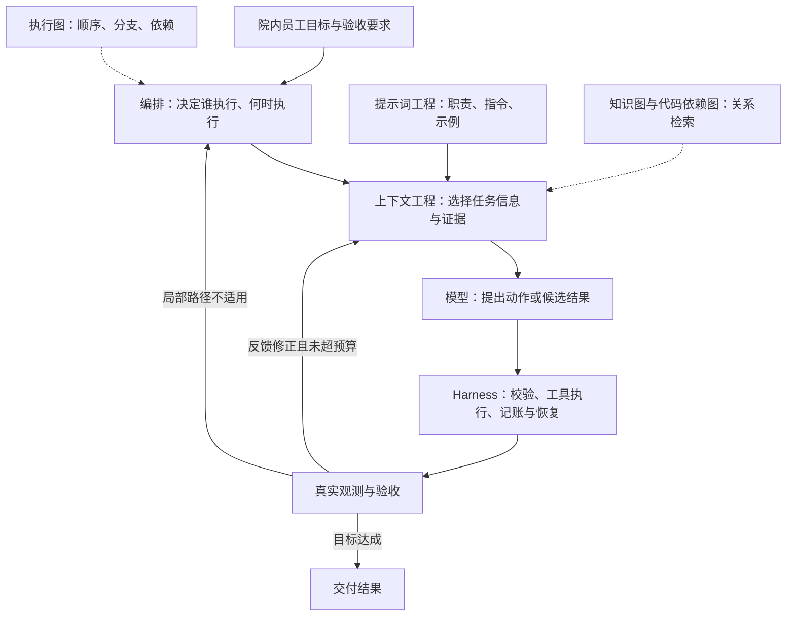
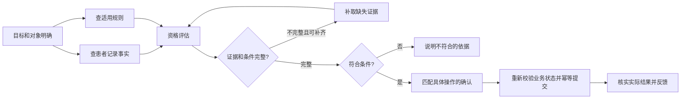

# 00-Agent工程范式与编排总览：MedAgent 逐题口述

核查日期：2026-10-13。所有答案以院内 ToB 边界为前提。一般理论与未落地的扩展方案明确分开。

## q-001

### 主问题｜上下文工程会替代提示词工程吗？

原文位置：00-Agent工程范式与编排总览.md 第 358 行（原件保存在同步前备份）。

**项目口述：** 可信患者档案来自数据库，近期对话与任务快照分开保存；工作台切换患者会清理上下文与未提交编辑。新任务隔离旧历史，待澄清任务只复用有界原问题和本轮补充，不把上轮助手猜测当临床事实。A2A 历史有条数、单条字节和总字节预算。

**针对本题的设计展开（原文原理，作为方案解释）：**

不会。上下文包含提示词；关注范围扩大后，仍需要准确指令。只是不能把缺数据、过期状态和权限问题都归咎于 Prompt。

**在 MedAgent 中怎么补全：** 进一步做 Context Builder：固定职责与授权先保留，当前目标和关键临床事实次之，然后按任务需要选工具证据，最后才是历史摘要。摘要保留来源、时间和原文引用，压缩策略要用多轮任务完成率和错误继承率验证。

**代码依据：** [backend/a2a_context.py](../../backend/a2a_context.py)、[backend/memory.py](../../backend/memory.py)、[backend/task_context.py](../../backend/task_context.py)

## q-002

### 主问题｜Harness 是否就是 Agent 框架？

原文位置：00-Agent工程范式与编排总览.md 第 362 行（原件保存在同步前备份）。

**项目口述：** 我把 Agent 的运行约束落在服务端：任务输入结构、专科和工具白名单、患者授权、模型与工具调用上限、超时熔断、重复调用阻断、工具依据覆盖和持久化完成确认。Prompt 描述职责，代码决定一次动作能否执行。

**针对本题的设计展开（原文原理，作为方案解释）：**

不等同。框架可以提供循环、状态和工具调用组件；实际 Harness 还要结合业务权限、数据环境、验收、可观测性和恢复策略。安装框架不等于具备完整生产运行环境。

**在 MedAgent 中怎么补全：** 进一步的长任务运行环境需要统一任务预算、持久执行队列、节点状态和验收器。框架能提供组件，业务权限和副作用状态仍由应用负责，不能仅靠装一个框架完成生产治理。

**代码依据：** [backend/agents.py](../../backend/agents.py)、[backend/mcp_security.py](../../backend/mcp_security.py)、[backend/resilience.py](../../backend/resilience.py)

## q-003

### 主问题｜Loop 是否等于 while 循环？

原文位置：00-Agent工程范式与编排总览.md 第 366 行（原件保存在同步前备份）。

**项目口述：** 专科由 LangChain create_agent 运行工具循环，模型和工具调用各有上限；同一专科本轮相同工具与参数被指纹去重。主计划最多三个不同专科，不允许 A 调 B、B 再调 A。修正意图也只有一次只读重路由预算。

**针对本题的设计展开（原文原理，作为方案解释）：**

语法可以是 while，工程核心却是状态、可靠观测、验收、可修正反馈与退出策略。没有信息增量的反复生成，只是消耗预算。

**在 MedAgent 中怎么补全：** 更长任务还应检测相同业务状态下的重复动作和证据没有增量，达到步数、时间或费用预算就停止。验收检查真实工具状态和目标覆盖，不能只让同一模型判断‘我已经成功’。

**代码依据：** [backend/agents.py](../../backend/agents.py)、[backend/evidence.py](../../backend/evidence.py)

## q-004

### 主问题｜Graph 是否比 Chain 更先进？

原文位置：00-Agent工程范式与编排总览.md 第 370 行（原件保存在同步前备份）。

**项目口述：** 简单明确任务直接匹配专科；多意图或复杂任务由 Planner 生成最多三步计划。服务端检查专科白名单、去重、意图要求的专科覆盖以及依赖只能指向已列出的前序步骤。结构或依赖非法时改用确定性短链，不能让模型添加未注册服务。

**针对本题的设计展开（原文原理，作为方案解释）：**

Chain 本身就是一种简单图。需要分支、并行和复杂依赖时采用更一般的图结构；顺序流程没有必要人为复杂化。知识图与执行图则属于不同问题。

**在 MedAgent 中怎么补全：** 计划能表达依赖与独立查询，当前没有无限自主改计划：只读依据缺失最多一次重新识别，普通工具故障不等于意图错误。若扩展更多节点，增加节点超时、验收条件、输入引用和版本化节点状态，同时限制重规划预算。

**代码依据：** [backend/agents.py](../../backend/agents.py)、[backend/evidence.py](../../backend/evidence.py)

## q-005

### 主问题｜有循环的 Agent 为什么又说计划是 DAG？

原文位置：00-Agent工程范式与编排总览.md 第 374 行（原件保存在同步前备份）。

**项目口述：** 简单明确任务直接匹配专科；多意图或复杂任务由 Planner 生成最多三步计划。服务端检查专科白名单、去重、意图要求的专科覆盖以及依赖只能指向已列出的前序步骤。结构或依赖非法时改用确定性短链，不能让模型添加未注册服务。

**针对本题的设计展开（原文原理，作为方案解释）：**

DAG 可以描述某一轮无环依赖，外层状态机负责有限重规划；也可以显式建模带循环的状态图。要说明自己采用哪一种，以及如何停止。

**在 MedAgent 中怎么补全：** 计划能表达依赖与独立查询，当前没有无限自主改计划：只读依据缺失最多一次重新识别，普通工具故障不等于意图错误。若扩展更多节点，增加节点超时、验收条件、输入引用和版本化节点状态，同时限制重规划预算。

**代码依据：** [backend/agents.py](../../backend/agents.py)、[backend/evidence.py](../../backend/evidence.py)

## q-006

### 主问题｜Supervisor 和 Plan-and-Execute 是一回事吗？

原文位置：00-Agent工程范式与编排总览.md 第 378 行（原件保存在同步前备份）。

**项目口述：** 简单明确任务直接匹配专科；多意图或复杂任务由 Planner 生成最多三步计划。服务端检查专科白名单、去重、意图要求的专科覆盖以及依赖只能指向已列出的前序步骤。结构或依赖非法时改用确定性短链，不能让模型添加未注册服务。

**针对本题的设计展开（原文原理，作为方案解释）：**

不是。Supervisor 描述协作中的管理拓扑，Plan-and-Execute 描述先规划后执行的控制策略。Supervisor 可用固定路由，单 Agent 也可先规划再执行。

**在 MedAgent 中怎么补全：** 计划能表达依赖与独立查询，当前没有无限自主改计划：只读依据缺失最多一次重新识别，普通工具故障不等于意图错误。若扩展更多节点，增加节点超时、验收条件、输入引用和版本化节点状态，同时限制重规划预算。

**代码依据：** [backend/agents.py](../../backend/agents.py)、[backend/evidence.py](../../backend/evidence.py)

## q-007

### 主问题｜串行、并行、异步怎么分类？

原文位置：00-Agent工程范式与编排总览.md 第 382 行（原件保存在同步前备份）。

**项目口述：** 带依赖的计划按依赖调度，独立只读步骤用 asyncio.gather 同批执行；批准了写动作时整个计划保持串行。前序的脱敏工具依据在预算内传给依赖节点，过长时明确提示重新查询，不截断后冒充完整资料。同批出错仍等待在途调用结束，再传播失败，避免解锁后留后台动作。

**针对本题的设计展开（原文原理，作为方案解释）：**

串行与并行主要描述执行关系；异步需要进一步区分异步 IO 和后台任务交互。后台任务内部仍可以串行、并行和循环。

**在 MedAgent 中怎么补全：** 并发只解决互不依赖的 IO 等待，不能把串行数据依赖打散。CPU 推理要在线程或独立模型服务中运行，并控制 GPU 与连接池并发；后台长任务应采用持久队列和状态查询，不能把 async 函数当成可靠任务队列。

**代码依据：** [backend/agents.py](../../backend/agents.py)、[backend/a2a_context.py](../../backend/a2a_context.py)

## q-008

### 主问题｜多个 Agent 互相审查为什么仍可能一起错？

原文位置：00-Agent工程范式与编排总览.md 第 386 行（原件保存在同步前备份）。

**项目口述：** 专科返回辅助回答和脱敏的真实工具 Observation；协调器汇总时优先依据 Observation，并查看截断标记和调用状态。执行前后都限制权限和格式，每个意图检查对应工具覆盖。最终医学结论仍需要医生复核，当前没有独立临床审查模型证明结论正确。

**针对本题的设计展开（原文原理，作为方案解释）：**

如果共享同一模型偏差、错误证据或验收漏洞，错误会相关。角色数量不代表判断独立性；应增加独立事实核验、程序验证和有代表性的评测。

**在 MedAgent 中怎么补全：** 完整审查要核对结论逐条引用、药名、指标单位、指南版本和请求目标。来源冲突按数据类型与版本处理：当前患者事实看授权业务库，医学规范看有效指南；冲突无法消除就展示差异并要求医生确认，不能一律由用户最新输入覆盖权威事实。

**代码依据：** [backend/evidence.py](../../backend/evidence.py)、[backend/agents.py](../../backend/agents.py)

## q-009

### 主问题｜一个完整的 Agent 系统怎样用一分钟说明？

原文位置：00-Agent工程范式与编排总览.md 第 390 行（原件保存在同步前备份）。

**项目口述：** 我做的是面向院内医生、药师和管理人员的临床辅助工作台。FastAPI 入口核对员工与患者权限，主协调器检查安全、范围、意图和计划，再交给症状、药品、指南三个专科，通过 MCP 查询真实数据，最后保存咨询和审计后发送完成事件。最终诊疗由医生复核。

**在 MedAgent 中怎么补全：** 设计上优先固定授权和执行边界，模型只在范围内做分类、规划、工具选择和解释。新能力必须有明确院内使用人、数据来源、权限与验收标准；患者挂号、预约、缴费、退费均不接入。

**代码依据：** [backend/main.py](../../backend/main.py)、[backend/agents.py](../../backend/agents.py)、[backend/access.py](../../backend/access.py)

**本题图与结构示例：** [example-006](#example-006)

## 原文图与结构示例（ToB适配）

以下逐块保留原文的图、伪代码、JSON 和文本结构，通用交易示例改为院内患者记录与转诊协同。这些是面试原理或扩展方案示例，可能包含尚未实现的角色、参数级审批、语义验收、持久恢复和队列；不能作为当前项目已实现的接口或代码。当前实现以各题项目口述、代码依据及主流程图为准。

### example-001

**一、先建立两个坐标系**

来源：00-Agent工程范式与编排总览.md 第 58 行。用途：ToB 原理示例 / 扩展设计；不表示代码已落地。



### example-002

**1. 提示词工程：把任务说明写成可执行的沟通契约**

来源：00-Agent工程范式与编排总览.md 第 105 行。用途：ToB 原理示例 / 扩展设计；不表示代码已落地。

```text
任务：根据提供的患者记录事实和适用院内转诊规则，判断是否符合转诊申请条件。
边界：只评估资格，不提交转诊申请。
依据：只采用可定位的患者记录字段和规则条款；缺失关键证据时说明缺口。
输出：patient_id、eligible、evidence_refs、missing_conditions。
验收：患者记录对象一致，条件与证据对应，不能把评估通过说成转诊申请已成功。
```

### example-003

**2. 上下文工程：每一轮重新选择有效信息**

来源：00-Agent工程范式与编排总览.md 第 128 行。用途：ToB 原理示例 / 扩展设计；不表示代码已落地。

```text
持久化状态和产物仓库
    → 权限与任务范围过滤
    → 选择当前步骤需要的证据
    → 保留来源、版本、关键条件与未知项
    → 预算内组装上下文
    → 模型调用
    → 新观测更新状态，再组装下一轮
```

### example-004

**1. 同一需求，六种设计责任**

来源：00-Agent工程范式与编排总览.md 第 271 行。用途：ToB 原理示例 / 扩展设计；不表示代码已落地。



### example-005

**2. 一段带注释的系统伪代码**

来源：00-Agent工程范式与编排总览.md 第 293 行。用途：ToB 原理示例 / 扩展设计；不表示代码已落地。

```python
def run_step(step, runtime):
    # Harness：恢复执行进度；预算和任务版本来自服务端，不能由模型自报。
    state = runtime.restore(step)
    while runtime.budget.can_continue(step):
        if runtime.cancelled_or_superseded(step):
            return stopped("任务取消或步骤版本已失效")

        # 图与编排：依赖未满足就等待，不让模型凭空补上游结果。
        if not runtime.graph.dependencies_satisfied(step):
            return waiting("等待必要前置步骤")

        # 上下文工程：读取有权访问的输入和新观测，按本轮预算组装。
        context = runtime.context.build(step, state.evidence_refs, state.feedback)
        if context.blocked:
            return blocked(context.reason)

        # 提示词工程：职责、指令和输出约束是模型输入的一部分。
        prompt = runtime.prompts.for_role(step.role)
        proposal = runtime.model.propose_accounted(prompt, context, step)
        # propose_accounted 同时检查父子预算，并结算本次模型调用。

        if proposal.kind == "action":
            # Harness：校验动作、参数、权限和操作确认后，才调用真实工具。
            observed = runtime.harness.execute_and_record(step, proposal)
            if observed.side_effect_unknown:
                return needs_reconciliation(observed.operation_id)
            state.add_observation(observed)      # 新证据回流到下一轮上下文
        else:
            # 循环工程：用固定验收条件和证据检查候选产物。
            verdict = runtime.verifier.check_accounted(step, proposal.result, state)
            if verdict.passed:
                # 图与编排：只提交当前版本产物，之后才能释放依赖它的节点。
                return runtime.commit_if_current(step, proposal.result)
            if not verdict.repairable:
                return blocked(verdict.failures)
            state.add_feedback(verdict.failures) # 返回具体缺口，不是泛泛要求反思

        # 以新增证据或减少验收缺口判断进展，不以输出长度判断。
        if state.no_progress_limit_reached():
            return needs_replan(state.verified_partial)
        runtime.checkpoint(step, state)         # 计数与进度跨重启保留

    return budget_exhausted(state.verified_partial)
```

### example-006

**Q9｜一个完整的 Agent 系统怎样用一分钟说明？**

来源：00-Agent工程范式与编排总览.md 第 392 行。用途：ToB 原理示例 / 扩展设计；不表示代码已落地。

[返回对应问答](#q-009)

```text
我把 Agent 工程看成相互配合的几个关注点，而不是互相淘汰的代际。
Prompt 讲清局部任务，Context 提供当前需要的事实和状态。
Harness 提供工具、权限、预算、反馈和恢复环境。
Loop 根据真实观测与验收缺口推进，并有明确停止条件。
Graph 显式管理依赖或关系，先说明是执行图还是知识、代码等关系图。
编排决定谁在何时执行、如何交接与聚合，可以是单 Agent、固定工作流或多 Agent。
最后用端到端效果与成本验证复杂度是否值得，而不是按 Agent 数量判断先进程度。
```

