# 02-场景设计与系统架构：MedAgent 逐题口述

核查日期：2026-10-13。所有答案以院内 ToB 边界为前提。一般理论与未落地的扩展方案明确分开。

## q-001

### 主问题｜面对用户比较抽象的指令，Agent 如何执行任务？

原文位置：02-场景设计与系统架构.md 第 28 行（原件保存在同步前备份）。

**项目口述：** 可信身份和患者档案由服务端读取。业务参数由模型按工具 schema 提出，执行前代码检查空值、占位值、列表和检验内容；药名必须能在当前任务原始输入或可信用药档案中找到依据，相互作用检查至少两种药。参数记录 raw_value、normalized_value、source、turn_id、evidence_span、schema_version 和 validation_status。

**针对本题的设计展开（原文原理，作为方案解释）：**

主 Agent 先判断指令是否可执行：可执行的直接拆解执行；模糊的先追问澄清；仍缺少非关键条件且风险可控时，可以在明确告知假设后保守执行。这里是“带假设执行”，不是系统故障时的降级。

**在 MedAgent 中怎么补全：** 现在没有训练过医疗 NER，也没有声称语义校验能识别全部错槽。扩展方案是为十类意图注册必填字段，规则抽固定格式，LLM 只提取有原文跨度的实体，再用药品目录校正通用名、单位和枚举。缺关键字段询问医生或药师，临床数值和药名不凭默认值补齐。

**代码依据：** [backend/clinical_slots.py](../../backend/clinical_slots.py)、[backend/schemas.py](../../backend/schemas.py)、[backend/agents.py](../../backend/agents.py)

## q-002

### 追问｜追问澄清、拆解子任务、在确认后保守执行怎么落地？

原文位置：02-场景设计与系统架构.md 第 34 行（原件保存在同步前备份）。

**项目口述：** 可信身份和患者档案由服务端读取。业务参数由模型按工具 schema 提出，执行前代码检查空值、占位值、列表和检验内容；药名必须能在当前任务原始输入或可信用药档案中找到依据，相互作用检查至少两种药。参数记录 raw_value、normalized_value、source、turn_id、evidence_span、schema_version 和 validation_status。

**针对本题的设计展开（原文原理，作为方案解释）：**

三步：先澄清——缺关键信息就问（对象、范围、格式）；再拆解——把确认后的任务拆成子任务；最后保守执行——仅在缺失项不影响权限、安全和不可逆操作时，基于合理假设继续，并明确告知“我理解为 XX，按此执行”。

**在 MedAgent 中怎么补全：** 现在没有训练过医疗 NER，也没有声称语义校验能识别全部错槽。扩展方案是为十类意图注册必填字段，规则抽固定格式，LLM 只提取有原文跨度的实体，再用药品目录校正通用名、单位和枚举。缺关键字段询问医生或药师，临床数值和药名不凭默认值补齐。

**代码依据：** [backend/clinical_slots.py](../../backend/clinical_slots.py)、[backend/schemas.py](../../backend/schemas.py)、[backend/agents.py](../../backend/agents.py)

## q-003

### 追问｜澄清无效时，拒绝还是基于假设执行？

原文位置：02-场景设计与系统架构.md 第 38 行（原件保存在同步前备份）。

**项目口述：** 可信身份和患者档案由服务端读取。业务参数由模型按工具 schema 提出，执行前代码检查空值、占位值、列表和检验内容；药名必须能在当前任务原始输入或可信用药档案中找到依据，相互作用检查至少两种药。参数记录 raw_value、normalized_value、source、turn_id、evidence_span、schema_version 和 validation_status。

**针对本题的设计展开（原文原理，作为方案解释）：**

分场景：高风险操作（涉及资金、权限、不可逆动作）明确拒绝并说明缺什么；低风险场景可以基于假设执行，但必须把假设写在输出里，给用户纠正的机会。

判断标准不是"用户态度"，而是"风险是否可控、错误是否可回退"：不可逆动作（转账、删数据、发外链）一旦按错误假设执行就无补救机会，必须拒绝；可逆的查询/生成类任务，用"回显假设"换取不打断用户，才值得降级执行。

**在 MedAgent 中怎么补全：** 现在没有训练过医疗 NER，也没有声称语义校验能识别全部错槽。扩展方案是为十类意图注册必填字段，规则抽固定格式，LLM 只提取有原文跨度的实体，再用药品目录校正通用名、单位和枚举。缺关键字段询问医生或药师，临床数值和药名不凭默认值补齐。

**代码依据：** [backend/clinical_slots.py](../../backend/clinical_slots.py)、[backend/schemas.py](../../backend/schemas.py)、[backend/agents.py](../../backend/agents.py)

## q-004

### 主问题｜用智能体进行数据清洗怎么做？

原文位置：02-场景设计与系统架构.md 第 44 行（原件保存在同步前备份）。

**项目口述：** 如果对院内医学材料做清洗，固定格式、编码、单位、日期和去重用确定性代码；异常病例描述才让模型协助分类，并保留原文和人工抽检。当前 BERT 数据处理脚本是已实现例子，医院批量数据清洗 Agent 需要另建任务和验收，不能改写患者原始记录后直接覆盖。

**针对本题的设计展开（原文原理，作为方案解释）：**

链路：规则清洗 → 异常识别 → 分类处理 → 人工抽检。LLM 只负责语义判断环节，确定性处理交给规则和代码。

**在 MedAgent 中怎么补全：** 若路由错，先看规则、训练覆盖、原型、阈值和否定边界；若生成错，先核对工具资料与上下文，再考虑 SFT 改稳定行为。实时知识用受控检索，不把医院事实靠微调固化；训练、调参和最终测试必须隔离。

**代码依据：** [scripts/train_intent_bert.py](../../scripts/train_intent_bert.py)、[scripts/calibrate_intent_bert.py](../../scripts/calibrate_intent_bert.py)、[docs/bert-threshold-evaluation-2026-10-12.md](../../docs/bert-threshold-evaluation-2026-10-12.md)

## q-005

### 追问｜规则清洗、异常识别、分类处理、人工抽检分别做什么？

原文位置：02-场景设计与系统架构.md 第 50 行（原件保存在同步前备份）。

**项目口述：** 项目实际训练的是十类意图 BERT 多标签分类器，使用多热标签、BCEWithLogitsLoss 和 Sigmoid，训练/验证/测试为 3100/640/1340 条合成数据。独立验证集扫描统一与逐类阈值后，当前保留每类 0.5；没有在这个项目训练专科 LLM、RLHF 或 GRPO。

**针对本题的设计展开（原文原理，作为方案解释）：**

规则清洗：格式校验、去重、正则替换；异常识别：规则发现不了的脏数据（同义词、错位字段）；分类处理：LLM 对异常数据分类并给出处理建议；人工抽检：按比例抽样复核，控制质量。

这条链路的本质是"确定性交给规则、不确定性交给 LLM、最终质量交给人工"：规则又快又稳但覆盖面有限，所以用"异常识别"兜住规则漏掉的脏数据，再让 LLM 只处理这批"不规则"的少数，最后人工抽检兜底质量——而不是让 LLM 从头清洗全量数据。

**在 MedAgent 中怎么补全：** 若路由错，先看规则、训练覆盖、原型、阈值和否定边界；若生成错，先核对工具资料与上下文，再考虑 SFT 改稳定行为。实时知识用受控检索，不把医院事实靠微调固化；训练、调参和最终测试必须隔离。

**代码依据：** [scripts/train_intent_bert.py](../../scripts/train_intent_bert.py)、[scripts/calibrate_intent_bert.py](../../scripts/calibrate_intent_bert.py)、[docs/bert-threshold-evaluation-2026-10-12.md](../../docs/bert-threshold-evaluation-2026-10-12.md)

## q-006

### 追问｜哪些步骤不该用 LLM？

原文位置：02-场景设计与系统架构.md 第 56 行（原件保存在同步前备份）。

**项目口述：** 项目实际训练的是十类意图 BERT 多标签分类器，使用多热标签、BCEWithLogitsLoss 和 Sigmoid，训练/验证/测试为 3100/640/1340 条合成数据。独立验证集扫描统一与逐类阈值后，当前保留每类 0.5；没有在这个项目训练专科 LLM、RLHF 或 GRPO。

**针对本题的设计展开（原文原理，作为方案解释）：**

格式校验、去重、正则替换这类确定性规则任务用代码/规则，不用 LLM——LLM 慢、贵且有随机性。LLM 只处理语义判断：异常分类、值归一化、字段语义纠错。

**在 MedAgent 中怎么补全：** 若路由错，先看规则、训练覆盖、原型、阈值和否定边界；若生成错，先核对工具资料与上下文，再考虑 SFT 改稳定行为。实时知识用受控检索，不把医院事实靠微调固化；训练、调参和最终测试必须隔离。

**代码依据：** [scripts/train_intent_bert.py](../../scripts/train_intent_bert.py)、[scripts/calibrate_intent_bert.py](../../scripts/calibrate_intent_bert.py)、[docs/bert-threshold-evaluation-2026-10-12.md](../../docs/bert-threshold-evaluation-2026-10-12.md)

## q-007

### 主问题｜Agent 链路过长导致用户等待时间过长怎么处理？

原文位置：02-场景设计与系统架构.md 第 60 行（原件保存在同步前备份）。

**项目口述：** 带依赖的计划按依赖调度，独立只读步骤用 asyncio.gather 同批执行；批准了写动作时整个计划保持串行。前序的脱敏工具依据在预算内传给依赖节点，过长时明确提示重新查询，不截断后冒充完整资料。同批出错仍等待在途调用结束，再传播失败，避免解锁后留后台动作。

**针对本题的设计展开（原文原理，作为方案解释）：**

四个手段：并行化独立节点、异步处理耗时任务、缓存高频结果、先给阶段性结果。

**在 MedAgent 中怎么补全：** 并发只解决互不依赖的 IO 等待，不能把串行数据依赖打散。CPU 推理要在线程或独立模型服务中运行，并控制 GPU 与连接池并发；后台长任务应采用持久队列和状态查询，不能把 async 函数当成可靠任务队列。

**代码依据：** [backend/agents.py](../../backend/agents.py)、[backend/a2a_context.py](../../backend/a2a_context.py)

## q-008

### 追问｜并行、异步、缓存、阶段性结果怎么落地？

原文位置：02-场景设计与系统架构.md 第 66 行（原件保存在同步前备份）。

**项目口述：** 带依赖的计划按依赖调度，独立只读步骤用 asyncio.gather 同批执行；批准了写动作时整个计划保持串行。前序的脱敏工具依据在预算内传给依赖节点，过长时明确提示重新查询，不截断后冒充完整资料。同批出错仍等待在途调用结束，再传播失败，避免解锁后留后台动作。

**在 MedAgent 中怎么补全：** 并发只解决互不依赖的 IO 等待，不能把串行数据依赖打散。CPU 推理要在线程或独立模型服务中运行，并控制 GPU 与连接池并发；后台长任务应采用持久队列和状态查询，不能把 async 函数当成可靠任务队列。

**代码依据：** [backend/agents.py](../../backend/agents.py)、[backend/a2a_context.py](../../backend/a2a_context.py)

## q-009

### 追问｜哪些节点可并行，哪些必须串行？

原文位置：02-场景设计与系统架构.md 第 70 行（原件保存在同步前备份）。

**项目口述：** 带依赖的计划按依赖调度，独立只读步骤用 asyncio.gather 同批执行；批准了写动作时整个计划保持串行。前序的脱敏工具依据在预算内传给依赖节点，过长时明确提示重新查询，不截断后冒充完整资料。同批出错仍等待在途调用结束，再传播失败，避免解锁后留后台动作。

**针对本题的设计展开（原文原理，作为方案解释）：**

判断标准是依赖关系：后一步依赖前一步结果的必须串行（意图识别→槽位补全→查询）；相互独立的可以并行（多数据源查询）。依赖决定执行模式。

补一个坑：并行不是越多越好——并行节点会放大失败面和聚合复杂度，有数据依赖的路径必须按依赖执行，但串行本身不保证数据事实一致。独立且无写冲突的节点即使都必须成功，也可并行；聚合时任一必需分支失败就阻断下游。

**在 MedAgent 中怎么补全：** 并发只解决互不依赖的 IO 等待，不能把串行数据依赖打散。CPU 推理要在线程或独立模型服务中运行，并控制 GPU 与连接池并发；后台长任务应采用持久队列和状态查询，不能把 async 函数当成可靠任务队列。

**代码依据：** [backend/agents.py](../../backend/agents.py)、[backend/a2a_context.py](../../backend/a2a_context.py)

## q-010

### 主问题｜主 Agent 拆解后发现意图错或执行异常，怎么处理？

原文位置：02-场景设计与系统架构.md 第 76 行（原件保存在同步前备份）。

**项目口述：** 我按识别前、执行中和执行后处理：前三路发现分歧时二次识别；执行前校验关键参数和权限；执行后检查每个意图是否有对应的成功工具依据，例如病史读取不能代替药品说明书查询。只读任务覆盖不匹配时最多复核并重路由一次；批准写动作或出现写调用时禁止自动重跑。

**针对本题的设计展开（原文原理，作为方案解释）：**

四种处理：回滚已执行节点、重新路由、保留可复用中间结果、降级执行。

**在 MedAgent 中怎么补全：** 工作台已能提交意图纠错，服务端重新核验患者权限和原请求所属员工，保存为待临床复核记录，不自动作为训练标签。完整闭环还需要结论与目标的语义核验、复核工单及标注发布流程。工具成功不是医学正确证明；写入不明先查状态、核对 HIS，跨系统补偿取决于医院接口。

**代码依据：** [backend/evidence.py](../../backend/evidence.py)、[backend/agents.py](../../backend/agents.py)、[backend/mcp_security.py](../../backend/mcp_security.py)、[backend/main.py](../../backend/main.py)

## q-011

### 追问｜回滚、重新路由、保留部分结果、降级分别怎么用？

原文位置：02-场景设计与系统架构.md 第 82 行（原件保存在同步前备份）。

**项目口述：** 我按识别前、执行中和执行后处理：前三路发现分歧时二次识别；执行前校验关键参数和权限；执行后检查每个意图是否有对应的成功工具依据，例如病史读取不能代替药品说明书查询。只读任务覆盖不匹配时最多复核并重路由一次；批准写动作或出现写调用时禁止自动重跑。

**针对本题的设计展开（原文原理，作为方案解释）：**

回滚：只撤销支持事务回滚或有明确补偿动作的副作用；已经外发、通知或被外部系统接收的动作不能假设都可回滚，必须先核实状态再补偿。重新路由：用修正后的意图重新分发；保留部分结果：输入、版本和证据仍有效时复用已完成的查询结果；降级：复杂任务退到更简单、确定性更高的路径，先提供可用结果。

**在 MedAgent 中怎么补全：** 工作台已能提交意图纠错，服务端重新核验患者权限和原请求所属员工，保存为待临床复核记录，不自动作为训练标签。完整闭环还需要结论与目标的语义核验、复核工单及标注发布流程。工具成功不是医学正确证明；写入不明先查状态、核对 HIS，跨系统补偿取决于医院接口。

**代码依据：** [backend/evidence.py](../../backend/evidence.py)、[backend/agents.py](../../backend/agents.py)、[backend/mcp_security.py](../../backend/mcp_security.py)、[backend/main.py](../../backend/main.py)

## q-012

### 追问｜如何判定重试还是终止？

原文位置：02-场景设计与系统架构.md 第 86 行（原件保存在同步前备份）。

**项目口述：** 我按识别前、执行中和执行后处理：前三路发现分歧时二次识别；执行前校验关键参数和权限；执行后检查每个意图是否有对应的成功工具依据，例如病史读取不能代替药品说明书查询。只读任务覆盖不匹配时最多复核并重路由一次；批准写动作或出现写调用时禁止自动重跑。

**针对本题的设计展开（原文原理，作为方案解释）：**

错误分类决定处理方式：只读调用的临时超时 → 在预算内受控重试；发送后的写操作超时 → 先核对结果或依赖已验收的幂等契约；参数错误、槽位缺失 → 不能原样重试，但补槽/修正参数后可以重新执行；意图本身错误、连续失败达到阈值、高风险操作出问题 → 终止，转澄清或人工。

判断标准不是"错误重不重"，而是"不改输入再试一次，有没有机会变对"：只读临时故障可能适合重试，但写超时不能据此判断未执行；参数错、槽位缺不改就一直错，必须先修正输入再执行——这是"修正后重新执行"，不是"重试"；意图错、连续失败到阈值，改也改不对，就该终止止损。

**在 MedAgent 中怎么补全：** 工作台已能提交意图纠错，服务端重新核验患者权限和原请求所属员工，保存为待临床复核记录，不自动作为训练标签。完整闭环还需要结论与目标的语义核验、复核工单及标注发布流程。工具成功不是医学正确证明；写入不明先查状态、核对 HIS，跨系统补偿取决于医院接口。

**代码依据：** [backend/evidence.py](../../backend/evidence.py)、[backend/agents.py](../../backend/agents.py)、[backend/mcp_security.py](../../backend/mcp_security.py)、[backend/main.py](../../backend/main.py)

## q-013

### 主问题｜如果让你设计售后系统的 Agent，怎么搭建？

原文位置：02-场景设计与系统架构.md 第 92 行（原件保存在同步前备份）。

**项目口述：** 这题问的是跨业务架构设计。我会借鉴主协调器、业务专科和受控工具的分层，但在 MedAgent 内只实现院内临床辅助；售后退款、订单处理不是这个项目的功能。如果面试官要求独立设计售后系统，可以在另一个系统中按身份、业务查询、问题分类、权限动作和人工服务设计。

**在 MedAgent 中怎么补全：** 设计上优先固定授权和执行边界，模型只在范围内做分类、规划、工具选择和解释。新能力必须有明确院内使用人、数据来源、权限与验收标准；患者挂号、预约、缴费、退费均不接入。

**代码依据：** [backend/main.py](../../backend/main.py)、[backend/agents.py](../../backend/agents.py)、[backend/access.py](../../backend/access.py)

## q-014

### 追问｜用户识别、订单/知识查询、问题分类、自动处理分别怎么做？

原文位置：02-场景设计与系统架构.md 第 98 行（原件保存在同步前备份）。

**项目口述：** 我做的是面向院内医生、药师和管理人员的临床辅助工作台。FastAPI 入口核对员工与患者权限，主协调器检查安全、范围、意图和计划，再交给症状、药品、指南三个专科，通过 MCP 查询真实数据，最后保存咨询和审计后发送完成事件。最终诊疗由医生复核。

**在 MedAgent 中怎么补全：** 设计上优先固定授权和执行边界，模型只在范围内做分类、规划、工具选择和解释。新能力必须有明确院内使用人、数据来源、权限与验收标准；患者挂号、预约、缴费、退费均不接入。

**代码依据：** [backend/main.py](../../backend/main.py)、[backend/agents.py](../../backend/agents.py)、[backend/access.py](../../backend/access.py)

## q-015

### 追问｜什么条件下必须转人工？

原文位置：02-场景设计与系统架构.md 第 102 行（原件保存在同步前备份）。

**项目口述：** 我做的是面向院内医生、药师和管理人员的临床辅助工作台。FastAPI 入口核对员工与患者权限，主协调器检查安全、范围、意图和计划，再交给症状、药品、指南三个专科，通过 MCP 查询真实数据，最后保存咨询和审计后发送完成事件。最终诊疗由医生复核。

**在 MedAgent 中怎么补全：** 设计上优先固定授权和执行边界，模型只在范围内做分类、规划、工具选择和解释。新能力必须有明确院内使用人、数据来源、权限与验收标准；患者挂号、预约、缴费、退费均不接入。

**代码依据：** [backend/main.py](../../backend/main.py)、[backend/agents.py](../../backend/agents.py)、[backend/access.py](../../backend/access.py)

## q-016

### 主问题｜用户要求出一个月数据总结并给出改进方案，Agent 如何闭环？

原文位置：02-场景设计与系统架构.md 第 108 行（原件保存在同步前备份）。

**项目口述：** 当前院内工作台通过 SSE 持续展示同一请求的结果，服务代码使用 async，A2A 同步客户端在线程执行；近期状态在 Redis 或本地 TTL 中。没有已经部署的长期后台报告队列、邮件通知或断点输出重放服务。

**针对本题的设计展开（原文原理，作为方案解释）：**

闭环：查询 → 分析 → 建议 → 审查 → 输出。中间结果要可复用，失败节点可单独重跑。

**在 MedAgent 中怎么补全：** 若做院内月度审核报告，入口登记员工与数据权限，创建持久 task_id 后入队；worker 保存节点结果并按 operation_id 去重，工作台通过授权状态接口或 SSE 查看进度。断线不等于任务取消；取消要先判断有没有已经提交的院内写操作。

**代码依据：** [backend/main.py](../../backend/main.py)、[backend/memory.py](../../backend/memory.py)、[backend/agents.py](../../backend/agents.py)

## q-017

### 追问｜查询、分析、建议、审查、输出五个环节怎么串？

原文位置：02-场景设计与系统架构.md 第 114 行（原件保存在同步前备份）。

**项目口述：** 当前院内工作台通过 SSE 持续展示同一请求的结果，服务代码使用 async，A2A 同步客户端在线程执行；近期状态在 Redis 或本地 TTL 中。没有已经部署的长期后台报告队列、邮件通知或断点输出重放服务。

**针对本题的设计展开（原文原理，作为方案解释）：**

查询 Agent 取月度数据 → 分析 Agent 算指标、找趋势 → 建议 Agent 基于分析生成改进方案 → 审查 Agent 校验数据引用和事实 → 主 Agent 聚合输出。

**在 MedAgent 中怎么补全：** 若做院内月度审核报告，入口登记员工与数据权限，创建持久 task_id 后入队；worker 保存节点结果并按 operation_id 去重，工作台通过授权状态接口或 SSE 查看进度。断线不等于任务取消；取消要先判断有没有已经提交的院内写操作。

**代码依据：** [backend/main.py](../../backend/main.py)、[backend/memory.py](../../backend/memory.py)、[backend/agents.py](../../backend/agents.py)

## q-018

### 追问｜中间失败是重跑还是复用已有结果？

原文位置：02-场景设计与系统架构.md 第 118 行（原件保存在同步前备份）。

**项目口述：** 当前院内工作台通过 SSE 持续展示同一请求的结果，服务代码使用 async，A2A 同步客户端在线程执行；近期状态在 Redis 或本地 TTL 中。没有已经部署的长期后台报告队列、邮件通知或断点输出重放服务。

**针对本题的设计展开（原文原理，作为方案解释）：**

看成本 + 时效性：查询结果在"数据未变化"的前提下可直接复用，但"未变化"不能拍脑袋假定——要查快照版本号/更新时间/TTL（time-to-live，存活时间），或对比下游输入是否变化；分析/建议失败只重跑失败节点及依赖它的节点（配合 checkpoint，即检查点），不整体重跑。

判断标准是"结果是否还新鲜、是否有副作用"：查询结果无副作用但可能因数据更新而失效，复用前必须确认时效性；分析/建议应基于已验证仍有效的数据快照重新计算；重算成本和是否与当前数据一致需要分别核对，所以只重跑失败节点及其下游，而不是把整条链路从头跑一遍。

**在 MedAgent 中怎么补全：** 若做院内月度审核报告，入口登记员工与数据权限，创建持久 task_id 后入队；worker 保存节点结果并按 operation_id 去重，工作台通过授权状态接口或 SSE 查看进度。断线不等于任务取消；取消要先判断有没有已经提交的院内写操作。

**代码依据：** [backend/main.py](../../backend/main.py)、[backend/memory.py](../../backend/memory.py)、[backend/agents.py](../../backend/agents.py)

## q-019

### 主问题｜模型突然挂掉/返回错误，Agent 系统怎么处理？

原文位置：02-场景设计与系统架构.md 第 124 行（原件保存在同步前备份）。

**项目口述：** 把权限失败、参数缺失、依赖故障和写入未知分开。权限失败拒绝；缺信息先询问；安全只读医院查询对瞬时网络错误及 429/部分 5xx 最多三次指数退避，转诊写调用不自动重试；连续依赖失败进入熔断。专科或工具失败不会被包装成成功答案。

**针对本题的设计展开（原文原理，作为方案解释）：**

按错误类型分层：瞬时错误重试、持续失败切换备用模型、规则降级、触发告警。

**在 MedAgent 中怎么补全：** 备用模型、备用数据源或跳过非关键步骤必须有已验证契约，不能凭空说存在。只有确实可逆的本地事务能回滚；外部写入走查询、对账、补偿或责任医生复核。对于无法确认的临床问题，应给出失败原因和人工核对路径。

**代码依据：** [backend/mcp_tools.py](../../backend/mcp_tools.py)、[backend/resilience.py](../../backend/resilience.py)、[backend/mcp_security.py](../../backend/mcp_security.py)

## q-020

### 追问｜按错误类型重试、切换备用模型、规则降级、告警分别怎么做？

原文位置：02-场景设计与系统架构.md 第 130 行（原件保存在同步前备份）。

**项目口述：** 把权限失败、参数缺失、依赖故障和写入未知分开。权限失败拒绝；缺信息先询问；安全只读医院查询对瞬时网络错误及 429/部分 5xx 最多三次指数退避，转诊写调用不自动重试；连续依赖失败进入熔断。专科或工具失败不会被包装成成功答案。

**针对本题的设计展开（原文原理，作为方案解释）：**

超时/限流/网络抖动 → 重试（指数退避）；持续失败 → 切备用模型；备用模型也不可用 → 规则降级（模板回答/FAQ）；同时触发告警，值班介入。

**在 MedAgent 中怎么补全：** 备用模型、备用数据源或跳过非关键步骤必须有已验证契约，不能凭空说存在。只有确实可逆的本地事务能回滚；外部写入走查询、对账、补偿或责任医生复核。对于无法确认的临床问题，应给出失败原因和人工核对路径。

**代码依据：** [backend/mcp_tools.py](../../backend/mcp_tools.py)、[backend/resilience.py](../../backend/resilience.py)、[backend/mcp_security.py](../../backend/mcp_security.py)

## q-021

### 追问｜哪些错误是瞬时的？

原文位置：02-场景设计与系统架构.md 第 134 行（原件保存在同步前备份）。

**项目口述：** 把权限失败、参数缺失、依赖故障和写入未知分开。权限失败拒绝；缺信息先询问；安全只读医院查询对瞬时网络错误及 429/部分 5xx 最多三次指数退避，转诊写调用不自动重试；连续依赖失败进入熔断。专科或工具失败不会被包装成成功答案。

**针对本题的设计展开（原文原理，作为方案解释）：**

超时、限流（429）、网络抖动、服务过载（529）是瞬时的，值得原样重试；参数错误、权限拒绝不是瞬时的，原样重试无意义，直接降级或告警；输出格式错误要单独看——相同输入盲目重试价值有限（模型大概率还是给同样错误格式），但把校验错误反馈给模型后做一次修复重试是有意义的（详见模块 3 Q15、模块 8 Q5）。

判断标准一句话："不改输入再试一次，会不会变好"——瞬时错误（网络、限流、过载）会恢复，值得原样重试；确定性错误（参数错、权限拒）不会因为重试就变对；格式错误属于"可反馈修复"的特殊类，靠"反馈错误 + 有限重试"而非"原样重试"。

**在 MedAgent 中怎么补全：** 备用模型、备用数据源或跳过非关键步骤必须有已验证契约，不能凭空说存在。只有确实可逆的本地事务能回滚；外部写入走查询、对账、补偿或责任医生复核。对于无法确认的临床问题，应给出失败原因和人工核对路径。

**代码依据：** [backend/mcp_tools.py](../../backend/mcp_tools.py)、[backend/resilience.py](../../backend/resilience.py)、[backend/mcp_security.py](../../backend/mcp_security.py)

## q-022

### 主问题｜有几千个 API，你有什么思路组织 Agent 框架？

原文位置：02-场景设计与系统架构.md 第 142 行（原件保存在同步前备份）。

**项目口述：** 模型通过 Function Calling 选择工具并生成结构化参数，LangChain 的 MCPAdapter 和 FastMCP 客户端通过 MCP 调用工具服务。FastMCP 注册 14 个工具，包括真实医院查询以及本地病史、辅助材料存储；服务端再次检查委托、员工状态、患者范围和写动作权限。两者在同一链路中使用。

**针对本题的设计展开（原文原理，作为方案解释）：**

几千个 API 的核心问题不是“模型能不能调用”，而是工具空间过大、路由困难、权限难治理、版本难控制。不能把几千个 API 的完整 schema（结构定义）一次性塞给模型，而应该采用“业务域 → 工具集 → 具体 API”的分层架构。

可以设计成四层：

同时建立统一的 Tool Registry（工具注册中心），管理工具名称、描述、输入输出 schema、版本、权限、超时、幂等性和负责人等元数据。

这样做的价值是：减少模型上下文、降低错误调用概率、提高路由稳定性，同时方便权限和版本治理。

**在 MedAgent 中怎么补全：** 工具注册要同时维护参数、输出、错误、权限、读写属性和版本契约；新增工具先做契约测试和权限回归，再开放给对应专科。不能把工具描述中的 readOnlyHint 当真正的服务端授权。

**代码依据：** [backend/mcp_tools.py](../../backend/mcp_tools.py)、[backend/mcp_security.py](../../backend/mcp_security.py)、[backend/agents.py](../../backend/agents.py)

**本题图与结构示例：** [example-001](#example-001)

## q-023

### 追问｜按业务域聚合、统一工具注册、主 Agent 路由怎么落地？

原文位置：02-场景设计与系统架构.md 第 164 行（原件保存在同步前备份）。

**项目口述：** 模型通过 Function Calling 选择工具并生成结构化参数，LangChain 的 MCPAdapter 和 FastMCP 客户端通过 MCP 调用工具服务。FastMCP 注册 14 个工具，包括真实医院查询以及本地病史、辅助材料存储；服务端再次检查委托、员工状态、患者范围和写动作权限。两者在同一链路中使用。

**针对本题的设计展开（原文原理，作为方案解释）：**

可以按“静态治理 + 动态路由”两部分落地。

第一步是静态治理：

- 每个 API 在 Tool Registry 中注册统一 schema；

- schema 至少包含：功能描述、参数、返回值、权限要求、超时、版本、幂等性；

- 对工具做版本管理，例如 `query_order_v1`、`query_order_v2`，避免接口变化直接影响线上 Agent。

第二步是动态路由：

这里最好把“选工具”和“执行工具”分开。模型负责判断调用哪个能力、生成参数；真正执行之前由系统做 schema 校验、权限校验、参数校验和风险控制，不能完全相信模型输出。

对于高频、重要 API，还可以把工具进一步封装成稳定的业务能力，例如不要让模型直接操作底层几十个库存接口，而是提供一个“查询可售库存”的业务工具，让底层 API 变化对 Agent 透明。

**在 MedAgent 中怎么补全：** 工具注册要同时维护参数、输出、错误、权限、读写属性和版本契约；新增工具先做契约测试和权限回归，再开放给对应专科。不能把工具描述中的 readOnlyHint 当真正的服务端授权。

**代码依据：** [backend/mcp_tools.py](../../backend/mcp_tools.py)、[backend/mcp_security.py](../../backend/mcp_security.py)、[backend/agents.py](../../backend/agents.py)

**本题图与结构示例：** [example-002](#example-002)

## q-024

### 追问｜新增 API 的治理和回归如何做？

原文位置：02-场景设计与系统架构.md 第 192 行（原件保存在同步前备份）。

**项目口述：** 模型通过 Function Calling 选择工具并生成结构化参数，LangChain 的 MCPAdapter 和 FastMCP 客户端通过 MCP 调用工具服务。FastMCP 注册 14 个工具，包括真实医院查询以及本地病史、辅助材料存储；服务端再次检查委托、员工状态、患者范围和写动作权限。两者在同一链路中使用。

**针对本题的设计展开（原文原理，作为方案解释）：**

新增 API 不能只是“注册一下就上线”，建议经过：

回归测试至少覆盖三层：

1. 工具级：参数是否正确、返回值是否符合 schema；

2. 路由级：典型用户问题能否正确选到新工具，同时不会抢错已有工具；

3. 业务级：真实任务链路能否完成。

另外要特别防止“工具描述冲突”。如果两个 API 的描述非常相似，模型容易随机选择，因此注册中心需要统一命名规范和工具描述模板，必要时增加路由规则、示例和人工配置。

**在 MedAgent 中怎么补全：** 工具注册要同时维护参数、输出、错误、权限、读写属性和版本契约；新增工具先做契约测试和权限回归，再开放给对应专科。不能把工具描述中的 readOnlyHint 当真正的服务端授权。

**代码依据：** [backend/mcp_tools.py](../../backend/mcp_tools.py)、[backend/mcp_security.py](../../backend/mcp_security.py)、[backend/agents.py](../../backend/agents.py)

**本题图与结构示例：** [example-003](#example-003)

## q-025

### 主问题｜让你设计一个生产级的多 Agent 系统，你会怎么考虑？

原文位置：02-场景设计与系统架构.md 第 214 行（原件保存在同步前备份）。

**项目口述：** 我把交付验收拆成院内权限、安全边界、工具契约、路由覆盖、故障分支和真实医院接口联调。仓库有配置、部署和工程回归记录，说明已有实现可核对；真实医院试点、临床收益和全链路容量不能直接从合成评测推导。

**针对本题的设计展开（原文原理，作为方案解释）：**

生产级多 Agent 不能只考虑“Agent 怎么协作”，还要考虑状态、通信、权限、可靠性、数据一致性、可观测性和故障恢复。我通常先把系统拆成四层：

横向基础设施：State / Checkpoint / Queue / Cache；Auth / Rate Limit / Circuit Breaker；Log / Metric / Trace，以及独立的 Audit 记录。

至少要重点设计以下能力：

1. 状态管理

不要依赖单个 Agent 的内存保存任务状态。应该把关键状态持久化，例如：

全局状态由编排层管理，Agent 只拥有自己需要的局部状态，避免多个 Agent 随意修改同一份上下文。

2. 通信机制

Agent 间不要依赖自然语言随意传递信息，最好定义统一的消息 schema，例如：

短链路、强依赖任务可以同步调用；耗时任务适合通过消息队列异步执行。

3. 权限隔离

4. 超时、重试和熔断

不能所有节点都无限重试。应该针对节点设置：

5. Checkpoint

每个关键节点完成后保存 checkpoint：

特别适合长任务、耗时任务和需要人工审批的任务。

6. 可观测性

至少需要三类数据：

- Log：记录发生了什么；

- Metric：统计成功率、延迟、Token、错误率等；

- Trace：追踪一次请求经过了哪些 Agent、工具和外部服务。

所有节点统一携带 `trace_id` / `task_id`，否则多 Agent 出问题时很难定位。

**在 MedAgent 中怎么补全：** 上线时明确医生/药师典型任务与责任人，先小范围灰度，再测成功率、复核耗时、人工纠错及院内流程接受度；准备模型/Prompt/工具联合回滚和数据恢复演练。范围变更先评估权限、状态和验收，不把新增患者服务混入 ToB 交付。

**代码依据：** [docs/production-readiness.md](../../docs/production-readiness.md)、[README.md](../../README.md)、[deploy/k8s/medagent-api.yaml](../../deploy/k8s/medagent-api.yaml)

**本题图与结构示例：** [example-004](#example-004)、[example-005](#example-005)、[example-006](#example-006)、[example-007](#example-007)、[example-008](#example-008)

## q-026

### 追问｜状态、通信、权限、超时熔断、Checkpoint、可观测分别怎么设计？

原文位置：02-场景设计与系统架构.md 第 312 行（原件保存在同步前备份）。

**项目口述：** 我把交付验收拆成院内权限、安全边界、工具契约、路由覆盖、故障分支和真实医院接口联调。仓库有配置、部署和工程回归记录，说明已有实现可核对；真实医院试点、临床收益和全链路容量不能直接从合成评测推导。

**针对本题的设计展开（原文原理，作为方案解释）：**

可以把它们理解成生产系统的六个“护栏”：

真正上线时还要补充一个点：版本管理。不仅模型有版本，Prompt（提示词）、Agent workflow（工作流）、Tool schema、RAG 索引都应该可追踪。否则线上出现问题时，无法判断到底是哪个版本导致的。

**在 MedAgent 中怎么补全：** 上线时明确医生/药师典型任务与责任人，先小范围灰度，再测成功率、复核耗时、人工纠错及院内流程接受度；准备模型/Prompt/工具联合回滚和数据恢复演练。范围变更先评估权限、状态和验收，不把新增患者服务混入 ToB 交付。

**代码依据：** [docs/production-readiness.md](../../docs/production-readiness.md)、[README.md](../../README.md)、[deploy/k8s/medagent-api.yaml](../../deploy/k8s/medagent-api.yaml)

## q-027

### 追问｜从开发版到上线版补哪些能力？

原文位置：02-场景设计与系统架构.md 第 327 行（原件保存在同步前备份）。

**项目口述：** 我把交付验收拆成院内权限、安全边界、工具契约、路由覆盖、故障分支和真实医院接口联调。仓库有配置、部署和工程回归记录，说明已有实现可核对；真实医院试点、临床收益和全链路容量不能直接从合成评测推导。

**针对本题的设计展开（原文原理，作为方案解释）：**

开发版主要验证“任务是否能跑通”，上线版重点验证“异常时是否可控”。

可以按下面的方向补齐：

面试时可以强调：生产系统并不是把 Demo 代码部署到服务器，而是要补齐可靠性、安全性、可观测性和运维能力。

**在 MedAgent 中怎么补全：** 上线时明确医生/药师典型任务与责任人，先小范围灰度，再测成功率、复核耗时、人工纠错及院内流程接受度；准备模型/Prompt/工具联合回滚和数据恢复演练。范围变更先评估权限、状态和验收，不把新增患者服务混入 ToB 交付。

**代码依据：** [docs/production-readiness.md](../../docs/production-readiness.md)、[README.md](../../README.md)、[deploy/k8s/medagent-api.yaml](../../deploy/k8s/medagent-api.yaml)

**本题图与结构示例：** [example-009](#example-009)

## q-028

### 主问题｜弄一个语音打电话功能，用户通过电话让 AI 完成操作，怎么设计？

原文位置：02-场景设计与系统架构.md 第 350 行（原件保存在同步前备份）。

**项目口述：** 当前 MedAgent 是院内文字工作台，没有 ASR、TTS、电话或 OCR 服务。这类题可结合‘医生语音录入临床辅助任务’解释设计，不能扩展成患者电话挂号、预约、付费或自动问诊。

**针对本题的设计展开（原文原理，作为方案解释）：**

电话 Agent 可以看成“实时语音入口 + Agent 执行中枢 + 实时语音输出”，核心不是把普通 Agent 接上 ASR（自动语音识别）/TTS（语音合成）就结束，而是需要解决低延迟、全双工打断、语音误识别、上下文管理和高风险操作确认。

整体链路：

其中 Agent 核心能力尽量与普通文本 Agent 复用，语音层负责解决实时输入输出问题。

**在 MedAgent 中怎么补全：** 院内语音方案：员工登录授权后，ASR 识别、展示原文和关键药名供确认，再进入现有安全/意图/工具链，结果由工作台或 TTS 呈现。看医疗实体错误率、嘈杂环境表现、端点延迟和打断；转诊及病史写入要单独确认具体目标与参数。

**代码依据：** [streamlit_app.py](../../streamlit_app.py)、[backend/main.py](../../backend/main.py)、[backend/access.py](../../backend/access.py)

**本题图与结构示例：** [example-010](#example-010)

## q-029

### 追问｜ASR、意图/槽位、任务执行、TTS 四段怎么串？

原文位置：02-场景设计与系统架构.md 第 373 行（原件保存在同步前备份）。

**项目口述：** 当前 MedAgent 是院内文字工作台，没有 ASR、TTS、电话或 OCR 服务。这类题可结合‘医生语音录入临床辅助任务’解释设计，不能扩展成患者电话挂号、预约、付费或自动问诊。

**针对本题的设计展开（原文原理，作为方案解释）：**

不要设计成“用户说完一句 → ASR 全部识别 → Agent 全部处理 → TTS 一次性回答”的纯串行模式，否则电话场景延迟会比较高。

更合理的是流式处理：

**在 MedAgent 中怎么补全：** 院内语音方案：员工登录授权后，ASR 识别、展示原文和关键药名供确认，再进入现有安全/意图/工具链，结果由工作台或 TTS 呈现。看医疗实体错误率、嘈杂环境表现、端点延迟和打断；转诊及病史写入要单独确认具体目标与参数。

**代码依据：** [streamlit_app.py](../../streamlit_app.py)、[backend/main.py](../../backend/main.py)、[backend/access.py](../../backend/access.py)

**本题图与结构示例：** [example-011](#example-011)

## q-030

### 追问｜打断、延迟、误识别和高风险操作如何处理？

原文位置：02-场景设计与系统架构.md 第 391 行（原件保存在同步前备份）。

**项目口述：** 当前 MedAgent 是院内文字工作台，没有 ASR、TTS、电话或 OCR 服务。这类题可结合‘医生语音录入临床辅助任务’解释设计，不能扩展成患者电话挂号、预约、付费或自动问诊。

**针对本题的设计展开（原文原理，作为方案解释）：**

打断：

用户开始说话后，通过 VAD/能量检测识别人声，立即停止当前 TTS 播放，并取消正在生成的非必要输出，让 Agent 转入新的用户输入。

延迟：

主要从三个位置优化：

同时控制 Prompt、工具调用和上下文长度，避免每轮电话都把大量历史重新送入模型。

误识别：

高风险操作：

**在 MedAgent 中怎么补全：** 院内语音方案：员工登录授权后，ASR 识别、展示原文和关键药名供确认，再进入现有安全/意图/工具链，结果由工作台或 TTS 呈现。看医疗实体错误率、嘈杂环境表现、端点延迟和打断；转诊及病史写入要单独确认具体目标与参数。

**代码依据：** [streamlit_app.py](../../streamlit_app.py)、[backend/main.py](../../backend/main.py)、[backend/access.py](../../backend/access.py)

**本题图与结构示例：** [example-012](#example-012)

## q-031

### 主问题｜设计 RAG+Agent 系统应考虑什么因素？

原文位置：02-场景设计与系统架构.md 第 417 行（原件保存在同步前备份）。

**项目口述：** MedAgent 目前通过 GuideAgent 的 search_guidelines、get_treatment_protocol 等工具调用医院知识接口，不是在这个仓库内完成切块、建向量库和 rerank。BGE-M3 在本项目用于意图原型匹配。简历里的 med_rag 是独立项目，不能把它的指标直接算作 MedAgent 结果。

**针对本题的设计展开（原文原理，作为方案解释）：**

RAG+Agent 的难点不是简单地把“向量数据库”接到 Agent 后面，而是要解决什么时候检索、检索什么、如何保证召回质量、如何控制权限、知识是否最新，以及模型是否真正依据检索结果回答。

可以把系统分成：

权限过滤应尽量在检索前或检索条件内完成，防止未授权文档进入候选集；召回后的过滤用于相关性、字段最小化和二次防御，不能替代前置授权。

在 Agent 系统中，RAG 最好不是一个固定步骤，而是由 Agent 根据任务决定是否调用。

例如：

- “1+1 等于多少”不需要 RAG；

- “根据公司制度，出差住宿标准是多少”需要 RAG；

- “根据这个制度和当前员工职级，判断这笔报销是否合规”则可能需要多次检索 + 业务规则判断。

**在 MedAgent 中怎么补全：** 接入 RAG 时将授权后的医学检索封装为 GuideAgent 工具，返回原文片段、文档标识、页码、版本日期和检索状态；按员工和院内数据范围过滤后再召回。正常空结果可改写或询问，依赖故障停止生成，缺证据不让模型凭记忆替代。

**代码依据：** [backend/mcp_tools.py](../../backend/mcp_tools.py)、[backend/agents.py](../../backend/agents.py)

**本题图与结构示例：** [example-013](#example-013)

## q-032

### 追问｜检索、调用频率、权限、更新、幻觉防控分别考虑什么？

原文位置：02-场景设计与系统架构.md 第 449 行（原件保存在同步前备份）。

**项目口述：** MedAgent 目前通过 GuideAgent 的 search_guidelines、get_treatment_protocol 等工具调用医院知识接口，不是在这个仓库内完成切块、建向量库和 rerank。BGE-M3 在本项目用于意图原型匹配。简历里的 med_rag 是独立项目，不能把它的指标直接算作 MedAgent 结果。

**针对本题的设计展开（原文原理，作为方案解释）：**

检索质量：

不能只看向量召回。生产 RAG 通常需要综合考虑关键词检索、向量召回、元数据过滤、Rerank（重排）和上下文压缩。

评价至少要拆成：

所以“回答错了”不一定都是 LLM 的问题，也可能是检索阶段没有把正确文档召回。

调用频率：

Agent 每次遇到问题都调用 RAG，会造成延迟和成本上升。可以根据意图做路由：

必要时增加缓存，例如相同问题或高度相似问题复用检索结果。

权限：

权限不能只在 Agent 层做一次。更可靠的是：

即使用户有访问知识库的权限，也要确保检索结果不会混入其他部门、租户或密级的数据。这里画的是 ACL/元数据预过滤；前面的完整链路另外保留了召回后的相关性与字段过滤，二者位置和职责不同。

知识更新：

知识库需要有增量更新机制：

同时保留文档版本和生效时间，避免旧知识覆盖新制度。

幻觉防控：

不能只靠 Prompt 说“不要幻觉”。应该建立约束：

对于金融、法务、医疗、企业制度等高风险场景，还应该限制“无证据生成”。

**在 MedAgent 中怎么补全：** 接入 RAG 时将授权后的医学检索封装为 GuideAgent 工具，返回原文片段、文档标识、页码、版本日期和检索状态；按员工和院内数据范围过滤后再召回。正常空结果可改写或询问，依赖故障停止生成，缺证据不让模型凭记忆替代。

**代码依据：** [backend/mcp_tools.py](../../backend/mcp_tools.py)、[backend/agents.py](../../backend/agents.py)

**本题图与结构示例：** [example-014](#example-014)、[example-015](#example-015)、[example-016](#example-016)、[example-017](#example-017)、[example-018](#example-018)

## q-033

### 追问｜RAG 是工具还是子 Agent？

原文位置：02-场景设计与系统架构.md 第 521 行（原件保存在同步前备份）。

**项目口述：** MedAgent 目前通过 GuideAgent 的 search_guidelines、get_treatment_protocol 等工具调用医院知识接口，不是在这个仓库内完成切块、建向量库和 rerank。BGE-M3 在本项目用于意图原型匹配。简历里的 med_rag 是独立项目，不能把它的指标直接算作 MedAgent 结果。

**针对本题的设计展开（原文原理，作为方案解释）：**

主要看检索流程复杂度和是否需要自主决策。

适合做工具：

调用一次就能得到结果，流程稳定、参数明确，这种适合作为 Tool。

适合做子 Agent：

当检索本身已经包含复杂决策、重试和多步推理时，可以把 RAG 封装成独立的 Retrieval Agent（检索子 Agent）。

选择标准可以概括为：

**在 MedAgent 中怎么补全：** 接入 RAG 时将授权后的医学检索封装为 GuideAgent 工具，返回原文片段、文档标识、页码、版本日期和检索状态；按员工和院内数据范围过滤后再召回。正常空结果可改写或询问，依赖故障停止生成，缺证据不让模型凭记忆替代。

**代码依据：** [backend/mcp_tools.py](../../backend/mcp_tools.py)、[backend/agents.py](../../backend/agents.py)

**本题图与结构示例：** [example-019](#example-019)、[example-020](#example-020)

## q-034

### 主问题｜生产级 Agent 系统从开发版转为上线版需要补充什么？

原文位置：02-场景设计与系统架构.md 第 553 行（原件保存在同步前备份）。

**项目口述：** 我把交付验收拆成院内权限、安全边界、工具契约、路由覆盖、故障分支和真实医院接口联调。仓库有配置、部署和工程回归记录，说明已有实现可核对；真实医院试点、临床收益和全链路容量不能直接从合成评测推导。

**针对本题的设计展开（原文原理，作为方案解释）：**

从开发版到生产版，核心不是“部署到更大的服务器”，而是把 Demo 中依赖人工保证的部分变成系统能力。

我通常按 安全与审计、稳定性、可观测性、发布与版本、性能与容量、灾备 六类补齐：

其中最容易被忽略的是：Agent 是一个动态系统，除了 API 和数据库版本，Prompt、模型、Tool schema、知识库版本和 workflow 都可能变化，因此这些也要纳入版本管理。

**在 MedAgent 中怎么补全：** 上线时明确医生/药师典型任务与责任人，先小范围灰度，再测成功率、复核耗时、人工纠错及院内流程接受度；准备模型/Prompt/工具联合回滚和数据恢复演练。范围变更先评估权限、状态和验收，不把新增患者服务混入 ToB 交付。

**代码依据：** [docs/production-readiness.md](../../docs/production-readiness.md)、[README.md](../../README.md)、[deploy/k8s/medagent-api.yaml](../../deploy/k8s/medagent-api.yaml)

**本题图与结构示例：** [example-021](#example-021)

## q-035

### 追问｜权限、监控告警、灰度、限流、灾备分别补什么？

原文位置：02-场景设计与系统架构.md 第 573 行（原件保存在同步前备份）。

**项目口述：** 我把交付验收拆成院内权限、安全边界、工具契约、路由覆盖、故障分支和真实医院接口联调。仓库有配置、部署和工程回归记录，说明已有实现可核对；真实医院试点、临床收益和全链路容量不能直接从合成评测推导。

**针对本题的设计展开（原文原理，作为方案解释）：**

权限：

至少需要：

不能因为 Agent 有调用某个 API 的能力，就默认所有用户都能调用。

监控告警：

不要只监控 HTTP 500，还应该监控 Agent 特有指标：

- 请求成功率、P95/P99 延迟；

- Agent 任务完成率；

- Tool 调用成功率；

- 模型超时/限流率；

- Token 消耗与单次任务成本；

- RAG 命中率、引用覆盖率；

- 人工转接率。

最好能通过 `trace_id` 从一次用户请求一直追踪到 Agent → Tool → DB/API。

灰度：

新模型、新 Prompt、新 workflow 不应该一次性全量切换。可以按用户、租户、流量比例做灰度，并比较新旧版本的：

出现明显回退就自动或人工回滚。

限流：

Agent 往往一次请求会产生多次模型和工具调用，因此不能只限制“HTTP 请求 QPS（每秒查询数）”，还要限制：

对耗时任务可以使用消息队列，把突发流量削峰。

灾备：

需要考虑的不只是“服务器挂了”，还包括：

同时要明确哪些任务可以恢复、哪些任务必须人工接管。

**在 MedAgent 中怎么补全：** 上线时明确医生/药师典型任务与责任人，先小范围灰度，再测成功率、复核耗时、人工纠错及院内流程接受度；准备模型/Prompt/工具联合回滚和数据恢复演练。范围变更先评估权限、状态和验收，不把新增患者服务混入 ToB 交付。

**代码依据：** [docs/production-readiness.md](../../docs/production-readiness.md)、[README.md](../../README.md)、[deploy/k8s/medagent-api.yaml](../../deploy/k8s/medagent-api.yaml)

**本题图与结构示例：** [example-022](#example-022)、[example-023](#example-023)、[example-024](#example-024)、[example-025](#example-025)

## q-036

### 追问｜哪些环节最容易开发可用、上线失效？

原文位置：02-场景设计与系统架构.md 第 645 行（原件保存在同步前备份）。

**项目口述：** 我把交付验收拆成院内权限、安全边界、工具契约、路由覆盖、故障分支和真实医院接口联调。仓库有配置、部署和工程回归记录，说明已有实现可核对；真实医院试点、临床收益和全链路容量不能直接从合成评测推导。

**针对本题的设计展开（原文原理，作为方案解释）：**

设计上可以重点说四类：

第一类：权限。

Demo 中可能所有请求都用同一个账号，生产环境一旦涉及多租户、部门权限和敏感数据，最容易出现越权。

第二类：高并发。

单用户测试时链路完全正常，但流量上来以后，一个请求可能触发多个 Agent、多个 Tool 和多次 LLM 调用，最终把模型服务或数据库打满。

第三类：外部依赖。

本地开发时所有 API 都可用，但线上总会遇到超时、限流、网络异常。因此必须提前设计超时、重试、熔断和降级。

第四类：状态与任务恢复。

Agent 长任务不能只把 session（会话）放在单机内存里。多实例部署后必须有共享状态；服务重启后还要能够通过 checkpoint 恢复任务，否则用户会出现“任务做到一半消失”的问题。

所以从面试角度，设计上可以把“开发版 → 生产版”总结成一句话：

**在 MedAgent 中怎么补全：** 上线时明确医生/药师典型任务与责任人，先小范围灰度，再测成功率、复核耗时、人工纠错及院内流程接受度；准备模型/Prompt/工具联合回滚和数据恢复演练。范围变更先评估权限、状态和验收，不把新增患者服务混入 ToB 交付。

**代码依据：** [docs/production-readiness.md](../../docs/production-readiness.md)、[README.md](../../README.md)、[deploy/k8s/medagent-api.yaml](../../deploy/k8s/medagent-api.yaml)

## 原文图与结构示例（ToB适配）

以下逐块保留原文的图、伪代码、JSON 和文本结构，通用交易示例改为院内患者记录与转诊协同。这些是面试原理或扩展方案示例，可能包含尚未实现的角色、参数级审批、语义验收、持久恢复和队列；不能作为当前项目已实现的接口或代码。当前实现以各题项目口述、代码依据及主流程图为准。

### example-001

**Q8｜有几千个 API，你有什么思路组织 Agent 框架？**

来源：02-场景设计与系统架构.md 第 150 行。用途：ToB 原理示例 / 扩展设计；不表示代码已落地。

[返回对应问答](#q-022)

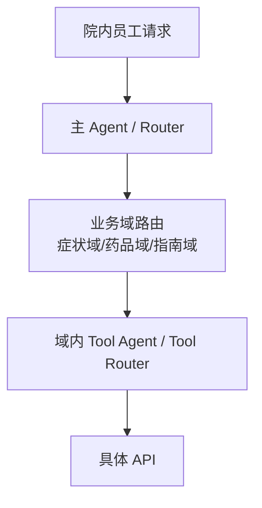

### example-002

**Q8｜有几千个 API，你有什么思路组织 Agent 框架？**

来源：02-场景设计与系统架构.md 第 177 行。用途：ToB 原理示例 / 扩展设计；不表示代码已落地。

[返回对应问答](#q-023)

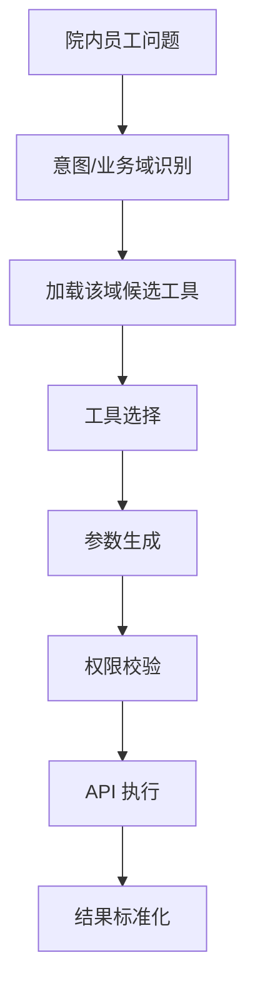

### example-003

**Q8｜有几千个 API，你有什么思路组织 Agent 框架？**

来源：02-场景设计与系统架构.md 第 196 行。用途：ToB 原理示例 / 扩展设计；不表示代码已落地。

[返回对应问答](#q-024)

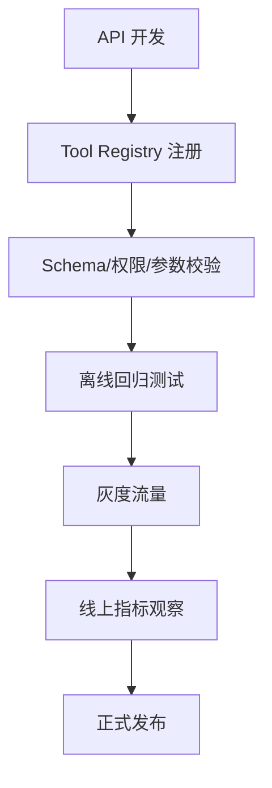

### example-004

**Q9｜让你设计一个生产级的多 Agent 系统，你会怎么考虑？**

来源：02-场景设计与系统架构.md 第 220 行。用途：ToB 原理示例 / 扩展设计；不表示代码已落地。

[返回对应问答](#q-025)

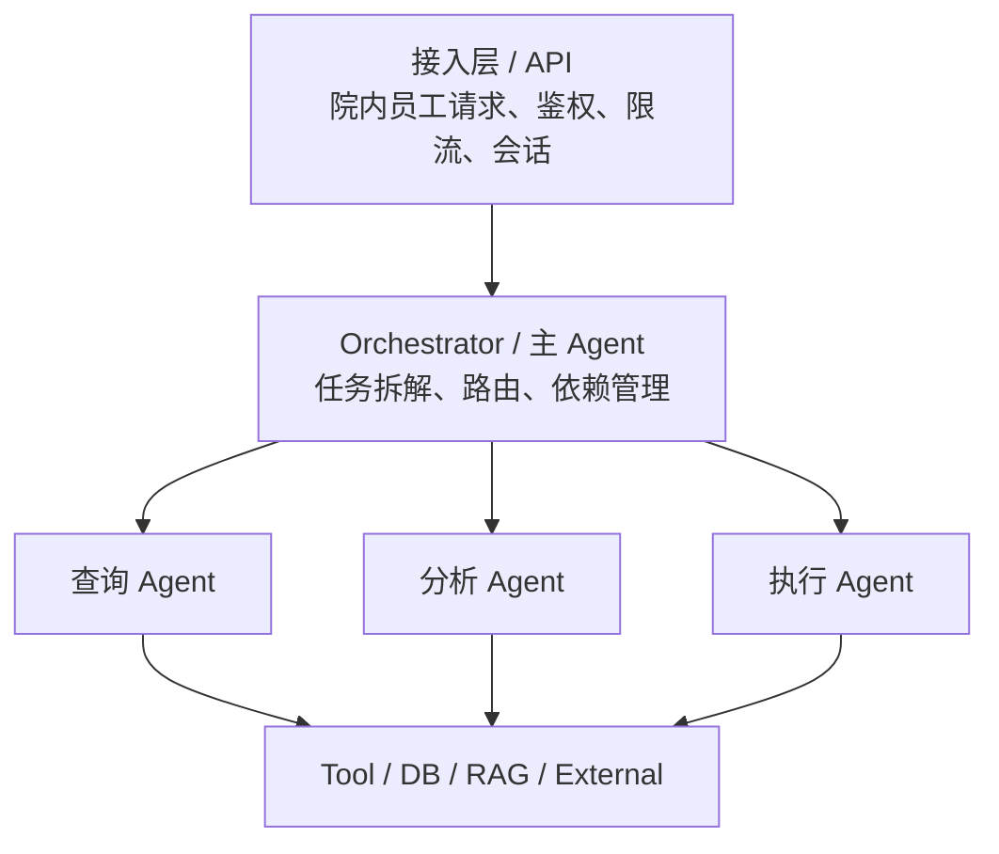

### example-005

**Q9｜让你设计一个生产级的多 Agent 系统，你会怎么考虑？**

来源：02-场景设计与系统架构.md 第 239 行。用途：ToB 原理示例 / 扩展设计；不表示代码已落地。

[返回对应问答](#q-025)

```text
conversation_id
task_id
current_step
completed_steps
tool_results
approval_status
retry_count
```

### example-006

**Q9｜让你设计一个生产级的多 Agent 系统，你会怎么考虑？**

来源：02-场景设计与系统架构.md 第 255 行。用途：ToB 原理示例 / 扩展设计；不表示代码已落地。

[返回对应问答](#q-025)

```json
{
  "task_id": "T123",
  "trace_id": "xxx",
  "from": "planner",
  "to": "query_agent",
  "action": "query_patient_record",
  "payload": {},
  "status": "pending"
}
```

### example-007

**Q9｜让你设计一个生产级的多 Agent 系统，你会怎么考虑？**

来源：02-场景设计与系统架构.md 第 277 行。用途：ToB 原理示例 / 扩展设计；不表示代码已落地。

[返回对应问答](#q-025)

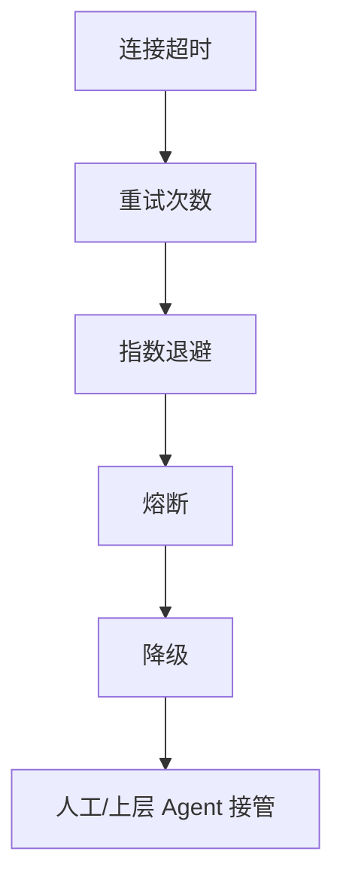

### example-008

**Q9｜让你设计一个生产级的多 Agent 系统，你会怎么考虑？**

来源：02-场景设计与系统架构.md 第 292 行。用途：ToB 原理示例 / 扩展设计；不表示代码已落地。

[返回对应问答](#q-025)

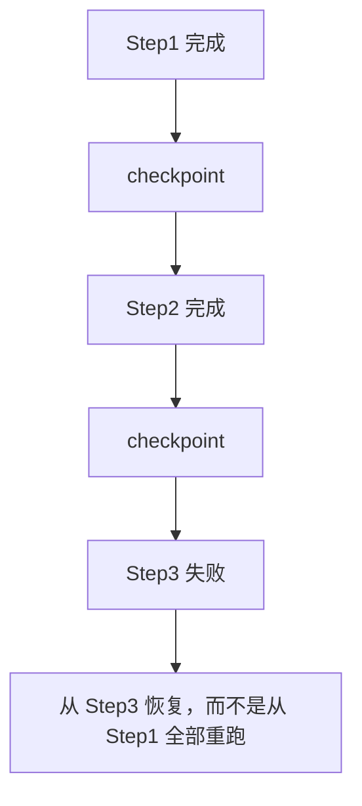

### example-009

**Q9｜让你设计一个生产级的多 Agent 系统，你会怎么考虑？**

来源：02-场景设计与系统架构.md 第 333 行。用途：ToB 原理示例 / 扩展设计；不表示代码已落地。

[返回对应问答](#q-027)

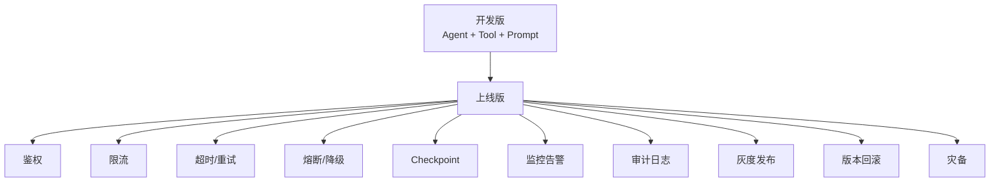

### example-010

**Q10｜弄一个语音打电话功能，用户通过电话让 AI 完成操作，怎么设计？**

来源：02-场景设计与系统架构.md 第 358 行。用途：ToB 原理示例 / 扩展设计；不表示代码已落地。

[返回对应问答](#q-028)

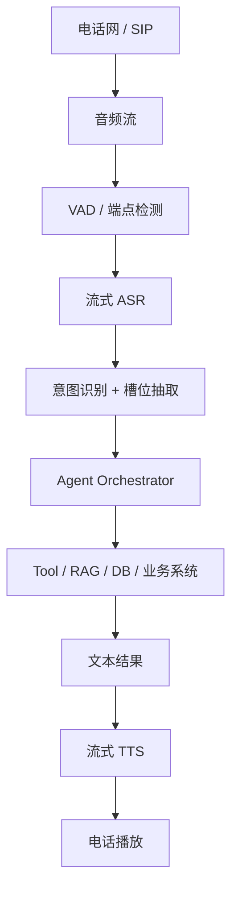

### example-011

**Q10｜弄一个语音打电话功能，用户通过电话让 AI 完成操作，怎么设计？**

来源：02-场景设计与系统架构.md 第 379 行。用途：ToB 原理示例 / 扩展设计；不表示代码已落地。

[返回对应问答](#q-029)

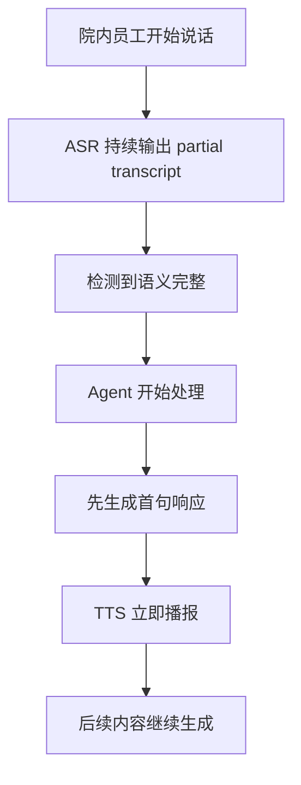

### example-012

**Q10｜弄一个语音打电话功能，用户通过电话让 AI 完成操作，怎么设计？**

来源：02-场景设计与系统架构.md 第 401 行。用途：ToB 原理示例 / 扩展设计；不表示代码已落地。

[返回对应问答](#q-030)

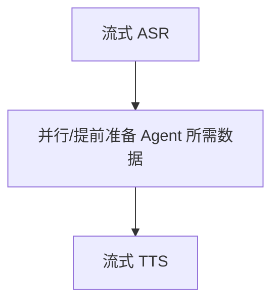

### example-013

**Q11｜设计 RAG+Agent 系统应考虑什么因素？**

来源：02-场景设计与系统架构.md 第 425 行。用途：ToB 原理示例 / 扩展设计；不表示代码已落地。

[返回对应问答](#q-031)

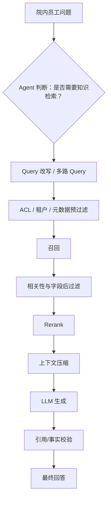

### example-014

**Q11｜设计 RAG+Agent 系统应考虑什么因素？**

来源：02-场景设计与系统架构.md 第 457 行。用途：ToB 原理示例 / 扩展设计；不表示代码已落地。

[返回对应问答](#q-032)

```text
召回阶段：相关文档有没有被召回？
排序阶段：最相关文档有没有排在前面？
生成阶段：模型有没有基于这些文档回答？
```

### example-015

**Q11｜设计 RAG+Agent 系统应考虑什么因素？**

来源：02-场景设计与系统架构.md 第 469 行。用途：ToB 原理示例 / 扩展设计；不表示代码已落地。

[返回对应问答](#q-032)

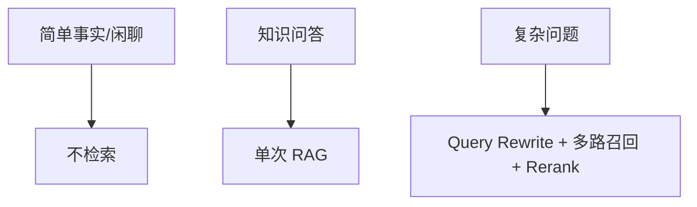

### example-016

**Q11｜设计 RAG+Agent 系统应考虑什么因素？**

来源：02-场景设计与系统架构.md 第 482 行。用途：ToB 原理示例 / 扩展设计；不表示代码已落地。

[返回对应问答](#q-032)

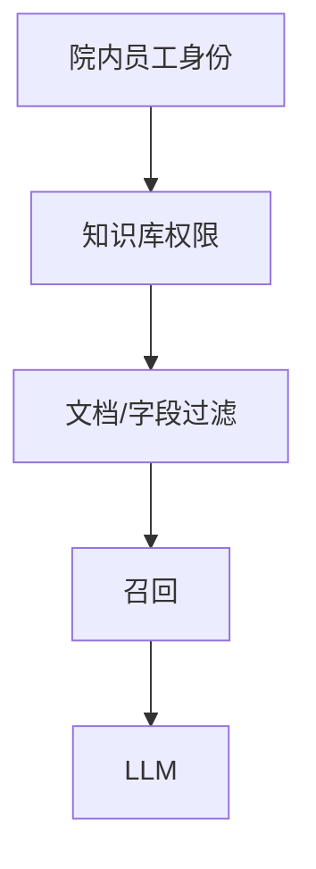

### example-017

**Q11｜设计 RAG+Agent 系统应考虑什么因素？**

来源：02-场景设计与系统架构.md 第 496 行。用途：ToB 原理示例 / 扩展设计；不表示代码已落地。

[返回对应问答](#q-032)

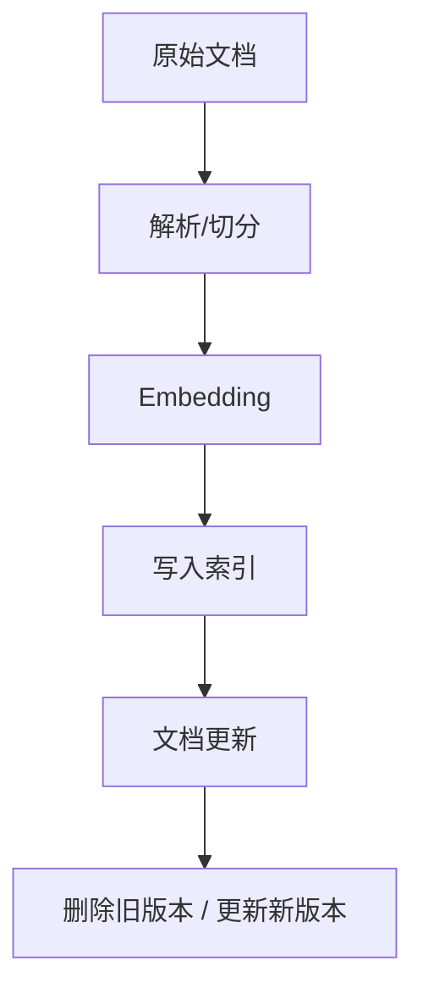

### example-018

**Q11｜设计 RAG+Agent 系统应考虑什么因素？**

来源：02-场景设计与系统架构.md 第 511 行。用途：ToB 原理示例 / 扩展设计；不表示代码已落地。

[返回对应问答](#q-032)

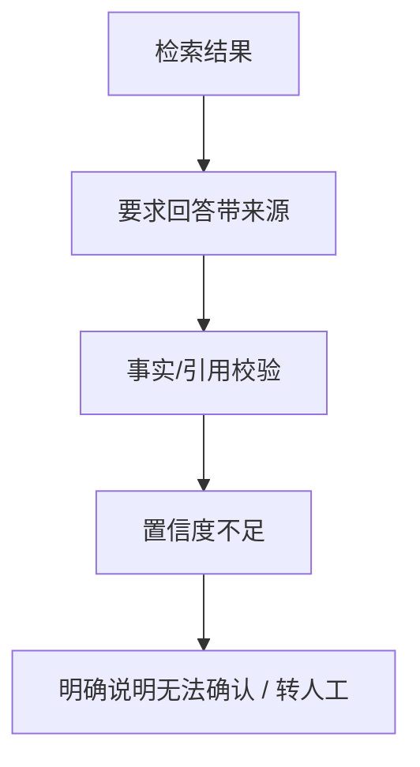

### example-019

**Q11｜设计 RAG+Agent 系统应考虑什么因素？**

来源：02-场景设计与系统架构.md 第 527 行。用途：ToB 原理示例 / 扩展设计；不表示代码已落地。

[返回对应问答](#q-033)

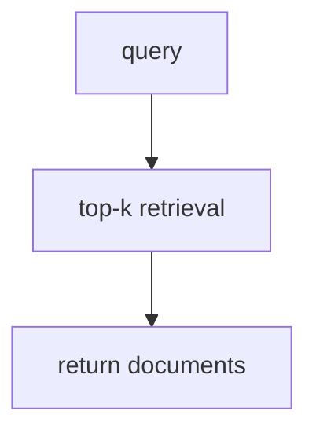

### example-020

**Q11｜设计 RAG+Agent 系统应考虑什么因素？**

来源：02-场景设计与系统架构.md 第 537 行。用途：ToB 原理示例 / 扩展设计；不表示代码已落地。

[返回对应问答](#q-033)

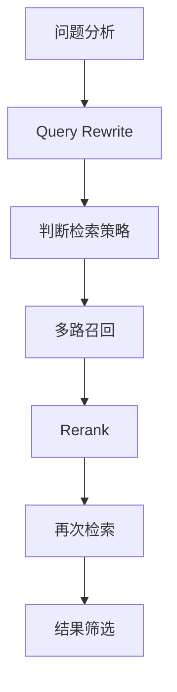

### example-021

**Q12｜生产级 Agent 系统从开发版转为上线版需要补充什么？**

来源：02-场景设计与系统架构.md 第 561 行。用途：ToB 原理示例 / 扩展设计；不表示代码已落地。

[返回对应问答](#q-034)

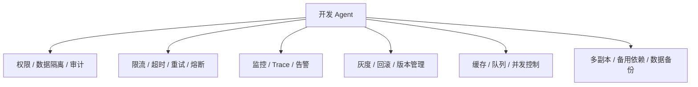

### example-022

**Q12｜生产级 Agent 系统从开发版转为上线版需要补充什么？**

来源：02-场景设计与系统架构.md 第 579 行。用途：ToB 原理示例 / 扩展设计；不表示代码已落地。

[返回对应问答](#q-035)

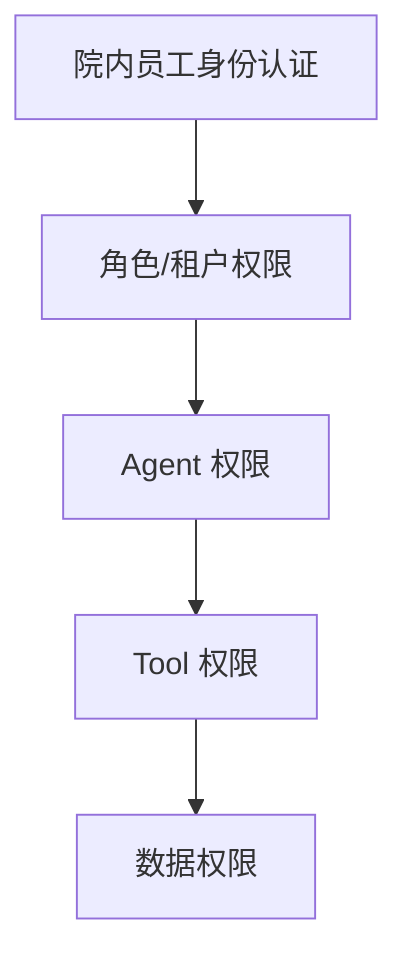

### example-023

**Q12｜生产级 Agent 系统从开发版转为上线版需要补充什么？**

来源：02-场景设计与系统架构.md 第 607 行。用途：ToB 原理示例 / 扩展设计；不表示代码已落地。

[返回对应问答](#q-035)

```text
成功率
延迟
成本
人工转接率
业务指标
```

### example-024

**Q12｜生产级 Agent 系统从开发版转为上线版需要补充什么？**

来源：02-场景设计与系统架构.md 第 621 行。用途：ToB 原理示例 / 扩展设计；不表示代码已落地。

[返回对应问答](#q-035)

```text
院内员工并发
Agent 任务并发
模型并发
Tool 并发
队列长度
```

### example-025

**Q12｜生产级 Agent 系统从开发版转为上线版需要补充什么？**

来源：02-场景设计与系统架构.md 第 635 行。用途：ToB 原理示例 / 扩展设计；不表示代码已落地。

[返回对应问答](#q-035)

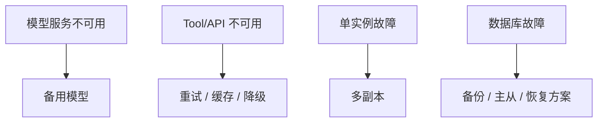

