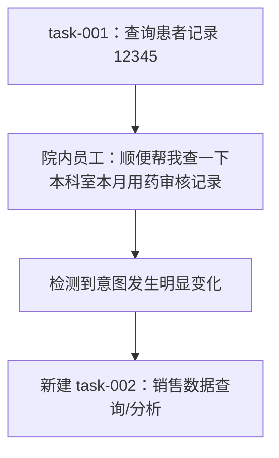
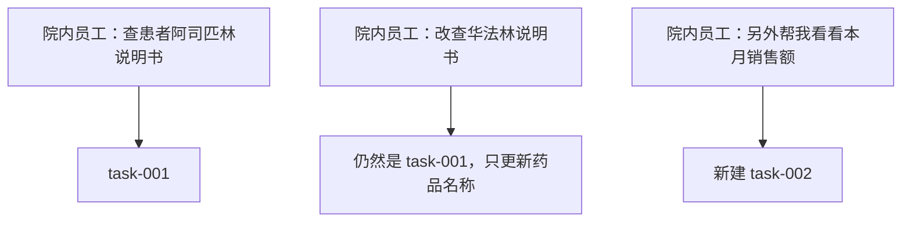
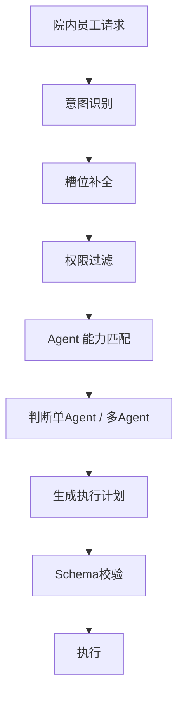
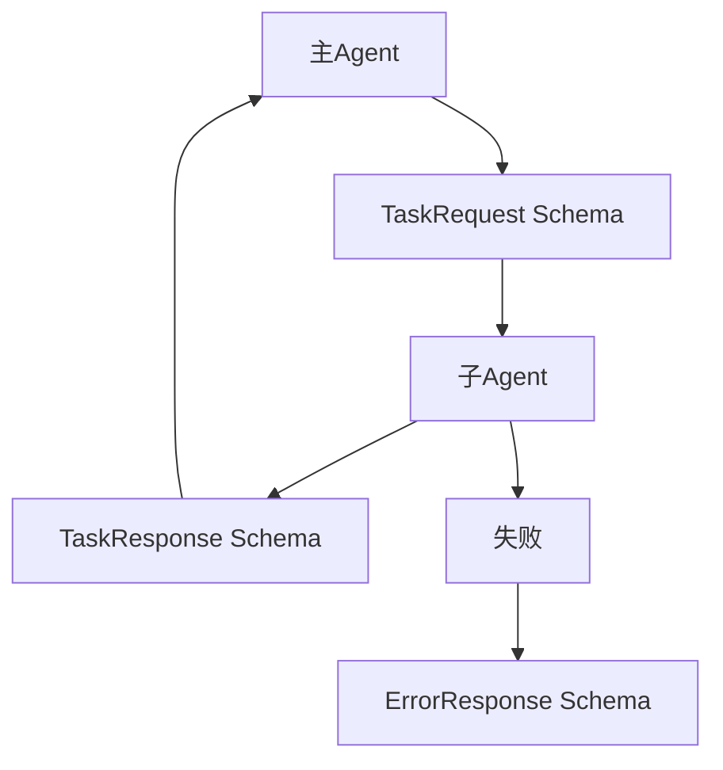
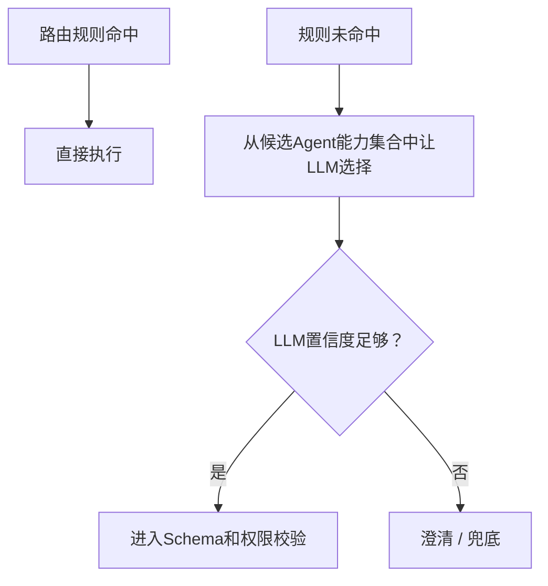
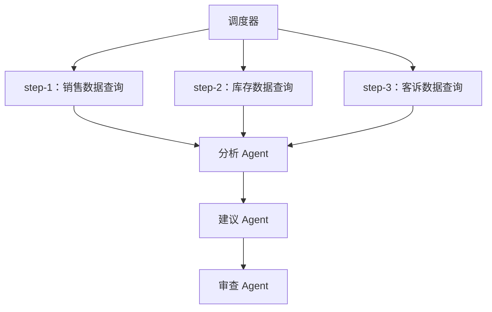
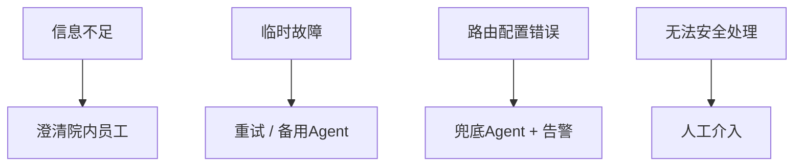

# 03-主Agent调度：MedAgent 逐题口述

核查日期：2026-10-13。所有答案以院内 ToB 边界为前提。一般理论与未落地的扩展方案明确分开。

## q-001

### 主问题｜主 Agent 是做什么的？

原文位置：03-主Agent调度.md 第 28 行（原件保存在同步前备份）。

**项目口述：** 我做的是面向院内医生、药师和管理人员的临床辅助工作台。FastAPI 入口核对员工与患者权限，主协调器检查安全、范围、意图和计划，再交给症状、药品、指南三个专科，通过 MCP 查询真实数据，最后保存咨询和审计后发送完成事件。最终诊疗由医生复核。

**针对本题的设计展开（原文原理，作为方案解释）：**

主 Agent 是整个系统的调度中枢：意图识别、槽位抽取、任务计划、路由分发、异常处理、结果聚合。本模块采用主 Agent 组织业务执行、子 Agent 完成具体业务的分工；主 Agent 也可以汇总结果并生成最终回答，并非不能生产任何结果。

**在 MedAgent 中怎么补全：** 设计上优先固定授权和执行边界，模型只在范围内做分类、规划、工具选择和解释。新能力必须有明确院内使用人、数据来源、权限与验收标准；患者挂号、预约、缴费、退费均不接入。

**代码依据：** [backend/main.py](../../backend/main.py)、[backend/agents.py](../../backend/agents.py)、[backend/access.py](../../backend/access.py)

## q-002

### 追问｜是只做意图识别，还是还负责任务拆解、路由、结果聚合？

原文位置：03-主Agent调度.md 第 34 行（原件保存在同步前备份）。

**项目口述：** 我做的是面向院内医生、药师和管理人员的临床辅助工作台。FastAPI 入口核对员工与患者权限，主协调器检查安全、范围、意图和计划，再交给症状、药品、指南三个专科，通过 MCP 查询真实数据，最后保存咨询和审计后发送完成事件。最终诊疗由医生复核。

**针对本题的设计展开（原文原理，作为方案解释）：**

取决于架构设计，主流是"全管"：意图识别只是入口，任务拆解、路由分发、结果聚合都由主 Agent 负责。回答时明确自己的架构选型，并说明为什么这么分。

**在 MedAgent 中怎么补全：** 设计上优先固定授权和执行边界，模型只在范围内做分类、规划、工具选择和解释。新能力必须有明确院内使用人、数据来源、权限与验收标准；患者挂号、预约、缴费、退费均不接入。

**代码依据：** [backend/main.py](../../backend/main.py)、[backend/agents.py](../../backend/agents.py)、[backend/access.py](../../backend/access.py)

## q-003

### 追问｜主 Agent 本身是否调用工具？还是只负责调度子 Agent？

原文位置：03-主Agent调度.md 第 38 行（原件保存在同步前备份）。

**项目口述：** 我做的是面向院内医生、药师和管理人员的临床辅助工作台。FastAPI 入口核对员工与患者权限，主协调器检查安全、范围、意图和计划，再交给症状、药品、指南三个专科，通过 MCP 查询真实数据，最后保存咨询和审计后发送完成事件。最终诊疗由医生复核。

**针对本题的设计展开（原文原理，作为方案解释）：**

一般只调用"路由/计划"类轻工具，业务工具（查库、检索、执行操作）全部交给子 Agent。职责清晰：主 Agent 管"往哪走"，子 Agent 管"怎么干"。

**在 MedAgent 中怎么补全：** 设计上优先固定授权和执行边界，模型只在范围内做分类、规划、工具选择和解释。新能力必须有明确院内使用人、数据来源、权限与验收标准；患者挂号、预约、缴费、退费均不接入。

**代码依据：** [backend/main.py](../../backend/main.py)、[backend/agents.py](../../backend/agents.py)、[backend/access.py](../../backend/access.py)

## q-004

### 主问题｜用户意图识别怎么做？

原文位置：03-主Agent调度.md 第 42 行（原件保存在同步前备份）。

**项目口述：** 十类院内意图由正则、本地 BERT Sigmoid 多标签和 BGE-M3 三路都识别，再统一融合。BERT 当前逐类阈值 0.5，向量默认 0.78，BERT 边界范围 0.08。分歧、否定、边界、空候选或通道不可用才触发 LLM 复核；不是三路必须完全一致，也不是按分数投票。

**针对本题的设计展开（原文原理，作为方案解释）：**

一种通用方案是“规则 + 分类模型 + Embedding（向量化表示）+ LLM 兜底”的成本级联。以下四层举例说明这种可选设计；MedAgent 的实际实现是前三路都运行后融合，并按冲突和不确定性条件调用 LLM 复核。

第二层是轻量分类模型，处理高频且边界比较稳定的业务意图，可以把大部分请求在低成本阶段解决。

最后才使用 LLM 做复杂分类，尤其是长文本、多意图、边界模糊或者新增意图。LLM 的输出必须结构化，例如返回 `intent`、`confidence`、`reason`，再进入后续校验。

这样设计的核心不是“谁最聪明”，而是把确定性问题尽量放在便宜、稳定的层，把真正需要语义理解的问题交给 LLM，同时控制成本和误路由风险。

**在 MedAgent 中怎么补全：** 阈值通过独立验证集选择，测试和挑战集只评估冻结结果。医疗急症由独立安全入口处理；意图置信分数不代表患者低风险。LLM 复核失败停止分派，不悄悄回到冲突候选。

**代码依据：** [backend/intent_fusion.py](../../backend/intent_fusion.py)、[backend/agents.py](../../backend/agents.py)、[backend/config.py](../../backend/config.py)

## q-005

### 追问｜规则、分类模型、Embedding 相似度、大模型 JSON 分类怎么结合？

原文位置：03-主Agent调度.md 第 58 行（原件保存在同步前备份）。

**项目口述：** 十类院内意图由正则、本地 BERT Sigmoid 多标签和 BGE-M3 三路都识别，再统一融合。BERT 当前逐类阈值 0.5，向量默认 0.78，BERT 边界范围 0.08。分歧、否定、边界、空候选或通道不可用才触发 LLM 复核；不是三路必须完全一致，也不是按分数投票。

**针对本题的设计展开（原文原理，作为方案解释）：**

可以按照“确定性从高到低、成本从低到高”的顺序处理：

1. 规则命中且没有歧义，直接路由。

2. 规则未命中，进入轻量分类模型。

3. 分类模型置信度不足，再做 Embedding 相似度匹配。

4. 仍然无法确定，调用 LLM 做结构化分类。

5. 最终置信度仍低于阈值，不强行路由，而是进入澄清或人工。

**在 MedAgent 中怎么补全：** 阈值通过独立验证集选择，测试和挑战集只评估冻结结果。医疗急症由独立安全入口处理；意图置信分数不代表患者低风险。LLM 复核失败停止分派，不悄悄回到冲突候选。

**代码依据：** [backend/intent_fusion.py](../../backend/intent_fusion.py)、[backend/agents.py](../../backend/agents.py)、[backend/config.py](../../backend/config.py)

## q-006

### 追问｜置信度低的时候怎么处理？是否进入澄清追问或人工兜底？

原文位置：03-主Agent调度.md 第 70 行（原件保存在同步前备份）。

**项目口述：** 十类院内意图由正则、本地 BERT Sigmoid 多标签和 BGE-M3 三路都识别，再统一融合。BERT 当前逐类阈值 0.5，向量默认 0.78，BERT 边界范围 0.08。分歧、否定、边界、空候选或通道不可用才触发 LLM 复核；不是三路必须完全一致，也不是按分数投票。

**针对本题的设计展开（原文原理，作为方案解释）：**

是。一般设置明确的决策阈值：

- 高置信度：直接进入任务执行。

- 中间区域：向用户确认候选意图或补充关键信息。

- 极低置信度：无法可靠判断时进入兜底或人工。

**在 MedAgent 中怎么补全：** 阈值通过独立验证集选择，测试和挑战集只评估冻结结果。医疗急症由独立安全入口处理；意图置信分数不代表患者低风险。LLM 复核失败停止分派，不悄悄回到冲突候选。

**代码依据：** [backend/intent_fusion.py](../../backend/intent_fusion.py)、[backend/agents.py](../../backend/agents.py)、[backend/config.py](../../backend/config.py)

## q-007

### 主问题｜意图分了几类？

原文位置：03-主Agent调度.md 第 80 行（原件保存在同步前备份）。

**项目口述：** 我分了十类院内意图：症状评估、药品信息查询、临床指南检索、检验结果辅助解读、院内分诊建议、随访管理、用药审核、临床知识查询、转诊协同、检查报告辅助解读。三专科按意图映射调用；医疗急症和范围外请求由守卫处理，不作为患者自助服务意图。

**针对本题的设计展开（原文原理，作为方案解释）：**

常见七类：查询类、分析类、生成类、操作类、知识问答类、闲聊类、异常类。每类意图对应明确的路由表。

**在 MedAgent 中怎么补全：** 阈值通过独立验证集选择，测试和挑战集只评估冻结结果。医疗急症由独立安全入口处理；意图置信分数不代表患者低风险。LLM 复核失败停止分派，不悄悄回到冲突候选。

**代码依据：** [backend/intent_fusion.py](../../backend/intent_fusion.py)、[backend/agents.py](../../backend/agents.py)、[backend/config.py](../../backend/config.py)

## q-008

### 追问｜查询类、分析类、生成类、操作类、知识问答类、闲聊类、异常类？

原文位置：03-主Agent调度.md 第 86 行（原件保存在同步前备份）。

**项目口述：** 十类院内意图由正则、本地 BERT Sigmoid 多标签和 BGE-M3 三路都识别，再统一融合。BERT 当前逐类阈值 0.5，向量默认 0.78，BERT 边界范围 0.08。分歧、否定、边界、空候选或通道不可用才触发 LLM 复核；不是三路必须完全一致，也不是按分数投票。

**针对本题的设计展开（原文原理，作为方案解释）：**

按业务实际划分，不必生搬硬套。关键不是分几类，而是每类都有明确处理路径：查询类→查询 Agent，分析类→分析 Agent，异常类→兜底节点。

**在 MedAgent 中怎么补全：** 阈值通过独立验证集选择，测试和挑战集只评估冻结结果。医疗急症由独立安全入口处理；意图置信分数不代表患者低风险。LLM 复核失败停止分派，不悄悄回到冲突候选。

**代码依据：** [backend/intent_fusion.py](../../backend/intent_fusion.py)、[backend/agents.py](../../backend/agents.py)、[backend/config.py](../../backend/config.py)

## q-009

### 追问｜不同意图对应哪些子 Agent？是否有路由表？

原文位置：03-主Agent调度.md 第 90 行（原件保存在同步前备份）。

**项目口述：** 十类院内意图由正则、本地 BERT Sigmoid 多标签和 BGE-M3 三路都识别，再统一融合。BERT 当前逐类阈值 0.5，向量默认 0.78，BERT 边界范围 0.08。分歧、否定、边界、空候选或通道不可用才触发 LLM 复核；不是三路必须完全一致，也不是按分数投票。

**针对本题的设计展开（原文原理，作为方案解释）：**

有显式路由表：意图 → 目标 Agent 的映射（规则表），维护在配置里。执行目标由校验后的意图决定；MedAgent 的规则只是融合证据，不绕过模型通道。

例如可以把路由配置写成可版本化的 JSON：

**在 MedAgent 中怎么补全：** 阈值通过独立验证集选择，测试和挑战集只评估冻结结果。医疗急症由独立安全入口处理；意图置信分数不代表患者低风险。LLM 复核失败停止分派，不悄悄回到冲突候选。

**代码依据：** [backend/intent_fusion.py](../../backend/intent_fusion.py)、[backend/agents.py](../../backend/agents.py)、[backend/config.py](../../backend/config.py)

**本题图与结构示例：** [example-001](#example-001)

## q-010

### 主问题｜意图识别错了怎么办？

原文位置：03-主Agent调度.md 第 121 行（原件保存在同步前备份）。

**项目口述：** 我把意图错误作为一个受控闭环处理：发现问题、判断副作用、修正识别、重建计划、核对结果，再由院内人员复核。事前看三路分歧和阈值边界，事中看参数缺失、权限或工具异常，事后看目标所需工具是否覆盖，最终看医生或药师纠正。置信度只能表示可疑，接口失败也可能是服务故障，不能单凭一个信号判定识别错。

**针对本题的设计展开（原文原理，作为方案解释）：**

设计上可以把“意图识别错误”当成一个完整的闭环问题，而不是简单地重新调用一次模型。一般分成：

`发现错误 → 判断是否已产生副作用 → 回滚/补偿 → 重新路由 → 结果校验 → 必要时人工兜底`

第三步是保留已有的有效中间结果。例如前面的用户身份识别已经完成，就不需要重新做一遍，只重建错误的意图和后续计划。

最终重新路由后，还需要做结果校验，确认“执行结果是否真的符合用户原始目标”，而不是仅仅看到工具调用成功就认为任务成功。

**在 MedAgent 中怎么补全：** 工作台已能提交意图纠错，服务端重新核验患者权限和原请求所属员工，保存为待临床复核记录，不自动作为训练标签。完整闭环还需要结论与目标的语义核验、复核工单及标注发布流程。工具成功不是医学正确证明；写入不明先查状态、核对 HIS，跨系统补偿取决于医院接口。

**代码依据：** [backend/evidence.py](../../backend/evidence.py)、[backend/agents.py](../../backend/agents.py)、[backend/mcp_security.py](../../backend/mcp_security.py)、[backend/main.py](../../backend/main.py)

## q-011

### 追问｜二次识别、执行结果校验、异常回滚、转人工、重新路由分别怎么做？

原文位置：03-主Agent调度.md 第 137 行（原件保存在同步前备份）。

**项目口述：** 我按识别前、执行中和执行后处理：前三路发现分歧时二次识别；执行前校验关键参数和权限；执行后检查每个意图是否有对应的成功工具依据，例如病史读取不能代替药品说明书查询。只读任务覆盖不匹配时最多复核并重路由一次；批准写动作或出现写调用时禁止自动重跑。

**针对本题的设计展开（原文原理，作为方案解释）：**

二次识别：当首次意图置信度低，或者执行结果暴露出明显矛盾时，用上下文和已获得信息再次判断，但不要无限循环。

异常回滚：对于有副作用的操作，需要有事务回滚、补偿接口或者业务撤销流程。不能假设所有 Agent 操作都能够真正回滚。

重新路由：修正意图后，重新生成任务计划，但复用已经可信的上下文、身份和查询结果。

转人工：连续修正失败、高风险操作出现不一致、系统无法判断真实业务状态时，交给人工，不继续让 Agent 猜。

**在 MedAgent 中怎么补全：** 工作台已能提交意图纠错，服务端重新核验患者权限和原请求所属员工，保存为待临床复核记录，不自动作为训练标签。完整闭环还需要结论与目标的语义核验、复核工单及标注发布流程。工具成功不是医学正确证明；写入不明先查状态、核对 HIS，跨系统补偿取决于医院接口。

**代码依据：** [backend/evidence.py](../../backend/evidence.py)、[backend/agents.py](../../backend/agents.py)、[backend/mcp_security.py](../../backend/mcp_security.py)、[backend/main.py](../../backend/main.py)

## q-012

### 追问｜如何判断“识别错了”？靠置信度、工具返回、结果校验还是人工反馈？

原文位置：03-主Agent调度.md 第 149 行（原件保存在同步前备份）。

**项目口述：** 我按识别前、执行中和执行后处理：前三路发现分歧时二次识别；执行前校验关键参数和权限；执行后检查每个意图是否有对应的成功工具依据，例如病史读取不能代替药品说明书查询。只读任务覆盖不匹配时最多复核并重路由一次；批准写动作或出现写调用时禁止自动重跑。

**针对本题的设计展开（原文原理，作为方案解释）：**

四个信号都可以使用，但作用不同：

- 置信度：事前判断，发现“可能识别错”。

- 工具返回：执行过程中发现参数与目标不匹配。

- 结果校验：事后判断“虽然执行成功，但结果不是用户要的”。

- 用户反馈：最终确认，比如用户说“我问的不是这个”。

因此生产系统最好采用“事前置信度 + 事中异常 + 事后结果校验 + 用户反馈”的闭环，而不是只依赖模型自己的判断。

**在 MedAgent 中怎么补全：** 工作台已能提交意图纠错，服务端重新核验患者权限和原请求所属员工，保存为待临床复核记录，不自动作为训练标签。完整闭环还需要结论与目标的语义核验、复核工单及标注发布流程。工具成功不是医学正确证明；写入不明先查状态、核对 HIS，跨系统补偿取决于医院接口。

**代码依据：** [backend/evidence.py](../../backend/evidence.py)、[backend/agents.py](../../backend/agents.py)、[backend/mcp_security.py](../../backend/mcp_security.py)、[backend/main.py](../../backend/main.py)

## q-013

### 主问题｜用户问题短且模糊怎么办？

原文位置：03-主Agent调度.md 第 160 行（原件保存在同步前备份）。

**项目口述：** 可信身份和患者档案由服务端读取。业务参数由模型按工具 schema 提出，执行前代码检查空值、占位值、列表和检验内容；药名必须能在当前任务原始输入或可信用药档案中找到依据，相互作用检查至少两种药。参数记录 raw_value、normalized_value、source、turn_id、evidence_span、schema_version 和 validation_status。

**针对本题的设计展开（原文原理，作为方案解释）：**

四个手段：槽位追问、结合上下文、query 改写、候选意图确认。

**在 MedAgent 中怎么补全：** 现在没有训练过医疗 NER，也没有声称语义校验能识别全部错槽。扩展方案是为十类意图注册必填字段，规则抽固定格式，LLM 只提取有原文跨度的实体，再用药品目录校正通用名、单位和枚举。缺关键字段询问医生或药师，临床数值和药名不凭默认值补齐。

**代码依据：** [backend/clinical_slots.py](../../backend/clinical_slots.py)、[backend/schemas.py](../../backend/schemas.py)、[backend/agents.py](../../backend/agents.py)

## q-014

### 追问｜槽位追问、结合上下文、query 改写、候选意图确认怎么用？

原文位置：03-主Agent调度.md 第 166 行（原件保存在同步前备份）。

**项目口述：** 可信身份和患者档案由服务端读取。业务参数由模型按工具 schema 提出，执行前代码检查空值、占位值、列表和检验内容；药名必须能在当前任务原始输入或可信用药档案中找到依据，相互作用检查至少两种药。参数记录 raw_value、normalized_value、source、turn_id、evidence_span、schema_version 和 validation_status。

**在 MedAgent 中怎么补全：** 现在没有训练过医疗 NER，也没有声称语义校验能识别全部错槽。扩展方案是为十类意图注册必填字段，规则抽固定格式，LLM 只提取有原文跨度的实体，再用药品目录校正通用名、单位和枚举。缺关键字段询问医生或药师，临床数值和药名不凭默认值补齐。

**代码依据：** [backend/clinical_slots.py](../../backend/clinical_slots.py)、[backend/schemas.py](../../backend/schemas.py)、[backend/agents.py](../../backend/agents.py)

## q-015

### 追问｜"查一下这个""帮我分析下"这类问题怎么处理？

原文位置：03-主Agent调度.md 第 170 行（原件保存在同步前备份）。

**项目口述：** 可信身份和患者档案由服务端读取。业务参数由模型按工具 schema 提出，执行前代码检查空值、占位值、列表和检验内容；药名必须能在当前任务原始输入或可信用药档案中找到依据，相互作用检查至少两种药。参数记录 raw_value、normalized_value、source、turn_id、evidence_span、schema_version 和 validation_status。

**针对本题的设计展开（原文原理，作为方案解释）：**

"查一下这个"：结合上一轮上下文补全指代，补不了就追问"您要查什么"；"帮我分析下"：追问分析对象和角度，或列候选问题让用户选。原则：能定位就定位，定位不了就澄清。

**在 MedAgent 中怎么补全：** 现在没有训练过医疗 NER，也没有声称语义校验能识别全部错槽。扩展方案是为十类意图注册必填字段，规则抽固定格式，LLM 只提取有原文跨度的实体，再用药品目录校正通用名、单位和枚举。缺关键字段询问医生或药师，临床数值和药名不凭默认值补齐。

**代码依据：** [backend/clinical_slots.py](../../backend/clinical_slots.py)、[backend/schemas.py](../../backend/schemas.py)、[backend/agents.py](../../backend/agents.py)

## q-016

### 主问题｜意图漂移怎么处理？

原文位置：03-主Agent调度.md 第 174 行（原件保存在同步前备份）。

**项目口述：** 每轮有 request_id，任务还有 task_id 和 plan_version。员工可选新任务、补充或更正；自动模式只续接待澄清问题，明确新请求切新任务并隔离旧历史。完整更正递增版本、丢弃旧业务输入；只有指代或局部含糊更正时先追问。A2A 返回必须匹配签名委托中的任务、计划版本和步骤，旧结果不能写回新计划。

**针对本题的设计展开（原文原理，作为方案解释）：**

多轮 Agent 最容易出现的问题之一，就是“上一轮任务还没完成，用户突然换了目标”。

我的处理方式不是简单地把整个上下文都继续塞给模型，而是给每个任务建立独立的 `task_id` 和任务状态。

例如：

这样可以避免两个任务的槽位、工具结果和执行状态相互污染。

所以核心判断标准是：用户是在修改当前任务，还是开启一个新的任务。

**在 MedAgent 中怎么补全：** 当前补充仍是有界的原问题与本轮信息组合，并非完整按字段合并。设计上把槽位按任务保存来源和时效，同任务只继承仍适用的字段，明确新值只覆盖对应字段；换患者或换任务不继承业务槽，身份始终重新从可信会话核验。

**代码依据：** [backend/task_context.py](../../backend/task_context.py)、[backend/main.py](../../backend/main.py)、[backend/a2a_server.py](../../backend/a2a_server.py)

**本题图与结构示例：** [example-002](#example-002)

## q-017

### 追问｜多轮对话中用户突然换问题，是否重置任务状态？

原文位置：03-主Agent调度.md 第 197 行（原件保存在同步前备份）。

**项目口述：** 每轮有 request_id，任务还有 task_id 和 plan_version。员工可选新任务、补充或更正；自动模式只续接待澄清问题，明确新请求切新任务并隔离旧历史。完整更正递增版本、丢弃旧业务输入；只有指代或局部含糊更正时先追问。A2A 返回必须匹配签名委托中的任务、计划版本和步骤，旧结果不能写回新计划。

**针对本题的设计展开（原文原理，作为方案解释）：**

不能一律重置，要区分三种情况：

1. 同一任务继续补充信息：保留 task。

2. 同一任务修改部分目标：更新槽位和计划。

3. 完全无关的新任务：新建 task。

例如：

**在 MedAgent 中怎么补全：** 当前补充仍是有界的原问题与本轮信息组合，并非完整按字段合并。设计上把槽位按任务保存来源和时效，同任务只继承仍适用的字段，明确新值只覆盖对应字段；换患者或换任务不继承业务槽，身份始终重新从可信会话核验。

**代码依据：** [backend/task_context.py](../../backend/task_context.py)、[backend/main.py](../../backend/main.py)、[backend/a2a_server.py](../../backend/a2a_server.py)

**本题图与结构示例：** [example-003](#example-003)

## q-018

### 追问｜如何防止上一轮任务状态污染新任务？

原文位置：03-主Agent调度.md 第 214 行（原件保存在同步前备份）。

**项目口述：** 每轮有 request_id，任务还有 task_id 和 plan_version。员工可选新任务、补充或更正；自动模式只续接待澄清问题，明确新请求切新任务并隔离旧历史。完整更正递增版本、丢弃旧业务输入；只有指代或局部含糊更正时先追问。A2A 返回必须匹配签名委托中的任务、计划版本和步骤，旧结果不能写回新计划。

**针对本题的设计展开（原文原理，作为方案解释）：**

核心是状态隔离：

- 用 `task_id` 隔离不同任务。

- 用结构化状态保存意图、槽位、计划和执行结果，不依赖整段聊天记录作为唯一状态。

- 新任务不默认继承旧槽位。

- 只有用户明确延续，或者系统能证明该信息属于当前任务时，才继承历史信息。

- 工具调用结果也绑定 `task_id`，避免把旧任务结果误拿给新任务。

对于长流程任务，还应该配合 checkpoint，这样新任务不会影响原任务，原任务也可以暂停后继续。

**在 MedAgent 中怎么补全：** 当前补充仍是有界的原问题与本轮信息组合，并非完整按字段合并。设计上把槽位按任务保存来源和时效，同任务只继承仍适用的字段，明确新值只覆盖对应字段；换患者或换任务不继承业务槽，身份始终重新从可信会话核验。

**代码依据：** [backend/task_context.py](../../backend/task_context.py)、[backend/main.py](../../backend/main.py)、[backend/a2a_server.py](../../backend/a2a_server.py)

## q-019

### 主问题｜槽位识别怎么做？

原文位置：03-主Agent调度.md 第 228 行（原件保存在同步前备份）。

**项目口述：** 可信身份和患者档案由服务端读取。业务参数由模型按工具 schema 提出，执行前代码检查空值、占位值、列表和检验内容；药名必须能在当前任务原始输入或可信用药档案中找到依据，相互作用检查至少两种药。参数记录 raw_value、normalized_value、source、turn_id、evidence_span、schema_version 和 validation_status。

**针对本题的设计展开（原文原理，作为方案解释）：**

分层结合：规则正则、NER（Named Entity Recognition，命名实体识别）、LLM 抽取、表单约束、历史上下文补全。规则层处理明确格式，模型层处理自然语言，校验层保证质量（见下方口径）。

**在 MedAgent 中怎么补全：** 现在没有训练过医疗 NER，也没有声称语义校验能识别全部错槽。扩展方案是为十类意图注册必填字段，规则抽固定格式，LLM 只提取有原文跨度的实体，再用药品目录校正通用名、单位和枚举。缺关键字段询问医生或药师，临床数值和药名不凭默认值补齐。

**代码依据：** [backend/clinical_slots.py](../../backend/clinical_slots.py)、[backend/schemas.py](../../backend/schemas.py)、[backend/agents.py](../../backend/agents.py)

## q-020

### 追问｜规则正则、NER、LLM 抽取、表单约束、历史上下文补全怎么结合？

原文位置：03-主Agent调度.md 第 234 行（原件保存在同步前备份）。

**项目口述：** 可信身份和患者档案由服务端读取。业务参数由模型按工具 schema 提出，执行前代码检查空值、占位值、列表和检验内容；药名必须能在当前任务原始输入或可信用药档案中找到依据，相互作用检查至少两种药。参数记录 raw_value、normalized_value、source、turn_id、evidence_span、schema_version 和 validation_status。

**针对本题的设计展开（原文原理，作为方案解释）：**

规则正则：时间、编号、金额、手机号、ID 这类固定格式；NER：人名、地名、机构等实体；LLM 抽取：业务对象和复杂表述；表单约束：选项类信息让用户点选；历史上下文：上一轮已提供的槽位自动补全。

**在 MedAgent 中怎么补全：** 现在没有训练过医疗 NER，也没有声称语义校验能识别全部错槽。扩展方案是为十类意图注册必填字段，规则抽固定格式，LLM 只提取有原文跨度的实体，再用药品目录校正通用名、单位和枚举。缺关键字段询问医生或药师，临床数值和药名不凭默认值补齐。

**代码依据：** [backend/clinical_slots.py](../../backend/clinical_slots.py)、[backend/schemas.py](../../backend/schemas.py)、[backend/agents.py](../../backend/agents.py)

## q-021

### 追问｜哪些槽位是必填？哪些槽位可选？缺失后怎么追问？

原文位置：03-主Agent调度.md 第 238 行（原件保存在同步前备份）。

**项目口述：** 可信身份和患者档案由服务端读取。业务参数由模型按工具 schema 提出，执行前代码检查空值、占位值、列表和检验内容；药名必须能在当前任务原始输入或可信用药档案中找到依据，相互作用检查至少两种药。参数记录 raw_value、normalized_value、source、turn_id、evidence_span、schema_version 和 validation_status。

**在 MedAgent 中怎么补全：** 现在没有训练过医疗 NER，也没有声称语义校验能识别全部错槽。扩展方案是为十类意图注册必填字段，规则抽固定格式，LLM 只提取有原文跨度的实体，再用药品目录校正通用名、单位和枚举。缺关键字段询问医生或药师，临床数值和药名不凭默认值补齐。

**代码依据：** [backend/clinical_slots.py](../../backend/clinical_slots.py)、[backend/schemas.py](../../backend/schemas.py)、[backend/agents.py](../../backend/agents.py)

## q-022

### 主问题｜用户问题模糊怎么办？

原文位置：03-主Agent调度.md 第 242 行（原件保存在同步前备份）。

**项目口述：** 可信身份和患者档案由服务端读取。业务参数由模型按工具 schema 提出，执行前代码检查空值、占位值、列表和检验内容；药名必须能在当前任务原始输入或可信用药档案中找到依据，相互作用检查至少两种药。参数记录 raw_value、normalized_value、source、turn_id、evidence_span、schema_version 和 validation_status。

**针对本题的设计展开（原文原理，作为方案解释）：**

判断槽位是否影响执行：影响就补槽，不影响就直接回答。

**在 MedAgent 中怎么补全：** 现在没有训练过医疗 NER，也没有声称语义校验能识别全部错槽。扩展方案是为十类意图注册必填字段，规则抽固定格式，LLM 只提取有原文跨度的实体，再用药品目录校正通用名、单位和枚举。缺关键字段询问医生或药师，临床数值和药名不凭默认值补齐。

**代码依据：** [backend/clinical_slots.py](../../backend/clinical_slots.py)、[backend/schemas.py](../../backend/schemas.py)、[backend/agents.py](../../backend/agents.py)

## q-023

### 追问｜是直接回答，还是先补槽？

原文位置：03-主Agent调度.md 第 248 行（原件保存在同步前备份）。

**项目口述：** 可信身份和患者档案由服务端读取。业务参数由模型按工具 schema 提出，执行前代码检查空值、占位值、列表和检验内容；药名必须能在当前任务原始输入或可信用药档案中找到依据，相互作用检查至少两种药。参数记录 raw_value、normalized_value、source、turn_id、evidence_span、schema_version 和 validation_status。

**针对本题的设计展开（原文原理，作为方案解释）：**

看任务类型：闲聊、通用问答直接回答；任务型问题缺关键槽位必须先补槽。

**在 MedAgent 中怎么补全：** 现在没有训练过医疗 NER，也没有声称语义校验能识别全部错槽。扩展方案是为十类意图注册必填字段，规则抽固定格式，LLM 只提取有原文跨度的实体，再用药品目录校正通用名、单位和枚举。缺关键字段询问医生或药师，临床数值和药名不凭默认值补齐。

**代码依据：** [backend/clinical_slots.py](../../backend/clinical_slots.py)、[backend/schemas.py](../../backend/schemas.py)、[backend/agents.py](../../backend/agents.py)

## q-024

### 追问｜怎么判断这个问题必须补槽，不能直接执行？

原文位置：03-主Agent调度.md 第 252 行（原件保存在同步前备份）。

**项目口述：** 可信身份和患者档案由服务端读取。业务参数由模型按工具 schema 提出，执行前代码检查空值、占位值、列表和检验内容；药名必须能在当前任务原始输入或可信用药档案中找到依据，相互作用检查至少两种药。参数记录 raw_value、normalized_value、source、turn_id、evidence_span、schema_version 和 validation_status。

**在 MedAgent 中怎么补全：** 现在没有训练过医疗 NER，也没有声称语义校验能识别全部错槽。扩展方案是为十类意图注册必填字段，规则抽固定格式，LLM 只提取有原文跨度的实体，再用药品目录校正通用名、单位和枚举。缺关键字段询问医生或药师，临床数值和药名不凭默认值补齐。

**代码依据：** [backend/clinical_slots.py](../../backend/clinical_slots.py)、[backend/schemas.py](../../backend/schemas.py)、[backend/agents.py](../../backend/agents.py)

## q-025

### 主问题｜多轮对话中槽位怎么继承？

原文位置：03-主Agent调度.md 第 256 行（原件保存在同步前备份）。

**项目口述：** 每轮有 request_id，任务还有 task_id 和 plan_version。员工可选新任务、补充或更正；自动模式只续接待澄清问题，明确新请求切新任务并隔离旧历史。完整更正递增版本、丢弃旧业务输入；只有指代或局部含糊更正时先追问。A2A 返回必须匹配签名委托中的任务、计划版本和步骤，旧结果不能写回新计划。

**针对本题的设计展开（原文原理，作为方案解释）：**

同一任务内，上一轮用户提供的信息默认继承到下一轮，但要检测冲突。

**在 MedAgent 中怎么补全：** 当前补充仍是有界的原问题与本轮信息组合，并非完整按字段合并。设计上把槽位按任务保存来源和时效，同任务只继承仍适用的字段，明确新值只覆盖对应字段；换患者或换任务不继承业务槽，身份始终重新从可信会话核验。

**代码依据：** [backend/task_context.py](../../backend/task_context.py)、[backend/main.py](../../backend/main.py)、[backend/a2a_server.py](../../backend/a2a_server.py)

## q-026

### 追问｜上一轮用户提供的信息，下一轮是否继续使用？

原文位置：03-主Agent调度.md 第 262 行（原件保存在同步前备份）。

**项目口述：** 每轮有 request_id，任务还有 task_id 和 plan_version。员工可选新任务、补充或更正；自动模式只续接待澄清问题，明确新请求切新任务并隔离旧历史。完整更正递增版本、丢弃旧业务输入；只有指代或局部含糊更正时先追问。A2A 返回必须匹配签名委托中的任务、计划版本和步骤，旧结果不能写回新计划。

**在 MedAgent 中怎么补全：** 当前补充仍是有界的原问题与本轮信息组合，并非完整按字段合并。设计上把槽位按任务保存来源和时效，同任务只继承仍适用的字段，明确新值只覆盖对应字段；换患者或换任务不继承业务槽，身份始终重新从可信会话核验。

**代码依据：** [backend/task_context.py](../../backend/task_context.py)、[backend/main.py](../../backend/main.py)、[backend/a2a_server.py](../../backend/a2a_server.py)

## q-027

### 追问｜如果新一轮槽位和历史槽位冲突，以哪个为准？

原文位置：03-主Agent调度.md 第 266 行（原件保存在同步前备份）。

**项目口述：** 每轮有 request_id，任务还有 task_id 和 plan_version。员工可选新任务、补充或更正；自动模式只续接待澄清问题，明确新请求切新任务并隔离旧历史。完整更正递增版本、丢弃旧业务输入；只有指代或局部含糊更正时先追问。A2A 返回必须匹配签名委托中的任务、计划版本和步骤，旧结果不能写回新计划。

**针对本题的设计展开（原文原理，作为方案解释）：**

以用户最新明确输入为准。用户最新的表述代表最新意图，历史槽位只是补充。

**在 MedAgent 中怎么补全：** 当前补充仍是有界的原问题与本轮信息组合，并非完整按字段合并。设计上把槽位按任务保存来源和时效，同任务只继承仍适用的字段，明确新值只覆盖对应字段；换患者或换任务不继承业务槽，身份始终重新从可信会话核验。

**代码依据：** [backend/task_context.py](../../backend/task_context.py)、[backend/main.py](../../backend/main.py)、[backend/a2a_server.py](../../backend/a2a_server.py)

## q-028

### 主问题｜槽位识别错误怎么办？

原文位置：03-主Agent调度.md 第 272 行（原件保存在同步前备份）。

**项目口述：** 可信身份和患者档案由服务端读取。业务参数由模型按工具 schema 提出，执行前代码检查空值、占位值、列表和检验内容；药名必须能在当前任务原始输入或可信用药档案中找到依据，相互作用检查至少两种药。参数记录 raw_value、normalized_value、source、turn_id、evidence_span、schema_version 和 validation_status。

**针对本题的设计展开（原文原理，作为方案解释）：**

校验层兜底：枚举约束、类型检查、二次确认。

**在 MedAgent 中怎么补全：** 现在没有训练过医疗 NER，也没有声称语义校验能识别全部错槽。扩展方案是为十类意图注册必填字段，规则抽固定格式，LLM 只提取有原文跨度的实体，再用药品目录校正通用名、单位和枚举。缺关键字段询问医生或药师，临床数值和药名不凭默认值补齐。

**代码依据：** [backend/clinical_slots.py](../../backend/clinical_slots.py)、[backend/schemas.py](../../backend/schemas.py)、[backend/agents.py](../../backend/agents.py)

## q-029

### 追问｜校验、枚举约束、类型检查、二次确认怎么做？

原文位置：03-主Agent调度.md 第 278 行（原件保存在同步前备份）。

**项目口述：** 可信身份和患者档案由服务端读取。业务参数由模型按工具 schema 提出，执行前代码检查空值、占位值、列表和检验内容；药名必须能在当前任务原始输入或可信用药档案中找到依据，相互作用检查至少两种药。参数记录 raw_value、normalized_value、source、turn_id、evidence_span、schema_version 和 validation_status。

**针对本题的设计展开（原文原理，作为方案解释）：**

枚举约束：城市必须在城市表里；类型检查：金额必须是数字；校验不过就二次确认，让用户纠错。

**在 MedAgent 中怎么补全：** 现在没有训练过医疗 NER，也没有声称语义校验能识别全部错槽。扩展方案是为十类意图注册必填字段，规则抽固定格式，LLM 只提取有原文跨度的实体，再用药品目录校正通用名、单位和枚举。缺关键字段询问医生或药师，临床数值和药名不凭默认值补齐。

**代码依据：** [backend/clinical_slots.py](../../backend/clinical_slots.py)、[backend/schemas.py](../../backend/schemas.py)、[backend/agents.py](../../backend/agents.py)

## q-030

### 追问｜比如时间、城市、岗位、产品编号识别错了怎么发现？

原文位置：03-主Agent调度.md 第 284 行（原件保存在同步前备份）。

**项目口述：** 可信身份和患者档案由服务端读取。业务参数由模型按工具 schema 提出，执行前代码检查空值、占位值、列表和检验内容；药名必须能在当前任务原始输入或可信用药档案中找到依据，相互作用检查至少两种药。参数记录 raw_value、normalized_value、source、turn_id、evidence_span、schema_version 和 validation_status。

**在 MedAgent 中怎么补全：** 现在没有训练过医疗 NER，也没有声称语义校验能识别全部错槽。扩展方案是为十类意图注册必填字段，规则抽固定格式，LLM 只提取有原文跨度的实体，再用药品目录校正通用名、单位和枚举。缺关键字段询问医生或药师，临床数值和药名不凭默认值补齐。

**代码依据：** [backend/clinical_slots.py](../../backend/clinical_slots.py)、[backend/schemas.py](../../backend/schemas.py)、[backend/agents.py](../../backend/agents.py)

## q-031

### 主问题｜槽位和意图是什么关系？

原文位置：03-主Agent调度.md 第 288 行（原件保存在同步前备份）。

**项目口述：** 可信身份和患者档案由服务端读取。业务参数由模型按工具 schema 提出，执行前代码检查空值、占位值、列表和检验内容；药名必须能在当前任务原始输入或可信用药档案中找到依据，相互作用检查至少两种药。参数记录 raw_value、normalized_value、source、turn_id、evidence_span、schema_version 和 validation_status。

**针对本题的设计展开（原文原理，作为方案解释）：**

先识别意图，再按意图对应的槽位 schema 抽取，避免无目标的抽取。

**在 MedAgent 中怎么补全：** 现在没有训练过医疗 NER，也没有声称语义校验能识别全部错槽。扩展方案是为十类意图注册必填字段，规则抽固定格式，LLM 只提取有原文跨度的实体，再用药品目录校正通用名、单位和枚举。缺关键字段询问医生或药师，临床数值和药名不凭默认值补齐。

**代码依据：** [backend/clinical_slots.py](../../backend/clinical_slots.py)、[backend/schemas.py](../../backend/schemas.py)、[backend/agents.py](../../backend/agents.py)

## q-032

### 追问｜先识别意图再抽槽，还是同时抽取？

原文位置：03-主Agent调度.md 第 294 行（原件保存在同步前备份）。

**项目口述：** 可信身份和患者档案由服务端读取。业务参数由模型按工具 schema 提出，执行前代码检查空值、占位值、列表和检验内容；药名必须能在当前任务原始输入或可信用药档案中找到依据，相互作用检查至少两种药。参数记录 raw_value、normalized_value、source、turn_id、evidence_span、schema_version 和 validation_status。

**针对本题的设计展开（原文原理，作为方案解释）：**

本模块采用先意图后槽位：意图决定需要哪些槽位，抽取有目标、有边界。也可以在一次模型调用中联合识别意图和抽取槽位，以减少调用延迟；但仍要按最终意图对应的 schema 校验字段，意图变化后重新检查已有槽位是否适用。

**在 MedAgent 中怎么补全：** 现在没有训练过医疗 NER，也没有声称语义校验能识别全部错槽。扩展方案是为十类意图注册必填字段，规则抽固定格式，LLM 只提取有原文跨度的实体，再用药品目录校正通用名、单位和枚举。缺关键字段询问医生或药师，临床数值和药名不凭默认值补齐。

**代码依据：** [backend/clinical_slots.py](../../backend/clinical_slots.py)、[backend/schemas.py](../../backend/schemas.py)、[backend/agents.py](../../backend/agents.py)

## q-033

### 追问｜不同意图是否有不同槽位 schema？

原文位置：03-主Agent调度.md 第 298 行（原件保存在同步前备份）。

**项目口述：** 可信身份和患者档案由服务端读取。业务参数由模型按工具 schema 提出，执行前代码检查空值、占位值、列表和检验内容；药名必须能在当前任务原始输入或可信用药档案中找到依据，相互作用检查至少两种药。参数记录 raw_value、normalized_value、source、turn_id、evidence_span、schema_version 和 validation_status。

**针对本题的设计展开（原文原理，作为方案解释）：**

这样做的价值是"抽取有目标"：先定意图，就锁定了要抽哪几个字段、各自必填与否，而不是对整句无差别抽实体——后者会抽出一堆无关字段，既浪费又容易抽错。

**在 MedAgent 中怎么补全：** 现在没有训练过医疗 NER，也没有声称语义校验能识别全部错槽。扩展方案是为十类意图注册必填字段，规则抽固定格式，LLM 只提取有原文跨度的实体，再用药品目录校正通用名、单位和枚举。缺关键字段询问医生或药师，临床数值和药名不凭默认值补齐。

**代码依据：** [backend/clinical_slots.py](../../backend/clinical_slots.py)、[backend/schemas.py](../../backend/schemas.py)、[backend/agents.py](../../backend/agents.py)

## q-034

### 主问题｜槽位不完整怎么办？

原文位置：03-主Agent调度.md 第 304 行（原件保存在同步前备份）。

**项目口述：** 可信身份和患者档案由服务端读取。业务参数由模型按工具 schema 提出，执行前代码检查空值、占位值、列表和检验内容；药名必须能在当前任务原始输入或可信用药档案中找到依据，相互作用检查至少两种药。参数记录 raw_value、normalized_value、source、turn_id、evidence_span、schema_version 和 validation_status。

**针对本题的设计展开（原文原理，作为方案解释）：**

四个手段：追问用户、默认值、历史补全、转人工。

**在 MedAgent 中怎么补全：** 现在没有训练过医疗 NER，也没有声称语义校验能识别全部错槽。扩展方案是为十类意图注册必填字段，规则抽固定格式，LLM 只提取有原文跨度的实体，再用药品目录校正通用名、单位和枚举。缺关键字段询问医生或药师，临床数值和药名不凭默认值补齐。

**代码依据：** [backend/clinical_slots.py](../../backend/clinical_slots.py)、[backend/schemas.py](../../backend/schemas.py)、[backend/agents.py](../../backend/agents.py)

## q-035

### 追问｜追问用户、默认值、历史补全、转人工分别怎么用？

原文位置：03-主Agent调度.md 第 310 行（原件保存在同步前备份）。

**项目口述：** 可信身份和患者档案由服务端读取。业务参数由模型按工具 schema 提出，执行前代码检查空值、占位值、列表和检验内容；药名必须能在当前任务原始输入或可信用药档案中找到依据，相互作用检查至少两种药。参数记录 raw_value、normalized_value、source、turn_id、evidence_span、schema_version 和 validation_status。

**在 MedAgent 中怎么补全：** 现在没有训练过医疗 NER，也没有声称语义校验能识别全部错槽。扩展方案是为十类意图注册必填字段，规则抽固定格式，LLM 只提取有原文跨度的实体，再用药品目录校正通用名、单位和枚举。缺关键字段询问医生或药师，临床数值和药名不凭默认值补齐。

**代码依据：** [backend/clinical_slots.py](../../backend/clinical_slots.py)、[backend/schemas.py](../../backend/schemas.py)、[backend/agents.py](../../backend/agents.py)

## q-036

### 追问｜缺必填槽位就问；默认值：可选项给默认（排序默认按时间）；历史补全：从上一轮继承；转人工：追问多轮仍缺失，转人工处理。

原文位置：03-主Agent调度.md 第 312 行（原件保存在同步前备份）。

**项目口述：** 可信身份和患者档案由服务端读取。业务参数由模型按工具 schema 提出，执行前代码检查空值、占位值、列表和检验内容；药名必须能在当前任务原始输入或可信用药档案中找到依据，相互作用检查至少两种药。参数记录 raw_value、normalized_value、source、turn_id、evidence_span、schema_version 和 validation_status。

**在 MedAgent 中怎么补全：** 现在没有训练过医疗 NER，也没有声称语义校验能识别全部错槽。扩展方案是为十类意图注册必填字段，规则抽固定格式，LLM 只提取有原文跨度的实体，再用药品目录校正通用名、单位和枚举。缺关键字段询问医生或药师，临床数值和药名不凭默认值补齐。

**代码依据：** [backend/clinical_slots.py](../../backend/clinical_slots.py)、[backend/schemas.py](../../backend/schemas.py)、[backend/agents.py](../../backend/agents.py)

## q-037

### 追问｜哪些槽位缺失时允许继续执行？哪些必须中断？

原文位置：03-主Agent调度.md 第 314 行（原件保存在同步前备份）。

**项目口述：** 可信身份和患者档案由服务端读取。业务参数由模型按工具 schema 提出，执行前代码检查空值、占位值、列表和检验内容；药名必须能在当前任务原始输入或可信用药档案中找到依据，相互作用检查至少两种药。参数记录 raw_value、normalized_value、source、turn_id、evidence_span、schema_version 和 validation_status。

**针对本题的设计展开（原文原理，作为方案解释）：**

允许继续：可选槽位、有默认值的、低风险场景。必须中断：关键槽位缺失（身份、金额、目标对象），硬执行会出错。

槽位识别的标准回答口径（可背）：

**在 MedAgent 中怎么补全：** 现在没有训练过医疗 NER，也没有声称语义校验能识别全部错槽。扩展方案是为十类意图注册必填字段，规则抽固定格式，LLM 只提取有原文跨度的实体，再用药品目录校正通用名、单位和枚举。缺关键字段询问医生或药师，临床数值和药名不凭默认值补齐。

**代码依据：** [backend/clinical_slots.py](../../backend/clinical_slots.py)、[backend/schemas.py](../../backend/schemas.py)、[backend/agents.py](../../backend/agents.py)

**本题图与结构示例：** [example-004](#example-004)

## q-038

### 主问题｜主 Agent 如何分发路由？

原文位置：03-主Agent调度.md 第 337 行（原件保存在同步前备份）。

**项目口述：** 简单明确任务直接匹配专科；多意图或复杂任务由 Planner 生成最多三步计划。服务端检查专科白名单、去重、意图要求的专科覆盖以及依赖只能指向已列出的前序步骤。结构或依赖非法时改用确定性短链，不能让模型添加未注册服务。

**针对本题的设计展开（原文原理，作为方案解释）：**

设计上可以把路由看成一个“约束下的任务决策”问题，而不是单纯让 LLM 选择 Agent。

主 Agent 首先根据 `intent` 判断业务方向，再根据 `slots` 确定调用参数；之后检查用户权限、Agent 是否可用、任务复杂度以及依赖关系，最后生成任务计划。

可以概括成：

其中最重要的是“路由约束优先于模型自由发挥”。例如用户没有权限访问财务数据，那么即使 LLM 判断财务 Agent 最适合，也不能调用。

生产上通常采用“规则优先 + LLM 规划兜底”：稳定的业务路径通过规则控制，复杂、多步骤的新场景才允许 LLM 参与规划。

**在 MedAgent 中怎么补全：** 计划能表达依赖与独立查询，当前没有无限自主改计划：只读依据缺失最多一次重新识别，普通工具故障不等于意图错误。若扩展更多节点，增加节点超时、验收条件、输入引用和版本化节点状态，同时限制重规划预算。

**代码依据：** [backend/agents.py](../../backend/agents.py)、[backend/evidence.py](../../backend/evidence.py)

**本题图与结构示例：** [example-005](#example-005)

## q-039

### 追问｜根据意图、槽位、权限、工具可用性、任务复杂度路由怎么做？

原文位置：03-主Agent调度.md 第 363 行（原件保存在同步前备份）。

**项目口述：** 简单明确任务直接匹配专科；多意图或复杂任务由 Planner 生成最多三步计划。服务端检查专科白名单、去重、意图要求的专科覆盖以及依赖只能指向已列出的前序步骤。结构或依赖非法时改用确定性短链，不能让模型添加未注册服务。

**针对本题的设计展开（原文原理，作为方案解释）：**

意图决定“去哪里”；槽位决定“带什么参数”；权限决定“能不能去”；工具可用性决定“当前能不能去”；任务复杂度决定“一个 Agent 能不能完成”。

例如用户提出一个数据分析请求：

此时可以路由到分析 Agent，并进一步拆成数据查询、指标分析、结论生成等步骤。

如果 `permission = deny`，则在路由阶段直接拦截；如果目标 Agent 熔断，则应该选择备用 Agent 或降级路径，而不是继续调用失败节点。

**在 MedAgent 中怎么补全：** 计划能表达依赖与独立查询，当前没有无限自主改计划：只读依据缺失最多一次重新识别，普通工具故障不等于意图错误。若扩展更多节点，增加节点超时、验收条件、输入引用和版本化节点状态，同时限制重规划预算。

**代码依据：** [backend/agents.py](../../backend/agents.py)、[backend/evidence.py](../../backend/evidence.py)

**本题图与结构示例：** [example-006](#example-006)

## q-040

### 追问｜是规则路由，还是大模型规划路由？

原文位置：03-主Agent调度.md 第 381 行（原件保存在同步前备份）。

**项目口述：** 简单明确任务直接匹配专科；多意图或复杂任务由 Planner 生成最多三步计划。服务端检查专科白名单、去重、意图要求的专科覆盖以及依赖只能指向已列出的前序步骤。结构或依赖非法时改用确定性短链，不能让模型添加未注册服务。

**针对本题的设计展开（原文原理，作为方案解释）：**

生产系统设计上可以采用组合方式。

规则适合稳定路径，因为可测试、可审计、可灰度、可回滚。LLM 更适合复杂任务规划，比如一个用户问题需要组合多个 Agent，而且组合关系不是提前完全枚举好的。

因此不是“二选一”，而是：

即使是 LLM 规划出的任务，也不能绕过工程校验层。

**在 MedAgent 中怎么补全：** 计划能表达依赖与独立查询，当前没有无限自主改计划：只读依据缺失最多一次重新识别，普通工具故障不等于意图错误。若扩展更多节点，增加节点超时、验收条件、输入引用和版本化节点状态，同时限制重规划预算。

**代码依据：** [backend/agents.py](../../backend/agents.py)、[backend/evidence.py](../../backend/evidence.py)

**本题图与结构示例：** [example-007](#example-007)

## q-041

### 主问题｜你的任务分发字段怎么设计？

原文位置：03-主Agent调度.md 第 402 行（原件保存在同步前备份）。

**项目口述：** 主协调器用 python-a2a 向三个专科发送 task、patient_id、有界历史和原始任务。短期签名委托绑定员工、患者、请求、目标专科和工具范围，并用摘要绑定原始输入。专科重读患者档案，返回回答、调用轨迹、脱敏工具 Observation 以及 task_id、plan_version、step_id；主协调器检查身份、格式与版本。

**针对本题的设计展开（原文原理，作为方案解释）：**

设计上可以把任务分发字段分成四类：身份字段、业务字段、调度字段、可靠性字段。

身份字段用于关联任务、计划和一次执行尝试，例如 `task_id`、`session_id`、`trace_id`、`user_id`、`plan_version`、`step_id`、`attempt_id`。计划级信封可以不带 step/attempt；派发到具体节点时必须补齐。

业务字段描述“要做什么”，例如 `intent`、`slots`、`target_agents`。

调度字段描述“怎么执行”，例如 `execution_mode`、`dependencies`、`priority`。

可靠性字段描述“失败怎么办”，例如 `timeout_ms`、`retry_policy`、`fallback_policy`。

这样设计的好处是：业务信息和工程控制信息分开，后续增加监控、重试、异步执行时不需要破坏原来的业务 schema。

补充一句"是谁生成的"：这份任务分发 JSON 由主 Agent 所在的调度服务组装：Planner 产生业务计划，服务端注入身份、追踪和重试策略等受控字段。子 Agent 按自己的输入 schema 接收、执行并返回结构化结果，不反向改写原计划。面试官常会顺着"这个 JSON 谁生成"往下问，应区分模型提出的计划与服务端负责的可信字段。

一个具体任务分发对象可以这样表示：

**在 MedAgent 中怎么补全：** 不用 A2A 也可通过进程内异步函数、自定义 HTTP 或消息队列分派，核心仍是任务契约、授权、超时和业务状态。当前统一 deadline_at 通过签名委托传到专科和 MCP，新调用只用剩余预算；服务是主从式，专科不能任意互相调用。队列、回调和长期任务是扩展项。

**代码依据：** [backend/a2a_server.py](../../backend/a2a_server.py)、[backend/service_auth.py](../../backend/service_auth.py)、[backend/agents.py](../../backend/agents.py)

**本题图与结构示例：** [example-008](#example-008)

## q-042

### 追问｜task_id、intent、slots、target_agent、priority、dependencies 分别做什么？

原文位置：03-主Agent调度.md 第 453 行（原件保存在同步前备份）。

**项目口述：** 主协调器用 python-a2a 向三个专科发送 task、patient_id、有界历史和原始任务。短期签名委托绑定员工、患者、请求、目标专科和工具范围，并用摘要绑定原始输入。专科重读患者档案，返回回答、调用轨迹、脱敏工具 Observation 以及 task_id、plan_version、step_id；主协调器检查身份、格式与版本。

**针对本题的设计展开（原文原理，作为方案解释）：**

`task_id`：唯一标识一个业务任务，便于状态管理和断点续跑。

`target_agent`：指定可能参与任务的 Agent。

`priority`：用于调度资源，例如高优先级用户请求优先执行。

`dependencies`：描述 Agent 之间的依赖关系，例如“报告生成必须等待数据查询完成”。

工程上通常还会使用 `trace_id` 做全链路追踪，避免只靠 `task_id` 无法定位跨服务调用。

**在 MedAgent 中怎么补全：** 不用 A2A 也可通过进程内异步函数、自定义 HTTP 或消息队列分派，核心仍是任务契约、授权、超时和业务状态。当前统一 deadline_at 通过签名委托传到专科和 MCP，新调用只用剩余预算；服务是主从式，专科不能任意互相调用。队列、回调和长期任务是扩展项。

**代码依据：** [backend/a2a_server.py](../../backend/a2a_server.py)、[backend/service_auth.py](../../backend/service_auth.py)、[backend/agents.py](../../backend/agents.py)

## q-043

### 追问｜字段缺失、类型错误、目标 Agent 不存在怎么办？

原文位置：03-主Agent调度.md 第 469 行（原件保存在同步前备份）。

**项目口述：** 主协调器用 python-a2a 向三个专科发送 task、patient_id、有界历史和原始任务。短期签名委托绑定员工、患者、请求、目标专科和工具范围，并用摘要绑定原始输入。专科重读患者档案，返回回答、调用轨迹、脱敏工具 Observation 以及 task_id、plan_version、step_id；主协调器检查身份、格式与版本。

**针对本题的设计展开（原文原理，作为方案解释）：**

不能让错误任务直接进入执行层。

第一层用 JSON Schema（JSON 结构约束规范）做静态结构校验；第二层检查业务约束，例如目标 Agent 是否存在、用户是否有权限、槽位是否满足必填要求；第三层检查 Agent 当前状态。

如果只是字段缺失，可以让主 Agent 补齐或者追问用户；如果类型错误则直接拒绝执行；如果 Agent 不存在，属于路由配置错误，应进入兜底流程并告警，而不是让模型继续随机选择一个 Agent。

**在 MedAgent 中怎么补全：** 不用 A2A 也可通过进程内异步函数、自定义 HTTP 或消息队列分派，核心仍是任务契约、授权、超时和业务状态。当前统一 deadline_at 通过签名委托传到专科和 MCP，新调用只用剩余预算；服务是主从式，专科不能任意互相调用。队列、回调和长期任务是扩展项。

**代码依据：** [backend/a2a_server.py](../../backend/a2a_server.py)、[backend/service_auth.py](../../backend/service_auth.py)、[backend/agents.py](../../backend/agents.py)

## q-044

### 主问题｜JSON Schema 怎么设计？

原文位置：03-主Agent调度.md 第 477 行（原件保存在同步前备份）。

**项目口述：** 模型通过 Function Calling 选择工具并生成结构化参数，LangChain 的 MCPAdapter 和 FastMCP 客户端通过 MCP 调用工具服务。FastMCP 注册 14 个工具，包括真实医院查询以及本地病史、辅助材料存储；服务端再次检查委托、员工状态、患者范围和写动作权限。两者在同一链路中使用。

**针对本题的设计展开（原文原理，作为方案解释）：**

我通常会把 Agent 通信设计成“契约式接口”，至少统一输入、输出和错误三种 schema。

输入 schema 解决“主 Agent 能传什么”；输出 schema 解决“子 Agent 必须返回什么”；错误 schema 解决“失败时怎么表达”。

例如：

Schema 不只是为了让 JSON 格式好看，更重要的是把 Agent 之间的接口从“自然语言约定”变成“机器可以校验的契约”。

一个生产级 schema 一般还需要定义：

- 字段类型

- 必填字段

- 枚举值

- 默认值

- 字段描述

- 版本号

- 错误码

- 可选扩展字段

这样后续 Agent 升级时，可以通过版本管理避免直接破坏上下游。

例如统一返回协议可以直接用 JSON Schema 表达：

上例是步骤级返回信封的结构约束。生产实现还要增加跨字段语义校验，例如 `success` 时 `data` 不应为空且 `error` 应为空，`failed/unknown` 时必须带结构化 `error`；JSON 字段类型正确不等于业务结果有效。

**在 MedAgent 中怎么补全：** 工具注册要同时维护参数、输出、错误、权限、读写属性和版本契约；新增工具先做契约测试和权限回归，再开放给对应专科。不能把工具描述中的 readOnlyHint 当真正的服务端授权。

**代码依据：** [backend/mcp_tools.py](../../backend/mcp_tools.py)、[backend/mcp_security.py](../../backend/mcp_security.py)、[backend/agents.py](../../backend/agents.py)

**本题图与结构示例：** [example-009](#example-009)、[example-010](#example-010)

## q-045

### 追问｜输入 schema、输出 schema、错误 schema 是否统一？

原文位置：03-主Agent调度.md 第 584 行（原件保存在同步前备份）。

**项目口述：** 模型通过 Function Calling 选择工具并生成结构化参数，LangChain 的 MCPAdapter 和 FastMCP 客户端通过 MCP 调用工具服务。FastMCP 注册 14 个工具，包括真实医院查询以及本地病史、辅助材料存储；服务端再次检查委托、员工状态、患者范围和写动作权限。两者在同一链路中使用。

**针对本题的设计展开（原文原理，作为方案解释）：**

统一的是协议规范，不是所有 Agent 使用完全相同的字段。

例如不同 Agent 可以有自己的业务输入：

但它们都遵循统一的顶层通信协议。步骤级响应使用 `task_id + plan_version + step_id + attempt_id` 关联到本次执行，`trace_id` 贯穿链路，`status / data / error` 表达结果。这里明确拆成两层：`TASK_RESPONSE_SCHEMA`（也可称 `response_envelope_schema`）校验完整返回信封；能力注册表中的 `result_schema` 只校验 `response.data` 的业务结果。各 Agent 不能用同一个 `output_schema` 名称同时指代这两层。

这样既保留业务差异，又让主 Agent 能用统一方式调度和处理错误。

**在 MedAgent 中怎么补全：** 工具注册要同时维护参数、输出、错误、权限、读写属性和版本契约；新增工具先做契约测试和权限回归，再开放给对应专科。不能把工具描述中的 readOnlyHint 当真正的服务端授权。

**代码依据：** [backend/mcp_tools.py](../../backend/mcp_tools.py)、[backend/mcp_security.py](../../backend/mcp_security.py)、[backend/agents.py](../../backend/agents.py)

**本题图与结构示例：** [example-011](#example-011)

## q-046

### 追问｜如何防止子 Agent 返回格式不稳定？

原文位置：03-主Agent调度.md 第 600 行（原件保存在同步前备份）。

**项目口述：** 模型通过 Function Calling 选择工具并生成结构化参数，LangChain 的 MCPAdapter 和 FastMCP 客户端通过 MCP 调用工具服务。FastMCP 注册 14 个工具，包括真实医院查询以及本地病史、辅助材料存储；服务端再次检查委托、员工状态、患者范围和写动作权限。两者在同一链路中使用。

**针对本题的设计展开（原文原理，作为方案解释）：**

至少做四层防护：

1. 生成阶段：使用结构化输出或 JSON Schema 约束模型。

2. 解析阶段：使用 OutputParser 或严格 JSON 解析。

3. 修复阶段：格式错误时把校验错误反馈给模型，有限次数重试。

4. 执行阶段：审查节点再次校验，不符合 schema 就不进入后续链路。

重试也不能无限进行，否则格式错误会变成延迟和成本问题。一般设置上限，超过后降级或转人工。

**在 MedAgent 中怎么补全：** 工具注册要同时维护参数、输出、错误、权限、读写属性和版本契约；新增工具先做契约测试和权限回归，再开放给对应专科。不能把工具描述中的 readOnlyHint 当真正的服务端授权。

**代码依据：** [backend/mcp_tools.py](../../backend/mcp_tools.py)、[backend/mcp_security.py](../../backend/mcp_security.py)、[backend/agents.py](../../backend/agents.py)

## q-047

### 主问题｜主 Agent 怎么判断调用哪个 Agent？

原文位置：03-主Agent调度.md 第 611 行（原件保存在同步前备份）。

**项目口述：** 十类院内意图由正则、本地 BERT Sigmoid 多标签和 BGE-M3 三路都识别，再统一融合。BERT 当前逐类阈值 0.5，向量默认 0.78，BERT 边界范围 0.08。分歧、否定、边界、空候选或通道不可用才触发 LLM 复核；不是三路必须完全一致，也不是按分数投票。

**针对本题的设计展开（原文原理，作为方案解释）：**

核心是先建立“Agent 能力描述”，再做任务与能力匹配，而不是让模型凭名字猜。

每个 Agent 应该有明确的能力定义，例如：

主 Agent 拿到用户任务后，先识别意图和槽位，再从满足“业务能力 + 参数要求 + 权限 + 健康状态”的候选 Agent 中选择。

对于固定业务，可以直接查路由表；对于复杂任务，再让 LLM 在候选集合中做规划。这样比把所有 Agent 的完整描述直接扔给 LLM 更稳定。

**在 MedAgent 中怎么补全：** 阈值通过独立验证集选择，测试和挑战集只评估冻结结果。医疗急症由独立安全入口处理；意图置信分数不代表患者低风险。LLM 复核失败停止分派，不悄悄回到冲突候选。

**代码依据：** [backend/intent_fusion.py](../../backend/intent_fusion.py)、[backend/agents.py](../../backend/agents.py)、[backend/config.py](../../backend/config.py)

**本题图与结构示例：** [example-012](#example-012)

## q-048

### 追问｜路由规则表 + LLM fallback + 置信度阈值怎么配合？

原文位置：03-主Agent调度.md 第 634 行（原件保存在同步前备份）。

**项目口述：** 十类院内意图由正则、本地 BERT Sigmoid 多标签和 BGE-M3 三路都识别，再统一融合。BERT 当前逐类阈值 0.5，向量默认 0.78，BERT 边界范围 0.08。分歧、否定、边界、空候选或通道不可用才触发 LLM 复核；不是三路必须完全一致，也不是按分数投票。

**针对本题的设计展开（原文原理，作为方案解释）：**

可以采用：

这里的关键不是让 LLM “决定一切”，而是给 LLM 一个受约束的候选空间。

**在 MedAgent 中怎么补全：** 阈值通过独立验证集选择，测试和挑战集只评估冻结结果。医疗急症由独立安全入口处理；意图置信分数不代表患者低风险。LLM 复核失败停止分派，不悄悄回到冲突候选。

**代码依据：** [backend/intent_fusion.py](../../backend/intent_fusion.py)、[backend/agents.py](../../backend/agents.py)、[backend/config.py](../../backend/config.py)

**本题图与结构示例：** [example-013](#example-013)

## q-049

### 追问｜当规则和模型判断冲突时，听谁的？

原文位置：03-主Agent调度.md 第 649 行（原件保存在同步前备份）。

**项目口述：** 十类院内意图由正则、本地 BERT Sigmoid 多标签和 BGE-M3 三路都识别，再统一融合。BERT 当前逐类阈值 0.5，向量默认 0.78，BERT 边界范围 0.08。分歧、否定、边界、空候选或通道不可用才触发 LLM 复核；不是三路必须完全一致，也不是按分数投票。

**针对本题的设计展开（原文原理，作为方案解释）：**

默认以规则和工程约束为准。

例如某个 Agent 明确要求管理员权限，而用户没有权限，即使 LLM 认为它最适合，也不能调用。

但规则本身也可能过时，所以在长期运行中需要通过日志、人工反馈和线上数据持续更新路由规则。模型可以提供候选建议，但不能绕过硬约束。

**在 MedAgent 中怎么补全：** 阈值通过独立验证集选择，测试和挑战集只评估冻结结果。医疗急症由独立安全入口处理；意图置信分数不代表患者低风险。LLM 复核失败停止分派，不悄悄回到冲突候选。

**代码依据：** [backend/intent_fusion.py](../../backend/intent_fusion.py)、[backend/agents.py](../../backend/agents.py)、[backend/config.py](../../backend/config.py)

## q-050

### 主问题｜什么是语义路由？

原文位置：03-主Agent调度.md 第 657 行（原件保存在同步前备份）。

**项目口述：** 十类院内意图由正则、本地 BERT Sigmoid 多标签和 BGE-M3 三路都识别，再统一融合。BERT 当前逐类阈值 0.5，向量默认 0.78，BERT 边界范围 0.08。分歧、否定、边界、空候选或通道不可用才触发 LLM 复核；不是三路必须完全一致，也不是按分数投票。

**在 MedAgent 中怎么补全：** 阈值通过独立验证集选择，测试和挑战集只评估冻结结果。医疗急症由独立安全入口处理；意图置信分数不代表患者低风险。LLM 复核失败停止分派，不悄悄回到冲突候选。

**代码依据：** [backend/intent_fusion.py](../../backend/intent_fusion.py)、[backend/agents.py](../../backend/agents.py)、[backend/config.py](../../backend/config.py)

## q-051

### 追问｜怎么用它做意图分流？

原文位置：03-主Agent调度.md 第 665 行（原件保存在同步前备份）。

**项目口述：** 十类院内意图由正则、本地 BERT Sigmoid 多标签和 BGE-M3 三路都识别，再统一融合。BERT 当前逐类阈值 0.5，向量默认 0.78，BERT 边界范围 0.08。分歧、否定、边界、空候选或通道不可用才触发 LLM 复核；不是三路必须完全一致，也不是按分数投票。

**针对本题的设计展开（原文原理，作为方案解释）：**

为每个意图维护经过审核的正反样例或能力原型；线上召回 top-k 候选，同时检查最高分、候选间隔和域外阈值。高置信且无硬约束冲突时才直接路由；低置信、多意图或高风险请求进入 LLM 判定、澄清或人工。阈值应基于离线混淆矩阵和线上错路由代价校准，不是凭经验写一个固定数。

**在 MedAgent 中怎么补全：** 阈值通过独立验证集选择，测试和挑战集只评估冻结结果。医疗急症由独立安全入口处理；意图置信分数不代表患者低风险。LLM 复核失败停止分派，不悄悄回到冲突候选。

**代码依据：** [backend/intent_fusion.py](../../backend/intent_fusion.py)、[backend/agents.py](../../backend/agents.py)、[backend/config.py](../../backend/config.py)

## q-052

### 追问｜与规则路由、LLM 路由怎么配合？

原文位置：03-主Agent调度.md 第 669 行（原件保存在同步前备份）。

**项目口述：** 十类院内意图由正则、本地 BERT Sigmoid 多标签和 BGE-M3 三路都识别，再统一融合。BERT 当前逐类阈值 0.5，向量默认 0.78，BERT 边界范围 0.08。分歧、否定、边界、空候选或通道不可用才触发 LLM 复核；不是三路必须完全一致，也不是按分数投票。

**针对本题的设计展开（原文原理，作为方案解释）：**

规则路由优先处理明确标识、合规和权限等硬条件；语义路由低成本召回候选；LLM 只在候选内处理长文本、组合意图和模糊边界。三者的输出都不能越过后续的参数、权限和业务校验。不同路由层如何分配模型与成本，见 对应主题。

**在 MedAgent 中怎么补全：** 阈值通过独立验证集选择，测试和挑战集只评估冻结结果。医疗急症由独立安全入口处理；意图置信分数不代表患者低风险。LLM 复核失败停止分派，不悄悄回到冲突候选。

**代码依据：** [backend/intent_fusion.py](../../backend/intent_fusion.py)、[backend/agents.py](../../backend/agents.py)、[backend/config.py](../../backend/config.py)

## q-053

### 主问题｜一个任务是否可以调用多个 Agent？

原文位置：03-主Agent调度.md 第 673 行（原件保存在同步前备份）。

**项目口述：** 带依赖的计划按依赖调度，独立只读步骤用 asyncio.gather 同批执行；批准了写动作时整个计划保持串行。前序的脱敏工具依据在预算内传给依赖节点，过长时明确提示重新查询，不截断后冒充完整资料。同批出错仍等待在途调用结束，再传播失败，避免解锁后留后台动作。

**针对本题的设计展开（原文原理，作为方案解释）：**

可以，而且实际复杂任务通常不是“一个 Agent 从头干到尾”，而是根据依赖关系采用单 Agent、串行、并行或循环执行。

例如用户让系统“分析本月销售下降原因并给出改进方案”，可以拆成：

其中三个数据查询彼此独立，可以并行；分析依赖查询结果，因此必须串行；如果分析结果不满足质量要求，还可以进入有限循环重新分析。

所以重点不是“能不能多个 Agent”，而是主 Agent 能不能正确判断依赖关系、并行边界和最大执行深度。

**在 MedAgent 中怎么补全：** 并发只解决互不依赖的 IO 等待，不能把串行数据依赖打散。CPU 推理要在线程或独立模型服务中运行，并控制 GPU 与连接池并发；后台长任务应采用持久队列和状态查询，不能把 async 函数当成可靠任务队列。

**代码依据：** [backend/agents.py](../../backend/agents.py)、[backend/a2a_context.py](../../backend/a2a_context.py)

**本题图与结构示例：** [example-014](#example-014)

## q-054

### 追问｜单 Agent、串行多 Agent、并行多 Agent、循环 Agent 分别是什么场景？

原文位置：03-主Agent调度.md 第 697 行（原件保存在同步前备份）。

**项目口述：** 带依赖的计划按依赖调度，独立只读步骤用 asyncio.gather 同批执行；批准了写动作时整个计划保持串行。前序的脱敏工具依据在预算内传给依赖节点，过长时明确提示重新查询，不截断后冒充完整资料。同批出错仍等待在途调用结束，再传播失败，避免解锁后留后台动作。

**针对本题的设计展开（原文原理，作为方案解释）：**

串行多 Agent：后一个 Agent 需要前一个结果，例如“查询数据 → 分析 → 生成报告”。

并行多 Agent：多个任务互不依赖，例如同时查销售、库存、客诉数据。

循环 Agent：存在“执行 → 评估 → 再执行”的迭代，例如“查询 → 评估召回质量 → 改写 query → 再查询”。

循环必须设置最大次数和退出条件，否则容易出现无限调用。

**在 MedAgent 中怎么补全：** 并发只解决互不依赖的 IO 等待，不能把串行数据依赖打散。CPU 推理要在线程或独立模型服务中运行，并控制 GPU 与连接池并发；后台长任务应采用持久队列和状态查询，不能把 async 函数当成可靠任务队列。

**代码依据：** [backend/agents.py](../../backend/agents.py)、[backend/a2a_context.py](../../backend/a2a_context.py)

## q-055

### 追问｜什么场景只调用一个？什么场景调用多个？

原文位置：03-主Agent调度.md 第 709 行（原件保存在同步前备份）。

**项目口述：** 带依赖的计划按依赖调度，独立只读步骤用 asyncio.gather 同批执行；批准了写动作时整个计划保持串行。前序的脱敏工具依据在预算内传给依赖节点，过长时明确提示重新查询，不截断后冒充完整资料。同批出错仍等待在途调用结束，再传播失败，避免解锁后留后台动作。

**针对本题的设计展开（原文原理，作为方案解释）：**

判断标准是任务是否存在明显的能力边界和数据依赖。

如果一个 Agent 自己就能可靠完成，而且拆分反而增加通信开销，就没必要多 Agent。

只有当不同步骤需要不同领域能力、需要并行降低延迟、或者需要独立校验时，多 Agent 才真正有价值。

**在 MedAgent 中怎么补全：** 并发只解决互不依赖的 IO 等待，不能把串行数据依赖打散。CPU 推理要在线程或独立模型服务中运行，并控制 GPU 与连接池并发；后台长任务应采用持久队列和状态查询，不能把 async 函数当成可靠任务队列。

**代码依据：** [backend/agents.py](../../backend/agents.py)、[backend/a2a_context.py](../../backend/a2a_context.py)

## q-056

### 主问题｜路由失败怎么办？

原文位置：03-主Agent调度.md 第 717 行（原件保存在同步前备份）。

**项目口述：** 把权限失败、参数缺失、依赖故障和写入未知分开。权限失败拒绝；缺信息先询问；安全只读医院查询对瞬时网络错误及 429/部分 5xx 最多三次指数退避，转诊写调用不自动重试；连续依赖失败进入熔断。专科或工具失败不会被包装成成功答案。

**针对本题的设计展开（原文原理，作为方案解释）：**

路由失败首先要区分原因，而不是统一重试。

常见情况有四类：

如果目标 Agent 暂时超时或者限流，可以在有幂等保障的前提下重试，或者切换备用 Agent。

如果是目标 Agent 不存在、schema 不匹配等配置错误，继续重试没有意义，应直接进入兜底路径并告警。

如果是用户信息不足导致无法判断，则应该返回明确的澄清问题，而不是让模型随机选择一个 Agent。

另外，对于已经产生副作用的任务，重试之前必须确认幂等性，否则可能出现“第一次实际上成功，第二次再次执行”的重复操作。

**在 MedAgent 中怎么补全：** 备用模型、备用数据源或跳过非关键步骤必须有已验证契约，不能凭空说存在。只有确实可逆的本地事务能回滚；外部写入走查询、对账、补偿或责任医生复核。对于无法确认的临床问题，应给出失败原因和人工核对路径。

**代码依据：** [backend/mcp_tools.py](../../backend/mcp_tools.py)、[backend/resilience.py](../../backend/resilience.py)、[backend/mcp_security.py](../../backend/mcp_security.py)

**本题图与结构示例：** [example-015](#example-015)

## q-057

### 追问｜异常路由、重试、降级、转人工、返回澄清问题怎么用？

原文位置：03-主Agent调度.md 第 741 行（原件保存在同步前备份）。

**项目口述：** 把权限失败、参数缺失、依赖故障和写入未知分开。权限失败拒绝；缺信息先询问；安全只读医院查询对瞬时网络错误及 429/部分 5xx 最多三次指数退避，转诊写调用不自动重试；连续依赖失败进入熔断。专科或工具失败不会被包装成成功答案。

**针对本题的设计展开（原文原理，作为方案解释）：**

异常路由：进入专门的异常处理节点，统一记录错误并判断下一步。

重试：只针对超时、网络抖动、限流等瞬时错误，并设置最大次数和退避策略。

降级：主路径不可用时改用能力更弱但稳定的路径，例如复杂分析降级成基础查询。

转人工：涉及资金、权限、数据修改等高风险场景，或者系统连续失败时使用。

澄清：当失败原因来自用户信息不足，而不是系统故障时，直接向用户补充询问。

**在 MedAgent 中怎么补全：** 备用模型、备用数据源或跳过非关键步骤必须有已验证契约，不能凭空说存在。只有确实可逆的本地事务能回滚；外部写入走查询、对账、补偿或责任医生复核。对于无法确认的临床问题，应给出失败原因和人工核对路径。

**代码依据：** [backend/mcp_tools.py](../../backend/mcp_tools.py)、[backend/resilience.py](../../backend/resilience.py)、[backend/mcp_security.py](../../backend/mcp_security.py)

## q-058

### 追问｜是否有兜底 Agent 或人工处理节点？

原文位置：03-主Agent调度.md 第 753 行（原件保存在同步前备份）。

**项目口述：** 把权限失败、参数缺失、依赖故障和写入未知分开。权限失败拒绝；缺信息先询问；安全只读医院查询对瞬时网络错误及 429/部分 5xx 最多三次指数退避，转诊写调用不自动重试；连续依赖失败进入熔断。专科或工具失败不会被包装成成功答案。

**针对本题的设计展开（原文原理，作为方案解释）：**

必须有，而且建议将兜底设计成系统级能力，而不是某一个业务 Agent 的私有逻辑。

兜底节点至少要能拿到：

这样人工接管时能够直接看到任务已经执行到哪一步，而不是让用户重新描述整个问题。

另外，兜底节点本身也要设置超时和告警，不能因为“所有问题都丢给兜底”而形成新的单点故障。

**在 MedAgent 中怎么补全：** 备用模型、备用数据源或跳过非关键步骤必须有已验证契约，不能凭空说存在。只有确实可逆的本地事务能回滚；外部写入走查询、对账、补偿或责任医生复核。对于无法确认的临床问题，应给出失败原因和人工核对路径。

**代码依据：** [backend/mcp_tools.py](../../backend/mcp_tools.py)、[backend/resilience.py](../../backend/resilience.py)、[backend/mcp_security.py](../../backend/mcp_security.py)

**本题图与结构示例：** [example-016](#example-016)

## q-059

### 主问题｜主 Agent 和子 Agent 的模型怎么分配？

原文位置：03-主Agent调度.md 第 773 行（原件保存在同步前备份）。

**项目口述：** 项目用本地路由减少不必要的云端意图复核，简单任务直接派专科；每轮限制最多三步专科以及模型、工具调用次数，并限制工具依据和历史长度。专科和汇总当前使用同一云端模型配置，未实测完整任务降本百分比。

**针对本题的设计展开（原文原理，作为方案解释）：**

不按“主 Agent 一定用最强模型、子 Agent 一定用小模型”分配，而是按每个步骤的认知难度、错误代价、上下文长度、延迟 SLO、结构化输出能力和单次成本分配。例如，明确意图分类、格式转换和规则内审查可以用小模型或确定性程序；跨域任务分解、冲突证据综合和复杂代码修改才升级到更强模型。

模型选择必须受能力和风险下限约束：不支持所需上下文、工具调用或结构化输出的模型不能入选；高风险动作即使使用强模型，也不能绕过服务端鉴权和确认。在满足质量底线的候选中，再根据延迟与成本选型，并通过真实任务集和线上数据校准。

**在 MedAgent 中怎么补全：** 进一步按角色实测模型分级，统计每个成功院内任务的 Token、费用和耗时，并同时看漏检、错误路由与人工纠错量。缓存必须包含权限、患者对象、输入与数据版本，患者数据和临床实时状态不能跨用户复用。

**代码依据：** [backend/config.py](../../backend/config.py)、[backend/agents.py](../../backend/agents.py)、[backend/observability.py](../../backend/observability.py)

## q-060

### 追问｜为什么不一定都用同一个大模型？

原文位置：03-主Agent调度.md 第 781 行（原件保存在同步前备份）。

**项目口述：** 项目用本地路由减少不必要的云端意图复核，简单任务直接派专科；每轮限制最多三步专科以及模型、工具调用次数，并限制工具依据和历史长度。专科和汇总当前使用同一云端模型配置，未实测完整任务降本百分比。

**针对本题的设计展开（原文原理，作为方案解释）：**

不同步骤的难度和风险不同，全部使用最大模型会放大延迟和成本，也不会自动修复工具、契约和权限问题。但模型分级也不能只为了便宜：小模型在长尾样本上达不到验收线时，必须升级或转人工。

**在 MedAgent 中怎么补全：** 进一步按角色实测模型分级，统计每个成功院内任务的 Token、费用和耗时，并同时看漏检、错误路由与人工纠错量。缓存必须包含权限、患者对象、输入与数据版本，患者数据和临床实时状态不能跨用户复用。

**代码依据：** [backend/config.py](../../backend/config.py)、[backend/agents.py](../../backend/agents.py)、[backend/observability.py](../../backend/observability.py)

## q-061

### 追问｜怎么验证分配是合理的？

原文位置：03-主Agent调度.md 第 785 行（原件保存在同步前备份）。

**项目口述：** 项目用本地路由减少不必要的云端意图复核，简单任务直接派专科；每轮限制最多三步专科以及模型、工具调用次数，并限制工具依据和历史长度。专科和汇总当前使用同一云端模型配置，未实测完整任务降本百分比。

**针对本题的设计展开（原文原理，作为方案解释）：**

按步骤建立保留集，在同一工具数据、Prompt/上下文策略和预算下对比候选模型的验收通过率、误执行率、p95 延迟和单个成功任务成本。线上只在低风险流量中灰度，质量或长尾指标越界就回滚。更完整的分层降本口径见 对应主题。

**在 MedAgent 中怎么补全：** 进一步按角色实测模型分级，统计每个成功院内任务的 Token、费用和耗时，并同时看漏检、错误路由与人工纠错量。缓存必须包含权限、患者对象、输入与数据版本，患者数据和临床实时状态不能跨用户复用。

**代码依据：** [backend/config.py](../../backend/config.py)、[backend/agents.py](../../backend/agents.py)、[backend/observability.py](../../backend/observability.py)

**本题图与结构示例：** [example-017](#example-017)、[example-018](#example-018)、[example-019](#example-019)、[example-020](#example-020)、[example-021](#example-021)、[example-022](#example-022)、[example-023](#example-023)

## 原文图与结构示例（ToB适配）

以下逐块保留原文的图、伪代码、JSON 和文本结构，通用交易示例改为院内患者记录与转诊协同。这些是面试原理或扩展方案示例，可能包含尚未实现的角色、参数级审批、语义验收、持久恢复和队列；不能作为当前项目已实现的接口或代码。当前实现以各题项目口述、代码依据及主流程图为准。

### example-001

**Q3｜意图分了几类？**

来源：03-主Agent调度.md 第 96 行。用途：ToB 原理示例 / 扩展设计；不表示代码已落地。

[返回对应问答](#q-009)

```json
{
  "version": "1.0",
  "routes": [
    {
      "intent": "patient_record_query",
      "target_agent": "query_agent",
      "required_slots": ["patient_id"],
      "risk_level": "low"
    },
    {
      "intent": "referral_request",
      "target_agent": "tool_agent",
      "required_slots": ["patient_id", "referral_reason"],
      "risk_level": "high",
      "require_confirmation": true
    }
  ],
  "fallback": {
    "target_node": "clarification_node",
    "min_confidence": 0.75
  }
}
```

### example-002

**Q6｜意图漂移怎么处理？**

来源：03-主Agent调度.md 第 184 行。用途：ToB 原理示例 / 扩展设计；不表示代码已落地。

[返回对应问答](#q-016)



### example-003

**Q6｜意图漂移怎么处理？**

来源：03-主Agent调度.md 第 207 行。用途：ToB 原理示例 / 扩展设计；不表示代码已落地。

[返回对应问答](#q-017)



### example-004

**Q12｜槽位不完整怎么办？**

来源：03-主Agent调度.md 第 322 行。用途：ToB 原理示例 / 扩展设计；不表示代码已落地。

[返回对应问答](#q-037)

```text
槽位识别不是只靠大模型抽字段。

一般会分三层：
1. 规则层：处理明确格式，比如时间、编号、金额、手机号、ID。
2. 模型层：处理自然语言中的实体和业务对象。
3. 校验层：根据 schema 检查字段类型、枚举范围、必填项。

如果缺少关键槽位，主 Agent 不会直接分发任务，而是进入澄清追问。
如果槽位置信度低，会让院内员工确认。
如果槽位与历史上下文冲突，以院内员工最新明确输入为准。
```

### example-005

**Q13｜主 Agent 如何分发路由？**

来源：03-主Agent调度.md 第 347 行。用途：ToB 原理示例 / 扩展设计；不表示代码已落地。

[返回对应问答](#q-038)



### example-006

**Q13｜主 Agent 如何分发路由？**

来源：03-主Agent调度.md 第 369 行。用途：ToB 原理示例 / 扩展设计；不表示代码已落地。

[返回对应问答](#q-039)

```text
intent = sales_analysis
slots = {time_range, region}
permission = allow_sales_data
agent_status = healthy
complexity = multi_step
```

### example-007

**Q13｜主 Agent 如何分发路由？**

来源：03-主Agent调度.md 第 389 行。用途：ToB 原理示例 / 扩展设计；不表示代码已落地。

[返回对应问答](#q-040)

```text
固定、高风险、强约束路径
→ 规则路由

复杂、长尾、需要动态拆解路径
→ LLM 规划

最终
→ Schema + 权限 + 能力检查再次约束
```

### example-008

**Q14｜你的任务分发字段怎么设计？**

来源：03-主Agent调度.md 第 422 行。用途：ToB 原理示例 / 扩展设计；不表示代码已落地。

[返回对应问答](#q-041)

```json
{
  "task_id": "task-20260820-001",
  "plan_version": 1,
  "session_id": "session-1001",
  "trace_id": "trace-8f3a",
  "user_id": "user-1001",
  "intent": "monthly_sales_analysis",
  "slots": {
    "month": "2026-07",
    "region": "华东"
  },
  "target_agents": ["query_agent", "analysis_agent"],
  "execution_mode": "serial",
  "dependencies": {
    "analysis_agent": ["query_agent"]
  },
  "priority": "normal",
  "timeout_ms": 15000,
  "retry_policy": {
    "max_attempts": 2,
    "backoff": "exponential",
    "retry_on": ["timeout", "rate_limited"]
  },
  "fallback_policy": {
    "on_failure": "return_partial",
    "handoff": "human"
  }
}
```

### example-009

**Q15｜JSON Schema 怎么设计？**

来源：03-主Agent调度.md 第 487 行。用途：ToB 原理示例 / 扩展设计；不表示代码已落地。

[返回对应问答](#q-044)



### example-010

**Q15｜JSON Schema 怎么设计？**

来源：03-主Agent调度.md 第 514 行。用途：ToB 原理示例 / 扩展设计；不表示代码已落地。

[返回对应问答](#q-044)

```json
{
  "$schema": "https://json-schema.org/draft/2020-12/schema",
  "$id": "TaskResponse.schema.json",
  "type": "object",
  "required": [
    "task_id",
    "trace_id",
    "plan_version",
    "step_id",
    "attempt_id",
    "status",
    "data",
    "error"
  ],
  "properties": {
    "task_id": {
      "type": "string",
      "minLength": 1
    },
    "trace_id": {
      "type": "string",
      "minLength": 1
    },
    "plan_version": {
      "type": "integer",
      "minimum": 1
    },
    "step_id": {
      "type": "string",
      "minLength": 1
    },
    "attempt_id": {
      "type": "string",
      "minLength": 1
    },
    "status": {
      "type": "string",
      "enum": ["success", "failed", "partial", "blocked", "unknown", "cancelled"]
    },
    "data": {
      "type": ["object", "null"]
    },
    "error": {
      "type": ["object", "null"]
    },
    "operation_id": {
      "type": ["string", "null"]
    },
    "observed_at": {
      "type": ["string", "null"],
      "format": "date-time"
    },
    "evidence_refs": {
      "type": "array",
      "items": {"type": "string"},
      "default": []
    },
    "unresolved": {
      "type": "array",
      "items": {"type": "string"},
      "default": []
    }
  },
  "additionalProperties": false
}
```

### example-011

**Q15｜JSON Schema 怎么设计？**

来源：03-主Agent调度.md 第 590 行。用途：ToB 原理示例 / 扩展设计；不表示代码已落地。

[返回对应问答](#q-045)

```text
OrderAgentInput
AnalysisAgentInput
KnowledgeAgentInput
```

### example-012

**Q16｜主 Agent 怎么判断调用哪个 Agent？**

来源：03-主Agent调度.md 第 619 行。用途：ToB 原理示例 / 扩展设计；不表示代码已落地。

[返回对应问答](#q-047)

```text
Agent名称
负责业务
输入Schema
输出Schema
支持的意图
需要的权限
可调用工具
当前健康状态
```

### example-013

**Q16｜主 Agent 怎么判断调用哪个 Agent？**

来源：03-主Agent调度.md 第 638 行。用途：ToB 原理示例 / 扩展设计；不表示代码已落地。

[返回对应问答](#q-048)



### example-014

**Q18｜一个任务是否可以调用多个 Agent？**

来源：03-主Agent调度.md 第 681 行。用途：ToB 原理示例 / 扩展设计；不表示代码已落地。

[返回对应问答](#q-053)



### example-015

**Q19｜路由失败怎么办？**

来源：03-主Agent调度.md 第 725 行。用途：ToB 原理示例 / 扩展设计；不表示代码已落地。

[返回对应问答](#q-056)



### example-016

**Q19｜路由失败怎么办？**

来源：03-主Agent调度.md 第 759 行。用途：ToB 原理示例 / 扩展设计；不表示代码已落地。

[返回对应问答](#q-058)

```text
task_id
当前意图
已抽取槽位
已经执行的步骤
失败原因
工具返回
院内员工上下文
```

### example-017

**1. 总入口：主 Agent 本质上是带状态的控制流程**

来源：03-主Agent调度.md 第 799 行。用途：ToB 原理示例 / 扩展设计；不表示代码已落地。

[返回对应问答](#q-061)

```python
# 每次收到一条院内员工消息进入此函数；返回最终回答、澄清问题或处理状态。
def handle_turn(message, session_id, auth_context):
    # 身份来自服务端认证；不能采用模型输出的 user_id / permissions。
    user = authenticate(auth_context)
    # 按院内员工和会话读取当前任务，避免跨院内员工读取状态。
    previous = store.load_active_task(user.id, session_id)
    task = select_task(message, previous, user, session_id)  # 见第 3 节
    # 任务归属尚不明确时先问清楚，不能把消息写入错误任务。
    if task.needs_clarification:
        return task.question

    decision = recognize_intent(message, task)              # 见第 2 节
    # 未达到可接受条件时停止执行；低置信度不等于可以随便选一个意图。
    if decision.action != "accept":
        return clarification_or_handoff(decision)

    # 例如从“查患者记录”改为“转诊申请”：重新检查槽位，并废弃旧执行计划。
    if task.intent != decision.intent:
        task.change_intent(decision.intent)
        task.revalidate_slots_and_invalidate_plan()
        # 只保留适用于新意图且来源可信的字段；旧确认随计划失效。

    slot_result = fill_slots(message, task)                 # 见第 3 节
    # 保存当前进度，下一轮对话或恢复执行时继续使用。
    store.save(task)
    # ready 表示执行必需的参数已经齐全且通过校验。
    if slot_result.action != "ready":
        return slot_result.question_or_handoff

    plan = build_plan(task, user)                           # 见第 4 节
    # 没有合法可执行的计划时，返回阻塞原因，不调用子 Agent。
    if plan.action != "ready":
        return plan.explanation

    # 展示具体操作供确认，确认记录绑定院内员工、任务及操作参数摘要。
    # 下一轮“确认”应延续当前任务，不能被识别成无关闲聊。
    if plan.has_write and not confirmation_matches(task, plan, user):
        store.save_pending_confirmation(task, plan)
        return render_confirmation(plan)

    # 先记录计划再执行，便于追踪本次实际派发了哪些操作。
    store.save_plan(task, plan)
    result = executor.run(plan, user)                       # 边界见第 5、6 节
    # 失败和部分成功分别呈现，不能包装成任务全部完成。
    if result.status != "success":
        return render_failure_or_partial(result)
    # 业务验收：院内员工要转诊状态，只返回患者记录存在还不算完成目标。
    if not satisfies_goal(result, task.intent, task.slots):
        return recover_wrong_route(task, result, user)      # 见第 6 节
    # 基于真实执行结果组织回答，保留依据，不凭空补充业务结论。
    return summarize_with_evidence(result)
```

### example-018

**2. 意图识别：逐层尝试，允许拒绝判断**

来源：03-主Agent调度.md 第 859 行。用途：ToB 原理示例 / 扩展设计；不表示代码已落地。

[返回对应问答](#q-061)

```python
# 意图白名单：患者记录查询、转诊申请申请、知识问答；未知标签不得直接执行。
INTENTS = {"patient_record_query", "referral_request", "knowledge_qa"}

# 输入本轮消息和任务上下文；输出接受、澄清等结构化决策。
def recognize_intent(message, task):
    # 补槽或确认中的“12345”“确认”，必须结合当前待答问题理解。
    text = resolve_reference(message, task.pending_question, task.context)
    # 例如“这个”对应多个患者记录：指代未消解，先追问具体对象。
    if text.ambiguous:
        return Decision(action="clarify", question=text.question)

    # 按层尝试：规则 → 分类模型 → 语义匹配 → LLM；可靠命中后提前返回。
    for stage in [rules, classifier, embedding_matcher, llm_classifier]:
        candidate = stage.predict(text, allowed_intents=INTENTS)
        # 检查返回结构和意图标签；非法结果交给下一层处理。
        if not valid_intent_output(candidate, INTENTS):
            continue
        # 本示例一次聚焦一个目标，多意图先让院内员工确定先后。
        if candidate.multiple_intents:
            return Decision(action="clarify", question="先查询患者记录，还是申请转诊申请？")

        # 每层使用自己的验证集阈值；相似度不是概率。
        # LLM 自报 confidence（置信度）不能直接当成已校准的正确率。
        if acceptance_policy[stage.name].accept(candidate):
            return Decision(action="accept", intent=candidate.intent)

    # 所有层都无法可靠判断，显式追问，避免默认误路由。
    return Decision(action="clarify", question="您想查询患者记录，还是申请转诊申请？")
```

### example-019

**3. 任务隔离与补槽：先确定归属，再更新字段**

来源：03-主Agent调度.md 第 896 行。用途：ToB 原理示例 / 扩展设计；不表示代码已落地。

[返回对应问答](#q-061)

```python
# 按意图定义必填/可选字段；此处简写，完整 schema 还需字段类型等约束。
SLOT_SCHEMAS = {
    "patient_record_query": {"required": ["patient_id"], "optional": []},
    "referral_request": {
        "required": ["patient_id", "referral_reason"], "optional": []
    },
    "knowledge_qa": {"required": [], "optional": []},
}

# 判断新消息属于旧任务还是新任务；task_id 隔离业务状态。
def select_task(message, previous, user, session_id):
    # 会话没有进行中的任务时，创建独立任务及空槽位。
    if previous is None:
        return new_task(user.id, session_id)
    # 四种关系依次表示：继续补充、修改目标、另起任务、无法确定。
    relation = classify_relation(message, previous)  # continue / modify / new / unclear
    if relation == "unclear":
        return NeedClarification("您是在继续刚才的任务，还是要处理新的事情？")
    if relation == "new":
        # 保存旧任务的可恢复进度；保存检查点本身不等于取消已发出的操作。
        store.checkpoint(previous)
        return new_task(user.id, session_id)         # 不自动复制旧槽位
    return previous                                 # 继续补充，或修改同一任务


# 仅抽取当前意图需要的参数，返回可执行状态或补充问题。
def fill_slots(message, task):
    schema = SLOT_SCHEMAS[task.intent]
    # 规则识别编号；NER / LLM 处理自然语言。冲突交给校验，不能静默覆盖。
    proposals = extract_slot_candidates(message, schema, task.context)
    # 统一字段格式并校验类型、取值和歧义；不能把规范化变成猜测。
    checked = normalize_and_validate(proposals, schema)
    # 抽取结果不可靠则追问；最多 3 轮的计数由任务状态持久化维护。
    if checked.invalid_or_ambiguous:
        return ask_or_handoff(task, checked.first_question, max_rounds=3)

    for field, candidate in checked.fields.items():
        # 只接受院内员工明确给出的完整字段，不能用“改成别的”覆盖患者标识。
        if candidate.explicit_and_complete:
            if task.slots.get(field) != candidate.value:
                # 参数变了，院内员工对旧参数的确认不再适用于新操作。
                task.invalidate_plan_and_confirmation()
            # 记录字段值、来源和对话轮次，便于解释覆盖依据与排查错误。
            task.set_slot(field, candidate.value, source="user", turn=task.turn)
        # 未提到的字段继续保留；残缺指代不能清空或覆盖原值。

    # 检查合并后的槽位，历史已提供的有效字段不用重复询问。
    missing = required_fields_missing(task.slots, schema)
    # 一次追问最关键的缺失字段；多轮仍缺失则交由兜底处理。
    if missing:
        return ask_or_handoff(task, question_for(missing[0]), max_rounds=3)
    return SlotResult(action="ready")
```

### example-020

**4. 路由与契约：模型提建议，服务端把关**

来源：03-主Agent调度.md 第 957 行。用途：ToB 原理示例 / 扩展设计；不表示代码已落地。

[返回对应问答](#q-061)

```python
# 显式维护意图到 Agent 的映射，固定业务优先走可审计的规则。
ROUTES = {
    "patient_record_query": "patient_record_agent",
    "referral_request": "referral_agent",
    "knowledge_qa": "knowledge_agent",
}

# 生成并校验执行计划；registry 是能力注册表，policy 是权限策略接口。
def build_plan(task, user):
    # 先筛选具备该业务能力的 Agent，避免仅凭名称选择。
    candidates = registry.find_capable(task.intent)
    # 再过滤无调用权限或不健康的 Agent，缩小可选范围。
    candidates = [a for a in candidates
                  if policy.can_invoke(user, a, task.slots) and a.healthy]
    if not candidates:
        return PlanResult(action="blocked", explanation="当前没有可用且有权限的处理路径")

    target = ROUTES.get(task.intent)
    if target is not None:
        # 固定路由目标不满足约束时，不能改用 LLM 绕过规则。
        if target not in ids(candidates):
            return configured_fallback_or_block(task, candidates)
        # 固定路径只生成一个执行步骤，槽位作为该步骤的输入参数。
        draft = single_step_plan(target, task.slots)
    else:
        # 无固定路由时，让模型在候选集合内规划；输出仍须独立校验。
        draft = llm.plan(task, allowed_agents=descriptions(candidates))

    # 结构校验只判断契约是否满足，不证明计划业务上正确或已获授权。
    validate_schema(draft, PLAN_SCHEMA)
    validate_step_ids_and_dependencies(draft)       # 引用存在、step_id 唯一、无环
    for step in draft.steps:
        # require 表示强制检查，失败即抛错；防止模型编造或越权选择 Agent。
        require(step.agent in ids(candidates))
        validate_schema(step.input, registry[step.agent].input_schema)
        # 按每一步的实际参数再鉴权，防止整体任务有权限但具体资源无权限。
        require(policy.can_invoke(user, step.agent, step.input))

    # 外层协议由服务端组装，不相信 LLM 生成的身份或无限重试配置。
    # 封装分发协议：task_id 标识任务，trace_id 追踪调用链，超时单位为毫秒。
    return envelope(
        draft, action="ready", task_id=task.id, user_id=user.id,
        trace_id=new_trace_id(), plan_version=task.plan_version,
        timeout_ms=15000, max_attempts=2,
        has_write=registry.any_write_step(draft),
    )
```

### example-021

**生成并校验执行计划；registry 是能力注册表，policy 是权限策略接口。**

来源：03-主Agent调度.md 第 1010 行。用途：ToB 原理示例 / 扩展设计；不表示代码已落地。

[返回对应问答](#q-061)

```python
# 步骤 id 是本次调用的唯一标识；agent 是执行者，同一执行者可出现多次。
plan.steps = [
    # 无前置依赖，患者记录查询可以立即开始。
    Step(id="read_patient_record", agent="patient_record_agent", depends_on=[],
         input={"patient_id": "12345"}),
    # 同样无前置依赖，可与患者记录查询并行。
    Step(id="read_policy", agent="knowledge_agent", depends_on=[],
         input={"query": "院内转诊规则"}),
    # 必须等两个查询成功；input_refs 表示引用上游真实结果，不是复制占位文本。
    Step(id="assess_referral", agent="referral_assessment_agent",
         depends_on=["read_patient_record", "read_policy"],
         input_refs={"order": "read_patient_record.data", "policy": "read_policy.data"}),
]
# 这是“评估能否转诊申请”的只读计划，不等于院内员工已经授权执行转诊申请。
```

### example-022

**5. 多 Agent 执行：只派发依赖已满足的节点**

来源：03-主Agent调度.md 第 1031 行。用途：ToB 原理示例 / 扩展设计；不表示代码已落地。

[返回对应问答](#q-061)

```python
# 执行只读有向无环图：前置步骤成功后，下游步骤才允许进入就绪队列。
def run_readonly_dag(plan, user):
    # 提前拒绝循环依赖，例如 A 等 B、B 又等 A，否则流程无法推进。
    validate_acyclic(plan)
    # pending 保存未完成步骤；results 按 step_id 保存通过校验的成功结果。
    pending, results = index_by_step_id(plan.steps), {}
    # 使用单调时钟计算整条计划的截止时间，避免系统时间调整影响超时判断。
    deadline = monotonic_now() + plan.timeout_ms / 1000

    while pending:
        if monotonic_now() >= deadline:
            return failed_or_partial(results, error="deadline_exceeded")
        # 筛出所有依赖都已成功的节点；空依赖列表自动满足条件。
        ready = [s for s in pending.values()
                 if all(dep in results for dep in s.depends_on)]
        # 仍有待执行步骤却没有就绪节点，说明依赖无法满足，停止而非空转。
        if not ready:
            return failed_or_partial(results, error="dependency_blocked")

        # 示例限流：最多同时派发 3 个只读步骤；失败时不放行下游。
        batch = parallel_map(
            ready, max_concurrency=3, deadline=deadline,
            fn=lambda s: dispatch_readonly_step(s, results, plan, user, deadline),
        )
        # parallel_map 约定返回步骤与响应的配对，便于将结果写回对应节点。
        # 即使实现因 deadline 或取消提前返回，也不能静默遗漏步骤，
        # 否则遗漏节点仍在 pending，下一轮会被再次派发。
        require(
            len(batch) == len(ready)
            and {step.id for step, _ in batch} == {step.id for step in ready}
        )
        for step, response in batch:
            if response.status != "success":
                # 不把 blocked / unknown / cancelled 压成 failed；保留步骤返回的六值语义。
                return stop_plan_preserving_status(
                    response,
                    completed_results=results,
                )
            # 只有成功结果进入依赖表；失败或部分结果不能释放下游。
            results[step.id] = response
            # 从待执行集合移除，避免后续循环重复派发同一步骤。
            del pending[step.id]
    # 所有步骤完成后返回聚合结果，由主入口继续做业务目标验收。
    return success(results)


# 单步派发边界：绑定输入、执行前校验、调用、返回结果校验。
def dispatch_readonly_step(step, results, plan, user, deadline):
    # 把 read_patient_record.data 等引用替换成已完成步骤的实际数据。
    args = resolve_input_refs(step, results)
    validate_schema(args, registry[step.agent].input_schema)
    # 该执行器只接受只读能力；写操作需走带操作确认的执行路径。
    require(registry[step.agent].read_only)
    # 用最终参数再次鉴权，避免规划后权限变化或上游结果引入越权对象。
    require(policy.can_invoke(user, step.agent, args))
    # DispatchRequest 是运行时派发信封；input 已由 input_refs 解析成实际参数。
    request = DispatchRequest(
        task_id=plan.task_id,
        trace_id=plan.trace_id,
        plan_version=plan.plan_version,
        step_id=step.id,
        input=args,
    )
    response = dispatch_with_resilience_policy(
        step, request, user, deadline
    )  # 重试、熔断与对账策略以模块 05 为准
    # 检查子 Agent 返回契约，格式正确之后还要核对任务与步骤归属。
    validate_schema(response, TASK_RESPONSE_SCHEMA)              # 顶层通信信封
    if response.data is not None:
        validate_schema(response.data, registry[step.agent].result_schema)
    # 防止异步旧响应或其他任务的结果混入当前任务。
    require(
        response.task_id == plan.task_id
        and response.trace_id == plan.trace_id
        and response.plan_version == plan.plan_version
        and response.step_id == step.id
        and execution_log.is_current_result_attempt(
            plan.task_id, step.id, response.attempt_id
        )
    )
    return response
```

### example-023

**6. 错路由与调用失败：按结构化状态分支**

来源：03-主Agent调度.md 第 1121 行。用途：ToB 原理示例 / 扩展设计；不表示代码已落地。

[返回对应问答](#q-061)

```python
# 03 只展示调度器与稳定性执行器的交接，不复制重试、熔断和幂等实现。
def dispatch_with_resilience_policy(step, request, principal, deadline):
    # 函数名和参数形状与模块 05 的权威实现一致。
    response = execute_resilient_step(step, request, principal, deadline)

    # unknown 表示写操作可能已经生效，只进入对账队列，绝不能自动重提。
    if response.status == "unknown":
        reconciliation_queue.enqueue(response)
    # blocked 表示缺少输入、授权或预算；交给上层澄清/审批，而不是技术重试。
    elif response.status == "blocked":
        blocking_router.record_requirement(response)
    return response


# 工具调用成功但业务目标不匹配时进入这里，区别于网络故障重试。
def recover_wrong_route(task, result, user):
    # 业务账本/执行日志判断副作用，不能只问 LLM“是否已经执行”。
    state = execution_log.side_effect_state(task.id)
    # 已产生副作用或状态未知时，先补偿/核实，不能直接重跑整个任务。
    if state in {"committed", "unknown"}:
        return compensation_or_handoff(task, result)
    # 本例最多自动修正一次路由，防止识别和执行反复循环。
    if task.replan_count >= 1:
        return handoff_with_checkpoint(task, reason="修正后仍未满足目标")
    task.replan_count += 1
    task.invalidate_plan_and_confirmation()
    # 只复用来源可靠、仍适用的上下文，移除错误意图引出的中间假设。
    task.keep_only_verified_reusable_context()
    # 保存当前进度，下一轮对话或恢复执行时继续使用。
    store.save(task)
    return restart_from_intent_with_evidence(task, result, user)
    # 重新经过意图、槽位、权限及确认检查，不能直接跳回执行节点。
```

