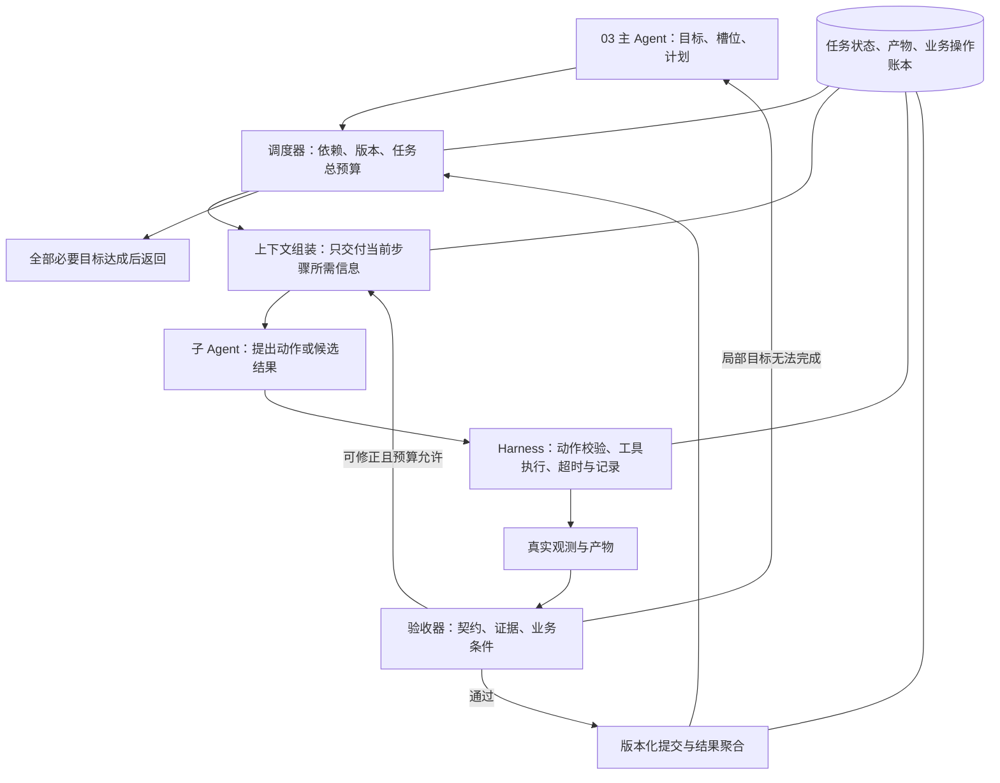

# 04-子Agent(智能体)与任务编排：MedAgent(医疗智能体项目) 逐题口述

核查日期：2026-10-13。所有答案以院内 ToB(面向机构业务) 边界为前提。一般理论与未落地的扩展方案明确分开。

## q-001

### 主问题｜子 Agent(智能体) 有哪些？

原文位置：仓库根目录下的本地原件 `artifacts/medagent_upgrade_20261013/原始资料/04-子Agent与任务编排.txt` 第 64 行。当前同名 .md 是适配稿；本地原件不随克隆分发。

**项目口述：** 项目是一个主协调器加三个临床专科：SymptomAgent(症状智能体) 做症状辅助评估、风险提示、疾病信息及科室建议，不创建转诊草稿；DrugAgent(药品智能体) 查药品和审核用药；GuideAgent(指南智能体) 处理指南、检验、报告、随访与临床知识。医生在独立表单确认患者、科室、原因后，由 ReferralDraftService(转诊草稿业务服务) 经受限 MCP(模型上下文协议) 调用创建转诊草稿；它是业务服务，不是第四个智能体。Planning(任务规划)、SafetyGuard(安全守卫)、DomainGuard(业务范围守卫) 是协调流程中的职责模块，没有另建检索、通知或独立审查服务。

**针对本题的设计展开（原文原理，作为方案解释）：**

按职责划分：检索 Agent(智能体)、数据库查询 Agent(智能体)、工具调用 Agent(智能体)、内容生成 Agent(智能体)、审查 Agent(智能体)、通知 Agent(智能体)、工单 Agent(智能体) 等。数量不是重点，职责边界才是。

**在 MedAgent(医疗智能体项目) 中怎么补全：** 按业务目标、可信数据和工具权限划分，而不是按每个 API(应用程序接口) 拆 Agent(智能体)。增加角色前，在同一任务集上比较完成率、交接损失、耗时与成本；不能假设多角色天然准确。

**代码依据：** [backend/agents.py](../../backend/agents.py)、[backend/a2a_server.py](../../backend/a2a_server.py)

## q-002

### 追问｜检索、数据库查询、工具调用、内容生成、审查、通知、工单等怎么定位？

原文位置：仓库根目录下的本地原件 `artifacts/medagent_upgrade_20261013/原始资料/04-子Agent与任务编排.txt` 第 70 行。当前同名 .md 是适配稿；本地原件不随克隆分发。

**项目口述：** 项目是一个主协调器加三个临床专科：SymptomAgent(症状智能体) 做症状辅助评估、风险提示、疾病信息及科室建议，不创建转诊草稿；DrugAgent(药品智能体) 查药品和审核用药；GuideAgent(指南智能体) 处理指南、检验、报告、随访与临床知识。医生在独立表单确认患者、科室、原因后，由 ReferralDraftService(转诊草稿业务服务) 经受限 MCP(模型上下文协议) 调用创建转诊草稿；它是业务服务，不是第四个智能体。Planning(任务规划)、SafetyGuard(安全守卫)、DomainGuard(业务范围守卫) 是协调流程中的职责模块，没有另建检索、通知或独立审查服务。

**针对本题的设计展开（原文原理，作为方案解释）：**

检索 Agent(智能体)：知识库召回；查询 Agent(智能体)：结构化数据查询；工具 Agent(智能体)：执行写操作；生成 Agent(智能体)：内容产出；审查 Agent(智能体)：结果校验；通知/工单 Agent(智能体)：消息触达与工单流转。每个都是一类能力。

**在 MedAgent(医疗智能体项目) 中怎么补全：** 按业务目标、可信数据和工具权限划分，而不是按每个 API(应用程序接口) 拆 Agent(智能体)。增加角色前，在同一任务集上比较完成率、交接损失、耗时与成本；不能假设多角色天然准确。

**代码依据：** [backend/agents.py](../../backend/agents.py)、[backend/a2a_server.py](../../backend/a2a_server.py)

## q-003

### 追问｜每个子 Agent(智能体) 的边界怎么划分？

原文位置：仓库根目录下的本地原件 `artifacts/medagent_upgrade_20261013/原始资料/04-子Agent与任务编排.txt` 第 74 行。当前同名 .md 是适配稿；本地原件不随克隆分发。

**项目口述：** 项目是一个主协调器加三个临床专科：SymptomAgent(症状智能体) 做症状辅助评估、风险提示、疾病信息及科室建议，不创建转诊草稿；DrugAgent(药品智能体) 查药品和审核用药；GuideAgent(指南智能体) 处理指南、检验、报告、随访与临床知识。医生在独立表单确认患者、科室、原因后，由 ReferralDraftService(转诊草稿业务服务) 经受限 MCP(模型上下文协议) 调用创建转诊草稿；它是业务服务，不是第四个智能体。Planning(任务规划)、SafetyGuard(安全守卫)、DomainGuard(业务范围守卫) 是协调流程中的职责模块，没有另建检索、通知或独立审查服务。

**针对本题的设计展开（原文原理，作为方案解释）：**

一个 Agent(智能体) 只负责一类业务能力或一类工具，职责单一。判断标准：能不能用一句话说清它做什么、不能做什么。

**在 MedAgent(医疗智能体项目) 中怎么补全：** 按业务目标、可信数据和工具权限划分，而不是按每个 API(应用程序接口) 拆 Agent(智能体)。增加角色前，在同一任务集上比较完成率、交接损失、耗时与成本；不能假设多角色天然准确。

**代码依据：** [backend/agents.py](../../backend/agents.py)、[backend/a2a_server.py](../../backend/a2a_server.py)

## q-004

### 主问题｜子 Agent(智能体) 负责什么？

原文位置：仓库根目录下的本地原件 `artifacts/medagent_upgrade_20261013/原始资料/04-子Agent与任务编排.txt` 第 78 行。当前同名 .md 是适配稿；本地原件不随克隆分发。

**项目口述：** 项目是一个主协调器加三个临床专科：SymptomAgent(症状智能体) 做症状辅助评估、风险提示、疾病信息及科室建议，不创建转诊草稿；DrugAgent(药品智能体) 查药品和审核用药；GuideAgent(指南智能体) 处理指南、检验、报告、随访与临床知识。医生在独立表单确认患者、科室、原因后，由 ReferralDraftService(转诊草稿业务服务) 经受限 MCP(模型上下文协议) 调用创建转诊草稿；它是业务服务，不是第四个智能体。Planning(任务规划)、SafetyGuard(安全守卫)、DomainGuard(业务范围守卫) 是协调流程中的职责模块，没有另建检索、通知或独立审查服务。

**针对本题的设计展开（原文原理，作为方案解释）：**

负责一类业务能力（如检索）或一类工具（如数据库操作），不跨界。业务能力和工具集的组合要内聚。

**在 MedAgent(医疗智能体项目) 中怎么补全：** 按业务目标、可信数据和工具权限划分，而不是按每个 API(应用程序接口) 拆 Agent(智能体)。增加角色前，在同一任务集上比较完成率、交接损失、耗时与成本；不能假设多角色天然准确。

**代码依据：** [backend/agents.py](../../backend/agents.py)、[backend/a2a_server.py](../../backend/a2a_server.py)

## q-005

### 追问｜是负责一个业务能力，还是负责一类工具？

原文位置：仓库根目录下的本地原件 `artifacts/medagent_upgrade_20261013/原始资料/04-子Agent与任务编排.txt` 第 84 行。当前同名 .md 是适配稿；本地原件不随克隆分发。

**项目口述：** 项目是一个主协调器加三个临床专科：SymptomAgent(症状智能体) 做症状辅助评估、风险提示、疾病信息及科室建议，不创建转诊草稿；DrugAgent(药品智能体) 查药品和审核用药；GuideAgent(指南智能体) 处理指南、检验、报告、随访与临床知识。医生在独立表单确认患者、科室、原因后，由 ReferralDraftService(转诊草稿业务服务) 经受限 MCP(模型上下文协议) 调用创建转诊草稿；它是业务服务，不是第四个智能体。Planning(任务规划)、SafetyGuard(安全守卫)、DomainGuard(业务范围守卫) 是协调流程中的职责模块，没有另建检索、通知或独立审查服务。

**在 MedAgent(医疗智能体项目) 中怎么补全：** 按业务目标、可信数据和工具权限划分，而不是按每个 API(应用程序接口) 拆 Agent(智能体)。增加角色前，在同一任务集上比较完成率、交接损失、耗时与成本；不能假设多角色天然准确。

**代码依据：** [backend/agents.py](../../backend/agents.py)、[backend/a2a_server.py](../../backend/a2a_server.py)

## q-006

### 追问｜是否允许子 Agent(智能体) 再调用其他子 Agent(智能体)？

原文位置：仓库根目录下的本地原件 `artifacts/medagent_upgrade_20261013/原始资料/04-子Agent与任务编排.txt` 第 88 行。当前同名 .md 是适配稿；本地原件不随克隆分发。

**项目口述：** 项目是一个主协调器加三个临床专科：SymptomAgent(症状智能体) 做症状辅助评估、风险提示、疾病信息及科室建议，不创建转诊草稿；DrugAgent(药品智能体) 查药品和审核用药；GuideAgent(指南智能体) 处理指南、检验、报告、随访与临床知识。医生在独立表单确认患者、科室、原因后，由 ReferralDraftService(转诊草稿业务服务) 经受限 MCP(模型上下文协议) 调用创建转诊草稿；它是业务服务，不是第四个智能体。Planning(任务规划)、SafetyGuard(安全守卫)、DomainGuard(业务范围守卫) 是协调流程中的职责模块，没有另建检索、通知或独立审查服务。

**针对本题的设计展开（原文原理，作为方案解释）：**

本模块选择由调度器统一派发，子 Agent(智能体) 可以提出委派请求，但不能自行扩大权限或调用预算。受控的层级委派也是可行架构，需要限制深度、扇出和总预算，并继承取消信号与追踪信息；不能把“不允许子 Agent(智能体) 互调”当作所有系统的通则。

**在 MedAgent(医疗智能体项目) 中怎么补全：** 按业务目标、可信数据和工具权限划分，而不是按每个 API(应用程序接口) 拆 Agent(智能体)。增加角色前，在同一任务集上比较完成率、交接损失、耗时与成本；不能假设多角色天然准确。

**代码依据：** [backend/agents.py](../../backend/agents.py)、[backend/a2a_server.py](../../backend/a2a_server.py)

## q-007

### 主问题｜子 Agent(智能体) 之间如何通信？

原文位置：仓库根目录下的本地原件 `artifacts/medagent_upgrade_20261013/原始资料/04-子Agent与任务编排.txt` 第 92 行。当前同名 .md 是适配稿；本地原件不随克隆分发。

**项目口述：** 主协调器用 python-a2a(Python智能体通信库) 向三个专科发送 task(任务)、patient_id(患者标识)、有界历史和原始任务。短期签名委托绑定员工、患者、请求、目标专科和工具范围，并用摘要绑定原始输入。专科重读患者档案，返回回答、调用轨迹、脱敏工具 Observation(工具观察结果) 以及 task_id(任务标识)、plan_version(计划版本)、step_id(步骤标识)；主协调器检查身份、格式与版本。

**针对本题的设计展开（原文原理，作为方案解释）：**

子 Agent(智能体) 的通信方式主要看两个维度：是否需要实时返回，以及通信双方希望保持多强的耦合。

同步场景可以使用 HTTP(超文本传输协议)/RPC(远程过程调用)，由主 Agent(智能体) 发起调用并等待结果；异步场景可以通过消息队列或事件总线解耦，让发送方不必一直等待。共享状态适合在同一个任务上下文中传递中间结果，但需要严格限制写入范围；A2A（Agent-to-Agent，Agent 间通信协议）或自定义通信协议则重点解决 Agent(智能体) 之间消息格式统一的问题。

在当前这种“主 Agent(智能体) 统一调度”的架构里，通常不会让子 Agent(智能体) 自由互相调用，而是由主 Agent(智能体) 负责路由和协调。这样做的核心价值不是通信更简单，而是让调用关系、权限、超时、重试和故障定位都集中可控。

无论采用哪种通信方式，消息都应该带 `task_id`(任务标识) / `trace_id`(链路追踪标识) / `plan_version`(计划版本) / `step_id`(步骤标识) / `attempt_id`(执行尝试标识)，并明确 source(来源)、target(目标)、input(输入)、context(上下文)、status(状态) 等字段。这样一个任务跨多个 Agent(智能体) 后，仍然可以还原完整执行链路并拒绝旧计划、旧尝试的迟到结果。

统一通信消息可以这样表示：

### example-002

**Q3｜子 Agent(智能体) 之间如何通信？**

原文位置：仓库根目录下的本地原件 `artifacts/medagent_upgrade_20261013/原始资料/04-子Agent与任务编排.txt` 第 106 行。该路径指保留的 .txt 原件，当前同名 .md 是适配稿；本地原件不随克隆分发。

用途：ToB(面向机构业务) 原理示例 / 扩展设计，不表示代码已落地。

[返回对应问答](#q-007)

```json
{
  "message_id": "msg-001",
  "task_id": "task-20260820-001",
  "trace_id": "trace-8f3a",
  "plan_version": 1,
  "step_id": "query_patient_record",
  "attempt_id": "attempt-001",
  "source": "planner",
  "target": "query_agent",
  "input": {
    "patient_id": "12345"
  },
  "context": {
    "user_id": "user-1001",
    "locale": "zh-CN"
  },
  "status": "pending",
  "deadline": "2026-08-20T10:30:00+08:00",
  "schema_version": "1.0"
}
```

**示例术语与字段译注：** `attempt`(执行尝试)；`attempt_id`(执行尝试标识)；`context`(上下文)；`deadline`(截止时间)；`input`(输入)；`message_id`(消息标识)；`patient_id`(患者标识)；`pending`(待处理)；`plan_version`(计划版本)；`planner`(规划器)；`query_agent`(查询智能体)；`query_patient_record`(查询患者记录)；`schema_version`(结构约束版本)；`source`(来源)；`status`(状态)；`step_id`(步骤标识)；`target`(目标)；`task`(任务)；`task_id`(任务标识)；`trace`(链路追踪)；`trace_id`(链路追踪标识)；`user_id`(员工标识)。


**在 MedAgent(医疗智能体项目) 中怎么补全：** 不用 A2A(智能体间通信协议) 也可通过进程内异步函数、自定义 HTTP(超文本传输协议) 或消息队列分派，核心仍是任务契约、授权、超时和业务状态。当前统一 deadline_at(绝对截止时间) 通过签名委托传到专科和 MCP(模型上下文协议)，新调用只用剩余预算；服务是主从式，专科不能任意互相调用。队列、回调和长期任务是扩展项。

**代码依据：** [backend/a2a_server.py](../../backend/a2a_server.py)、[backend/service_auth.py](../../backend/service_auth.py)、[backend/agents.py](../../backend/agents.py)

**本题图与结构示例：** [example-002](#example-002)

## q-008

### 追问｜共享状态、消息队列、HTTP(超文本传输协议) API(应用程序接口)、事件总线、A2A(智能体间通信协议) 协议分别是什么？

原文位置：仓库根目录下的本地原件 `artifacts/medagent_upgrade_20261013/原始资料/04-子Agent与任务编排.txt` 第 129 行。当前同名 .md 是适配稿；本地原件不随克隆分发。

**项目口述：** 主协调器用 python-a2a(Python智能体通信库) 向三个专科发送 task(任务)、patient_id(患者标识)、有界历史和原始任务。短期签名委托绑定员工、患者、请求、目标专科和工具范围，并用摘要绑定原始输入。专科重读患者档案，返回回答、调用轨迹、脱敏工具 Observation(工具观察结果) 以及 task_id(任务标识)、plan_version(计划版本)、step_id(步骤标识)；主协调器检查身份、格式与版本。

**针对本题的设计展开（原文原理，作为方案解释）：**

共享状态：通过全局 state(状态) 传递；消息队列：异步解耦；HTTP(超文本传输协议) API(应用程序接口)：同步服务间调用；事件总线：发布订阅；A2A(智能体间通信协议)：Agent(智能体) 间通信协议。选择取决于同步/异步和耦合度要求。

**在 MedAgent(医疗智能体项目) 中怎么补全：** 不用 A2A(智能体间通信协议) 也可通过进程内异步函数、自定义 HTTP(超文本传输协议) 或消息队列分派，核心仍是任务契约、授权、超时和业务状态。当前统一 deadline_at(绝对截止时间) 通过签名委托传到专科和 MCP(模型上下文协议)，新调用只用剩余预算；服务是主从式，专科不能任意互相调用。队列、回调和长期任务是扩展项。

**代码依据：** [backend/a2a_server.py](../../backend/a2a_server.py)、[backend/service_auth.py](../../backend/service_auth.py)、[backend/agents.py](../../backend/agents.py)

## q-009

### 追问｜通信数据结构是什么？有没有 trace_id(链路追踪标识)？

原文位置：仓库根目录下的本地原件 `artifacts/medagent_upgrade_20261013/原始资料/04-子Agent与任务编排.txt` 第 133 行。当前同名 .md 是适配稿；本地原件不随克隆分发。

**项目口述：** 主协调器用 python-a2a(Python智能体通信库) 向三个专科发送 task(任务)、patient_id(患者标识)、有界历史和原始任务。短期签名委托绑定员工、患者、请求、目标专科和工具范围，并用摘要绑定原始输入。专科重读患者档案，返回回答、调用轨迹、脱敏工具 Observation(工具观察结果) 以及 task_id(任务标识)、plan_version(计划版本)、step_id(步骤标识)；主协调器检查身份、格式与版本。

**针对本题的设计展开（原文原理，作为方案解释）：**

统一任务消息结构至少包含 task(任务)/plan(计划)/step(步骤)/attempt(执行尝试) 身份、source(来源)、target(目标)、input(输入)、context(上下文)，并用 trace_id(链路追踪标识) 串联全链路。`schema_version`(结构约束版本) 表示协议版本，不能和 `plan_version`(计划版本) 混用。

**在 MedAgent(医疗智能体项目) 中怎么补全：** 不用 A2A(智能体间通信协议) 也可通过进程内异步函数、自定义 HTTP(超文本传输协议) 或消息队列分派，核心仍是任务契约、授权、超时和业务状态。当前统一 deadline_at(绝对截止时间) 通过签名委托传到专科和 MCP(模型上下文协议)，新调用只用剩余预算；服务是主从式，专科不能任意互相调用。队列、回调和长期任务是扩展项。

**代码依据：** [backend/a2a_server.py](../../backend/a2a_server.py)、[backend/service_auth.py](../../backend/service_auth.py)、[backend/agents.py](../../backend/agents.py)

## q-010

### 主问题｜子 Agent(智能体) 有自己的状态吗？

原文位置：仓库根目录下的本地原件 `artifacts/medagent_upgrade_20261013/原始资料/04-子Agent与任务编排.txt` 第 137 行。当前同名 .md 是适配稿；本地原件不随克隆分发。

**项目口述：** 全局层保存当前员工、患者、会话、请求与任务版本，局部层由各专科维护本轮消息和工具轨迹。会话缓存按员工关联会话与患者隔离，并用会话锁阻止同一会话同时执行。专科只返回结果，不能随意覆盖入口的授权上下文。

**针对本题的设计展开（原文原理，作为方案解释）：**

有，但建议做“任务级状态”和“Agent(智能体) 级状态”两层隔离。

全局 state(状态) 保存主流程真正需要共享的信息，例如用户输入、intent(意图)、slots(业务参数槽位)、plan(计划)、各节点的执行状态以及最终结果；局部 state(状态) 保存某个 Agent(智能体) 的中间变量、工具调用参数、检索结果、局部重试次数等，不应该把所有细节都污染到全局状态中。

这样设计有两个好处：第一，主 Agent(智能体) 可以看到任务全貌并做下一步调度；第二，子 Agent(智能体) 的内部实现可以独立变化，不会因为修改一个局部字段就影响其他 Agent(智能体)。

更重要的是状态更新要可控。尤其是并行执行时，不能让多个 Agent(智能体) 随意修改同一个字段，而应该按命名空间或 step_id(步骤标识) 写入自己的结果，再由主 Agent(智能体) 做合并。对于需要断点续跑的生产系统，还应该给关键步骤保存 checkpoint(检查点)，而不是只把状态存在进程内存里。

**在 MedAgent(医疗智能体项目) 中怎么补全：** 独立档案编辑已要求先读取 revision(修订号)，再以 expected_revision(预期状态修订号) 保存，服务端核对内容快照并以 SQL(结构化查询语言) 比较全部原字段后更新；冲突返回 409，重载并核对后再保存。会话锁和档案保护是两层机制。图框架的 Reducer(状态归并器) 可以管理 state(状态)，但不替代数据库并发与写操作幂等。

**代码依据：** [backend/memory.py](../../backend/memory.py)、[backend/task_context.py](../../backend/task_context.py)、[backend/main.py](../../backend/main.py)

## q-011

### 追问｜全局 state(状态) 和局部 state(状态) 如何区分？

原文位置：仓库根目录下的本地原件 `artifacts/medagent_upgrade_20261013/原始资料/04-子Agent与任务编排.txt` 第 149 行。当前同名 .md 是适配稿；本地原件不随克隆分发。

**项目口述：** 全局层保存当前员工、患者、会话、请求与任务版本，局部层由各专科维护本轮消息和工具轨迹。会话缓存按员工关联会话与患者隔离，并用会话锁阻止同一会话同时执行。专科只返回结果，不能随意覆盖入口的授权上下文。

**针对本题的设计展开（原文原理，作为方案解释）：**

全局 state(状态)：input(输入)、intent(意图)、slots(业务参数槽位)、plan(计划)、final_answer(最终回答)，任务级；局部 state(状态)：每个子 Agent(智能体) 自己的中间变量和执行记录。详见模块 6。

**在 MedAgent(医疗智能体项目) 中怎么补全：** 独立档案编辑已要求先读取 revision(修订号)，再以 expected_revision(预期状态修订号) 保存，服务端核对内容快照并以 SQL(结构化查询语言) 比较全部原字段后更新；冲突返回 409，重载并核对后再保存。会话锁和档案保护是两层机制。图框架的 Reducer(状态归并器) 可以管理 state(状态)，但不替代数据库并发与写操作幂等。

**代码依据：** [backend/memory.py](../../backend/memory.py)、[backend/task_context.py](../../backend/task_context.py)、[backend/main.py](../../backend/main.py)

## q-012

### 追问｜子 Agent(智能体) 修改状态时如何避免互相覆盖？

原文位置：仓库根目录下的本地原件 `artifacts/medagent_upgrade_20261013/原始资料/04-子Agent与任务编排.txt` 第 153 行。当前同名 .md 是适配稿；本地原件不随克隆分发。

**项目口述：** 全局层保存当前员工、患者、会话、请求与任务版本，局部层由各专科维护本轮消息和工具轨迹。会话缓存按员工关联会话与患者隔离，并用会话锁阻止同一会话同时执行。专科只返回结果，不能随意覆盖入口的授权上下文。

**针对本题的设计展开（原文原理，作为方案解释）：**

按 task_id(任务标识) / plan_version(计划版本) / step_id(步骤标识) 隔离结果，由调度器以条件更新提交。命名空间只能减少不同节点的覆盖，不能解决同一步重试、重复投递或旧 worker(工作单元) 迟到写入；这些还需要 attempt_id(执行尝试标识)、租约令牌和状态版本检查。

**在 MedAgent(医疗智能体项目) 中怎么补全：** 独立档案编辑已要求先读取 revision(修订号)，再以 expected_revision(预期状态修订号) 保存，服务端核对内容快照并以 SQL(结构化查询语言) 比较全部原字段后更新；冲突返回 409，重载并核对后再保存。会话锁和档案保护是两层机制。图框架的 Reducer(状态归并器) 可以管理 state(状态)，但不替代数据库并发与写操作幂等。

**代码依据：** [backend/memory.py](../../backend/memory.py)、[backend/task_context.py](../../backend/task_context.py)、[backend/main.py](../../backend/main.py)

## q-013

### 主问题｜子 Agent(智能体) 失败怎么办？

原文位置：仓库根目录下的本地原件 `artifacts/medagent_upgrade_20261013/原始资料/04-子Agent与任务编排.txt` 第 157 行。当前同名 .md 是适配稿；本地原件不随克隆分发。

**项目口述：** 把权限失败、参数缺失、依赖故障和写入未知分开。权限失败拒绝；缺信息先询问；安全只读医院查询对瞬时网络错误及 429/部分 5xx 最多三次指数退避，转诊写调用不自动重试；连续依赖失败进入熔断。专科或工具失败不会被包装成成功答案。

**针对本题的设计展开（原文原理，作为方案解释）：**

子 Agent(智能体) 失败不能简单理解成“重试一次”。生产环境里要先判断失败属于哪一类，再决定处理策略。

可以把失败大致分成四类：瞬时故障，例如网络抖动、限流、临时超时，适合有限次数重试；持续性故障，例如依赖服务长期不可用，应该快速失败并切换降级路径；业务性失败，例如参数不合法、数据不存在，通常重试没有意义，应重新补槽、改路由或直接返回业务错误；副作用已经发生但后续失败，则要考虑回滚或补偿。

因此主 Agent(智能体) 接收到的最好不是简单的“success(成功)=false(假)”，而是统一的错误码、错误类型、是否可重试、是否可补偿、已执行到哪一步等结构化信息。这样它才能判断是 retry（重试）、replan（重规划）、skip（跳过）、rollback（回滚）还是人工接管，而不是再次调用模型猜原因。

结构化错误返回示例：

### example-003

**Q5｜子 Agent(智能体) 失败怎么办？**

原文位置：仓库根目录下的本地原件 `artifacts/medagent_upgrade_20261013/原始资料/04-子Agent与任务编排.txt` 第 169 行。该路径指保留的 .txt 原件，当前同名 .md 是适配稿；本地原件不随克隆分发。

用途：ToB(面向机构业务) 原理示例 / 扩展设计，不表示代码已落地。

[返回对应问答](#q-013)

```json
{
  "task_id": "task-20260820-001",
  "trace_id": "trace-8f3a",
  "plan_version": 1,
  "step_id": "s2",
  "attempt_id": "attempt-002",
  "status": "failed",
  "data": null,
  "error": {
    "code": "UPSTREAM_TIMEOUT",
    "type": "transient",
    "message": "患者记录服务响应超时",
    "retryable": true,
    "compensatable": false,
    "retry_count": 1,
    "completed_steps": ["s1"]
  }
}
```

**示例术语与字段译注：** `attempt`(执行尝试)；`attempt_id`(执行尝试标识)；`code`(代码)；`completed_steps`(已完成步骤列表)；`data`(数据)；`error`(错误)；`failed`(失败)；`message`(消息)；`plan_version`(计划版本)；`retry_count`(重试数量)；`retryable`(是否可重试)；`status`(状态)；`step_id`(步骤标识)；`task`(任务)；`task_id`(任务标识)；`trace`(链路追踪)；`trace_id`(链路追踪标识)；`type`(类型)。


另外要限制重试次数和总耗时，避免“失败 → 重试 → 再失败”的无限循环。

**在 MedAgent(医疗智能体项目) 中怎么补全：** 备用模型、备用数据源或跳过非关键步骤必须有已验证契约，不能凭空说存在。只有确实可逆的本地事务能回滚；外部写入走查询、对账、补偿或责任医生复核。对于无法确认的临床问题，应给出失败原因和人工核对路径。

**代码依据：** [backend/mcp_tools.py](../../backend/mcp_tools.py)、[backend/resilience.py](../../backend/resilience.py)、[backend/mcp_security.py](../../backend/mcp_security.py)

**本题图与结构示例：** [example-003](#example-003)

## q-014

### 追问｜重试、超时、降级、跳过、回滚、转人工分别什么时候用？

原文位置：仓库根目录下的本地原件 `artifacts/medagent_upgrade_20261013/原始资料/04-子Agent与任务编排.txt` 第 192 行。当前同名 .md 是适配稿；本地原件不随克隆分发。

**项目口述：** 把权限失败、参数缺失、依赖故障和写入未知分开。权限失败拒绝；缺信息先询问；安全只读医院查询对瞬时网络错误及 429/部分 5xx 最多三次指数退避，转诊写调用不自动重试；连续依赖失败进入熔断。专科或工具失败不会被包装成成功答案。

**针对本题的设计展开（原文原理，作为方案解释）：**

瞬时错误→有限重试；响应慢→超时保护；可接受的能力缩减→降级；可选且下游允许缺失的节点→跳过；副作用已发生→先核实业务状态，再按条件补偿或转人工。并非所有副作用都能回滚。详见模块 5。

**在 MedAgent(医疗智能体项目) 中怎么补全：** 备用模型、备用数据源或跳过非关键步骤必须有已验证契约，不能凭空说存在。只有确实可逆的本地事务能回滚；外部写入走查询、对账、补偿或责任医生复核。对于无法确认的临床问题，应给出失败原因和人工核对路径。

**代码依据：** [backend/mcp_tools.py](../../backend/mcp_tools.py)、[backend/resilience.py](../../backend/resilience.py)、[backend/mcp_security.py](../../backend/mcp_security.py)

## q-015

### 追问｜主 Agent(智能体) 如何知道失败原因？

原文位置：仓库根目录下的本地原件 `artifacts/medagent_upgrade_20261013/原始资料/04-子Agent与任务编排.txt` 第 196 行。当前同名 .md 是适配稿；本地原件不随克隆分发。

**项目口述：** 把权限失败、参数缺失、依赖故障和写入未知分开。权限失败拒绝；缺信息先询问；安全只读医院查询对瞬时网络错误及 429/部分 5xx 最多三次指数退避，转诊写调用不自动重试；连续依赖失败进入熔断。专科或工具失败不会被包装成成功答案。

**针对本题的设计展开（原文原理，作为方案解释）：**

靠结构化错误返回：子 Agent(智能体) 失败时返回统一错误结构（错误码 + 原因 + 上下文），主 Agent(智能体) 据此决策，而不是靠猜。

**在 MedAgent(医疗智能体项目) 中怎么补全：** 备用模型、备用数据源或跳过非关键步骤必须有已验证契约，不能凭空说存在。只有确实可逆的本地事务能回滚；外部写入走查询、对账、补偿或责任医生复核。对于无法确认的临床问题，应给出失败原因和人工核对路径。

**代码依据：** [backend/mcp_tools.py](../../backend/mcp_tools.py)、[backend/resilience.py](../../backend/resilience.py)、[backend/mcp_security.py](../../backend/mcp_security.py)

## q-016

### 主问题｜子 Agent(智能体) 工具权限怎么控制？

原文位置：仓库根目录下的本地原件 `artifacts/medagent_upgrade_20261013/原始资料/04-子Agent与任务编排.txt` 第 200 行。当前同名 .md 是适配稿；本地原件不随克隆分发。

**项目口述：** 权限在入口、A2A(智能体间通信协议) 专科和 MCP(模型上下文协议) 工具执行点重复核验；数据库中的员工状态、角色和患者授权优先于旧令牌。专科只得到受限工具，患者 ID(标识) 服务端注入；原始任务摘要与签名委托绑定。外部文档和工具文字是数据，不允许改变授权、目标患者或写动作范围。

**针对本题的设计展开（原文原理，作为方案解释）：**

不同 Agent(智能体) 应该绑定不同工具集，并且遵循最小权限原则。核心不是“每个 Agent(智能体) 都有一套 tools(工具列表)”，而是让职责、工具和数据访问范围有明确的对应关系；多个 Agent(智能体) 可以在各自授权范围内共享同一种工具。

工程上可以在 Agent(智能体) 注册时声明 allowed_tools(允许调用的工具)，再在执行层做一次实际鉴权，而不能只相信 Prompt(提示词) 中写的“不要调用某工具”。也就是说，Prompt(提示词) 是行为约束，权限系统才是真正的安全边界。

**在 MedAgent(医疗智能体项目) 中怎么补全：** Prompt(提示词) 可以提示忽略注入，但真正防线是白名单、schema(结构约束)、可信身份、固定数据源、写入确认和审计。进一步对最终参数做审批绑定、限制外部域名和文件权限、加入注入回归；不将未测试的‘万能注入检测’写成已有能力。

**代码依据：** [backend/service_auth.py](../../backend/service_auth.py)、[backend/mcp_security.py](../../backend/mcp_security.py)、[backend/access.py](../../backend/access.py)、[backend/agents.py](../../backend/agents.py)

## q-017

### 追问｜不同 Agent(智能体) 绑定不同工具集怎么做？

原文位置：仓库根目录下的本地原件 `artifacts/medagent_upgrade_20261013/原始资料/04-子Agent与任务编排.txt` 第 212 行。当前同名 .md 是适配稿；本地原件不随克隆分发。

**项目口述：** 权限在入口、A2A(智能体间通信协议) 专科和 MCP(模型上下文协议) 工具执行点重复核验；数据库中的员工状态、角色和患者授权优先于旧令牌。专科只得到受限工具，患者 ID(标识) 服务端注入；原始任务摘要与签名委托绑定。外部文档和工具文字是数据，不允许改变授权、目标患者或写动作范围。

**针对本题的设计展开（原文原理，作为方案解释）：**

每个子 Agent(智能体) 定义自己的 tools(工具列表) 列表，注册时绑定。查询 Agent(智能体) 只有读工具，工具 Agent(智能体) 才有写工具。

**在 MedAgent(医疗智能体项目) 中怎么补全：** Prompt(提示词) 可以提示忽略注入，但真正防线是白名单、schema(结构约束)、可信身份、固定数据源、写入确认和审计。进一步对最终参数做审批绑定、限制外部域名和文件权限、加入注入回归；不将未测试的‘万能注入检测’写成已有能力。

**代码依据：** [backend/service_auth.py](../../backend/service_auth.py)、[backend/mcp_security.py](../../backend/mcp_security.py)、[backend/access.py](../../backend/access.py)、[backend/agents.py](../../backend/agents.py)

## q-018

### 追问｜是否所有 Agent(智能体) 都能访问数据库？是否有权限边界？

原文位置：仓库根目录下的本地原件 `artifacts/medagent_upgrade_20261013/原始资料/04-子Agent与任务编排.txt` 第 216 行。当前同名 .md 是适配稿；本地原件不随克隆分发。

**项目口述：** 权限在入口、A2A(智能体间通信协议) 专科和 MCP(模型上下文协议) 工具执行点重复核验；数据库中的员工状态、角色和患者授权优先于旧令牌。专科只得到受限工具，患者 ID(标识) 服务端注入；原始任务摘要与签名委托绑定。外部文档和工具文字是数据，不允许改变授权、目标患者或写动作范围。

**针对本题的设计展开（原文原理，作为方案解释）：**

不是。只有需要数据的 Agent（查询 Agent）有数据库权限，其他 Agent(智能体) 只能拿结果。职责用于决定所需能力，实际权限还要取用户授权、Agent(智能体) 能力范围和当前资源策略的交集。

子 Agent(智能体) 设计原则（可背）：

### example-004

**Q6｜子 Agent(智能体) 工具权限怎么控制？**

原文位置：仓库根目录下的本地原件 `artifacts/medagent_upgrade_20261013/原始资料/04-子Agent与任务编排.txt` 第 222 行。该路径指保留的 .txt 原件，当前同名 .md 是适配稿；本地原件不随克隆分发。

用途：ToB(面向机构业务) 原理示例 / 扩展设计，不表示代码已落地。

[返回对应问答](#q-018)

```text
1. 单一职责：一个 Agent 只负责一类任务。
2. 输入输出稳定：必须有明确 schema。
3. 工具权限最小化：只开放它需要的工具。
4. 状态隔离：只读全局状态，写入自己的结果区域。
5. 可观测：每个 Agent 执行前后都记录日志和 trace。
6. 可降级：失败后有 fallback，不影响整个系统崩溃。
```

**示例术语与字段译注：** `Agent`(智能体)；`fallback`(兜底)；`schema`(结构约束)；`trace`(链路追踪)。


**在 MedAgent(医疗智能体项目) 中怎么补全：** Prompt(提示词) 可以提示忽略注入，但真正防线是白名单、schema(结构约束)、可信身份、固定数据源、写入确认和审计。进一步对最终参数做审批绑定、限制外部域名和文件权限、加入注入回归；不将未测试的‘万能注入检测’写成已有能力。

**代码依据：** [backend/service_auth.py](../../backend/service_auth.py)、[backend/mcp_security.py](../../backend/mcp_security.py)、[backend/access.py](../../backend/access.py)、[backend/agents.py](../../backend/agents.py)

**本题图与结构示例：** [example-004](#example-004)

## q-019

### 主问题｜什么情况下串行执行？

原文位置：仓库根目录下的本地原件 `artifacts/medagent_upgrade_20261013/原始资料/04-子Agent与任务编排.txt` 第 233 行。当前同名 .md 是适配稿；本地原件不随克隆分发。

**项目口述：** 带依赖的计划按依赖调度，独立只读步骤用 asyncio(Python异步并发库).gather(汇集并发任务结果) 同批执行；批准了写动作时整个计划保持串行。前序的脱敏工具依据在预算内传给依赖节点，过长时明确提示重新查询，不截断后冒充完整资料。同批出错仍等待在途调用结束，再传播失败，避免解锁后留后台动作。

**针对本题的设计展开（原文原理，作为方案解释）：**

后一步依赖前一步结果时必须串行。依赖关系决定执行模式。

**在 MedAgent(医疗智能体项目) 中怎么补全：** 并发只解决互不依赖的 IO(输入输出) 等待，不能把串行数据依赖打散。CPU(中央处理器) 推理要在线程或独立模型服务中运行，并控制 GPU(图形处理器) 与连接池并发；后台长任务应采用持久队列和状态查询，不能把 async(异步) 函数当成可靠任务队列。

**代码依据：** [backend/agents.py](../../backend/agents.py)、[backend/a2a_context.py](../../backend/a2a_context.py)

## q-020

### 追问｜后一步依赖前一步结果时必须串行怎么理解？

原文位置：仓库根目录下的本地原件 `artifacts/medagent_upgrade_20261013/原始资料/04-子Agent与任务编排.txt` 第 239 行。当前同名 .md 是适配稿；本地原件不随克隆分发。

**项目口述：** 带依赖的计划按依赖调度，独立只读步骤用 asyncio(Python异步并发库).gather(汇集并发任务结果) 同批执行；批准了写动作时整个计划保持串行。前序的脱敏工具依据在预算内传给依赖节点，过长时明确提示重新查询，不截断后冒充完整资料。同批出错仍等待在途调用结束，再传播失败，避免解锁后留后台动作。

**针对本题的设计展开（原文原理，作为方案解释）：**

串行确保按依赖顺序执行：前一步输出供后一步使用。事实一致性还需核对快照、版本和并发更新，不能仅靠执行顺序保证。

**在 MedAgent(医疗智能体项目) 中怎么补全：** 并发只解决互不依赖的 IO(输入输出) 等待，不能把串行数据依赖打散。CPU(中央处理器) 推理要在线程或独立模型服务中运行，并控制 GPU(图形处理器) 与连接池并发；后台长任务应采用持久队列和状态查询，不能把 async(异步) 函数当成可靠任务队列。

**代码依据：** [backend/agents.py](../../backend/agents.py)、[backend/a2a_context.py](../../backend/a2a_context.py)

## q-021

### 追问｜举例？

原文位置：仓库根目录下的本地原件 `artifacts/medagent_upgrade_20261013/原始资料/04-子Agent与任务编排.txt` 第 243 行。当前同名 .md 是适配稿；本地原件不随克隆分发。

**项目口述：** 带依赖的计划按依赖调度，独立只读步骤用 asyncio(Python异步并发库).gather(汇集并发任务结果) 同批执行；批准了写动作时整个计划保持串行。前序的脱敏工具依据在预算内传给依赖节点，过长时明确提示重新查询，不截断后冒充完整资料。同批出错仍等待在途调用结束，再传播失败，避免解锁后留后台动作。

**针对本题的设计展开（原文原理，作为方案解释）：**

比如先意图识别，再槽位补全，再数据库查询，再结果生成——每步都依赖上一步，必须串行。反过来，如果两个步骤没有依赖，还硬串行，就是白白拖慢响应。注意：数据依赖是串行最常见的理由，但不是唯一理由——副作用顺序（先记账再发通知）、锁/限流、事务边界也会强制串行。

**在 MedAgent(医疗智能体项目) 中怎么补全：** 并发只解决互不依赖的 IO(输入输出) 等待，不能把串行数据依赖打散。CPU(中央处理器) 推理要在线程或独立模型服务中运行，并控制 GPU(图形处理器) 与连接池并发；后台长任务应采用持久队列和状态查询，不能把 async(异步) 函数当成可靠任务队列。

**代码依据：** [backend/agents.py](../../backend/agents.py)、[backend/a2a_context.py](../../backend/a2a_context.py)

## q-022

### 主问题｜什么情况下并行执行？

原文位置：仓库根目录下的本地原件 `artifacts/medagent_upgrade_20261013/原始资料/04-子Agent与任务编排.txt` 第 247 行。当前同名 .md 是适配稿；本地原件不随克隆分发。

**项目口述：** 带依赖的计划按依赖调度，独立只读步骤用 asyncio(Python异步并发库).gather(汇集并发任务结果) 同批执行；批准了写动作时整个计划保持串行。前序的脱敏工具依据在预算内传给依赖节点，过长时明确提示重新查询，不截断后冒充完整资料。同批出错仍等待在途调用结束，再传播失败，避免解锁后留后台动作。

**针对本题的设计展开（原文原理，作为方案解释）：**

多个任务相互独立时可以并行，提高响应速度。

**在 MedAgent(医疗智能体项目) 中怎么补全：** 并发只解决互不依赖的 IO(输入输出) 等待，不能把串行数据依赖打散。CPU(中央处理器) 推理要在线程或独立模型服务中运行，并控制 GPU(图形处理器) 与连接池并发；后台长任务应采用持久队列和状态查询，不能把 async(异步) 函数当成可靠任务队列。

**代码依据：** [backend/agents.py](../../backend/agents.py)、[backend/a2a_context.py](../../backend/a2a_context.py)

## q-023

### 追问｜多个任务相互独立时可以并行怎么理解？

原文位置：仓库根目录下的本地原件 `artifacts/medagent_upgrade_20261013/原始资料/04-子Agent与任务编排.txt` 第 253 行。当前同名 .md 是适配稿；本地原件不随克隆分发。

**项目口述：** 带依赖的计划按依赖调度，独立只读步骤用 asyncio(Python异步并发库).gather(汇集并发任务结果) 同批执行；批准了写动作时整个计划保持串行。前序的脱敏工具依据在预算内传给依赖节点，过长时明确提示重新查询，不截断后冒充完整资料。同批出错仍等待在途调用结束，再传播失败，避免解锁后留后台动作。

**针对本题的设计展开（原文原理，作为方案解释）：**

并行任务之间没有数据依赖，谁先谁后不影响结果，同时执行缩短总耗时。

**在 MedAgent(医疗智能体项目) 中怎么补全：** 并发只解决互不依赖的 IO(输入输出) 等待，不能把串行数据依赖打散。CPU(中央处理器) 推理要在线程或独立模型服务中运行，并控制 GPU(图形处理器) 与连接池并发；后台长任务应采用持久队列和状态查询，不能把 async(异步) 函数当成可靠任务队列。

**代码依据：** [backend/agents.py](../../backend/agents.py)、[backend/a2a_context.py](../../backend/a2a_context.py)

## q-024

### 追问｜举例？

原文位置：仓库根目录下的本地原件 `artifacts/medagent_upgrade_20261013/原始资料/04-子Agent与任务编排.txt` 第 257 行。当前同名 .md 是适配稿；本地原件不随克隆分发。

**项目口述：** 带依赖的计划按依赖调度，独立只读步骤用 asyncio(Python异步并发库).gather(汇集并发任务结果) 同批执行；批准了写动作时整个计划保持串行。前序的脱敏工具依据在预算内传给依赖节点，过长时明确提示重新查询，不截断后冒充完整资料。同批出错仍等待在途调用结束，再传播失败，避免解锁后留后台动作。

**针对本题的设计展开（原文原理，作为方案解释）：**

比如同时查知识库、查数据库、查缓存，再统一聚合——三个数据源互不依赖，可以并行。但并行有代价：资源竞争、失败处理和聚合都更复杂。先检查数据依赖、写冲突与配额，再决定并发；即使所有分支都必须成功，也可以并行，只是失败时需阻断下游（详见 Q10）。

**在 MedAgent(医疗智能体项目) 中怎么补全：** 并发只解决互不依赖的 IO(输入输出) 等待，不能把串行数据依赖打散。CPU(中央处理器) 推理要在线程或独立模型服务中运行，并控制 GPU(图形处理器) 与连接池并发；后台长任务应采用持久队列和状态查询，不能把 async(异步) 函数当成可靠任务队列。

**代码依据：** [backend/agents.py](../../backend/agents.py)、[backend/a2a_context.py](../../backend/a2a_context.py)

## q-025

### 主问题｜什么情况下异步执行？

原文位置：仓库根目录下的本地原件 `artifacts/medagent_upgrade_20261013/原始资料/04-子Agent与任务编排.txt` 第 261 行。当前同名 .md 是适配稿；本地原件不随克隆分发。

**项目口述：** 当前院内工作台通过 SSE(服务器推送事件) 持续展示同一请求的结果，服务代码使用 async(异步)，A2A(智能体间通信协议) 同步客户端在线程执行；近期状态在 Redis(内存键值数据库) 或本地 TTL(生存时间) 中。没有已经部署的长期后台报告队列、邮件通知或断点输出重放服务。

**针对本题的设计展开（原文原理，作为方案解释）：**

耗时长、不要求立即返回的任务可以异步。提交任务后立即返回 task_id(任务标识)，后台执行。

**在 MedAgent(医疗智能体项目) 中怎么补全：** 若做院内月度审核报告，入口登记员工与数据权限，创建持久 task_id(任务标识) 后入队；worker(工作单元) 保存节点结果并按 operation_id(写操作标识) 去重，工作台通过授权状态接口或 SSE(服务器推送事件) 查看进度。断线不等于任务取消；取消要先判断有没有已经提交的院内写操作。

**代码依据：** [backend/main.py](../../backend/main.py)、[backend/memory.py](../../backend/memory.py)、[backend/agents.py](../../backend/agents.py)

## q-026

### 追问｜耗时长、不要求立即返回的任务可以异步怎么理解？

原文位置：仓库根目录下的本地原件 `artifacts/medagent_upgrade_20261013/原始资料/04-子Agent与任务编排.txt` 第 267 行。当前同名 .md 是适配稿；本地原件不随克隆分发。

**项目口述：** 当前院内工作台通过 SSE(服务器推送事件) 持续展示同一请求的结果，服务代码使用 async(异步)，A2A(智能体间通信协议) 同步客户端在线程执行；近期状态在 Redis(内存键值数据库) 或本地 TTL(生存时间) 中。没有已经部署的长期后台报告队列、邮件通知或断点输出重放服务。

**针对本题的设计展开（原文原理，作为方案解释）：**

异步避免用户长时间等待：任务进队列后台跑，用户先拿到"已受理"反馈。

**在 MedAgent(医疗智能体项目) 中怎么补全：** 若做院内月度审核报告，入口登记员工与数据权限，创建持久 task_id(任务标识) 后入队；worker(工作单元) 保存节点结果并按 operation_id(写操作标识) 去重，工作台通过授权状态接口或 SSE(服务器推送事件) 查看进度。断线不等于任务取消；取消要先判断有没有已经提交的院内写操作。

**代码依据：** [backend/main.py](../../backend/main.py)、[backend/memory.py](../../backend/memory.py)、[backend/agents.py](../../backend/agents.py)

## q-027

### 追问｜举例？

原文位置：仓库根目录下的本地原件 `artifacts/medagent_upgrade_20261013/原始资料/04-子Agent与任务编排.txt` 第 271 行。当前同名 .md 是适配稿；本地原件不随克隆分发。

**项目口述：** 当前院内工作台通过 SSE(服务器推送事件) 持续展示同一请求的结果，服务代码使用 async(异步)，A2A(智能体间通信协议) 同步客户端在线程执行；近期状态在 Redis(内存键值数据库) 或本地 TTL(生存时间) 中。没有已经部署的长期后台报告队列、邮件通知或断点输出重放服务。

**针对本题的设计展开（原文原理，作为方案解释）：**

比如报告生成、批量分析、数据入库、后台画像更新——都是耗时长且不需要立即拿结果的任务。反过来，用户要即时答案的查询类任务不能做成"后台任务"（detached background task(任务)），否则用户要的是结果、你只回一个 task_id(任务标识)，体验反而更差；但它可以用异步 I/O(输入输出) 非阻塞地等外部依赖——要区分"异步 I/O(输入输出)"和"后台任务"：前者是并发实现手段，后者是交互模式。

**在 MedAgent(医疗智能体项目) 中怎么补全：** 若做院内月度审核报告，入口登记员工与数据权限，创建持久 task_id(任务标识) 后入队；worker(工作单元) 保存节点结果并按 operation_id(写操作标识) 去重，工作台通过授权状态接口或 SSE(服务器推送事件) 查看进度。断线不等于任务取消；取消要先判断有没有已经提交的院内写操作。

**代码依据：** [backend/main.py](../../backend/main.py)、[backend/memory.py](../../backend/memory.py)、[backend/agents.py](../../backend/agents.py)

## q-028

### 主问题｜并行结果怎么合并？

原文位置：仓库根目录下的本地原件 `artifacts/medagent_upgrade_20261013/原始资料/04-子Agent与任务编排.txt` 第 275 行。当前同名 .md 是适配稿；本地原件不随克隆分发。

**项目口述：** 带依赖的计划按依赖调度，独立只读步骤用 asyncio(Python异步并发库).gather(汇集并发任务结果) 同批执行；批准了写动作时整个计划保持串行。前序的脱敏工具依据在预算内传给依赖节点，过长时明确提示重新查询，不截断后冒充完整资料。同批出错仍等待在途调用结束，再传播失败，避免解锁后留后台动作。

**针对本题的设计展开（原文原理，作为方案解释）：**

并行执行真正难的地方不在“同时调用”，而在于多个结果到齐之后怎么判断整个任务是否成功。

通常会定义一个聚合策略：哪些子任务是必须成功的，哪些是可选的；等待多久算超时；部分成功时是否允许生成最终结果。不能所有任务都简单地使用“全部成功才成功”。

例如三个独立数据源查询中，核心数据库是必选项，推荐数据源只是增强项，那么核心查询失败应该阻止最终答案，而增强项失败可以标记为“部分数据不可用”。因此并行节点最好为每个 step(步骤) 定义 status(状态)、required(必填)、timeout(超时)、fallback(兜底) 等元数据，聚合器再根据策略决定继续、降级还是失败。

同时要注意超时后的迟到结果：如果主流程已经基于降级结果完成，迟到结果不能再次无条件覆盖最终结果，需要通过 task_id(任务标识) / step_id(步骤标识) / version(版本) 控制结果写入。

**在 MedAgent(医疗智能体项目) 中怎么补全：** 并发只解决互不依赖的 IO(输入输出) 等待，不能把串行数据依赖打散。CPU(中央处理器) 推理要在线程或独立模型服务中运行，并控制 GPU(图形处理器) 与连接池并发；后台长任务应采用持久队列和状态查询，不能把 async(异步) 函数当成可靠任务队列。

**代码依据：** [backend/agents.py](../../backend/agents.py)、[backend/a2a_context.py](../../backend/a2a_context.py)

## q-029

### 追问｜等待全部完成、设置超时、部分成功也返回怎么做？

原文位置：仓库根目录下的本地原件 `artifacts/medagent_upgrade_20261013/原始资料/04-子Agent与任务编排.txt` 第 287 行。当前同名 .md 是适配稿；本地原件不随克隆分发。

**项目口述：** 带依赖的计划按依赖调度，独立只读步骤用 asyncio(Python异步并发库).gather(汇集并发任务结果) 同批执行；批准了写动作时整个计划保持串行。前序的脱敏工具依据在预算内传给依赖节点，过长时明确提示重新查询，不截断后冒充完整资料。同批出错仍等待在途调用结束，再传播失败，避免解锁后留后台动作。

**针对本题的设计展开（原文原理，作为方案解释）：**

正常：全部完成再聚合；兜底：每个并行任务设超时，超时视为失败；容错：部分成功时先返回成功部分，失败的标注"未获取"。

**在 MedAgent(医疗智能体项目) 中怎么补全：** 并发只解决互不依赖的 IO(输入输出) 等待，不能把串行数据依赖打散。CPU(中央处理器) 推理要在线程或独立模型服务中运行，并控制 GPU(图形处理器) 与连接池并发；后台长任务应采用持久队列和状态查询，不能把 async(异步) 函数当成可靠任务队列。

**代码依据：** [backend/agents.py](../../backend/agents.py)、[backend/a2a_context.py](../../backend/a2a_context.py)

## q-030

### 追问｜某个子 Agent(智能体) 慢或失败时是否阻塞整体？

原文位置：仓库根目录下的本地原件 `artifacts/medagent_upgrade_20261013/原始资料/04-子Agent与任务编排.txt` 第 291 行。当前同名 .md 是适配稿；本地原件不随克隆分发。

**项目口述：** 带依赖的计划按依赖调度，独立只读步骤用 asyncio(Python异步并发库).gather(汇集并发任务结果) 同批执行；批准了写动作时整个计划保持串行。前序的脱敏工具依据在预算内传给依赖节点，过长时明确提示重新查询，不截断后冒充完整资料。同批出错仍等待在途调用结束，再传播失败，避免解锁后留后台动作。

**针对本题的设计展开（原文原理，作为方案解释）：**

分情况，不能一律"不阻塞"：必需节点（required(必填)）失败会阻断依赖它的下游，不能简单跳过；可选节点超时或失败才降级/部分返回。是否阻塞由 required(必填) + dependency(依赖) + partial(部分完成)-success(成功) 策略三者共同决定——慢 Agent(智能体) 不能拖垮快 Agent(智能体)，但关键 Agent(智能体) 失败也不能被"部分成功"糊弄过去。

**在 MedAgent(医疗智能体项目) 中怎么补全：** 并发只解决互不依赖的 IO(输入输出) 等待，不能把串行数据依赖打散。CPU(中央处理器) 推理要在线程或独立模型服务中运行，并控制 GPU(图形处理器) 与连接池并发；后台长任务应采用持久队列和状态查询，不能把 async(异步) 函数当成可靠任务队列。

**代码依据：** [backend/agents.py](../../backend/agents.py)、[backend/a2a_context.py](../../backend/a2a_context.py)

## q-031

### 主问题｜异步任务如何通知用户？

原文位置：仓库根目录下的本地原件 `artifacts/medagent_upgrade_20261013/原始资料/04-子Agent与任务编排.txt` 第 295 行。当前同名 .md 是适配稿；本地原件不随克隆分发。

**项目口述：** 当前院内工作台通过 SSE(服务器推送事件) 持续展示同一请求的结果，服务代码使用 async(异步)，A2A(智能体间通信协议) 同步客户端在线程执行；近期状态在 Redis(内存键值数据库) 或本地 TTL(生存时间) 中。没有已经部署的长期后台报告队列、邮件通知或断点输出重放服务。

**针对本题的设计展开（原文原理，作为方案解释）：**

异步任务通知最好分成“任务状态存储”和“用户通知通道”两部分理解。

状态表或任务存储是事实来源，至少记录 task_id(任务标识)、status(状态)、progress(执行进度)、current_step(当前步骤)、result(结果)、error(错误)、created_at(创建时间)、updated_at(更新时间) 等；轮询、WebSocket(双向实时通信协议)、消息通知只是把这些状态变化告知用户。

提交异步任务时，任务记录和待投递事件可在同一数据库事务中写入（transactional outbox(事务消息表)，事务发件箱），再由投递器可靠送入队列；否则可能出现“状态已保存但未入队”的双写窗口。消费者仍需处理重复投递。这样即使前端断开、服务重启，任务仍然存在。WebSocket(双向实时通信协议) 更适合实时展示进度，轮询更简单可靠，站内信或消息通知适合任务结束后的提醒。

因此“异步”不等于“后台跑完就不管了”，必须有可查询的生命周期状态，否则用户无法判断任务到底是在排队、执行、失败还是已经完成。

**在 MedAgent(医疗智能体项目) 中怎么补全：** 若做院内月度审核报告，入口登记员工与数据权限，创建持久 task_id(任务标识) 后入队；worker(工作单元) 保存节点结果并按 operation_id(写操作标识) 去重，工作台通过授权状态接口或 SSE(服务器推送事件) 查看进度。断线不等于任务取消；取消要先判断有没有已经提交的院内写操作。

**代码依据：** [backend/main.py](../../backend/main.py)、[backend/memory.py](../../backend/memory.py)、[backend/agents.py](../../backend/agents.py)

## q-032

### 追问｜任务 ID(标识)、轮询、WebSocket(双向实时通信协议)、消息通知、状态表分别怎么做？

原文位置：仓库根目录下的本地原件 `artifacts/medagent_upgrade_20261013/原始资料/04-子Agent与任务编排.txt` 第 307 行。当前同名 .md 是适配稿；本地原件不随克隆分发。

**项目口述：** 当前院内工作台通过 SSE(服务器推送事件) 持续展示同一请求的结果，服务代码使用 async(异步)，A2A(智能体间通信协议) 同步客户端在线程执行；近期状态在 Redis(内存键值数据库) 或本地 TTL(生存时间) 中。没有已经部署的长期后台报告队列、邮件通知或断点输出重放服务。

**针对本题的设计展开（原文原理，作为方案解释）：**

提交时返回 task_id(任务标识)；前端轮询查状态；长连接用 WebSocket(双向实时通信协议) 推送；完成后发站内信/短信；状态表记录任务生命周期，是前几种方式的数据底座。

**在 MedAgent(医疗智能体项目) 中怎么补全：** 若做院内月度审核报告，入口登记员工与数据权限，创建持久 task_id(任务标识) 后入队；worker(工作单元) 保存节点结果并按 operation_id(写操作标识) 去重，工作台通过授权状态接口或 SSE(服务器推送事件) 查看进度。断线不等于任务取消；取消要先判断有没有已经提交的院内写操作。

**代码依据：** [backend/main.py](../../backend/main.py)、[backend/memory.py](../../backend/memory.py)、[backend/agents.py](../../backend/agents.py)

## q-033

### 追问｜用户刷新页面后如何继续看到任务进度？

原文位置：仓库根目录下的本地原件 `artifacts/medagent_upgrade_20261013/原始资料/04-子Agent与任务编排.txt` 第 311 行。当前同名 .md 是适配稿；本地原件不随克隆分发。

**项目口述：** 当前院内工作台通过 SSE(服务器推送事件) 持续展示同一请求的结果，服务代码使用 async(异步)，A2A(智能体间通信协议) 同步客户端在线程执行；近期状态在 Redis(内存键值数据库) 或本地 TTL(生存时间) 中。没有已经部署的长期后台报告队列、邮件通知或断点输出重放服务。

**针对本题的设计展开（原文原理，作为方案解释）：**

靠 task_id(任务标识) 查状态表恢复进度（配合 checkpoint(检查点)）。刷新不丢任务，重连后继续显示。

**在 MedAgent(医疗智能体项目) 中怎么补全：** 若做院内月度审核报告，入口登记员工与数据权限，创建持久 task_id(任务标识) 后入队；worker(工作单元) 保存节点结果并按 operation_id(写操作标识) 去重，工作台通过授权状态接口或 SSE(服务器推送事件) 查看进度。断线不等于任务取消；取消要先判断有没有已经提交的院内写操作。

**代码依据：** [backend/main.py](../../backend/main.py)、[backend/memory.py](../../backend/memory.py)、[backend/agents.py](../../backend/agents.py)

## q-034

### 主问题｜同步任务阻塞异步任务怎么办？

原文位置：仓库根目录下的本地原件 `artifacts/medagent_upgrade_20261013/原始资料/04-子Agent与任务编排.txt` 第 315 行。当前同名 .md 是适配稿；本地原件不随克隆分发。

**项目口述：** 带依赖的计划按依赖调度，独立只读步骤用 asyncio(Python异步并发库).gather(汇集并发任务结果) 同批执行；批准了写动作时整个计划保持串行。前序的脱敏工具依据在预算内传给依赖节点，过长时明确提示重新查询，不截断后冒充完整资料。同批出错仍等待在途调用结束，再传播失败，避免解锁后留后台动作。

**针对本题的设计展开（原文原理，作为方案解释）：**

核心目标是把不同类型的工作从同一个执行资源池里隔离出来，避免一个慢任务把整个 Agent(智能体) 系统拖死。

可以把任务分成至少两类：IO(输入输出) 密集型任务主要等待数据库、HTTP(超文本传输协议)、模型服务返回，适合异步 IO(输入输出) / 协程提高并发；CPU(中央处理器) 密集型任务主要消耗计算资源，应该使用独立进程或受控线程池，并限制并发数。

任务队列负责排队和削峰，消息队列负责跨服务异步解耦，线程池/进程池负责控制实际执行并发，资源隔离则保证报告生成、批量分析这类重任务不会和在线查询抢同一批资源。

进一步还需要设置优先级和配额，例如在线用户请求优先于后台批处理；单个用户或单类任务不能无限占用 worker(工作单元)。这样做的本质是把“Agent(智能体) 调度”进一步变成“任务调度 + 资源调度”。

**在 MedAgent(医疗智能体项目) 中怎么补全：** 并发只解决互不依赖的 IO(输入输出) 等待，不能把串行数据依赖打散。CPU(中央处理器) 推理要在线程或独立模型服务中运行，并控制 GPU(图形处理器) 与连接池并发；后台长任务应采用持久队列和状态查询，不能把 async(异步) 函数当成可靠任务队列。

**代码依据：** [backend/agents.py](../../backend/agents.py)、[backend/a2a_context.py](../../backend/a2a_context.py)

## q-035

### 追问｜任务队列、线程池、协程、消息队列、资源隔离分别做什么？

原文位置：仓库根目录下的本地原件 `artifacts/medagent_upgrade_20261013/原始资料/04-子Agent与任务编排.txt` 第 327 行。当前同名 .md 是适配稿；本地原件不随克隆分发。

**项目口述：** 带依赖的计划按依赖调度，独立只读步骤用 asyncio(Python异步并发库).gather(汇集并发任务结果) 同批执行；批准了写动作时整个计划保持串行。前序的脱敏工具依据在预算内传给依赖节点，过长时明确提示重新查询，不截断后冒充完整资料。同批出错仍等待在途调用结束，再传播失败，避免解锁后留后台动作。

**针对本题的设计展开（原文原理，作为方案解释）：**

任务队列：排队削峰；线程池：控制并发；协程：高并发 IO(输入输出)；消息队列：异步解耦；资源隔离：不同类型任务分开执行，互不抢占。

**在 MedAgent(医疗智能体项目) 中怎么补全：** 并发只解决互不依赖的 IO(输入输出) 等待，不能把串行数据依赖打散。CPU(中央处理器) 推理要在线程或独立模型服务中运行，并控制 GPU(图形处理器) 与连接池并发；后台长任务应采用持久队列和状态查询，不能把 async(异步) 函数当成可靠任务队列。

**代码依据：** [backend/agents.py](../../backend/agents.py)、[backend/a2a_context.py](../../backend/a2a_context.py)

## q-036

### 追问｜CPU(中央处理器) 密集和 IO(输入输出) 密集任务怎么分开处理？

原文位置：仓库根目录下的本地原件 `artifacts/medagent_upgrade_20261013/原始资料/04-子Agent与任务编排.txt` 第 331 行。当前同名 .md 是适配稿；本地原件不随克隆分发。

**项目口述：** 带依赖的计划按依赖调度，独立只读步骤用 asyncio(Python异步并发库).gather(汇集并发任务结果) 同批执行；批准了写动作时整个计划保持串行。前序的脱敏工具依据在预算内传给依赖节点，过长时明确提示重新查询，不截断后冒充完整资料。同批出错仍等待在途调用结束，再传播失败，避免解锁后留后台动作。

**针对本题的设计展开（原文原理，作为方案解释）：**

CPU(中央处理器) 密集工作使用适合语言运行时的进程或线程池；例如 CPython(Python的C语言实现) 的纯 Python(编程语言) CPU(中央处理器) 计算通常考虑进程池，释放 GIL(全局解释器锁) 的原生计算另论。IO(输入输出) 密集工作用异步 IO(输入输出)，但仍要限制连接数、并发数和请求速率，不能无限放开。

**在 MedAgent(医疗智能体项目) 中怎么补全：** 并发只解决互不依赖的 IO(输入输出) 等待，不能把串行数据依赖打散。CPU(中央处理器) 推理要在线程或独立模型服务中运行，并控制 GPU(图形处理器) 与连接池并发；后台长任务应采用持久队列和状态查询，不能把 async(异步) 函数当成可靠任务队列。

**代码依据：** [backend/agents.py](../../backend/agents.py)、[backend/a2a_context.py](../../backend/a2a_context.py)

## q-037

### 主问题｜怎么实现多工具并行调用？

原文位置：仓库根目录下的本地原件 `artifacts/medagent_upgrade_20261013/原始资料/04-子Agent与任务编排.txt` 第 335 行。当前同名 .md 是适配稿；本地原件不随克隆分发。

**项目口述：** 带依赖的计划按依赖调度，独立只读步骤用 asyncio(Python异步并发库).gather(汇集并发任务结果) 同批执行；批准了写动作时整个计划保持串行。前序的脱敏工具依据在预算内传给依赖节点，过长时明确提示重新查询，不截断后冒充完整资料。同批出错仍等待在途调用结束，再传播失败，避免解锁后留后台动作。

**针对本题的设计展开（原文原理，作为方案解释）：**

先根据数据依赖和副作用判断哪些调用真正独立，再由调度器同时派发。对 IO(输入输出) 型工具，可以使用 `asyncio.TaskGroup`(Python异步并发库) 或等价的结构化并发；每个调用仍然要带 `step_id`(步骤标识) / `attempt_id`(执行尝试标识) / `deadline`(截止时间)，并在统一结果表中按 `step_id`(步骤标识) 归集，不依赖完成顺序。

### example-005

**Q13｜怎么实现多工具并行调用？**

原文位置：仓库根目录下的本地原件 `artifacts/medagent_upgrade_20261013/原始资料/04-子Agent与任务编排.txt` 第 341 行。该路径指保留的 .txt 原件，当前同名 .md 是适配稿；本地原件不随克隆分发。

用途：ToB(面向机构业务) 原理示例 / 扩展设计，不表示代码已落地。

[返回对应问答](#q-037)

```python
async def call_independent_tools(steps, deadline):
    results = {}

    async def run(step):
        timeout = remaining_seconds(deadline)
        request = build_step_request(step, deadline=deadline)
        try:
            results[step.id] = await asyncio.wait_for(
                tool_registry.call(step.tool, request),
                timeout=timeout,
            )
        except Exception as exc:
            # 转成结构化结果；是否取消其他步骤由 required/fallback 决定。
            results[step.id] = classify_tool_failure(step, exc)

    async with asyncio.TaskGroup() as group:
        for step in steps:
            group.create_task(run(step))

    require(results.keys() == {step.id for step in steps})
    return results
```

**示例术语与字段译注：** `asyncio`(Python异步并发库)；`build_step_request`(构建步骤请求)；`deadline`(截止时间)；`fallback`(兜底)；`group`(分组)；`id`(标识)；`request`(请求)；`required`(必填)；`results`(结果列表)；`run`(运行)；`step`(步骤)；`steps`(步骤列表)；`timeout`(超时)；`tool`(工具)；`tool_registry`(工具能力注册表)。


生产上还要限制全局和单依赖并发度，传递剩余 deadline(截止时间)，定义必选/可选结果及部分失败策略。并行只降低独立步骤的等待时间，不会自动降低总调用成本，还可能更快触发下游限流。

**在 MedAgent(医疗智能体项目) 中怎么补全：** 并发只解决互不依赖的 IO(输入输出) 等待，不能把串行数据依赖打散。CPU(中央处理器) 推理要在线程或独立模型服务中运行，并控制 GPU(图形处理器) 与连接池并发；后台长任务应采用持久队列和状态查询，不能把 async(异步) 函数当成可靠任务队列。

**代码依据：** [backend/agents.py](../../backend/agents.py)、[backend/a2a_context.py](../../backend/a2a_context.py)

**本题图与结构示例：** [example-005](#example-005)

## q-038

### 追问｜哪些工具不能直接并行？

原文位置：仓库根目录下的本地原件 `artifacts/medagent_upgrade_20261013/原始资料/04-子Agent与任务编排.txt` 第 367 行。当前同名 .md 是适配稿；本地原件不随克隆分发。

**项目口述：** 带依赖的计划按依赖调度，独立只读步骤用 asyncio(Python异步并发库).gather(汇集并发任务结果) 同批执行；批准了写动作时整个计划保持串行。前序的脱敏工具依据在预算内传给依赖节点，过长时明确提示重新查询，不截断后冒充完整资料。同批出错仍等待在途调用结束，再传播失败，避免解锁后留后台动作。

**针对本题的设计展开（原文原理，作为方案解释）：**

存在读写依赖、共享可变对象、顺序性要求，或会对同一业务对象产生冲突副作用的调用不能仅因为“都 ready(就绪)”就并行。必须先用 DAG(有向无环图)、业务锁/版本和提交规则明确关系。

**在 MedAgent(医疗智能体项目) 中怎么补全：** 并发只解决互不依赖的 IO(输入输出) 等待，不能把串行数据依赖打散。CPU(中央处理器) 推理要在线程或独立模型服务中运行，并控制 GPU(图形处理器) 与连接池并发；后台长任务应采用持久队列和状态查询，不能把 async(异步) 函数当成可靠任务队列。

**代码依据：** [backend/agents.py](../../backend/agents.py)、[backend/a2a_context.py](../../backend/a2a_context.py)

## q-039

### 追问｜某个工具慢或失败怎么办？

原文位置：仓库根目录下的本地原件 `artifacts/medagent_upgrade_20261013/原始资料/04-子Agent与任务编排.txt` 第 371 行。当前同名 .md 是适配稿；本地原件不随克隆分发。

**项目口述：** 带依赖的计划按依赖调度，独立只读步骤用 asyncio(Python异步并发库).gather(汇集并发任务结果) 同批执行；批准了写动作时整个计划保持串行。前序的脱敏工具依据在预算内传给依赖节点，过长时明确提示重新查询，不截断后冒充完整资料。同批出错仍等待在途调用结束，再传播失败，避免解锁后留后台动作。

**针对本题的设计展开（原文原理，作为方案解释）：**

不一定因为一个可选步骤失败就取消所有成功结果。由计划的 `required`(必填)、deadline(截止时间) 和 fallback(兜底) policy(策略) 决定是否 fail-fast(快速失败)、等待全部或返回 partial(部分完成)；汇总时保留每个 step(步骤) 的错误和未解决项。

**在 MedAgent(医疗智能体项目) 中怎么补全：** 并发只解决互不依赖的 IO(输入输出) 等待，不能把串行数据依赖打散。CPU(中央处理器) 推理要在线程或独立模型服务中运行，并控制 GPU(图形处理器) 与连接池并发；后台长任务应采用持久队列和状态查询，不能把 async(异步) 函数当成可靠任务队列。

**代码依据：** [backend/agents.py](../../backend/agents.py)、[backend/a2a_context.py](../../backend/a2a_context.py)

## q-040

### 主问题｜Python(编程语言) 多核并行和 GIL(全局解释器锁) 怎么理解？

原文位置：仓库根目录下的本地原件 `artifacts/medagent_upgrade_20261013/原始资料/04-子Agent与任务编排.txt` 第 375 行。当前同名 .md 是适配稿；本地原件不随克隆分发。

**项目口述：** 对一般启用 GIL(全局解释器锁) 的 CPython(Python的C语言实现)，线程适合等待网络 IO(输入输出)，CPU(中央处理器) 密集的 Python(编程语言) 计算通常用进程或专门推理服务；PyTorch(深度学习框架) 等原生算子与 GPU(图形处理器) 执行还取决于底层实现。Lock(互斥锁) 不可同线程重复获取，RLock(可重入锁) 可重入，但异步协程临界区应用 asyncio(Python异步并发库).Lock(互斥锁)，不能拿线程锁替代。项目用 to_thread(将同步函数放到线程执行) 隔离同步客户端和本地推理，不声称线程等于多核推理加速。

**针对本题的设计展开（原文原理，作为方案解释）：**

GIL(全局解释器锁) 是 CPython(Python的C语言实现) 解释器对 Python(编程语言) 字节码执行的互斥机制。在常见 GIL(全局解释器锁) 构建中，多线程适合并发等待 IO(输入输出)，但通常不能让纯 Python(编程语言) CPU(中央处理器) 计算按核数线性加速。CPU(中央处理器) 密集的纯 Python(编程语言) 任务通常使用多进程、分布式 worker(工作单元)，或把热点交给会释放 GIL(全局解释器锁) 的原生库。

也不能把“有 GIL(全局解释器锁)”等同于“线程没用”：网络、数据库和模型 API(应用程序接口) 调用大部分时间在等待 IO(输入输出)，线程或异步 IO(输入输出) 仍能提高并发。另外，从 Python(编程语言) 3.13 开始存在可选的 free-threaded CPython(Python的C语言实现) 构建，但它不是默认构建，且扩展模块可能因不兼容而重新启用 GIL(全局解释器锁)。是否可用及实际扩展效率都要在目标环境验证，不能用一句“Python(编程语言) 已经没有 GIL(全局解释器锁)”概括。[Python(编程语言) 官方：Free-threaded CPython(Python的C语言实现)](https://docs.python.org/3/howto/free-threading-python.html)

**在 MedAgent(医疗智能体项目) 中怎么补全：** 并发只解决互不依赖的 IO(输入输出) 等待，不能把串行数据依赖打散。CPU(中央处理器) 推理要在线程或独立模型服务中运行，并控制 GPU(图形处理器) 与连接池并发；后台长任务应采用持久队列和状态查询，不能把 async(异步) 函数当成可靠任务队列。

**代码依据：** [backend/agents.py](../../backend/agents.py)、[backend/a2a_context.py](../../backend/a2a_context.py)

## q-041

### 追问｜Lock(互斥锁) 和 RLock(可重入锁) 有什么区别？

原文位置：仓库根目录下的本地原件 `artifacts/medagent_upgrade_20261013/原始资料/04-子Agent与任务编排.txt` 第 383 行。当前同名 .md 是适配稿；本地原件不随克隆分发。

**项目口述：** 带依赖的计划按依赖调度，独立只读步骤用 asyncio(Python异步并发库).gather(汇集并发任务结果) 同批执行；批准了写动作时整个计划保持串行。前序的脱敏工具依据在预算内传给依赖节点，过长时明确提示重新查询，不截断后冒充完整资料。同批出错仍等待在途调用结束，再传播失败，避免解锁后留后台动作。

**针对本题的设计展开（原文原理，作为方案解释）：**

`Lock`(互斥锁) 不记录同一线程的递归获取，已持有时再次获取会自己阻塞；`RLock`(可重入锁) 记录拥有者和递归次数，同一线程可重入，但必须对应次数释放。只在调用链确实需要重入时使用 `RLock`(可重入锁)；它不能解决进程间或分布式并发。

**在 MedAgent(医疗智能体项目) 中怎么补全：** 并发只解决互不依赖的 IO(输入输出) 等待，不能把串行数据依赖打散。CPU(中央处理器) 推理要在线程或独立模型服务中运行，并控制 GPU(图形处理器) 与连接池并发；后台长任务应采用持久队列和状态查询，不能把 async(异步) 函数当成可靠任务队列。

**代码依据：** [backend/agents.py](../../backend/agents.py)、[backend/a2a_context.py](../../backend/a2a_context.py)

## q-042

### 追问｜Agent(智能体) 服务怎么选并发模型？

原文位置：仓库根目录下的本地原件 `artifacts/medagent_upgrade_20261013/原始资料/04-子Agent与任务编排.txt` 第 387 行。当前同名 .md 是适配稿；本地原件不随克隆分发。

**项目口述：** 带依赖的计划按依赖调度，独立只读步骤用 asyncio(Python异步并发库).gather(汇集并发任务结果) 同批执行；批准了写动作时整个计划保持串行。前序的脱敏工具依据在预算内传给依赖节点，过长时明确提示重新查询，不截断后冒充完整资料。同批出错仍等待在途调用结束，再传播失败，避免解锁后留后台动作。

**针对本题的设计展开（原文原理，作为方案解释）：**

HTTP(超文本传输协议)/数据库/模型调用优先异步 IO(输入输出) 或受控线程池；纯 Python(编程语言) CPU(中央处理器) 计算使用进程池或独立 worker(工作单元)；NumPy(数值计算库)、PyTorch(深度学习框架) 等原生算子是否释放 GIL(全局解释器锁)、自身是否已启用多线程，需通过监控和压测确认。不论选哪种方式，都要有界队列、并发上限和超时。

串行、并行、异步的面试回答口径（可背）：

### example-006

**Q14｜Python(编程语言) 多核并行和 GIL(全局解释器锁) 怎么理解？**

原文位置：仓库根目录下的本地原件 `artifacts/medagent_upgrade_20261013/原始资料/04-子Agent与任务编排.txt` 第 393 行。该路径指保留的 .txt 原件，当前同名 .md 是适配稿；本地原件不随克隆分发。

用途：ToB(面向机构业务) 原理示例 / 扩展设计，不表示代码已落地。

[返回对应问答](#q-042)

```text
串行：用于强依赖流程，按顺序传递结果；数据一致性另靠快照、版本或事务约束。
并行：用于独立子任务，提高响应速度。
异步：用于耗时任务，避免院内员工长时间等待。

这不是三个互斥选项，而是两个维度：
- 执行依赖：serial / parallel / DAG，决定步骤先后。
- 交互方式：inline / background，决定院内员工当前等待结果还是稍后查询。
后台任务内部同样可以串行或并行；在线请求也可以使用异步 IO。
```

**示例术语与字段译注：** `DAG`(有向无环图)；`IO`(输入输出)。


**在 MedAgent(医疗智能体项目) 中怎么补全：** 并发只解决互不依赖的 IO(输入输出) 等待，不能把串行数据依赖打散。CPU(中央处理器) 推理要在线程或独立模型服务中运行，并控制 GPU(图形处理器) 与连接池并发；后台长任务应采用持久队列和状态查询，不能把 async(异步) 函数当成可靠任务队列。

**代码依据：** [backend/agents.py](../../backend/agents.py)、[backend/a2a_context.py](../../backend/a2a_context.py)

**本题图与结构示例：** [example-006](#example-006)

## q-043

### 主问题｜主 Agent(智能体) 是直接执行还是先规划？

原文位置：仓库根目录下的本地原件 `artifacts/medagent_upgrade_20261013/原始资料/04-子Agent与任务编排.txt` 第 406 行。当前同名 .md 是适配稿；本地原件不随克隆分发。

**项目口述：** 简单明确任务直接匹配专科；多意图或复杂任务由 Planner(规划器) 生成最多三步计划。服务端检查专科白名单、去重、意图要求的专科覆盖以及依赖只能指向已列出的前序步骤。结构或依赖非法时改用确定性短链，不能让模型添加未注册服务。

**针对本题的设计展开（原文原理，作为方案解释）：**

简单任务直接执行，复杂任务先生成计划再执行。

**在 MedAgent(医疗智能体项目) 中怎么补全：** 计划能表达依赖与独立查询，当前没有无限自主改计划：只读依据缺失最多一次重新识别，普通工具故障不等于意图错误。若扩展更多节点，增加节点超时、验收条件、输入引用和版本化节点状态，同时限制重规划预算。

**代码依据：** [backend/agents.py](../../backend/agents.py)、[backend/evidence.py](../../backend/evidence.py)

## q-044

### 追问｜简单任务直接执行，复杂任务先生成计划怎么理解？

原文位置：仓库根目录下的本地原件 `artifacts/medagent_upgrade_20261013/原始资料/04-子Agent与任务编排.txt` 第 412 行。当前同名 .md 是适配稿；本地原件不随克隆分发。

**项目口述：** 简单明确任务直接匹配专科；多意图或复杂任务由 Planner(规划器) 生成最多三步计划。服务端检查专科白名单、去重、意图要求的专科覆盖以及依赖只能指向已列出的前序步骤。结构或依赖非法时改用确定性短链，不能让模型添加未注册服务。

**针对本题的设计展开（原文原理，作为方案解释）：**

简单任务（查一个数）规划反而浪费；复杂任务（多步骤、多依赖）先规划能避免乱序和遗漏。

**在 MedAgent(医疗智能体项目) 中怎么补全：** 计划能表达依赖与独立查询，当前没有无限自主改计划：只读依据缺失最多一次重新识别，普通工具故障不等于意图错误。若扩展更多节点，增加节点超时、验收条件、输入引用和版本化节点状态，同时限制重规划预算。

**代码依据：** [backend/agents.py](../../backend/agents.py)、[backend/evidence.py](../../backend/evidence.py)

## q-045

### 追问｜如何判断任务复杂度？

原文位置：仓库根目录下的本地原件 `artifacts/medagent_upgrade_20261013/原始资料/04-子Agent与任务编排.txt` 第 416 行。当前同名 .md 是适配稿；本地原件不随克隆分发。

**项目口述：** 简单明确任务直接匹配专科；多意图或复杂任务由 Planner(规划器) 生成最多三步计划。服务端检查专科白名单、去重、意图要求的专科覆盖以及依赖只能指向已列出的前序步骤。结构或依赖非法时改用确定性短链，不能让模型添加未注册服务。

**针对本题的设计展开（原文原理，作为方案解释）：**

先看路径是否确定、是否存在跨能力依赖和运行时信息缺口。固定的多步骤流程可以直接走工作流；只有步骤选择需要随任务变化时，动态规划才有价值，不能只用“超过 2 步”判断。

**在 MedAgent(医疗智能体项目) 中怎么补全：** 计划能表达依赖与独立查询，当前没有无限自主改计划：只读依据缺失最多一次重新识别，普通工具故障不等于意图错误。若扩展更多节点，增加节点超时、验收条件、输入引用和版本化节点状态，同时限制重规划预算。

**代码依据：** [backend/agents.py](../../backend/agents.py)、[backend/evidence.py](../../backend/evidence.py)

## q-046

### 主问题｜Plan-and-Execute(先规划再执行) 怎么做？

原文位置：仓库根目录下的本地原件 `artifacts/medagent_upgrade_20261013/原始资料/04-子Agent与任务编排.txt` 第 420 行。当前同名 .md 是适配稿；本地原件不随克隆分发。

**项目口述：** 简单明确任务直接匹配专科；多意图或复杂任务由 Planner(规划器) 生成最多三步计划。服务端检查专科白名单、去重、意图要求的专科覆盖以及依赖只能指向已列出的前序步骤。结构或依赖非法时改用确定性短链，不能让模型添加未注册服务。

**针对本题的设计展开（原文原理，作为方案解释）：**

Plan-and-Execute(先规划再执行) 可以理解为把“想做什么”和“具体执行”拆开：Planner(规划器) 负责把用户目标转成结构化计划，Executor(执行器) 负责按计划调用具体 Agent(智能体) / 工具并反馈执行结果。

典型流程是：用户请求 → Planner(规划器) 生成步骤和依赖 → 对计划做 schema(结构约束)、能力白名单和依赖合法性校验 → Executor(执行器) 按 DAG(有向无环图)/步骤执行 → 每一步返回结构化结果 → 根据结果判断继续、重试、降级或 replan(重新规划)。

这种方式比让一个 Agent(智能体) 从头到尾自由调用更容易控制，因为计划本身就是一个可以检查、记录和审计的中间产物。尤其是复杂任务，可以在真正执行有副作用的操作前先检查计划是否合理。

但计划不能被理解成“模型生成以后永远不变”。执行过程中的真实结果可能和模型预期不同，所以要允许针对未执行步骤做局部 replan(重新规划)，同时保留已经成功完成的结果。

**在 MedAgent(医疗智能体项目) 中怎么补全：** 计划能表达依赖与独立查询，当前没有无限自主改计划：只读依据缺失最多一次重新识别，普通工具故障不等于意图错误。若扩展更多节点，增加节点超时、验收条件、输入引用和版本化节点状态，同时限制重规划预算。

**代码依据：** [backend/agents.py](../../backend/agents.py)、[backend/evidence.py](../../backend/evidence.py)

## q-047

### 追问｜Planner(规划器) 生成步骤，Executor(执行器) 按步骤调用 Agent(智能体)/工具怎么做？

原文位置：仓库根目录下的本地原件 `artifacts/medagent_upgrade_20261013/原始资料/04-子Agent与任务编排.txt` 第 432 行。当前同名 .md 是适配稿；本地原件不随克隆分发。

**项目口述：** 简单明确任务直接匹配专科；多意图或复杂任务由 Planner(规划器) 生成最多三步计划。服务端检查专科白名单、去重、意图要求的专科覆盖以及依赖只能指向已列出的前序步骤。结构或依赖非法时改用确定性短链，不能让模型添加未注册服务。

**针对本题的设计展开（原文原理，作为方案解释）：**

Planner（主 Agent）输出计划 JSON（步骤、依赖、目标 Agent）；Executor(执行器) 按计划执行，每步执行后检查结果。

**在 MedAgent(医疗智能体项目) 中怎么补全：** 计划能表达依赖与独立查询，当前没有无限自主改计划：只读依据缺失最多一次重新识别，普通工具故障不等于意图错误。若扩展更多节点，增加节点超时、验收条件、输入引用和版本化节点状态，同时限制重规划预算。

**代码依据：** [backend/agents.py](../../backend/agents.py)、[backend/evidence.py](../../backend/evidence.py)

## q-048

### 追问｜执行中发现计划不合理怎么办？

原文位置：仓库根目录下的本地原件 `artifacts/medagent_upgrade_20261013/原始资料/04-子Agent与任务编排.txt` 第 436 行。当前同名 .md 是适配稿；本地原件不随克隆分发。

**项目口述：** 简单明确任务直接匹配专科；多意图或复杂任务由 Planner(规划器) 生成最多三步计划。服务端检查专科白名单、去重、意图要求的专科覆盖以及依赖只能指向已列出的前序步骤。结构或依赖非法时改用确定性短链，不能让模型添加未注册服务。

**针对本题的设计展开（原文原理，作为方案解释）：**

动态 replan(重新规划)：重新规划未执行部分，已完成结果仅在目标、输入和证据版本仍适用时复用。发布新计划版本后拒收旧版本结果；不能把“保留已完成步骤”理解成永久相信过期数据。

**在 MedAgent(医疗智能体项目) 中怎么补全：** 计划能表达依赖与独立查询，当前没有无限自主改计划：只读依据缺失最多一次重新识别，普通工具故障不等于意图错误。若扩展更多节点，增加节点超时、验收条件、输入引用和版本化节点状态，同时限制重规划预算。

**代码依据：** [backend/agents.py](../../backend/agents.py)、[backend/evidence.py](../../backend/evidence.py)

## q-049

### 主问题｜任务计划里包含什么？

原文位置：仓库根目录下的本地原件 `artifacts/medagent_upgrade_20261013/原始资料/04-子Agent与任务编排.txt` 第 440 行。当前同名 .md 是适配稿；本地原件不随克隆分发。

**项目口述：** 简单明确任务直接匹配专科；多意图或复杂任务由 Planner(规划器) 生成最多三步计划。服务端检查专科白名单、去重、意图要求的专科覆盖以及依赖只能指向已列出的前序步骤。结构或依赖非法时改用确定性短链，不能让模型添加未注册服务。

**针对本题的设计展开（原文原理，作为方案解释）：**

一个生产级任务计划至少应该描述“做什么、谁来做、先后关系以及失败怎么办”。

除了任务目标和步骤本身，比较关键的是依赖关系。依赖关系实际上把计划组织成一个 DAG(有向无环图)：没有依赖的节点可以并行，有依赖的节点等待前置结果。目标 Agent(智能体) 决定具体由谁执行，timeout(超时) 控制单步最长等待时间，回滚/补偿策略决定出现副作用失败时如何恢复。

工程上还可以增加 step_type(步骤类型)、required(必填)、retry_policy(重试策略)、fallback(兜底)、input_ref(输入引用)、output_ref(输出引用)、status(状态) 等字段。这样一个 step(步骤) 不只是“调用某 Agent(智能体)”，而是一个可以独立执行、重试、审计和恢复的任务单元。

因此计划设计得好不好，不是看 JSON(结构化数据格式) 有多少字段，而是看它能不能支持调度器真正执行和恢复。

**在 MedAgent(医疗智能体项目) 中怎么补全：** 计划能表达依赖与独立查询，当前没有无限自主改计划：只读依据缺失最多一次重新识别，普通工具故障不等于意图错误。若扩展更多节点，增加节点超时、验收条件、输入引用和版本化节点状态，同时限制重规划预算。

**代码依据：** [backend/agents.py](../../backend/agents.py)、[backend/evidence.py](../../backend/evidence.py)

## q-050

### 追问｜任务目标、执行步骤、依赖关系、目标 Agent(智能体)、超时、回滚策略分别做什么？

原文位置：仓库根目录下的本地原件 `artifacts/medagent_upgrade_20261013/原始资料/04-子Agent与任务编排.txt` 第 452 行。当前同名 .md 是适配稿；本地原件不随克隆分发。

**项目口述：** 简单明确任务直接匹配专科；多意图或复杂任务由 Planner(规划器) 生成最多三步计划。服务端检查专科白名单、去重、意图要求的专科覆盖以及依赖只能指向已列出的前序步骤。结构或依赖非法时改用确定性短链，不能让模型添加未注册服务。

**针对本题的设计展开（原文原理，作为方案解释）：**

目标：计划要达成的结果；步骤：step_id(步骤标识) 标识的执行单元；依赖：步骤间顺序；目标 Agent(智能体)：每步由谁执行；超时：每步时限；回滚策略：失败怎么办。

**在 MedAgent(医疗智能体项目) 中怎么补全：** 计划能表达依赖与独立查询，当前没有无限自主改计划：只读依据缺失最多一次重新识别，普通工具故障不等于意图错误。若扩展更多节点，增加节点超时、验收条件、输入引用和版本化节点状态，同时限制重规划预算。

**代码依据：** [backend/agents.py](../../backend/agents.py)、[backend/evidence.py](../../backend/evidence.py)

## q-051

### 追问｜每一步是否可以单独失败和重试？

原文位置：仓库根目录下的本地原件 `artifacts/medagent_upgrade_20261013/原始资料/04-子Agent与任务编排.txt` 第 456 行。当前同名 .md 是适配稿；本地原件不随克隆分发。

**项目口述：** 简单明确任务直接匹配专科；多意图或复杂任务由 Planner(规划器) 生成最多三步计划。服务端检查专科白名单、去重、意图要求的专科覆盖以及依赖只能指向已列出的前序步骤。结构或依赖非法时改用确定性短链，不能让模型添加未注册服务。

**针对本题的设计展开（原文原理，作为方案解释）：**

可以按步骤恢复，但只重跑失败步骤及受其结果变化影响的下游。仍然有效的成功结果可复用；写操作要先查业务状态并复用幂等键，不能一概重跑所有后继。

**在 MedAgent(医疗智能体项目) 中怎么补全：** 计划能表达依赖与独立查询，当前没有无限自主改计划：只读依据缺失最多一次重新识别，普通工具故障不等于意图错误。若扩展更多节点，增加节点超时、验收条件、输入引用和版本化节点状态，同时限制重规划预算。

**代码依据：** [backend/agents.py](../../backend/agents.py)、[backend/evidence.py](../../backend/evidence.py)

## q-052

### 主问题｜计划由大模型生成可靠吗？

原文位置：仓库根目录下的本地原件 `artifacts/medagent_upgrade_20261013/原始资料/04-子Agent与任务编排.txt` 第 460 行。当前同名 .md 是适配稿；本地原件不随克隆分发。

**项目口述：** 简单明确任务直接匹配专科；多意图或复杂任务由 Planner(规划器) 生成最多三步计划。服务端检查专科白名单、去重、意图要求的专科覆盖以及依赖只能指向已列出的前序步骤。结构或依赖非法时改用确定性短链，不能让模型添加未注册服务。

**针对本题的设计展开（原文原理，作为方案解释）：**

不应该把模型生成的计划直接当成可执行指令。Planner(规划器) 的输出本质上仍然是模型推理结果，可能出现不存在的 Agent(智能体)、错误依赖、重复步骤、参数不完整甚至危险操作。

所以通常至少经过四层校验：

1. Schema(结构约束) 校验：保证 JSON(结构化数据格式) 结构、字段类型、必填项正确。

2. 能力白名单：Agent(智能体)、工具、action(动作) 必须存在于注册中心，模型不能凭空创造能力。

3. 计划规则校验：检查依赖关系是否形成环、参数是否满足前置条件、是否超出最大步骤数、是否包含不允许的工具组合。

通过后才进入 Executor(执行器)。也就是说，LLM(大语言模型) 负责“提出计划”，真正的执行权限仍然掌握在确定性的调度和权限系统里。

**在 MedAgent(医疗智能体项目) 中怎么补全：** 计划能表达依赖与独立查询，当前没有无限自主改计划：只读依据缺失最多一次重新识别，普通工具故障不等于意图错误。若扩展更多节点，增加节点超时、验收条件、输入引用和版本化节点状态，同时限制重规划预算。

**代码依据：** [backend/agents.py](../../backend/agents.py)、[backend/evidence.py](../../backend/evidence.py)

## q-053

### 追问｜schema(结构约束) 约束、白名单、规则校验、人工兜底怎么做？

原文位置：仓库根目录下的本地原件 `artifacts/medagent_upgrade_20261013/原始资料/04-子Agent与任务编排.txt` 第 475 行。当前同名 .md 是适配稿；本地原件不随克隆分发。

**项目口述：** 简单明确任务直接匹配专科；多意图或复杂任务由 Planner(规划器) 生成最多三步计划。服务端检查专科白名单、去重、意图要求的专科覆盖以及依赖只能指向已列出的前序步骤。结构或依赖非法时改用确定性短链，不能让模型添加未注册服务。

**针对本题的设计展开（原文原理，作为方案解释）：**

schema(结构约束) 约束：计划必须符合计划 JSON(结构化数据格式) 格式；白名单：步骤里的 Agent(智能体)/工具必须在注册表里；规则校验：依赖关系合法（无环）；人工兜底：高风险任务人工审批。

**在 MedAgent(医疗智能体项目) 中怎么补全：** 计划能表达依赖与独立查询，当前没有无限自主改计划：只读依据缺失最多一次重新识别，普通工具故障不等于意图错误。若扩展更多节点，增加节点超时、验收条件、输入引用和版本化节点状态，同时限制重规划预算。

**代码依据：** [backend/agents.py](../../backend/agents.py)、[backend/evidence.py](../../backend/evidence.py)

## q-054

### 追问｜如何避免模型规划出不存在的工具或 Agent(智能体)？

原文位置：仓库根目录下的本地原件 `artifacts/medagent_upgrade_20261013/原始资料/04-子Agent与任务编排.txt` 第 479 行。当前同名 .md 是适配稿；本地原件不随克隆分发。

**项目口述：** 简单明确任务直接匹配专科；多意图或复杂任务由 Planner(规划器) 生成最多三步计划。服务端检查专科白名单、去重、意图要求的专科覆盖以及依赖只能指向已列出的前序步骤。结构或依赖非法时改用确定性短链，不能让模型添加未注册服务。

**针对本题的设计展开（原文原理，作为方案解释）：**

白名单校验：计划生成后逐项核对 Agent(智能体)/工具是否在注册表里，不存在的直接拒绝执行并降级。模型只能规划"存在的能力"。

**在 MedAgent(医疗智能体项目) 中怎么补全：** 计划能表达依赖与独立查询，当前没有无限自主改计划：只读依据缺失最多一次重新识别，普通工具故障不等于意图错误。若扩展更多节点，增加节点超时、验收条件、输入引用和版本化节点状态，同时限制重规划预算。

**代码依据：** [backend/agents.py](../../backend/agents.py)、[backend/evidence.py](../../backend/evidence.py)

## q-055

### 主问题｜执行过程中能否动态改计划？

原文位置：仓库根目录下的本地原件 `artifacts/medagent_upgrade_20261013/原始资料/04-子Agent与任务编排.txt` 第 483 行。当前同名 .md 是适配稿；本地原件不随克隆分发。

**项目口述：** 我按识别前、执行中和执行后处理：前三路发现分歧时二次识别；执行前校验关键参数和权限；执行后检查每个意图是否有对应的成功工具依据，例如病史读取不能代替药品说明书查询。只读任务覆盖不匹配时最多复核并重路由一次；批准写动作或出现写调用时禁止自动重跑。

**针对本题的设计展开（原文原理，作为方案解释）：**

可以，但更准确地说应该是“局部 replan(重新规划)”，而不是每次失败都把整个任务重新生成一遍。

例如计划原本是 A → B → C，A 已成功，B 返回的数据说明原来的 C 不再适用，这时应该保留 A 的结果，只重新规划 B 之后未完成的部分。这样既节约模型调用，也避免已经完成的步骤被重复执行。

replan(重新规划) 最好有触发条件，例如关键结果偏离预期、发现新信息、依赖服务返回新的可用能力、原计划中的 Agent(智能体) 不可用等。同时需要限制 replan(重新规划) 次数，防止出现“规划失败 → 重规划 → 再失败”的循环。

因此动态规划和稳定执行并不矛盾：规划可以动态，但需要在明确的版本边界上交接。

### example-007

**Q19｜执行过程中能否动态改计划？**

原文位置：仓库根目录下的本地原件 `artifacts/medagent_upgrade_20261013/原始资料/04-子Agent与任务编排.txt` 第 495 行。该路径指保留的 .txt 原件，当前同名 .md 是适配稿；本地原件不随克隆分发。

用途：ToB(面向机构业务) 原理示例 / 扩展设计，不表示代码已落地。

[返回对应问答](#q-055)

```python
def publish_replan(task, observations):
    old = store.load_plan(task.id)
    # 先确认在途写操作状态；计划失效不能撤销已经发生的业务副作用。
    if operations.has_unresolved_write(task.id):
        return needs_reconciliation(task.id)
    reusable = select_results_still_valid(old, task.goal, observations)
    draft = planner.plan_remaining(task, reusable, observations)
    validate_plan_and_budget(draft, task)         # 重新校验依赖、权限、预算及目标覆盖
    # 原子替换当前版本，并标记旧版本的未完成步骤失效。
    if not store.publish_if_version(task.id, expected=old.version, new=draft):
        return conflict("期间任务已变化，需要按最新状态重新判断")
    # 请求取消旧 worker；迟到响应仍由版本与租约校验拒收。
    scheduler.cancel_superseded_attempts(task.id, old.version)
    return ready(draft)
```

**示例术语与字段译注：** `conflict`(冲突)；`draft`(草案)；`goal`(目标)；`id`(标识)；`load_plan`(读取计划)；`new`(新任务)；`observations`(工具观察结果列表)；`planner`(规划器)；`publish_if_version`(版本匹配后发布)；`ready`(就绪)；`scheduler`(调度器)；`store`(存储器)；`task`(任务)；`version`(版本)；`worker`(工作单元)。


`publish_if_version`(版本匹配后发布) 同时保证新版本递增、可复用产物显式登记、受影响的确认失效及派发事件可靠记录；不能先更新数据库再无保障地发一条队列消息。正在执行写操作的发布与执行入口还需通过服务端状态协调，避免检查后又发起旧操作。

**在 MedAgent(医疗智能体项目) 中怎么补全：** 工作台已能提交意图纠错，服务端重新核验患者权限和原请求所属员工，保存为待临床复核记录，不自动作为训练标签。完整闭环还需要结论与目标的语义核验、复核工单及标注发布流程。工具成功不是医学正确证明；写入不明先查状态、核对 HIS(医院信息系统)，跨系统补偿取决于医院接口。

**代码依据：** [backend/evidence.py](../../backend/evidence.py)、[backend/agents.py](../../backend/agents.py)、[backend/mcp_security.py](../../backend/mcp_security.py)、[backend/main.py](../../backend/main.py)

**本题图与结构示例：** [example-007](#example-007)

## q-056

### 追问｜可以根据工具返回结果重新规划怎么理解？

原文位置：仓库根目录下的本地原件 `artifacts/medagent_upgrade_20261013/原始资料/04-子Agent与任务编排.txt` 第 514 行。当前同名 .md 是适配稿；本地原件不随克隆分发。

**项目口述：** 我按识别前、执行中和执行后处理：前三路发现分歧时二次识别；执行前校验关键参数和权限；执行后检查每个意图是否有对应的成功工具依据，例如病史读取不能代替药品说明书查询。只读任务覆盖不匹配时最多复核并重路由一次；批准写动作或出现写调用时禁止自动重跑。

**针对本题的设计展开（原文原理，作为方案解释）：**

执行结果与预期不符但任务仍可完成 → replan（调整后续步骤）；结果提供了新信息 → 顺带优化计划。

**在 MedAgent(医疗智能体项目) 中怎么补全：** 工作台已能提交意图纠错，服务端重新核验患者权限和原请求所属员工，保存为待临床复核记录，不自动作为训练标签。完整闭环还需要结论与目标的语义核验、复核工单及标注发布流程。工具成功不是医学正确证明；写入不明先查状态、核对 HIS(医院信息系统)，跨系统补偿取决于医院接口。

**代码依据：** [backend/evidence.py](../../backend/evidence.py)、[backend/agents.py](../../backend/agents.py)、[backend/mcp_security.py](../../backend/mcp_security.py)、[backend/main.py](../../backend/main.py)

## q-057

### 追问｜什么时候允许 replan(重新规划)？什么时候直接失败？

原文位置：仓库根目录下的本地原件 `artifacts/medagent_upgrade_20261013/原始资料/04-子Agent与任务编排.txt` 第 518 行。当前同名 .md 是适配稿；本地原件不随克隆分发。

**项目口述：** 我按识别前、执行中和执行后处理：前三路发现分歧时二次识别；执行前校验关键参数和权限；执行后检查每个意图是否有对应的成功工具依据，例如病史读取不能代替药品说明书查询。只读任务覆盖不匹配时最多复核并重路由一次；批准写动作或出现写调用时禁止自动重跑。

**针对本题的设计展开（原文原理，作为方案解释）：**

允许 replan(重新规划)：结果偏差可修正、任务仍可完成。直接失败：关键前置条件不满足、连续失败达到阈值——再规划也是浪费时间。

**在 MedAgent(医疗智能体项目) 中怎么补全：** 工作台已能提交意图纠错，服务端重新核验患者权限和原请求所属员工，保存为待临床复核记录，不自动作为训练标签。完整闭环还需要结论与目标的语义核验、复核工单及标注发布流程。工具成功不是医学正确证明；写入不明先查状态、核对 HIS(医院信息系统)，跨系统补偿取决于医院接口。

**代码依据：** [backend/evidence.py](../../backend/evidence.py)、[backend/agents.py](../../backend/agents.py)、[backend/mcp_security.py](../../backend/mcp_security.py)、[backend/main.py](../../backend/main.py)

## q-058

### 主问题｜计划和工作流有什么区别？

原文位置：仓库根目录下的本地原件 `artifacts/medagent_upgrade_20261013/原始资料/04-子Agent与任务编排.txt` 第 522 行。当前同名 .md 是适配稿；本地原件不随克隆分发。

**项目口述：** 简单明确任务直接匹配专科；多意图或复杂任务由 Planner(规划器) 生成最多三步计划。服务端检查专科白名单、去重、意图要求的专科覆盖以及依赖只能指向已列出的前序步骤。结构或依赖非法时改用确定性短链，不能让模型添加未注册服务。

**针对本题的设计展开（原文原理，作为方案解释）：**

工作流和 Plan-and-Execute(先规划再执行) 都是在编排任务，但控制权来源不同。

所以判断标准不是“哪个更先进”，而是看任务的不确定性和风险等级。越高风险、越强合规要求的动作，越应该把执行路径固定下来。

**在 MedAgent(医疗智能体项目) 中怎么补全：** 计划能表达依赖与独立查询，当前没有无限自主改计划：只读依据缺失最多一次重新识别，普通工具故障不等于意图错误。若扩展更多节点，增加节点超时、验收条件、输入引用和版本化节点状态，同时限制重规划预算。

**代码依据：** [backend/agents.py](../../backend/agents.py)、[backend/evidence.py](../../backend/evidence.py)

## q-059

### 追问｜工作流固定，计划可以动态生成怎么理解？

原文位置：仓库根目录下的本地原件 `artifacts/medagent_upgrade_20261013/原始资料/04-子Agent与任务编排.txt` 第 534 行。当前同名 .md 是适配稿；本地原件不随克隆分发。

**项目口述：** 简单明确任务直接匹配专科；多意图或复杂任务由 Planner(规划器) 生成最多三步计划。服务端检查专科白名单、去重、意图要求的专科覆盖以及依赖只能指向已列出的前序步骤。结构或依赖非法时改用确定性短链，不能让模型添加未注册服务。

**针对本题的设计展开（原文原理，作为方案解释）：**

工作流的控制结构由工程人员预先定义，可以包含条件分支和有界循环，每次实际路径未必相同；动态计划则由模型在运行时提出步骤，仍需校验后执行。

**在 MedAgent(医疗智能体项目) 中怎么补全：** 计划能表达依赖与独立查询，当前没有无限自主改计划：只读依据缺失最多一次重新识别，普通工具故障不等于意图错误。若扩展更多节点，增加节点超时、验收条件、输入引用和版本化节点状态，同时限制重规划预算。

**代码依据：** [backend/agents.py](../../backend/agents.py)、[backend/evidence.py](../../backend/evidence.py)

## q-060

### 追问｜生产环境是否允许完全动态规划？

原文位置：仓库根目录下的本地原件 `artifacts/medagent_upgrade_20261013/原始资料/04-子Agent与任务编排.txt` 第 538 行。当前同名 .md 是适配稿；本地原件不随克隆分发。

**项目口述：** 简单明确任务直接匹配专科；多意图或复杂任务由 Planner(规划器) 生成最多三步计划。服务端检查专科白名单、去重、意图要求的专科覆盖以及依赖只能指向已列出的前序步骤。结构或依赖非法时改用确定性短链，不能让模型添加未注册服务。

**针对本题的设计展开（原文原理，作为方案解释）：**

不鼓励。完全动态规划不可控、难测试。生产采用"固定主干 + 动态子计划"：主干固定保证稳定，子计划动态保证灵活。

计划对象可以这样设计（可背）：

### example-008

**Q20｜计划和工作流有什么区别？**

原文位置：仓库根目录下的本地原件 `artifacts/medagent_upgrade_20261013/原始资料/04-子Agent与任务编排.txt` 第 544 行。该路径指保留的 .txt 原件，当前同名 .md 是适配稿；本地原件不随克隆分发。

用途：ToB(面向机构业务) 原理示例 / 扩展设计，不表示代码已落地。

[返回对应问答](#q-060)

```json
{
  "task_id": "referral-task-001",
  "plan_version": 1,
  "goal": "查询患者记录并给出转诊申请资格评估，不提交转诊申请",
  "interaction_mode": "inline",
  "steps": [
    {
      "step_id": "read_patient_record",
      "agent": "patient_record_agent",
      "action": "query_patient_record",
      "input": {"patient_id": "12345"},
      "depends_on": [],
      "required": true,
      "timeout_ms": 3000
    },
    {
      "step_id": "assess_referral",
      "agent": "referral_assessment_agent",
      "action": "assess_with_applicable_policy",
      "input_refs": {"order": "read_patient_record.data"},
      "depends_on": ["read_patient_record"],
      "required": true,
      "timeout_ms": 8000
    }
  ],
  "fallback_policy": {
    "on_missing_evidence": "blocked",
    "on_required_step_failure": "fail",
    "allow_partial": false,
    "allow_write": false
  }
}
```

**示例术语与字段译注：** `action`(动作)；`agent`(智能体)；`blocked`(已阻断)；`data`(数据)；`depends_on`(依赖步骤)；`fail`(失败)；`fallback_policy`(兜底策略)；`goal`(目标)；`input`(输入)；`input_refs`(输入依据引用)；`patient_id`(患者标识)；`patient_record_agent`(患者记录智能体)；`plan_version`(计划版本)；`query_patient_record`(查询患者记录)；`read_patient_record`(读取患者记录)；`referral`(院内转诊)；`required`(必填)；`step_id`(步骤标识)；`steps`(步骤列表)；`task`(任务)；`task_id`(任务标识)；`timeout_ms`(超时毫秒数)。


**在 MedAgent(医疗智能体项目) 中怎么补全：** 计划能表达依赖与独立查询，当前没有无限自主改计划：只读依据缺失最多一次重新识别，普通工具故障不等于意图错误。若扩展更多节点，增加节点超时、验收条件、输入引用和版本化节点状态，同时限制重规划预算。

**代码依据：** [backend/agents.py](../../backend/agents.py)、[backend/evidence.py](../../backend/evidence.py)

**本题图与结构示例：** [example-008](#example-008)

## q-061

### 主问题｜ReAct(推理与行动交替) 框架的原理是什么？

原文位置：仓库根目录下的本地原件 `artifacts/medagent_upgrade_20261013/原始资料/04-子Agent与任务编排.txt` 第 581 行。当前同名 .md 是适配稿；本地原件不随克隆分发。

**项目口述：** 专科由 LangChain(大模型应用开发框架) create_agent(创建智能体) 运行工具循环，模型和工具调用各有上限；同一专科本轮相同工具与参数被指纹去重。主计划最多三个不同专科，不允许 A 调 B、B 再调 A。修正意图也只有一次只读重路由预算。

**针对本题的设计展开（原文原理，作为方案解释）：**

ReAct(推理与行动交替) 把“根据当前信息决定下一步”和“调用外部能力获得新观测”交替进行，可抽象为 Reason(原因)/Decide(作出决策) → Action(动作) → Observation(工具观察结果) → 更新状态 的有界循环。工程上不需要保存或暴露模型的私有思维链；真正需要记录的是选择的动作、结构化参数、工具观测、状态变化和停止原因。

ReAct(推理与行动交替) 适合路径不能预先确定、需要边查边决定的局部任务；但它不等于无限自由调工具。生产实现必须有工具白名单、schema(结构约束) 与权限校验、步数/时间/费用预算、无进展检测和高风险操作确认。

**在 MedAgent(医疗智能体项目) 中怎么补全：** 更长任务还应检测相同业务状态下的重复动作和证据没有增量，达到步数、时间或费用预算就停止。验收检查真实工具状态和目标覆盖，不能只让同一模型判断‘我已经成功’。

**代码依据：** [backend/agents.py](../../backend/agents.py)、[backend/evidence.py](../../backend/evidence.py)

## q-062

### 追问｜与 Plan-and-Execute(先规划再执行) 的区别？

原文位置：仓库根目录下的本地原件 `artifacts/medagent_upgrade_20261013/原始资料/04-子Agent与任务编排.txt` 第 589 行。当前同名 .md 是适配稿；本地原件不随克隆分发。

**项目口述：** 专科由 LangChain(大模型应用开发框架) create_agent(创建智能体) 运行工具循环，模型和工具调用各有上限；同一专科本轮相同工具与参数被指纹去重。主计划最多三个不同专科，不允许 A 调 B、B 再调 A。修正意图也只有一次只读重路由预算。

**针对本题的设计展开（原文原理，作为方案解释）：**

Plan-and-Execute(先规划再执行) 先产生可校验的多步计划，再按依赖执行，更适合目标可拆解、依赖较稳定的长任务；ReAct(推理与行动交替) 每轮根据最新观测选择下一动作，对未知路径更灵活，但更容易发生重复调用、上下文增长和成本失控。实际系统可以在受控计划的某个节点内使用 ReAct(推理与行动交替) 循环，两者不必二选一。

**在 MedAgent(医疗智能体项目) 中怎么补全：** 更长任务还应检测相同业务状态下的重复动作和证据没有增量，达到步数、时间或费用预算就停止。验收检查真实工具状态和目标覆盖，不能只让同一模型判断‘我已经成功’。

**代码依据：** [backend/agents.py](../../backend/agents.py)、[backend/evidence.py](../../backend/evidence.py)

## q-063

### 追问｜ReAct(推理与行动交替) 循环什么时候应该停止？

原文位置：仓库根目录下的本地原件 `artifacts/medagent_upgrade_20261013/原始资料/04-子Agent与任务编排.txt` 第 593 行。当前同名 .md 是适配稿；本地原件不随克隆分发。

**项目口述：** 专科由 LangChain(大模型应用开发框架) create_agent(创建智能体) 运行工具循环，模型和工具调用各有上限；同一专科本轮相同工具与参数被指纹去重。主计划最多三个不同专科，不允许 A 调 B、B 再调 A。修正意图也只有一次只读重路由预算。

**针对本题的设计展开（原文原理，作为方案解释）：**

目标与验收条件已满足时正常停止；达到步数、时间或费用预算时强制停止；连续出现相同动作且没有新观测、所需证据无法获得或风险动作缺少授权时，返回 `blocked`(已阻断) / `failed`(失败) 或转人工。不能只依赖模型自己输出“完成”，停止条件必须由外层状态机根据结构化状态判断。

**在 MedAgent(医疗智能体项目) 中怎么补全：** 更长任务还应检测相同业务状态下的重复动作和证据没有增量，达到步数、时间或费用预算就停止。验收检查真实工具状态和目标覆盖，不能只让同一模型判断‘我已经成功’。

**代码依据：** [backend/agents.py](../../backend/agents.py)、[backend/evidence.py](../../backend/evidence.py)

## q-064

### 主问题｜Plan-and-Solve(先规划再求解) 和 ReAct(推理与行动交替) 有什么区别？为什么选 ReAct(推理与行动交替) 而不是 Plan-and-Execute(先规划再执行)/Multi-Agent(多智能体)？

原文位置：仓库根目录下的本地原件 `artifacts/medagent_upgrade_20261013/原始资料/04-子Agent与任务编排.txt` 第 597 行。当前同名 .md 是适配稿；本地原件不随克隆分发。

**项目口述：** 简单明确任务直接匹配专科；多意图或复杂任务由 Planner(规划器) 生成最多三步计划。服务端检查专科白名单、去重、意图要求的专科覆盖以及依赖只能指向已列出的前序步骤。结构或依赖非法时改用确定性短链，不能让模型添加未注册服务。

**针对本题的设计展开（原文原理，作为方案解释）：**

Plan-and-Solve(先规划再求解) 是先分解、后求解的推理策略；Plan-and-Execute(先规划再执行) 进一步把计划变成可调度、可校验的执行步骤；ReAct(推理与行动交替) 在每次真实观测后再决定下一动作；Multi-Agent(多智能体) 描述的是角色与能力如何分工。它们不在同一层，不应被当成四个互斥产品。

只有当任务的下一步高度依赖刚获得的外部观测，且很难预先列出稳定计划时，才优先在局部使用 ReAct(推理与行动交替)。如果路径固定或风险高，优先工作流；如果依赖可拆解，优先受控计划；只有职责、权限、上下文或独立验收需要分离时才引入多 Agent(智能体)。面试中应说清项目的实际特征和对照基线，不能只因为“ReAct(推理与行动交替) 更智能”就做选型。

**在 MedAgent(医疗智能体项目) 中怎么补全：** 计划能表达依赖与独立查询，当前没有无限自主改计划：只读依据缺失最多一次重新识别，普通工具故障不等于意图错误。若扩展更多节点，增加节点超时、验收条件、输入引用和版本化节点状态，同时限制重规划预算。

**代码依据：** [backend/agents.py](../../backend/agents.py)、[backend/evidence.py](../../backend/evidence.py)

## q-065

### 追问｜长任务下谁更稳定？

原文位置：仓库根目录下的本地原件 `artifacts/medagent_upgrade_20261013/原始资料/04-子Agent与任务编排.txt` 第 605 行。当前同名 .md 是适配稿；本地原件不随克隆分发。

**项目口述：** 简单明确任务直接匹配专科；多意图或复杂任务由 Planner(规划器) 生成最多三步计划。服务端检查专科白名单、去重、意图要求的专科覆盖以及依赖只能指向已列出的前序步骤。结构或依赖非法时改用确定性短链，不能让模型添加未注册服务。

**针对本题的设计展开（原文原理，作为方案解释）：**

没有脱离任务的固定答案。依赖清晰时，先计划更容易做预算、恢复和覆盖校验；未知信息会频繁改变路径时，纯计划会反复过期。常见做法是顶层计划管目标和预算，节点内用有界 ReAct(推理与行动交替) 解决局部未知。

**在 MedAgent(医疗智能体项目) 中怎么补全：** 计划能表达依赖与独立查询，当前没有无限自主改计划：只读依据缺失最多一次重新识别，普通工具故障不等于意图错误。若扩展更多节点，增加节点超时、验收条件、输入引用和版本化节点状态，同时限制重规划预算。

**代码依据：** [backend/agents.py](../../backend/agents.py)、[backend/evidence.py](../../backend/evidence.py)

## q-066

### 追问｜选型后怎么证明对？

原文位置：仓库根目录下的本地原件 `artifacts/medagent_upgrade_20261013/原始资料/04-子Agent与任务编排.txt` 第 609 行。当前同名 .md 是适配稿；本地原件不随克隆分发。

**项目口述：** 简单明确任务直接匹配专科；多意图或复杂任务由 Planner(规划器) 生成最多三步计划。服务端检查专科白名单、去重、意图要求的专科覆盖以及依赖只能指向已列出的前序步骤。结构或依赖非法时改用确定性短链，不能让模型添加未注册服务。

**针对本题的设计展开（原文原理，作为方案解释）：**

在同一任务集、模型、工具快照和预算下，对比固定工作流、单 Agent(智能体) ReAct(推理与行动交替)、Plan-and-Execute(先规划再执行) 以及多 Agent(智能体) 方案的端到端成功率、误执行、无效循环、p95(第95百分位延迟) 延迟和单个成功任务成本。

**在 MedAgent(医疗智能体项目) 中怎么补全：** 计划能表达依赖与独立查询，当前没有无限自主改计划：只读依据缺失最多一次重新识别，普通工具故障不等于意图错误。若扩展更多节点，增加节点超时、验收条件、输入引用和版本化节点状态，同时限制重规划预算。

**代码依据：** [backend/agents.py](../../backend/agents.py)、[backend/evidence.py](../../backend/evidence.py)

## q-067

### 主问题｜子 Agent(智能体) 之间如何协同？

原文位置：仓库根目录下的本地原件 `artifacts/medagent_upgrade_20261013/原始资料/04-子Agent与任务编排.txt` 第 615 行。当前同名 .md 是适配稿；本地原件不随克隆分发。

**项目口述：** 主协调器用 python-a2a(Python智能体通信库) 向三个专科发送 task(任务)、patient_id(患者标识)、有界历史和原始任务。短期签名委托绑定员工、患者、请求、目标专科和工具范围，并用摘要绑定原始输入。专科重读患者档案，返回回答、调用轨迹、脱敏工具 Observation(工具观察结果) 以及 task_id(任务标识)、plan_version(计划版本)、step_id(步骤标识)；主协调器检查身份、格式与版本。

**针对本题的设计展开（原文原理，作为方案解释）：**

多 Agent(智能体) 协同可以有多种模式，但每种模式解决的问题不同。

主从式由主 Agent(智能体) 统一编排，适合希望集中控制路由、权限、超时和结果聚合的系统；点对点让 Agent(智能体) 直接通信，减少中央中转，但增加参与者之间的接口依赖并可能形成复杂调用图；黑板模式让多个 Agent(智能体) 围绕共享状态协作，适合反复读写同一任务上下文；事件驱动通过事件总线解耦生产者和消费者，更适合异步流程。

如果系统核心诉求是可控性和可观测性，通常优先主从式；如果任务很多且天然异步，可以在主从式之外引入消息队列或事件总线。

面试时不需要把四种模式全部吹一遍，更重要的是说明为什么当前项目选择一种模式，以及它牺牲了什么、换来了什么。

**在 MedAgent(医疗智能体项目) 中怎么补全：** 不用 A2A(智能体间通信协议) 也可通过进程内异步函数、自定义 HTTP(超文本传输协议) 或消息队列分派，核心仍是任务契约、授权、超时和业务状态。当前统一 deadline_at(绝对截止时间) 通过签名委托传到专科和 MCP(模型上下文协议)，新调用只用剩余预算；服务是主从式，专科不能任意互相调用。队列、回调和长期任务是扩展项。

**代码依据：** [backend/a2a_server.py](../../backend/a2a_server.py)、[backend/service_auth.py](../../backend/service_auth.py)、[backend/agents.py](../../backend/agents.py)

## q-068

### 追问｜主从式、点对点、黑板模式、事件驱动分别是什么？

原文位置：仓库根目录下的本地原件 `artifacts/medagent_upgrade_20261013/原始资料/04-子Agent与任务编排.txt` 第 627 行。当前同名 .md 是适配稿；本地原件不随克隆分发。

**项目口述：** 主协调器用 python-a2a(Python智能体通信库) 向三个专科发送 task(任务)、patient_id(患者标识)、有界历史和原始任务。短期签名委托绑定员工、患者、请求、目标专科和工具范围，并用摘要绑定原始输入。专科重读患者档案，返回回答、调用轨迹、脱敏工具 Observation(工具观察结果) 以及 task_id(任务标识)、plan_version(计划版本)、step_id(步骤标识)；主协调器检查身份、格式与版本。

**针对本题的设计展开（原文原理，作为方案解释）：**

主从式：主 Agent(智能体) 统一调度；点对点：Agent(智能体) 直接通信；黑板模式：共享空间读写；事件驱动：事件总线松耦合。

**在 MedAgent(医疗智能体项目) 中怎么补全：** 不用 A2A(智能体间通信协议) 也可通过进程内异步函数、自定义 HTTP(超文本传输协议) 或消息队列分派，核心仍是任务契约、授权、超时和业务状态。当前统一 deadline_at(绝对截止时间) 通过签名委托传到专科和 MCP(模型上下文协议)，新调用只用剩余预算；服务是主从式，专科不能任意互相调用。队列、回调和长期任务是扩展项。

**代码依据：** [backend/a2a_server.py](../../backend/a2a_server.py)、[backend/service_auth.py](../../backend/service_auth.py)、[backend/agents.py](../../backend/agents.py)

## q-069

### 追问｜你们项目属于哪一种？

原文位置：仓库根目录下的本地原件 `artifacts/medagent_upgrade_20261013/原始资料/04-子Agent与任务编排.txt` 第 631 行。当前同名 .md 是适配稿；本地原件不随克隆分发。

**项目口述：** 主协调器用 python-a2a(Python智能体通信库) 向三个专科发送 task(任务)、patient_id(患者标识)、有界历史和原始任务。短期签名委托绑定员工、患者、请求、目标专科和工具范围，并用摘要绑定原始输入。专科重读患者档案，返回回答、调用轨迹、脱敏工具 Observation(工具观察结果) 以及 task_id(任务标识)、plan_version(计划版本)、step_id(步骤标识)；主协调器检查身份、格式与版本。

**针对本题的设计展开（原文原理，作为方案解释）：**

如实说明项目选型。本模块采用主 Agent(智能体) 规划、调度器执行的集中编排，便于统一控制；代价是中央状态协调和调度器可靠性要求更高，也仍需限制重规划循环。

**在 MedAgent(医疗智能体项目) 中怎么补全：** 不用 A2A(智能体间通信协议) 也可通过进程内异步函数、自定义 HTTP(超文本传输协议) 或消息队列分派，核心仍是任务契约、授权、超时和业务状态。当前统一 deadline_at(绝对截止时间) 通过签名委托传到专科和 MCP(模型上下文协议)，新调用只用剩余预算；服务是主从式，专科不能任意互相调用。队列、回调和长期任务是扩展项。

**代码依据：** [backend/a2a_server.py](../../backend/a2a_server.py)、[backend/service_auth.py](../../backend/service_auth.py)、[backend/agents.py](../../backend/agents.py)

## q-070

### 主问题｜主 Agent(智能体) 如何协调多个子 Agent(智能体)？

原文位置：仓库根目录下的本地原件 `artifacts/medagent_upgrade_20261013/原始资料/04-子Agent与任务编排.txt` 第 635 行。当前同名 .md 是适配稿；本地原件不随克隆分发。

**项目口述：** 主协调器用 python-a2a(Python智能体通信库) 向三个专科发送 task(任务)、patient_id(患者标识)、有界历史和原始任务。短期签名委托绑定员工、患者、请求、目标专科和工具范围，并用摘要绑定原始输入。专科重读患者档案，返回回答、调用轨迹、脱敏工具 Observation(工具观察结果) 以及 task_id(任务标识)、plan_version(计划版本)、step_id(步骤标识)；主协调器检查身份、格式与版本。

**针对本题的设计展开（原文原理，作为方案解释）：**

主 Agent(智能体) 协调多个子 Agent(智能体) 时，本质上承担的是一个任务调度器的职责。

第一步根据意图、槽位、权限和任务计划决定调用哪些 Agent(智能体)；第二步为每个子任务分配 `task_id`(任务标识) / `step_id`(步骤标识)，并跟踪 `pending`(待处理) / `running`(运行中) / `terminal`(终止状态) 调度生命周期；进入 terminal(终止状态) 时再记录 03 统一的六值结果 `status`(状态)，超时根据副作用是否可确认映射为 `failed`(失败) 或 `unknown`(未知)；第三步根据结构化错误决定 retry(重试)、replan(重新规划)、fallback(兜底) 或人工接管；最后对多个结果做聚合、冲突处理和最终输出审查。

这里有一个容易被忽略的问题：多个子 Agent(智能体) 返回的结果可能互相矛盾。主 Agent(智能体) 不能简单把文本拼起来，而应该根据数据源优先级、结果状态和业务规则进行判断，必要时重新查询或标记冲突。

所以“主 Agent(智能体) 是调度中心”并不等于“它只负责调用”，它还负责整个任务生命周期的控制。

**在 MedAgent(医疗智能体项目) 中怎么补全：** 不用 A2A(智能体间通信协议) 也可通过进程内异步函数、自定义 HTTP(超文本传输协议) 或消息队列分派，核心仍是任务契约、授权、超时和业务状态。当前统一 deadline_at(绝对截止时间) 通过签名委托传到专科和 MCP(模型上下文协议)，新调用只用剩余预算；服务是主从式，专科不能任意互相调用。队列、回调和长期任务是扩展项。

**代码依据：** [backend/a2a_server.py](../../backend/a2a_server.py)、[backend/service_auth.py](../../backend/service_auth.py)、[backend/agents.py](../../backend/agents.py)

## q-071

### 追问｜分发任务、监听结果、处理异常、聚合答案怎么做？

原文位置：仓库根目录下的本地原件 `artifacts/medagent_upgrade_20261013/原始资料/04-子Agent与任务编排.txt` 第 647 行。当前同名 .md 是适配稿；本地原件不随克隆分发。

**项目口述：** 主协调器用 python-a2a(Python智能体通信库) 向三个专科发送 task(任务)、patient_id(患者标识)、有界历史和原始任务。短期签名委托绑定员工、患者、请求、目标专科和工具范围，并用摘要绑定原始输入。专科重读患者档案，返回回答、调用轨迹、脱敏工具 Observation(工具观察结果) 以及 task_id(任务标识)、plan_version(计划版本)、step_id(步骤标识)；主协调器检查身份、格式与版本。

**针对本题的设计展开（原文原理，作为方案解释）：**

分发：按计划把子任务派给对应 Agent(智能体)；监听：跟踪每个子 Agent(智能体) 的执行状态；处理异常：失败时按策略重试/降级/转人工；聚合：合并结果生成最终答案。

**在 MedAgent(医疗智能体项目) 中怎么补全：** 不用 A2A(智能体间通信协议) 也可通过进程内异步函数、自定义 HTTP(超文本传输协议) 或消息队列分派，核心仍是任务契约、授权、超时和业务状态。当前统一 deadline_at(绝对截止时间) 通过签名委托传到专科和 MCP(模型上下文协议)，新调用只用剩余预算；服务是主从式，专科不能任意互相调用。队列、回调和长期任务是扩展项。

**代码依据：** [backend/a2a_server.py](../../backend/a2a_server.py)、[backend/service_auth.py](../../backend/service_auth.py)、[backend/agents.py](../../backend/agents.py)

## q-072

### 追问｜是否允许子 Agent(智能体) 之间直接通信？

原文位置：仓库根目录下的本地原件 `artifacts/medagent_upgrade_20261013/原始资料/04-子Agent与任务编排.txt` 第 651 行。当前同名 .md 是适配稿；本地原件不随克隆分发。

**项目口述：** 主协调器用 python-a2a(Python智能体通信库) 向三个专科发送 task(任务)、patient_id(患者标识)、有界历史和原始任务。短期签名委托绑定员工、患者、请求、目标专科和工具范围，并用摘要绑定原始输入。专科重读患者档案，返回回答、调用轨迹、脱敏工具 Observation(工具观察结果) 以及 task_id(任务标识)、plan_version(计划版本)、step_id(步骤标识)；主协调器检查身份、格式与版本。

**针对本题的设计展开（原文原理，作为方案解释）：**

本模块由调度器转交结构化结果。受控直连或委派也可以，但不能绕过权限、预算和生命周期管理；统一中转本身也无法消除无限重规划。

**在 MedAgent(医疗智能体项目) 中怎么补全：** 不用 A2A(智能体间通信协议) 也可通过进程内异步函数、自定义 HTTP(超文本传输协议) 或消息队列分派，核心仍是任务契约、授权、超时和业务状态。当前统一 deadline_at(绝对截止时间) 通过签名委托传到专科和 MCP(模型上下文协议)，新调用只用剩余预算；服务是主从式，专科不能任意互相调用。队列、回调和长期任务是扩展项。

**代码依据：** [backend/a2a_server.py](../../backend/a2a_server.py)、[backend/service_auth.py](../../backend/service_auth.py)、[backend/agents.py](../../backend/agents.py)

## q-073

### 主问题｜Agent(智能体) 怎么知道什么时候和另一个 Agent(智能体) 对话？

原文位置：仓库根目录下的本地原件 `artifacts/medagent_upgrade_20261013/原始资料/04-子Agent与任务编排.txt` 第 655 行。当前同名 .md 是适配稿；本地原件不随克隆分发。

**项目口述：** 简单明确任务直接匹配专科；多意图或复杂任务由 Planner(规划器) 生成最多三步计划。服务端检查专科白名单、去重、意图要求的专科覆盖以及依赖只能指向已列出的前序步骤。结构或依赖非法时改用确定性短链，不能让模型添加未注册服务。

**针对本题的设计展开（原文原理，作为方案解释）：**

什么时候调用另一个 Agent(智能体)，应该由任务计划和调度器决定，而不是让子 Agent(智能体) 在执行过程中无限自由扩展调用链。

一种方式是路由触发：主 Agent(智能体) 根据当前意图直接把任务发给目标 Agent(智能体)；另一种方式是依赖触发：计划中已经定义了 depends_on(依赖步骤)，只有前置步骤完成后，后续 Agent(智能体) 才会被唤起。

在允许动态规划的场景里，模型可以参与“提出下一步”，但提出之后仍然要经过能力白名单、权限和依赖检查。也就是说，模型可以建议调用谁，但不能绕过调度器直接获得执行权限。

这样才能把“模型决策”和“系统执行”分开，避免模型因为一次错误判断而无限扩张调用范围。

**在 MedAgent(医疗智能体项目) 中怎么补全：** 计划能表达依赖与独立查询，当前没有无限自主改计划：只读依据缺失最多一次重新识别，普通工具故障不等于意图错误。若扩展更多节点，增加节点超时、验收条件、输入引用和版本化节点状态，同时限制重规划预算。

**代码依据：** [backend/agents.py](../../backend/agents.py)、[backend/evidence.py](../../backend/evidence.py)

## q-074

### 追问｜由主 Agent(智能体) 路由，或由计划中的依赖关系触发怎么理解？

原文位置：仓库根目录下的本地原件 `artifacts/medagent_upgrade_20261013/原始资料/04-子Agent与任务编排.txt` 第 667 行。当前同名 .md 是适配稿；本地原件不随克隆分发。

**项目口述：** 简单明确任务直接匹配专科；多意图或复杂任务由 Planner(规划器) 生成最多三步计划。服务端检查专科白名单、去重、意图要求的专科覆盖以及依赖只能指向已列出的前序步骤。结构或依赖非法时改用确定性短链，不能让模型添加未注册服务。

**针对本题的设计展开（原文原理，作为方案解释）：**

路由触发：主 Agent(智能体) 判断需要哪个 Agent(智能体) 就派谁；依赖触发：计划里 step(步骤) 的 depends_on(依赖步骤) 决定顺序。

**在 MedAgent(医疗智能体项目) 中怎么补全：** 计划能表达依赖与独立查询，当前没有无限自主改计划：只读依据缺失最多一次重新识别，普通工具故障不等于意图错误。若扩展更多节点，增加节点超时、验收条件、输入引用和版本化节点状态，同时限制重规划预算。

**代码依据：** [backend/agents.py](../../backend/agents.py)、[backend/evidence.py](../../backend/evidence.py)

## q-075

### 追问｜是否允许模型自由决定调用？

原文位置：仓库根目录下的本地原件 `artifacts/medagent_upgrade_20261013/原始资料/04-子Agent与任务编排.txt` 第 671 行。当前同名 .md 是适配稿；本地原件不随克隆分发。

**项目口述：** 简单明确任务直接匹配专科；多意图或复杂任务由 Planner(规划器) 生成最多三步计划。服务端检查专科白名单、去重、意图要求的专科覆盖以及依赖只能指向已列出的前序步骤。结构或依赖非法时改用确定性短链，不能让模型添加未注册服务。

**针对本题的设计展开（原文原理，作为方案解释）：**

不鼓励。模型自由调用会导致死循环和职责混乱。调用关系由计划和路由表决定，模型只参与计划生成。

**在 MedAgent(医疗智能体项目) 中怎么补全：** 计划能表达依赖与独立查询，当前没有无限自主改计划：只读依据缺失最多一次重新识别，普通工具故障不等于意图错误。若扩展更多节点，增加节点超时、验收条件、输入引用和版本化节点状态，同时限制重规划预算。

**代码依据：** [backend/agents.py](../../backend/agents.py)、[backend/evidence.py](../../backend/evidence.py)

## q-076

### 主问题｜A2A(智能体间通信协议) 通信怎么做？

原文位置：仓库根目录下的本地原件 `artifacts/medagent_upgrade_20261013/原始资料/04-子Agent与任务编排.txt` 第 675 行。当前同名 .md 是适配稿；本地原件不随克隆分发。

**项目口述：** 主协调器用 python-a2a(Python智能体通信库) 向三个专科发送 task(任务)、patient_id(患者标识)、有界历史和原始任务。短期签名委托绑定员工、患者、请求、目标专科和工具范围，并用摘要绑定原始输入。专科重读患者档案，返回回答、调用轨迹、脱敏工具 Observation(工具观察结果) 以及 task_id(任务标识)、plan_version(计划版本)、step_id(步骤标识)；主协调器检查身份、格式与版本。

**针对本题的设计展开（原文原理，作为方案解释）：**

先区分层次：A2A(智能体间通信协议) 是 Agent(智能体) 互操作协议，HTTP(超文本传输协议) 和消息队列是通信实现选择，不能当成同一层的互斥选项。本节只讨论任务通信需要的通用契约，下述自定义 JSON(结构化数据格式) 不宣称符合特定 A2A(智能体间通信协议) 版本。

消息至少需要有任务身份、发送方、接收方、输入参数和链路上下文。对于生产系统，还建议增加 `message_id`(消息标识)、`plan_version`(计划版本)、`step_id`(步骤标识)、`attempt_id`(执行尝试标识)、`status`(状态)、`deadline`(截止时间) 等工程字段。有副作用时另行持久化稳定的 `operation_id`(写操作标识)，并可将它作为下游接口的 `idempotency_key`(幂等键)。

鉴权应该由服务层完成，而不是依靠消息里的 source(来源) 字段自我声明；超时应该按调用跳数和整个任务分别控制；幂等应该确保同一个 task(任务)/step(步骤) 重复投递时不会造成重复副作用；失败也应该通过统一 error(错误) schema(结构约束) 回传，让上游知道“失败是临时的还是业务性的”。

所以通信协议设计的重点并不只是字段多少，而是让消息具备可追踪、可重试、可幂等和可恢复的能力。

**在 MedAgent(医疗智能体项目) 中怎么补全：** 不用 A2A(智能体间通信协议) 也可通过进程内异步函数、自定义 HTTP(超文本传输协议) 或消息队列分派，核心仍是任务契约、授权、超时和业务状态。当前统一 deadline_at(绝对截止时间) 通过签名委托传到专科和 MCP(模型上下文协议)，新调用只用剩余预算；服务是主从式，专科不能任意互相调用。队列、回调和长期任务是扩展项。

**代码依据：** [backend/a2a_server.py](../../backend/a2a_server.py)、[backend/service_auth.py](../../backend/service_auth.py)、[backend/agents.py](../../backend/agents.py)

## q-077

### 追问｜任务消息应包含 task_id(任务标识)、source(来源)、target(目标)、input(输入)、context(上下文)、trace_id(链路追踪标识) 做什么？

原文位置：仓库根目录下的本地原件 `artifacts/medagent_upgrade_20261013/原始资料/04-子Agent与任务编排.txt` 第 687 行。当前同名 .md 是适配稿；本地原件不随克隆分发。

**项目口述：** 主协调器用 python-a2a(Python智能体通信库) 向三个专科发送 task(任务)、patient_id(患者标识)、有界历史和原始任务。短期签名委托绑定员工、患者、请求、目标专科和工具范围，并用摘要绑定原始输入。专科重读患者档案，返回回答、调用轨迹、脱敏工具 Observation(工具观察结果) 以及 task_id(任务标识)、plan_version(计划版本)、step_id(步骤标识)；主协调器检查身份、格式与版本。

**针对本题的设计展开（原文原理，作为方案解释）：**

task_id(任务标识) 标识任务；source(来源) 发送方；target(目标) 接收方；input(输入) 输入参数；context(上下文) 上下文；trace_id(链路追踪标识) 链路追踪。这些字段提供关联基础；实现幂等还需要操作级标识、后端原子去重和结果记录。

**在 MedAgent(医疗智能体项目) 中怎么补全：** 不用 A2A(智能体间通信协议) 也可通过进程内异步函数、自定义 HTTP(超文本传输协议) 或消息队列分派，核心仍是任务契约、授权、超时和业务状态。当前统一 deadline_at(绝对截止时间) 通过签名委托传到专科和 MCP(模型上下文协议)，新调用只用剩余预算；服务是主从式，专科不能任意互相调用。队列、回调和长期任务是扩展项。

**代码依据：** [backend/a2a_server.py](../../backend/a2a_server.py)、[backend/service_auth.py](../../backend/service_auth.py)、[backend/agents.py](../../backend/agents.py)

## q-078

### 追问｜如何做鉴权、超时、幂等和失败回传？

原文位置：仓库根目录下的本地原件 `artifacts/medagent_upgrade_20261013/原始资料/04-子Agent与任务编排.txt` 第 691 行。当前同名 .md 是适配稿；本地原件不随克隆分发。

**项目口述：** 主协调器用 python-a2a(Python智能体通信库) 向三个专科发送 task(任务)、patient_id(患者标识)、有界历史和原始任务。短期签名委托绑定员工、患者、请求、目标专科和工具范围，并用摘要绑定原始输入。专科重读患者档案，返回回答、调用轨迹、脱敏工具 Observation(工具观察结果) 以及 task_id(任务标识)、plan_version(计划版本)、step_id(步骤标识)；主协调器检查身份、格式与版本。

**针对本题的设计展开（原文原理，作为方案解释）：**

鉴权：服务间 token(词元) 校验；超时：每跳设时限；幂等：同一逻辑业务操作使用稳定 operation_id(写操作标识)，后端原子去重；不能只按 task_id(任务标识)，否则同一任务的不同合法步骤会被误去重；失败回传：错误结构体回传，而不是静默失败。

**在 MedAgent(医疗智能体项目) 中怎么补全：** 不用 A2A(智能体间通信协议) 也可通过进程内异步函数、自定义 HTTP(超文本传输协议) 或消息队列分派，核心仍是任务契约、授权、超时和业务状态。当前统一 deadline_at(绝对截止时间) 通过签名委托传到专科和 MCP(模型上下文协议)，新调用只用剩余预算；服务是主从式，专科不能任意互相调用。队列、回调和长期任务是扩展项。

**代码依据：** [backend/a2a_server.py](../../backend/a2a_server.py)、[backend/service_auth.py](../../backend/service_auth.py)、[backend/agents.py](../../backend/agents.py)

## q-079

### 主问题｜多 Agent(智能体) 会不会互相甩锅？

原文位置：仓库根目录下的本地原件 `artifacts/medagent_upgrade_20261013/原始资料/04-子Agent与任务编排.txt` 第 695 行。当前同名 .md 是适配稿；本地原件不随克隆分发。

**项目口述：** 项目有 HTTP(超文本传输协议)、A2A(智能体间通信协议)、MCP(模型上下文协议) 调用指标和脱敏排障日志，可以按请求标识关联阶段。新增意图复核原因、候选分数与路线随成功咨询审计保存。HTTP(超文本传输协议) 指标主要是响应建立，不应当作整个 SSE(服务器推送事件) 任务耗时；完整长任务与依赖状态要另外统计。

**针对本题的设计展开（原文原理，作为方案解释）：**

会，尤其在 Agent(智能体) 数量增加以后，如果没有明确的输入输出契约，很容易出现“上游以为下游会补字段，下游又以为上游已经校验过”的问题。

治理的核心是把每个 Agent(智能体) 看成一个边界明确的服务：定义它负责什么、不负责什么、输入 schema(结构约束) 是什么、成功输出是什么、失败输出是什么。这样错误一出现，就能根据实际执行节点和返回状态判断责任归属。

此外不要只记录最终回答，还应该记录每个 step(步骤) 的输入、输出、状态和耗时。这样一个最终结果错误时，可以沿 trace(链路追踪) 逐节点定位：是 Planner(规划器) 规划错了、Router(路由器) 路由错了、子 Agent(智能体) 执行错了，还是 Aggregator(结果汇总器) 聚合错了。

这比单纯增加日志更重要，因为它建立的是“责任可定位”的系统。

**在 MedAgent(医疗智能体项目) 中怎么补全：** 生产方案按员工/院内业务做脱敏 Trace(链路追踪)，区分路由、工具、模型与保存失败，监控超时、错误、熔断与任务成功率，并配置告警、值班与反馈闭环。不能把代码里有 /metrics(评测指标) 说成医院已部署线上监控。

**代码依据：** [backend/observability.py](../../backend/observability.py)、[backend/main.py](../../backend/main.py)、[backend/agents.py](../../backend/agents.py)

## q-080

### 追问｜明确职责边界、输出契约、失败原因归属怎么做？

原文位置：仓库根目录下的本地原件 `artifacts/medagent_upgrade_20261013/原始资料/04-子Agent与任务编排.txt` 第 707 行。当前同名 .md 是适配稿；本地原件不随克隆分发。

**项目口述：** 项目有 HTTP(超文本传输协议)、A2A(智能体间通信协议)、MCP(模型上下文协议) 调用指标和脱敏排障日志，可以按请求标识关联阶段。新增意图复核原因、候选分数与路线随成功咨询审计保存。HTTP(超文本传输协议) 指标主要是响应建立，不应当作整个 SSE(服务器推送事件) 任务耗时；完整长任务与依赖状态要另外统计。

**针对本题的设计展开（原文原理，作为方案解释）：**

职责边界写清输入前提和输出承诺；契约异常先定位到边界，再检查是生产者输出错误、消费者版本不兼容，还是上游输入错误。失败节点是诊断入口，不一定是根因。

**在 MedAgent(医疗智能体项目) 中怎么补全：** 生产方案按员工/院内业务做脱敏 Trace(链路追踪)，区分路由、工具、模型与保存失败，监控超时、错误、熔断与任务成功率，并配置告警、值班与反馈闭环。不能把代码里有 /metrics(评测指标) 说成医院已部署线上监控。

**代码依据：** [backend/observability.py](../../backend/observability.py)、[backend/main.py](../../backend/main.py)、[backend/agents.py](../../backend/agents.py)

## q-081

### 追问｜如何定位哪个 Agent(智能体) 失败？

原文位置：仓库根目录下的本地原件 `artifacts/medagent_upgrade_20261013/原始资料/04-子Agent与任务编排.txt` 第 711 行。当前同名 .md 是适配稿；本地原件不随克隆分发。

**项目口述：** 项目有 HTTP(超文本传输协议)、A2A(智能体间通信协议)、MCP(模型上下文协议) 调用指标和脱敏排障日志，可以按请求标识关联阶段。新增意图复核原因、候选分数与路线随成功咨询审计保存。HTTP(超文本传输协议) 指标主要是响应建立，不应当作整个 SSE(服务器推送事件) 任务耗时；完整长任务与依赖状态要另外统计。

**针对本题的设计展开（原文原理，作为方案解释）：**

靠 trace_id(链路追踪标识) 和节点日志：每个节点执行前后记录状态，失败节点在 trace(链路追踪) 上直接可见，定位效率需用实际故障数据评估，不能在面试中虚报提升幅度。

**在 MedAgent(医疗智能体项目) 中怎么补全：** 生产方案按员工/院内业务做脱敏 Trace(链路追踪)，区分路由、工具、模型与保存失败，监控超时、错误、熔断与任务成功率，并配置告警、值班与反馈闭环。不能把代码里有 /metrics(评测指标) 说成医院已部署线上监控。

**代码依据：** [backend/observability.py](../../backend/observability.py)、[backend/main.py](../../backend/main.py)、[backend/agents.py](../../backend/agents.py)

## q-082

### 主问题｜多 Agent(智能体) 会不会死循环？

原文位置：仓库根目录下的本地原件 `artifacts/medagent_upgrade_20261013/原始资料/04-子Agent与任务编排.txt` 第 715 行。当前同名 .md 是适配稿；本地原件不随克隆分发。

**项目口述：** 专科由 LangChain(大模型应用开发框架) create_agent(创建智能体) 运行工具循环，模型和工具调用各有上限；同一专科本轮相同工具与参数被指纹去重。主计划最多三个不同专科，不允许 A 调 B、B 再调 A。修正意图也只有一次只读重路由预算。

**针对本题的设计展开（原文原理，作为方案解释）：**

会，而且死循环通常不只是简单的 A→B→A，还可能表现为“重复查询、重复规划、不断 replan(重新规划)”等隐性循环。

因此至少需要三层保护：限制整个任务最大 step(步骤) 数；记录当前调用链和已访问节点，检测明显的环；对 replan(重新规划) 次数、单 Agent(智能体) 连续调用次数也设置上限。

另外，从架构上减少子 Agent(智能体) 直接互相调用比单纯依赖防护更重要。让调用关系回到主 Agent(智能体) / Scheduler(调度器) 手中，可以把调用图变成可控的 DAG(有向无环图) 或受限状态机；即使模型判断失误，也很难无限扩张调用链。

因此面试时最好不要只回答“加 max_steps(最大执行步数)”，还要说明“架构上限制自由调用 + 运行时设置硬上限”两层防护。

**在 MedAgent(医疗智能体项目) 中怎么补全：** 更长任务还应检测相同业务状态下的重复动作和证据没有增量，达到步数、时间或费用预算就停止。验收检查真实工具状态和目标覆盖，不能只让同一模型判断‘我已经成功’。

**代码依据：** [backend/agents.py](../../backend/agents.py)、[backend/evidence.py](../../backend/evidence.py)

## q-083

### 追问｜max_steps(最大执行步数)、visited_agents(已访问智能体)、调用链检测怎么做？

原文位置：仓库根目录下的本地原件 `artifacts/medagent_upgrade_20261013/原始资料/04-子Agent与任务编排.txt` 第 727 行。当前同名 .md 是适配稿；本地原件不随克隆分发。

**项目口述：** 专科由 LangChain(大模型应用开发框架) create_agent(创建智能体) 运行工具循环，模型和工具调用各有上限；同一专科本轮相同工具与参数被指纹去重。主计划最多三个不同专科，不允许 A 调 B、B 再调 A。修正意图也只有一次只读重路由预算。

**针对本题的设计展开（原文原理，作为方案解释）：**

max_steps(最大执行步数) 限制总执行量；活动调用栈用于发现递归环；动作指纹结合证据版本用于检测无进展重复。不能仅凭 Agent(智能体) 名称重复就判死循环，合法流程也可能多次调用同一个查询 Agent(智能体)。

**在 MedAgent(医疗智能体项目) 中怎么补全：** 更长任务还应检测相同业务状态下的重复动作和证据没有增量，达到步数、时间或费用预算就停止。验收检查真实工具状态和目标覆盖，不能只让同一模型判断‘我已经成功’。

**代码依据：** [backend/agents.py](../../backend/agents.py)、[backend/evidence.py](../../backend/evidence.py)

## q-084

### 追问｜如果 A 调 B，B 又调 A，怎么防？

原文位置：仓库根目录下的本地原件 `artifacts/medagent_upgrade_20261013/原始资料/04-子Agent与任务编排.txt` 第 731 行。当前同名 .md 是适配稿；本地原件不随克隆分发。

**项目口述：** 专科由 LangChain(大模型应用开发框架) create_agent(创建智能体) 运行工具循环，模型和工具调用各有上限；同一专科本轮相同工具与参数被指纹去重。主计划最多三个不同专科，不允许 A 调 B、B 再调 A。修正意图也只有一次只读重路由预算。

**针对本题的设计展开（原文原理，作为方案解释）：**

检查当前活动调用栈中的请求/委派关系，并限制委派深度；对于顺序发生的 A→B→A，再判断输入、证据和目标是否变化。重复但有新信息可以是合法迭代，无进展重复才应停止或换策略。

**在 MedAgent(医疗智能体项目) 中怎么补全：** 更长任务还应检测相同业务状态下的重复动作和证据没有增量，达到步数、时间或费用预算就停止。验收检查真实工具状态和目标覆盖，不能只让同一模型判断‘我已经成功’。

**代码依据：** [backend/agents.py](../../backend/agents.py)、[backend/evidence.py](../../backend/evidence.py)

## q-085

### 主问题｜多 Agent(智能体) 协同如何保证稳定？

原文位置：仓库根目录下的本地原件 `artifacts/medagent_upgrade_20261013/原始资料/04-子Agent与任务编排.txt` 第 735 行。当前同名 .md 是适配稿；本地原件不随克隆分发。

**项目口述：** 把权限失败、参数缺失、依赖故障和写入未知分开。权限失败拒绝；缺信息先询问；安全只读医院查询对瞬时网络错误及 429/部分 5xx 最多三次指数退避，转诊写调用不自动重试；连续依赖失败进入熔断。专科或工具失败不会被包装成成功答案。

**针对本题的设计展开（原文原理，作为方案解释）：**

多 Agent(智能体) 系统稳定性不是靠某一个组件解决，而是任务编排、资源控制和故障恢复共同完成。

状态机解决“任务现在处于什么阶段”，任务队列解决“任务如何排队和削峰”，超时避免单节点长期占用资源，重试处理短暂故障，熔断防止某个坏掉的依赖不断被调用，日志和 trace(链路追踪) 则负责事后定位。

再往生产环境走，还需要考虑幂等和 checkpoint(检查点)。因为一旦发生重试或服务重启，系统可能再次执行同一个 step(步骤)；如果这个 step(步骤) 有副作用，就必须通过幂等键或状态检查避免重复执行。checkpoint(检查点) 则保证任务中断后可以从最近一个已完成节点继续，而不是从头开始。

最终目标不是“所有 Agent(智能体) 永远不失败”，而是“单个 Agent(智能体) 失败时，故障不会扩散成整个任务不可控”。

**在 MedAgent(医疗智能体项目) 中怎么补全：** 备用模型、备用数据源或跳过非关键步骤必须有已验证契约，不能凭空说存在。只有确实可逆的本地事务能回滚；外部写入走查询、对账、补偿或责任医生复核。对于无法确认的临床问题，应给出失败原因和人工核对路径。

**代码依据：** [backend/mcp_tools.py](../../backend/mcp_tools.py)、[backend/resilience.py](../../backend/resilience.py)、[backend/mcp_security.py](../../backend/mcp_security.py)

## q-086

### 追问｜状态机、任务队列、超时、重试、熔断、日志分别做什么？

原文位置：仓库根目录下的本地原件 `artifacts/medagent_upgrade_20261013/原始资料/04-子Agent与任务编排.txt` 第 747 行。当前同名 .md 是适配稿；本地原件不随克隆分发。

**项目口述：** 把权限失败、参数缺失、依赖故障和写入未知分开。权限失败拒绝；缺信息先询问；安全只读医院查询对瞬时网络错误及 429/部分 5xx 最多三次指数退避，转诊写调用不自动重试；连续依赖失败进入熔断。专科或工具失败不会被包装成成功答案。

**针对本题的设计展开（原文原理，作为方案解释）：**

状态机：任务状态流转可控；任务队列：削峰；顺序性取决于分区、消费者并发与重试策略，并非天然全局有序；超时/重试/熔断：单点失败不扩散；日志：事后可排查。详见模块 5。

**在 MedAgent(医疗智能体项目) 中怎么补全：** 备用模型、备用数据源或跳过非关键步骤必须有已验证契约，不能凭空说存在。只有确实可逆的本地事务能回滚；外部写入走查询、对账、补偿或责任医生复核。对于无法确认的临床问题，应给出失败原因和人工核对路径。

**代码依据：** [backend/mcp_tools.py](../../backend/mcp_tools.py)、[backend/resilience.py](../../backend/resilience.py)、[backend/mcp_security.py](../../backend/mcp_security.py)

## q-087

### 追问｜有没有全链路 trace(链路追踪)？

原文位置：仓库根目录下的本地原件 `artifacts/medagent_upgrade_20261013/原始资料/04-子Agent与任务编排.txt` 第 751 行。当前同名 .md 是适配稿；本地原件不随克隆分发。

**项目口述：** 把权限失败、参数缺失、依赖故障和写入未知分开。权限失败拒绝；缺信息先询问；安全只读医院查询对瞬时网络错误及 429/部分 5xx 最多三次指数退避，转诊写调用不自动重试；连续依赖失败进入熔断。专科或工具失败不会被包装成成功答案。

**针对本题的设计展开（原文原理，作为方案解释）：**

必须有。trace_id(链路追踪标识) 贯穿主 Agent(智能体) 和所有子 Agent(智能体)，全链路可观测是协同稳定的前提。

协同模式可以这样回答（可背）：

### example-009

**Q29｜多 Agent(智能体) 协同如何保证稳定？**

原文位置：仓库根目录下的本地原件 `artifacts/medagent_upgrade_20261013/原始资料/04-子Agent与任务编排.txt` 第 757 行。该路径指保留的 .txt 原件，当前同名 .md 是适配稿；本地原件不随克隆分发。

用途：ToB(面向机构业务) 原理示例 / 扩展设计，不表示代码已落地。

[返回对应问答](#q-087)

```text
生产里一般不建议让子 Agent 完全自由互相调用。
更稳的方式是主 Agent 统一调度：

1. 主 Agent 识别任务。
2. 主 Agent 生成计划。
3. 主 Agent 根据计划调用子 Agent。
4. 子 Agent 只返回结构化结果。
5. 主 Agent 聚合结果并决定下一步。

这样可以减少死循环、重复调用和职责不清的问题。
```

**示例术语与字段译注：** `Agent`(智能体)。


**在 MedAgent(医疗智能体项目) 中怎么补全：** 备用模型、备用数据源或跳过非关键步骤必须有已验证契约，不能凭空说存在。只有确实可逆的本地事务能回滚；外部写入走查询、对账、补偿或责任医生复核。对于无法确认的临床问题，应给出失败原因和人工核对路径。

**代码依据：** [backend/mcp_tools.py](../../backend/mcp_tools.py)、[backend/resilience.py](../../backend/resilience.py)、[backend/mcp_security.py](../../backend/mcp_security.py)

**本题图与结构示例：** [example-009](#example-009)

## q-088

### 主问题｜交给子 Agent(智能体) 的应该是一句话，还是一份任务契约？

原文位置：仓库根目录下的本地原件 `artifacts/medagent_upgrade_20261013/原始资料/04-子Agent与任务编排.txt` 第 776 行。当前同名 .md 是适配稿；本地原件不随克隆分发。

**项目口述：** 主协调器用 python-a2a(Python智能体通信库) 向三个专科发送 task(任务)、patient_id(患者标识)、有界历史和原始任务。短期签名委托绑定员工、患者、请求、目标专科和工具范围，并用摘要绑定原始输入。专科重读患者档案，返回回答、调用轨迹、脱敏工具 Observation(工具观察结果) 以及 task_id(任务标识)、plan_version(计划版本)、step_id(步骤标识)；主协调器检查身份、格式与版本。

**针对本题的设计展开（原文原理，作为方案解释）：**

设计上可以区分三种身份：`task_id`(任务标识) 标识完整用户任务，`step_id`(步骤标识) 标识计划中的一次工作，`attempt_id`(执行尝试标识) 标识该工作的一次执行尝试。同一个 Agent(智能体) 可承担多个 step(步骤)，同一个 step(步骤) 也可有多个 attempt(执行尝试)；它们都不能简单用 Agent(智能体) 名称替代。

### example-010

**Q30｜交给子 Agent(智能体) 的应该是一句话，还是一份任务契约？**

原文位置：仓库根目录下的本地原件 `artifacts/medagent_upgrade_20261013/原始资料/04-子Agent与任务编排.txt` 第 784 行。该路径指保留的 .txt 原件，当前同名 .md 是适配稿；本地原件不随克隆分发。

用途：ToB(面向机构业务) 原理示例 / 扩展设计，不表示代码已落地。

[返回对应问答](#q-088)

```python
# 调度器生成的步骤契约；输入引用必须指向经过权限检查的产物。
request = StepRequest(
    task_id="referral-task-001",
    trace_id="trace-8f3a",              # 跨服务、模型与工具的链路关联标识
    plan_version=3,                  # 院内员工改目标或重规划后推进计划版本
    step_id="assess_referral",         # 本步只做评估，不负责实际转诊申请
    agent="referral_assessment_agent", # 角色与步骤身份分开，同一角色可承担多个步骤
    attempt_id="attempt-002",        # 本次执行标识，不充当业务幂等键
    goal="根据患者记录与适用规则判断是否满足转诊申请条件",
    input_refs={
        "order": "artifact:patient-12345-v7",
        "policy": "artifact:referral-policy-v2",
    },
    acceptance=[
        "结论关联患者记录 12345",
        "每个判断条件有对应证据",
        "缺失关键证据时返回 blocked，不猜测通过",
    ],
    result_schema="ReferralAssessment.v1", # 只约束 StepResult.data，不是顶层返回信封
    budget=Budget(max_model_calls=6, max_tool_calls=4, max_output_tokens=1200),
    # 单步预算从父任务额度中分配，不能每个子 Agent 都拿一份完整总预算。
    allowed_tools=["read_artifact"],
)

# 子 Agent 交付结构化产物，不能只回一句“可以退”。
response = StepResult(
    task_id=request.task_id,
    trace_id=request.trace_id,
    plan_version=request.plan_version,
    step_id=request.step_id,
    attempt_id=request.attempt_id,
    status="success",                # 表示评估完成，不表示转诊申请已提交
    data={"patient_id": "12345", "eligible": True},
    evidence_refs=["artifact:patient-12345-v7", "artifact:referral-policy-v2"],
    unresolved=[],
    error=None,
)
```

**示例术语与字段译注：** `Agent`(智能体)；`Budget`(预算)；`StepRequest`(步骤请求)；`StepResult`(步骤结果)；`True`(真)；`acceptance`(验收条件)；`agent`(智能体)；`allowed_tools`(允许调用的工具)；`artifact`(产物)；`attempt`(执行尝试)；`attempt_id`(执行尝试标识)；`blocked`(已阻断)；`budget`(预算)；`data`(数据)；`error`(错误)；`goal`(目标)；`input_refs`(输入依据引用)；`patient`(患者)；`patient_id`(患者标识)；`plan_version`(计划版本)；`policy`(策略)；`read_artifact`(读取产物)；`referral`(院内转诊)；`request`(请求)；`response`(响应)；`result_schema`(结果结构约束)；`status`(状态)；`step_id`(步骤标识)；`success`(成功)；`task`(任务)；`task_id`(任务标识)；`trace`(链路追踪)；`trace_id`(链路追踪标识)。


**在 MedAgent(医疗智能体项目) 中怎么补全：** 不用 A2A(智能体间通信协议) 也可通过进程内异步函数、自定义 HTTP(超文本传输协议) 或消息队列分派，核心仍是任务契约、授权、超时和业务状态。当前统一 deadline_at(绝对截止时间) 通过签名委托传到专科和 MCP(模型上下文协议)，新调用只用剩余预算；服务是主从式，专科不能任意互相调用。队列、回调和长期任务是扩展项。

**代码依据：** [backend/a2a_server.py](../../backend/a2a_server.py)、[backend/service_auth.py](../../backend/service_auth.py)、[backend/agents.py](../../backend/agents.py)

**本题图与结构示例：** [example-010](#example-010)

## q-089

### 追问｜“评估不通过”和“Agent(智能体) 执行失败”是同一件事吗？

原文位置：仓库根目录下的本地原件 `artifacts/medagent_upgrade_20261013/原始资料/04-子Agent与任务编排.txt` 第 824 行。当前同名 .md 是适配稿；本地原件不随克隆分发。

**项目口述：** 主协调器用 python-a2a(Python智能体通信库) 向三个专科发送 task(任务)、patient_id(患者标识)、有界历史和原始任务。短期签名委托绑定员工、患者、请求、目标专科和工具范围，并用摘要绑定原始输入。专科重读患者档案，返回回答、调用轨迹、脱敏工具 Observation(工具观察结果) 以及 task_id(任务标识)、plan_version(计划版本)、step_id(步骤标识)；主协调器检查身份、格式与版本。

**在 MedAgent(医疗智能体项目) 中怎么补全：** 不用 A2A(智能体间通信协议) 也可通过进程内异步函数、自定义 HTTP(超文本传输协议) 或消息队列分派，核心仍是任务契约、授权、超时和业务状态。当前统一 deadline_at(绝对截止时间) 通过签名委托传到专科和 MCP(模型上下文协议)，新调用只用剩余预算；服务是主从式，专科不能任意互相调用。队列、回调和长期任务是扩展项。

**代码依据：** [backend/a2a_server.py](../../backend/a2a_server.py)、[backend/service_auth.py](../../backend/service_auth.py)、[backend/agents.py](../../backend/agents.py)

## q-090

### 主问题｜上下文工程和 Prompt(提示词) Engineering(工程实现) 有什么区别？

原文位置：仓库根目录下的本地原件 `artifacts/medagent_upgrade_20261013/原始资料/04-子Agent与任务编排.txt` 第 828 行。当前同名 .md 是适配稿；本地原件不随克隆分发。

**项目口述：** 可信患者档案来自数据库，近期对话与任务快照分开保存；工作台切换患者会清理上下文与未提交编辑。新任务隔离旧历史，待澄清任务只复用有界原问题和本轮补充，不把上轮助手猜测当临床事实。A2A(智能体间通信协议) 历史有条数、单条字节和总字节预算。

**针对本题的设计展开（原文原理，作为方案解释）：**

Prompt(提示词) Engineering(工程实现) 主要设计指令表达；上下文工程还要决定每次调用放入哪些任务状态、工具定义、证据和历史，以及何时检索、压缩或移除。它贯穿运行循环，而非只在开头写一次提示词。[Anthropic(大模型服务提供商) 的上下文工程说明](https://www.anthropic.com/engineering/effective-context-engineering-for-ai-agents)

04 只保留调用边界，不再维护第二份 Context(上下文) Builder(构建器) 实现：调度器传入 `StepRequest`(步骤请求)、调用主体、局部 state(状态) 和可用输入预算，接收 `ContextView`(受限上下文视图) 或明确的 blocked(已阻断) 结果。权限、证据时效、指令/数据分区、token(词元) 裁剪和 manifest(清单) 的权威实现见 对应主题。

### example-011

**Q31｜上下文工程和 Prompt(提示词) Engineering(工程实现) 有什么区别？**

原文位置：仓库根目录下的本地原件 `artifacts/medagent_upgrade_20261013/原始资料/04-子Agent与任务编排.txt` 第 838 行。该路径指保留的 .txt 原件，当前同名 .md 是适配稿；本地原件不随克隆分发。

用途：ToB(面向机构业务) 原理示例 / 扩展设计，不表示代码已落地。

[返回对应问答](#q-090)

```python
ctx = context_builder.build_context(
    step=request,
    state=local_state,
    principal=principal,
    token_budget=model_spec.input_budget_for(request),
)
```

**示例术语与字段译注：** `build_context`(构建受限上下文)；`context_builder`(上下文构建器)；`local_state`(本地状态)；`principal`(认证主体)；`request`(请求)；`state`(状态)；`step`(步骤)；`token_budget`(词元预算)。


讲解重点：完整 state(状态) 是系统事实来源，prompt(提示词) 是当前步骤的受限视图。输入不足就明确阻塞或补取信息，不能为了节约 token(词元) 删除关键否定条件。

**在 MedAgent(医疗智能体项目) 中怎么补全：** 进一步做 Context(上下文) Builder(构建器)：固定职责与授权先保留，当前目标和关键临床事实次之，然后按任务需要选工具证据，最后才是历史摘要。摘要保留来源、时间和原文引用，压缩策略要用多轮任务完成率和错误继承率验证。

**代码依据：** [backend/a2a_context.py](../../backend/a2a_context.py)、[backend/memory.py](../../backend/memory.py)、[backend/task_context.py](../../backend/task_context.py)

**本题图与结构示例：** [example-011](#example-011)

## q-091

### 主问题｜子 Agent(智能体) 如何交换信息，又不污染上下文？

原文位置：仓库根目录下的本地原件 `artifacts/medagent_upgrade_20261013/原始资料/04-子Agent与任务编排.txt` 第 849 行。当前同名 .md 是适配稿；本地原件不随克隆分发。

**项目口述：** 可信患者档案来自数据库，近期对话与任务快照分开保存；工作台切换患者会清理上下文与未提交编辑。新任务隔离旧历史，待澄清任务只复用有界原问题和本轮补充，不把上轮助手猜测当临床事实。A2A(智能体间通信协议) 历史有条数、单条字节和总字节预算。

**针对本题的设计展开（原文原理，作为方案解释）：**

交换“结果、证据和未解决问题”，不广播全部聊天历史与内部推演。原始大产物外置保存，通过带版本的引用按需取回；摘要只是视图，不能替代权威数据和原始证据。

**在 MedAgent(医疗智能体项目) 中怎么补全：** 进一步做 Context(上下文) Builder(构建器)：固定职责与授权先保留，当前目标和关键临床事实次之，然后按任务需要选工具证据，最后才是历史摘要。摘要保留来源、时间和原文引用，压缩策略要用多轮任务完成率和错误继承率验证。

**代码依据：** [backend/a2a_context.py](../../backend/a2a_context.py)、[backend/memory.py](../../backend/memory.py)、[backend/task_context.py](../../backend/task_context.py)

## q-092

### 追问｜上游已经总结过了，下游还需要原文吗？

原文位置：仓库根目录下的本地原件 `artifacts/medagent_upgrade_20261013/原始资料/04-子Agent与任务编排.txt` 第 863 行。当前同名 .md 是适配稿；本地原件不随克隆分发。

**项目口述：** 可信患者档案来自数据库，近期对话与任务快照分开保存；工作台切换患者会清理上下文与未提交编辑。新任务隔离旧历史，待澄清任务只复用有界原问题和本轮补充，不把上轮助手猜测当临床事实。A2A(智能体间通信协议) 历史有条数、单条字节和总字节预算。

**针对本题的设计展开（原文原理，作为方案解释）：**

不一定每次读取，但要能回源。关键数字、条件和否定词应保留结构化值及来源；存在争议或即将写操作时，读取权威数据重新核实。不可读的证据引用不算有效交接。

**在 MedAgent(医疗智能体项目) 中怎么补全：** 进一步做 Context(上下文) Builder(构建器)：固定职责与授权先保留，当前目标和关键临床事实次之，然后按任务需要选工具证据，最后才是历史摘要。摘要保留来源、时间和原文引用，压缩策略要用多轮任务完成率和错误继承率验证。

**代码依据：** [backend/a2a_context.py](../../backend/a2a_context.py)、[backend/memory.py](../../backend/memory.py)、[backend/task_context.py](../../backend/task_context.py)

## q-093

### 追问｜事实变更怎么处理？

原文位置：仓库根目录下的本地原件 `artifacts/medagent_upgrade_20261013/原始资料/04-子Agent与任务编排.txt` 第 867 行。当前同名 .md 是适配稿；本地原件不随克隆分发。

**项目口述：** 可信患者档案来自数据库，近期对话与任务快照分开保存；工作台切换患者会清理上下文与未提交编辑。新任务隔离旧历史，待澄清任务只复用有界原问题和本轮补充，不把上轮助手猜测当临床事实。A2A(智能体间通信协议) 历史有条数、单条字节和总字节预算。

**在 MedAgent(医疗智能体项目) 中怎么补全：** 进一步做 Context(上下文) Builder(构建器)：固定职责与授权先保留，当前目标和关键临床事实次之，然后按任务需要选工具证据，最后才是历史摘要。摘要保留来源、时间和原文引用，压缩策略要用多轮任务完成率和错误继承率验证。

**代码依据：** [backend/a2a_context.py](../../backend/a2a_context.py)、[backend/memory.py](../../backend/memory.py)、[backend/task_context.py](../../backend/task_context.py)

## q-094

### 追问｜怎样知道压缩伤害了效果？

原文位置：仓库根目录下的本地原件 `artifacts/medagent_upgrade_20261013/原始资料/04-子Agent与任务编排.txt` 第 871 行。当前同名 .md 是适配稿；本地原件不随克隆分发。

**项目口述：** 可信患者档案来自数据库，近期对话与任务快照分开保存；工作台切换患者会清理上下文与未提交编辑。新任务隔离旧历史，待澄清任务只复用有界原问题和本轮补充，不把上轮助手猜测当临床事实。A2A(智能体间通信协议) 历史有条数、单条字节和总字节预算。

**在 MedAgent(医疗智能体项目) 中怎么补全：** 进一步做 Context(上下文) Builder(构建器)：固定职责与授权先保留，当前目标和关键临床事实次之，然后按任务需要选工具证据，最后才是历史摘要。摘要保留来源、时间和原文引用，压缩策略要用多轮任务完成率和错误继承率验证。

**代码依据：** [backend/a2a_context.py](../../backend/a2a_context.py)、[backend/memory.py](../../backend/memory.py)、[backend/task_context.py](../../backend/task_context.py)

## q-095

### 主问题｜系统层面怎样同时管理依赖、预算和异步可靠性？

原文位置：仓库根目录下的本地原件 `artifacts/medagent_upgrade_20261013/原始资料/04-子Agent与任务编排.txt` 第 875 行。当前同名 .md 是适配稿；本地原件不随克隆分发。

**项目口述：** 我把 Agent(智能体) 的运行约束落在服务端：任务输入结构、专科和工具白名单、患者授权、模型与工具调用上限、超时熔断、重复调用阻断、工具依据覆盖和持久化完成确认。Prompt(提示词) 描述职责，代码决定一次动作能否执行。

**针对本题的设计展开（原文原理，作为方案解释）：**

调度器同时检查“依赖是否满足”和“资源是否允许”：就绪节点不等于立即执行。模型并发、工具 QPS(每秒请求数)、连接池和用户配额都可能是瓶颈。重试、评估器和重规划也消耗同一个父任务预算。

假设两个独立查询耗时分别为 `t1、t2`，并行阶段耗时近似为 `max(t1,t2) + 调度与排队开销`(上限)。整个 DAG(有向无环图) 的延迟还受关键路径和共享资源制约；并行减少等待，通常不会减少总调用成本。

### example-012

**Q33｜系统层面怎样同时管理依赖、预算和异步可靠性？**

原文位置：仓库根目录下的本地原件 `artifacts/medagent_upgrade_20261013/原始资料/04-子Agent与任务编排.txt` 第 883 行。该路径指保留的 .txt 原件，当前同名 .md 是适配稿；本地原件不随克隆分发。

用途：ToB(面向机构业务) 原理示例 / 扩展设计，不表示代码已落地。

[返回对应问答](#q-095)

```python
def submit_background(task_spec, principal):
    # 同一事务落下任务和待发送事件，消除“保存成功但忘记入队”的窗口。
    with db.transaction() as tx:
        task = tx.create_task(task_spec, owner=principal.id, status="queued")
        tx.outbox_add(event_id=new_id(), kind="task_ready", task_id=task.id)
    return {"task_id": task.id, "status": "queued"}  # 已受理，不宣称已完成


def consume_step_event(event):
    # 原子领取本步骤当前版本的租约；重复消息遇到已完成/已有有效租约则不执行。
    lease = store.claim_if_runnable(event.task_id, event.plan_version, event.step_id)
    if lease is None:
        return acknowledge(event)
    try:
        # 原子预留父任务额度，所有 worker 共享计数，不能各自读后再减。
        allocation = budgets.reserve_for_step(lease)
        result = run_step_with_harness(lease, allocation)
        # 只接受当前计划、当前 attempt 和有效租约的结果；旧 worker 不能覆盖。
        store.commit_if_current(lease, result)
        acknowledge(event)                         # 先持久化，再确认消费
    finally:
        budgets.settle_usage_and_release_unused(lease)
        store.release_lease_if_owned(lease)
```

**示例术语与字段译注：** `attempt`(执行尝试)；`budgets`(预算集合)；`commit_if_current`(任务仍有效时提交)；`db`(数据库)；`event`(事件)；`event_id`(事件标识)；`id`(标识)；`lease`(执行租约)；`new_id`(新任务标识)；`plan_version`(计划版本)；`principal`(认证主体)；`result`(结果)；`status`(状态)；`step_id`(步骤标识)；`store`(存储器)；`task`(任务)；`task_id`(任务标识)；`task_ready`(任务就绪)；`worker`(工作单元)。


讲解重点：此处只展示消费协议骨架。Outbox(待发送事件表) 投递器需要重复发送未确认事件；worker(工作单元) 崩溃后由租约过期与恢复器接续，长任务需续租。`commit_if_current`(任务仍有效时提交) 必须是原子条件更新，而不是普通 `if` 后写数据库。输入非法或预算不足要记录终态/等待状态，不能靠队列无限重投。跨进程期限需传递可比较的截止时间或剩余 TTL(生存时间)，不能直接传递本机单调时钟读数。

**在 MedAgent(医疗智能体项目) 中怎么补全：** 进一步的长任务运行环境需要统一任务预算、持久执行队列、节点状态和验收器。框架能提供组件，业务权限和副作用状态仍由应用负责，不能仅靠装一个框架完成生产治理。

**代码依据：** [backend/agents.py](../../backend/agents.py)、[backend/mcp_security.py](../../backend/mcp_security.py)、[backend/resilience.py](../../backend/resilience.py)

**本题图与结构示例：** [example-012](#example-012)

## q-096

### 主问题｜驾驭工程（Harness(智能体运行约束环境) Engineering(工程实现)）到底设计什么？

原文位置：仓库根目录下的本地原件 `artifacts/medagent_upgrade_20261013/原始资料/04-子Agent与任务编排.txt` 第 911 行。当前同名 .md 是适配稿；本地原件不随克隆分发。

**项目口述：** 我把 Agent(智能体) 的运行约束落在服务端：任务输入结构、专科和工具白名单、患者授权、模型与工具调用上限、超时熔断、重复调用阻断、工具依据覆盖和持久化完成确认。Prompt(提示词) 描述职责，代码决定一次动作能否执行。

**针对本题的设计展开（原文原理，作为方案解释）：**

在这里，Harness(智能体运行约束环境) 指包围 Agent（包括模型）的可执行环境与工程控制：如何准备任务与上下文、开放工具、执行动作、提供反馈、保存进度和恢复。测试与验收属于其中一部分。OpenAI(人工智能服务提供商) 的工程实践把环境、工具、约束与反馈循环放在一起讨论；Anthropic(大模型服务提供商) 的长任务实践也强调初始化、进度记录与跨上下文恢复。[OpenAI(人工智能服务提供商)：Harness(智能体运行约束环境) engineering(工程实现)](https://openai.com/index/harness-engineering/)、[Anthropic(大模型服务提供商)：长任务 Harness(智能体运行约束环境)](https://www.anthropic.com/engineering/effective-harnesses-for-long-running-agents)

**在 MedAgent(医疗智能体项目) 中怎么补全：** 进一步的长任务运行环境需要统一任务预算、持久执行队列、节点状态和验收器。框架能提供组件，业务权限和副作用状态仍由应用负责，不能仅靠装一个框架完成生产治理。

**代码依据：** [backend/agents.py](../../backend/agents.py)、[backend/mcp_security.py](../../backend/mcp_security.py)、[backend/resilience.py](../../backend/resilience.py)

### example-013

**Q34｜驾驭工程（Harness(智能体运行约束环境) Engineering(工程实现)）到底设计什么？**

原文位置：仓库根目录下的本地原件 `artifacts/medagent_upgrade_20261013/原始资料/04-子Agent与任务编排.txt` 第 929 行。该路径指保留的 .txt 原件，当前同名 .md 是适配稿；本地原件不随克隆分发。

用途：ToB(面向机构业务) 原理示例 / 扩展设计，不表示代码已落地。

[返回对应问答](#q-096)

```python
def execute_action(action, request, principal, lease):
    # 该入口统一处理模型提出的工具动作；模型不能直接连接业务后端。
    tool = registry.require_tool(action.tool)
    require(tool.name in request.allowed_tools)
    validate_schema(action.args, tool.input_schema)
    require(policy.authorized(principal, tool, action.args))
    require(store.is_current_and_not_cancelled(lease))
    budgets.reserve_tool_call(request.task_id, request.step_id)      # 执行前从共享额度中扣除

    if tool.has_write:
        # 确认绑定具体业务操作，不因出现一句“确认”就对所有写操作放行。
        operation = operations.load_bound_operation(request, action)
        require(confirmation.valid_for(principal, operation))
        # 操作 ID 跨网络重试保持稳定；改了业务参数则重新生成操作并重新授权。
        return tool.invoke_transactionally(
            action.args,
            operation_id=operation.id,
            expected_resource_version=operation.resource_version,
            principal=principal,
        )
        # 后端仍需原子去重、检查资源版本及业务前置条件，并保存执行结果。

    # 只读动作同样受权限、大小与超时限制，防止慢查询耗尽 worker。
    return tool.invoke(action.args, timeout=lease.remaining_time, max_bytes=64000)
```

**示例术语与字段译注：** `ID`(标识)；`action`(动作)；`allowed_tools`(允许调用的工具)；`args`(参数)；`budgets`(预算集合)；`execute_action`(执行动作)；`id`(标识)；`input_schema`(输入结构约束)；`lease`(执行租约)；`max_bytes`(上限字节)；`name`(名称)；`operation_id`(写操作标识)；`policy`(策略)；`principal`(认证主体)；`registry`(注册表)；`request`(请求)；`resource_version`(受控资源版本)；`step_id`(步骤标识)；`store`(存储器)；`task_id`(任务标识)；`timeout`(超时)；`tool`(工具)；`validate_schema`(校验数据结构)；`worker`(工作单元)。


**本题图与结构示例：** [example-013](#example-013)

## q-097

### 追问｜为什么写在 Prompt(提示词) 里的限制不够？

原文位置：仓库根目录下的本地原件 `artifacts/medagent_upgrade_20261013/原始资料/04-子Agent与任务编排.txt` 第 956 行。当前同名 .md 是适配稿；本地原件不随克隆分发。

**项目口述：** 我把 Agent(智能体) 的运行约束落在服务端：任务输入结构、专科和工具白名单、患者授权、模型与工具调用上限、超时熔断、重复调用阻断、工具依据覆盖和持久化完成确认。Prompt(提示词) 描述职责，代码决定一次动作能否执行。

**针对本题的设计展开（原文原理，作为方案解释）：**

因为模型可能误解或被外部文本误导。Prompt(提示词) 描述期望行为，网关与后端决定实际能执行什么。工具列表过滤和文档分区有帮助，但不能代替服务端鉴权。取消也不是撤销：动作已经提交后，要核实业务结果并走适用的补偿流程。

**在 MedAgent(医疗智能体项目) 中怎么补全：** 进一步的长任务运行环境需要统一任务预算、持久执行队列、节点状态和验收器。框架能提供组件，业务权限和副作用状态仍由应用负责，不能仅靠装一个框架完成生产治理。

**代码依据：** [backend/agents.py](../../backend/agents.py)、[backend/mcp_security.py](../../backend/mcp_security.py)、[backend/resilience.py](../../backend/resilience.py)

## q-098

### 主问题｜checkpoint(检查点) 能不能保证恢复时不会重复退款？

原文位置：仓库根目录下的本地原件 `artifacts/medagent_upgrade_20261013/原始资料/04-子Agent与任务编排.txt` 第 960 行。当前同名 .md 是适配稿；本地原件不随克隆分发。

**项目口述：** 病史更新和辅助材料保存仍由聊天 approved_actions(本轮批准的写动作) 批准动作范围。转诊草稿移到独立 POST(提交请求) /api(应用程序接口)/referral(院内转诊)-drafts：医生填写患者、科室和原因并 confirmed=true(真) 后，业务服务签发仅含 generate_referral(生成院内转诊单) 的限时委托，绑定 confirmed_arguments_sha256(医生确认参数摘要)；MCP(模型上下文协议) 再核对服务身份、最终参数摘要、医生角色和患者授权。工具层按员工＋请求标识＋工具建立唯一 operation_id(写操作标识)；同键同参数完成结果可重放，冲突拒绝，pending(待处理)/unknown(未知) 阻止重发。聊天不能批准或创建转诊草稿，也不声称完成完整转诊协同。

**针对本题的设计展开（原文原理，作为方案解释）：**

本节只保留结论：结果写回去重与业务副作用幂等是两个问题；租约能拒绝旧 worker(工作单元) 写回，不能撤销已发出的业务请求。完整恢复状态机和伪代码见 对应主题。

**在 MedAgent(医疗智能体项目) 中怎么补全：** 参数级确认目前只覆盖独立转诊草稿动作；聊天病史和辅助材料保存仍是动作级确认，不能说所有写入都已逐参数审批。独立档案表单已有 expected_revision(预期状态修订号) 条件更新及409冲突拒绝。转诊结果未知先查看操作状态并核对医院，不更换请求标识盲目重发；外部 HIS(医院信息系统) 的一致性仍需医院契约和人工核对。

**代码依据：** [backend/referral_service.py](../../backend/referral_service.py)、[backend/mcp_security.py](../../backend/mcp_security.py)、[backend/main.py](../../backend/main.py)、[backend/schemas.py](../../backend/schemas.py)

## q-099

### 主问题｜循环工程怎样让 Agent(智能体) 逐步完成任务，而不是反复调用？

原文位置：仓库根目录下的本地原件 `artifacts/medagent_upgrade_20261013/原始资料/04-子Agent与任务编排.txt` 第 968 行。当前同名 .md 是适配稿；本地原件不随克隆分发。

**项目口述：** 专科由 LangChain(大模型应用开发框架) create_agent(创建智能体) 运行工具循环，模型和工具调用各有上限；同一专科本轮相同工具与参数被指纹去重。主计划最多三个不同专科，不允许 A 调 B、B 再调 A。修正意图也只有一次只读重路由预算。

**针对本题的设计展开（原文原理，作为方案解释）：**

本模块把循环工程定义为：明确验收条件 → 采取动作 → 取得真实观测 → 验收 → 根据缺口修正 → 达标或明确停止。这是教学上的工程归纳，不把某个固定“五要素”说成行业标准。

要区分三种变化：重试保持同一动作，只处理瞬时故障；局部修正根据失败证据改变当前步骤的输入或策略；重规划改变剩余任务图，由主 Agent(智能体) / Planner(规划器) 提出、调度器校验。不要让工具层、子 Agent(智能体) 和主 Agent(智能体) 各自无限重试。

### example-014

**Q36｜循环工程怎样让 Agent(智能体) 逐步完成任务，而不是反复调用？**

原文位置：仓库根目录下的本地原件 `artifacts/medagent_upgrade_20261013/原始资料/04-子Agent与任务编排.txt` 第 976 行。该路径指保留的 .txt 原件，当前同名 .md 是适配稿；本地原件不随克隆分发。

用途：ToB(面向机构业务) 原理示例 / 扩展设计，不表示代码已落地。

[返回对应问答](#q-099)

```python
def run_local_loop(request, principal, model_spec):
    # 单步局部循环；有副作用且结果未知的动作交给恢复流程，不在这里猜测重做。
    state = checkpoints.load_local(request)        # 恢复已用额度、历史观测和失败项
    best = state.best_verified_partial             # 只保存有证据支撑的部分产物

    while budgets.can_continue(request.task_id, request.step_id):
        if store.cancelled_or_superseded(request):
            return stopped("任务已取消或计划已更新")
        ctx = context_builder.build_context(
            step=request,
            state=state,
            principal=principal,
            token_budget=model_spec.input_budget_for(request),
        )
        if ctx.blocked:
            return blocked(ctx.reason)

        # 每次模型调用都记账，验收器若调用模型也使用同一总预算。
        ticket = budgets.reserve_model_call(request.task_id, request.step_id)
        proposal = model.propose(ctx.render_for_model(), allocation=ticket)
        validate_schema(proposal, ACTION_OR_RESULT_SCHEMA)

        if proposal.kind == "tool_call":
            # 同动作、同参数、同证据版本连续重复，提示没有获得新信息。
            fingerprint = action_fingerprint(proposal, state.evidence_version)
            if state.repeats_without_progress(fingerprint, limit=2):
                return needs_replan("重复动作未产生新证据", best)
            observation = harness.execute_and_record(proposal, request, principal)
            if observation.side_effect_unknown:
                return needs_reconciliation(observation.operation_id)
            state.add_observation(fingerprint, observation)
            # 同步更新 evidence_refs / evidence_version，供下一轮组装上下文。
            # 真实工具结果进入下一轮上下文；成功调用不直接等于目标完成。
        else:
            # 子 Agent 只能交候选结果；是否通过由外部验收器决定。
            verdict = verifier.check(proposal.result, request.acceptance, state.evidence)
            best = keep_verified_partial(best, proposal.result, verdict)
            if verdict.passed:
                return success(proposal.result)
            if not verdict.repairable:
                return blocked(verdict.failures)
            state.add_feedback(verdict.failures)  # 如“缺少规则生效日期”，而非“再想想”
            if state.no_progress_rounds >= 2:
                return needs_replan("连续修正没有减少验收缺口", best)

        state.best_verified_partial = best
        checkpoints.save_local(request, state)   # 累计计数跨重启保留，不能重启清零
    return budget_exhausted(best)                 # 部分成果不能伪装成完整成功
```

**示例术语与字段译注：** `Agent`(智能体)；`acceptance`(验收条件)；`add_feedback`(追加反馈)；`add_observation`(追加工具观察结果)；`best`(最佳)；`blocked`(已阻断)；`budgets`(预算集合)；`build_context`(构建受限上下文)；`context_builder`(上下文构建器)；`evidence`(证据)；`evidence_version`(证据版本)；`failures`(失败列表)；`harness`(智能体运行约束环境)；`limit`(上限)；`load_local`(读取本地)；`model`(模型)；`observation`(工具观察结果)；`operation_id`(写操作标识)；`principal`(认证主体)；`proposal`(提议)；`propose`(提出候选)；`reason`(原因)；`request`(请求)；`result`(结果)；`run_local_loop`(运行本地执行循环)；`save_local`(保存本地)；`side_effect_unknown`(写入结果未知)；`state`(状态)；`step`(步骤)；`step_id`(步骤标识)；`store`(存储器)；`success`(成功)；`task_id`(任务标识)；`token_budget`(词元预算)；`tool_call`(工具调用)；`validate_schema`(校验数据结构)；`verifier`(校验器)。


讲解重点：这里的 `state.add_observation / add_feedback`(状态；追加工具观察结果；追加反馈) 负责记录可验证进展，例如新增有效证据、减少未满足条件；不能用模型自报“我更有信心”当进展。涉及动态数据的有界轮询应按业务策略处理，不能仅凭参数一样判循环。异常由 Harness(智能体运行约束环境) 转成结构化失败；预算服务结算实际 token(词元)，用量异常时也不能绕过上限。预算服务同时检查父任务和当前步骤的额度；`model.propose`(模型；提出候选) 的适配器须在 finally 中结算或保守记账，进程崩溃则由过期预留的恢复机制接管。

**在 MedAgent(医疗智能体项目) 中怎么补全：** 更长任务还应检测相同业务状态下的重复动作和证据没有增量，达到步数、时间或费用预算就停止。验收检查真实工具状态和目标覆盖，不能只让同一模型判断‘我已经成功’。

**代码依据：** [backend/agents.py](../../backend/agents.py)、[backend/evidence.py](../../backend/evidence.py)

**本题图与结构示例：** [example-014](#example-014)

## q-100

### 追问｜用同一个模型评价自己的答案可靠吗？

原文位置：仓库根目录下的本地原件 `artifacts/medagent_upgrade_20261013/原始资料/04-子Agent与任务编排.txt` 第 1029 行。当前同名 .md 是适配稿；本地原件不随克隆分发。

**项目口述：** 专科由 LangChain(大模型应用开发框架) create_agent(创建智能体) 运行工具循环，模型和工具调用各有上限；同一专科本轮相同工具与参数被指纹去重。主计划最多三个不同专科，不允许 A 调 B、B 再调 A。修正意图也只有一次只读重路由预算。

**针对本题的设计展开（原文原理，作为方案解释）：**

可以作为信号，但不应作为唯一验收依据。结构、数值和业务状态优先程序校验；语义质量可用 rubric(评价标准) 和评估模型辅助，争议样本人工标注。换一个 Agent(智能体) 名字并不保证独立判断：共享模型、证据和提示方式仍可能产生相关错误。执行者不能为了“通过”而修改既定验收标准。

**在 MedAgent(医疗智能体项目) 中怎么补全：** 更长任务还应检测相同业务状态下的重复动作和证据没有增量，达到步数、时间或费用预算就停止。验收检查真实工具状态和目标覆盖，不能只让同一模型判断‘我已经成功’。

**代码依据：** [backend/agents.py](../../backend/agents.py)、[backend/evidence.py](../../backend/evidence.py)

## q-101

### 主问题｜单次任务的循环与系统改进循环有什么区别？

原文位置：仓库根目录下的本地原件 `artifacts/medagent_upgrade_20261013/原始资料/04-子Agent与任务编排.txt` 第 1033 行。当前同名 .md 是适配稿；本地原件不随克隆分发。

**项目口述：** 我把路由、工具执行、端到端完成与临床结论质量分开评估。BERT(双向编码语言模型) 的 1340 条合成测试集合匹配率 100%，400 条合成挑战为 87%，Micro-F1(微平均F1) 0.9461；多意图子集 250 条匹配率 97.2%。这些是不同任务分组，不能代替真实医院准确率。

**针对本题的设计展开（原文原理，作为方案解释）：**

任务内循环解决“这一次如何完成”；系统改进循环解决“这类失败以后如何更少发生”。线上出现失败后，应沿 trace(链路追踪) 找到最早的证据或控制缺口，形成可复现样本，再改上下文策略、工具接口、调度逻辑或验收标准。

### example-015

**Q37｜单次任务的循环与系统改进循环有什么区别？**

原文位置：仓库根目录下的本地原件 `artifacts/medagent_upgrade_20261013/原始资料/04-子Agent与任务编排.txt` 第 1039 行。该路径指保留的 .txt 原件，当前同名 .md 是适配稿；本地原件不随克隆分发。

用途：ToB(面向机构业务) 原理示例 / 扩展设计，不表示代码已落地。

[返回对应问答](#q-101)

```text
线上失败记录（脱敏，保留必要版本与证据）
→ 人工确认期望结果与失败类型
→ 固化为可重复回放的评测样本
→ 一次改变一个主要因素，如上下文筛选或工具返回格式
→ 相同任务、模型和预算下对照测试
→ 检查成功率、误执行、延迟、成本与回归
→ 小范围发布；指标恶化则回滚
```


**在 MedAgent(医疗智能体项目) 中怎么补全：** 系统评测按单意图、多意图、否定、短句、长上下文、范围外、权限撤销和工具故障分层。定义 gold(人工标准答案) 输入、期望路由、参数、证据与允许副作用；固定模型、数据与预算再比较。临床结论由有依据的标注和医生抽检验证，模型裁判也要独立校准。

**代码依据：** [evaluation(评估)/bert_multilabel_challenge_summary.json](../../evaluation/bert_multilabel_challenge_summary.json)、[tests/test_task_contracts.py](../../tests/test_task_contracts.py)、[docs/bert-threshold-evaluation-2026-10-12.md](../../docs/bert-threshold-evaluation-2026-10-12.md)

**本题图与结构示例：** [example-015](#example-015)

## q-102

### 追问｜怎么证明是上下文工程改善了效果，而不是模型升级？

原文位置：仓库根目录下的本地原件 `artifacts/medagent_upgrade_20261013/原始资料/04-子Agent与任务编排.txt` 第 1049 行。当前同名 .md 是适配稿；本地原件不随克隆分发。

**项目口述：** 我把路由、工具执行、端到端完成与临床结论质量分开评估。BERT(双向编码语言模型) 的 1340 条合成测试集合匹配率 100%，400 条合成挑战为 87%，Micro-F1(微平均F1) 0.9461；多意图子集 250 条匹配率 97.2%。这些是不同任务分组，不能代替真实医院准确率。

**针对本题的设计展开（原文原理，作为方案解释）：**

固定模型版本、任务集、预算和工具数据，先只改变上下文策略；多次运行观察波动。开发样本用于调参，保留样本用于检验泛化。不能把失败样本原答案全部塞进提示词，再拿同一批样本宣称提升。

**在 MedAgent(医疗智能体项目) 中怎么补全：** 系统评测按单意图、多意图、否定、短句、长上下文、范围外、权限撤销和工具故障分层。定义 gold(人工标准答案) 输入、期望路由、参数、证据与允许副作用；固定模型、数据与预算再比较。临床结论由有依据的标注和医生抽检验证，模型裁判也要独立校准。

**代码依据：** [evaluation(评估)/bert_multilabel_challenge_summary.json](../../evaluation/bert_multilabel_challenge_summary.json)、[tests/test_task_contracts.py](../../tests/test_task_contracts.py)、[docs/bert-threshold-evaluation-2026-10-12.md](../../docs/bert-threshold-evaluation-2026-10-12.md)

## q-103

### 追问｜哪些东西需要版本化？

原文位置：仓库根目录下的本地原件 `artifacts/medagent_upgrade_20261013/原始资料/04-子Agent与任务编排.txt` 第 1053 行。当前同名 .md 是适配稿；本地原件不随克隆分发。

**项目口述：** 我把路由、工具执行、端到端完成与临床结论质量分开评估。BERT(双向编码语言模型) 的 1340 条合成测试集合匹配率 100%，400 条合成挑战为 87%，Micro-F1(微平均F1) 0.9461；多意图子集 250 条匹配率 97.2%。这些是不同任务分组，不能代替真实医院准确率。

**在 MedAgent(医疗智能体项目) 中怎么补全：** 系统评测按单意图、多意图、否定、短句、长上下文、范围外、权限撤销和工具故障分层。定义 gold(人工标准答案) 输入、期望路由、参数、证据与允许副作用；固定模型、数据与预算再比较。临床结论由有依据的标注和医生抽检验证，模型裁判也要独立校准。

**代码依据：** [evaluation(评估)/bert_multilabel_challenge_summary.json](../../evaluation/bert_multilabel_challenge_summary.json)、[tests/test_task_contracts.py](../../tests/test_task_contracts.py)、[docs/bert-threshold-evaluation-2026-10-12.md](../../docs/bert-threshold-evaluation-2026-10-12.md)

## q-104

### 主问题｜怎样从系统角度评价多 Agent(智能体) 是否值得？

原文位置：仓库根目录下的本地原件 `artifacts/medagent_upgrade_20261013/原始资料/04-子Agent与任务编排.txt` 第 1057 行。当前同名 .md 是适配稿；本地原件不随克隆分发。

**项目口述：** 项目是一个主协调器加三个临床专科：SymptomAgent(症状智能体) 做症状辅助评估、风险提示、疾病信息及科室建议，不创建转诊草稿；DrugAgent(药品智能体) 查药品和审核用药；GuideAgent(指南智能体) 处理指南、检验、报告、随访与临床知识。医生在独立表单确认患者、科室、原因后，由 ReferralDraftService(转诊草稿业务服务) 经受限 MCP(模型上下文协议) 调用创建转诊草稿；它是业务服务，不是第四个智能体。Planning(任务规划)、SafetyGuard(安全守卫)、DomainGuard(业务范围守卫) 是协调流程中的职责模块，没有另建检索、通知或独立审查服务。

**针对本题的设计展开（原文原理，作为方案解释）：**

先定义端到端任务成功，再看拆分是否改善它。Agent(智能体) 数量、消息数量和单节点成功率都不是最终目标；一个局部表现更好的 Agent(智能体)，也可能因上下文交接错误使整个任务变差。

本题只回答“是否值得拆成多 Agent(智能体)”的架构判断；项目级指标定义、测试集与抽检方法以 对应主题 为准，稳定性专项指标见 对应主题。

**在 MedAgent(医疗智能体项目) 中怎么补全：** 按业务目标、可信数据和工具权限划分，而不是按每个 API(应用程序接口) 拆 Agent(智能体)。增加角色前，在同一任务集上比较完成率、交接损失、耗时与成本；不能假设多角色天然准确。

**代码依据：** [backend/agents.py](../../backend/agents.py)、[backend/a2a_server.py](../../backend/a2a_server.py)

## q-105

### 追问｜什么情况下减少 Agent(智能体)？

原文位置：仓库根目录下的本地原件 `artifacts/medagent_upgrade_20261013/原始资料/04-子Agent与任务编排.txt` 第 1075 行。当前同名 .md 是适配稿；本地原件不随克隆分发。

**项目口述：** 项目是一个主协调器加三个临床专科：SymptomAgent(症状智能体) 做症状辅助评估、风险提示、疾病信息及科室建议，不创建转诊草稿；DrugAgent(药品智能体) 查药品和审核用药；GuideAgent(指南智能体) 处理指南、检验、报告、随访与临床知识。医生在独立表单确认患者、科室、原因后，由 ReferralDraftService(转诊草稿业务服务) 经受限 MCP(模型上下文协议) 调用创建转诊草稿；它是业务服务，不是第四个智能体。Planning(任务规划)、SafetyGuard(安全守卫)、DomainGuard(业务范围守卫) 是协调流程中的职责模块，没有另建检索、通知或独立审查服务。

**针对本题的设计展开（原文原理，作为方案解释）：**

两个角色长期使用相同上下文与工具，拆开后没有独立验收收益，却增加通信、排队和摘要损失，就考虑合并。固定查库或事务操作可以直接实现成工具/工作流节点，不需要为了“多 Agent(智能体)”再包一层 LLM(大语言模型)。

**在 MedAgent(医疗智能体项目) 中怎么补全：** 按业务目标、可信数据和工具权限划分，而不是按每个 API(应用程序接口) 拆 Agent(智能体)。增加角色前，在同一任务集上比较完成率、交接损失、耗时与成本；不能假设多角色天然准确。

**代码依据：** [backend/agents.py](../../backend/agents.py)、[backend/a2a_server.py](../../backend/a2a_server.py)

## q-106

### 追问｜有哪些取舍必须说出来？

原文位置：仓库根目录下的本地原件 `artifacts/medagent_upgrade_20261013/原始资料/04-子Agent与任务编排.txt` 第 1079 行。当前同名 .md 是适配稿；本地原件不随克隆分发。

**项目口述：** 项目是一个主协调器加三个临床专科：SymptomAgent(症状智能体) 做症状辅助评估、风险提示、疾病信息及科室建议，不创建转诊草稿；DrugAgent(药品智能体) 查药品和审核用药；GuideAgent(指南智能体) 处理指南、检验、报告、随访与临床知识。医生在独立表单确认患者、科室、原因后，由 ReferralDraftService(转诊草稿业务服务) 经受限 MCP(模型上下文协议) 调用创建转诊草稿；它是业务服务，不是第四个智能体。Planning(任务规划)、SafetyGuard(安全守卫)、DomainGuard(业务范围守卫) 是协调流程中的职责模块，没有另建检索、通知或独立审查服务。

**针对本题的设计展开（原文原理，作为方案解释）：**

上下文隔离提高专注度，但增加证据交接成本；并行降低部分等待，但可能加重限流；增加评估提高发现错误的机会，但增加时延且评估器也会误判；动态规划覆盖长尾，但使恢复和回归测试更复杂。通过单 Agent(智能体) / 固定工作流基线与多 Agent(智能体) 方案对照，才能判断额外复杂度是否值得。

**在 MedAgent(医疗智能体项目) 中怎么补全：** 按业务目标、可信数据和工具权限划分，而不是按每个 API(应用程序接口) 拆 Agent(智能体)。增加角色前，在同一任务集上比较完成率、交接损失、耗时与成本；不能假设多角色天然准确。

**代码依据：** [backend/agents.py](../../backend/agents.py)、[backend/a2a_server.py](../../backend/a2a_server.py)

## 章节概览示例（无对应问答）

以下示例按原文独立章节保留，属于 ToB(面向机构业务) 原理或扩展设计，不表示当前产品功能。

### example-001

**导读：先看系统，再逐题展开**

原文位置：仓库根目录下的本地原件 `artifacts/medagent_upgrade_20261013/原始资料/04-子Agent与任务编排.txt` 第 30 行。该路径指保留的 .txt 原件，当前同名 .md 是适配稿；本地原件不随克隆分发。

用途：ToB(面向机构业务) 原理示例 / 扩展设计，不表示代码已落地。

归属：章节概览，位于本章首题之前；无对应问答，不计为漏关联。



**示例术语与字段译注：** `Agent`(智能体)；`Harness`(智能体运行约束环境)；`flowchart`(流程图)。


## 章节附录示例（无对应问答）

以下示例按原文独立章节保留，属于 ToB(面向机构业务) 原理或扩展设计，不表示当前产品功能。

### example-016

**3. 面试串讲口径**

原文位置：仓库根目录下的本地原件 `artifacts/medagent_upgrade_20261013/原始资料/04-子Agent与任务编排.txt` 第 1120 行。该路径指保留的 .txt 原件，当前同名 .md 是适配稿；本地原件不随克隆分发。

用途：ToB(面向机构业务) 原理示例 / 扩展设计，不表示代码已落地。

归属：章节附录「3. 面试串讲口径」；不强行关联前一题。

```text
我先按局部目标和验收边界拆任务，不按模型数量拆系统。
主 Agent 提出计划，调度器管理依赖、版本、预算和生命周期。
每个子 Agent 拿到受限任务契约，Context Builder 按需组装证据与状态。
模型提出动作，Harness 在执行前检查权限和参数，并返回真实工具观测。
验收器检查结果是否满足业务条件；缺口可修正才继续循环，且受总预算约束。
不能局部解决就提交重规划请求，已经完成的结果只在仍然有效时复用。
写操作通过业务后端幂等和状态核对恢复，不能只依赖 checkpoint。
最后用端到端成功率、成本、延迟和故障恢复验证，判断多 Agent 是否值得。
```

**示例术语与字段译注：** `Agent`(智能体)；`Builder`(构建器)；`Context`(上下文)；`Harness`(智能体运行约束环境)；`checkpoint`(检查点)。
