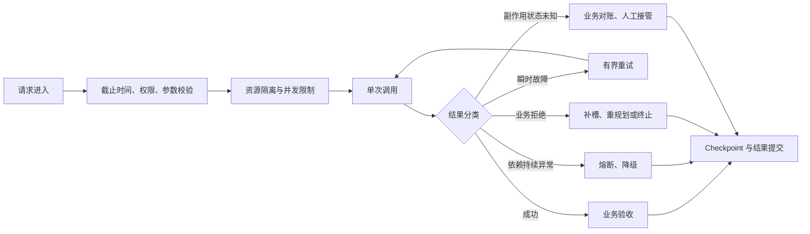

# 05-稳定性与异常保障：MedAgent 逐题口述

核查日期：2026-10-13。所有答案以院内 ToB 边界为前提。一般理论与未落地的扩展方案明确分开。

## q-001

### 主问题｜异常路由怎么做？

原文位置：05-稳定性与异常保障.md 第 56 行（原件保存在同步前备份）。

**项目口述：** 把权限失败、参数缺失、依赖故障和写入未知分开。权限失败拒绝；缺信息先询问；安全只读医院查询对瞬时网络错误及 429/部分 5xx 最多三次指数退避，转诊写调用不自动重试；连续依赖失败进入熔断。专科或工具失败不会被包装成成功答案。

**针对本题的设计展开（原文原理，作为方案解释）：**

按异常的语义和可恢复性分流，不只按抛出异常的组件分类。同一个工具可能返回限流、参数错误、权限错误或业务拒绝，处理策略完全不同。

路由依据应由结构化错误提供，不让主 Agent 从自然语言报错里猜：

**在 MedAgent 中怎么补全：** 备用模型、备用数据源或跳过非关键步骤必须有已验证契约，不能凭空说存在。只有确实可逆的本地事务能回滚；外部写入走查询、对账、补偿或责任医生复核。对于无法确认的临床问题，应给出失败原因和人工核对路径。

**代码依据：** [backend/mcp_tools.py](../../backend/mcp_tools.py)、[backend/resilience.py](../../backend/resilience.py)、[backend/mcp_security.py](../../backend/mcp_security.py)

**本题图与结构示例：** [example-002](#example-002)

## q-002

### 追问｜识别失败、槽位缺失、工具失败、权限不足、模型超时分别怎么处理？

原文位置：05-稳定性与异常保障.md 第 94 行（原件保存在同步前备份）。

**项目口述：** 把权限失败、参数缺失、依赖故障和写入未知分开。权限失败拒绝；缺信息先询问；安全只读医院查询对瞬时网络错误及 429/部分 5xx 最多三次指数退避，转诊写调用不自动重试；连续依赖失败进入熔断。专科或工具失败不会被包装成成功答案。

**针对本题的设计展开（原文原理，作为方案解释）：**

识别失败→澄清或转人工；槽位缺失→追问补槽；权限不足→拒绝、重新认证或申请授权。工具/模型失败还要继续按错误语义分类：只对可恢复的瞬时故障做有界重试；写请求超时且业务状态未知时先对账；备用工具或模型只有在能力、权限和输出契约等价时才能切换。

**在 MedAgent 中怎么补全：** 备用模型、备用数据源或跳过非关键步骤必须有已验证契约，不能凭空说存在。只有确实可逆的本地事务能回滚；外部写入走查询、对账、补偿或责任医生复核。对于无法确认的临床问题，应给出失败原因和人工核对路径。

**代码依据：** [backend/mcp_tools.py](../../backend/mcp_tools.py)、[backend/resilience.py](../../backend/resilience.py)、[backend/mcp_security.py](../../backend/mcp_security.py)

## q-003

### 追问｜不同异常是否进入不同兜底节点？

原文位置：05-稳定性与异常保障.md 第 98 行（原件保存在同步前备份）。

**项目口述：** 把权限失败、参数缺失、依赖故障和写入未知分开。权限失败拒绝；缺信息先询问；安全只读医院查询对瞬时网络错误及 429/部分 5xx 最多三次指数退避，转诊写调用不自动重试；连续依赖失败进入熔断。专科或工具失败不会被包装成成功答案。

**针对本题的设计展开（原文原理，作为方案解释）：**

是。澄清、重试、降级、对账和人工节点分开设计。兜底节点也不是万能 Agent：它只能在显式允许的策略中选择，不能绕过权限、确认和预算继续“尝试一下”。

**在 MedAgent 中怎么补全：** 备用模型、备用数据源或跳过非关键步骤必须有已验证契约，不能凭空说存在。只有确实可逆的本地事务能回滚；外部写入走查询、对账、补偿或责任医生复核。对于无法确认的临床问题，应给出失败原因和人工核对路径。

**代码依据：** [backend/mcp_tools.py](../../backend/mcp_tools.py)、[backend/resilience.py](../../backend/resilience.py)、[backend/mcp_security.py](../../backend/mcp_security.py)

## q-004

### 主问题｜用户问题无法识别怎么办？

原文位置：05-稳定性与异常保障.md 第 102 行（原件保存在同步前备份）。

**项目口述：** 可信身份和患者档案由服务端读取。业务参数由模型按工具 schema 提出，执行前代码检查空值、占位值、列表和检验内容；药名必须能在当前任务原始输入或可信用药档案中找到依据，相互作用检查至少两种药。参数记录 raw_value、normalized_value、source、turn_id、evidence_span、schema_version 和 validation_status。

**针对本题的设计展开（原文原理，作为方案解释）：**

三个手段：澄清追问、候选问题推荐、转人工。

**在 MedAgent 中怎么补全：** 现在没有训练过医疗 NER，也没有声称语义校验能识别全部错槽。扩展方案是为十类意图注册必填字段，规则抽固定格式，LLM 只提取有原文跨度的实体，再用药品目录校正通用名、单位和枚举。缺关键字段询问医生或药师，临床数值和药名不凭默认值补齐。

**代码依据：** [backend/clinical_slots.py](../../backend/clinical_slots.py)、[backend/schemas.py](../../backend/schemas.py)、[backend/agents.py](../../backend/agents.py)

## q-005

### 追问｜澄清追问、候选问题推荐、转人工怎么做？

原文位置：05-稳定性与异常保障.md 第 108 行（原件保存在同步前备份）。

**项目口述：** 可信身份和患者档案由服务端读取。业务参数由模型按工具 schema 提出，执行前代码检查空值、占位值、列表和检验内容；药名必须能在当前任务原始输入或可信用药档案中找到依据，相互作用检查至少两种药。参数记录 raw_value、normalized_value、source、turn_id、evidence_span、schema_version 和 validation_status。

**针对本题的设计展开（原文原理，作为方案解释）：**

澄清：直接问用户想做什么；候选推荐：列出可能的意图让用户选；转人工：多轮仍无法识别时。

**在 MedAgent 中怎么补全：** 现在没有训练过医疗 NER，也没有声称语义校验能识别全部错槽。扩展方案是为十类意图注册必填字段，规则抽固定格式，LLM 只提取有原文跨度的实体，再用药品目录校正通用名、单位和枚举。缺关键字段询问医生或药师，临床数值和药名不凭默认值补齐。

**代码依据：** [backend/clinical_slots.py](../../backend/clinical_slots.py)、[backend/schemas.py](../../backend/schemas.py)、[backend/agents.py](../../backend/agents.py)

## q-006

### 追问｜是否允许模型自由发挥？

原文位置：05-稳定性与异常保障.md 第 112 行（原件保存在同步前备份）。

**项目口述：** 可信身份和患者档案由服务端读取。业务参数由模型按工具 schema 提出，执行前代码检查空值、占位值、列表和检验内容；药名必须能在当前任务原始输入或可信用药档案中找到依据，相互作用检查至少两种药。参数记录 raw_value、normalized_value、source、turn_id、evidence_span、schema_version 和 validation_status。

**针对本题的设计展开（原文原理，作为方案解释）：**

不允许模型在不确定时自行扩大目标或执行高风险动作。它可以生成受 schema 约束的澄清问题或候选意图，但最终路由、权限和动作仍由服务端校验。

**在 MedAgent 中怎么补全：** 现在没有训练过医疗 NER，也没有声称语义校验能识别全部错槽。扩展方案是为十类意图注册必填字段，规则抽固定格式，LLM 只提取有原文跨度的实体，再用药品目录校正通用名、单位和枚举。缺关键字段询问医生或药师，临床数值和药名不凭默认值补齐。

**代码依据：** [backend/clinical_slots.py](../../backend/clinical_slots.py)、[backend/schemas.py](../../backend/schemas.py)、[backend/agents.py](../../backend/agents.py)

## q-007

### 主问题｜子 Agent 执行失败怎么办？

原文位置：05-稳定性与异常保障.md 第 116 行（原件保存在同步前备份）。

**项目口述：** 把权限失败、参数缺失、依赖故障和写入未知分开。权限失败拒绝；缺信息先询问；安全只读医院查询对瞬时网络错误及 429/部分 5xx 最多三次指数退避，转诊写调用不自动重试；连续依赖失败进入熔断。专科或工具失败不会被包装成成功答案。

**针对本题的设计展开（原文原理，作为方案解释）：**

先区分失败类型，再决定重试、切换、降级还是终止，而不是所有异常都重跑。生产上通常按“瞬时故障 → 重试，依赖不可用 → 备用 Agent/工具，非关键任务 → 跳过或降级，有副作用且已执行 → 回滚/补偿，关键任务连续失败 → 人工兜底”的方式处理。核心是把单节点失败控制在节点边界内，不能让一个子 Agent 的失败把整个任务拖垮。

**在 MedAgent 中怎么补全：** 备用模型、备用数据源或跳过非关键步骤必须有已验证契约，不能凭空说存在。只有确实可逆的本地事务能回滚；外部写入走查询、对账、补偿或责任医生复核。对于无法确认的临床问题，应给出失败原因和人工核对路径。

**代码依据：** [backend/mcp_tools.py](../../backend/mcp_tools.py)、[backend/resilience.py](../../backend/resilience.py)、[backend/mcp_security.py](../../backend/mcp_security.py)

## q-008

### 追问｜重试、切换备用 Agent、跳过、降级、回滚分别怎么用？

原文位置：05-稳定性与异常保障.md 第 122 行（原件保存在同步前备份）。

**项目口述：** 把权限失败、参数缺失、依赖故障和写入未知分开。权限失败拒绝；缺信息先询问；安全只读医院查询对瞬时网络错误及 429/部分 5xx 最多三次指数退避，转诊写调用不自动重试；连续依赖失败进入熔断。专科或工具失败不会被包装成成功答案。

**针对本题的设计展开（原文原理，作为方案解释）：**

重试适合超时、网络抖动、限流这类瞬时错误；切备用 Agent/工具适合当前实现持续不可用且存在语义等价的备用能力时；跳过只适用于非关键节点，且必须确认不影响最终结果；降级是把复杂能力换成简单能力，例如精排失败退回粗排。已产生的副作用未必可以原子回滚，更常见的是按业务条件执行补偿或转人工。

**在 MedAgent 中怎么补全：** 备用模型、备用数据源或跳过非关键步骤必须有已验证契约，不能凭空说存在。只有确实可逆的本地事务能回滚；外部写入走查询、对账、补偿或责任医生复核。对于无法确认的临床问题，应给出失败原因和人工核对路径。

**代码依据：** [backend/mcp_tools.py](../../backend/mcp_tools.py)、[backend/resilience.py](../../backend/resilience.py)、[backend/mcp_security.py](../../backend/mcp_security.py)

## q-009

### 追问｜怎么保证不会影响其他 Agent？

原文位置：05-稳定性与异常保障.md 第 126 行（原件保存在同步前备份）。

**项目口述：** 把权限失败、参数缺失、依赖故障和写入未知分开。权限失败拒绝；缺信息先询问；安全只读医院查询对瞬时网络错误及 429/部分 5xx 最多三次指数退避，转诊写调用不自动重试；连续依赖失败进入熔断。专科或工具失败不会被包装成成功答案。

**针对本题的设计展开（原文原理，作为方案解释）：**

通过任务级和节点级隔离。每个节点有独立状态、超时和重试计数；并行节点失败时，只把该节点标记为 failed，其他独立节点继续执行；最后由主 Agent 根据依赖关系决定是“部分成功返回、重新规划，还是整体终止”。如果一个失败节点是关键前置节点，才阻断其下游，而不是全局阻断。

**在 MedAgent 中怎么补全：** 备用模型、备用数据源或跳过非关键步骤必须有已验证契约，不能凭空说存在。只有确实可逆的本地事务能回滚；外部写入走查询、对账、补偿或责任医生复核。对于无法确认的临床问题，应给出失败原因和人工核对路径。

**代码依据：** [backend/mcp_tools.py](../../backend/mcp_tools.py)、[backend/resilience.py](../../backend/resilience.py)、[backend/mcp_security.py](../../backend/mcp_security.py)

## q-010

### 主问题｜工具调用失败怎么办？

原文位置：05-稳定性与异常保障.md 第 130 行（原件保存在同步前备份）。

**项目口述：** 把权限失败、参数缺失、依赖故障和写入未知分开。权限失败拒绝；缺信息先询问；安全只读医院查询对瞬时网络错误及 429/部分 5xx 最多三次指数退避，转诊写调用不自动重试；连续依赖失败进入熔断。专科或工具失败不会被包装成成功答案。

**针对本题的设计展开（原文原理，作为方案解释）：**

工具调用要分成“调用前校验 → 调用中保护 → 调用后校验”三层。调用前检查参数 schema、权限和工具状态；调用中设置超时、重试、熔断；调用后检查返回结构和业务结果是否符合预期。这样可以避免“HTTP 200 但业务实际上失败”这种问题。

**在 MedAgent 中怎么补全：** 备用模型、备用数据源或跳过非关键步骤必须有已验证契约，不能凭空说存在。只有确实可逆的本地事务能回滚；外部写入走查询、对账、补偿或责任医生复核。对于无法确认的临床问题，应给出失败原因和人工核对路径。

**代码依据：** [backend/mcp_tools.py](../../backend/mcp_tools.py)、[backend/resilience.py](../../backend/resilience.py)、[backend/mcp_security.py](../../backend/mcp_security.py)

## q-011

### 追问｜参数校验、重试、备用工具、返回可解释错误怎么做？

原文位置：05-稳定性与异常保障.md 第 136 行（原件保存在同步前备份）。

**项目口述：** 把权限失败、参数缺失、依赖故障和写入未知分开。权限失败拒绝；缺信息先询问；安全只读医院查询对瞬时网络错误及 429/部分 5xx 最多三次指数退避，转诊写调用不自动重试；连续依赖失败进入熔断。专科或工具失败不会被包装成成功答案。

**针对本题的设计展开（原文原理，作为方案解释）：**

参数校验主要防止模型生成非法参数，比如金额类型错误、枚举值不存在；瞬时错误才进入重试；主工具连续失败时，只有备用能力满足相同业务语义、权限和新鲜度要求才能切换；所有路径都失败后，返回统一错误码、失败原因和是否可重试的信息。对于写操作，还要由后端对稳定幂等键执行原子去重，不能只是在请求中多带一个字段。

**在 MedAgent 中怎么补全：** 备用模型、备用数据源或跳过非关键步骤必须有已验证契约，不能凭空说存在。只有确实可逆的本地事务能回滚；外部写入走查询、对账、补偿或责任医生复核。对于无法确认的临床问题，应给出失败原因和人工核对路径。

**代码依据：** [backend/mcp_tools.py](../../backend/mcp_tools.py)、[backend/resilience.py](../../backend/resilience.py)、[backend/mcp_security.py](../../backend/mcp_security.py)

## q-012

### 追问｜工具失败是返回给用户，还是内部消化？

原文位置：05-稳定性与异常保障.md 第 140 行（原件保存在同步前备份）。

**项目口述：** 把权限失败、参数缺失、依赖故障和写入未知分开。权限失败拒绝；缺信息先询问；安全只读医院查询对瞬时网络错误及 429/部分 5xx 最多三次指数退避，转诊写调用不自动重试；连续依赖失败进入熔断。专科或工具失败不会被包装成成功答案。

**针对本题的设计展开（原文原理，作为方案解释）：**

先内部消化可恢复故障，例如重试、切备用工具、走缓存；如果最终仍影响结果，就必须明确告诉用户失败发生在哪里、哪些结果可用、系统采取了什么替代方案。不能把失败伪装成正常结果。生产系统尤其要区分“技术成功”和“业务成功”。

**在 MedAgent 中怎么补全：** 备用模型、备用数据源或跳过非关键步骤必须有已验证契约，不能凭空说存在。只有确实可逆的本地事务能回滚；外部写入走查询、对账、补偿或责任医生复核。对于无法确认的临床问题，应给出失败原因和人工核对路径。

**代码依据：** [backend/mcp_tools.py](../../backend/mcp_tools.py)、[backend/resilience.py](../../backend/resilience.py)、[backend/mcp_security.py](../../backend/mcp_security.py)

## q-013

### 主问题｜权限不足怎么办？

原文位置：05-稳定性与异常保障.md 第 144 行（原件保存在同步前备份）。

**项目口述：** 权限在入口、A2A 专科和 MCP 工具执行点重复核验；数据库中的员工状态、角色和患者授权优先于旧令牌。专科只得到受限工具，患者 ID 服务端注入；原始任务摘要与签名委托绑定。外部文档和工具文字是数据，不允许改变授权、目标患者或写动作范围。

**针对本题的设计展开（原文原理，作为方案解释）：**

三个手段：拒绝访问、提示申请权限、转管理员。

**在 MedAgent 中怎么补全：** Prompt 可以提示忽略注入，但真正防线是白名单、schema、可信身份、固定数据源、写入确认和审计。进一步对最终参数做审批绑定、限制外部域名和文件权限、加入注入回归；不将未测试的‘万能注入检测’写成已有能力。

**代码依据：** [backend/service_auth.py](../../backend/service_auth.py)、[backend/mcp_security.py](../../backend/mcp_security.py)、[backend/access.py](../../backend/access.py)、[backend/agents.py](../../backend/agents.py)

## q-014

### 追问｜拒绝访问、提示申请权限、转管理员怎么做？

原文位置：05-稳定性与异常保障.md 第 150 行（原件保存在同步前备份）。

**项目口述：** 权限在入口、A2A 专科和 MCP 工具执行点重复核验；数据库中的员工状态、角色和患者授权优先于旧令牌。专科只得到受限工具，患者 ID 服务端注入；原始任务摘要与签名委托绑定。外部文档和工具文字是数据，不允许改变授权、目标患者或写动作范围。

**针对本题的设计展开（原文原理，作为方案解释）：**

拒绝：明确告知无权操作；提示：给出申请权限的路径；转管理员：需要授权处理的事务转给有权限的人。

**在 MedAgent 中怎么补全：** Prompt 可以提示忽略注入，但真正防线是白名单、schema、可信身份、固定数据源、写入确认和审计。进一步对最终参数做审批绑定、限制外部域名和文件权限、加入注入回归；不将未测试的‘万能注入检测’写成已有能力。

**代码依据：** [backend/service_auth.py](../../backend/service_auth.py)、[backend/mcp_security.py](../../backend/mcp_security.py)、[backend/access.py](../../backend/access.py)、[backend/agents.py](../../backend/agents.py)

## q-015

### 追问｜是否记录越权访问日志？

原文位置：05-稳定性与异常保障.md 第 154 行（原件保存在同步前备份）。

**项目口述：** 权限在入口、A2A 专科和 MCP 工具执行点重复核验；数据库中的员工状态、角色和患者授权优先于旧令牌。专科只得到受限工具，患者 ID 服务端注入；原始任务摘要与签名委托绑定。外部文档和工具文字是数据，不允许改变授权、目标患者或写动作范围。

**针对本题的设计展开（原文原理，作为方案解释）：**

必须记录。越权尝试本身就是风险信号，日志用于审计和风控；但只记录定位所需的 principal、资源摘要、策略结果和 trace，不把 token、完整隐私数据或未脱敏的模型上下文写入日志。

**在 MedAgent 中怎么补全：** Prompt 可以提示忽略注入，但真正防线是白名单、schema、可信身份、固定数据源、写入确认和审计。进一步对最终参数做审批绑定、限制外部域名和文件权限、加入注入回归；不将未测试的‘万能注入检测’写成已有能力。

**代码依据：** [backend/service_auth.py](../../backend/service_auth.py)、[backend/mcp_security.py](../../backend/mcp_security.py)、[backend/access.py](../../backend/access.py)、[backend/agents.py](../../backend/agents.py)

## q-016

### 主问题｜数据冲突怎么办？

原文位置：05-稳定性与异常保障.md 第 158 行（原件保存在同步前备份）。

**项目口述：** 专科返回辅助回答和脱敏的真实工具 Observation；协调器汇总时优先依据 Observation，并查看截断标记和调用状态。执行前后都限制权限和格式，每个意图检查对应工具覆盖。最终医学结论仍需要医生复核，当前没有独立临床审查模型证明结论正确。

**针对本题的设计展开（原文原理，作为方案解释）：**

数据冲突不能只靠 LLM 自己判断，而要先建立数据源优先级和一致性规则，再决定是否需要人工确认。处理流程一般是：发现冲突 → 判断数据源可信度 → 按规则选主 → 保留冲突证据 → 高风险场景让用户确认。关键是让系统的决策过程可解释、可追溯。

**在 MedAgent 中怎么补全：** 完整审查要核对结论逐条引用、药名、指标单位、指南版本和请求目标。来源冲突按数据类型与版本处理：当前患者事实看授权业务库，医学规范看有效指南；冲突无法消除就展示差异并要求医生确认，不能一律由用户最新输入覆盖权威事实。

**代码依据：** [backend/evidence.py](../../backend/evidence.py)、[backend/agents.py](../../backend/agents.py)

## q-017

### 追问｜设置信任优先级、返回冲突信息、让用户确认怎么做？

原文位置：05-稳定性与异常保障.md 第 164 行（原件保存在同步前备份）。

**项目口述：** 专科返回辅助回答和脱敏的真实工具 Observation；协调器汇总时优先依据 Observation，并查看截断标记和调用状态。执行前后都限制权限和格式，每个意图检查对应工具覆盖。最终医学结论仍需要医生复核，当前没有独立临床审查模型证明结论正确。

**针对本题的设计展开（原文原理，作为方案解释）：**

先在系统层定义 source priority，例如实时业务数据库通常高于历史缓存，经过权限控制的结构化数据高于普通知识文本；发现冲突时不要直接覆盖，而是记录不同来源及时间。高风险字段按性质分流：金额或操作参数向用户展示已核实值并二次确认；身份冲突重新认证；权限冲突以授权系统为准；仍无法确定的制度或业务异常再进入相应管理者审批或人工审核。

**在 MedAgent 中怎么补全：** 完整审查要核对结论逐条引用、药名、指标单位、指南版本和请求目标。来源冲突按数据类型与版本处理：当前患者事实看授权业务库，医学规范看有效指南；冲突无法消除就展示差异并要求医生确认，不能一律由用户最新输入覆盖权威事实。

**代码依据：** [backend/evidence.py](../../backend/evidence.py)、[backend/agents.py](../../backend/agents.py)

## q-018

### 追问｜用户输入、数据库、RAG、历史上下文冲突时以谁为准？

原文位置：05-稳定性与异常保障.md 第 168 行（原件保存在同步前备份）。

**项目口述：** 专科返回辅助回答和脱敏的真实工具 Observation；协调器汇总时优先依据 Observation，并查看截断标记和调用状态。执行前后都限制权限和格式，每个意图检查对应工具覆盖。最终医学结论仍需要医生复核，当前没有独立临床审查模型证明结论正确。

**针对本题的设计展开（原文原理，作为方案解释）：**

不靠一条全局优先级序列，而是按"字段语义"裁决：

1. 用户意图/偏好/槽位修正 → 以用户最新明确输入为准（这是"用户想干什么"，用户说了算）。

3. 制度规则/知识依据 → 以当前生效的权威文档为准；RAG 召回的是文档，不是独立权威等级。

4. 历史摘要 → 在判断“用户当时说了什么”时低于可回溯原文；两者都不能替代当前业务系统中的动态事实。

高风险字段冲突不能一刀切"让用户确认或转人工"，要按风险类型分开处理：金额/操作意图 → 用户二次确认（业务确认）；身份冲突 → 重新认证或 step-up 认证（身份是认证问题，不是确认问题）；权限冲突 → 以授权系统为准，用户确认不能授予权限，越权或异常授权只能走管理员审批。

RAG 场景如何给召回文档补充发布主体、生效时间和版本等证据属性，见 对应主题。

**在 MedAgent 中怎么补全：** 完整审查要核对结论逐条引用、药名、指标单位、指南版本和请求目标。来源冲突按数据类型与版本处理：当前患者事实看授权业务库，医学规范看有效指南；冲突无法消除就展示差异并要求医生确认，不能一律由用户最新输入覆盖权威事实。

**代码依据：** [backend/evidence.py](../../backend/evidence.py)、[backend/agents.py](../../backend/agents.py)

## q-019

### 主问题｜任务执行过程中的熔断机制怎么做？

原文位置：05-稳定性与异常保障.md 第 183 行（原件保存在同步前备份）。

**项目口述：** 默认整轮 120 秒、模型 30 秒、医院接口单次 10 秒，专科模型与工具各最多六次。入口设置绝对 deadline_at，签名委托传到 A2A 与 MCP；新调用取阶段上限和剩余时间的较小值，过期任务不再执行工具。已有只读退避、超时和熔断。超时不证明已提交的医院写入未发生，未知结果先核对。

**针对本题的设计展开（原文原理，作为方案解释）：**

熔断解决的不是“单次调用失败”，而是下游持续不健康时继续调用会形成故障放大的问题。通常以依赖为粒度设置熔断器，并配合超时、重试和降级：正常状态持续调用；失败率或连续失败超过阈值进入 Open（打开），Open 状态直接快速失败并走备用路径；经过冷却时间后进入 Half-Open（半开），放少量探测流量，成功再恢复 Closed（关闭），失败继续熔断。

**在 MedAgent 中怎么补全：** 上线按节点 p95/p99 与医院契约配置预算，并同步服务时钟；还需并发配额、准入控制和统一成本预算。取消只能结束本地等待，外部已提交动作能否取消取决于医院接口，不承诺自动回滚。

**代码依据：** [backend/task_budget.py](../../backend/task_budget.py)、[backend/service_auth.py](../../backend/service_auth.py)、[backend/mcp_security.py](../../backend/mcp_security.py)、[backend/resilience.py](../../backend/resilience.py)

## q-020

### 追问｜模型、工具、数据库、子 Agent 是否分别设置熔断？

原文位置：05-稳定性与异常保障.md 第 189 行（原件保存在同步前备份）。

**项目口述：** 默认整轮 120 秒、模型 30 秒、医院接口单次 10 秒，专科模型与工具各最多六次。入口设置绝对 deadline_at，签名委托传到 A2A 与 MCP；新调用取阶段上限和剩余时间的较小值，过期任务不再执行工具。已有只读退避、超时和熔断。超时不证明已提交的医院写入未发生，未知结果先核对。

**针对本题的设计展开（原文原理，作为方案解释）：**

原则上分别设置，因为它们的故障特征和恢复时间不同。模型熔断后可在重新校验能力、策略和输出契约后切换备用模型；数据库只有在缓存或只读副本满足一致性与新鲜度要求时才能降级读取；某个子 Agent 熔断后则可以重新规划任务。不能只做一个全局熔断器，否则一个依赖异常会误伤整个系统。

**在 MedAgent 中怎么补全：** 上线按节点 p95/p99 与医院契约配置预算，并同步服务时钟；还需并发配额、准入控制和统一成本预算。取消只能结束本地等待，外部已提交动作能否取消取决于医院接口，不承诺自动回滚。

**代码依据：** [backend/task_budget.py](../../backend/task_budget.py)、[backend/service_auth.py](../../backend/service_auth.py)、[backend/mcp_security.py](../../backend/mcp_security.py)、[backend/resilience.py](../../backend/resilience.py)

## q-021

### 追问｜连续失败多少次触发熔断？熔断后多久恢复？

原文位置：05-稳定性与异常保障.md 第 193 行（原件保存在同步前备份）。

**项目口述：** 默认整轮 120 秒、模型 30 秒、医院接口单次 10 秒，专科模型与工具各最多六次。入口设置绝对 deadline_at，签名委托传到 A2A 与 MCP；新调用取阶段上限和剩余时间的较小值，过期任务不再执行工具。已有只读退避、超时和熔断。超时不证明已提交的医院写入未发生，未知结果先核对。

**针对本题的设计展开（原文原理，作为方案解释）：**

不要简单背一个固定数字，生产上应根据调用量、错误率和业务容忍度配置。低流量场景可按连续失败次数，高流量场景更适合看滑动时间窗口内的错误率，并设最小请求数，避免两次请求失败就误熔断。超时、5xx（服务端错误）可计入故障，参数错误和业务拒绝通常不应计入依赖健康度。熔断后先冷却，再进入 Half-Open 状态放少量探测流量，而不是一次性全部恢复。

熔断粒度：应对准“真正共享故障域”，例如 `provider + model + region` 或 `tool + endpoint`。粒度太粗会误伤健康能力，粒度太细则样本不足、无法及时熔断。

**在 MedAgent 中怎么补全：** 上线按节点 p95/p99 与医院契约配置预算，并同步服务时钟；还需并发配额、准入控制和统一成本预算。取消只能结束本地等待，外部已提交动作能否取消取决于医院接口，不承诺自动回滚。

**代码依据：** [backend/task_budget.py](../../backend/task_budget.py)、[backend/service_auth.py](../../backend/service_auth.py)、[backend/mcp_security.py](../../backend/mcp_security.py)、[backend/resilience.py](../../backend/resilience.py)

## q-022

### 主问题｜最大超时时间怎么设置？

原文位置：05-稳定性与异常保障.md 第 199 行（原件保存在同步前备份）。

**项目口述：** 默认整轮 120 秒、模型 30 秒、医院接口单次 10 秒，专科模型与工具各最多六次。入口设置绝对 deadline_at，签名委托传到 A2A 与 MCP；新调用取阶段上限和剩余时间的较小值，过期任务不再执行工具。已有只读退避、超时和熔断。超时不证明已提交的医院写入未发生，未知结果先核对。

**针对本题的设计展开（原文原理，作为方案解释）：**

超时要从“总预算”倒推，而不是每一层随便设一个数字。入口生成端到端 `deadline`，下游传递截止时间或剩余 TTL（time-to-live，存活时间）；每层还要为排队、结果聚合和必要的重试预留时间。必须满足子调用超时 < 父任务剩余时间，否则父节点已超时，子节点还在继续占用资源。

跨进程不能直接传某台机器的单调时钟读数；可传 UTC 截止时间并考虑时钟偏差，或在每一跳重新计算剩余 TTL。超时和取消也应向下传播，但取消不等于撤销已发出的写操作。

**在 MedAgent 中怎么补全：** 上线按节点 p95/p99 与医院契约配置预算，并同步服务时钟；还需并发配额、准入控制和统一成本预算。取消只能结束本地等待，外部已提交动作能否取消取决于医院接口，不承诺自动回滚。

**代码依据：** [backend/task_budget.py](../../backend/task_budget.py)、[backend/service_auth.py](../../backend/service_auth.py)、[backend/mcp_security.py](../../backend/mcp_security.py)、[backend/resilience.py](../../backend/resilience.py)

## q-023

### 追问｜按 Agent、工具、接口、任务整体分别设置怎么做？

原文位置：05-稳定性与异常保障.md 第 207 行（原件保存在同步前备份）。

**项目口述：** 默认整轮 120 秒、模型 30 秒、医院接口单次 10 秒，专科模型与工具各最多六次。入口设置绝对 deadline_at，签名委托传到 A2A 与 MCP；新调用取阶段上限和剩余时间的较小值，过期任务不再执行工具。已有只读退避、超时和熔断。超时不证明已提交的医院写入未发生，未知结果先核对。

**针对本题的设计展开（原文原理，作为方案解释）：**

任务级是总超时，例如一次请求给整个任务一个总预算；Agent 级是某个子任务的预算；工具级再拆到单次 API/数据库调用；接口层还要有连接、读取等更细粒度 timeout。父级预算应该始终大于子级，并预留结果聚合、重试和网络抖动的时间。

**在 MedAgent 中怎么补全：** 上线按节点 p95/p99 与医院契约配置预算，并同步服务时钟；还需并发配额、准入控制和统一成本预算。取消只能结束本地等待，外部已提交动作能否取消取决于医院接口，不承诺自动回滚。

**代码依据：** [backend/task_budget.py](../../backend/task_budget.py)、[backend/service_auth.py](../../backend/service_auth.py)、[backend/mcp_security.py](../../backend/mcp_security.py)、[backend/resilience.py](../../backend/resilience.py)

## q-024

### 追问｜单个节点超时是否影响整体任务？

原文位置：05-稳定性与异常保障.md 第 211 行（原件保存在同步前备份）。

**项目口述：** 默认整轮 120 秒、模型 30 秒、医院接口单次 10 秒，专科模型与工具各最多六次。入口设置绝对 deadline_at，签名委托传到 A2A 与 MCP；新调用取阶段上限和剩余时间的较小值，过期任务不再执行工具。已有只读退避、超时和熔断。超时不证明已提交的医院写入未发生，未知结果先核对。

**针对本题的设计展开（原文原理，作为方案解释）：**

看依赖关系。独立并行节点超时，可以标记该节点失败，其他节点继续；关键前置节点超时，则会阻塞它的下游，需要重试、降级或重新规划。不能简单回答“不会影响整体”，真正的判断依据是依赖关系 + 任务是否允许部分成功。

**在 MedAgent 中怎么补全：** 上线按节点 p95/p99 与医院契约配置预算，并同步服务时钟；还需并发配额、准入控制和统一成本预算。取消只能结束本地等待，外部已提交动作能否取消取决于医院接口，不承诺自动回滚。

**代码依据：** [backend/task_budget.py](../../backend/task_budget.py)、[backend/service_auth.py](../../backend/service_auth.py)、[backend/mcp_security.py](../../backend/mcp_security.py)、[backend/resilience.py](../../backend/resilience.py)

## q-025

### 主问题｜如何重试？

原文位置：05-稳定性与异常保障.md 第 215 行（原件保存在同步前备份）。

**项目口述：** 把权限失败、参数缺失、依赖故障和写入未知分开。权限失败拒绝；缺信息先询问；安全只读医院查询对瞬时网络错误及 429/部分 5xx 最多三次指数退避，转诊写调用不自动重试；连续依赖失败进入熔断。专科或工具失败不会被包装成成功答案。

**针对本题的设计展开（原文原理，作为方案解释）：**

重试必须建立在“这个错误大概率临时可恢复，而且再次执行不会造成重复副作用”的前提上。标准做法是：先分类错误，再设最大尝试次数、指数退避（exponential backoff）和抖动（jitter），最后受同一个父任务的截止时间与重试预算约束。

多层服务不能各自默认重试 3 次；如果入口、Agent、工具网关各尝试 3 次，一次用户请求最坏可能放大为 27 次下游调用。应明确由哪一层负责重试，其他层传递结构化失败。

**在 MedAgent 中怎么补全：** 备用模型、备用数据源或跳过非关键步骤必须有已验证契约，不能凭空说存在。只有确实可逆的本地事务能回滚；外部写入走查询、对账、补偿或责任医生复核。对于无法确认的临床问题，应给出失败原因和人工核对路径。

**代码依据：** [backend/mcp_tools.py](../../backend/mcp_tools.py)、[backend/resilience.py](../../backend/resilience.py)、[backend/mcp_security.py](../../backend/mcp_security.py)

## q-026

### 追问｜固定重试、指数退避、按错误类型重试怎么做？

原文位置：05-稳定性与异常保障.md 第 223 行（原件保存在同步前备份）。

**项目口述：** 把权限失败、参数缺失、依赖故障和写入未知分开。权限失败拒绝；缺信息先询问；安全只读医院查询对瞬时网络错误及 429/部分 5xx 最多三次指数退避，转诊写调用不自动重试；连续依赖失败进入熔断。专科或工具失败不会被包装成成功答案。

**针对本题的设计展开（原文原理，作为方案解释）：**

固定重试简单但容易形成同步重试风暴；指数退避会逐渐拉长重试间隔，降低对故障下游的压力；生产上通常再加 jitter，避免大量实例同时在 2s、4s、8s 时刻重试。真正重要的是“错误分类优先”，而不是所有异常统一重试。

**在 MedAgent 中怎么补全：** 备用模型、备用数据源或跳过非关键步骤必须有已验证契约，不能凭空说存在。只有确实可逆的本地事务能回滚；外部写入走查询、对账、补偿或责任医生复核。对于无法确认的临床问题，应给出失败原因和人工核对路径。

**代码依据：** [backend/mcp_tools.py](../../backend/mcp_tools.py)、[backend/resilience.py](../../backend/resilience.py)、[backend/mcp_security.py](../../backend/mcp_security.py)

## q-027

### 追问｜哪些错误可以重试？哪些不能重试？

原文位置：05-稳定性与异常保障.md 第 227 行（原件保存在同步前备份）。

**项目口述：** 把权限失败、参数缺失、依赖故障和写入未知分开。权限失败拒绝；缺信息先询问；安全只读医院查询对瞬时网络错误及 429/部分 5xx 最多三次指数退避，转诊写调用不自动重试；连续依赖失败进入熔断。专科或工具失败不会被包装成成功答案。

**针对本题的设计展开（原文原理，作为方案解释）：**

只读调用遇到网络抖动、限流、明确可重试的部分 5xx 时通常可以重试，并尊重服务端 `Retry-After`；参数错误、权限不足、业务校验失败通常不能重试。“超时”不能单独决定策略：连接建立前失败与写请求发出后回包超时的风险不同。写操作只有在后端原子幂等，或已确认原操作未开始时才能自动重提。

**在 MedAgent 中怎么补全：** 备用模型、备用数据源或跳过非关键步骤必须有已验证契约，不能凭空说存在。只有确实可逆的本地事务能回滚；外部写入走查询、对账、补偿或责任医生复核。对于无法确认的临床问题，应给出失败原因和人工核对路径。

**代码依据：** [backend/mcp_tools.py](../../backend/mcp_tools.py)、[backend/resilience.py](../../backend/resilience.py)、[backend/mcp_security.py](../../backend/mcp_security.py)

## q-028

### 主问题｜如何降级？

原文位置：05-稳定性与异常保障.md 第 231 行（原件保存在同步前备份）。

**项目口述：** 把权限失败、参数缺失、依赖故障和写入未知分开。权限失败拒绝；缺信息先询问；安全只读医院查询对瞬时网络错误及 429/部分 5xx 最多三次指数退避，转诊写调用不自动重试；连续依赖失败进入熔断。专科或工具失败不会被包装成成功答案。

**针对本题的设计展开（原文原理，作为方案解释）：**

降级的核心不是“少做一点”，而是在部分能力不可用时仍保持核心业务可用。通常先定义业务优先级，把系统拆成核心路径和非核心能力，再为每个依赖准备替代方案：主模型失败切备用模型；复杂检索失败退到基础检索或静态知识；推荐/分析能力失败时返回基础结果。

**在 MedAgent 中怎么补全：** 备用模型、备用数据源或跳过非关键步骤必须有已验证契约，不能凭空说存在。只有确实可逆的本地事务能回滚；外部写入走查询、对账、补偿或责任医生复核。对于无法确认的临床问题，应给出失败原因和人工核对路径。

**代码依据：** [backend/mcp_tools.py](../../backend/mcp_tools.py)、[backend/resilience.py](../../backend/resilience.py)、[backend/mcp_security.py](../../backend/mcp_security.py)

## q-029

### 追问｜大模型失败走规则，RAG 失败走 FAQ，精排失败走粗排怎么理解？

原文位置：05-稳定性与异常保障.md 第 237 行（原件保存在同步前备份）。

**项目口述：** 把权限失败、参数缺失、依赖故障和写入未知分开。权限失败拒绝；缺信息先询问；安全只读医院查询对瞬时网络错误及 429/部分 5xx 最多三次指数退避，转诊写调用不自动重试；连续依赖失败进入熔断。专科或工具失败不会被包装成成功答案。

**针对本题的设计展开（原文原理，作为方案解释）：**

本质上是能力分级：高质量能力不可用时，退回成本更低、确定性更高的能力。降级路径必须提前设计，而不是故障发生后临时让 LLM 自己想替代方案。每个降级节点都应该明确“能保证什么、不能保证什么”。

**在 MedAgent 中怎么补全：** 备用模型、备用数据源或跳过非关键步骤必须有已验证契约，不能凭空说存在。只有确实可逆的本地事务能回滚；外部写入走查询、对账、补偿或责任医生复核。对于无法确认的临床问题，应给出失败原因和人工核对路径。

**代码依据：** [backend/mcp_tools.py](../../backend/mcp_tools.py)、[backend/resilience.py](../../backend/resilience.py)、[backend/mcp_security.py](../../backend/mcp_security.py)

## q-030

### 追问｜降级后是否提示用户结果可信度下降？

原文位置：05-稳定性与异常保障.md 第 241 行（原件保存在同步前备份）。

**项目口述：** 把权限失败、参数缺失、依赖故障和写入未知分开。权限失败拒绝；缺信息先询问；安全只读医院查询对瞬时网络错误及 429/部分 5xx 最多三次指数退避，转诊写调用不自动重试；连续依赖失败进入熔断。专科或工具失败不会被包装成成功答案。

**针对本题的设计展开（原文原理，作为方案解释）：**

需要根据业务风险决定。对低风险场景可以提示“当前使用简化方案”；对高风险场景不能只提示，而应直接阻断或转人工。降级不是无限兜底，最终目标是“可用但不过度冒险”。

**在 MedAgent 中怎么补全：** 备用模型、备用数据源或跳过非关键步骤必须有已验证契约，不能凭空说存在。只有确实可逆的本地事务能回滚；外部写入走查询、对账、补偿或责任医生复核。对于无法确认的临床问题，应给出失败原因和人工核对路径。

**代码依据：** [backend/mcp_tools.py](../../backend/mcp_tools.py)、[backend/resilience.py](../../backend/resilience.py)、[backend/mcp_security.py](../../backend/mcp_security.py)

## q-031

### 主问题｜如何防止死循环？

原文位置：05-稳定性与异常保障.md 第 245 行（原件保存在同步前备份）。

**项目口述：** 专科由 LangChain create_agent 运行工具循环，模型和工具调用各有上限；同一专科本轮相同工具与参数被指纹去重。主计划最多三个不同专科，不允许 A 调 B、B 再调 A。修正意图也只有一次只读重路由预算。

**针对本题的设计展开（原文原理，作为方案解释）：**

死循环通常来自三类问题：调用图递归且没有退出条件、模型在没有新观测时重复同一动作、任务规划不断 replan 却没有可验证进展。生产上要同时限制步数、重试/replan 次数、调用深度、扇出、时间和费用预算，并检测“相同规范化动作 + 相同关键业务状态 + 没有新证据”的停滞模式。

**在 MedAgent 中怎么补全：** 更长任务还应检测相同业务状态下的重复动作和证据没有增量，达到步数、时间或费用预算就停止。验收检查真实工具状态和目标覆盖，不能只让同一模型判断‘我已经成功’。

**代码依据：** [backend/agents.py](../../backend/agents.py)、[backend/evidence.py](../../backend/evidence.py)

## q-032

### 追问｜max_steps、max_retries、活动调用栈、trace 检测怎么做？

原文位置：05-稳定性与异常保障.md 第 251 行（原件保存在同步前备份）。

**项目口述：** 专科由 LangChain create_agent 运行工具循环，模型和工具调用各有上限；同一专科本轮相同工具与参数被指纹去重。主计划最多三个不同专科，不允许 A 调 B、B 再调 A。修正意图也只有一次只读重路由预算。

**针对本题的设计展开（原文原理，作为方案解释）：**

`max_steps` 控制整个任务最多执行多少步；`max_retries` 控制单节点尝试次数；活动调用栈按 `plan_version + step_id` 或稳定的逻辑调用边检查尚未返回的递归环，`invocation_id` 只负责区分和追踪具体调用；trace 用于识别跨轮次的停滞模式。不能仅凭 Agent 名称重复或出现 A→B→A 就判死循环，因为同一 Agent 可能合法处理不同 step，轮询也可能在等待真实状态变化。动态规划还要限制 replan 次数，并要求每轮产生新证据、减少未满足条件或改变可执行状态。

**在 MedAgent 中怎么补全：** 更长任务还应检测相同业务状态下的重复动作和证据没有增量，达到步数、时间或费用预算就停止。验收检查真实工具状态和目标覆盖，不能只让同一模型判断‘我已经成功’。

**代码依据：** [backend/agents.py](../../backend/agents.py)、[backend/evidence.py](../../backend/evidence.py)

## q-033

### 追问｜Agent 反复调用同一个工具怎么办？

原文位置：05-稳定性与异常保障.md 第 255 行（原件保存在同步前备份）。

**项目口述：** 专科由 LangChain create_agent 运行工具循环，模型和工具调用各有上限；同一专科本轮相同工具与参数被指纹去重。主计划最多三个不同专科，不允许 A 调 B、B 再调 A。修正意图也只有一次只读重路由预算。

**针对本题的设计展开（原文原理，作为方案解释）：**

可以把 `tool_name + normalized_input + relevant_state_version` 作为候选指纹；只有它反复出现且没有新观测、状态变化或退避等待，才判定为停滞并阻止继续调用。轮询必须有状态变化判定、退避、deadline 和最大次数，不能因为参数相同就直接拦截，也不能无限放行。

**在 MedAgent 中怎么补全：** 更长任务还应检测相同业务状态下的重复动作和证据没有增量，达到步数、时间或费用预算就停止。验收检查真实工具状态和目标覆盖，不能只让同一模型判断‘我已经成功’。

**代码依据：** [backend/agents.py](../../backend/agents.py)、[backend/evidence.py](../../backend/evidence.py)

## q-034

### 主问题｜如何快速排查问题？

原文位置：05-稳定性与异常保障.md 第 259 行（原件保存在同步前备份）。

**项目口述：** 项目有 HTTP、A2A、MCP 调用指标和脱敏排障日志，可以按请求标识关联阶段。新增意图复核原因、候选分数与路线随成功咨询审计保存。HTTP 指标主要是响应建立，不应当作整个 SSE 任务耗时；完整长任务与依赖状态要另外统计。

**针对本题的设计展开（原文原理，作为方案解释）：**

生产排障首先不是看某一条日志，而是沿着 `trace_id` 把一次请求的完整执行链串起来，再结合节点状态、耗时、错误码和工具返回定位故障层级。基本路径是：请求入口 → 主 Agent 路由 → 子 Agent → 工具/模型 → 状态持久化 → 最终输出。

**在 MedAgent 中怎么补全：** 生产方案按员工/院内业务做脱敏 Trace，区分路由、工具、模型与保存失败，监控超时、错误、熔断与任务成功率，并配置告警、值班与反馈闭环。不能把代码里有 /metrics 说成医院已部署线上监控。

**代码依据：** [backend/observability.py](../../backend/observability.py)、[backend/main.py](../../backend/main.py)、[backend/agents.py](../../backend/agents.py)

## q-035

### 追问｜trace_id、日志、状态快照、节点耗时、工具返回分别做什么？

原文位置：05-稳定性与异常保障.md 第 265 行（原件保存在同步前备份）。

**项目口述：** 项目有 HTTP、A2A、MCP 调用指标和脱敏排障日志，可以按请求标识关联阶段。新增意图复核原因、候选分数与路线随成功咨询审计保存。HTTP 指标主要是响应建立，不应当作整个 SSE 任务耗时；完整长任务与依赖状态要另外统计。

**针对本题的设计展开（原文原理，作为方案解释）：**

trace_id 解决“这一请求经过了哪些节点”；日志记录节点做了什么；状态快照说明故障发生时任务处于什么状态；耗时用于定位慢节点；经过脱敏的工具结果摘要或产物引用用于确认故障来自外部依赖还是内部逻辑。生产上最好再配合 metrics，把错误率、P95/P99 延迟、重试率、熔断次数做成监控指标；密钥、完整隐私数据和原始长上下文不能为了排障直接写日志。

**在 MedAgent 中怎么补全：** 生产方案按员工/院内业务做脱敏 Trace，区分路由、工具、模型与保存失败，监控超时、错误、熔断与任务成功率，并配置告警、值班与反馈闭环。不能把代码里有 /metrics 说成医院已部署线上监控。

**代码依据：** [backend/observability.py](../../backend/observability.py)、[backend/main.py](../../backend/main.py)、[backend/agents.py](../../backend/agents.py)

## q-036

### 追问｜如何定位是主 Agent、子 Agent、工具还是模型的问题？

原文位置：05-稳定性与异常保障.md 第 269 行（原件保存在同步前备份）。

**项目口述：** 项目有 HTTP、A2A、MCP 调用指标和脱敏排障日志，可以按请求标识关联阶段。新增意图复核原因、候选分数与路线随成功咨询审计保存。HTTP 指标主要是响应建立，不应当作整个 SSE 任务耗时；完整长任务与依赖状态要另外统计。

**针对本题的设计展开（原文原理，作为方案解释）：**

先看异常最早出现在哪个 span：路由目标错误、计划错误通常从主 Agent/Planner 查起；子任务契约或输出错误从子 Agent 查起；连接超时、5xx、数据库异常从工具/基础设施查起；模型输出结构或内容异常则检查模型、上下文和解析层。失败 span 是诊断入口，不一定是根因：下游参数错误也可能源于上游错误抽取。应沿输入和证据链向前查到最早偏差。

**在 MedAgent 中怎么补全：** 生产方案按员工/院内业务做脱敏 Trace，区分路由、工具、模型与保存失败，监控超时、错误、熔断与任务成功率，并配置告警、值班与反馈闭环。不能把代码里有 /metrics 说成医院已部署线上监控。

**代码依据：** [backend/observability.py](../../backend/observability.py)、[backend/main.py](../../backend/main.py)、[backend/agents.py](../../backend/agents.py)

## q-037

### 主问题｜输出稳定性差、波动大怎么排查？

原文位置：05-稳定性与异常保障.md 第 273 行（原件保存在同步前备份）。

**项目口述：** 可信患者档案来自数据库，近期对话与任务快照分开保存；工作台切换患者会清理上下文与未提交编辑。新任务隔离旧历史，待澄清任务只复用有界原问题和本轮补充，不把上轮助手猜测当临床事实。A2A 历史有条数、单条字节和总字节预算。

**针对本题的设计展开（原文原理，作为方案解释）：**

先把“不稳定”定义成可重复的失败类型，如路由变动、工具选择错误、事实冲突、结构不合法或表达风格波动；然后固定任务集、模型版本、工具数据快照和预算，对同一输入多次回放。否则无法区分是采样随机性，还是上游数据和运行环境变了。

排查顺序按证据链进行：

1. Runtime / 工具层：先看是否有超时、重试、降级、索引/数据版本变化、工具返回顺序不稳定或并发竞争。

2. Context 层：比较每次实际注入的证据 manifest，检查检索召回、压缩、历史继承、时效和冲突裁决是否变化。

3. Prompt / 模型层：在前两层固定后，再检查指令歧义、few-shot 覆盖、结构化输出约束、模型版本和采样参数。

最后将差异归因到最早偏离的节点，每次只改一个主要因素，在保留集上重复评测。不能只凭几个样例就宣称稳定性提升，改善幅度必须来自实际评测数据。

**在 MedAgent 中怎么补全：** 进一步做 Context Builder：固定职责与授权先保留，当前目标和关键临床事实次之，然后按任务需要选工具证据，最后才是历史摘要。摘要保留来源、时间和原文引用，压缩策略要用多轮任务完成率和错误继承率验证。

**代码依据：** [backend/a2a_context.py](../../backend/a2a_context.py)、[backend/memory.py](../../backend/memory.py)、[backend/task_context.py](../../backend/task_context.py)

## q-038

### 追问｜为什么先查 Runtime 和 Context，再调 Prompt？

原文位置：05-稳定性与异常保障.md 第 287 行（原件保存在同步前备份）。

**项目口述：** 可信患者档案来自数据库，近期对话与任务快照分开保存；工作台切换患者会清理上下文与未提交编辑。新任务隔离旧历史，待澄清任务只复用有界原问题和本轮补充，不把上轮助手猜测当临床事实。A2A 历史有条数、单条字节和总字节预算。

**针对本题的设计展开（原文原理，作为方案解释）：**

因为相同 Prompt 如果拿到的工具结果、检索证据或降级路径不同，输出可能随之变化，但不必然变化。这时盲目增加 Prompt 规则会掩盖真正的数据或控制面问题，还可能引入新回归。

**在 MedAgent 中怎么补全：** 进一步做 Context Builder：固定职责与授权先保留，当前目标和关键临床事实次之，然后按任务需要选工具证据，最后才是历史摘要。摘要保留来源、时间和原文引用，压缩策略要用多轮任务完成率和错误继承率验证。

**代码依据：** [backend/a2a_context.py](../../backend/a2a_context.py)、[backend/memory.py](../../backend/memory.py)、[backend/task_context.py](../../backend/task_context.py)

## q-039

### 追问｜用什么指标衡量波动？

原文位置：05-稳定性与异常保障.md 第 291 行（原件保存在同步前备份）。

**项目口述：** 可信患者档案来自数据库，近期对话与任务快照分开保存；工作台切换患者会清理上下文与未提交编辑。新任务隔离旧历史，待澄清任务只复用有界原问题和本轮补充，不把上轮助手猜测当临床事实。A2A 历史有条数、单条字节和总字节预算。

**针对本题的设计展开（原文原理，作为方案解释）：**

按任务分层看多次运行的路由一致率、工具选择/参数一致率、结构合法率、事实一致率、端到端成功率和成本/延迟分布。表达不同但都满足任务验收，不应误判为失败；真正需要控制的是决策、事实和契约波动。

**在 MedAgent 中怎么补全：** 进一步做 Context Builder：固定职责与授权先保留，当前目标和关键临床事实次之，然后按任务需要选工具证据，最后才是历史摘要。摘要保留来源、时间和原文引用，压缩策略要用多轮任务完成率和错误继承率验证。

**代码依据：** [backend/a2a_context.py](../../backend/a2a_context.py)、[backend/memory.py](../../backend/memory.py)、[backend/task_context.py](../../backend/task_context.py)

## q-040

### 主问题｜如何防止过载和故障扩散？

原文位置：05-稳定性与异常保障.md 第 295 行（原件保存在同步前备份）。

**项目口述：** 我把交付验收拆成院内权限、安全边界、工具契约、路由覆盖、故障分支和真实医院接口联调。仓库有配置、部署和工程回归记录，说明已有实现可核对；真实医院试点、临床收益和全链路容量不能直接从合成评测推导。

**针对本题的设计展开（原文原理，作为方案解释）：**

熔断只解决“下游已经不健康”，不能代替并发控制。还需要舱壁隔离（bulkhead）、有界队列、背压、限流、优先级和负载脱落（load shedding）。

例如，在线问答、批量报告、评估器和后台索引不应共用无上限的 worker 池。批处理涌入时，系统应延后或拒绝低优先级任务，保住在线核心路径。如果队列无上限，请求即使最终都执行，也会因排队超过 deadline 而全部失去价值。

**在 MedAgent 中怎么补全：** 上线时明确医生/药师典型任务与责任人，先小范围灰度，再测成功率、复核耗时、人工纠错及院内流程接受度；准备模型/Prompt/工具联合回滚和数据恢复演练。范围变更先评估权限、状态和验收，不把新增患者服务混入 ToB 交付。

**代码依据：** [docs/production-readiness.md](../../docs/production-readiness.md)、[README.md](../../README.md)、[deploy/k8s/medagent-api.yaml](../../deploy/k8s/medagent-api.yaml)

## q-041

### 追问｜限流、并发限制、背压和熔断有什么区别？

原文位置：05-稳定性与异常保障.md 第 303 行（原件保存在同步前备份）。

**项目口述：** 我把交付验收拆成院内权限、安全边界、工具契约、路由覆盖、故障分支和真实医院接口联调。仓库有配置、部署和工程回归记录，说明已有实现可核对；真实医院试点、临床收益和全链路容量不能直接从合成评测推导。

**针对本题的设计展开（原文原理，作为方案解释）：**

- 限流：控制单位时间接收多少请求。

- 并发限制：控制同时在飞请求数，保护连接池和 worker。

- 背压：当消费速度不足时，让上游减速、等待或停止生产。

- 熔断：根据下游故障信号暂停调用，避免继续放大失败。

**在 MedAgent 中怎么补全：** 上线时明确医生/药师典型任务与责任人，先小范围灰度，再测成功率、复核耗时、人工纠错及院内流程接受度；准备模型/Prompt/工具联合回滚和数据恢复演练。范围变更先评估权限、状态和验收，不把新增患者服务混入 ToB 交付。

**代码依据：** [docs/production-readiness.md](../../docs/production-readiness.md)、[README.md](../../README.md)、[deploy/k8s/medagent-api.yaml](../../deploy/k8s/medagent-api.yaml)

## q-042

### 追问｜队列满了怎么办？

原文位置：05-稳定性与异常保障.md 第 310 行（原件保存在同步前备份）。

**项目口述：** 我把交付验收拆成院内权限、安全边界、工具契约、路由覆盖、故障分支和真实医院接口联调。仓库有配置、部署和工程回归记录，说明已有实现可核对；真实医院试点、临床收益和全链路容量不能直接从合成评测推导。

**针对本题的设计展开（原文原理，作为方案解释）：**

必须有显式拒绝策略：在线请求可快速返回“系统繁忙，请稍后重试”；尚未接受的后台任务可延迟入队或按优先级拒绝；已经确认接收的持久化任务不能静默丢弃，必须保留可查询的延期、取消或失败状态。高风险写操作不能因过载转成未受控的其他路径。明确拒绝比让请求在队列中超时更可预测。

这段代码的核心不是 `try/except`，而是处理顺序：先校验和预留预算 → 再检查熔断/资源 → 登记当次 attempt → 分类失败 → 只重试可安全重试的错误。真实实现中 `wait` 应由异步调度器或延迟队列承载，不用 worker 空等长退避。

**在 MedAgent 中怎么补全：** 上线时明确医生/药师典型任务与责任人，先小范围灰度，再测成功率、复核耗时、人工纠错及院内流程接受度；准备模型/Prompt/工具联合回滚和数据恢复演练。范围变更先评估权限、状态和验收，不把新增患者服务混入 ToB 交付。

**代码依据：** [docs/production-readiness.md](../../docs/production-readiness.md)、[README.md](../../README.md)、[deploy/k8s/medagent-api.yaml](../../deploy/k8s/medagent-api.yaml)

**本题图与结构示例：** [example-003](#example-003)

## q-043

### 主问题｜Checkpoint 是什么？

原文位置：05-稳定性与异常保障.md 第 426 行（原件保存在同步前备份）。

**项目口述：** 现在保存 started、agents_completed、completed、failed 阶段以及任务标识、版本、缺失字段等近期快照。生产委托必须带任务、会话、版本、步骤和期限；MCP 必须借助 Redis 核对任务仍在执行且版本相符，缺配置或任务域拒绝。开发环境未配置 Redis 时使用本地 TTL，不提供跨进程围栏；这不能撤销已提交的医院写入。会话默认 1800 秒，checkpoint 默认一天，尚未实现节点持久恢复或 SSE 重放。

**针对本题的设计展开（原文原理，作为方案解释）：**

Checkpoint 是任务在可恢复边界上的持久化状态快照。它的价值不只是“记录做到哪了”，而是让系统能够在进程重启、节点失败、用户刷新、异步任务恢复后继续执行，而不是从头开始。

**在 MedAgent 中怎么补全：** 节点恢复要持久保存计划版本、已完成步骤、输入摘要、工具依据引用和操作状态，恢复时先重新鉴权。只读证据核验时效后才能复用；写任务先核对 operation_id，结果未知绝不盲目再次执行。Checkpoint 不提供跨 HIS 的恰好一次保证。

**代码依据：** [backend/memory.py](../../backend/memory.py)、[backend/main.py](../../backend/main.py)、[backend/mcp_security.py](../../backend/mcp_security.py)

## q-044

### 追问｜保存哪些状态？什么时候保存？

原文位置：05-稳定性与异常保障.md 第 434 行（原件保存在同步前备份）。

**项目口述：** 现在保存 started、agents_completed、completed、failed 阶段以及任务标识、版本、缺失字段等近期快照。生产委托必须带任务、会话、版本、步骤和期限；MCP 必须借助 Redis 核对任务仍在执行且版本相符，缺配置或任务域拒绝。开发环境未配置 Redis 时使用本地 TTL，不提供跨进程围栏；这不能撤销已提交的医院写入。会话默认 1800 秒，checkpoint 默认一天，尚未实现节点持久恢复或 SSE 重放。

**针对本题的设计展开（原文原理，作为方案解释）：**

至少保存任务与计划版本、当前可执行节点、状态值、产物引用、已用预算、重试/replan 计数、取消状态和错误信息。对有副作用的步骤，`operation_id` 必须在首次外部调用前持久化，否则崩溃后无法用同一标识查询或接续。大文档、检索全文和模型原始输出宜放产物存储，checkpoint 只保存不可变引用和校验摘要。

**在 MedAgent 中怎么补全：** 节点恢复要持久保存计划版本、已完成步骤、输入摘要、工具依据引用和操作状态，恢复时先重新鉴权。只读证据核验时效后才能复用；写任务先核对 operation_id，结果未知绝不盲目再次执行。Checkpoint 不提供跨 HIS 的恰好一次保证。

**代码依据：** [backend/memory.py](../../backend/memory.py)、[backend/main.py](../../backend/main.py)、[backend/mcp_security.py](../../backend/mcp_security.py)

## q-045

### 追问｜为什么说 Checkpoint 是任务状态快照？

原文位置：05-稳定性与异常保障.md 第 438 行（原件保存在同步前备份）。

**项目口述：** 现在保存 started、agents_completed、completed、failed 阶段以及任务标识、版本、缺失字段等近期快照。生产委托必须带任务、会话、版本、步骤和期限；MCP 必须借助 Redis 核对任务仍在执行且版本相符，缺配置或任务域拒绝。开发环境未配置 Redis 时使用本地 TTL，不提供跨进程围栏；这不能撤销已提交的医院写入。会话默认 1800 秒，checkpoint 默认一天，尚未实现节点持久恢复或 SSE 重放。

**针对本题的设计展开（原文原理，作为方案解释）：**

因为它不是简单日志，而是恢复所需的最小完整状态。恢复程序拿到 checkpoint 后，应该能判断“哪些节点已经完成、哪些还没有完成、当前任务需要从哪里继续”。因此 checkpoint 的设计必须和任务状态机、节点依赖一起设计。

**在 MedAgent 中怎么补全：** 节点恢复要持久保存计划版本、已完成步骤、输入摘要、工具依据引用和操作状态，恢复时先重新鉴权。只读证据核验时效后才能复用；写任务先核对 operation_id，结果未知绝不盲目再次执行。Checkpoint 不提供跨 HIS 的恰好一次保证。

**代码依据：** [backend/memory.py](../../backend/memory.py)、[backend/main.py](../../backend/main.py)、[backend/mcp_security.py](../../backend/mcp_security.py)

## q-046

### 主问题｜LangGraph Checkpoint 怎么用？

原文位置：05-稳定性与异常保障.md 第 442 行（原件保存在同步前备份）。

**项目口述：** 现在保存 started、agents_completed、completed、failed 阶段以及任务标识、版本、缺失字段等近期快照。生产委托必须带任务、会话、版本、步骤和期限；MCP 必须借助 Redis 核对任务仍在执行且版本相符，缺配置或任务域拒绝。开发环境未配置 Redis 时使用本地 TTL，不提供跨进程围栏；这不能撤销已提交的医院写入。会话默认 1800 秒，checkpoint 默认一天，尚未实现节点持久恢复或 SSE 重放。

**针对本题的设计展开（原文原理，作为方案解释）：**

在 LangGraph 中，给图配置 checkpointer 后，状态快照会按图执行的 super-step 保存，并通过 `thread_id` 组织。`graph.get_state(config)` 返回 `StateSnapshot`，其 `values` 是当前状态，`next` 表示下一批待执行节点。[LangGraph Checkpointers](https://docs.langchain.com/oss/python/langgraph/checkpointers)

从历史 checkpoint replay 时，该点之后的节点会重新执行，包括相关的 LLM、API 和 interrupt，因此外部副作用仍需幂等。[LangGraph Time Travel](https://docs.langchain.com/oss/python/langgraph/use-time-travel)

`thread_id` 是 LangGraph 用来组织和读取某条线程 checkpoint 的标识，不是 checkpoint 游标，也不必然等于业务 `task_id`；如果一个业务任务对应一条图线程，可以直接使用同一值，否则应显式建立映射。定位具体历史快照还需要 `checkpoint_id`。

**在 MedAgent 中怎么补全：** 节点恢复要持久保存计划版本、已完成步骤、输入摘要、工具依据引用和操作状态，恢复时先重新鉴权。只读证据核验时效后才能复用；写任务先核对 operation_id，结果未知绝不盲目再次执行。Checkpoint 不提供跨 HIS 的恰好一次保证。

**代码依据：** [backend/memory.py](../../backend/memory.py)、[backend/main.py](../../backend/main.py)、[backend/mcp_security.py](../../backend/mcp_security.py)

**本题图与结构示例：** [example-004](#example-004)

## q-047

### 追问｜每个节点执行后保存 state 怎么做？

原文位置：05-稳定性与异常保障.md 第 473 行（原件保存在同步前备份）。

**项目口述：** 现在保存 started、agents_completed、completed、failed 阶段以及任务标识、版本、缺失字段等近期快照。生产委托必须带任务、会话、版本、步骤和期限；MCP 必须借助 Redis 核对任务仍在执行且版本相符，缺配置或任务域拒绝。开发环境未配置 Redis 时使用本地 TTL，不提供跨进程围栏；这不能撤销已提交的医院写入。会话默认 1800 秒，checkpoint 默认一天，尚未实现节点持久恢复或 SSE 重放。

**针对本题的设计展开（原文原理，作为方案解释）：**

核心思路是给图配置 checkpointer，业务代码重点设计 state schema、reducer 和副作用边界，而不是在每个节点里手写一套 Redis/数据库保存逻辑。并行节点的状态更新还要有合法 reducer，否则同一 super-step 的多路写入可能冲突。

**在 MedAgent 中怎么补全：** 节点恢复要持久保存计划版本、已完成步骤、输入摘要、工具依据引用和操作状态，恢复时先重新鉴权。只读证据核验时效后才能复用；写任务先核对 operation_id，结果未知绝不盲目再次执行。Checkpoint 不提供跨 HIS 的恰好一次保证。

**代码依据：** [backend/memory.py](../../backend/memory.py)、[backend/main.py](../../backend/main.py)、[backend/mcp_security.py](../../backend/mcp_security.py)

## q-048

### 追问｜中断后如何从上次节点继续？

原文位置：05-稳定性与异常保障.md 第 477 行（原件保存在同步前备份）。

**项目口述：** 现在保存 started、agents_completed、completed、failed 阶段以及任务标识、版本、缺失字段等近期快照。生产委托必须带任务、会话、版本、步骤和期限；MCP 必须借助 Redis 核对任务仍在执行且版本相符，缺配置或任务域拒绝。开发环境未配置 Redis 时使用本地 TTL，不提供跨进程围栏；这不能撤销已提交的医院写入。会话默认 1800 秒，checkpoint 默认一天，尚未实现节点持久恢复或 SSE 重放。

**针对本题的设计展开（原文原理，作为方案解释）：**

用同一 `thread_id` 加载最新快照并接续；如果从某个历史 `checkpoint_id` replay，该 checkpoint 之后的节点会重新执行，不能误以为只是读取旧结果。恢复前还应校验任务归属、取消状态、剩余预算、图/契约版本和外部证据时效性。LangGraph 现行文档说明，已持久化的 thread 在恢复时会运行当前部署的图代码，因此上线改图属于对存量 checkpoint 的兼容性变更。[LangGraph Backward Compatibility](https://docs.langchain.com/oss/python/langgraph/backward-compatibility)

**在 MedAgent 中怎么补全：** 节点恢复要持久保存计划版本、已完成步骤、输入摘要、工具依据引用和操作状态，恢复时先重新鉴权。只读证据核验时效后才能复用；写任务先核对 operation_id，结果未知绝不盲目再次执行。Checkpoint 不提供跨 HIS 的恰好一次保证。

**代码依据：** [backend/memory.py](../../backend/memory.py)、[backend/main.py](../../backend/main.py)、[backend/mcp_security.py](../../backend/mcp_security.py)

## q-049

### 主问题｜Checkpoint 存哪里？

原文位置：05-稳定性与异常保障.md 第 481 行（原件保存在同步前备份）。

**项目口述：** 现在保存 started、agents_completed、completed、failed 阶段以及任务标识、版本、缺失字段等近期快照。生产委托必须带任务、会话、版本、步骤和期限；MCP 必须借助 Redis 核对任务仍在执行且版本相符，缺配置或任务域拒绝。开发环境未配置 Redis 时使用本地 TTL，不提供跨进程围栏；这不能撤销已提交的医院写入。会话默认 1800 秒，checkpoint 默认一天，尚未实现节点持久恢复或 SSE 重放。

**针对本题的设计展开（原文原理，作为方案解释）：**

选择 checkpoint 存储要看持久性、一致性、并发更新、恢复时间、容量、加密及运维成本。开发环境可以使用内存；生产环境需要共享、持久化且能做条件更新的存储。不应机械回答“Redis + 数据库”，而应先说明恢复目标和已有基础设施。

**在 MedAgent 中怎么补全：** 节点恢复要持久保存计划版本、已完成步骤、输入摘要、工具依据引用和操作状态，恢复时先重新鉴权。只读证据核验时效后才能复用；写任务先核对 operation_id，结果未知绝不盲目再次执行。Checkpoint 不提供跨 HIS 的恰好一次保证。

**代码依据：** [backend/memory.py](../../backend/memory.py)、[backend/main.py](../../backend/main.py)、[backend/mcp_security.py](../../backend/mcp_security.py)

## q-050

### 追问｜内存、Redis、MySQL、PostgreSQL、MongoDB 怎么选？

原文位置：05-稳定性与异常保障.md 第 487 行（原件保存在同步前备份）。

**项目口述：** 现在保存 started、agents_completed、completed、failed 阶段以及任务标识、版本、缺失字段等近期快照。生产委托必须带任务、会话、版本、步骤和期限；MCP 必须借助 Redis 核对任务仍在执行且版本相符，缺配置或任务域拒绝。开发环境未配置 Redis 时使用本地 TTL，不提供跨进程围栏；这不能撤销已提交的医院写入。会话默认 1800 秒，checkpoint 默认一天，尚未实现节点持久恢复或 SSE 重放。

**针对本题的设计展开（原文原理，作为方案解释）：**

内存只适合测试和单进程开发；Redis 偏低延迟状态，但要单独评估持久化和故障转移语义；MySQL/PostgreSQL 适合需要事务、版本条件更新和审计的状态；文档库可容纳灵活结构，但仍要验证并发与事务需求。框架项目还必须选用与当前版本兼容的 checkpointer 实现，不能只因为团队有某个数据库就自行假设官方适配。[LangGraph Checkpointers](https://docs.langchain.com/oss/python/langgraph/checkpointers)

**在 MedAgent 中怎么补全：** 节点恢复要持久保存计划版本、已完成步骤、输入摘要、工具依据引用和操作状态，恢复时先重新鉴权。只读证据核验时效后才能复用；写任务先核对 operation_id，结果未知绝不盲目再次执行。Checkpoint 不提供跨 HIS 的恰好一次保证。

**代码依据：** [backend/memory.py](../../backend/memory.py)、[backend/main.py](../../backend/main.py)、[backend/mcp_security.py](../../backend/mcp_security.py)

## q-051

### 追问｜生产环境为什么不能只存在内存？

原文位置：05-稳定性与异常保障.md 第 491 行（原件保存在同步前备份）。

**项目口述：** 现在保存 started、agents_completed、completed、failed 阶段以及任务标识、版本、缺失字段等近期快照。生产委托必须带任务、会话、版本、步骤和期限；MCP 必须借助 Redis 核对任务仍在执行且版本相符，缺配置或任务域拒绝。开发环境未配置 Redis 时使用本地 TTL，不提供跨进程围栏；这不能撤销已提交的医院写入。会话默认 1800 秒，checkpoint 默认一天，尚未实现节点持久恢复或 SSE 重放。

**针对本题的设计展开（原文原理，作为方案解释）：**

因为服务重启、容器迁移或多实例负载均衡都会导致状态丢失或实例间不可见。生产必须保证 checkpoint 至少具备持久化能力，并且多实例都可以访问同一份任务状态。若 Redis 作为主要存储，还要考虑持久化策略、故障切换和数据恢复。

**在 MedAgent 中怎么补全：** 节点恢复要持久保存计划版本、已完成步骤、输入摘要、工具依据引用和操作状态，恢复时先重新鉴权。只读证据核验时效后才能复用；写任务先核对 operation_id，结果未知绝不盲目再次执行。Checkpoint 不提供跨 HIS 的恰好一次保证。

**代码依据：** [backend/memory.py](../../backend/memory.py)、[backend/main.py](../../backend/main.py)、[backend/mcp_security.py](../../backend/mcp_security.py)

## q-052

### 主问题｜用户刷新后任务怎么继续？

原文位置：05-稳定性与异常保障.md 第 495 行（原件保存在同步前备份）。

**项目口述：** FastAPI 通过 SSE 输出 session、meta、trace、card、delta 和 done。文字增量是展示状态；入口收到协调器完成后，还要保存咨询、审计、会话与快照，才发送最终 done。断流、工具失败或模型输出截断不会确认成功。

**针对本题的设计展开（原文原理，作为方案解释）：**

关键不是“刷新后重新跑”，而是让前端持有稳定的 `task_id`，服务端根据 `task_id` 读取任务状态和 checkpoint。页面刷新、浏览器重连甚至切换实例，都可以重新订阅这个 task，而不依赖原来的 HTTP 连接。

**在 MedAgent 中怎么补全：** 刷新恢复需要持久事件序号和已保存输出，再按员工、患者与任务授权查询或重放。当前没有这套事件重放，因此不能说刷新会自动接着输出。优化首字延迟可以先显示阶段状态，同时实测全链路首字、总耗时和模型/工具耗时。

**代码依据：** [backend/main.py](../../backend/main.py)、[backend/agents.py](../../backend/agents.py)、[streamlit_app.py](../../streamlit_app.py)

## q-053

### 追问｜根据 session_id/task_id 找到 checkpoint 怎么做？

原文位置：05-稳定性与异常保障.md 第 501 行（原件保存在同步前备份）。

**项目口述：** FastAPI 通过 SSE 输出 session、meta、trace、card、delta 和 done。文字增量是展示状态；入口收到协调器完成后，还要保存咨询、审计、会话与快照，才发送最终 done。断流、工具失败或模型输出截断不会确认成功。

**针对本题的设计展开（原文原理，作为方案解释）：**

创建任务时生成唯一 task_id，并把 task_id 与 session_id、user_id 建立关联。刷新后前端带 task_id 查询任务状态，服务端校验用户是否有权访问该任务，再返回当前状态、已完成结果和后续进度。这里必须避免只靠 session_id，否则同一会话中多个任务容易串状态。

**在 MedAgent 中怎么补全：** 刷新恢复需要持久事件序号和已保存输出，再按员工、患者与任务授权查询或重放。当前没有这套事件重放，因此不能说刷新会自动接着输出。优化首字延迟可以先显示阶段状态，同时实测全链路首字、总耗时和模型/工具耗时。

**代码依据：** [backend/main.py](../../backend/main.py)、[backend/agents.py](../../backend/agents.py)、[streamlit_app.py](../../streamlit_app.py)

## q-054

### 追问｜是否能恢复流式输出？

原文位置：05-稳定性与异常保障.md 第 505 行（原件保存在同步前备份）。

**项目口述：** FastAPI 通过 SSE 输出 session、meta、trace、card、delta 和 done。文字增量是展示状态；入口收到协调器完成后，还要保存咨询、审计、会话与快照，才发送最终 done。断流、工具失败或模型输出截断不会确认成功。

**针对本题的设计展开（原文原理，作为方案解释）：**

可以，但要区分“恢复任务状态”和“恢复原来的网络连接”。原来的 SSE/WebSocket 连接已经断了，不能继续原连接；正确做法是保存已经生成的消息/事件序号，用户重连后从最后一个 offset 继续消费。任务已经完成时直接返回最终结果，避免重复生成。

**在 MedAgent 中怎么补全：** 刷新恢复需要持久事件序号和已保存输出，再按员工、患者与任务授权查询或重放。当前没有这套事件重放，因此不能说刷新会自动接着输出。优化首字延迟可以先显示阶段状态，同时实测全链路首字、总耗时和模型/工具耗时。

**代码依据：** [backend/main.py](../../backend/main.py)、[backend/agents.py](../../backend/agents.py)、[streamlit_app.py](../../streamlit_app.py)

## q-055

### 主问题｜异步任务失败后怎么恢复？

原文位置：05-稳定性与异常保障.md 第 509 行（原件保存在同步前备份）。

**项目口述：** 现在保存 started、agents_completed、completed、failed 阶段以及任务标识、版本、缺失字段等近期快照。生产委托必须带任务、会话、版本、步骤和期限；MCP 必须借助 Redis 核对任务仍在执行且版本相符，缺配置或任务域拒绝。开发环境未配置 Redis 时使用本地 TTL，不提供跨进程围栏；这不能撤销已提交的医院写入。会话默认 1800 秒，checkpoint 默认一天，尚未实现节点持久恢复或 SSE 重放。

**针对本题的设计展开（原文原理，作为方案解释）：**

异步任务恢复要同时依赖 checkpoint + 任务状态机 + 幂等机制。失败后先读取任务状态，确认哪些节点已经成功，再从最近可恢复节点继续，而不是简单“从上一个节点重跑”。如果失败发生在一个有副作用的节点上，还要先确认它到底执行成功、失败还是状态未知，再决定是否重试。

**在 MedAgent 中怎么补全：** 节点恢复要持久保存计划版本、已完成步骤、输入摘要、工具依据引用和操作状态，恢复时先重新鉴权。只读证据核验时效后才能复用；写任务先核对 operation_id，结果未知绝不盲目再次执行。Checkpoint 不提供跨 HIS 的恰好一次保证。

**代码依据：** [backend/memory.py](../../backend/memory.py)、[backend/main.py](../../backend/main.py)、[backend/mcp_security.py](../../backend/mcp_security.py)

**本题图与结构示例：** [example-005](#example-005)

## q-056

### 追问｜从最近成功节点继续，不重复执行已完成节点怎么做？

原文位置：05-稳定性与异常保障.md 第 559 行（原件保存在同步前备份）。

**项目口述：** 现在保存 started、agents_completed、completed、failed 阶段以及任务标识、版本、缺失字段等近期快照。生产委托必须带任务、会话、版本、步骤和期限；MCP 必须借助 Redis 核对任务仍在执行且版本相符，缺配置或任务域拒绝。开发环境未配置 Redis 时使用本地 TTL，不提供跨进程围栏；这不能撤销已提交的医院写入。会话默认 1800 秒，checkpoint 默认一天，尚未实现节点持久恢复或 SSE 重放。

**针对本题的设计展开（原文原理，作为方案解释）：**

按 `plan_version + step_id` 记录每个节点的状态、产物版本和当前 attempt，恢复时重新计算 DAG 的就绪集合。只有输入、目标和证据仍然有效的成功结果才能复用；上游输入或计划版本变更后，受影响的下游产物必须失效。不能只靠一个 `completed_nodes` 数组判断是否跳过执行。

**在 MedAgent 中怎么补全：** 节点恢复要持久保存计划版本、已完成步骤、输入摘要、工具依据引用和操作状态，恢复时先重新鉴权。只读证据核验时效后才能复用；写任务先核对 operation_id，结果未知绝不盲目再次执行。Checkpoint 不提供跨 HIS 的恰好一次保证。

**代码依据：** [backend/memory.py](../../backend/memory.py)、[backend/main.py](../../backend/main.py)、[backend/mcp_security.py](../../backend/mcp_security.py)

## q-057

### 追问｜如何避免重复写数据库、重复发消息？

原文位置：05-稳定性与异常保障.md 第 563 行（原件保存在同步前备份）。

**项目口述：** 现在保存 started、agents_completed、completed、failed 阶段以及任务标识、版本、缺失字段等近期快照。生产委托必须带任务、会话、版本、步骤和期限；MCP 必须借助 Redis 核对任务仍在执行且版本相符，缺配置或任务域拒绝。开发环境未配置 Redis 时使用本地 TTL，不提供跨进程围栏；这不能撤销已提交的医院写入。会话默认 1800 秒，checkpoint 默认一天，尚未实现节点持久恢复或 SSE 重放。

**针对本题的设计展开（原文原理，作为方案解释）：**

checkpoint 负责告诉系统“流程最后可确认到哪一步”，业务后端的幂等和操作账本处理“实际已执行，但结果没来得及写回”。数据库写入可使用业务唯一约束或幂等键；可靠消息可使用事务发件箱（transactional outbox）缩小“业务提交但消息未发送”的双写窗口，消费端仍需去重。如果外部系统无法区分 `not_started` 和 `unknown`，就不能自动重提。

**在 MedAgent 中怎么补全：** 节点恢复要持久保存计划版本、已完成步骤、输入摘要、工具依据引用和操作状态，恢复时先重新鉴权。只读证据核验时效后才能复用；写任务先核对 operation_id，结果未知绝不盲目再次执行。Checkpoint 不提供跨 HIS 的恰好一次保证。

**代码依据：** [backend/memory.py](../../backend/memory.py)、[backend/main.py](../../backend/main.py)、[backend/mcp_security.py](../../backend/mcp_security.py)

## q-058

### 主问题｜Checkpoint 和日志有什么区别？

原文位置：05-稳定性与异常保障.md 第 567 行（原件保存在同步前备份）。

**项目口述：** 现在保存 started、agents_completed、completed、failed 阶段以及任务标识、版本、缺失字段等近期快照。生产委托必须带任务、会话、版本、步骤和期限；MCP 必须借助 Redis 核对任务仍在执行且版本相符，缺配置或任务域拒绝。开发环境未配置 Redis 时使用本地 TTL，不提供跨进程围栏；这不能撤销已提交的医院写入。会话默认 1800 秒，checkpoint 默认一天，尚未实现节点持久恢复或 SSE 重放。

**针对本题的设计展开（原文原理，作为方案解释）：**

Checkpoint 和日志的主要职责不同：Checkpoint 为恢复服务，日志为观测和排障服务。 两者会共享 task、step、trace 等关联元数据，但不能互相替代。Checkpoint 应该是结构化、可加载、足够让任务继续执行的状态；日志记录的是执行过程、脱敏后的输入输出摘要、错误和耗时等信息。

**在 MedAgent 中怎么补全：** 节点恢复要持久保存计划版本、已完成步骤、输入摘要、工具依据引用和操作状态，恢复时先重新鉴权。只读证据核验时效后才能复用；写任务先核对 operation_id，结果未知绝不盲目再次执行。Checkpoint 不提供跨 HIS 的恰好一次保证。

**代码依据：** [backend/memory.py](../../backend/memory.py)、[backend/main.py](../../backend/main.py)、[backend/mcp_security.py](../../backend/mcp_security.py)

## q-059

### 追问｜checkpoint 用于恢复，日志用于排查怎么理解？

原文位置：05-稳定性与异常保障.md 第 573 行（原件保存在同步前备份）。

**项目口述：** 现在保存 started、agents_completed、completed、failed 阶段以及任务标识、版本、缺失字段等近期快照。生产委托必须带任务、会话、版本、步骤和期限；MCP 必须借助 Redis 核对任务仍在执行且版本相符，缺配置或任务域拒绝。开发环境未配置 Redis 时使用本地 TTL，不提供跨进程围栏；这不能撤销已提交的医院写入。会话默认 1800 秒，checkpoint 默认一天，尚未实现节点持久恢复或 SSE 重放。

**针对本题的设计展开（原文原理，作为方案解释）：**

当服务重启时，系统需要 checkpoint 判断“任务现在是什么状态、下一步做什么”；而工程师排查问题时，需要日志回答“为什么会走到这个状态”。因此 checkpoint 不应该承担完整日志职责，否则状态会膨胀；日志也不能替代 checkpoint，因为日志通常不能直接恢复程序执行。

**在 MedAgent 中怎么补全：** 节点恢复要持久保存计划版本、已完成步骤、输入摘要、工具依据引用和操作状态，恢复时先重新鉴权。只读证据核验时效后才能复用；写任务先核对 operation_id，结果未知绝不盲目再次执行。Checkpoint 不提供跨 HIS 的恰好一次保证。

**代码依据：** [backend/memory.py](../../backend/memory.py)、[backend/main.py](../../backend/main.py)、[backend/mcp_security.py](../../backend/mcp_security.py)

## q-060

### 追问｜checkpoint 是结构化状态，日志是执行记录怎么理解？

原文位置：05-稳定性与异常保障.md 第 577 行（原件保存在同步前备份）。

**项目口述：** 现在保存 started、agents_completed、completed、failed 阶段以及任务标识、版本、缺失字段等近期快照。生产委托必须带任务、会话、版本、步骤和期限；MCP 必须借助 Redis 核对任务仍在执行且版本相符，缺配置或任务域拒绝。开发环境未配置 Redis 时使用本地 TTL，不提供跨进程围栏；这不能撤销已提交的医院写入。会话默认 1800 秒，checkpoint 默认一天，尚未实现节点持久恢复或 SSE 重放。

**针对本题的设计展开（原文原理，作为方案解释）：**

Checkpoint 更像“存档点”，必须保证结构稳定、可序列化和可恢复；日志更像“录像”，强调事件时间线和诊断信息。生产中两者通常通过 trace_id/task_id 关联，这样既能从 checkpoint 恢复任务，又能从日志追查故障原因。

Checkpoint 保存内容（可背）：

字段只是教学示例；具体状态应由 schema 和状态机定义。`completed_nodes` 这种列表不足以支撑并行尝试、计划版本和写操作对账，因此示例改为按 `step_id` 记录状态。

断点继续的回答口径（可背）：

**在 MedAgent 中怎么补全：** 节点恢复要持久保存计划版本、已完成步骤、输入摘要、工具依据引用和操作状态，恢复时先重新鉴权。只读证据核验时效后才能复用；写任务先核对 operation_id，结果未知绝不盲目再次执行。Checkpoint 不提供跨 HIS 的恰好一次保证。

**代码依据：** [backend/memory.py](../../backend/memory.py)、[backend/main.py](../../backend/main.py)、[backend/mcp_security.py](../../backend/mcp_security.py)

**本题图与结构示例：** [example-006](#example-006)、[example-007](#example-007)、[example-008](#example-008)

## 原文图与结构示例（ToB适配）

以下逐块保留原文的图、伪代码、JSON 和文本结构，通用交易示例改为院内患者记录与转诊协同。这些是面试原理或扩展方案示例，可能包含尚未实现的角色、参数级审批、语义验收、持久恢复和队列；不能作为当前项目已实现的接口或代码。当前实现以各题项目口述、代码依据及主流程图为准。

### example-001

**导读：稳定性的目标不是“永不失败”**

来源：05-稳定性与异常保障.md 第 34 行。用途：ToB 原理示例 / 扩展设计；不表示代码已落地。



### example-002

**Q1｜异常路由怎么做？**

来源：05-稳定性与异常保障.md 第 74 行。用途：ToB 原理示例 / 扩展设计；不表示代码已落地。

[返回对应问答](#q-001)

```json
{
  "task_id": "task-001",
  "trace_id": "trace-8f3a",
  "plan_version": 3,
  "step_id": "submit_referral",
  "attempt_id": "attempt-002",
  "status": "unknown",
  "data": null,
  "error": {
    "code": "RESPONSE_TIMEOUT_AFTER_SEND",
    "category": "side_effect_unknown",
    "retryable": false,
    "message": "请求已发出，未收到服务端最终结果"
  },
  "operation_id": "referral-patient-12345-v1",
  "observed_at": "2026-09-14T10:00:00+08:00"
}
```

### example-003

**课堂伪代码：把超时、重试、熔断和过载串成一条执行链**

来源：05-稳定性与异常保障.md 第 318 行。用途：ToB 原理示例 / 扩展设计；不表示代码已落地。

[返回对应问答](#q-042)

```python
def execute_resilient_step(step, request, principal, task_deadline):
    # 先验证协议，再按服务端登记的 action/resource 做鉴权；不能信任请求自报权限。
    validate_envelope(request)
    authorize(principal, step.action, step.resource_scope)

    # 重试、超时和退避参数按依赖配置，不由模型临时生成。
    policy = resilience_policy.for_dependency(step.dependency)

    # 派发前检查总 deadline 和总预算；未发出的调用不记为在途（in-flight）。
    if remaining(task_deadline) <= 0:
        return failed_response(step, code="deadline_exceeded")
    reservation = budgets.try_reserve(
        task_id=request.task_id,
        tokens=step.max_tokens,
        calls=policy.max_attempts,
    )
    if reservation is None:
        return blocked_response(step, code="budget_exhausted")

    # 熔断是依赖健康判断；bulkhead 是并发资源隔离。
    if not breakers[step.dependency].allow_request():
        budgets.release_unused(reservation)
        return failed_response(step, code="dependency_circuit_open")

    lease = bulkheads[step.dependency].try_acquire()
    if lease is None:
        budgets.release_unused(reservation)
        return failed_response(step, code="overloaded", retry_after=policy.retry_after)

    operation_id = None
    try:
        for attempt_no in range(policy.max_attempts):
            # 每次尝试前重新计算剩余时间，避免局部重试突破父任务 deadline。
            if remaining(task_deadline) <= policy.min_call_timeout:
                return failed_response(step, code="deadline_exceeded")

            # 写操作的 operation_id 在首次外部调用前持久化，后续尝试复用。
            if step.has_side_effect and operation_id is None:
                operation_id = operations.get_or_create(
                    request.task_id, step.id, step.business_object
                )

            attempt_id = attempts.start_inflight(
                task_id=request.task_id,
                plan_version=request.plan_version,
                step_id=step.id,
                operation_id=operation_id,
            )
            try:
                # operation_id 是跨重试稳定的业务幂等键；attempt_id 只标识本次调用。
                raw = dependency_client.call(
                    action=step.action,
                    payload=request.input,
                    idempotency_key=operation_id,
                    timeout=min(policy.per_call_timeout, remaining(task_deadline)),
                )
            except Exception as exc:
                failure = classify_failure(exc, sent=attempts.was_sent(attempt_id))
                attempts.finish(attempt_id, failure=failure)

                # 只有依赖健康故障才进入熔断统计；参数、权限和业务拒绝不计入。
                if failure.counts_toward_dependency_health:
                    breakers[step.dependency].record_failure(failure)

                # 发送后写操作超时时业务状态未知，先对账，不直接重发。
                if step.has_side_effect and failure.side_effect_unknown:
                    return unknown_response(
                        step,
                        operation_id=operation_id,
                        code="write_outcome_unknown",
                    )

                if not failure.retryable or attempt_no + 1 >= policy.max_attempts:
                    return failed_response(step, code=failure.code)

                if not breakers[step.dependency].allow_request():
                    return failed_response(step, code="dependency_circuit_open")

                # 退避同时受 Retry-After、重试序号和父任务剩余时间约束。
                delay = bounded_backoff(attempt_no, failure.retry_after)
                if delay >= remaining(task_deadline):
                    return failed_response(step, code="deadline_exceeded")
                wait(delay)
                continue

            try:
                result = validate_business_result(step.result_schema, raw)
            except ContractError as exc:
                # 返回契约错误不是传输瞬时故障，不原样重试。
                failure = non_retryable_failure("invalid_dependency_result", exc)
                attempts.finish(attempt_id, failure=failure)
                if failure.counts_toward_dependency_health:
                    breakers[step.dependency].record_failure(failure)
                return failed_response(step, code=failure.code)
            attempts.finish(attempt_id, result=result)
            breakers[step.dependency].record_success()
            return success_response(step, data=result, operation_id=operation_id)
    finally:
        # 所有返回/异常路径都归还舱壁配额，并按实际消耗结算预留预算。
        lease.release()
        budgets.settle_and_release_unused(reservation)
```

### example-004

**Q16｜LangGraph Checkpoint 怎么用？**

来源：05-稳定性与异常保障.md 第 450 行。用途：ToB 原理示例 / 扩展设计；不表示代码已落地。

[返回对应问答](#q-046)

```python
from langgraph.checkpoint.memory import InMemorySaver

# 开发环境示例；生产环境换成持久化 checkpointer。
checkpointer = InMemorySaver()

# compile 时绑定 checkpointer，图会在执行边界保存 StateSnapshot。
graph = builder.compile(checkpointer=checkpointer)

# thread_id 用于归组同一条图线程的 checkpoint，不是某个具体快照的游标。
config = {"configurable": {"thread_id": "task-001"}}

# 首次调用写入初始状态并推进图；后续可用同一 thread_id 接续。
graph.invoke(initial_state, config=config)

# 未指定 checkpoint_id 时读取该 thread 的最新快照。
snapshot = graph.get_state(config)
print(snapshot.values)  # 已持久化状态
print(snapshot.next)    # 下一批节点；空元组表示图已完成
```

### example-005

**Q19｜异步任务失败后怎么恢复？**

来源：05-稳定性与异常保障.md 第 515 行。用途：ToB 原理示例 / 扩展设计；不表示代码已落地。

[返回对应问答](#q-055)

```python
def recover_step(task_id, step_id, principal):
    # 不在数据库事务/行锁内调用外部后端；先读取快照并抢占有时限的恢复租约。
    step = store.load_step(task_id, step_id)

    # 抢租约前重做安全与新鲜度检查，不能默认旧 checkpoint 仍可执行。
    require(step.owner == principal.id)
    require(not step.task_cancelled)
    require(step.plan_version == store.current_plan_version(task_id))
    require(step.input_versions_still_valid())
    require(step.deadline_not_exceeded())
    require(policy.can_execute(principal, step))

    # CAS 租约保证同一 plan/attempt 只有一个恢复者获得提交资格。
    lease = store.claim_recovery_if_current(
        task_id, step_id,
        expected_plan_version=step.plan_version,
        expected_attempt_id=step.attempt_id,
    )

    # 只读步骤没有外部副作用，可以创建新 attempt 重新计算。
    if step.read_only:
        return resume_with_new_attempt(step, lease)

    # 写操作必须先查业务后端，不用 checkpoint 猜结果。
    require(step.operation_id is not None)
    operation = operations.load(step.operation_id)
    require(operation.task_id == task_id and operation.step_id == step_id)

    # 此处持有的是有时限的逻辑租约，不是跨网络调用的数据库行锁。
    status = backend.query_operation(operation.id, principal)
    if status == "succeeded":
        # 后端事实优先于本地 checkpoint，并仍以 CAS 条件提交恢复结果。
        return commit_recovered_result_if_current(step, lease, status.result)
    if status == "in_progress":
        return wait_with_deadline(step, lease)
    if status == "definitively_not_started":
        # 只有权威后端确认未开始，才复用原 operation_id 接续写操作。
        return resume_with_same_operation_id(step, lease)
    if status == "failed":
        return record_business_failure_if_current(step, lease, status.reason)
    return handoff_for_reconciliation(step, lease)  # unknown 绝不自动重提
```

### example-006

**Q20｜Checkpoint 和日志有什么区别？**

来源：05-稳定性与异常保障.md 第 583 行。用途：ToB 原理示例 / 扩展设计；不表示代码已落地。

[返回对应问答](#q-060)

```json
{
  "task_id": "task-001",
  "thread_id": "thread-001",
  "plan_version": 3,
  "checkpoint_version": 12,
  "task_status": "waiting_reconciliation",
  "next_steps": ["verify_referral_operation"],
  "step_states": {
    "read_patient_record": {
      "status": "success",
      "artifact_ref": "artifact://order/12345/v8"
    },
    "submit_referral": {
      "status": "unknown",
      "attempt_id": "attempt-002",
      "operation_id": "referral-patient-12345-v1"
    }
  },
  "budget": {
    "model_calls_used": 3,
    "tool_calls_used": 5,
    "deadline": "2026-09-14T10:05:00+08:00"
  },
  "cancelled": false,
  "last_error": "RESPONSE_TIMEOUT_AFTER_SEND",
  "updated_at": "2026-09-14T10:03:00+08:00"
}
```

### example-007

**Q20｜Checkpoint 和日志有什么区别？**

来源：05-稳定性与异常保障.md 第 617 行。用途：ToB 原理示例 / 扩展设计；不表示代码已落地。

[返回对应问答](#q-060)

```text
Checkpoint 持久化的是可恢复流程状态，包括计划版本、节点状态、产物引用、
累计重试与预算。服务重启后先根据 task/thread 标识加载快照，然后重新校验归属、
取消状态、计划版本和证据时效性，只接续仍然有效的未完成步骤。
对于写数据库、转诊申请和提交院内通知等副作用，checkpoint 不能单独防重；
必须在外部调用前持久化 operation_id，并由业务后端原子去重、查询真实操作状态。
```

### example-008

**面试串讲口径**

来源：05-稳定性与异常保障.md 第 654 行。用途：ToB 原理示例 / 扩展设计；不表示代码已落地。

[返回对应问答](#q-060)

```text
我会先按契约、权限、业务、瞬时故障、持续故障和副作用未知对错误分类。
只有可恢复的瞬时故障进入有界重试，所有尝试共享父任务 deadline 和重试预算。
持续故障用熔断和降级止损，资源层用舱壁、限流、有界队列和背压防扩散。
Checkpoint 恢复流程进度，但不保证业务副作用只执行一次。
写操作通过稳定 operation_id、后端原子去重和恢复前对账保证正确性；
状态不明时停止自动重提。最后用故障注入验证重试、熔断、降级和断点恢复的实际行为。
```

