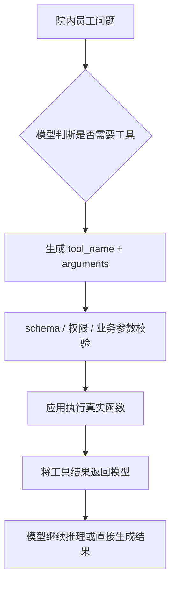
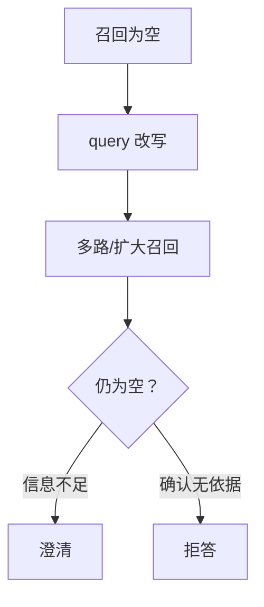

# 07-工具与外部能力：MedAgent(医疗智能体项目) 逐题口述

核查日期：2026-10-13。所有答案以院内 ToB(面向机构业务) 边界为前提。一般理论与未落地的扩展方案明确分开。

## q-001

### 主问题｜LangChain(大模型应用开发框架) 常用工具有哪些？

原文位置：仓库根目录下的本地原件 `artifacts/medagent_upgrade_20261013/原始资料/07-工具与外部能力.txt` 第 25 行。当前同名 .md 是适配稿；本地原件不随克隆分发。

**项目口述：** 模型通过 Function Calling(函数调用) 选择工具并生成结构化参数，LangChain(大模型应用开发框架) 的 MCPAdapter(MCP工具适配器) 和 FastMCP(MCP服务框架) 客户端通过 MCP(模型上下文协议) 调用工具服务。FastMCP(MCP服务框架) 注册 14 个工具，包括真实医院查询以及本地病史、辅助材料存储；服务端再次检查委托、员工状态、患者范围和写动作权限。两者在同一链路中使用。

**针对本题的设计展开（原文原理，作为方案解释）：**

如果面试官沿用旧版口径，可以说自己用过 Tool(工具)、PromptTemplate(提示词模板)、Retriever(检索器)、Memory(记忆)、AgentExecutor(智能体执行器) 和 OutputParser(输出解析器)，但要主动补充：这不再是 LangChain(大模型应用开发框架) 1.x 的权威“六大组件”分类。

当前 LangChain(大模型应用开发框架) 1.x 将 `create_agent`(创建智能体) 作为标准 Agent(智能体) 入口，其底层运行在 LangGraph(有状态智能体编排框架) 上。面试时更适合按实际工程边界讲：

- Model(模型)：推理与工具选择；

- Tools(工具列表)：向模型描述可用能力，真实执行仍由应用控制；

- Middleware(中间件)：动态模型/工具选择、上下文工程、摘要和护栏（guardrails(安全约束)）；

- State(状态) / Context(上下文)：管理执行状态和当次模型可见信息；

- Structured Output(结构化输出)：将结果约束为应用可验证的契约；

- LangGraph(有状态智能体编排框架) runtime(运行环境)：承载节点、循环、持久化和人工介入。

旧 chains(调用链)、部分 retrievers(检索器集合) 和旧版 Agent(智能体) 实现已迁入 `langchain-classic`(LangChain传统链组件库)，所以不能再用旧导入路径当成当前默认架构。[LangChain(大模型应用开发框架)：What's new(新任务) in LangChain(大模型应用开发框架) v1](https://docs.langchain.com/oss/python/releases/langchain-v1)

**在 MedAgent(医疗智能体项目) 中怎么补全：** 工具注册要同时维护参数、输出、错误、权限、读写属性和版本契约；新增工具先做契约测试和权限回归，再开放给对应专科。不能把工具描述中的 readOnlyHint(只读工具提示) 当真正的服务端授权。

**代码依据：** [backend/mcp_tools.py](../../backend/mcp_tools.py)、[backend/mcp_security.py](../../backend/mcp_security.py)、[backend/agents.py](../../backend/agents.py)

## q-002

### 追问｜老项目里的 Tool(工具)、PromptTemplate(提示词模板)、Retriever(检索器)、Memory(记忆)、AgentExecutor(智能体执行器)、OutputParser(输出解析器) 分别做什么？

原文位置：仓库根目录下的本地原件 `artifacts/medagent_upgrade_20261013/原始资料/07-工具与外部能力.txt` 第 42 行。当前同名 .md 是适配稿；本地原件不随克隆分发。

**项目口述：** 模型通过 Function Calling(函数调用) 选择工具并生成结构化参数，LangChain(大模型应用开发框架) 的 MCPAdapter(MCP工具适配器) 和 FastMCP(MCP服务框架) 客户端通过 MCP(模型上下文协议) 调用工具服务。FastMCP(MCP服务框架) 注册 14 个工具，包括真实医院查询以及本地病史、辅助材料存储；服务端再次检查委托、员工状态、患者范围和写动作权限。两者在同一链路中使用。

**针对本题的设计展开（原文原理，作为方案解释）：**

Tool(工具) 封装 schema(结构约束) 和执行函数；PromptTemplate(提示词模板) 组织提示词；Retriever(检索器) 抽象检索；Memory(记忆) 是旧版常用对话记忆抽象；AgentExecutor(智能体执行器) 承载旧版 Agent(智能体) 循环；OutputParser(输出解析器) 解析模型输出。回答时要同时说明项目所用 LangChain(大模型应用开发框架) 版本，不把历史 API(应用程序接口) 当成当前唯一做法。

**在 MedAgent(医疗智能体项目) 中怎么补全：** 工具注册要同时维护参数、输出、错误、权限、读写属性和版本契约；新增工具先做契约测试和权限回归，再开放给对应专科。不能把工具描述中的 readOnlyHint(只读工具提示) 当真正的服务端授权。

**代码依据：** [backend/mcp_tools.py](../../backend/mcp_tools.py)、[backend/mcp_security.py](../../backend/mcp_security.py)、[backend/agents.py](../../backend/agents.py)

## q-003

### 追问｜你项目中具体用了哪些？

原文位置：仓库根目录下的本地原件 `artifacts/medagent_upgrade_20261013/原始资料/07-工具与外部能力.txt` 第 46 行。当前同名 .md 是适配稿；本地原件不随克隆分发。

**项目口述：** 模型通过 Function Calling(函数调用) 选择工具并生成结构化参数，LangChain(大模型应用开发框架) 的 MCPAdapter(MCP工具适配器) 和 FastMCP(MCP服务框架) 客户端通过 MCP(模型上下文协议) 调用工具服务。FastMCP(MCP服务框架) 注册 14 个工具，包括真实医院查询以及本地病史、辅助材料存储；服务端再次检查委托、员工状态、患者范围和写动作权限。两者在同一链路中使用。

**针对本题的设计展开（原文原理，作为方案解释）：**

如实说，重点讲 Tool(工具) 封装（schema(结构约束) 定义与校验）和 OutputParser（输出格式稳定）。用得越具体，越像真做过。

**在 MedAgent(医疗智能体项目) 中怎么补全：** 工具注册要同时维护参数、输出、错误、权限、读写属性和版本契约；新增工具先做契约测试和权限回归，再开放给对应专科。不能把工具描述中的 readOnlyHint(只读工具提示) 当真正的服务端授权。

**代码依据：** [backend/mcp_tools.py](../../backend/mcp_tools.py)、[backend/mcp_security.py](../../backend/mcp_security.py)、[backend/agents.py](../../backend/agents.py)

## q-004

### 主问题｜LangGraph(有状态智能体编排框架) 和 LangChain(大模型应用开发框架) Agent(智能体) 区别？

原文位置：仓库根目录下的本地原件 `artifacts/medagent_upgrade_20261013/原始资料/07-工具与外部能力.txt` 第 50 行。当前同名 .md 是适配稿；本地原件不随克隆分发。

**项目口述：** 简单明确任务直接匹配专科；多意图或复杂任务由 Planner(规划器) 生成最多三步计划。服务端检查专科白名单、去重、意图要求的专科覆盖以及依赖只能指向已列出的前序步骤。结构或依赖非法时改用确定性短链，不能让模型添加未注册服务。

**针对本题的设计展开（原文原理，作为方案解释）：**

LangChain(大模型应用开发框架) 更偏“组件与调用链抽象”，提供 Tool(工具)、Retriever(检索器)、Prompt(提示词) 等可复用组件；LangGraph(有状态智能体编排框架) 更偏“有状态的流程编排”，通过节点、边和 State(状态) 描述任务如何执行。

简单任务可以直接用 LangChain(大模型应用开发框架) 的组件组合起来，但当系统出现多 Agent(智能体)、条件分支、循环、人工介入、Checkpoint(检查点)、失败恢复时，仅靠自由调用链很难控制执行状态。此时把流程显式建模成状态图更容易调试和恢复。

所以我不会把二者理解成完全替代关系，而是：LangChain(大模型应用开发框架) 更像能力组件层，LangGraph(有状态智能体编排框架) 更像复杂任务编排层。

**在 MedAgent(医疗智能体项目) 中怎么补全：** 计划能表达依赖与独立查询，当前没有无限自主改计划：只读依据缺失最多一次重新识别，普通工具故障不等于意图错误。若扩展更多节点，增加节点超时、验收条件、输入引用和版本化节点状态，同时限制重规划预算。

**代码依据：** [backend/agents.py](../../backend/agents.py)、[backend/evidence.py](../../backend/evidence.py)

## q-005

### 追问｜LangChain(大模型应用开发框架) 偏工具链，LangGraph(有状态智能体编排框架) 偏状态图编排怎么理解？

原文位置：仓库根目录下的本地原件 `artifacts/medagent_upgrade_20261013/原始资料/07-工具与外部能力.txt` 第 60 行。当前同名 .md 是适配稿；本地原件不随克隆分发。

**项目口述：** 简单明确任务直接匹配专科；多意图或复杂任务由 Planner(规划器) 生成最多三步计划。服务端检查专科白名单、去重、意图要求的专科覆盖以及依赖只能指向已列出的前序步骤。结构或依赖非法时改用确定性短链，不能让模型添加未注册服务。

**针对本题的设计展开（原文原理，作为方案解释）：**

LangChain(大模型应用开发框架) 提供组件（Tool(工具)、Retriever(检索器)、Memory(记忆)）自由拼装；LangGraph(有状态智能体编排框架) 用图定义执行流程：节点（处理步骤）、边（流转条件）、状态（state(状态) 传递）。

**在 MedAgent(医疗智能体项目) 中怎么补全：** 计划能表达依赖与独立查询，当前没有无限自主改计划：只读依据缺失最多一次重新识别，普通工具故障不等于意图错误。若扩展更多节点，增加节点超时、验收条件、输入引用和版本化节点状态，同时限制重规划预算。

**代码依据：** [backend/agents.py](../../backend/agents.py)、[backend/evidence.py](../../backend/evidence.py)

## q-006

### 追问｜为什么复杂 Agent(智能体) 更适合 LangGraph(有状态智能体编排框架)？

原文位置：仓库根目录下的本地原件 `artifacts/medagent_upgrade_20261013/原始资料/07-工具与外部能力.txt` 第 64 行。当前同名 .md 是适配稿；本地原件不随克隆分发。

**项目口述：** 简单明确任务直接匹配专科；多意图或复杂任务由 Planner(规划器) 生成最多三步计划。服务端检查专科白名单、去重、意图要求的专科覆盖以及依赖只能指向已列出的前序步骤。结构或依赖非法时改用确定性短链，不能让模型添加未注册服务。

**针对本题的设计展开（原文原理，作为方案解释）：**

复杂 Agent(智能体) 需要：多节点分支、循环、状态管理、checkpoint(检查点)。LangGraph(有状态智能体编排框架) 天然支持状态机和 checkpoint(检查点)，LangChain(大模型应用开发框架) 的自由拼装在大系统里会失控。

**在 MedAgent(医疗智能体项目) 中怎么补全：** 计划能表达依赖与独立查询，当前没有无限自主改计划：只读依据缺失最多一次重新识别，普通工具故障不等于意图错误。若扩展更多节点，增加节点超时、验收条件、输入引用和版本化节点状态，同时限制重规划预算。

**代码依据：** [backend/agents.py](../../backend/agents.py)、[backend/evidence.py](../../backend/evidence.py)

## q-007

### 主问题｜Function Calling(函数调用) 是什么？

原文位置：仓库根目录下的本地原件 `artifacts/medagent_upgrade_20261013/原始资料/07-工具与外部能力.txt` 第 68 行。当前同名 .md 是适配稿；本地原件不随克隆分发。

**项目口述：** 模型通过 Function Calling(函数调用) 选择工具并生成结构化参数，LangChain(大模型应用开发框架) 的 MCPAdapter(MCP工具适配器) 和 FastMCP(MCP服务框架) 客户端通过 MCP(模型上下文协议) 调用工具服务。FastMCP(MCP服务框架) 注册 14 个工具，包括真实医院查询以及本地病史、辅助材料存储；服务端再次检查委托、员工状态、患者范围和写动作权限。两者在同一链路中使用。

**针对本题的设计展开（原文原理，作为方案解释）：**

Function Calling(函数调用) 的核心是把“模型想执行什么操作”转换成符合 schema(结构约束) 的结构化调用请求，再由应用侧真正执行。

完整链路通常是：

### example-001

**Q3｜Function Calling(函数调用) 是什么？**

原文位置：仓库根目录下的本地原件 `artifacts/medagent_upgrade_20261013/原始资料/07-工具与外部能力.txt` 第 76 行。该路径指保留的 .txt 原件，当前同名 .md 是适配稿；本地原件不随克隆分发。

用途：ToB(面向机构业务) 原理示例 / 扩展设计，不表示代码已落地。

[返回对应问答](#q-007)



**示例术语与字段译注：** `arguments`(参数列表)；`flowchart`(流程图)；`schema`(结构约束)；`tool_name`(工具名称)。


**在 MedAgent(医疗智能体项目) 中怎么补全：** 工具注册要同时维护参数、输出、错误、权限、读写属性和版本契约；新增工具先做契约测试和权限回归，再开放给对应专科。不能把工具描述中的 readOnlyHint(只读工具提示) 当真正的服务端授权。

**代码依据：** [backend/mcp_tools.py](../../backend/mcp_tools.py)、[backend/mcp_security.py](../../backend/mcp_security.py)、[backend/agents.py](../../backend/agents.py)

**本题图与结构示例：** [example-001](#example-001)

## q-008

### 追问｜模型根据函数 schema(结构约束) 生成调用参数怎么理解？

原文位置：仓库根目录下的本地原件 `artifacts/medagent_upgrade_20261013/原始资料/07-工具与外部能力.txt` 第 88 行。当前同名 .md 是适配稿；本地原件不随克隆分发。

**项目口述：** 模型通过 Function Calling(函数调用) 选择工具并生成结构化参数，LangChain(大模型应用开发框架) 的 MCPAdapter(MCP工具适配器) 和 FastMCP(MCP服务框架) 客户端通过 MCP(模型上下文协议) 调用工具服务。FastMCP(MCP服务框架) 注册 14 个工具，包括真实医院查询以及本地病史、辅助材料存储；服务端再次检查委托、员工状态、患者范围和写动作权限。两者在同一链路中使用。

**针对本题的设计展开（原文原理，作为方案解释）：**

你定义函数和参数 schema(结构约束)，模型决定"要不要调、用什么参数调"，输出结构化 JSON(结构化数据格式)，你的代码执行函数。

**在 MedAgent(医疗智能体项目) 中怎么补全：** 工具注册要同时维护参数、输出、错误、权限、读写属性和版本契约；新增工具先做契约测试和权限回归，再开放给对应专科。不能把工具描述中的 readOnlyHint(只读工具提示) 当真正的服务端授权。

**代码依据：** [backend/mcp_tools.py](../../backend/mcp_tools.py)、[backend/mcp_security.py](../../backend/mcp_security.py)、[backend/agents.py](../../backend/agents.py)

## q-009

### 追问｜参数不合法怎么办？

原文位置：仓库根目录下的本地原件 `artifacts/medagent_upgrade_20261013/原始资料/07-工具与外部能力.txt` 第 92 行。当前同名 .md 是适配稿；本地原件不随克隆分发。

**项目口述：** 模型通过 Function Calling(函数调用) 选择工具并生成结构化参数，LangChain(大模型应用开发框架) 的 MCPAdapter(MCP工具适配器) 和 FastMCP(MCP服务框架) 客户端通过 MCP(模型上下文协议) 调用工具服务。FastMCP(MCP服务框架) 注册 14 个工具，包括真实医院查询以及本地病史、辅助材料存储；服务端再次检查委托、员工状态、患者范围和写动作权限。两者在同一链路中使用。

**针对本题的设计展开（原文原理，作为方案解释）：**

校验层先拒绝执行，返回字段级结构化错误；如果是可修正的格式或枚举值错误，让模型修改动作后重新校验，并生成新 `attempt_id`(执行尝试标识)。这是“拒绝 → 修复 → 重新校验”，不是对原错误动作直接重试。有限次修正仍不合法时进入澄清、兜底或人工；不能拿不合法参数硬调函数。

**在 MedAgent(医疗智能体项目) 中怎么补全：** 工具注册要同时维护参数、输出、错误、权限、读写属性和版本契约；新增工具先做契约测试和权限回归，再开放给对应专科。不能把工具描述中的 readOnlyHint(只读工具提示) 当真正的服务端授权。

**代码依据：** [backend/mcp_tools.py](../../backend/mcp_tools.py)、[backend/mcp_security.py](../../backend/mcp_security.py)、[backend/agents.py](../../backend/agents.py)

## q-010

### 主问题｜MCP(模型上下文协议) 是什么？

原文位置：仓库根目录下的本地原件 `artifacts/medagent_upgrade_20261013/原始资料/07-工具与外部能力.txt` 第 96 行。当前同名 .md 是适配稿；本地原件不随克隆分发。

**项目口述：** 模型通过 Function Calling(函数调用) 选择工具并生成结构化参数，LangChain(大模型应用开发框架) 的 MCPAdapter(MCP工具适配器) 和 FastMCP(MCP服务框架) 客户端通过 MCP(模型上下文协议) 调用工具服务。FastMCP(MCP服务框架) 注册 14 个工具，包括真实医院查询以及本地病史、辅助材料存储；服务端再次检查委托、员工状态、患者范围和写动作权限。两者在同一链路中使用。

**针对本题的设计展开（原文原理，作为方案解释）：**

MCP(模型上下文协议) 可以理解成一层标准化的上下文与外部能力接入协议：外部系统按统一方式暴露能力，Host（宿主）/Client（客户端）按协议发现并使用它们。

它解决的核心问题不是“模型怎么决定调用”，而是“工具怎么标准化接入 Agent(智能体) 生态”。例如一个 MCP(模型上下文协议) Server(服务端) 可以统一暴露数据库、文件系统或业务 API(应用程序接口) 的能力，客户端不需要为每个外部系统重新设计一套专用适配方式。

基础原语不只有 Tools(工具列表)：

- Tools(工具列表)：可调用的动作，包含名称、描述和输入/输出 schema(结构约束)；

- Resources(资源)：可按 URI(统一资源标识符) 读取的上下文或数据；

- Prompts(提示模板)：服务端暴露的可复用提示模板。

工程价值是让能力描述、发现和交互接口标准化，并让 Host(宿主程序)、Client(客户端) 与 Server(服务端) 的责任分开。但 MCP(模型上下文协议) 本身不等于权限系统或业务安全系统，真正高风险操作仍要在服务端做鉴权、参数和业务规则校验。[MCP(模型上下文协议) 官方文档](https://modelcontextprotocol.io/docs/getting-started/intro)

**在 MedAgent(医疗智能体项目) 中怎么补全：** 工具注册要同时维护参数、输出、错误、权限、读写属性和版本契约；新增工具先做契约测试和权限回归，再开放给对应专科。不能把工具描述中的 readOnlyHint(只读工具提示) 当真正的服务端授权。

**代码依据：** [backend/mcp_tools.py](../../backend/mcp_tools.py)、[backend/mcp_security.py](../../backend/mcp_security.py)、[backend/agents.py](../../backend/agents.py)

## q-011

### 追问｜模型/Agent(智能体) 与外部工具系统的标准化连接协议怎么理解？

原文位置：仓库根目录下的本地原件 `artifacts/medagent_upgrade_20261013/原始资料/07-工具与外部能力.txt` 第 112 行。当前同名 .md 是适配稿；本地原件不随克隆分发。

**项目口述：** 模型通过 Function Calling(函数调用) 选择工具并生成结构化参数，LangChain(大模型应用开发框架) 的 MCPAdapter(MCP工具适配器) 和 FastMCP(MCP服务框架) 客户端通过 MCP(模型上下文协议) 调用工具服务。FastMCP(MCP服务框架) 注册 14 个工具，包括真实医院查询以及本地病史、辅助材料存储；服务端再次检查委托、员工状态、患者范围和写动作权限。两者在同一链路中使用。

**针对本题的设计展开（原文原理，作为方案解释）：**

可类比为“可发现、可协商的标准接口”：Server(服务端) 暴露 Tools(工具列表)、Resources(资源) 和 Prompts(提示模板)，Host(宿主程序)/Client(客户端) 根据协议版本和支持能力与之交互。它降低专用胶水代码，但不会自动解决语义选择、权限和业务安全。

**在 MedAgent(医疗智能体项目) 中怎么补全：** 工具注册要同时维护参数、输出、错误、权限、读写属性和版本契约；新增工具先做契约测试和权限回归，再开放给对应专科。不能把工具描述中的 readOnlyHint(只读工具提示) 当真正的服务端授权。

**代码依据：** [backend/mcp_tools.py](../../backend/mcp_tools.py)、[backend/mcp_security.py](../../backend/mcp_security.py)、[backend/agents.py](../../backend/agents.py)

## q-012

### 追问｜MCP(模型上下文协议) Server(服务端) 暴露哪些能力？如何鉴权？

原文位置：仓库根目录下的本地原件 `artifacts/medagent_upgrade_20261013/原始资料/07-工具与外部能力.txt` 第 116 行。当前同名 .md 是适配稿；本地原件不随克隆分发。

**项目口述：** 模型通过 Function Calling(函数调用) 选择工具并生成结构化参数，LangChain(大模型应用开发框架) 的 MCPAdapter(MCP工具适配器) 和 FastMCP(MCP服务框架) 客户端通过 MCP(模型上下文协议) 调用工具服务。FastMCP(MCP服务框架) 注册 14 个工具，包括真实医院查询以及本地病史、辅助材料存储；服务端再次检查委托、员工状态、患者范围和写动作权限。两者在同一链路中使用。

**针对本题的设计展开（原文原理，作为方案解释）：**

Server(服务端) 可暴露 Tools(工具列表)、Resources(资源) 和 Prompts(提示模板)，具体实例要根据当前用户、租户和任务最小化。鉴权不只是传一个 API(应用程序接口) key(键)：远程 Server(服务端) 要正确验证 token(词元) 的签发者、audience（受众）、scope（权限范围）和资源边界，工具执行时还要再做对象级鉴权和审计。工具“没有展示给模型”不等于服务端已完成授权。

**在 MedAgent(医疗智能体项目) 中怎么补全：** 工具注册要同时维护参数、输出、错误、权限、读写属性和版本契约；新增工具先做契约测试和权限回归，再开放给对应专科。不能把工具描述中的 readOnlyHint(只读工具提示) 当真正的服务端授权。

**代码依据：** [backend/mcp_tools.py](../../backend/mcp_tools.py)、[backend/mcp_security.py](../../backend/mcp_security.py)、[backend/agents.py](../../backend/agents.py)

## q-013

### 主问题｜MCP(模型上下文协议) 和 Function Calling(函数调用) 区别？

原文位置：仓库根目录下的本地原件 `artifacts/medagent_upgrade_20261013/原始资料/07-工具与外部能力.txt` 第 120 行。当前同名 .md 是适配稿；本地原件不随克隆分发。

**项目口述：** 模型通过 Function Calling(函数调用) 选择工具并生成结构化参数，LangChain(大模型应用开发框架) 的 MCPAdapter(MCP工具适配器) 和 FastMCP(MCP服务框架) 客户端通过 MCP(模型上下文协议) 调用工具服务。FastMCP(MCP服务框架) 注册 14 个工具，包括真实医院查询以及本地病史、辅助材料存储；服务端再次检查委托、员工状态、患者范围和写动作权限。两者在同一链路中使用。

**针对本题的设计展开（原文原理，作为方案解释）：**

两者解决的是不同层的问题。

Function Calling(函数调用) 解决“模型如何表达一次工具调用”，重点是模型侧的结构化调用接口，例如工具名和 JSON(结构化数据格式) 参数。

MCP(模型上下文协议) 解决“外部工具如何以统一方式被发现、描述和接入”，重点是工具接入层。

可以把它理解成：

### example-002

**Q5｜MCP(模型上下文协议) 和 Function Calling(函数调用) 区别？**

原文位置：仓库根目录下的本地原件 `artifacts/medagent_upgrade_20261013/原始资料/07-工具与外部能力.txt` 第 132 行。该路径指保留的 .txt 原件，当前同名 .md 是适配稿；本地原件不随克隆分发。

用途：ToB(面向机构业务) 原理示例 / 扩展设计，不表示代码已落地。

[返回对应问答](#q-013)

```text
MCP：工具怎么接进系统
Function Calling：模型怎么发起调用
业务服务：真正怎么执行
```

**示例术语与字段译注：** `Function Calling`(函数调用)；`MCP`(模型上下文协议)。


因此二者不是竞争关系，完全可以组合使用。真正的执行权依然掌握在应用/服务端，而不是交给模型。

**在 MedAgent(医疗智能体项目) 中怎么补全：** 工具注册要同时维护参数、输出、错误、权限、读写属性和版本契约；新增工具先做契约测试和权限回归，再开放给对应专科。不能把工具描述中的 readOnlyHint(只读工具提示) 当真正的服务端授权。

**代码依据：** [backend/mcp_tools.py](../../backend/mcp_tools.py)、[backend/mcp_security.py](../../backend/mcp_security.py)、[backend/agents.py](../../backend/agents.py)

**本题图与结构示例：** [example-002](#example-002)

## q-014

### 追问｜Function Calling(函数调用) 是模型调用函数能力，MCP(模型上下文协议) 是工具接入协议怎么理解？

原文位置：仓库根目录下的本地原件 `artifacts/medagent_upgrade_20261013/原始资料/07-工具与外部能力.txt` 第 140 行。当前同名 .md 是适配稿；本地原件不随克隆分发。

**项目口述：** 模型通过 Function Calling(函数调用) 选择工具并生成结构化参数，LangChain(大模型应用开发框架) 的 MCPAdapter(MCP工具适配器) 和 FastMCP(MCP服务框架) 客户端通过 MCP(模型上下文协议) 调用工具服务。FastMCP(MCP服务框架) 注册 14 个工具，包括真实医院查询以及本地病史、辅助材料存储；服务端再次检查委托、员工状态、患者范围和写动作权限。两者在同一链路中使用。

**针对本题的设计展开（原文原理，作为方案解释）：**

Function Calling(函数调用) 回答"模型怎么发起调用"；MCP(模型上下文协议) 回答"工具怎么被接进来"。一个在模型层，一个在接入层，层次不同。

**在 MedAgent(医疗智能体项目) 中怎么补全：** 工具注册要同时维护参数、输出、错误、权限、读写属性和版本契约；新增工具先做契约测试和权限回归，再开放给对应专科。不能把工具描述中的 readOnlyHint(只读工具提示) 当真正的服务端授权。

**代码依据：** [backend/mcp_tools.py](../../backend/mcp_tools.py)、[backend/mcp_security.py](../../backend/mcp_security.py)、[backend/agents.py](../../backend/agents.py)

## q-015

### 追问｜二者能不能一起用？

原文位置：仓库根目录下的本地原件 `artifacts/medagent_upgrade_20261013/原始资料/07-工具与外部能力.txt` 第 144 行。当前同名 .md 是适配稿；本地原件不随克隆分发。

**项目口述：** 模型通过 Function Calling(函数调用) 选择工具并生成结构化参数，LangChain(大模型应用开发框架) 的 MCPAdapter(MCP工具适配器) 和 FastMCP(MCP服务框架) 客户端通过 MCP(模型上下文协议) 调用工具服务。FastMCP(MCP服务框架) 注册 14 个工具，包括真实医院查询以及本地病史、辅助材料存储；服务端再次检查委托、员工状态、患者范围和写动作权限。两者在同一链路中使用。

**针对本题的设计展开（原文原理，作为方案解释）：**

能。MCP(模型上下文协议) 接入工具，模型通过 Function Calling(函数调用) 调用 MCP(模型上下文协议) 暴露的工具。MCP(模型上下文协议) 管"接进来"，Function Calling(函数调用) 管"调起来"。

**在 MedAgent(医疗智能体项目) 中怎么补全：** 工具注册要同时维护参数、输出、错误、权限、读写属性和版本契约；新增工具先做契约测试和权限回归，再开放给对应专科。不能把工具描述中的 readOnlyHint(只读工具提示) 当真正的服务端授权。

**代码依据：** [backend/mcp_tools.py](../../backend/mcp_tools.py)、[backend/mcp_security.py](../../backend/mcp_security.py)、[backend/agents.py](../../backend/agents.py)

## q-016

### 主问题｜Skill(技能) 是什么？

原文位置：仓库根目录下的本地原件 `artifacts/medagent_upgrade_20261013/原始资料/07-工具与外部能力.txt` 第 148 行。当前同名 .md 是适配稿；本地原件不随克隆分发。

**项目口述：** 项目实际用的是 MCP(模型上下文协议) 工具发现与调用以及 A2A(智能体间通信协议) 专科通信，没有部署 MCP(模型上下文协议) Sampling(采样)、Elicitation(用户信息征询)、完整 Skill(技能) 加载器或协议长期任务回调。协议提供连接方式，医疗数据访问和操作确认仍由服务端代码执行。

**针对本题的设计展开（原文原理，作为方案解释）：**

Skill(技能) 更接近“可复用的任务能力包”，不是一次函数调用。

一个 Skill(技能) 可以定义：

- 任务目标和处理流程；

- 该任务应该使用哪些工具；

- 对输入输出的要求；

- 领域规则和提示词；

- 异常处理和质量标准。

例如“生成月度经营分析”可以是一个 Skill(技能)，内部依次完成数据查询、指标计算、异常分析、结论生成和审查；而“查询销售额”更适合直接作为 Tool(工具)。

所以判断标准是：Tool(工具) 提供一个原子能力，Skill(技能) 封装完成一类任务所需要的完整方法论和操作规范。

**在 MedAgent(医疗智能体项目) 中怎么补全：** 问到协议新增能力时先说明项目锁定的依赖和实际用法，再根据官方版本确认细节。Skill(技能) 可以封装院内审核步骤、说明与按需资源，但不能替代权限；协议升级需要旧客户端与新 schema(结构约束) 的兼容测试，不按‘最新’名词猜版本。

**代码依据：** [backend/a2a_server.py](../../backend/a2a_server.py)、[backend/mcp_tools.py](../../backend/mcp_tools.py)、[constraints.txt](../../constraints.txt)

## q-017

### 追问｜对固定任务能力、规范、流程的封装怎么理解？

原文位置：仓库根目录下的本地原件 `artifacts/medagent_upgrade_20261013/原始资料/07-工具与外部能力.txt` 第 165 行。当前同名 .md 是适配稿；本地原件不随克隆分发。

**项目口述：** 项目实际用的是 MCP(模型上下文协议) 工具发现与调用以及 A2A(智能体间通信协议) 专科通信，没有部署 MCP(模型上下文协议) Sampling(采样)、Elicitation(用户信息征询)、完整 Skill(技能) 加载器或协议长期任务回调。协议提供连接方式，医疗数据访问和操作确认仍由服务端代码执行。

**针对本题的设计展开（原文原理，作为方案解释）：**

Skill(技能) 是"任务能力包"：做某类任务的完整 know-how（怎么做 + 用什么做 + 什么算做好），封装成一个可复用的单元。

**在 MedAgent(医疗智能体项目) 中怎么补全：** 问到协议新增能力时先说明项目锁定的依赖和实际用法，再根据官方版本确认细节。Skill(技能) 可以封装院内审核步骤、说明与按需资源，但不能替代权限；协议升级需要旧客户端与新 schema(结构约束) 的兼容测试，不按‘最新’名词猜版本。

**代码依据：** [backend/a2a_server.py](../../backend/a2a_server.py)、[backend/mcp_tools.py](../../backend/mcp_tools.py)、[constraints.txt](../../constraints.txt)

## q-018

### 追问｜Skill(技能) 和工具有什么区别？

原文位置：仓库根目录下的本地原件 `artifacts/medagent_upgrade_20261013/原始资料/07-工具与外部能力.txt` 第 169 行。当前同名 .md 是适配稿；本地原件不随克隆分发。

**项目口述：** 项目实际用的是 MCP(模型上下文协议) 工具发现与调用以及 A2A(智能体间通信协议) 专科通信，没有部署 MCP(模型上下文协议) Sampling(采样)、Elicitation(用户信息征询)、完整 Skill(技能) 加载器或协议长期任务回调。协议提供连接方式，医疗数据访问和操作确认仍由服务端代码执行。

**针对本题的设计展开（原文原理，作为方案解释）：**

工具是单次调用能力（查一次库、调一次 API(应用程序接口)）；Skill(技能) 是完整任务能力包（含流程和规范）。一个 Skill(技能) 内部可能用多个工具。

**在 MedAgent(医疗智能体项目) 中怎么补全：** 问到协议新增能力时先说明项目锁定的依赖和实际用法，再根据官方版本确认细节。Skill(技能) 可以封装院内审核步骤、说明与按需资源，但不能替代权限；协议升级需要旧客户端与新 schema(结构约束) 的兼容测试，不按‘最新’名词猜版本。

**代码依据：** [backend/a2a_server.py](../../backend/a2a_server.py)、[backend/mcp_tools.py](../../backend/mcp_tools.py)、[constraints.txt](../../constraints.txt)

## q-019

### 主问题｜Skill(技能) 的渐进式披露是什么意思？

原文位置：仓库根目录下的本地原件 `artifacts/medagent_upgrade_20261013/原始资料/07-工具与外部能力.txt` 第 173 行。当前同名 .md 是适配稿；本地原件不随克隆分发。

**项目口述：** 项目实际用的是 MCP(模型上下文协议) 工具发现与调用以及 A2A(智能体间通信协议) 专科通信，没有部署 MCP(模型上下文协议) Sampling(采样)、Elicitation(用户信息征询)、完整 Skill(技能) 加载器或协议长期任务回调。协议提供连接方式，医疗数据访问和操作确认仍由服务端代码执行。

**针对本题的设计展开（原文原理，作为方案解释）：**

渐进式披露是指不把所有 Skill(技能) 的全部说明、示例和资源一次性塞进模型上下文，而是按需分层加载：

1. 发现层：常驻 Skill(技能) 的名称和简短描述，用于判断是否相关。

2. 指令层：Skill(技能) 命中后才加载主体流程、边界和验收标准。

3. 资源层：只在具体步骤需要时读取参考文档、模板或运行脚本；脚本可只把必要输出带回上下文。

它的目标是控制上下文占用和无关指令干扰，但不能自动保证准确性。稳定性改善还取决于 Skill(技能) 描述是否能正确触发、主体是否明确、外部资源是否按任务裁剪，并需通过实际评测验证。[Anthropic(大模型服务提供商)：Agent(智能体) Skills(技能)](https://platform.claude.com/docs/en/agents-and-tools/agent-skills/overview)

**在 MedAgent(医疗智能体项目) 中怎么补全：** 问到协议新增能力时先说明项目锁定的依赖和实际用法，再根据官方版本确认细节。Skill(技能) 可以封装院内审核步骤、说明与按需资源，但不能替代权限；协议升级需要旧客户端与新 schema(结构约束) 的兼容测试，不按‘最新’名词猜版本。

**代码依据：** [backend/a2a_server.py](../../backend/a2a_server.py)、[backend/mcp_tools.py](../../backend/mcp_tools.py)、[constraints.txt](../../constraints.txt)

## q-020

### 追问｜为什么可能提升 Agent(智能体) 稳定性？

原文位置：仓库根目录下的本地原件 `artifacts/medagent_upgrade_20261013/原始资料/07-工具与外部能力.txt` 第 185 行。当前同名 .md 是适配稿；本地原件不随克隆分发。

**项目口述：** 项目实际用的是 MCP(模型上下文协议) 工具发现与调用以及 A2A(智能体间通信协议) 专科通信，没有部署 MCP(模型上下文协议) Sampling(采样)、Elicitation(用户信息征询)、完整 Skill(技能) 加载器或协议长期任务回调。协议提供连接方式，医疗数据访问和操作确认仍由服务端代码执行。

**针对本题的设计展开（原文原理，作为方案解释）：**

每次只引入当前任务需要的指令和参考材料，可以降低不相关规则冲突、工具误选和长上下文中关键条件被淹没的概率。这是一个可检验的工程假设，不能在没有对照评测时虚报提升幅度。

**在 MedAgent(医疗智能体项目) 中怎么补全：** 问到协议新增能力时先说明项目锁定的依赖和实际用法，再根据官方版本确认细节。Skill(技能) 可以封装院内审核步骤、说明与按需资源，但不能替代权限；协议升级需要旧客户端与新 schema(结构约束) 的兼容测试，不按‘最新’名词猜版本。

**代码依据：** [backend/a2a_server.py](../../backend/a2a_server.py)、[backend/mcp_tools.py](../../backend/mcp_tools.py)、[constraints.txt](../../constraints.txt)

## q-021

### 追问｜与一次性加载所有工具有什么区别？

原文位置：仓库根目录下的本地原件 `artifacts/medagent_upgrade_20261013/原始资料/07-工具与外部能力.txt` 第 189 行。当前同名 .md 是适配稿；本地原件不随克隆分发。

**项目口述：** 项目实际用的是 MCP(模型上下文协议) 工具发现与调用以及 A2A(智能体间通信协议) 专科通信，没有部署 MCP(模型上下文协议) Sampling(采样)、Elicitation(用户信息征询)、完整 Skill(技能) 加载器或协议长期任务回调。协议提供连接方式，医疗数据访问和操作确认仍由服务端代码执行。

**针对本题的设计展开（原文原理，作为方案解释）：**

一次性加载会让所有能力描述、参数 schema(结构约束) 和规范同时占用上下文，能力数量增长后选择空间和 token(词元) 成本都会扩大。渐进式披露先召回相关 Skill(技能)，再在 Skill(技能) 内暴露当前步骤允许的工具；但召回层需要有未命中、误命中和多 Skill(技能) 冲突的评测与兜底。

**在 MedAgent(医疗智能体项目) 中怎么补全：** 问到协议新增能力时先说明项目锁定的依赖和实际用法，再根据官方版本确认细节。Skill(技能) 可以封装院内审核步骤、说明与按需资源，但不能替代权限；协议升级需要旧客户端与新 schema(结构约束) 的兼容测试，不按‘最新’名词猜版本。

**代码依据：** [backend/a2a_server.py](../../backend/a2a_server.py)、[backend/mcp_tools.py](../../backend/mcp_tools.py)、[constraints.txt](../../constraints.txt)

## q-022

### 主问题｜MCP(模型上下文协议) 当前版本支持哪些新能力？

原文位置：仓库根目录下的本地原件 `artifacts/medagent_upgrade_20261013/原始资料/07-工具与外部能力.txt` 第 193 行。当前同名 .md 是适配稿；本地原件不随克隆分发。

**项目口述：** 我会先报项目实际使用的 MCP(模型上下文协议) 工具发现与调用方式，再核对锁定依赖和官方协议版本。Resources(资源)、Prompts(提示模板)、Sampling(采样)、Elicitation(用户信息征询) 等是协议能力题，是否支持取决于具体版本、实现和协商结果；当前项目没有把它们全部接入。生产看鉴权、能力协商、结构兼容和回归，不把‘最新版本’当未经核实的固定结论。

**针对本题的设计展开（原文原理，作为方案解释）：**

版本题必须先说明核对日期，并区分协议规范与实际使用的 SDK(软件开发工具包)/框架版本。[官方 Versioning(版本管理) 页面](https://modelcontextprotocol.io/specification/versioning)。截至 2026-10-07 再核对官方 Versioning(版本管理) 页面，当前规范版本仍为 `2026-07-28`，关键变化不是又增加几个工具类型，而是把协议转向更容易水平扩展和治理的无状态模型：

- Stateless(无状态) protocol(协议) core(核心组件)：取消依赖长期会话的初始化交换和 `Mcp-Session-Id`(MCP会话标识请求头)，每个请求自带协议版本、客户端信息和必要能力。

- Multi Round-Trip Requests(多次往返请求)（MRTR(多次往返请求)）：Server(服务端) 需要用户补参数、确认或调用客户端能力时，返回 `input_required`(输入必填)，Client(客户端) 收集结果后重新发起原请求，不再依赖 Server(服务端) 主动发起的持久连接请求。

- 可路由、可缓存、可追踪：Streamable HTTP(可流式传输的HTTP) 引入 `Mcp-Method`(MCP方法请求头) / `Mcp-Name`(MCP对象名称请求头) 请求头；列表和资源读取结果可声明 TTL(生存时间)/缓存范围；规范允许通过 `_meta` 传播 W3C(万维网联盟) `traceparent`(父链路请求头) / `tracestate`(链路状态请求头) / `baggage`(链路附带信息)。[MCP(模型上下文协议) 发布候选说明](https://blog.modelcontextprotocol.io/posts/2026-07-28-release-candidate/)；[SEP-414(MCP无状态通信改进提案编号)](https://github.com/modelcontextprotocol/modelcontextprotocol/pull/414)

**在 MedAgent(医疗智能体项目) 中怎么补全：** 问到协议新增能力时先说明项目锁定的依赖和实际用法，再根据官方版本确认细节。Skill(技能) 可以封装院内审核步骤、说明与按需资源，但不能替代权限；协议升级需要旧客户端与新 schema(结构约束) 的兼容测试，不按‘最新’名词猜版本。

**代码依据：** [backend/a2a_server.py](../../backend/a2a_server.py)、[backend/mcp_tools.py](../../backend/mcp_tools.py)、[constraints.txt](../../constraints.txt)

## q-023

### 追问｜与旧版的关键差异是什么？

原文位置：仓库根目录下的本地原件 `artifacts/medagent_upgrade_20261013/原始资料/07-工具与外部能力.txt` 第 207 行。当前同名 .md 是适配稿；本地原件不随克隆分发。

**项目口述：** 项目实际用的是 MCP(模型上下文协议) 工具发现与调用以及 A2A(智能体间通信协议) 专科通信，没有部署 MCP(模型上下文协议) Sampling(采样)、Elicitation(用户信息征询)、完整 Skill(技能) 加载器或协议长期任务回调。协议提供连接方式，医疗数据访问和操作确认仍由服务端代码执行。

**针对本题的设计展开（原文原理，作为方案解释）：**

最大差异是从“需要协议会话和双向持久交互”转向“单请求自包含 + 需要补充输入时多轮重提交”。这降低了负载均衡、无状态扩容和网关治理的复杂度，但会给依赖 session(会话) id(标识)、Server(服务端) 主动请求或旧能力协商的实现带来迁移成本。

**在 MedAgent(医疗智能体项目) 中怎么补全：** 问到协议新增能力时先说明项目锁定的依赖和实际用法，再根据官方版本确认细节。Skill(技能) 可以封装院内审核步骤、说明与按需资源，但不能替代权限；协议升级需要旧客户端与新 schema(结构约束) 的兼容测试，不按‘最新’名词猜版本。

**代码依据：** [backend/a2a_server.py](../../backend/a2a_server.py)、[backend/mcp_tools.py](../../backend/mcp_tools.py)、[constraints.txt](../../constraints.txt)

## q-024

### 追问｜生产落地要注意什么？

原文位置：仓库根目录下的本地原件 `artifacts/medagent_upgrade_20261013/原始资料/07-工具与外部能力.txt` 第 211 行。当前同名 .md 是适配稿；本地原件不随克隆分发。

**项目口述：** 项目实际用的是 MCP(模型上下文协议) 工具发现与调用以及 A2A(智能体间通信协议) 专科通信，没有部署 MCP(模型上下文协议) Sampling(采样)、Elicitation(用户信息征询)、完整 Skill(技能) 加载器或协议长期任务回调。协议提供连接方式，医疗数据访问和操作确认仍由服务端代码执行。

**针对本题的设计展开（原文原理，作为方案解释）：**

显式管理协议版本和 SDK(软件开发工具包) 兼容矩阵；为 MRTR(多次往返请求) 设定最大轮数、deadline(截止时间)、用户取消和幂等边界；把 `requestState`(请求状态)、客户端/服务端自报信息当成不可信输入，不用它们授权；缓存必须按用户/租户和权限范围隔离；为旧版客户端准备灰度、回滚和可观测性。

区别可以直接这样说（可背）：

### example-003

**Q8｜MCP(模型上下文协议) 当前版本支持哪些新能力？**

原文位置：仓库根目录下的本地原件 `artifacts/medagent_upgrade_20261013/原始资料/07-工具与外部能力.txt` 第 217 行。该路径指保留的 .txt 原件，当前同名 .md 是适配稿；本地原件不随克隆分发。

用途：ToB(面向机构业务) 原理示例 / 扩展设计，不表示代码已落地。

[返回对应问答](#q-024)

```text
Function Calling：
偏模型侧能力，让模型按照 schema 调用函数。

MCP：
偏工具接入协议，把外部系统、数据库、文件、API 标准化暴露给 Agent。

Skill：
偏任务能力封装，可以包含提示词、流程、工具使用规范、代码规范。

LangGraph：
偏复杂流程编排，用状态图管理多 Agent、多节点、多分支和 checkpoint。
```

**示例术语与字段译注：** `API`(应用程序接口)；`Agent`(智能体)；`Function Calling`(函数调用)；`LangGraph`(有状态智能体编排框架)；`MCP`(模型上下文协议)；`Skill`(技能)；`checkpoint`(检查点)；`schema`(结构约束)。


**在 MedAgent(医疗智能体项目) 中怎么补全：** 问到协议新增能力时先说明项目锁定的依赖和实际用法，再根据官方版本确认细节。Skill(技能) 可以封装院内审核步骤、说明与按需资源，但不能替代权限；协议升级需要旧客户端与新 schema(结构约束) 的兼容测试，不按‘最新’名词猜版本。

**代码依据：** [backend/a2a_server.py](../../backend/a2a_server.py)、[backend/mcp_tools.py](../../backend/mcp_tools.py)、[constraints.txt](../../constraints.txt)

**本题图与结构示例：** [example-003](#example-003)

## q-025

### 主问题｜你的 RAG(检索增强生成) 跟 Agent(智能体) 是怎么配合的？

原文位置：仓库根目录下的本地原件 `artifacts/medagent_upgrade_20261013/原始资料/07-工具与外部能力.txt` 第 233 行。当前同名 .md 是适配稿；本地原件不随克隆分发。

**项目口述：** MedAgent(医疗智能体项目) 目前通过 GuideAgent(指南智能体) 的 search_guidelines(检索临床指南)、get_treatment_protocol(查询治疗方案) 等工具调用医院知识接口，不是在这个仓库内完成切块、建向量库和 rerank(重排序)。BGE-M3(多语言多粒度多功能嵌入模型) 在本项目用于意图原型匹配。简历里的 med_rag(医疗检索增强生成项目) 是独立项目，不能把它的指标直接算作 MedAgent(医疗智能体项目) 结果。

**针对本题的设计展开（原文原理，作为方案解释）：**

RAG(检索增强生成) 在 Agent(智能体) 系统里通常不是独立于 Agent(智能体) 的整套应用，而是一种可以被调度的知识能力。

设计上可以根据复杂度选择封装方式：

- 简单 RAG(检索增强生成)：query(查询) → 向量检索 → 返回 topK（前 K 条），适合直接做 Tool(工具)。

- 复杂 RAG(检索增强生成)：包含 query(查询) 改写、多路召回、rerank（重排）、过滤、压缩、引用校验等步骤，更适合封装成独立的 Retrieval Agent(智能体)。

主 Agent(智能体) 主要负责判断“这个问题需不需要知识检索”；RAG(检索增强生成) 负责回答“去哪里找、怎么找、哪些候选证据相关”，并返回来源、版本和相关性分数。结果是否足以支撑结论、来源是否具有业务权威性，仍由验收与业务策略判断。

这样做的好处是把任务路由和检索算法解耦，后续修改召回、重排策略时，不需要修改主 Agent(智能体) 的整体业务流程。

**在 MedAgent(医疗智能体项目) 中怎么补全：** 接入 RAG(检索增强生成) 时将授权后的医学检索封装为 GuideAgent(指南智能体) 工具，返回原文片段、文档标识、页码、版本日期和检索状态；按员工和院内数据范围过滤后再召回。正常空结果可改写或询问，依赖故障停止生成，缺证据不让模型凭记忆替代。

**代码依据：** [backend/mcp_tools.py](../../backend/mcp_tools.py)、[backend/agents.py](../../backend/agents.py)

## q-026

### 追问｜RAG(检索增强生成) 是一个工具，还是一个子 Agent(智能体)？

原文位置：仓库根目录下的本地原件 `artifacts/medagent_upgrade_20261013/原始资料/07-工具与外部能力.txt` 第 248 行。当前同名 .md 是适配稿；本地原件不随克隆分发。

**项目口述：** MedAgent(医疗智能体项目) 目前通过 GuideAgent(指南智能体) 的 search_guidelines(检索临床指南)、get_treatment_protocol(查询治疗方案) 等工具调用医院知识接口，不是在这个仓库内完成切块、建向量库和 rerank(重排序)。BGE-M3(多语言多粒度多功能嵌入模型) 在本项目用于意图原型匹配。简历里的 med_rag(医疗检索增强生成项目) 是独立项目，不能把它的指标直接算作 MedAgent(医疗智能体项目) 结果。

**针对本题的设计展开（原文原理，作为方案解释）：**

取决于复杂度：单次召回可以注册成 Tool(工具)，由模型通过 Function Calling(函数调用) 表达调用意图；带 query(查询) 改写、多路召回、重排的复杂检索逻辑，可以封装成检索子 Agent（独立 prompt、独立状态、可独立迭代）。Tool(工具) 是能力封装，Function Calling(函数调用) 是模型表达调用的接口，二者不是同层概念。

**在 MedAgent(医疗智能体项目) 中怎么补全：** 接入 RAG(检索增强生成) 时将授权后的医学检索封装为 GuideAgent(指南智能体) 工具，返回原文片段、文档标识、页码、版本日期和检索状态；按员工和院内数据范围过滤后再召回。正常空结果可改写或询问，依赖故障停止生成，缺证据不让模型凭记忆替代。

**代码依据：** [backend/mcp_tools.py](../../backend/mcp_tools.py)、[backend/agents.py](../../backend/agents.py)

## q-027

### 追问｜主 Agent(智能体) 什么时候调用 RAG(检索增强生成)？

原文位置：仓库根目录下的本地原件 `artifacts/medagent_upgrade_20261013/原始资料/07-工具与外部能力.txt` 第 252 行。当前同名 .md 是适配稿；本地原件不随克隆分发。

**项目口述：** MedAgent(医疗智能体项目) 目前通过 GuideAgent(指南智能体) 的 search_guidelines(检索临床指南)、get_treatment_protocol(查询治疗方案) 等工具调用医院知识接口，不是在这个仓库内完成切块、建向量库和 rerank(重排序)。BGE-M3(多语言多粒度多功能嵌入模型) 在本项目用于意图原型匹配。简历里的 med_rag(医疗检索增强生成项目) 是独立项目，不能把它的指标直接算作 MedAgent(医疗智能体项目) 结果。

**针对本题的设计展开（原文原理，作为方案解释）：**

知识类、制度类、文档依据类问题时调用。结构化数据查询走数据库 Agent(智能体)，操作类走工具 Agent(智能体)，不是所有问题都走 RAG(检索增强生成)。

**在 MedAgent(医疗智能体项目) 中怎么补全：** 接入 RAG(检索增强生成) 时将授权后的医学检索封装为 GuideAgent(指南智能体) 工具，返回原文片段、文档标识、页码、版本日期和检索状态；按员工和院内数据范围过滤后再召回。正常空结果可改写或询问，依赖故障停止生成，缺证据不让模型凭记忆替代。

**代码依据：** [backend/mcp_tools.py](../../backend/mcp_tools.py)、[backend/agents.py](../../backend/agents.py)

## q-028

### 主问题｜什么情况走 RAG(检索增强生成)？

原文位置：仓库根目录下的本地原件 `artifacts/medagent_upgrade_20261013/原始资料/07-工具与外部能力.txt` 第 256 行。当前同名 .md 是适配稿；本地原件不随克隆分发。

**项目口述：** MedAgent(医疗智能体项目) 目前通过 GuideAgent(指南智能体) 的 search_guidelines(检索临床指南)、get_treatment_protocol(查询治疗方案) 等工具调用医院知识接口，不是在这个仓库内完成切块、建向量库和 rerank(重排序)。BGE-M3(多语言多粒度多功能嵌入模型) 在本项目用于意图原型匹配。简历里的 med_rag(医疗检索增强生成项目) 是独立项目，不能把它的指标直接算作 MedAgent(医疗智能体项目) 结果。

**针对本题的设计展开（原文原理，作为方案解释）：**

知识问答、政策查询、文档依据类问题走 RAG(检索增强生成)。

判断标准是"答案是否藏在文档里"：产品说明、政策条款、操作手册这类答案在文档里、且模型靠自身参数知识会过时或出错，必须检索；能靠结构化查询或模型常识直接回答的，就不该走 RAG(检索增强生成)，白白增加延迟和 token(词元)。

**在 MedAgent(医疗智能体项目) 中怎么补全：** 接入 RAG(检索增强生成) 时将授权后的医学检索封装为 GuideAgent(指南智能体) 工具，返回原文片段、文档标识、页码、版本日期和检索状态；按员工和院内数据范围过滤后再召回。正常空结果可改写或询问，依赖故障停止生成，缺证据不让模型凭记忆替代。

**代码依据：** [backend/mcp_tools.py](../../backend/mcp_tools.py)、[backend/agents.py](../../backend/agents.py)

## q-029

### 追问｜知识问答、政策查询、文档依据类问题怎么理解？

原文位置：仓库根目录下的本地原件 `artifacts/medagent_upgrade_20261013/原始资料/07-工具与外部能力.txt` 第 264 行。当前同名 .md 是适配稿；本地原件不随克隆分发。

**项目口述：** MedAgent(医疗智能体项目) 目前通过 GuideAgent(指南智能体) 的 search_guidelines(检索临床指南)、get_treatment_protocol(查询治疗方案) 等工具调用医院知识接口，不是在这个仓库内完成切块、建向量库和 rerank(重排序)。BGE-M3(多语言多粒度多功能嵌入模型) 在本项目用于意图原型匹配。简历里的 med_rag(医疗检索增强生成项目) 是独立项目，不能把它的指标直接算作 MedAgent(医疗智能体项目) 结果。

**针对本题的设计展开（原文原理，作为方案解释）：**

答案藏在文档里的问题：产品说明、政策条款、操作手册。这类问题模型靠自身知识会过时或出错，必须检索。

**在 MedAgent(医疗智能体项目) 中怎么补全：** 接入 RAG(检索增强生成) 时将授权后的医学检索封装为 GuideAgent(指南智能体) 工具，返回原文片段、文档标识、页码、版本日期和检索状态；按员工和院内数据范围过滤后再召回。正常空结果可改写或询问，依赖故障停止生成，缺证据不让模型凭记忆替代。

**代码依据：** [backend/mcp_tools.py](../../backend/mcp_tools.py)、[backend/agents.py](../../backend/agents.py)

## q-030

### 追问｜什么情况不走 RAG(检索增强生成)？

原文位置：仓库根目录下的本地原件 `artifacts/medagent_upgrade_20261013/原始资料/07-工具与外部能力.txt` 第 268 行。当前同名 .md 是适配稿；本地原件不随克隆分发。

**项目口述：** MedAgent(医疗智能体项目) 目前通过 GuideAgent(指南智能体) 的 search_guidelines(检索临床指南)、get_treatment_protocol(查询治疗方案) 等工具调用医院知识接口，不是在这个仓库内完成切块、建向量库和 rerank(重排序)。BGE-M3(多语言多粒度多功能嵌入模型) 在本项目用于意图原型匹配。简历里的 med_rag(医疗检索增强生成项目) 是独立项目，不能把它的指标直接算作 MedAgent(医疗智能体项目) 结果。

**针对本题的设计展开（原文原理，作为方案解释）：**

结构化数据查询（走数据库 Agent(智能体)）、闲聊、时效性信息（走搜索）。乱走 RAG(检索增强生成) 浪费延迟和 token(词元)。

**在 MedAgent(医疗智能体项目) 中怎么补全：** 接入 RAG(检索增强生成) 时将授权后的医学检索封装为 GuideAgent(指南智能体) 工具，返回原文片段、文档标识、页码、版本日期和检索状态；按员工和院内数据范围过滤后再召回。正常空结果可改写或询问，依赖故障停止生成，缺证据不让模型凭记忆替代。

**代码依据：** [backend/mcp_tools.py](../../backend/mcp_tools.py)、[backend/agents.py](../../backend/agents.py)

## q-031

### 主问题｜RAG(检索增强生成) Agent(智能体) 返回什么？

原文位置：仓库根目录下的本地原件 `artifacts/medagent_upgrade_20261013/原始资料/07-工具与外部能力.txt` 第 272 行。当前同名 .md 是适配稿；本地原件不随克隆分发。

**项目口述：** MedAgent(医疗智能体项目) 目前通过 GuideAgent(指南智能体) 的 search_guidelines(检索临床指南)、get_treatment_protocol(查询治疗方案) 等工具调用医院知识接口，不是在这个仓库内完成切块、建向量库和 rerank(重排序)。BGE-M3(多语言多粒度多功能嵌入模型) 在本项目用于意图原型匹配。简历里的 med_rag(医疗检索增强生成项目) 是独立项目，不能把它的指标直接算作 MedAgent(医疗智能体项目) 结果。

**针对本题的设计展开（原文原理，作为方案解释）：**

RAG(检索增强生成) Agent(智能体) 最好不要只返回一段自然语言，而是返回结构化结果，方便主 Agent(智能体)继续判断。

核心字段可以包括：

- `retrieved_chunks`(检索到的分块)：实际召回的原文片段；

- `sources`(来源列表)：doc_id(文档标识)、标题、段落等引用信息；

- `scores`(评分列表)：召回/重排相关性分数；

- `summary`(摘要)：对召回内容的压缩结论；

- 外层返回信封：沿用 03 的六值 `status`(状态)、`data`(数据)、`error`(错误) 契约；

- `data.retrieval_status`(数据；检索状态)：`hit`(命中) / `empty`(空内容)，表达检索是否命中；

- `conflicts`(冲突列表)：如果多个来源存在冲突，记录冲突情况。

这样主 Agent(智能体) 可以根据分数、来源可靠性和冲突状态决定“直接使用、继续检索、请求澄清还是拒答”，而不是把所有判断都交给模型自由发挥。

**在 MedAgent(医疗智能体项目) 中怎么补全：** 接入 RAG(检索增强生成) 时将授权后的医学检索封装为 GuideAgent(指南智能体) 工具，返回原文片段、文档标识、页码、版本日期和检索状态；按员工和院内数据范围过滤后再召回。正常空结果可改写或询问，依赖故障停止生成，缺证据不让模型凭记忆替代。

**代码依据：** [backend/mcp_tools.py](../../backend/mcp_tools.py)、[backend/agents.py](../../backend/agents.py)

## q-032

### 追问｜召回内容、引用来源、相关性分数、摘要结果分别做什么？

原文位置：仓库根目录下的本地原件 `artifacts/medagent_upgrade_20261013/原始资料/07-工具与外部能力.txt` 第 290 行。当前同名 .md 是适配稿；本地原件不随克隆分发。

**项目口述：** MedAgent(医疗智能体项目) 目前通过 GuideAgent(指南智能体) 的 search_guidelines(检索临床指南)、get_treatment_protocol(查询治疗方案) 等工具调用医院知识接口，不是在这个仓库内完成切块、建向量库和 rerank(重排序)。BGE-M3(多语言多粒度多功能嵌入模型) 在本项目用于意图原型匹配。简历里的 med_rag(医疗检索增强生成项目) 是独立项目，不能把它的指标直接算作 MedAgent(医疗智能体项目) 结果。

**针对本题的设计展开（原文原理，作为方案解释）：**

召回内容：检索到的原文片段；引用来源：doc_id(文档标识)、版本和出处；相关性分数：表示 query(查询) 与候选内容的匹配程度，用于排序或阈值判断，但不是答案正确概率或事实置信度；摘要结果：对候选证据的压缩结论。

**在 MedAgent(医疗智能体项目) 中怎么补全：** 接入 RAG(检索增强生成) 时将授权后的医学检索封装为 GuideAgent(指南智能体) 工具，返回原文片段、文档标识、页码、版本日期和检索状态；按员工和院内数据范围过滤后再召回。正常空结果可改写或询问，依赖故障停止生成，缺证据不让模型凭记忆替代。

**代码依据：** [backend/mcp_tools.py](../../backend/mcp_tools.py)、[backend/agents.py](../../backend/agents.py)

## q-033

### 追问｜主 Agent(智能体) 是否直接使用 RAG(检索增强生成) 结果？

原文位置：仓库根目录下的本地原件 `artifacts/medagent_upgrade_20261013/原始资料/07-工具与外部能力.txt` 第 294 行。当前同名 .md 是适配稿；本地原件不随克隆分发。

**项目口述：** MedAgent(医疗智能体项目) 目前通过 GuideAgent(指南智能体) 的 search_guidelines(检索临床指南)、get_treatment_protocol(查询治疗方案) 等工具调用医院知识接口，不是在这个仓库内完成切块、建向量库和 rerank(重排序)。BGE-M3(多语言多粒度多功能嵌入模型) 在本项目用于意图原型匹配。简历里的 med_rag(医疗检索增强生成项目) 是独立项目，不能把它的指标直接算作 MedAgent(医疗智能体项目) 结果。

**针对本题的设计展开（原文原理，作为方案解释）：**

不完全直接使用。经过相关性校验、来源检查和冲突检测后再聚合：低相关性候选可丢弃或标记，来源不可靠或相互冲突时按字段语义和业务权威规则处理。

`empty`(空内容) 是“检索正常完成但没有命中”的业务结果，因此外层可以是 `status=success`(状态；成功)；连接超时、鉴权失败或索引错误才使用 `failed`(失败)。不能在同一个 `status`(状态) 字段中混用执行状态和检索结果。

**在 MedAgent(医疗智能体项目) 中怎么补全：** 接入 RAG(检索增强生成) 时将授权后的医学检索封装为 GuideAgent(指南智能体) 工具，返回原文片段、文档标识、页码、版本日期和检索状态；按员工和院内数据范围过滤后再召回。正常空结果可改写或询问，依赖故障停止生成，缺证据不让模型凭记忆替代。

**代码依据：** [backend/mcp_tools.py](../../backend/mcp_tools.py)、[backend/agents.py](../../backend/agents.py)

## q-034

### 主问题｜RAG(检索增强生成) 召回为空怎么办？

原文位置：仓库根目录下的本地原件 `artifacts/medagent_upgrade_20261013/原始资料/07-工具与外部能力.txt` 第 300 行。当前同名 .md 是适配稿；本地原件不随克隆分发。

**项目口述：** MedAgent(医疗智能体项目) 目前通过 GuideAgent(指南智能体) 的 search_guidelines(检索临床指南)、get_treatment_protocol(查询治疗方案) 等工具调用医院知识接口，不是在这个仓库内完成切块、建向量库和 rerank(重排序)。BGE-M3(多语言多粒度多功能嵌入模型) 在本项目用于意图原型匹配。简历里的 med_rag(医疗检索增强生成项目) 是独立项目，不能把它的指标直接算作 MedAgent(医疗智能体项目) 结果。

**针对本题的设计展开（原文原理，作为方案解释）：**

RAG(检索增强生成) 召回为空不能立即认为“知识库没有答案”，一般需要分层处理。

第一步先检查 query(查询) 本身是否有问题，例如用户使用口语、指代词或别名，就做 query(查询) rewrite(改写)。

第二步可以适度扩大召回范围，例如调整检索阈值、增加召回路数或同时使用关键词检索和向量检索。

第三步仍然为空时，判断是不是用户问题本身缺少关键条件，必要时进入澄清。

最后如果确认知识库没有可靠依据，就应该明确拒答，而不是让 LLM(大语言模型) 根据自身参数知识补答案。

所以完整思路是：

### example-004

**Q12｜RAG(检索增强生成) 召回为空怎么办？**

原文位置：仓库根目录下的本地原件 `artifacts/medagent_upgrade_20261013/原始资料/07-工具与外部能力.txt` 第 316 行。该路径指保留的 .txt 原件，当前同名 .md 是适配稿；本地原件不随克隆分发。

用途：ToB(面向机构业务) 原理示例 / 扩展设计，不表示代码已落地。

[返回对应问答](#q-034)



**示例术语与字段译注：** `flowchart`(流程图)；`query`(查询)。


核心原则是：检索失败不能自动等价于让模型自由生成。

**在 MedAgent(医疗智能体项目) 中怎么补全：** 接入 RAG(检索增强生成) 时将授权后的医学检索封装为 GuideAgent(指南智能体) 工具，返回原文片段、文档标识、页码、版本日期和检索状态；按员工和院内数据范围过滤后再召回。正常空结果可改写或询问，依赖故障停止生成，缺证据不让模型凭记忆替代。

**代码依据：** [backend/mcp_tools.py](../../backend/mcp_tools.py)、[backend/agents.py](../../backend/agents.py)

**本题图与结构示例：** [example-004](#example-004)

## q-035

### 追问｜改写 query(查询)、扩大召回、澄清问题、拒答怎么做？

原文位置：仓库根目录下的本地原件 `artifacts/medagent_upgrade_20261013/原始资料/07-工具与外部能力.txt` 第 327 行。当前同名 .md 是适配稿；本地原件不随克隆分发。

**项目口述：** MedAgent(医疗智能体项目) 目前通过 GuideAgent(指南智能体) 的 search_guidelines(检索临床指南)、get_treatment_protocol(查询治疗方案) 等工具调用医院知识接口，不是在这个仓库内完成切块、建向量库和 rerank(重排序)。BGE-M3(多语言多粒度多功能嵌入模型) 在本项目用于意图原型匹配。简历里的 med_rag(医疗检索增强生成项目) 是独立项目，不能把它的指标直接算作 MedAgent(医疗智能体项目) 结果。

**针对本题的设计展开（原文原理，作为方案解释）：**

改写 query(查询)：换个表述再检索；扩大召回：放宽检索条件（降低阈值、多路召回）；澄清问题：和用户确认真实意图；拒答：明确告知"未找到相关依据"。

**在 MedAgent(医疗智能体项目) 中怎么补全：** 接入 RAG(检索增强生成) 时将授权后的医学检索封装为 GuideAgent(指南智能体) 工具，返回原文片段、文档标识、页码、版本日期和检索状态；按员工和院内数据范围过滤后再召回。正常空结果可改写或询问，依赖故障停止生成，缺证据不让模型凭记忆替代。

**代码依据：** [backend/mcp_tools.py](../../backend/mcp_tools.py)、[backend/agents.py](../../backend/agents.py)

## q-036

### 追问｜是否允许模型编造？

原文位置：仓库根目录下的本地原件 `artifacts/medagent_upgrade_20261013/原始资料/07-工具与外部能力.txt` 第 331 行。当前同名 .md 是适配稿；本地原件不随克隆分发。

**项目口述：** MedAgent(医疗智能体项目) 目前通过 GuideAgent(指南智能体) 的 search_guidelines(检索临床指南)、get_treatment_protocol(查询治疗方案) 等工具调用医院知识接口，不是在这个仓库内完成切块、建向量库和 rerank(重排序)。BGE-M3(多语言多粒度多功能嵌入模型) 在本项目用于意图原型匹配。简历里的 med_rag(医疗检索增强生成项目) 是独立项目，不能把它的指标直接算作 MedAgent(医疗智能体项目) 结果。

**针对本题的设计展开（原文原理，作为方案解释）：**

不允许。召回为空且改写无效就拒答或转人工。编造 = 幻觉，是 Agent(智能体) 项目最不能踩的坑。

**在 MedAgent(医疗智能体项目) 中怎么补全：** 接入 RAG(检索增强生成) 时将授权后的医学检索封装为 GuideAgent(指南智能体) 工具，返回原文片段、文档标识、页码、版本日期和检索状态；按员工和院内数据范围过滤后再召回。正常空结果可改写或询问，依赖故障停止生成，缺证据不让模型凭记忆替代。

**代码依据：** [backend/mcp_tools.py](../../backend/mcp_tools.py)、[backend/agents.py](../../backend/agents.py)

## q-037

### 主问题｜RAG(检索增强生成) 和数据库结果冲突怎么办？

原文位置：仓库根目录下的本地原件 `artifacts/medagent_upgrade_20261013/原始资料/07-工具与外部能力.txt` 第 335 行。当前同名 .md 是适配稿；本地原件不随克隆分发。

**项目口述：** MedAgent(医疗智能体项目) 目前通过 GuideAgent(指南智能体) 的 search_guidelines(检索临床指南)、get_treatment_protocol(查询治疗方案) 等工具调用医院知识接口，不是在这个仓库内完成切块、建向量库和 rerank(重排序)。BGE-M3(多语言多粒度多功能嵌入模型) 在本项目用于意图原型匹配。简历里的 med_rag(医疗检索增强生成项目) 是独立项目，不能把它的指标直接算作 MedAgent(医疗智能体项目) 结果。

**针对本题的设计展开（原文原理，作为方案解释）：**

字段权威和高风险冲突的统一规则以 对应主题 为准。RAG(检索增强生成) 这里只补一个专项边界：RAG(检索增强生成) 是检索机制，不是权威等级。应该对它召回的每份文档判断发布主体、适用对象、生效时间和版本，而不是根据相似度分数决定谁更权威。

**在 MedAgent(医疗智能体项目) 中怎么补全：** 接入 RAG(检索增强生成) 时将授权后的医学检索封装为 GuideAgent(指南智能体) 工具，返回原文片段、文档标识、页码、版本日期和检索状态；按员工和院内数据范围过滤后再召回。正常空结果可改写或询问，依赖故障停止生成，缺证据不让模型凭记忆替代。

**代码依据：** [backend/mcp_tools.py](../../backend/mcp_tools.py)、[backend/agents.py](../../backend/agents.py)

## q-038

### 追问｜按数据源优先级处理怎么做？

原文位置：仓库根目录下的本地原件 `artifacts/medagent_upgrade_20261013/原始资料/07-工具与外部能力.txt` 第 343 行。当前同名 .md 是适配稿；本地原件不随克隆分发。

**项目口述：** MedAgent(医疗智能体项目) 目前通过 GuideAgent(指南智能体) 的 search_guidelines(检索临床指南)、get_treatment_protocol(查询治疗方案) 等工具调用医院知识接口，不是在这个仓库内完成切块、建向量库和 rerank(重排序)。BGE-M3(多语言多粒度多功能嵌入模型) 在本项目用于意图原型匹配。简历里的 med_rag(医疗检索增强生成项目) 是独立项目，不能把它的指标直接算作 MedAgent(医疗智能体项目) 结果。

**针对本题的设计展开（原文原理，作为方案解释）：**

先把 RAG(检索增强生成) 结果拆成带 `source_id`(来源标识) / `issuer`(签发方) / `effective_at`(生效时间) / `expires_at`(到期时间) / `version`(版本) / `retrieved_at`(检索时间) 的证据，再按字段类型应用 05 的规则。检索分数只表示相关性，不能代替权威性和时效性。

**在 MedAgent(医疗智能体项目) 中怎么补全：** 接入 RAG(检索增强生成) 时将授权后的医学检索封装为 GuideAgent(指南智能体) 工具，返回原文片段、文档标识、页码、版本日期和检索状态；按员工和院内数据范围过滤后再召回。正常空结果可改写或询问，依赖故障停止生成，缺证据不让模型凭记忆替代。

**代码依据：** [backend/mcp_tools.py](../../backend/mcp_tools.py)、[backend/agents.py](../../backend/agents.py)

## q-039

### 追问｜是否展示冲突？

原文位置：仓库根目录下的本地原件 `artifacts/medagent_upgrade_20261013/原始资料/07-工具与外部能力.txt` 第 347 行。当前同名 .md 是适配稿；本地原件不随克隆分发。

**项目口述：** MedAgent(医疗智能体项目) 目前通过 GuideAgent(指南智能体) 的 search_guidelines(检索临床指南)、get_treatment_protocol(查询治疗方案) 等工具调用医院知识接口，不是在这个仓库内完成切块、建向量库和 rerank(重排序)。BGE-M3(多语言多粒度多功能嵌入模型) 在本项目用于意图原型匹配。简历里的 med_rag(医疗检索增强生成项目) 是独立项目，不能把它的指标直接算作 MedAgent(医疗智能体项目) 结果。

**针对本题的设计展开（原文原理，作为方案解释）：**

重大冲突要展示差异和来源，但不是所有冲突都能靠用户文本确认解决：身份冲突要重新认证，权限冲突以授权系统为准，制度冲突需由规则管理者确认生效版本。

**在 MedAgent(医疗智能体项目) 中怎么补全：** 接入 RAG(检索增强生成) 时将授权后的医学检索封装为 GuideAgent(指南智能体) 工具，返回原文片段、文档标识、页码、版本日期和检索状态；按员工和院内数据范围过滤后再召回。正常空结果可改写或询问，依赖故障停止生成，缺证据不让模型凭记忆替代。

**代码依据：** [backend/mcp_tools.py](../../backend/mcp_tools.py)、[backend/agents.py](../../backend/agents.py)

## q-040

### 主问题｜RAG(检索增强生成) 是否参与多轮？

原文位置：仓库根目录下的本地原件 `artifacts/medagent_upgrade_20261013/原始资料/07-工具与外部能力.txt` 第 351 行。当前同名 .md 是适配稿；本地原件不随克隆分发。

**项目口述：** MedAgent(医疗智能体项目) 目前通过 GuideAgent(指南智能体) 的 search_guidelines(检索临床指南)、get_treatment_protocol(查询治疗方案) 等工具调用医院知识接口，不是在这个仓库内完成切块、建向量库和 rerank(重排序)。BGE-M3(多语言多粒度多功能嵌入模型) 在本项目用于意图原型匹配。简历里的 med_rag(医疗检索增强生成项目) 是独立项目，不能把它的指标直接算作 MedAgent(医疗智能体项目) 结果。

**针对本题的设计展开（原文原理，作为方案解释）：**

多轮 RAG(检索增强生成) 的关键不是把所有历史一起塞进检索器，而是先把当前用户问题还原成一个独立、完整、可检索的 query(查询)。

例如：

### example-005

**Q14｜RAG(检索增强生成) 是否参与多轮？**

原文位置：仓库根目录下的本地原件 `artifacts/medagent_upgrade_20261013/原始资料/07-工具与外部能力.txt` 第 359 行。该路径指保留的 .txt 原件，当前同名 .md 是适配稿；本地原件不随克隆分发。

用途：ToB(面向机构业务) 原理示例 / 扩展设计，不表示代码已落地。

[返回对应问答](#q-040)

```text
上一轮：院内员工问“本院的转诊协同规范”
当前： “那转诊申请时限是多少？”
```


之后用这个“当前任务语义完整”的 query(查询) 去检索。

历史上下文主要用于指代消解和 query(查询) 改写，而不是把历史对话全部直接拿去召回。这样可以减少旧话题导致的检索漂移。

**在 MedAgent(医疗智能体项目) 中怎么补全：** 接入 RAG(检索增强生成) 时将授权后的医学检索封装为 GuideAgent(指南智能体) 工具，返回原文片段、文档标识、页码、版本日期和检索状态；按员工和院内数据范围过滤后再召回。正常空结果可改写或询问，依赖故障停止生成，缺证据不让模型凭记忆替代。

**代码依据：** [backend/mcp_tools.py](../../backend/mcp_tools.py)、[backend/agents.py](../../backend/agents.py)

### example-006

**Q14｜RAG(检索增强生成) 是否参与多轮？**

原文位置：仓库根目录下的本地原件 `artifacts/medagent_upgrade_20261013/原始资料/07-工具与外部能力.txt` 第 366 行。该路径指保留的 .txt 原件，当前同名 .md 是适配稿；本地原件不随克隆分发。

用途：ToB(面向机构业务) 原理示例 / 扩展设计，不表示代码已落地。

[返回对应问答](#q-040)

```text
本院转诊协同规范中的转诊申请时限是多少？
```


**本题图与结构示例：** [example-005](#example-005)、[example-006](#example-006)

## q-041

### 追问｜当前问题改写后检索，历史只作为补充怎么做？

原文位置：仓库根目录下的本地原件 `artifacts/medagent_upgrade_20261013/原始资料/07-工具与外部能力.txt` 第 374 行。当前同名 .md 是适配稿；本地原件不随克隆分发。

**项目口述：** MedAgent(医疗智能体项目) 目前通过 GuideAgent(指南智能体) 的 search_guidelines(检索临床指南)、get_treatment_protocol(查询治疗方案) 等工具调用医院知识接口，不是在这个仓库内完成切块、建向量库和 rerank(重排序)。BGE-M3(多语言多粒度多功能嵌入模型) 在本项目用于意图原型匹配。简历里的 med_rag(医疗检索增强生成项目) 是独立项目，不能把它的指标直接算作 MedAgent(医疗智能体项目) 结果。

**针对本题的设计展开（原文原理，作为方案解释）：**

每轮检索以当前 query(查询) 为主（先做指代消解和 query(查询) 改写），历史信息只用于改写 query(查询) 的上下文，不混入检索内容。

**在 MedAgent(医疗智能体项目) 中怎么补全：** 接入 RAG(检索增强生成) 时将授权后的医学检索封装为 GuideAgent(指南智能体) 工具，返回原文片段、文档标识、页码、版本日期和检索状态；按员工和院内数据范围过滤后再召回。正常空结果可改写或询问，依赖故障停止生成，缺证据不让模型凭记忆替代。

**代码依据：** [backend/mcp_tools.py](../../backend/mcp_tools.py)、[backend/agents.py](../../backend/agents.py)

## q-042

### 追问｜如何防止历史问题影响当前检索？

原文位置：仓库根目录下的本地原件 `artifacts/medagent_upgrade_20261013/原始资料/07-工具与外部能力.txt` 第 378 行。当前同名 .md 是适配稿；本地原件不随克隆分发。

**项目口述：** MedAgent(医疗智能体项目) 目前通过 GuideAgent(指南智能体) 的 search_guidelines(检索临床指南)、get_treatment_protocol(查询治疗方案) 等工具调用医院知识接口，不是在这个仓库内完成切块、建向量库和 rerank(重排序)。BGE-M3(多语言多粒度多功能嵌入模型) 在本项目用于意图原型匹配。简历里的 med_rag(医疗检索增强生成项目) 是独立项目，不能把它的指标直接算作 MedAgent(医疗智能体项目) 结果。

**针对本题的设计展开（原文原理，作为方案解释）：**

当前 query(查询) 为主，历史为辅：检索以改写后的当前问题为输入；历史只帮"理解当前问题"，不帮"扩充检索范围"。防止旧话题的召回内容污染新问题的答案。

回答口径（可背）：

### example-007

**Q14｜RAG(检索增强生成) 是否参与多轮？**

原文位置：仓库根目录下的本地原件 `artifacts/medagent_upgrade_20261013/原始资料/07-工具与外部能力.txt` 第 384 行。该路径指保留的 .txt 原件，当前同名 .md 是适配稿；本地原件不随克隆分发。

用途：ToB(面向机构业务) 原理示例 / 扩展设计，不表示代码已落地。

[返回对应问答](#q-042)

```text
在 Agent 项目里，RAG 不是整个系统本身，而是主 Agent 可以调用的一种能力。

主 Agent 会先判断院内员工问题类型：
1. 如果是知识类、制度类、文档依据类问题，就调用 RAG Agent。
2. 如果是结构化数据查询，就调用数据库查询 Agent。
3. 如果是操作类任务，就调用工具 Agent。
4. 如果是综合问题，可能并行调用 RAG Agent 和数据库 Agent，再聚合结果。
```

**示例术语与字段译注：** `Agent`(智能体)；`RAG`(检索增强生成)。


**在 MedAgent(医疗智能体项目) 中怎么补全：** 接入 RAG(检索增强生成) 时将授权后的医学检索封装为 GuideAgent(指南智能体) 工具，返回原文片段、文档标识、页码、版本日期和检索状态；按员工和院内数据范围过滤后再召回。正常空结果可改写或询问，依赖故障停止生成，缺证据不让模型凭记忆替代。

**代码依据：** [backend/mcp_tools.py](../../backend/mcp_tools.py)、[backend/agents.py](../../backend/agents.py)

**本题图与结构示例：** [example-007](#example-007)
