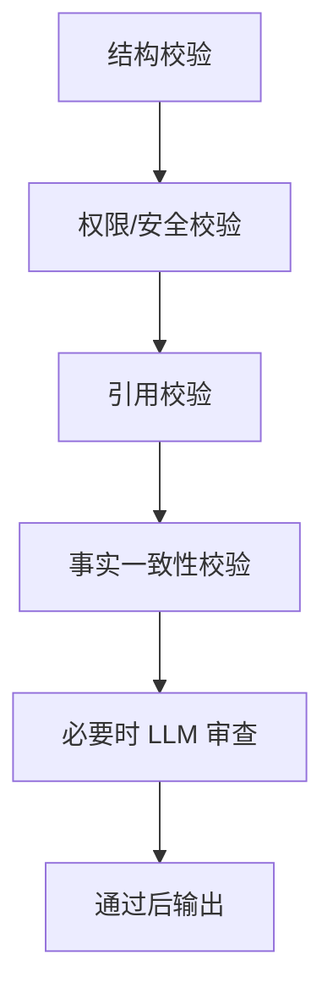
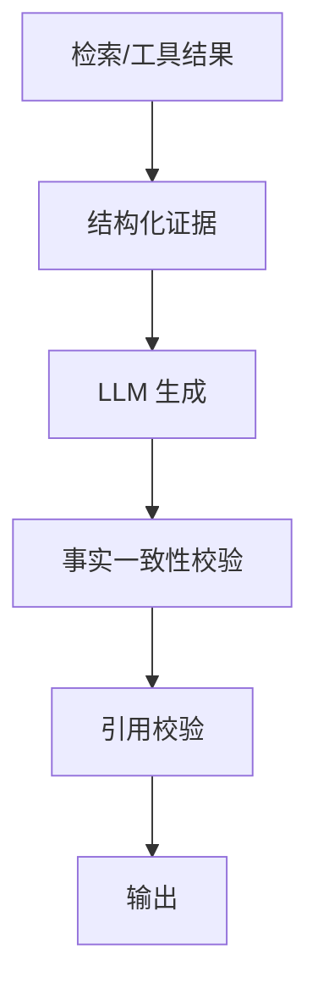
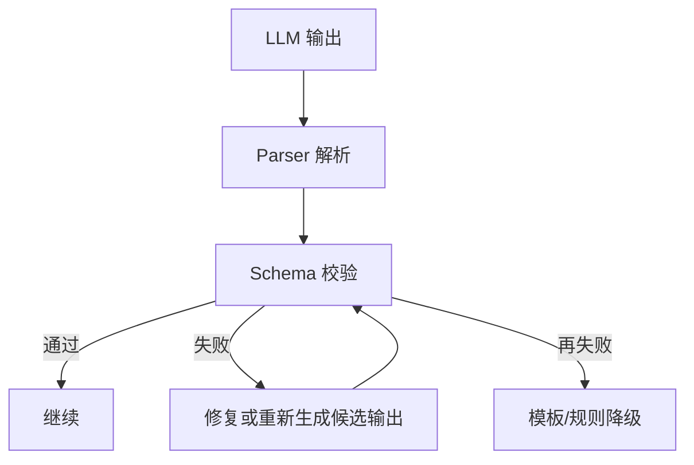
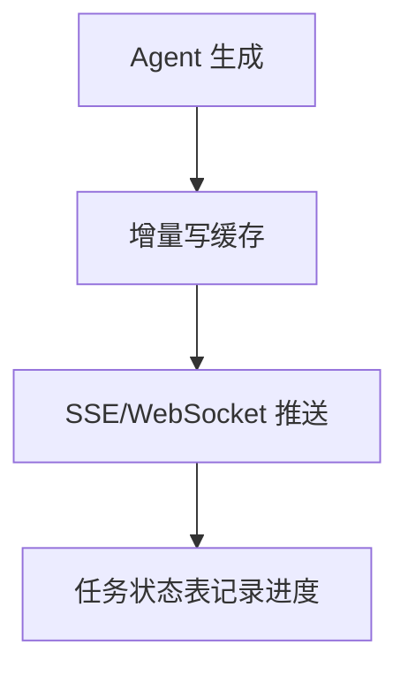
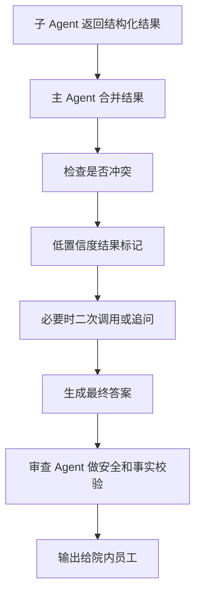

# 08-输出与效果评估：MedAgent 逐题口述

核查日期：2026-10-13。所有答案以院内 ToB 边界为前提。一般理论与未落地的扩展方案明确分开。

## q-001

### 主问题｜多个 Agent 的结果怎么聚合？

原文位置：08-输出与效果评估.md 第 26 行（原件保存在同步前备份）。

**项目口述：** 专科返回辅助回答和脱敏的真实工具 Observation；协调器汇总时优先依据 Observation，并查看截断标记和调用状态。执行前后都限制权限和格式，每个意图检查对应工具覆盖。最终医学结论仍需要医生复核，当前没有独立临床审查模型证明结论正确。

**针对本题的设计展开（原文原理，作为方案解释）：**

先看结果是不是结构化的，再决定聚合方式。通常有三种：

2. 模板聚合：报告、工单、分析结论这类格式固定的场景，先按模板组织，再把各 Agent 的结果填入对应位置。

3. LLM 总结聚合：多个结果本身是非结构化文本，而且需要综合、归纳、解释时，再让 LLM 做最终总结。

生产上一般不是“三选一”，而是结构化结果优先规则/模板，开放式内容最后才让 LLM 总结。这样可以减少模型自由发挥，也更容易做结果校验。

**在 MedAgent 中怎么补全：** 完整审查要核对结论逐条引用、药名、指标单位、指南版本和请求目标。来源冲突按数据类型与版本处理：当前患者事实看授权业务库，医学规范看有效指南；冲突无法消除就展示差异并要求医生确认，不能一律由用户最新输入覆盖权威事实。

**代码依据：** [backend/evidence.py](../../backend/evidence.py)、[backend/agents.py](../../backend/agents.py)

## q-002

### 追问｜规则聚合、模板聚合、LLM 总结聚合怎么做？

原文位置：08-输出与效果评估.md 第 38 行（原件保存在同步前备份）。

**项目口述：** 专科返回辅助回答和脱敏的真实工具 Observation；协调器汇总时优先依据 Observation，并查看截断标记和调用状态。执行前后都限制权限和格式，每个意图检查对应工具覆盖。最终医学结论仍需要医生复核，当前没有独立临床审查模型证明结论正确。

**针对本题的设计展开（原文原理，作为方案解释）：**

规则聚合：字段化结果按规则拼接（查询结果直接填模板）；模板聚合：固定格式输出（报告模板）；LLM 总结聚合：多源结果让 LLM 综合生成（适合开放式问题）。

**在 MedAgent 中怎么补全：** 完整审查要核对结论逐条引用、药名、指标单位、指南版本和请求目标。来源冲突按数据类型与版本处理：当前患者事实看授权业务库，医学规范看有效指南；冲突无法消除就展示差异并要求医生确认，不能一律由用户最新输入覆盖权威事实。

**代码依据：** [backend/evidence.py](../../backend/evidence.py)、[backend/agents.py](../../backend/agents.py)

## q-003

### 追问｜冲突结果怎么处理？

原文位置：08-输出与效果评估.md 第 42 行（原件保存在同步前备份）。

**项目口述：** 专科返回辅助回答和脱敏的真实工具 Observation；协调器汇总时优先依据 Observation，并查看截断标记和调用状态。执行前后都限制权限和格式，每个意图检查对应工具覆盖。最终医学结论仍需要医生复核，当前没有独立临床审查模型证明结论正确。

**在 MedAgent 中怎么补全：** 完整审查要核对结论逐条引用、药名、指标单位、指南版本和请求目标。来源冲突按数据类型与版本处理：当前患者事实看授权业务库，医学规范看有效指南；冲突无法消除就展示差异并要求医生确认，不能一律由用户最新输入覆盖权威事实。

**代码依据：** [backend/evidence.py](../../backend/evidence.py)、[backend/agents.py](../../backend/agents.py)

## q-004

### 主问题｜输出结果如何审查？

原文位置：08-输出与效果评估.md 第 46 行（原件保存在同步前备份）。

**项目口述：** 专科返回辅助回答和脱敏的真实工具 Observation；协调器汇总时优先依据 Observation，并查看截断标记和调用状态。执行前后都限制权限和格式，每个意图检查对应工具覆盖。最终医学结论仍需要医生复核，当前没有独立临床审查模型证明结论正确。

**针对本题的设计展开（原文原理，作为方案解释）：**

输出审查建议拆成“机器可校验”和“模型语义校验”两层。

第一层检查结构和确定性约束：JSON Schema、字段类型、权限、敏感信息、引用是否存在等，这些最好由代码完成。

第二层检查语义正确性：最终结论是否和工具结果一致，是否出现工具没有提供的事实，是否把多个来源错误拼接，是否存在明显的推断越界。

因此审查不是简单“再让一个模型看一遍”，而是：

高风险业务还应该保留人工审批入口。

**在 MedAgent 中怎么补全：** 完整审查要核对结论逐条引用、药名、指标单位、指南版本和请求目标。来源冲突按数据类型与版本处理：当前患者事实看授权业务库，医学规范看有效指南；冲突无法消除就展示差异并要求医生确认，不能一律由用户最新输入覆盖权威事实。

**代码依据：** [backend/evidence.py](../../backend/evidence.py)、[backend/agents.py](../../backend/agents.py)

**本题图与结构示例：** [example-001](#example-001)

## q-005

### 追问｜事实一致性、安全性、权限、格式、引用分别审什么？

原文位置：08-输出与效果评估.md 第 67 行（原件保存在同步前备份）。

**项目口述：** 专科返回辅助回答和脱敏的真实工具 Observation；协调器汇总时优先依据 Observation，并查看截断标记和调用状态。执行前后都限制权限和格式，每个意图检查对应工具覆盖。最终医学结论仍需要医生复核，当前没有独立临床审查模型证明结论正确。

**针对本题的设计展开（原文原理，作为方案解释）：**

事实一致性：结论与工具结果/引用是否一致（防幻觉）；安全性：有无敏感/违规内容；权限：用户是否有权看到这些数据；格式：是否符合输出 schema；引用：引用的来源是否真实存在。

**在 MedAgent 中怎么补全：** 完整审查要核对结论逐条引用、药名、指标单位、指南版本和请求目标。来源冲突按数据类型与版本处理：当前患者事实看授权业务库，医学规范看有效指南；冲突无法消除就展示差异并要求医生确认，不能一律由用户最新输入覆盖权威事实。

**代码依据：** [backend/evidence.py](../../backend/evidence.py)、[backend/agents.py](../../backend/agents.py)

## q-006

### 追问｜审查 Agent 是否独立？

原文位置：08-输出与效果评估.md 第 71 行（原件保存在同步前备份）。

**项目口述：** 专科返回辅助回答和脱敏的真实工具 Observation；协调器汇总时优先依据 Observation，并查看截断标记和调用状态。执行前后都限制权限和格式，每个意图检查对应工具覆盖。最终医学结论仍需要医生复核，当前没有独立临床审查模型证明结论正确。

**针对本题的设计展开（原文原理，作为方案解释）：**

建议独立：审查 Agent 用独立的模型调用和上下文，不与被审查 Agent 共享生成过程。

但"独立"既非必要条件，也非充分条件——独立调用/独立上下文有助于降低相关性错误，但同款模型独立再跑一遍，仍可能共享同一类偏差（同样的幻觉倾向、同样的常识盲区）。真正有效的审查靠"确定性规则校验（schema/权限/引用存在性）优先，权威证据比对兜底，必要时用异构模型或人工抽检"，而不是"同一个模型自己再看一遍"。

**在 MedAgent 中怎么补全：** 完整审查要核对结论逐条引用、药名、指标单位、指南版本和请求目标。来源冲突按数据类型与版本处理：当前患者事实看授权业务库，医学规范看有效指南；冲突无法消除就展示差异并要求医生确认，不能一律由用户最新输入覆盖权威事实。

**代码依据：** [backend/evidence.py](../../backend/evidence.py)、[backend/agents.py](../../backend/agents.py)

## q-007

### 主问题｜如果子 Agent 结果冲突怎么办？

原文位置：08-输出与效果评估.md 第 77 行（原件保存在同步前备份）。

**项目口述：** 专科返回辅助回答和脱敏的真实工具 Observation；协调器汇总时优先依据 Observation，并查看截断标记和调用状态。执行前后都限制权限和格式，每个意图检查对应工具覆盖。最终医学结论仍需要医生复核，当前没有独立临床审查模型证明结论正确。

**针对本题的设计展开（原文原理，作为方案解释）：**

先区分“冲突是否可以确定裁决”。如果一个来源明显更权威，就按系统预先定义的优先级裁决；如果两个来源都可能正确，就不能让模型随便挑一个。

实际可以这样处理：

1. 给每个结果带 `source`、`timestamp`、`confidence`。

2. 根据业务规则定义数据源优先级。

3. 自动裁决可以确定的冲突。

4. 无法自动裁决且影响用户利益的冲突，展示差异并按风险类型进入用户确认、重新认证、授权系统裁决或管理者审批。

这样做比单纯让 LLM “判断谁正确”更稳定，因为冲突处理本身应该是业务规则，而不是模型自由判断。

**在 MedAgent 中怎么补全：** 完整审查要核对结论逐条引用、药名、指标单位、指南版本和请求目标。来源冲突按数据类型与版本处理：当前患者事实看授权业务库，医学规范看有效指南；冲突无法消除就展示差异并要求医生确认，不能一律由用户最新输入覆盖权威事实。

**代码依据：** [backend/evidence.py](../../backend/evidence.py)、[backend/agents.py](../../backend/agents.py)

## q-008

### 追问｜信任优先级、来源标注、让用户确认怎么做？

原文位置：08-输出与效果评估.md 第 91 行（原件保存在同步前备份）。

**项目口述：** 专科返回辅助回答和脱敏的真实工具 Observation；协调器汇总时优先依据 Observation，并查看截断标记和调用状态。执行前后都限制权限和格式，每个意图检查对应工具覆盖。最终医学结论仍需要医生复核，当前没有独立临床审查模型证明结论正确。

**针对本题的设计展开（原文原理，作为方案解释）：**

信任优先级：按字段语义和权威来源裁决；来源标注：输出里标明每个结论来自哪；用户确认只适用于用户能够决定的金额、偏好或操作意图，身份与权限冲突必须走认证和授权系统。

**在 MedAgent 中怎么补全：** 完整审查要核对结论逐条引用、药名、指标单位、指南版本和请求目标。来源冲突按数据类型与版本处理：当前患者事实看授权业务库，医学规范看有效指南；冲突无法消除就展示差异并要求医生确认，不能一律由用户最新输入覆盖权威事实。

**代码依据：** [backend/evidence.py](../../backend/evidence.py)、[backend/agents.py](../../backend/agents.py)

## q-009

### 追问｜是直接选一个，还是展示差异？

原文位置：08-输出与效果评估.md 第 95 行（原件保存在同步前备份）。

**项目口述：** 专科返回辅助回答和脱敏的真实工具 Observation；协调器汇总时优先依据 Observation，并查看截断标记和调用状态。执行前后都限制权限和格式，每个意图检查对应工具覆盖。最终医学结论仍需要医生复核，当前没有独立临床审查模型证明结论正确。

**针对本题的设计展开（原文原理，作为方案解释）：**

结果确定性强（权威数据库 vs 无依据生成）→ 直接选权威来源；不确定性大 → 展示差异并进入对应的确认、认证或审批出口。原则：涉及用户利益的关键冲突必须透明，但透明不等于用户有权裁决身份、权限或制度版本。

**在 MedAgent 中怎么补全：** 完整审查要核对结论逐条引用、药名、指标单位、指南版本和请求目标。来源冲突按数据类型与版本处理：当前患者事实看授权业务库，医学规范看有效指南；冲突无法消除就展示差异并要求医生确认，不能一律由用户最新输入覆盖权威事实。

**代码依据：** [backend/evidence.py](../../backend/evidence.py)、[backend/agents.py](../../backend/agents.py)

## q-010

### 主问题｜如何减少幻觉？

原文位置：08-输出与效果评估.md 第 99 行（原件保存在同步前备份）。

**项目口述：** 专科返回辅助回答和脱敏的真实工具 Observation；协调器汇总时优先依据 Observation，并查看截断标记和调用状态。执行前后都限制权限和格式，每个意图检查对应工具覆盖。最终医学结论仍需要医生复核，当前没有独立临床审查模型证明结论正确。

**针对本题的设计展开（原文原理，作为方案解释）：**

减少幻觉不能只靠一句 prompt，而要让输出链路形成“证据约束”。

一个比较稳的链路是：

如果没有可靠依据，就返回“当前没有找到足够依据”，而不是让模型根据参数记忆补全。

**在 MedAgent 中怎么补全：** 完整审查要核对结论逐条引用、药名、指标单位、指南版本和请求目标。来源冲突按数据类型与版本处理：当前患者事实看授权业务库，医学规范看有效指南；冲突无法消除就展示差异并要求医生确认，不能一律由用户最新输入覆盖权威事实。

**代码依据：** [backend/evidence.py](../../backend/evidence.py)、[backend/agents.py](../../backend/agents.py)

**本题图与结构示例：** [example-002](#example-002)

## q-011

### 追问｜只基于工具结果回答、引用来源、审查节点怎么做？

原文位置：08-输出与效果评估.md 第 119 行（原件保存在同步前备份）。

**项目口述：** 专科返回辅助回答和脱敏的真实工具 Observation；协调器汇总时优先依据 Observation，并查看截断标记和调用状态。执行前后都限制权限和格式，每个意图检查对应工具覆盖。最终医学结论仍需要医生复核，当前没有独立临床审查模型证明结论正确。

**针对本题的设计展开（原文原理，作为方案解释）：**

只基于工具结果回答：prompt 约束"没有工具依据不许下结论"；引用来源：每个结论带出处，可核对；审查节点：输出前做事实校验拦截。

**在 MedAgent 中怎么补全：** 完整审查要核对结论逐条引用、药名、指标单位、指南版本和请求目标。来源冲突按数据类型与版本处理：当前患者事实看授权业务库，医学规范看有效指南；冲突无法消除就展示差异并要求医生确认，不能一律由用户最新输入覆盖权威事实。

**代码依据：** [backend/evidence.py](../../backend/evidence.py)、[backend/agents.py](../../backend/agents.py)

## q-012

### 追问｜检索不到时是否拒答？

原文位置：08-输出与效果评估.md 第 123 行（原件保存在同步前备份）。

**项目口述：** 专科返回辅助回答和脱敏的真实工具 Observation；协调器汇总时优先依据 Observation，并查看截断标记和调用状态。执行前后都限制权限和格式，每个意图检查对应工具覆盖。最终医学结论仍需要医生复核，当前没有独立临床审查模型证明结论正确。

**针对本题的设计展开（原文原理，作为方案解释）：**

拒答。明确告知"未找到相关依据"，不编造。宁可不答，不要答错。

**在 MedAgent 中怎么补全：** 完整审查要核对结论逐条引用、药名、指标单位、指南版本和请求目标。来源冲突按数据类型与版本处理：当前患者事实看授权业务库，医学规范看有效指南；冲突无法消除就展示差异并要求医生确认，不能一律由用户最新输入覆盖权威事实。

**代码依据：** [backend/evidence.py](../../backend/evidence.py)、[backend/agents.py](../../backend/agents.py)

## q-013

### 主问题｜输出格式怎么稳定？

原文位置：08-输出与效果评估.md 第 127 行（原件保存在同步前备份）。

**项目口述：** 模型通过 Function Calling 选择工具并生成结构化参数，LangChain 的 MCPAdapter 和 FastMCP 客户端通过 MCP 调用工具服务。FastMCP 注册 14 个工具，包括真实医院查询以及本地病史、辅助材料存储；服务端再次检查委托、员工状态、患者范围和写动作权限。两者在同一链路中使用。

**针对本题的设计展开（原文原理，作为方案解释）：**

输出稳定性最好采用多层约束，而不是只依赖 prompt。

- JSON Schema：约束字段、类型、必填项，是最核心的结构契约。

- OutputParser：解析模型结果并检查是否符合预期。

- 模板：在模型输出无法恢复时提供确定性的最终格式。

典型处理链：

这样可以把“模型输出不稳定”隔离在系统内部，而不是直接暴露给用户。

**在 MedAgent 中怎么补全：** 工具注册要同时维护参数、输出、错误、权限、读写属性和版本契约；新增工具先做契约测试和权限回归，再开放给对应专科。不能把工具描述中的 readOnlyHint 当真正的服务端授权。

**代码依据：** [backend/mcp_tools.py](../../backend/mcp_tools.py)、[backend/mcp_security.py](../../backend/mcp_security.py)、[backend/agents.py](../../backend/agents.py)

**本题图与结构示例：** [example-003](#example-003)

## q-014

### 追问｜JSON schema、模板、OutputParser 怎么做？

原文位置：08-输出与效果评估.md 第 150 行（原件保存在同步前备份）。

**项目口述：** 模型通过 Function Calling 选择工具并生成结构化参数，LangChain 的 MCPAdapter 和 FastMCP 客户端通过 MCP 调用工具服务。FastMCP 注册 14 个工具，包括真实医院查询以及本地病史、辅助材料存储；服务端再次检查委托、员工状态、患者范围和写动作权限。两者在同一链路中使用。

**针对本题的设计展开（原文原理，作为方案解释）：**

JSON schema：约束输出结构；模板：固定格式兜底；OutputParser：解析和校验输出，不合法时返回字段级错误，由上层修复或重新生成候选输出，再次校验。

**在 MedAgent 中怎么补全：** 工具注册要同时维护参数、输出、错误、权限、读写属性和版本契约；新增工具先做契约测试和权限回归，再开放给对应专科。不能把工具描述中的 readOnlyHint 当真正的服务端授权。

**代码依据：** [backend/mcp_tools.py](../../backend/mcp_tools.py)、[backend/mcp_security.py](../../backend/mcp_security.py)、[backend/agents.py](../../backend/agents.py)

## q-015

### 追问｜大模型输出不符合格式怎么办？

原文位置：08-输出与效果评估.md 第 154 行（原件保存在同步前备份）。

**项目口述：** 模型通过 Function Calling 选择工具并生成结构化参数，LangChain 的 MCPAdapter 和 FastMCP 客户端通过 MCP 调用工具服务。FastMCP 注册 14 个工具，包括真实医院查询以及本地病史、辅助材料存储；服务端再次检查委托、员工状态、患者范围和写动作权限。两者在同一链路中使用。

**针对本题的设计展开（原文原理，作为方案解释）：**

三层处理：带字段级错误做一次局部修正或重新生成 → 降级模板输出 → 审查节点拦截（格式不对不让出）。这里是改变候选输出后的重新校验，不是对同一无效动作做技术重试。

**在 MedAgent 中怎么补全：** 工具注册要同时维护参数、输出、错误、权限、读写属性和版本契约；新增工具先做契约测试和权限回归，再开放给对应专科。不能把工具描述中的 readOnlyHint 当真正的服务端授权。

**代码依据：** [backend/mcp_tools.py](../../backend/mcp_tools.py)、[backend/mcp_security.py](../../backend/mcp_security.py)、[backend/agents.py](../../backend/agents.py)

## q-016

### 主问题｜流式输出怎么做？

原文位置：08-输出与效果评估.md 第 158 行（原件保存在同步前备份）。

**项目口述：** FastAPI 通过 SSE 输出 session、meta、trace、card、delta 和 done。文字增量是展示状态；入口收到协调器完成后，还要保存咨询、审计、会话与快照，才发送最终 done。断流、工具失败或模型输出截断不会确认成功。

**针对本题的设计展开（原文原理，作为方案解释）：**

流式输出本质上要解决两个问题：怎么把增量内容传给用户，以及连接断开后怎么恢复。

SSE（Server-Sent Events）适合服务端单向持续推送，WebSocket 适合前后端都需要实时通信的场景；消息队列主要解决异步任务的解耦，并不直接等于前端流式协议；增量缓存负责保存已经产生的内容和任务状态。

因此生产上通常是：

用户刷新或断线后，通过 `task_id` 找回已经生成的内容和当前状态，再继续推送。

**在 MedAgent 中怎么补全：** 刷新恢复需要持久事件序号和已保存输出，再按员工、患者与任务授权查询或重放。当前没有这套事件重放，因此不能说刷新会自动接着输出。优化首字延迟可以先显示阶段状态，同时实测全链路首字、总耗时和模型/工具耗时。

**代码依据：** [backend/main.py](../../backend/main.py)、[backend/agents.py](../../backend/agents.py)、[streamlit_app.py](../../streamlit_app.py)

**本题图与结构示例：** [example-004](#example-004)

## q-017

### 追问｜SSE、WebSocket、消息队列、增量缓存分别怎么做？

原文位置：08-输出与效果评估.md 第 175 行（原件保存在同步前备份）。

**项目口述：** FastAPI 通过 SSE 输出 session、meta、trace、card、delta 和 done。文字增量是展示状态；入口收到协调器完成后，还要保存咨询、审计、会话与快照，才发送最终 done。断流、工具失败或模型输出截断不会确认成功。

**针对本题的设计展开（原文原理，作为方案解释）：**

SSE：服务端单向推送（最常用）；WebSocket：双向长连接；消息队列：异步场景；增量缓存：已生成内容缓存，支持断点续传。

**在 MedAgent 中怎么补全：** 刷新恢复需要持久事件序号和已保存输出，再按员工、患者与任务授权查询或重放。当前没有这套事件重放，因此不能说刷新会自动接着输出。优化首字延迟可以先显示阶段状态，同时实测全链路首字、总耗时和模型/工具耗时。

**代码依据：** [backend/main.py](../../backend/main.py)、[backend/agents.py](../../backend/agents.py)、[streamlit_app.py](../../streamlit_app.py)

## q-018

### 追问｜用户刷新后如何继续输出？

原文位置：08-输出与效果评估.md 第 179 行（原件保存在同步前备份）。

**项目口述：** FastAPI 通过 SSE 输出 session、meta、trace、card、delta 和 done。文字增量是展示状态；入口收到协调器完成后，还要保存咨询、审计、会话与快照，才发送最终 done。断流、工具失败或模型输出截断不会确认成功。

**针对本题的设计展开（原文原理，作为方案解释）：**

task_id 绑定 + 增量缓存恢复（详见本章"流式输出不中断"）：刷新后带 task_id 重连，从缓存断点继续推。

输出聚合流程（可背）：

**在 MedAgent 中怎么补全：** 刷新恢复需要持久事件序号和已保存输出，再按员工、患者与任务授权查询或重放。当前没有这套事件重放，因此不能说刷新会自动接着输出。优化首字延迟可以先显示阶段状态，同时实测全链路首字、总耗时和模型/工具耗时。

**代码依据：** [backend/main.py](../../backend/main.py)、[backend/agents.py](../../backend/agents.py)、[streamlit_app.py](../../streamlit_app.py)

**本题图与结构示例：** [example-005](#example-005)

## q-019

### 主问题｜如何保证 Agent 流式输出不中断？

原文位置：08-输出与效果评估.md 第 198 行（原件保存在同步前备份）。

**项目口述：** FastAPI 通过 SSE 输出 session、meta、trace、card、delta 和 done。文字增量是展示状态；入口收到协调器完成后，还要保存咨询、审计、会话与快照，才发送最终 done。断流、工具失败或模型输出截断不会确认成功。

**针对本题的设计展开（原文原理，作为方案解释）：**

四件套：SSE、WebSocket、token 缓存、任务状态表。核心思路：流式输出不直接依赖浏览器连接，而是和 task_id 绑定。

**在 MedAgent 中怎么补全：** 刷新恢复需要持久事件序号和已保存输出，再按员工、患者与任务授权查询或重放。当前没有这套事件重放，因此不能说刷新会自动接着输出。优化首字延迟可以先显示阶段状态，同时实测全链路首字、总耗时和模型/工具耗时。

**代码依据：** [backend/main.py](../../backend/main.py)、[backend/agents.py](../../backend/agents.py)、[streamlit_app.py](../../streamlit_app.py)

## q-020

### 追问｜SSE、WebSocket、token 缓存、任务状态表分别做什么？

原文位置：08-输出与效果评估.md 第 204 行（原件保存在同步前备份）。

**项目口述：** FastAPI 通过 SSE 输出 session、meta、trace、card、delta 和 done。文字增量是展示状态；入口收到协调器完成后，还要保存咨询、审计、会话与快照，才发送最终 done。断流、工具失败或模型输出截断不会确认成功。

**针对本题的设计展开（原文原理，作为方案解释）：**

SSE/WebSocket：传输通道；token 缓存：已生成内容落缓存（Redis/数据库）；任务状态表：记录任务进度和状态，是恢复的数据底座。

**在 MedAgent 中怎么补全：** 刷新恢复需要持久事件序号和已保存输出，再按员工、患者与任务授权查询或重放。当前没有这套事件重放，因此不能说刷新会自动接着输出。优化首字延迟可以先显示阶段状态，同时实测全链路首字、总耗时和模型/工具耗时。

**代码依据：** [backend/main.py](../../backend/main.py)、[backend/agents.py](../../backend/agents.py)、[streamlit_app.py](../../streamlit_app.py)

## q-021

### 追问｜用户刷新后如何恢复？

原文位置：08-输出与效果评估.md 第 208 行（原件保存在同步前备份）。

**项目口述：** FastAPI 通过 SSE 输出 session、meta、trace、card、delta 和 done。文字增量是展示状态；入口收到协调器完成后，还要保存咨询、审计、会话与快照，才发送最终 done。断流、工具失败或模型输出截断不会确认成功。

**针对本题的设计展开（原文原理，作为方案解释）：**

前端带 task_id 重新连接，服务端读取已生成内容和当前任务状态，继续推送后续 token。任务已完成直接返回完整结果，任务失败返回失败原因和可恢复节点。

**在 MedAgent 中怎么补全：** 刷新恢复需要持久事件序号和已保存输出，再按员工、患者与任务授权查询或重放。当前没有这套事件重放，因此不能说刷新会自动接着输出。优化首字延迟可以先显示阶段状态，同时实测全链路首字、总耗时和模型/工具耗时。

**代码依据：** [backend/main.py](../../backend/main.py)、[backend/agents.py](../../backend/agents.py)、[streamlit_app.py](../../streamlit_app.py)

## q-022

### 主问题｜首 token 慢怎么办？

原文位置：08-输出与效果评估.md 第 212 行（原件保存在同步前备份）。

**项目口述：** FastAPI 通过 SSE 输出 session、meta、trace、card、delta 和 done。文字增量是展示状态；入口收到协调器完成后，还要保存咨询、审计、会话与快照，才发送最终 done。断流、工具失败或模型输出截断不会确认成功。

**针对本题的设计展开（原文原理，作为方案解释）：**

先返回任务状态，再流式生成。

原因是首 token 慢通常卡在"意图识别 + 工具/检索"这段前置耗时，而不是模型吐字本身。与其让用户盯着空白等，不如请求进来先秒回"任务已受理，正在处理"，模型开始产出后再流式推内容——用户看到即时反馈，就不会误以为卡死，这比单纯优化模型推理更见效。

**在 MedAgent 中怎么补全：** 刷新恢复需要持久事件序号和已保存输出，再按员工、患者与任务授权查询或重放。当前没有这套事件重放，因此不能说刷新会自动接着输出。优化首字延迟可以先显示阶段状态，同时实测全链路首字、总耗时和模型/工具耗时。

**代码依据：** [backend/main.py](../../backend/main.py)、[backend/agents.py](../../backend/agents.py)、[streamlit_app.py](../../streamlit_app.py)

## q-023

### 追问｜先返回任务状态，再流式生成怎么做？

原文位置：08-输出与效果评估.md 第 220 行（原件保存在同步前备份）。

**项目口述：** FastAPI 通过 SSE 输出 session、meta、trace、card、delta 和 done。文字增量是展示状态；入口收到协调器完成后，还要保存咨询、审计、会话与快照，才发送最终 done。断流、工具失败或模型输出截断不会确认成功。

**针对本题的设计展开（原文原理，作为方案解释）：**

请求进来先秒回"任务已受理，正在处理"（任务状态），模型生成开始后再流式推内容。用户看到即时反馈，不会以为卡死。

**在 MedAgent 中怎么补全：** 刷新恢复需要持久事件序号和已保存输出，再按员工、患者与任务授权查询或重放。当前没有这套事件重放，因此不能说刷新会自动接着输出。优化首字延迟可以先显示阶段状态，同时实测全链路首字、总耗时和模型/工具耗时。

**代码依据：** [backend/main.py](../../backend/main.py)、[backend/agents.py](../../backend/agents.py)、[streamlit_app.py](../../streamlit_app.py)

## q-024

### 追问｜是否可以先输出阶段性结果？

原文位置：08-输出与效果评估.md 第 224 行（原件保存在同步前备份）。

**项目口述：** FastAPI 通过 SSE 输出 session、meta、trace、card、delta 和 done。文字增量是展示状态；入口收到协调器完成后，还要保存咨询、审计、会话与快照，才发送最终 done。断流、工具失败或模型输出截断不会确认成功。

**在 MedAgent 中怎么补全：** 刷新恢复需要持久事件序号和已保存输出，再按员工、患者与任务授权查询或重放。当前没有这套事件重放，因此不能说刷新会自动接着输出。优化首字延迟可以先显示阶段状态，同时实测全链路首字、总耗时和模型/工具耗时。

**代码依据：** [backend/main.py](../../backend/main.py)、[backend/agents.py](../../backend/agents.py)、[streamlit_app.py](../../streamlit_app.py)

## q-025

### 主问题｜生成中断怎么办？

原文位置：08-输出与效果评估.md 第 228 行（原件保存在同步前备份）。

**项目口述：** FastAPI 通过 SSE 输出 session、meta、trace、card、delta 和 done。文字增量是展示状态；入口收到协调器完成后，还要保存咨询、审计、会话与快照，才发送最终 done。断流、工具失败或模型输出截断不会确认成功。

**针对本题的设计展开（原文原理，作为方案解释）：**

根据 task_id 恢复任务，但要先分清"断在哪一层"——网络断连和节点中断是两套不同机制：

- 网络断连（前端掉线，后端任务还活着）：已生成内容按 event offset（事件序号）落缓存，重连后按 task_id 重放已确认内容、继续订阅后续增量。这是"续传"，不是重跑。

- 节点/进程中断（LLM 调用或进程在节点中途失败）：LangGraph 的完整 `StateSnapshot` 保存在 super-step 边界；同一 super-step 内还可能保存已完成节点的 pending writes。它不是按 token 保存，因此不能承诺“从某个 token 精确续写”。恢复时从最近可恢复 checkpoint 接续，尚未确认完成的 LLM 调用会重新生成。具体语义见 对应主题 和 [LangGraph Checkpointers](https://docs.langchain.com/oss/python/langgraph/checkpointers)。

关键认知：完整 checkpoint 的粒度是 super-step 边界；pending writes 是该步内已完成任务的写入记录，两者都不是 token 级续写。网络层的断点续传和任务层的 checkpoint 恢复是两个机制，别混为一谈。

**在 MedAgent 中怎么补全：** 刷新恢复需要持久事件序号和已保存输出，再按员工、患者与任务授权查询或重放。当前没有这套事件重放，因此不能说刷新会自动接着输出。优化首字延迟可以先显示阶段状态，同时实测全链路首字、总耗时和模型/工具耗时。

**代码依据：** [backend/main.py](../../backend/main.py)、[backend/agents.py](../../backend/agents.py)、[streamlit_app.py](../../streamlit_app.py)

## q-026

### 追问｜根据 task_id 恢复任务怎么做？

原文位置：08-输出与效果评估.md 第 239 行（原件保存在同步前备份）。

**项目口述：** FastAPI 通过 SSE 输出 session、meta、trace、card、delta 和 done。文字增量是展示状态；入口收到协调器完成后，还要保存咨询、审计、会话与快照，才发送最终 done。断流、工具失败或模型输出截断不会确认成功。

**针对本题的设计展开（原文原理，作为方案解释）：**

先判断中断层级：前端断连 → 按 task_id 从缓存重放已生成内容、继续订阅（后端任务可能还在跑）；节点/进程失败 → 从最近可恢复 checkpoint 接续，未被 checkpoint 或 pending writes 确认完成的节点重新执行。前者是“续传”，后者是“恢复执行”，都不能说成“从某个 token 精确续写”。

**在 MedAgent 中怎么补全：** 刷新恢复需要持久事件序号和已保存输出，再按员工、患者与任务授权查询或重放。当前没有这套事件重放，因此不能说刷新会自动接着输出。优化首字延迟可以先显示阶段状态，同时实测全链路首字、总耗时和模型/工具耗时。

**代码依据：** [backend/main.py](../../backend/main.py)、[backend/agents.py](../../backend/agents.py)、[streamlit_app.py](../../streamlit_app.py)

## q-027

### 追问｜已输出内容是否保存？

原文位置：08-输出与效果评估.md 第 243 行（原件保存在同步前备份）。

**项目口述：** FastAPI 通过 SSE 输出 session、meta、trace、card、delta 和 done。文字增量是展示状态；入口收到协调器完成后，还要保存咨询、审计、会话与快照，才发送最终 done。断流、工具失败或模型输出截断不会确认成功。

**针对本题的设计展开（原文原理，作为方案解释）：**

保存。每段已发布输出应带单调递增的 event offset 落缓存/数据库，网络断连时按 offset 去重并续传；节点/进程中断时则从最近可恢复 checkpoint 接续，而非接着上一个 token 写。

**在 MedAgent 中怎么补全：** 刷新恢复需要持久事件序号和已保存输出，再按员工、患者与任务授权查询或重放。当前没有这套事件重放，因此不能说刷新会自动接着输出。优化首字延迟可以先显示阶段状态，同时实测全链路首字、总耗时和模型/工具耗时。

**代码依据：** [backend/main.py](../../backend/main.py)、[backend/agents.py](../../backend/agents.py)、[streamlit_app.py](../../streamlit_app.py)

## q-028

### 主问题｜多 Agent 流式输出怎么聚合？

原文位置：08-输出与效果评估.md 第 247 行（原件保存在同步前备份）。

**项目口述：** FastAPI 通过 SSE 输出 session、meta、trace、card、delta 和 done。文字增量是展示状态；入口收到协调器完成后，还要保存咨询、审计、会话与快照，才发送最终 done。断流、工具失败或模型输出截断不会确认成功。

**针对本题的设计展开（原文原理，作为方案解释）：**

多 Agent 系统中，我更倾向于把“内部协同”和“外部用户输出”分开。

子 Agent 之间传递结构化结果，而不是直接把各自 token 推给用户；主 Agent 等必要的子任务完成后，再统一组织最终回答并流式输出。

原因有三个：

1. 避免多个 Agent 的内容互相穿插；

2. 主 Agent 可以在输出前做冲突处理和事实审查；

3. 用户看到的是一个完整回答，而不是内部执行日志。

如果确实需要展示过程，可以额外设计标准化的 progress event，例如“正在查询”“正在分析”，而不是直接暴露子 Agent 原始输出。

**在 MedAgent 中怎么补全：** 刷新恢复需要持久事件序号和已保存输出，再按员工、患者与任务授权查询或重放。当前没有这套事件重放，因此不能说刷新会自动接着输出。优化首字延迟可以先显示阶段状态，同时实测全链路首字、总耗时和模型/工具耗时。

**代码依据：** [backend/main.py](../../backend/main.py)、[backend/agents.py](../../backend/agents.py)、[streamlit_app.py](../../streamlit_app.py)

## q-029

### 追问｜先执行内部任务，最终统一流式输出怎么做？

原文位置：08-输出与效果评估.md 第 262 行（原件保存在同步前备份）。

**项目口述：** FastAPI 通过 SSE 输出 session、meta、trace、card、delta 和 done。文字增量是展示状态；入口收到协调器完成后，还要保存咨询、审计、会话与快照，才发送最终 done。断流、工具失败或模型输出截断不会确认成功。

**针对本题的设计展开（原文原理，作为方案解释）：**

子 Agent 之间的结果传递不走流式（内部结构化传递），全部完成后由主 Agent 统一流式输出给用户。内部效率 + 外部体验兼顾。

**在 MedAgent 中怎么补全：** 刷新恢复需要持久事件序号和已保存输出，再按员工、患者与任务授权查询或重放。当前没有这套事件重放，因此不能说刷新会自动接着输出。优化首字延迟可以先显示阶段状态，同时实测全链路首字、总耗时和模型/工具耗时。

**代码依据：** [backend/main.py](../../backend/main.py)、[backend/agents.py](../../backend/agents.py)、[streamlit_app.py](../../streamlit_app.py)

## q-030

### 追问｜是否每个子 Agent 都直接流式给用户？

原文位置：08-输出与效果评估.md 第 266 行（原件保存在同步前备份）。

**项目口述：** FastAPI 通过 SSE 输出 session、meta、trace、card、delta 和 done。文字增量是展示状态；入口收到协调器完成后，还要保存咨询、审计、会话与快照，才发送最终 done。断流、工具失败或模型输出截断不会确认成功。

**针对本题的设计展开（原文原理，作为方案解释）：**

不。子 Agent 直接流式会导致输出顺序混乱、互相穿插。统一由主 Agent 出口。

**在 MedAgent 中怎么补全：** 刷新恢复需要持久事件序号和已保存输出，再按员工、患者与任务授权查询或重放。当前没有这套事件重放，因此不能说刷新会自动接着输出。优化首字延迟可以先显示阶段状态，同时实测全链路首字、总耗时和模型/工具耗时。

**代码依据：** [backend/main.py](../../backend/main.py)、[backend/agents.py](../../backend/agents.py)、[streamlit_app.py](../../streamlit_app.py)

## q-031

### 主问题｜输出过程中工具失败怎么办？

原文位置：08-输出与效果评估.md 第 270 行（原件保存在同步前备份）。

**项目口述：** 把权限失败、参数缺失、依赖故障和写入未知分开。权限失败拒绝；缺信息先询问；安全只读医院查询对瞬时网络错误及 429/部分 5xx 最多三次指数退避，转诊写调用不自动重试；连续依赖失败进入熔断。专科或工具失败不会被包装成成功答案。

**针对本题的设计展开（原文原理，作为方案解释）：**

流式阶段已经输出一部分内容后再发生工具失败，最重要的是防止系统继续生成“建立在错误数据上的完整答案”。

先把两层状态分开：调度生命周期是 `pending / running / terminal`；进入 terminal 后，结果状态使用 03 的六值 `success / partial / blocked / failed / unknown / cancelled`。可恢复故障仍停留在 `running`，不能把 `partial` 当作生命周期状态。一旦关键工具失败，就停止继续生成，并按语义收口：

- 必需只读数据明确失败：`failed`，结束流并说明失败原因；

- 可选数据缺失但仍满足最低验收：`partial`，标注缺口后生成降级回答；

- 缺输入、授权、确认或预算：`blocked`，等待补齐条件；

- 写请求已发送但结果不明：`unknown`，停止自动重提并进入对账；

- 用户取消：`cancelled`；全部必要条件满足才是 `success`。

已经输出给用户的内容不能假装没发生，因此最好把输出和任务状态绑定；必要时明确标注“以下内容基于已获取的信息”。

**在 MedAgent 中怎么补全：** 备用模型、备用数据源或跳过非关键步骤必须有已验证契约，不能凭空说存在。只有确实可逆的本地事务能回滚；外部写入走查询、对账、补偿或责任医生复核。对于无法确认的临床问题，应给出失败原因和人工核对路径。

**代码依据：** [backend/mcp_tools.py](../../backend/mcp_tools.py)、[backend/resilience.py](../../backend/resilience.py)、[backend/mcp_security.py](../../backend/mcp_security.py)

## q-032

### 追问｜停止输出、补充错误提示、降级回答怎么做？

原文位置：08-输出与效果评估.md 第 286 行（原件保存在同步前备份）。

**项目口述：** 把权限失败、参数缺失、依赖故障和写入未知分开。权限失败拒绝；缺信息先询问；安全只读医院查询对瞬时网络错误及 429/部分 5xx 最多三次指数退避，转诊写调用不自动重试；连续依赖失败进入熔断。专科或工具失败不会被包装成成功答案。

**针对本题的设计展开（原文原理，作为方案解释）：**

停止输出：不再继续生成错误内容；错误提示：告知哪一步失败（"查询超时"）；降级回答：用可用部分给降级结果。

**在 MedAgent 中怎么补全：** 备用模型、备用数据源或跳过非关键步骤必须有已验证契约，不能凭空说存在。只有确实可逆的本地事务能回滚；外部写入走查询、对账、补偿或责任医生复核。对于无法确认的临床问题，应给出失败原因和人工核对路径。

**代码依据：** [backend/mcp_tools.py](../../backend/mcp_tools.py)、[backend/resilience.py](../../backend/resilience.py)、[backend/mcp_security.py](../../backend/mcp_security.py)

## q-033

### 追问｜是否会输出半截错误答案？

原文位置：08-输出与效果评估.md 第 290 行（原件保存在同步前备份）。

**项目口述：** 把权限失败、参数缺失、依赖故障和写入未知分开。权限失败拒绝；缺信息先询问；安全只读医院查询对瞬时网络错误及 429/部分 5xx 最多三次指数退避，转诊写调用不自动重试；连续依赖失败进入熔断。专科或工具失败不会被包装成成功答案。

**针对本题的设计展开（原文原理，作为方案解释）：**

不能绝对保证“从未输出半截内容”，因为已发送到客户端的字节无法撤回。工程上只发布通过阶段校验的事件，并把未完成内容标成 provisional；后续证据失效时立即发送结构化纠正或终止事件，不能假装此前内容没有出现。

流式输出推荐回答（可背）：

**在 MedAgent 中怎么补全：** 备用模型、备用数据源或跳过非关键步骤必须有已验证契约，不能凭空说存在。只有确实可逆的本地事务能回滚；外部写入走查询、对账、补偿或责任医生复核。对于无法确认的临床问题，应给出失败原因和人工核对路径。

**代码依据：** [backend/mcp_tools.py](../../backend/mcp_tools.py)、[backend/resilience.py](../../backend/resilience.py)、[backend/mcp_security.py](../../backend/mcp_security.py)

**本题图与结构示例：** [example-006](#example-006)

## q-034

### 主问题｜如何评判 Agent 效果？

原文位置：08-输出与效果评估.md 第 308 行（原件保存在同步前备份）。

**项目口述：** 我把路由、工具执行、端到端完成与临床结论质量分开评估。BERT 的 1340 条合成测试集合匹配率 100%，400 条合成挑战为 87%，Micro-F1 0.9461；多意图子集 250 条匹配率 97.2%。这些是不同任务分组，不能代替真实医院准确率。

**针对本题的设计展开（原文原理，作为方案解释）：**

评估 Agent 不能只看“回答像不像人说的”，最好从离线能力、在线任务结果和系统性能三个层面衡量。

本节定义项目级评估口径；“是否值得拆成多 Agent”的架构对照见 对应主题，稳定性专项指标见 对应主题。

核心指标包括：

- 意图识别准确率：预测的意图标签是否与标注或业务真值一致；

- 任务成功率：用户目标是否真正完成，是最重要的端到端指标；

- 工具调用成功率：工具是否被正确选择、参数是否正确、调用是否成功；

- 耗时指标：不仅看平均耗时，还要看 P50/P95/P99，识别长尾。

另外还应结合人工评测或业务验收，例如答案事实正确率、引用正确率、用户满意度。

**在 MedAgent 中怎么补全：** 系统评测按单意图、多意图、否定、短句、长上下文、范围外、权限撤销和工具故障分层。定义 gold 输入、期望路由、参数、证据与允许副作用；固定模型、数据与预算再比较。临床结论由有依据的标注和医生抽检验证，模型裁判也要独立校准。

**代码依据：** [evaluation/bert_multilabel_challenge_summary.json](../../evaluation/bert_multilabel_challenge_summary.json)、[tests/test_task_contracts.py](../../tests/test_task_contracts.py)、[docs/bert-threshold-evaluation-2026-10-12.md](../../docs/bert-threshold-evaluation-2026-10-12.md)

## q-035

### 追问｜意图准确率、任务成功率、工具调用成功率、平均耗时怎么算？

原文位置：08-输出与效果评估.md 第 324 行（原件保存在同步前备份）。

**项目口述：** 我把路由、工具执行、端到端完成与临床结论质量分开评估。BERT 的 1340 条合成测试集合匹配率 100%，400 条合成挑战为 87%，Micro-F1 0.9461；多意图子集 250 条匹配率 97.2%。这些是不同任务分组，不能代替真实医院准确率。

**针对本题的设计展开（原文原理，作为方案解释）：**

意图识别准确率 = 意图标签预测正确的样本占比；任务成功率 = 端到端完成任务的占比；工具调用成功率 = 工具调用成功次数占比；平均耗时 = 任务平均响应时间。路由准确率另行衡量在给定意图与上下文下是否选择了正确 Agent 或 Tool，不能与意图识别准确率合并。

**在 MedAgent 中怎么补全：** 系统评测按单意图、多意图、否定、短句、长上下文、范围外、权限撤销和工具故障分层。定义 gold 输入、期望路由、参数、证据与允许副作用；固定模型、数据与预算再比较。临床结论由有依据的标注和医生抽检验证，模型裁判也要独立校准。

**代码依据：** [evaluation/bert_multilabel_challenge_summary.json](../../evaluation/bert_multilabel_challenge_summary.json)、[tests/test_task_contracts.py](../../tests/test_task_contracts.py)、[docs/bert-threshold-evaluation-2026-10-12.md](../../docs/bert-threshold-evaluation-2026-10-12.md)

## q-036

### 追问｜是否有测试集？

原文位置：08-输出与效果评估.md 第 328 行（原件保存在同步前备份）。

**项目口述：** 我把路由、工具执行、端到端完成与临床结论质量分开评估。BERT 的 1340 条合成测试集合匹配率 100%，400 条合成挑战为 87%，Micro-F1 0.9461；多意图子集 250 条匹配率 97.2%。这些是不同任务分组，不能代替真实医院准确率。

**针对本题的设计展开（原文原理，作为方案解释）：**

必须有。构建意图/槽位/端到端三层测试集，每次改动跑回归。没有测试集的"效果好"都是玄学。

**在 MedAgent 中怎么补全：** 系统评测按单意图、多意图、否定、短句、长上下文、范围外、权限撤销和工具故障分层。定义 gold 输入、期望路由、参数、证据与允许副作用；固定模型、数据与预算再比较。临床结论由有依据的标注和医生抽检验证，模型裁判也要独立校准。

**代码依据：** [evaluation/bert_multilabel_challenge_summary.json](../../evaluation/bert_multilabel_challenge_summary.json)、[tests/test_task_contracts.py](../../tests/test_task_contracts.py)、[docs/bert-threshold-evaluation-2026-10-12.md](../../docs/bert-threshold-evaluation-2026-10-12.md)

## q-037

### 主问题｜多 Agent 项目指标怎么计算？

原文位置：08-输出与效果评估.md 第 332 行（原件保存在同步前备份）。

**项目口述：** 我把路由、工具执行、端到端完成与临床结论质量分开评估。BERT 的 1340 条合成测试集合匹配率 100%，400 条合成挑战为 87%，Micro-F1 0.9461；多意图子集 250 条匹配率 97.2%。这些是不同任务分组，不能代替真实医院准确率。

**针对本题的设计展开（原文原理，作为方案解释）：**

多 Agent 项目一定要分层评估，否则最终任务失败时不知道到底是路由、执行还是聚合出了问题。

可以拆成：

1. 路由层：是否选择了正确 Agent；

2. 执行层：每个子任务是否成功，工具参数是否正确；

3. 结果层：最终答案是否正确、完整、符合用户目标。

例如最终任务成功率只有 80%，要继续往下拆：可能路由准确率是 95%，但某个工具 Agent 成功率只有 75%。这样才能知道应该优化路由策略还是优化具体 Agent。

**在 MedAgent 中怎么补全：** 系统评测按单意图、多意图、否定、短句、长上下文、范围外、权限撤销和工具故障分层。定义 gold 输入、期望路由、参数、证据与允许副作用；固定模型、数据与预算再比较。临床结论由有依据的标注和医生抽检验证，模型裁判也要独立校准。

**代码依据：** [evaluation/bert_multilabel_challenge_summary.json](../../evaluation/bert_multilabel_challenge_summary.json)、[tests/test_task_contracts.py](../../tests/test_task_contracts.py)、[docs/bert-threshold-evaluation-2026-10-12.md](../../docs/bert-threshold-evaluation-2026-10-12.md)

## q-038

### 追问｜路由准确率、子任务成功率、最终答案准确率怎么算？

原文位置：08-输出与效果评估.md 第 345 行（原件保存在同步前备份）。

**项目口述：** 我把路由、工具执行、端到端完成与临床结论质量分开评估。BERT 的 1340 条合成测试集合匹配率 100%，400 条合成挑战为 87%，Micro-F1 0.9461；多意图子集 250 条匹配率 97.2%。这些是不同任务分组，不能代替真实医院准确率。

**针对本题的设计展开（原文原理，作为方案解释）：**

路由准确率 = 路由到正确 Agent 的占比；子任务成功率 = 各子 Agent 任务完成占比；最终答案准确率 = 端到端答案正确占比。

**在 MedAgent 中怎么补全：** 系统评测按单意图、多意图、否定、短句、长上下文、范围外、权限撤销和工具故障分层。定义 gold 输入、期望路由、参数、证据与允许副作用；固定模型、数据与预算再比较。临床结论由有依据的标注和医生抽检验证，模型裁判也要独立校准。

**代码依据：** [evaluation/bert_multilabel_challenge_summary.json](../../evaluation/bert_multilabel_challenge_summary.json)、[tests/test_task_contracts.py](../../tests/test_task_contracts.py)、[docs/bert-threshold-evaluation-2026-10-12.md](../../docs/bert-threshold-evaluation-2026-10-12.md)

## q-039

### 追问｜哪个 Agent 最容易失败？

原文位置：08-输出与效果评估.md 第 349 行（原件保存在同步前备份）。

**项目口述：** 我把路由、工具执行、端到端完成与临床结论质量分开评估。BERT 的 1340 条合成测试集合匹配率 100%，400 条合成挑战为 87%，Micro-F1 0.9461；多意图子集 250 条匹配率 97.2%。这些是不同任务分组，不能代替真实医院准确率。

**针对本题的设计展开（原文原理，作为方案解释）：**

用指标定位：通常工具 Agent（外部依赖不可控）和意图识别（长尾难覆盖）是瓶颈。指标拆到 Agent 级才能回答这个问题。

**在 MedAgent 中怎么补全：** 系统评测按单意图、多意图、否定、短句、长上下文、范围外、权限撤销和工具故障分层。定义 gold 输入、期望路由、参数、证据与允许副作用；固定模型、数据与预算再比较。临床结论由有依据的标注和医生抽检验证，模型裁判也要独立校准。

**代码依据：** [evaluation/bert_multilabel_challenge_summary.json](../../evaluation/bert_multilabel_challenge_summary.json)、[tests/test_task_contracts.py](../../tests/test_task_contracts.py)、[docs/bert-threshold-evaluation-2026-10-12.md](../../docs/bert-threshold-evaluation-2026-10-12.md)

## q-040

### 主问题｜Agent 流程耗时多久？

原文位置：08-输出与效果评估.md 第 353 行（原件保存在同步前备份）。

**项目口述：** 项目有 HTTP、A2A、MCP 调用指标和脱敏排障日志，可以按请求标识关联阶段。新增意图复核原因、候选分数与路线随成功咨询审计保存。HTTP 指标主要是响应建立，不应当作整个 SSE 任务耗时；完整长任务与依赖状态要另外统计。

**针对本题的设计展开（原文原理，作为方案解释）：**

性能评估不要只统计一个平均响应时间，而要把链路拆开。

至少记录：

- 端到端耗时：用户从请求到任务完成的总时间；

- TTFT/首 token 时间：用户多久看到第一段响应；

- 工具耗时：数据库、HTTP API、RAG 等外部依赖累计耗时；

- LLM 耗时：模型等待时间；

- 对每个节点记录 P50/P95/P99，定位长尾。

例如平均耗时只有 2 秒，但 P99 达到 15 秒，实际线上体验仍然可能很差。因此性能优化要重点看尾部延迟，而不是只看平均值。

**在 MedAgent 中怎么补全：** 生产方案按员工/院内业务做脱敏 Trace，区分路由、工具、模型与保存失败，监控超时、错误、熔断与任务成功率，并配置告警、值班与反馈闭环。不能把代码里有 /metrics 说成医院已部署线上监控。

**代码依据：** [backend/observability.py](../../backend/observability.py)、[backend/main.py](../../backend/main.py)、[backend/agents.py](../../backend/agents.py)

## q-041

### 追问｜总耗时、首 token、工具耗时、LLM 耗时怎么统计？

原文位置：08-输出与效果评估.md 第 368 行（原件保存在同步前备份）。

**项目口述：** 项目有 HTTP、A2A、MCP 调用指标和脱敏排障日志，可以按请求标识关联阶段。新增意图复核原因、候选分数与路线随成功咨询审计保存。HTTP 指标主要是响应建立，不应当作整个 SSE 任务耗时；完整长任务与依赖状态要另外统计。

**针对本题的设计展开（原文原理，作为方案解释）：**

总耗时 = 端到端时间；首 token = 第一次有输出时间；工具耗时 = 外部调用累计时间；LLM 耗时 = 模型推理累计时间。分层埋点统计。

**在 MedAgent 中怎么补全：** 生产方案按员工/院内业务做脱敏 Trace，区分路由、工具、模型与保存失败，监控超时、错误、熔断与任务成功率，并配置告警、值班与反馈闭环。不能把代码里有 /metrics 说成医院已部署线上监控。

**代码依据：** [backend/observability.py](../../backend/observability.py)、[backend/main.py](../../backend/main.py)、[backend/agents.py](../../backend/agents.py)

## q-042

### 追问｜瓶颈在哪？

原文位置：08-输出与效果评估.md 第 372 行（原件保存在同步前备份）。

**项目口述：** 项目有 HTTP、A2A、MCP 调用指标和脱敏排障日志，可以按请求标识关联阶段。新增意图复核原因、候选分数与路线随成功咨询审计保存。HTTP 指标主要是响应建立，不应当作整个 SSE 任务耗时；完整长任务与依赖状态要另外统计。

**针对本题的设计展开（原文原理，作为方案解释）：**

看关键路径，而不是简单比累计值。并行节点的墙钟时间相互重叠，不能把各节点耗时相加后当作端到端延迟；累计资源耗时可以相加，但主要反映成本与资源占用。真正决定端到端延迟的是"关键路径"（依赖链上最长的那条）和首 token 之前的串行前置段。所以定位瓶颈要同时看：关键路径耗时（决定延迟）、单节点 P95（决定长尾）、累计资源耗时（决定成本）。LLM 慢 → 优化 prompt/换模型/降 effort；工具慢 → 缓存、并行、换接口。

**在 MedAgent 中怎么补全：** 生产方案按员工/院内业务做脱敏 Trace，区分路由、工具、模型与保存失败，监控超时、错误、熔断与任务成功率，并配置告警、值班与反馈闭环。不能把代码里有 /metrics 说成医院已部署线上监控。

**代码依据：** [backend/observability.py](../../backend/observability.py)、[backend/main.py](../../backend/main.py)、[backend/agents.py](../../backend/agents.py)

## q-043

### 主问题｜如何评估稳定性？

原文位置：08-输出与效果评估.md 第 376 行（原件保存在同步前备份）。

**项目口述：** 项目有 HTTP、A2A、MCP 调用指标和脱敏排障日志，可以按请求标识关联阶段。新增意图复核原因、候选分数与路线随成功咨询审计保存。HTTP 指标主要是响应建立，不应当作整个 SSE 任务耗时；完整长任务与依赖状态要另外统计。

**针对本题的设计展开（原文原理，作为方案解释）：**

稳定性评估应该同时看“失败多少”和“系统靠多少补救才成功”。

本题给出项目评估中的稳定性切面；故障分类、恢复代价、RTO/RPO 和副作用正确性的完整口径以 对应主题 为准。

核心指标可以包括：

- 超时率；

- 异常率；

- 重试率；

- 熔断次数；

- 降级率；

- 任务最终成功率；

- 关键依赖可用性。

例如重试率很高但最终成功率仍然很高，说明系统有一定自愈能力；如果重试率和超时率同时持续上升，就可能意味着下游已经进入不稳定状态。单看某一个指标很难判断真实健康度。

**在 MedAgent 中怎么补全：** 生产方案按员工/院内业务做脱敏 Trace，区分路由、工具、模型与保存失败，监控超时、错误、熔断与任务成功率，并配置告警、值班与反馈闭环。不能把代码里有 /metrics 说成医院已部署线上监控。

**代码依据：** [backend/observability.py](../../backend/observability.py)、[backend/main.py](../../backend/main.py)、[backend/agents.py](../../backend/agents.py)

## q-044

### 追问｜超时率、重试率、熔断次数、异常率怎么算？

原文位置：08-输出与效果评估.md 第 395 行（原件保存在同步前备份）。

**项目口述：** 项目有 HTTP、A2A、MCP 调用指标和脱敏排障日志，可以按请求标识关联阶段。新增意图复核原因、候选分数与路线随成功咨询审计保存。HTTP 指标主要是响应建立，不应当作整个 SSE 任务耗时；完整长任务与依赖状态要另外统计。

**针对本题的设计展开（原文原理，作为方案解释）：**

超时率 = 超时任务占比；重试率 = 发生重试的调用占比；熔断次数 = 熔断器触发的次数；异常率 = 异常任务占比。四个指标看系统健壮度。

**在 MedAgent 中怎么补全：** 生产方案按员工/院内业务做脱敏 Trace，区分路由、工具、模型与保存失败，监控超时、错误、熔断与任务成功率，并配置告警、值班与反馈闭环。不能把代码里有 /metrics 说成医院已部署线上监控。

**代码依据：** [backend/observability.py](../../backend/observability.py)、[backend/main.py](../../backend/main.py)、[backend/agents.py](../../backend/agents.py)

## q-045

### 追问｜是否有线上监控？

原文位置：08-输出与效果评估.md 第 399 行（原件保存在同步前备份）。

**项目口述：** 项目有 HTTP、A2A、MCP 调用指标和脱敏排障日志，可以按请求标识关联阶段。新增意图复核原因、候选分数与路线随成功咨询审计保存。HTTP 指标主要是响应建立，不应当作整个 SSE 任务耗时；完整长任务与依赖状态要另外统计。

**针对本题的设计展开（原文原理，作为方案解释）：**

必须有。指标面板 + 异常自动告警。没监控的 Agent 上线，等于裸奔。

**在 MedAgent 中怎么补全：** 生产方案按员工/院内业务做脱敏 Trace，区分路由、工具、模型与保存失败，监控超时、错误、熔断与任务成功率，并配置告警、值班与反馈闭环。不能把代码里有 /metrics 说成医院已部署线上监控。

**代码依据：** [backend/observability.py](../../backend/observability.py)、[backend/main.py](../../backend/main.py)、[backend/agents.py](../../backend/agents.py)

## q-046

### 主问题｜如何评估幻觉？

原文位置：08-输出与效果评估.md 第 403 行（原件保存在同步前备份）。

**项目口述：** 我把路由、工具执行、端到端完成与临床结论质量分开评估。BERT 的 1340 条合成测试集合匹配率 100%，400 条合成挑战为 87%，Micro-F1 0.9461；多意图子集 250 条匹配率 97.2%。这些是不同任务分组，不能代替真实医院准确率。

**针对本题的设计展开（原文原理，作为方案解释）：**

幻觉评估最好拆成“检索问题”和“生成问题”。

事实一致性检查最终答案是否被已有证据支持；引用评估拆成引用有效性（来源是否真实存在）和引用蕴含（引用内容是否支持对应结论）；人工抽检负责发现自动指标难以识别的语义错误。

还可以把错误进一步分类：

- 检索错：找错文档、召回不足、文档本身错误；

- 生成错：有正确证据，但模型自行扩展出没有依据的结论；

- 引用错：答案基本正确，但引用和结论对不上。

这样才能知道究竟应该优化召回、重排，还是优化生成和审查。

**在 MedAgent 中怎么补全：** 系统评测按单意图、多意图、否定、短句、长上下文、范围外、权限撤销和工具故障分层。定义 gold 输入、期望路由、参数、证据与允许副作用；固定模型、数据与预算再比较。临床结论由有依据的标注和医生抽检验证，模型裁判也要独立校准。

**代码依据：** [evaluation/bert_multilabel_challenge_summary.json](../../evaluation/bert_multilabel_challenge_summary.json)、[tests/test_task_contracts.py](../../tests/test_task_contracts.py)、[docs/bert-threshold-evaluation-2026-10-12.md](../../docs/bert-threshold-evaluation-2026-10-12.md)

## q-047

### 追问｜事实一致性、引用命中率、人工抽检怎么做？

原文位置：08-输出与效果评估.md 第 418 行（原件保存在同步前备份）。

**项目口述：** 我把路由、工具执行、端到端完成与临床结论质量分开评估。BERT 的 1340 条合成测试集合匹配率 100%，400 条合成挑战为 87%，Micro-F1 0.9461；多意图子集 250 条匹配率 97.2%。这些是不同任务分组，不能代替真实医院准确率。

**针对本题的设计展开（原文原理，作为方案解释）：**

事实一致性：结论与工具结果/知识库比对；引用要拆两个指标——引用有效性（citation validity，引用来源是否真实存在）和引用蕴含（citation entailment，引用内容是否真的支持结论，引用对了但文不对题也不算过）；人工抽检：定期抽样人工复核（最可信的兜底）。

**在 MedAgent 中怎么补全：** 系统评测按单意图、多意图、否定、短句、长上下文、范围外、权限撤销和工具故障分层。定义 gold 输入、期望路由、参数、证据与允许副作用；固定模型、数据与预算再比较。临床结论由有依据的标注和医生抽检验证，模型裁判也要独立校准。

**代码依据：** [evaluation/bert_multilabel_challenge_summary.json](../../evaluation/bert_multilabel_challenge_summary.json)、[tests/test_task_contracts.py](../../tests/test_task_contracts.py)、[docs/bert-threshold-evaluation-2026-10-12.md](../../docs/bert-threshold-evaluation-2026-10-12.md)

## q-048

### 追问｜幻觉来自检索还是生成？

原文位置：08-输出与效果评估.md 第 422 行（原件保存在同步前备份）。

**项目口述：** 我把路由、工具执行、端到端完成与临床结论质量分开评估。BERT 的 1340 条合成测试集合匹配率 100%，400 条合成挑战为 87%，Micro-F1 0.9461；多意图子集 250 条匹配率 97.2%。这些是不同任务分组，不能代替真实医院准确率。

**针对本题的设计展开（原文原理，作为方案解释）：**

分开定位：检索问题（召回错、文档本身错）→ 治检索（质量、重排）；生成问题（模型编造）→ 治生成（约束、审查）。检索与生成应分别定位，并联合检查证据是否被正确使用。

**在 MedAgent 中怎么补全：** 系统评测按单意图、多意图、否定、短句、长上下文、范围外、权限撤销和工具故障分层。定义 gold 输入、期望路由、参数、证据与允许副作用；固定模型、数据与预算再比较。临床结论由有依据的标注和医生抽检验证，模型裁判也要独立校准。

**代码依据：** [evaluation/bert_multilabel_challenge_summary.json](../../evaluation/bert_multilabel_challenge_summary.json)、[tests/test_task_contracts.py](../../tests/test_task_contracts.py)、[docs/bert-threshold-evaluation-2026-10-12.md](../../docs/bert-threshold-evaluation-2026-10-12.md)

## q-049

### 主问题｜如何评估上下文管理？

原文位置：08-输出与效果评估.md 第 426 行（原件保存在同步前备份）。

**项目口述：** 我把路由、工具执行、端到端完成与临床结论质量分开评估。BERT 的 1340 条合成测试集合匹配率 100%，400 条合成挑战为 87%，Micro-F1 0.9461；多意图子集 250 条匹配率 97.2%。这些是不同任务分组，不能代替真实医院准确率。

**针对本题的设计展开（原文原理，作为方案解释）：**

上下文管理不应该只看 token 有没有压缩，而要看“压缩和隔离之后任务是否还能正确完成”。

可以从三个维度评估：

1. 多轮任务完成率：多轮场景最终完成目标的比例；

2. 上下文污染率：由于旧任务、错误历史或无关信息导致错误的比例；

3. 澄清成功率：信息不足时经过追问后，能否得到足够槽位并继续任务。

对于上下文压缩，还要做 A/B 对比：压缩前后的任务成功率、事实正确率和 token 消耗一起看，而不是只追求上下文越短越好。

**在 MedAgent 中怎么补全：** 系统评测按单意图、多意图、否定、短句、长上下文、范围外、权限撤销和工具故障分层。定义 gold 输入、期望路由、参数、证据与允许副作用；固定模型、数据与预算再比较。临床结论由有依据的标注和医生抽检验证，模型裁判也要独立校准。

**代码依据：** [evaluation/bert_multilabel_challenge_summary.json](../../evaluation/bert_multilabel_challenge_summary.json)、[tests/test_task_contracts.py](../../tests/test_task_contracts.py)、[docs/bert-threshold-evaluation-2026-10-12.md](../../docs/bert-threshold-evaluation-2026-10-12.md)

## q-050

### 追问｜多轮任务完成率、上下文污染率、澄清成功率怎么算？

原文位置：08-输出与效果评估.md 第 439 行（原件保存在同步前备份）。

**项目口述：** 我把路由、工具执行、端到端完成与临床结论质量分开评估。BERT 的 1340 条合成测试集合匹配率 100%，400 条合成挑战为 87%，Micro-F1 0.9461；多意图子集 250 条匹配率 97.2%。这些是不同任务分组，不能代替真实医院准确率。

**针对本题的设计展开（原文原理，作为方案解释）：**

多轮任务完成率 = 多轮场景下任务完成占比；上下文污染率 = 受旧上下文影响出错的占比；澄清成功率 = 追问后成功补全信息的占比。

**在 MedAgent 中怎么补全：** 系统评测按单意图、多意图、否定、短句、长上下文、范围外、权限撤销和工具故障分层。定义 gold 输入、期望路由、参数、证据与允许副作用；固定模型、数据与预算再比较。临床结论由有依据的标注和医生抽检验证，模型裁判也要独立校准。

**代码依据：** [evaluation/bert_multilabel_challenge_summary.json](../../evaluation/bert_multilabel_challenge_summary.json)、[tests/test_task_contracts.py](../../tests/test_task_contracts.py)、[docs/bert-threshold-evaluation-2026-10-12.md](../../docs/bert-threshold-evaluation-2026-10-12.md)

## q-051

### 追问｜压缩后是否丢失关键信息？

原文位置：08-输出与效果评估.md 第 443 行（原件保存在同步前备份）。

**项目口述：** 我把路由、工具执行、端到端完成与临床结论质量分开评估。BERT 的 1340 条合成测试集合匹配率 100%，400 条合成挑战为 87%，Micro-F1 0.9461；多意图子集 250 条匹配率 97.2%。这些是不同任务分组，不能代替真实医院准确率。

**针对本题的设计展开（原文原理，作为方案解释）：**

A/B 对比压缩前后任务成功率：压缩版成功率不降或微降，说明压缩有效；明显下降说明压缩策略丢了关键事实，要回查压缩逻辑。

**在 MedAgent 中怎么补全：** 系统评测按单意图、多意图、否定、短句、长上下文、范围外、权限撤销和工具故障分层。定义 gold 输入、期望路由、参数、证据与允许副作用；固定模型、数据与预算再比较。临床结论由有依据的标注和医生抽检验证，模型裁判也要独立校准。

**代码依据：** [evaluation/bert_multilabel_challenge_summary.json](../../evaluation/bert_multilabel_challenge_summary.json)、[tests/test_task_contracts.py](../../tests/test_task_contracts.py)、[docs/bert-threshold-evaluation-2026-10-12.md](../../docs/bert-threshold-evaluation-2026-10-12.md)

## q-052

### 主问题｜怎么自动评估 Agent 的执行轨迹？

原文位置：08-输出与效果评估.md 第 447 行（原件保存在同步前备份）。

**项目口述：** 我把路由、工具执行、端到端完成与临床结论质量分开评估。BERT 的 1340 条合成测试集合匹配率 100%，400 条合成挑战为 87%，Micro-F1 0.9461；多意图子集 250 条匹配率 97.2%。这些是不同任务分组，不能代替真实医院准确率。

**针对本题的设计展开（原文原理，作为方案解释）：**

轨迹评估不是要求每一步都和某条 gold path（人工标注的参考路径）完全一样，而是检查执行过程是否满足契约、安全边界和可验证进展。可分三层：

1. 确定性校验：工具和 Agent 是否在白名单，schema/权限/依赖是否合法，是否超步数、deadline 和成本预算，高风险动作是否经过确认。

2. 证据与状态校验：每个结论是否有可回溯观测，是否使用了过期或旧 plan 结果，每轮是否减少未满足条件或带来新证据。

3. 任务级判定：对允许多条合法路径的开放任务，用规则、模型评估器或人工判断是否有效、高效且满足最终验收。

评估器也会犯错，所以要用人工标注样本校准，分开开发集与保留集，并记录评估器版本。不需要收集模型私有思维链；动作、参数、观测、状态变化和停止原因已足以做工程评估。

**在 MedAgent 中怎么补全：** 系统评测按单意图、多意图、否定、短句、长上下文、范围外、权限撤销和工具故障分层。定义 gold 输入、期望路由、参数、证据与允许副作用；固定模型、数据与预算再比较。临床结论由有依据的标注和医生抽检验证，模型裁判也要独立校准。

**代码依据：** [evaluation/bert_multilabel_challenge_summary.json](../../evaluation/bert_multilabel_challenge_summary.json)、[tests/test_task_contracts.py](../../tests/test_task_contracts.py)、[docs/bert-threshold-evaluation-2026-10-12.md](../../docs/bert-threshold-evaluation-2026-10-12.md)

## q-053

### 追问｜轨迹评估看什么？

原文位置：08-输出与效果评估.md 第 459 行（原件保存在同步前备份）。

**项目口述：** 我把路由、工具执行、端到端完成与临床结论质量分开评估。BERT 的 1340 条合成测试集合匹配率 100%，400 条合成挑战为 87%，Micro-F1 0.9461；多意图子集 250 条匹配率 97.2%。这些是不同任务分组，不能代替真实医院准确率。

**针对本题的设计展开（原文原理，作为方案解释）：**

看路由/工具选择、参数和权限、证据完整性、状态版本、有效进展、无效重复、预算以及停止原因，最后再对照任务验收。步数少不一定好，步数多也不一定错，关键是每一步是否有必要且产生可验证进展。

**在 MedAgent 中怎么补全：** 系统评测按单意图、多意图、否定、短句、长上下文、范围外、权限撤销和工具故障分层。定义 gold 输入、期望路由、参数、证据与允许副作用；固定模型、数据与预算再比较。临床结论由有依据的标注和医生抽检验证，模型裁判也要独立校准。

**代码依据：** [evaluation/bert_multilabel_challenge_summary.json](../../evaluation/bert_multilabel_challenge_summary.json)、[tests/test_task_contracts.py](../../tests/test_task_contracts.py)、[docs/bert-threshold-evaluation-2026-10-12.md](../../docs/bert-threshold-evaluation-2026-10-12.md)

## q-054

### 追问｜卡在死循环怎么监控并解决？

原文位置：08-输出与效果评估.md 第 463 行（原件保存在同步前备份）。

**项目口述：** 我把路由、工具执行、端到端完成与临床结论质量分开评估。BERT 的 1340 条合成测试集合匹配率 100%，400 条合成挑战为 87%，Micro-F1 0.9461；多意图子集 250 条匹配率 97.2%。这些是不同任务分组，不能代替真实医院准确率。

**针对本题的设计展开（原文原理，作为方案解释）：**

监控相同规范化动作 + 相同关键状态版本 + 无新证据的重复，同时看 max_steps、replan/重试次数、deadline 和成本预算。只有在没有新状态变化时才判停滞；合法轮询需有退避、最大次数和真实状态变化判定。发现停滞后输出未满足条件并澄清、降级或人工接管，不无限续跑。

**在 MedAgent 中怎么补全：** 系统评测按单意图、多意图、否定、短句、长上下文、范围外、权限撤销和工具故障分层。定义 gold 输入、期望路由、参数、证据与允许副作用；固定模型、数据与预算再比较。临床结论由有依据的标注和医生抽检验证，模型裁判也要独立校准。

**代码依据：** [evaluation/bert_multilabel_challenge_summary.json](../../evaluation/bert_multilabel_challenge_summary.json)、[tests/test_task_contracts.py](../../tests/test_task_contracts.py)、[docs/bert-threshold-evaluation-2026-10-12.md](../../docs/bert-threshold-evaluation-2026-10-12.md)

## q-055

### 主问题｜缺少真实用户反馈时怎么抽检验证？

原文位置：08-输出与效果评估.md 第 467 行（原件保存在同步前备份）。

**项目口述：** 我把路由、工具执行、端到端完成与临床结论质量分开评估。BERT 的 1340 条合成测试集合匹配率 100%，400 条合成挑战为 87%，Micro-F1 0.9461；多意图子集 250 条匹配率 97.2%。这些是不同任务分组，不能代替真实医院准确率。

**针对本题的设计展开（原文原理，作为方案解释）：**

每条样本保留输入、必要数据快照、预期验收、评审者和分歧；双人独立标注一部分样本并裁决分歧，用于校准标准和模型评估器。综合确定性契约检查、权威证据比对、对抗/故障注入和人工抽检，只能得到“当前样本下的评测结果”，不能伪装成真实用户满意度。

**在 MedAgent 中怎么补全：** 系统评测按单意图、多意图、否定、短句、长上下文、范围外、权限撤销和工具故障分层。定义 gold 输入、期望路由、参数、证据与允许副作用；固定模型、数据与预算再比较。临床结论由有依据的标注和医生抽检验证，模型裁判也要独立校准。

**代码依据：** [evaluation/bert_multilabel_challenge_summary.json](../../evaluation/bert_multilabel_challenge_summary.json)、[tests/test_task_contracts.py](../../tests/test_task_contracts.py)、[docs/bert-threshold-evaluation-2026-10-12.md](../../docs/bert-threshold-evaluation-2026-10-12.md)

## q-056

### 追问｜用什么作为 gold 标准？

原文位置：08-输出与效果评估.md 第 475 行（原件保存在同步前备份）。

**项目口述：** 我把路由、工具执行、端到端完成与临床结论质量分开评估。BERT 的 1340 条合成测试集合匹配率 100%，400 条合成挑战为 87%，Micro-F1 0.9461；多意图子集 250 条匹配率 97.2%。这些是不同任务分组，不能代替真实医院准确率。

**针对本题的设计展开（原文原理，作为方案解释）：**

有确定答案的任务使用权威业务数据、现行规则和可执行测试；开放任务使用带必要条件和反例的验收 rubric（评分细则），由领域人员标注。LLM-as-a-Judge（用模型当评委）是可扩展评估工具，不是无需校准的 gold。

**在 MedAgent 中怎么补全：** 系统评测按单意图、多意图、否定、短句、长上下文、范围外、权限撤销和工具故障分层。定义 gold 输入、期望路由、参数、证据与允许副作用；固定模型、数据与预算再比较。临床结论由有依据的标注和医生抽检验证，模型裁判也要独立校准。

**代码依据：** [evaluation/bert_multilabel_challenge_summary.json](../../evaluation/bert_multilabel_challenge_summary.json)、[tests/test_task_contracts.py](../../tests/test_task_contracts.py)、[docs/bert-threshold-evaluation-2026-10-12.md](../../docs/bert-threshold-evaluation-2026-10-12.md)

## q-057

### 追问｜如何减少抽样偏差？

原文位置：08-输出与效果评估.md 第 479 行（原件保存在同步前备份）。

**项目口述：** 我把路由、工具执行、端到端完成与临床结论质量分开评估。BERT 的 1340 条合成测试集合匹配率 100%，400 条合成挑战为 87%，Micro-F1 0.9461；多意图子集 250 条匹配率 97.2%。这些是不同任务分组，不能代替真实医院准确率。

**针对本题的设计展开（原文原理，作为方案解释）：**

预先固定分层和抽样规则，同时保留随机流量基线与高风险/稀有失败过采样；报告时按实际流量权重回加总体指标，并单独报告关键分层。不允许只挑优化过的开发样本复测。

**在 MedAgent 中怎么补全：** 系统评测按单意图、多意图、否定、短句、长上下文、范围外、权限撤销和工具故障分层。定义 gold 输入、期望路由、参数、证据与允许副作用；固定模型、数据与预算再比较。临床结论由有依据的标注和医生抽检验证，模型裁判也要独立校准。

**代码依据：** [evaluation/bert_multilabel_challenge_summary.json](../../evaluation/bert_multilabel_challenge_summary.json)、[tests/test_task_contracts.py](../../tests/test_task_contracts.py)、[docs/bert-threshold-evaluation-2026-10-12.md](../../docs/bert-threshold-evaluation-2026-10-12.md)

## q-058

### 主问题｜如何控制多 Agent 系统的成本？

原文位置：08-输出与效果评估.md 第 483 行（原件保存在同步前备份）。

**项目口述：** 项目用本地路由减少不必要的云端意图复核，简单任务直接派专科；每轮限制最多三步专科以及模型、工具调用次数，并限制工具依据和历史长度。专科和汇总当前使用同一云端模型配置，未实测完整任务降本百分比。

**针对本题的设计展开（原文原理，作为方案解释）：**

先把成本按路由、模型 token/推理时间、工具/检索、重试与无效循环、存储/队列和人工接管分解，再看“单个成功任务成本”，不只看单次模型价格。优先删除没有带来独立能力或验收价值的 Agent/评审节点；确定性任务用规则、缓存或工作流，简单任务用小模型，只将低置信、高难度或高风险任务升级。

同时使用最小充分上下文、检索预过滤、prefix（前缀）缓存/语义缓存、并行独立节点、有界重试/循环和任务级预算。但每一项降本都有质量下限：要同时观察任务成功率、误执行率、延迟和人工接管，不能把失败和风险转嫁给用户。模型级推理优化和分层策略见 对应主题。

**在 MedAgent 中怎么补全：** 进一步按角色实测模型分级，统计每个成功院内任务的 Token、费用和耗时，并同时看漏检、错误路由与人工纠错量。缓存必须包含权限、患者对象、输入与数据版本，患者数据和临床实时状态不能跨用户复用。

**代码依据：** [backend/config.py](../../backend/config.py)、[backend/agents.py](../../backend/agents.py)、[backend/observability.py](../../backend/observability.py)

## q-059

### 追问｜怎么设定任务预算？

原文位置：08-输出与效果评估.md 第 491 行（原件保存在同步前备份）。

**项目口述：** 项目用本地路由减少不必要的云端意图复核，简单任务直接派专科；每轮限制最多三步专科以及模型、工具调用次数，并限制工具依据和历史长度。专科和汇总当前使用同一云端模型配置，未实测完整任务降本百分比。

**针对本题的设计展开（原文原理，作为方案解释）：**

按任务类型和风险设置 token、模型调用次数、工具调用次数、最大并发、replan/重试次数、deadline 和费用上限；派发前预留，完成后结算，并对共享预算使用原子操作。到达边界时明确降级、返回 partial 或人工接管，不允许节点自行超支。

**在 MedAgent 中怎么补全：** 进一步按角色实测模型分级，统计每个成功院内任务的 Token、费用和耗时，并同时看漏检、错误路由与人工纠错量。缓存必须包含权限、患者对象、输入与数据版本，患者数据和临床实时状态不能跨用户复用。

**代码依据：** [backend/config.py](../../backend/config.py)、[backend/agents.py](../../backend/agents.py)、[backend/observability.py](../../backend/observability.py)

## q-060

### 追问｜怎么判断降成本没有伤害效果？

原文位置：08-输出与效果评估.md 第 495 行（原件保存在同步前备份）。

**项目口述：** 项目用本地路由减少不必要的云端意图复核，简单任务直接派专科；每轮限制最多三步专科以及模型、工具调用次数，并限制工具依据和历史长度。专科和汇总当前使用同一云端模型配置，未实测完整任务降本百分比。

**针对本题的设计展开（原文原理，作为方案解释）：**

在固定任务集和保留集上对比单 Agent/固定工作流基线与多 Agent 方案，同时报告成功率、严重错误、成本、p95 延迟和人工接管。只有在质量和风险底线不退化时，成本下降才有意义。

可以准备这些指标（可背）：

**在 MedAgent 中怎么补全：** 进一步按角色实测模型分级，统计每个成功院内任务的 Token、费用和耗时，并同时看漏检、错误路由与人工纠错量。缓存必须包含权限、患者对象、输入与数据版本，患者数据和临床实时状态不能跨用户复用。

**代码依据：** [backend/config.py](../../backend/config.py)、[backend/agents.py](../../backend/agents.py)、[backend/observability.py](../../backend/observability.py)

**本题图与结构示例：** [example-007](#example-007)

## 原文图与结构示例（ToB适配）

以下逐块保留原文的图、伪代码、JSON 和文本结构，通用交易示例改为院内患者记录与转诊协同。这些是面试原理或扩展方案示例，可能包含尚未实现的角色、参数级审批、语义验收、持久恢复和队列；不能作为当前项目已实现的接口或代码。当前实现以各题项目口述、代码依据及主流程图为准。

### example-001

**Q2｜输出结果如何审查？**

来源：08-输出与效果评估.md 第 57 行。用途：ToB 原理示例 / 扩展设计；不表示代码已落地。

[返回对应问答](#q-004)



### example-002

**Q4｜如何减少幻觉？**

来源：08-输出与效果评估.md 第 108 行。用途：ToB 原理示例 / 扩展设计；不表示代码已落地。

[返回对应问答](#q-010)



### example-003

**Q5｜输出格式怎么稳定？**

来源：08-输出与效果评估.md 第 138 行。用途：ToB 原理示例 / 扩展设计；不表示代码已落地。

[返回对应问答](#q-013)



### example-004

**Q6｜流式输出怎么做？**

来源：08-输出与效果评估.md 第 167 行。用途：ToB 原理示例 / 扩展设计；不表示代码已落地。

[返回对应问答](#q-016)



### example-005

**Q6｜流式输出怎么做？**

来源：08-输出与效果评估.md 第 185 行。用途：ToB 原理示例 / 扩展设计；不表示代码已落地。

[返回对应问答](#q-018)



### example-006

**Q11｜输出过程中工具失败怎么办？**

来源：08-输出与效果评估.md 第 296 行。用途：ToB 原理示例 / 扩展设计；不表示代码已落地。

[返回对应问答](#q-033)

```text
流式输出不直接依赖浏览器连接本身，而是和 task_id 绑定。

服务端会把任务状态和已生成内容缓存到 Redis 或数据库。
院内员工刷新后，前端带 task_id 重新连接，服务端读取已生成内容和
当前任务状态，然后继续推送后续 token。
如果任务已完成，就直接返回完整结果。
如果任务失败，就返回失败原因和可恢复节点。
```

### example-007

**Q20｜如何控制多 Agent 系统的成本？**

来源：08-输出与效果评估.md 第 501 行。用途：ToB 原理示例 / 扩展设计；不表示代码已落地。

[返回对应问答](#q-060)

```text
1. 意图识别准确率。
2. 路由准确率。
3. 槽位抽取准确率。
4. 子 Agent 执行成功率。
5. 工具调用成功率。
6. 任务完成率。
7. 平均响应时间。
8. 首 token 时间。
9. 超时率。
10. 幻觉率 / 人工抽检错误率。
11. 院内员工满意度。
```

