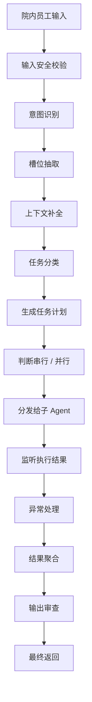

# 横向题表与连续追问：MedAgent(医疗智能体项目) 对照

每个表格单元和连问都保留来源，链接到本目录的项目适配答案。表中概念短语也按问题处理，避免漏掉不带问号的追问。

## q-001

### 说下你理解的 Agent(智能体)

来源：一、Multi-Agent(多智能体) 项目主线类；仓库根目录下的本地原件 `artifacts/medagent_upgrade_20261013/原始资料/多Agent高频面试题横向扩展及纵向延伸.txt` 第 11 行、第 1 个表格单元。当前同名 .md 是适配稿。

**项目口述：** 我把 Agent(智能体) 的运行约束落在服务端：任务输入结构、专科和工具白名单、患者授权、模型与工具调用上限、超时熔断、重复调用阻断、工具依据覆盖和持久化完成确认。Prompt(提示词) 描述职责，代码决定一次动作能否执行。

**方案补全：** 进一步的长任务运行环境需要统一任务预算、持久执行队列、节点状态和验收器。框架能提供组件，业务权限和副作用状态仍由应用负责，不能仅靠装一个框架完成生产治理。

**对应详解：** [说下你理解的 Agent(智能体)](<01-项目主线与软技能.md#q-001>)。

## q-002

### Agent(智能体) 和普通大模型调用有什么区别？

来源：一、Multi-Agent(多智能体) 项目主线类；仓库根目录下的本地原件 `artifacts/medagent_upgrade_20261013/原始资料/多Agent高频面试题横向扩展及纵向延伸.txt` 第 11 行、第 2 个表格单元。当前同名 .md 是适配稿。

**项目口述：** 我把 Agent(智能体) 的运行约束落在服务端：任务输入结构、专科和工具白名单、患者授权、模型与工具调用上限、超时熔断、重复调用阻断、工具依据覆盖和持久化完成确认。Prompt(提示词) 描述职责，代码决定一次动作能否执行。

**方案补全：** 进一步的长任务运行环境需要统一任务预算、持久执行队列、节点状态和验收器。框架能提供组件，业务权限和副作用状态仍由应用负责，不能仅靠装一个框架完成生产治理。

**对应详解：** [说下你理解的 Agent(智能体)](<01-项目主线与软技能.md#q-001>)。

## q-003

### Agent(智能体) 是否具备任务理解、任务拆解、工具调用、状态管理、结果校验、异常兜底？

来源：一、Multi-Agent(多智能体) 项目主线类；仓库根目录下的本地原件 `artifacts/medagent_upgrade_20261013/原始资料/多Agent高频面试题横向扩展及纵向延伸.txt` 第 11 行、第 3 个表格单元。当前同名 .md 是适配稿。

**项目口述：** 我把 Agent(智能体) 的运行约束落在服务端：任务输入结构、专科和工具白名单、患者授权、模型与工具调用上限、超时熔断、重复调用阻断、工具依据覆盖和持久化完成确认。Prompt(提示词) 描述职责，代码决定一次动作能否执行。

**方案补全：** 进一步的长任务运行环境需要统一任务预算、持久执行队列、节点状态和验收器。框架能提供组件，业务权限和副作用状态仍由应用负责，不能仅靠装一个框架完成生产治理。

**对应详解：** [说下你理解的 Agent(智能体)](<01-项目主线与软技能.md#q-001>)。

## q-004

### 什么是 Multi-Agent(多智能体)？

来源：一、Multi-Agent(多智能体) 项目主线类；仓库根目录下的本地原件 `artifacts/medagent_upgrade_20261013/原始资料/多Agent高频面试题横向扩展及纵向延伸.txt` 第 12 行、第 1 个表格单元。当前同名 .md 是适配稿。

**项目口述：** 项目是一个主协调器加三个临床专科：SymptomAgent(症状智能体) 做症状辅助评估、风险提示、疾病信息及科室建议，不创建转诊草稿；DrugAgent(药品智能体) 查药品和审核用药；GuideAgent(指南智能体) 处理指南、检验、报告、随访与临床知识。医生在独立表单确认患者、科室、原因后，由 ReferralDraftService(转诊草稿业务服务) 经受限 MCP(模型上下文协议) 调用创建转诊草稿；它是业务服务，不是第四个智能体。Planning(任务规划)、SafetyGuard(安全守卫)、DomainGuard(业务范围守卫) 是协调流程中的职责模块，没有另建检索、通知或独立审查服务。

**方案补全：** 按业务目标、可信数据和工具权限划分，而不是按每个 API(应用程序接口) 拆 Agent(智能体)。增加角色前，在同一任务集上比较完成率、交接损失、耗时与成本；不能假设多角色天然准确。

**对应详解：** [什么是 Multi-Agent(多智能体)？](<01-项目主线与软技能.md#q-004>)。

## q-005

### 多 Agent(智能体) 和单 Agent(智能体) 有什么区别？

来源：一、Multi-Agent(多智能体) 项目主线类；仓库根目录下的本地原件 `artifacts/medagent_upgrade_20261013/原始资料/多Agent高频面试题横向扩展及纵向延伸.txt` 第 12 行、第 2 个表格单元。当前同名 .md 是适配稿。

**项目口述：** 项目是一个主协调器加三个临床专科：SymptomAgent(症状智能体) 做症状辅助评估、风险提示、疾病信息及科室建议，不创建转诊草稿；DrugAgent(药品智能体) 查药品和审核用药；GuideAgent(指南智能体) 处理指南、检验、报告、随访与临床知识。医生在独立表单确认患者、科室、原因后，由 ReferralDraftService(转诊草稿业务服务) 经受限 MCP(模型上下文协议) 调用创建转诊草稿；它是业务服务，不是第四个智能体。Planning(任务规划)、SafetyGuard(安全守卫)、DomainGuard(业务范围守卫) 是协调流程中的职责模块，没有另建检索、通知或独立审查服务。

**方案补全：** 按业务目标、可信数据和工具权限划分，而不是按每个 API(应用程序接口) 拆 Agent(智能体)。增加角色前，在同一任务集上比较完成率、交接损失、耗时与成本；不能假设多角色天然准确。

**对应详解：** [什么是 Multi-Agent(多智能体)？](<01-项目主线与软技能.md#q-004>)。

## q-006

### 为什么不把所有能力都写在一个 Agent(智能体) 里？拆分依据是什么？

来源：一、Multi-Agent(多智能体) 项目主线类；仓库根目录下的本地原件 `artifacts/medagent_upgrade_20261013/原始资料/多Agent高频面试题横向扩展及纵向延伸.txt` 第 12 行、第 3 个表格单元。当前同名 .md 是适配稿。

**项目口述：** 项目是一个主协调器加三个临床专科：SymptomAgent(症状智能体) 做症状辅助评估、风险提示、疾病信息及科室建议，不创建转诊草稿；DrugAgent(药品智能体) 查药品和审核用药；GuideAgent(指南智能体) 处理指南、检验、报告、随访与临床知识。医生在独立表单确认患者、科室、原因后，由 ReferralDraftService(转诊草稿业务服务) 经受限 MCP(模型上下文协议) 调用创建转诊草稿；它是业务服务，不是第四个智能体。Planning(任务规划)、SafetyGuard(安全守卫)、DomainGuard(业务范围守卫) 是协调流程中的职责模块，没有另建检索、通知或独立审查服务。

**方案补全：** 按业务目标、可信数据和工具权限划分，而不是按每个 API(应用程序接口) 拆 Agent(智能体)。增加角色前，在同一任务集上比较完成率、交接损失、耗时与成本；不能假设多角色天然准确。

**对应详解：** [什么是 Multi-Agent(多智能体)？](<01-项目主线与软技能.md#q-004>)。

## q-007

### 你的项目为什么要用多 Agent(智能体)？

来源：一、Multi-Agent(多智能体) 项目主线类；仓库根目录下的本地原件 `artifacts/medagent_upgrade_20261013/原始资料/多Agent高频面试题横向扩展及纵向延伸.txt` 第 13 行、第 1 个表格单元。当前同名 .md 是适配稿。

**项目口述：** 项目是一个主协调器加三个临床专科：SymptomAgent(症状智能体) 做症状辅助评估、风险提示、疾病信息及科室建议，不创建转诊草稿；DrugAgent(药品智能体) 查药品和审核用药；GuideAgent(指南智能体) 处理指南、检验、报告、随访与临床知识。医生在独立表单确认患者、科室、原因后，由 ReferralDraftService(转诊草稿业务服务) 经受限 MCP(模型上下文协议) 调用创建转诊草稿；它是业务服务，不是第四个智能体。Planning(任务规划)、SafetyGuard(安全守卫)、DomainGuard(业务范围守卫) 是协调流程中的职责模块，没有另建检索、通知或独立审查服务。

**方案补全：** 按业务目标、可信数据和工具权限划分，而不是按每个 API(应用程序接口) 拆 Agent(智能体)。增加角色前，在同一任务集上比较完成率、交接损失、耗时与成本；不能假设多角色天然准确。

**对应详解：** [你的项目为什么要用多 Agent(智能体)？](<01-项目主线与软技能.md#q-007>)。

## q-008

### 是业务复杂、工具多、权限不同，还是任务链路长？

来源：一、Multi-Agent(多智能体) 项目主线类；仓库根目录下的本地原件 `artifacts/medagent_upgrade_20261013/原始资料/多Agent高频面试题横向扩展及纵向延伸.txt` 第 13 行、第 2 个表格单元。当前同名 .md 是适配稿。

**项目口述：** 项目是一个主协调器加三个临床专科：SymptomAgent(症状智能体) 做症状辅助评估、风险提示、疾病信息及科室建议，不创建转诊草稿；DrugAgent(药品智能体) 查药品和审核用药；GuideAgent(指南智能体) 处理指南、检验、报告、随访与临床知识。医生在独立表单确认患者、科室、原因后，由 ReferralDraftService(转诊草稿业务服务) 经受限 MCP(模型上下文协议) 调用创建转诊草稿；它是业务服务，不是第四个智能体。Planning(任务规划)、SafetyGuard(安全守卫)、DomainGuard(业务范围守卫) 是协调流程中的职责模块，没有另建检索、通知或独立审查服务。

**方案补全：** 按业务目标、可信数据和工具权限划分，而不是按每个 API(应用程序接口) 拆 Agent(智能体)。增加角色前，在同一任务集上比较完成率、交接损失、耗时与成本；不能假设多角色天然准确。

**对应详解：** [你的项目为什么要用多 Agent(智能体)？](<01-项目主线与软技能.md#q-007>)。

## q-009

### 如果只用一个 Agent(智能体)，会出现什么问题？

来源：一、Multi-Agent(多智能体) 项目主线类；仓库根目录下的本地原件 `artifacts/medagent_upgrade_20261013/原始资料/多Agent高频面试题横向扩展及纵向延伸.txt` 第 13 行、第 3 个表格单元。当前同名 .md 是适配稿。

**项目口述：** 项目是一个主协调器加三个临床专科：SymptomAgent(症状智能体) 做症状辅助评估、风险提示、疾病信息及科室建议，不创建转诊草稿；DrugAgent(药品智能体) 查药品和审核用药；GuideAgent(指南智能体) 处理指南、检验、报告、随访与临床知识。医生在独立表单确认患者、科室、原因后，由 ReferralDraftService(转诊草稿业务服务) 经受限 MCP(模型上下文协议) 调用创建转诊草稿；它是业务服务，不是第四个智能体。Planning(任务规划)、SafetyGuard(安全守卫)、DomainGuard(业务范围守卫) 是协调流程中的职责模块，没有另建检索、通知或独立审查服务。

**方案补全：** 按业务目标、可信数据和工具权限划分，而不是按每个 API(应用程序接口) 拆 Agent(智能体)。增加角色前，在同一任务集上比较完成率、交接损失、耗时与成本；不能假设多角色天然准确。

**对应详解：** [你的项目为什么要用多 Agent(智能体)？](<01-项目主线与软技能.md#q-007>)。

## q-010

### 你们项目里有几个 Agent(智能体)？

来源：一、Multi-Agent(多智能体) 项目主线类；仓库根目录下的本地原件 `artifacts/medagent_upgrade_20261013/原始资料/多Agent高频面试题横向扩展及纵向延伸.txt` 第 14 行、第 1 个表格单元。当前同名 .md 是适配稿。

**项目口述：** 项目是一个主协调器加三个临床专科：SymptomAgent(症状智能体) 做症状辅助评估、风险提示、疾病信息及科室建议，不创建转诊草稿；DrugAgent(药品智能体) 查药品和审核用药；GuideAgent(指南智能体) 处理指南、检验、报告、随访与临床知识。医生在独立表单确认患者、科室、原因后，由 ReferralDraftService(转诊草稿业务服务) 经受限 MCP(模型上下文协议) 调用创建转诊草稿；它是业务服务，不是第四个智能体。Planning(任务规划)、SafetyGuard(安全守卫)、DomainGuard(业务范围守卫) 是协调流程中的职责模块，没有另建检索、通知或独立审查服务。

**方案补全：** 按业务目标、可信数据和工具权限划分，而不是按每个 API(应用程序接口) 拆 Agent(智能体)。增加角色前，在同一任务集上比较完成率、交接损失、耗时与成本；不能假设多角色天然准确。

**对应详解：** [你们项目里有几个 Agent(智能体)？](<01-项目主线与软技能.md#q-010>)。

## q-011

### 主 Agent(智能体)、检索 Agent(智能体)、查询 Agent(智能体)、工具 Agent(智能体)、审查 Agent(智能体) 怎么分工？

来源：一、Multi-Agent(多智能体) 项目主线类；仓库根目录下的本地原件 `artifacts/medagent_upgrade_20261013/原始资料/多Agent高频面试题横向扩展及纵向延伸.txt` 第 14 行、第 2 个表格单元。当前同名 .md 是适配稿。

**项目口述：** 项目是一个主协调器加三个临床专科：SymptomAgent(症状智能体) 做症状辅助评估、风险提示、疾病信息及科室建议，不创建转诊草稿；DrugAgent(药品智能体) 查药品和审核用药；GuideAgent(指南智能体) 处理指南、检验、报告、随访与临床知识。医生在独立表单确认患者、科室、原因后，由 ReferralDraftService(转诊草稿业务服务) 经受限 MCP(模型上下文协议) 调用创建转诊草稿；它是业务服务，不是第四个智能体。Planning(任务规划)、SafetyGuard(安全守卫)、DomainGuard(业务范围守卫) 是协调流程中的职责模块，没有另建检索、通知或独立审查服务。

**方案补全：** 按业务目标、可信数据和工具权限划分，而不是按每个 API(应用程序接口) 拆 Agent(智能体)。增加角色前，在同一任务集上比较完成率、交接损失、耗时与成本；不能假设多角色天然准确。

**对应详解：** [你们项目里有几个 Agent(智能体)？](<01-项目主线与软技能.md#q-010>)。

## q-012

### 每个 Agent(智能体) 的输入、输出、工具权限、状态字段分别是什么？

来源：一、Multi-Agent(多智能体) 项目主线类；仓库根目录下的本地原件 `artifacts/medagent_upgrade_20261013/原始资料/多Agent高频面试题横向扩展及纵向延伸.txt` 第 14 行、第 3 个表格单元。当前同名 .md 是适配稿。

**项目口述：** 项目是一个主协调器加三个临床专科：SymptomAgent(症状智能体) 做症状辅助评估、风险提示、疾病信息及科室建议，不创建转诊草稿；DrugAgent(药品智能体) 查药品和审核用药；GuideAgent(指南智能体) 处理指南、检验、报告、随访与临床知识。医生在独立表单确认患者、科室、原因后，由 ReferralDraftService(转诊草稿业务服务) 经受限 MCP(模型上下文协议) 调用创建转诊草稿；它是业务服务，不是第四个智能体。Planning(任务规划)、SafetyGuard(安全守卫)、DomainGuard(业务范围守卫) 是协调流程中的职责模块，没有另建检索、通知或独立审查服务。

**方案补全：** 按业务目标、可信数据和工具权限划分，而不是按每个 API(应用程序接口) 拆 Agent(智能体)。增加角色前，在同一任务集上比较完成率、交接损失、耗时与成本；不能假设多角色天然准确。

**对应详解：** [你们项目里有几个 Agent(智能体)？](<01-项目主线与软技能.md#q-010>)。

## q-013

### 你这个项目是 Workflow(工作流) 还是 Agent(智能体)？

来源：一、Multi-Agent(多智能体) 项目主线类；仓库根目录下的本地原件 `artifacts/medagent_upgrade_20261013/原始资料/多Agent高频面试题横向扩展及纵向延伸.txt` 第 15 行、第 1 个表格单元。当前同名 .md 是适配稿。

**项目口述：** 简单明确任务直接匹配专科；多意图或复杂任务由 Planner(规划器) 生成最多三步计划。服务端检查专科白名单、去重、意图要求的专科覆盖以及依赖只能指向已列出的前序步骤。结构或依赖非法时改用确定性短链，不能让模型添加未注册服务。

**方案补全：** 计划能表达依赖与独立查询，当前没有无限自主改计划：只读依据缺失最多一次重新识别，普通工具故障不等于意图错误。若扩展更多节点，增加节点超时、验收条件、输入引用和版本化节点状态，同时限制重规划预算。

**对应详解：** [你这个项目是 Workflow(工作流) 还是 Agent(智能体)？](<01-项目主线与软技能.md#q-013>)。

## q-014

### 固定流程和动态决策有什么区别？

来源：一、Multi-Agent(多智能体) 项目主线类；仓库根目录下的本地原件 `artifacts/medagent_upgrade_20261013/原始资料/多Agent高频面试题横向扩展及纵向延伸.txt` 第 15 行、第 2 个表格单元。当前同名 .md 是适配稿。

**项目口述：** 简单明确任务直接匹配专科；多意图或复杂任务由 Planner(规划器) 生成最多三步计划。服务端检查专科白名单、去重、意图要求的专科覆盖以及依赖只能指向已列出的前序步骤。结构或依赖非法时改用确定性短链，不能让模型添加未注册服务。

**方案补全：** 计划能表达依赖与独立查询，当前没有无限自主改计划：只读依据缺失最多一次重新识别，普通工具故障不等于意图错误。若扩展更多节点，增加节点超时、验收条件、输入引用和版本化节点状态，同时限制重规划预算。

**对应详解：** [你这个项目是 Workflow(工作流) 还是 Agent(智能体)？](<01-项目主线与软技能.md#q-013>)。

## q-015

### 哪些节点是固定编排？哪些节点是由模型动态判断？

来源：一、Multi-Agent(多智能体) 项目主线类；仓库根目录下的本地原件 `artifacts/medagent_upgrade_20261013/原始资料/多Agent高频面试题横向扩展及纵向延伸.txt` 第 15 行、第 3 个表格单元。当前同名 .md 是适配稿。

**项目口述：** 简单明确任务直接匹配专科；多意图或复杂任务由 Planner(规划器) 生成最多三步计划。服务端检查专科白名单、去重、意图要求的专科覆盖以及依赖只能指向已列出的前序步骤。结构或依赖非法时改用确定性短链，不能让模型添加未注册服务。

**方案补全：** 计划能表达依赖与独立查询，当前没有无限自主改计划：只读依据缺失最多一次重新识别，普通工具故障不等于意图错误。若扩展更多节点，增加节点超时、验收条件、输入引用和版本化节点状态，同时限制重规划预算。

**对应详解：** [你这个项目是 Workflow(工作流) 还是 Agent(智能体)？](<01-项目主线与软技能.md#q-013>)。

## q-016

### Agent(智能体) 和 Coze(智能体开发平台)/Dify(大模型应用开发平台) 有什么区别？

来源：一、Multi-Agent(多智能体) 项目主线类；仓库根目录下的本地原件 `artifacts/medagent_upgrade_20261013/原始资料/多Agent高频面试题横向扩展及纵向延伸.txt` 第 16 行、第 1 个表格单元。当前同名 .md 是适配稿。

**项目口述：** 模型通过 Function Calling(函数调用) 选择工具并生成结构化参数，LangChain(大模型应用开发框架) 的 MCPAdapter(MCP工具适配器) 和 FastMCP(MCP服务框架) 客户端通过 MCP(模型上下文协议) 调用工具服务。FastMCP(MCP服务框架) 注册 14 个工具，包括真实医院查询以及本地病史、辅助材料存储；服务端再次检查委托、员工状态、患者范围和写动作权限。两者在同一链路中使用。

**方案补全：** 工具注册要同时维护参数、输出、错误、权限、读写属性和版本契约；新增工具先做契约测试和权限回归，再开放给对应专科。不能把工具描述中的 readOnlyHint(只读工具提示) 当真正的服务端授权。

**对应详解：** [Agent(智能体) 和 Coze(智能体开发平台)/Dify(大模型应用开发平台) 有什么区别？](<01-项目主线与软技能.md#q-016>)。

## q-017

### 你是低代码平台搭建，还是自己基于 LangChain(大模型应用开发框架)/LangGraph(有状态智能体编排框架) 开发？

来源：一、Multi-Agent(多智能体) 项目主线类；仓库根目录下的本地原件 `artifacts/medagent_upgrade_20261013/原始资料/多Agent高频面试题横向扩展及纵向延伸.txt` 第 16 行、第 2 个表格单元。当前同名 .md 是适配稿。

**项目口述：** 模型通过 Function Calling(函数调用) 选择工具并生成结构化参数，LangChain(大模型应用开发框架) 的 MCPAdapter(MCP工具适配器) 和 FastMCP(MCP服务框架) 客户端通过 MCP(模型上下文协议) 调用工具服务。FastMCP(MCP服务框架) 注册 14 个工具，包括真实医院查询以及本地病史、辅助材料存储；服务端再次检查委托、员工状态、患者范围和写动作权限。两者在同一链路中使用。

**方案补全：** 工具注册要同时维护参数、输出、错误、权限、读写属性和版本契约；新增工具先做契约测试和权限回归，再开放给对应专科。不能把工具描述中的 readOnlyHint(只读工具提示) 当真正的服务端授权。

**对应详解：** [Agent(智能体) 和 Coze(智能体开发平台)/Dify(大模型应用开发平台) 有什么区别？](<01-项目主线与软技能.md#q-016>)。

## q-018

### 自研部分在哪里？工具封装、状态管理、路由、异常处理是否自己实现？

来源：一、Multi-Agent(多智能体) 项目主线类；仓库根目录下的本地原件 `artifacts/medagent_upgrade_20261013/原始资料/多Agent高频面试题横向扩展及纵向延伸.txt` 第 16 行、第 3 个表格单元。当前同名 .md 是适配稿。

**项目口述：** 模型通过 Function Calling(函数调用) 选择工具并生成结构化参数，LangChain(大模型应用开发框架) 的 MCPAdapter(MCP工具适配器) 和 FastMCP(MCP服务框架) 客户端通过 MCP(模型上下文协议) 调用工具服务。FastMCP(MCP服务框架) 注册 14 个工具，包括真实医院查询以及本地病史、辅助材料存储；服务端再次检查委托、员工状态、患者范围和写动作权限。两者在同一链路中使用。

**方案补全：** 工具注册要同时维护参数、输出、错误、权限、读写属性和版本契约；新增工具先做契约测试和权限回归，再开放给对应专科。不能把工具描述中的 readOnlyHint(只读工具提示) 当真正的服务端授权。

**对应详解：** [Agent(智能体) 和 Coze(智能体开发平台)/Dify(大模型应用开发平台) 有什么区别？](<01-项目主线与软技能.md#q-016>)。

### example-001

**一、Multi-Agent(多智能体) 项目主线类**

原文位置：仓库根目录下的本地原件 `artifacts/medagent_upgrade_20261013/原始资料/多Agent高频面试题横向扩展及纵向延伸.txt` 第 20 行。该路径指保留的 .txt 原件，当前同名 .md 是适配稿；本地原件不随克隆分发。

用途：ToB(面向机构业务) 原理示例 / 扩展设计，不表示代码已落地。

[返回对应问答](#q-018)

```text
不是想听“Agent = 智能体”，而是判断你有没有真正理解：
1. Agent 为什么要拆。
2. 主 Agent 怎么调度。
3. 子 Agent 怎么协作。
4. 状态怎么传递。
5. 工具怎么调用。
6. 异常怎么兜底。
7. 链路怎么可观测。
```

**示例术语与字段译注：** `Agent`(智能体)。


**本题图与结构示例：** [example-001](#example-001)

## q-019

### 为什么从上一家公司离职？

来源：二、软技能、客户沟通与项目管理类；仓库根目录下的本地原件 `artifacts/medagent_upgrade_20261013/原始资料/多Agent高频面试题横向扩展及纵向延伸.txt` 第 37 行、第 1 个表格单元。当前同名 .md 是适配稿。

**项目口述：** 这类题不能由代码证明个人经历。我的项目表达围绕院内需求、具体负责模块和可展示交付物：意图路由、专科编排、工具权限、回归与文档；实际只参与修订的部分就说明参与了哪些改动。离职、薪资、团队分工与对客经历要按本人事实回答。

**方案补全：** 如果被问客户交付，结合医生/药师用药审核流程讲需求澄清、原型确认、范围变更、验收样本和复核反馈；没有真实医院客户案例时，用工程方案或本地修复案例回答，不编造合同、线上事故、采购成果或任职年限。

**对应详解：** [为什么从上一家公司离职？](<01-项目主线与软技能.md#q-019>)。

## q-020

### 是薪资、发展、地域、团队还是技术栈原因？

来源：二、软技能、客户沟通与项目管理类；仓库根目录下的本地原件 `artifacts/medagent_upgrade_20261013/原始资料/多Agent高频面试题横向扩展及纵向延伸.txt` 第 37 行、第 2 个表格单元。当前同名 .md 是适配稿。

**项目口述：** 这类题不能由代码证明个人经历。我的项目表达围绕院内需求、具体负责模块和可展示交付物：意图路由、专科编排、工具权限、回归与文档；实际只参与修订的部分就说明参与了哪些改动。离职、薪资、团队分工与对客经历要按本人事实回答。

**方案补全：** 如果被问客户交付，结合医生/药师用药审核流程讲需求澄清、原型确认、范围变更、验收样本和复核反馈；没有真实医院客户案例时，用工程方案或本地修复案例回答，不编造合同、线上事故、采购成果或任职年限。

**对应详解：** [为什么从上一家公司离职？](<01-项目主线与软技能.md#q-019>)。

## q-021

### 你来我们这，会不会也因为同样的原因走？

来源：二、软技能、客户沟通与项目管理类；仓库根目录下的本地原件 `artifacts/medagent_upgrade_20261013/原始资料/多Agent高频面试题横向扩展及纵向延伸.txt` 第 37 行、第 3 个表格单元。当前同名 .md 是适配稿。

**项目口述：** 这类题不能由代码证明个人经历。我的项目表达围绕院内需求、具体负责模块和可展示交付物：意图路由、专科编排、工具权限、回归与文档；实际只参与修订的部分就说明参与了哪些改动。离职、薪资、团队分工与对客经历要按本人事实回答。

**方案补全：** 如果被问客户交付，结合医生/药师用药审核流程讲需求澄清、原型确认、范围变更、验收样本和复核反馈；没有真实医院客户案例时，用工程方案或本地修复案例回答，不编造合同、线上事故、采购成果或任职年限。

**对应详解：** [为什么从上一家公司离职？](<01-项目主线与软技能.md#q-019>)。

## q-022

### 你的期望薪资是多少？

来源：二、软技能、客户沟通与项目管理类；仓库根目录下的本地原件 `artifacts/medagent_upgrade_20261013/原始资料/多Agent高频面试题横向扩展及纵向延伸.txt` 第 38 行、第 1 个表格单元。当前同名 .md 是适配稿。

**项目口述：** 这类题不能由代码证明个人经历。我的项目表达围绕院内需求、具体负责模块和可展示交付物：意图路由、专科编排、工具权限、回归与文档；实际只参与修订的部分就说明参与了哪些改动。离职、薪资、团队分工与对客经历要按本人事实回答。

**方案补全：** 如果被问客户交付，结合医生/药师用药审核流程讲需求澄清、原型确认、范围变更、验收样本和复核反馈；没有真实医院客户案例时，用工程方案或本地修复案例回答，不编造合同、线上事故、采购成果或任职年限。

**对应详解：** [你的期望薪资是多少？](<01-项目主线与软技能.md#q-022>)。

## q-023

### 上一家薪资结构（base(基础配置)、年终、补贴、股票）是什么？

来源：二、软技能、客户沟通与项目管理类；仓库根目录下的本地原件 `artifacts/medagent_upgrade_20261013/原始资料/多Agent高频面试题横向扩展及纵向延伸.txt` 第 38 行、第 2 个表格单元。当前同名 .md 是适配稿。

**项目口述：** 这类题不能由代码证明个人经历。我的项目表达围绕院内需求、具体负责模块和可展示交付物：意图路由、专科编排、工具权限、回归与文档；实际只参与修订的部分就说明参与了哪些改动。离职、薪资、团队分工与对客经历要按本人事实回答。

**方案补全：** 如果被问客户交付，结合医生/药师用药审核流程讲需求澄清、原型确认、范围变更、验收样本和复核反馈；没有真实医院客户案例时，用工程方案或本地修复案例回答，不编造合同、线上事故、采购成果或任职年限。

**对应详解：** [你的期望薪资是多少？](<01-项目主线与软技能.md#q-022>)。

## q-024

### 如何按岗位、城市、公司规模合理报价？

来源：二、软技能、客户沟通与项目管理类；仓库根目录下的本地原件 `artifacts/medagent_upgrade_20261013/原始资料/多Agent高频面试题横向扩展及纵向延伸.txt` 第 38 行、第 3 个表格单元。当前同名 .md 是适配稿。

**项目口述：** 这类题不能由代码证明个人经历。我的项目表达围绕院内需求、具体负责模块和可展示交付物：意图路由、专科编排、工具权限、回归与文档；实际只参与修订的部分就说明参与了哪些改动。离职、薪资、团队分工与对客经历要按本人事实回答。

**方案补全：** 如果被问客户交付，结合医生/药师用药审核流程讲需求澄清、原型确认、范围变更、验收样本和复核反馈；没有真实医院客户案例时，用工程方案或本地修复案例回答，不编造合同、线上事故、采购成果或任职年限。

**对应详解：** [你的期望薪资是多少？](<01-项目主线与软技能.md#q-022>)。

## q-025

### 未来两三年的工作规划是什么？

来源：二、软技能、客户沟通与项目管理类；仓库根目录下的本地原件 `artifacts/medagent_upgrade_20261013/原始资料/多Agent高频面试题横向扩展及纵向延伸.txt` 第 39 行、第 1 个表格单元。当前同名 .md 是适配稿。

**项目口述：** 这类题不能由代码证明个人经历。我的项目表达围绕院内需求、具体负责模块和可展示交付物：意图路由、专科编排、工具权限、回归与文档；实际只参与修订的部分就说明参与了哪些改动。离职、薪资、团队分工与对客经历要按本人事实回答。

**方案补全：** 如果被问客户交付，结合医生/药师用药审核流程讲需求澄清、原型确认、范围变更、验收样本和复核反馈；没有真实医院客户案例时，用工程方案或本地修复案例回答，不编造合同、线上事故、采购成果或任职年限。

**对应详解：** [未来两三年的工作规划是什么？](<01-项目主线与软技能.md#q-025>)。

## q-026

### Agent(智能体) 方向深耕还是转管理？

来源：二、软技能、客户沟通与项目管理类；仓库根目录下的本地原件 `artifacts/medagent_upgrade_20261013/原始资料/多Agent高频面试题横向扩展及纵向延伸.txt` 第 39 行、第 2 个表格单元。当前同名 .md 是适配稿。

**项目口述：** 这类题不能由代码证明个人经历。我的项目表达围绕院内需求、具体负责模块和可展示交付物：意图路由、专科编排、工具权限、回归与文档；实际只参与修订的部分就说明参与了哪些改动。离职、薪资、团队分工与对客经历要按本人事实回答。

**方案补全：** 如果被问客户交付，结合医生/药师用药审核流程讲需求澄清、原型确认、范围变更、验收样本和复核反馈；没有真实医院客户案例时，用工程方案或本地修复案例回答，不编造合同、线上事故、采购成果或任职年限。

**对应详解：** [未来两三年的工作规划是什么？](<01-项目主线与软技能.md#q-025>)。

## q-027

### 你的规划与这个岗位的发展空间是否匹配？

来源：二、软技能、客户沟通与项目管理类；仓库根目录下的本地原件 `artifacts/medagent_upgrade_20261013/原始资料/多Agent高频面试题横向扩展及纵向延伸.txt` 第 39 行、第 3 个表格单元。当前同名 .md 是适配稿。

**项目口述：** 这类题不能由代码证明个人经历。我的项目表达围绕院内需求、具体负责模块和可展示交付物：意图路由、专科编排、工具权限、回归与文档；实际只参与修订的部分就说明参与了哪些改动。离职、薪资、团队分工与对客经历要按本人事实回答。

**方案补全：** 如果被问客户交付，结合医生/药师用药审核流程讲需求澄清、原型确认、范围变更、验收样本和复核反馈；没有真实医院客户案例时，用工程方案或本地修复案例回答，不编造合同、线上事故、采购成果或任职年限。

**对应详解：** [未来两三年的工作规划是什么？](<01-项目主线与软技能.md#q-025>)。

## q-028

### 你们对接过客户吗？有没有对客经验？

来源：二、软技能、客户沟通与项目管理类；仓库根目录下的本地原件 `artifacts/medagent_upgrade_20261013/原始资料/多Agent高频面试题横向扩展及纵向延伸.txt` 第 40 行、第 1 个表格单元。当前同名 .md 是适配稿。

**项目口述：** 这类题不能由代码证明个人经历。我的项目表达围绕院内需求、具体负责模块和可展示交付物：意图路由、专科编排、工具权限、回归与文档；实际只参与修订的部分就说明参与了哪些改动。离职、薪资、团队分工与对客经历要按本人事实回答。

**方案补全：** 如果被问客户交付，结合医生/药师用药审核流程讲需求澄清、原型确认、范围变更、验收样本和复核反馈；没有真实医院客户案例时，用工程方案或本地修复案例回答，不编造合同、线上事故、采购成果或任职年限。

**对应详解：** [你们对接过客户吗？有没有对客经验？](<01-项目主线与软技能.md#q-028>)。

## q-029

### 内部/外部用户、to B/to C？

来源：二、软技能、客户沟通与项目管理类；仓库根目录下的本地原件 `artifacts/medagent_upgrade_20261013/原始资料/多Agent高频面试题横向扩展及纵向延伸.txt` 第 40 行、第 2 个表格单元。当前同名 .md 是适配稿。

**项目口述：** 这类题不能由代码证明个人经历。我的项目表达围绕院内需求、具体负责模块和可展示交付物：意图路由、专科编排、工具权限、回归与文档；实际只参与修订的部分就说明参与了哪些改动。离职、薪资、团队分工与对客经历要按本人事实回答。

**方案补全：** 如果被问客户交付，结合医生/药师用药审核流程讲需求澄清、原型确认、范围变更、验收样本和复核反馈；没有真实医院客户案例时，用工程方案或本地修复案例回答，不编造合同、线上事故、采购成果或任职年限。

**对应详解：** [你们对接过客户吗？有没有对客经验？](<01-项目主线与软技能.md#q-028>)。

## q-030

### 如何把模糊需求转成 Agent(智能体) 能力边界？

来源：二、软技能、客户沟通与项目管理类；仓库根目录下的本地原件 `artifacts/medagent_upgrade_20261013/原始资料/多Agent高频面试题横向扩展及纵向延伸.txt` 第 40 行、第 3 个表格单元。当前同名 .md 是适配稿。

**项目口述：** 这类题不能由代码证明个人经历。我的项目表达围绕院内需求、具体负责模块和可展示交付物：意图路由、专科编排、工具权限、回归与文档；实际只参与修订的部分就说明参与了哪些改动。离职、薪资、团队分工与对客经历要按本人事实回答。

**方案补全：** 如果被问客户交付，结合医生/药师用药审核流程讲需求澄清、原型确认、范围变更、验收样本和复核反馈；没有真实医院客户案例时，用工程方案或本地修复案例回答，不编造合同、线上事故、采购成果或任职年限。

**对应详解：** [你们对接过客户吗？有没有对客经验？](<01-项目主线与软技能.md#q-028>)。

## q-031

### 项目交付时甲方不满意，工期已到必须交付，怎么处理？

来源：二、软技能、客户沟通与项目管理类；仓库根目录下的本地原件 `artifacts/medagent_upgrade_20261013/原始资料/多Agent高频面试题横向扩展及纵向延伸.txt` 第 41 行、第 1 个表格单元。当前同名 .md 是适配稿。

**项目口述：** 这类题不能由代码证明个人经历。我的项目表达围绕院内需求、具体负责模块和可展示交付物：意图路由、专科编排、工具权限、回归与文档；实际只参与修订的部分就说明参与了哪些改动。离职、薪资、团队分工与对客经历要按本人事实回答。

**方案补全：** 如果被问客户交付，结合医生/药师用药审核流程讲需求澄清、原型确认、范围变更、验收样本和复核反馈；没有真实医院客户案例时，用工程方案或本地修复案例回答，不编造合同、线上事故、采购成果或任职年限。

**对应详解：** [项目交付时甲方不满意，工期已到必须交付，怎么处理？](<01-项目主线与软技能.md#q-031>)。

## q-032

### 原型、范围、优先级、延期或迭代如何取舍？

来源：二、软技能、客户沟通与项目管理类；仓库根目录下的本地原件 `artifacts/medagent_upgrade_20261013/原始资料/多Agent高频面试题横向扩展及纵向延伸.txt` 第 41 行、第 2 个表格单元。当前同名 .md 是适配稿。

**项目口述：** 这类题不能由代码证明个人经历。我的项目表达围绕院内需求、具体负责模块和可展示交付物：意图路由、专科编排、工具权限、回归与文档；实际只参与修订的部分就说明参与了哪些改动。离职、薪资、团队分工与对客经历要按本人事实回答。

**方案补全：** 如果被问客户交付，结合医生/药师用药审核流程讲需求澄清、原型确认、范围变更、验收样本和复核反馈；没有真实医院客户案例时，用工程方案或本地修复案例回答，不编造合同、线上事故、采购成果或任职年限。

**对应详解：** [项目交付时甲方不满意，工期已到必须交付，怎么处理？](<01-项目主线与软技能.md#q-031>)。

## q-033

### 如何定义任务完成率、人工干预率等验收标准？

来源：二、软技能、客户沟通与项目管理类；仓库根目录下的本地原件 `artifacts/medagent_upgrade_20261013/原始资料/多Agent高频面试题横向扩展及纵向延伸.txt` 第 41 行、第 3 个表格单元。当前同名 .md 是适配稿。

**项目口述：** 这类题不能由代码证明个人经历。我的项目表达围绕院内需求、具体负责模块和可展示交付物：意图路由、专科编排、工具权限、回归与文档；实际只参与修订的部分就说明参与了哪些改动。离职、薪资、团队分工与对客经历要按本人事实回答。

**方案补全：** 如果被问客户交付，结合医生/药师用药审核流程讲需求澄清、原型确认、范围变更、验收样本和复核反馈；没有真实医院客户案例时，用工程方案或本地修复案例回答，不编造合同、线上事故、采购成果或任职年限。

**对应详解：** [项目交付时甲方不满意，工期已到必须交付，怎么处理？](<01-项目主线与软技能.md#q-031>)。

## q-034

### 客户说智能体不好用，怎么沟通？

来源：二、软技能、客户沟通与项目管理类；仓库根目录下的本地原件 `artifacts/medagent_upgrade_20261013/原始资料/多Agent高频面试题横向扩展及纵向延伸.txt` 第 42 行、第 1 个表格单元。当前同名 .md 是适配稿。

**项目口述：** 这类题不能由代码证明个人经历。我的项目表达围绕院内需求、具体负责模块和可展示交付物：意图路由、专科编排、工具权限、回归与文档；实际只参与修订的部分就说明参与了哪些改动。离职、薪资、团队分工与对客经历要按本人事实回答。

**方案补全：** 如果被问客户交付，结合医生/药师用药审核流程讲需求澄清、原型确认、范围变更、验收样本和复核反馈；没有真实医院客户案例时，用工程方案或本地修复案例回答，不编造合同、线上事故、采购成果或任职年限。

**对应详解：** [客户说智能体不好用，怎么沟通？](<01-项目主线与软技能.md#q-034>)。

## q-035

### 先定位意图、工具、速度还是结果问题

来源：二、软技能、客户沟通与项目管理类；仓库根目录下的本地原件 `artifacts/medagent_upgrade_20261013/原始资料/多Agent高频面试题横向扩展及纵向延伸.txt` 第 42 行、第 2 个表格单元。当前同名 .md 是适配稿。

**项目口述：** 这类题不能由代码证明个人经历。我的项目表达围绕院内需求、具体负责模块和可展示交付物：意图路由、专科编排、工具权限、回归与文档；实际只参与修订的部分就说明参与了哪些改动。离职、薪资、团队分工与对客经历要按本人事实回答。

**方案补全：** 如果被问客户交付，结合医生/药师用药审核流程讲需求澄清、原型确认、范围变更、验收样本和复核反馈；没有真实医院客户案例时，用工程方案或本地修复案例回答，不编造合同、线上事故、采购成果或任职年限。

**对应详解：** [客户说智能体不好用，怎么沟通？](<01-项目主线与软技能.md#q-034>)。

## q-036

### 如何解释能力边界和局限？

来源：二、软技能、客户沟通与项目管理类；仓库根目录下的本地原件 `artifacts/medagent_upgrade_20261013/原始资料/多Agent高频面试题横向扩展及纵向延伸.txt` 第 42 行、第 3 个表格单元。当前同名 .md 是适配稿。

**项目口述：** 这类题不能由代码证明个人经历。我的项目表达围绕院内需求、具体负责模块和可展示交付物：意图路由、专科编排、工具权限、回归与文档；实际只参与修订的部分就说明参与了哪些改动。离职、薪资、团队分工与对客经历要按本人事实回答。

**方案补全：** 如果被问客户交付，结合医生/药师用药审核流程讲需求澄清、原型确认、范围变更、验收样本和复核反馈；没有真实医院客户案例时，用工程方案或本地修复案例回答，不编造合同、线上事故、采购成果或任职年限。

**对应详解：** [客户说智能体不好用，怎么沟通？](<01-项目主线与软技能.md#q-034>)。

## q-037

### 对接 B 端客户时，哪些沟通技巧比较重要？

来源：二、软技能、客户沟通与项目管理类；仓库根目录下的本地原件 `artifacts/medagent_upgrade_20261013/原始资料/多Agent高频面试题横向扩展及纵向延伸.txt` 第 43 行、第 1 个表格单元。当前同名 .md 是适配稿。

**项目口述：** 这类题不能由代码证明个人经历。我的项目表达围绕院内需求、具体负责模块和可展示交付物：意图路由、专科编排、工具权限、回归与文档；实际只参与修订的部分就说明参与了哪些改动。离职、薪资、团队分工与对客经历要按本人事实回答。

**方案补全：** 如果被问客户交付，结合医生/药师用药审核流程讲需求澄清、原型确认、范围变更、验收样本和复核反馈；没有真实医院客户案例时，用工程方案或本地修复案例回答，不编造合同、线上事故、采购成果或任职年限。

**对应详解：** [对接 B 端客户时，哪些沟通技巧比较重要？](<01-项目主线与软技能.md#q-037>)。

## q-038

### 需求翻译、预期管理、效果演示、迭代节奏

来源：二、软技能、客户沟通与项目管理类；仓库根目录下的本地原件 `artifacts/medagent_upgrade_20261013/原始资料/多Agent高频面试题横向扩展及纵向延伸.txt` 第 43 行、第 2 个表格单元。当前同名 .md 是适配稿。

**项目口述：** 这类题不能由代码证明个人经历。我的项目表达围绕院内需求、具体负责模块和可展示交付物：意图路由、专科编排、工具权限、回归与文档；实际只参与修订的部分就说明参与了哪些改动。离职、薪资、团队分工与对客经历要按本人事实回答。

**方案补全：** 如果被问客户交付，结合医生/药师用药审核流程讲需求澄清、原型确认、范围变更、验收样本和复核反馈；没有真实医院客户案例时，用工程方案或本地修复案例回答，不编造合同、线上事故、采购成果或任职年限。

**对应详解：** [对接 B 端客户时，哪些沟通技巧比较重要？](<01-项目主线与软技能.md#q-037>)。

## q-039

### 如何避免双方对效果标准理解不同？

来源：二、软技能、客户沟通与项目管理类；仓库根目录下的本地原件 `artifacts/medagent_upgrade_20261013/原始资料/多Agent高频面试题横向扩展及纵向延伸.txt` 第 43 行、第 3 个表格单元。当前同名 .md 是适配稿。

**项目口述：** 这类题不能由代码证明个人经历。我的项目表达围绕院内需求、具体负责模块和可展示交付物：意图路由、专科编排、工具权限、回归与文档；实际只参与修订的部分就说明参与了哪些改动。离职、薪资、团队分工与对客经历要按本人事实回答。

**方案补全：** 如果被问客户交付，结合医生/药师用药审核流程讲需求澄清、原型确认、范围变更、验收样本和复核反馈；没有真实医院客户案例时，用工程方案或本地修复案例回答，不编造合同、线上事故、采购成果或任职年限。

**对应详解：** [对接 B 端客户时，哪些沟通技巧比较重要？](<01-项目主线与软技能.md#q-037>)。

## q-040

### 开发中客户提出新增需求，如何沟通？

来源：二、软技能、客户沟通与项目管理类；仓库根目录下的本地原件 `artifacts/medagent_upgrade_20261013/原始资料/多Agent高频面试题横向扩展及纵向延伸.txt` 第 44 行、第 1 个表格单元。当前同名 .md 是适配稿。

**项目口述：** 这类题不能由代码证明个人经历。我的项目表达围绕院内需求、具体负责模块和可展示交付物：意图路由、专科编排、工具权限、回归与文档；实际只参与修订的部分就说明参与了哪些改动。离职、薪资、团队分工与对客经历要按本人事实回答。

**方案补全：** 如果被问客户交付，结合医生/药师用药审核流程讲需求澄清、原型确认、范围变更、验收样本和复核反馈；没有真实医院客户案例时，用工程方案或本地修复案例回答，不编造合同、线上事故、采购成果或任职年限。

**对应详解：** [开发中客户提出新增需求，如何沟通？](<01-项目主线与软技能.md#q-040>)。

## q-041

### 判断与现有路由/状态的兼容性、评估排期和优先级

来源：二、软技能、客户沟通与项目管理类；仓库根目录下的本地原件 `artifacts/medagent_upgrade_20261013/原始资料/多Agent高频面试题横向扩展及纵向延伸.txt` 第 44 行、第 2 个表格单元。当前同名 .md 是适配稿。

**项目口述：** 这类题不能由代码证明个人经历。我的项目表达围绕院内需求、具体负责模块和可展示交付物：意图路由、专科编排、工具权限、回归与文档；实际只参与修订的部分就说明参与了哪些改动。离职、薪资、团队分工与对客经历要按本人事实回答。

**方案补全：** 如果被问客户交付，结合医生/药师用药审核流程讲需求澄清、原型确认、范围变更、验收样本和复核反馈；没有真实医院客户案例时，用工程方案或本地修复案例回答，不编造合同、线上事故、采购成果或任职年限。

**对应详解：** [开发中客户提出新增需求，如何沟通？](<01-项目主线与软技能.md#q-040>)。

## q-042

### 是否需要走变更流程？

来源：二、软技能、客户沟通与项目管理类；仓库根目录下的本地原件 `artifacts/medagent_upgrade_20261013/原始资料/多Agent高频面试题横向扩展及纵向延伸.txt` 第 44 行、第 3 个表格单元。当前同名 .md 是适配稿。

**项目口述：** 这类题不能由代码证明个人经历。我的项目表达围绕院内需求、具体负责模块和可展示交付物：意图路由、专科编排、工具权限、回归与文档；实际只参与修订的部分就说明参与了哪些改动。离职、薪资、团队分工与对客经历要按本人事实回答。

**方案补全：** 如果被问客户交付，结合医生/药师用药审核流程讲需求澄清、原型确认、范围变更、验收样本和复核反馈；没有真实医院客户案例时，用工程方案或本地修复案例回答，不编造合同、线上事故、采购成果或任职年限。

**对应详解：** [开发中客户提出新增需求，如何沟通？](<01-项目主线与软技能.md#q-040>)。

## q-043

### 业务部门不配合、需求频繁变，怎么推进 Agent(智能体) 项目？

来源：二、软技能、客户沟通与项目管理类；仓库根目录下的本地原件 `artifacts/medagent_upgrade_20261013/原始资料/多Agent高频面试题横向扩展及纵向延伸.txt` 第 45 行、第 1 个表格单元。当前同名 .md 是适配稿。

**项目口述：** 这类题不能由代码证明个人经历。我的项目表达围绕院内需求、具体负责模块和可展示交付物：意图路由、专科编排、工具权限、回归与文档；实际只参与修订的部分就说明参与了哪些改动。离职、薪资、团队分工与对客经历要按本人事实回答。

**方案补全：** 如果被问客户交付，结合医生/药师用药审核流程讲需求澄清、原型确认、范围变更、验收样本和复核反馈；没有真实医院客户案例时，用工程方案或本地修复案例回答，不编造合同、线上事故、采购成果或任职年限。

**对应详解：** [业务部门不配合、需求频繁变，怎么推进 Agent(智能体) 项目？](<01-项目主线与软技能.md#q-043>)。

## q-044

### 原型验证、锁定 MVP(最小可用版本)、让业务方参与测试

来源：二、软技能、客户沟通与项目管理类；仓库根目录下的本地原件 `artifacts/medagent_upgrade_20261013/原始资料/多Agent高频面试题横向扩展及纵向延伸.txt` 第 45 行、第 2 个表格单元。当前同名 .md 是适配稿。

**项目口述：** 这类题不能由代码证明个人经历。我的项目表达围绕院内需求、具体负责模块和可展示交付物：意图路由、专科编排、工具权限、回归与文档；实际只参与修订的部分就说明参与了哪些改动。离职、薪资、团队分工与对客经历要按本人事实回答。

**方案补全：** 如果被问客户交付，结合医生/药师用药审核流程讲需求澄清、原型确认、范围变更、验收样本和复核反馈；没有真实医院客户案例时，用工程方案或本地修复案例回答，不编造合同、线上事故、采购成果或任职年限。

**对应详解：** [业务部门不配合、需求频繁变，怎么推进 Agent(智能体) 项目？](<01-项目主线与软技能.md#q-043>)。

## q-045

### 如何避免做好后没人用？

来源：二、软技能、客户沟通与项目管理类；仓库根目录下的本地原件 `artifacts/medagent_upgrade_20261013/原始资料/多Agent高频面试题横向扩展及纵向延伸.txt` 第 45 行、第 3 个表格单元。当前同名 .md 是适配稿。

**项目口述：** 这类题不能由代码证明个人经历。我的项目表达围绕院内需求、具体负责模块和可展示交付物：意图路由、专科编排、工具权限、回归与文档；实际只参与修订的部分就说明参与了哪些改动。离职、薪资、团队分工与对客经历要按本人事实回答。

**方案补全：** 如果被问客户交付，结合医生/药师用药审核流程讲需求澄清、原型确认、范围变更、验收样本和复核反馈；没有真实医院客户案例时，用工程方案或本地修复案例回答，不编造合同、线上事故、采购成果或任职年限。

**对应详解：** [业务部门不配合、需求频繁变，怎么推进 Agent(智能体) 项目？](<01-项目主线与软技能.md#q-043>)。

## q-046

### 跨部门推动 Agent(智能体) 项目，有哪些协作方法？

来源：二、软技能、客户沟通与项目管理类；仓库根目录下的本地原件 `artifacts/medagent_upgrade_20261013/原始资料/多Agent高频面试题横向扩展及纵向延伸.txt` 第 46 行、第 1 个表格单元。当前同名 .md 是适配稿。

**项目口述：** 这类题不能由代码证明个人经历。我的项目表达围绕院内需求、具体负责模块和可展示交付物：意图路由、专科编排、工具权限、回归与文档；实际只参与修订的部分就说明参与了哪些改动。离职、薪资、团队分工与对客经历要按本人事实回答。

**方案补全：** 如果被问客户交付，结合医生/药师用药审核流程讲需求澄清、原型确认、范围变更、验收样本和复核反馈；没有真实医院客户案例时，用工程方案或本地修复案例回答，不编造合同、线上事故、采购成果或任职年限。

**对应详解：** [跨部门推动 Agent(智能体) 项目，有哪些协作方法？](<01-项目主线与软技能.md#q-046>)。

## q-047

### 以业务痛点和量化收益对齐、分阶段交付

来源：二、软技能、客户沟通与项目管理类；仓库根目录下的本地原件 `artifacts/medagent_upgrade_20261013/原始资料/多Agent高频面试题横向扩展及纵向延伸.txt` 第 46 行、第 2 个表格单元。当前同名 .md 是适配稿。

**项目口述：** 这类题不能由代码证明个人经历。我的项目表达围绕院内需求、具体负责模块和可展示交付物：意图路由、专科编排、工具权限、回归与文档；实际只参与修订的部分就说明参与了哪些改动。离职、薪资、团队分工与对客经历要按本人事实回答。

**方案补全：** 如果被问客户交付，结合医生/药师用药审核流程讲需求澄清、原型确认、范围变更、验收样本和复核反馈；没有真实医院客户案例时，用工程方案或本地修复案例回答，不编造合同、线上事故、采购成果或任职年限。

**对应详解：** [跨部门推动 Agent(智能体) 项目，有哪些协作方法？](<01-项目主线与软技能.md#q-046>)。

## q-048

### 如何处理受影响团队的顾虑？

来源：二、软技能、客户沟通与项目管理类；仓库根目录下的本地原件 `artifacts/medagent_upgrade_20261013/原始资料/多Agent高频面试题横向扩展及纵向延伸.txt` 第 46 行、第 3 个表格单元。当前同名 .md 是适配稿。

**项目口述：** 这类题不能由代码证明个人经历。我的项目表达围绕院内需求、具体负责模块和可展示交付物：意图路由、专科编排、工具权限、回归与文档；实际只参与修订的部分就说明参与了哪些改动。离职、薪资、团队分工与对客经历要按本人事实回答。

**方案补全：** 如果被问客户交付，结合医生/药师用药审核流程讲需求澄清、原型确认、范围变更、验收样本和复核反馈；没有真实医院客户案例时，用工程方案或本地修复案例回答，不编造合同、线上事故、采购成果或任职年限。

**对应详解：** [跨部门推动 Agent(智能体) 项目，有哪些协作方法？](<01-项目主线与软技能.md#q-046>)。

## q-049

### 上一个 Agent(智能体) 项目不足的地方是什么？

来源：二、软技能、客户沟通与项目管理类；仓库根目录下的本地原件 `artifacts/medagent_upgrade_20261013/原始资料/多Agent高频面试题横向扩展及纵向延伸.txt` 第 47 行、第 1 个表格单元。当前同名 .md 是适配稿。

**项目口述：** 我把交付验收拆成院内权限、安全边界、工具契约、路由覆盖、故障分支和真实医院接口联调。仓库有配置、部署和工程回归记录，说明已有实现可核对；真实医院试点、临床收益和全链路容量不能直接从合成评测推导。

**方案补全：** 上线时明确医生/药师典型任务与责任人，先小范围灰度，再测成功率、复核耗时、人工纠错及院内流程接受度；准备模型/Prompt(提示词)/工具联合回滚和数据恢复演练。范围变更先评估权限、状态和验收，不把新增患者服务混入 ToB(面向机构业务) 交付。

**对应详解：** [上一个 Agent(智能体) 项目不足的地方是什么？](<01-项目主线与软技能.md#q-049>)。

## q-050

### 路由准确率、稳定性、响应速度、状态恢复、幻觉

来源：二、软技能、客户沟通与项目管理类；仓库根目录下的本地原件 `artifacts/medagent_upgrade_20261013/原始资料/多Agent高频面试题横向扩展及纵向延伸.txt` 第 47 行、第 2 个表格单元。当前同名 .md 是适配稿。

**项目口述：** 我把交付验收拆成院内权限、安全边界、工具契约、路由覆盖、故障分支和真实医院接口联调。仓库有配置、部署和工程回归记录，说明已有实现可核对；真实医院试点、临床收益和全链路容量不能直接从合成评测推导。

**方案补全：** 上线时明确医生/药师典型任务与责任人，先小范围灰度，再测成功率、复核耗时、人工纠错及院内流程接受度；准备模型/Prompt(提示词)/工具联合回滚和数据恢复演练。范围变更先评估权限、状态和验收，不把新增患者服务混入 ToB(面向机构业务) 交付。

**对应详解：** [上一个 Agent(智能体) 项目不足的地方是什么？](<01-项目主线与软技能.md#q-049>)。

## q-051

### 如果重做一次会改什么？

来源：二、软技能、客户沟通与项目管理类；仓库根目录下的本地原件 `artifacts/medagent_upgrade_20261013/原始资料/多Agent高频面试题横向扩展及纵向延伸.txt` 第 47 行、第 3 个表格单元。当前同名 .md 是适配稿。

**项目口述：** 我把交付验收拆成院内权限、安全边界、工具契约、路由覆盖、故障分支和真实医院接口联调。仓库有配置、部署和工程回归记录，说明已有实现可核对；真实医院试点、临床收益和全链路容量不能直接从合成评测推导。

**方案补全：** 上线时明确医生/药师典型任务与责任人，先小范围灰度，再测成功率、复核耗时、人工纠错及院内流程接受度；准备模型/Prompt(提示词)/工具联合回滚和数据恢复演练。范围变更先评估权限、状态和验收，不把新增患者服务混入 ToB(面向机构业务) 交付。

**对应详解：** [上一个 Agent(智能体) 项目不足的地方是什么？](<01-项目主线与软技能.md#q-049>)。

## q-052

### 你遇到的最大难点是什么，怎么解决的？

来源：二、软技能、客户沟通与项目管理类；仓库根目录下的本地原件 `artifacts/medagent_upgrade_20261013/原始资料/多Agent高频面试题横向扩展及纵向延伸.txt` 第 48 行、第 1 个表格单元。当前同名 .md 是适配稿。

**项目口述：** 我按识别前、执行中和执行后处理：前三路发现分歧时二次识别；执行前校验关键参数和权限；执行后检查每个意图是否有对应的成功工具依据，例如病史读取不能代替药品说明书查询。只读任务覆盖不匹配时最多复核并重路由一次；批准写动作或出现写调用时禁止自动重跑。

**方案补全：** 工作台已能提交意图纠错，服务端重新核验患者权限和原请求所属员工，保存为待临床复核记录，不自动作为训练标签。完整闭环还需要结论与目标的语义核验、复核工单及标注发布流程。工具成功不是医学正确证明；写入不明先查状态、核对 HIS(医院信息系统)，跨系统补偿取决于医院接口。

**对应详解：** [你遇到的最大难点是什么，怎么解决的？](<01-项目主线与软技能.md#q-052>)。

## q-053

### 死循环、通信、状态污染、输出不稳定

来源：二、软技能、客户沟通与项目管理类；仓库根目录下的本地原件 `artifacts/medagent_upgrade_20261013/原始资料/多Agent高频面试题横向扩展及纵向延伸.txt` 第 48 行、第 2 个表格单元。当前同名 .md 是适配稿。

**项目口述：** 我按识别前、执行中和执行后处理：前三路发现分歧时二次识别；执行前校验关键参数和权限；执行后检查每个意图是否有对应的成功工具依据，例如病史读取不能代替药品说明书查询。只读任务覆盖不匹配时最多复核并重路由一次；批准写动作或出现写调用时禁止自动重跑。

**方案补全：** 工作台已能提交意图纠错，服务端重新核验患者权限和原请求所属员工，保存为待临床复核记录，不自动作为训练标签。完整闭环还需要结论与目标的语义核验、复核工单及标注发布流程。工具成功不是医学正确证明；写入不明先查状态、核对 HIS(医院信息系统)，跨系统补偿取决于医院接口。

**对应详解：** [你遇到的最大难点是什么，怎么解决的？](<01-项目主线与软技能.md#q-052>)。

## q-054

### 面试官要验证你的工程排障思路。

来源：二、软技能、客户沟通与项目管理类；仓库根目录下的本地原件 `artifacts/medagent_upgrade_20261013/原始资料/多Agent高频面试题横向扩展及纵向延伸.txt` 第 48 行、第 3 个表格单元。当前同名 .md 是适配稿。

**项目口述：** 我按识别前、执行中和执行后处理：前三路发现分歧时二次识别；执行前校验关键参数和权限；执行后检查每个意图是否有对应的成功工具依据，例如病史读取不能代替药品说明书查询。只读任务覆盖不匹配时最多复核并重路由一次；批准写动作或出现写调用时禁止自动重跑。

**方案补全：** 工作台已能提交意图纠错，服务端重新核验患者权限和原请求所属员工，保存为待临床复核记录，不自动作为训练标签。完整闭环还需要结论与目标的语义核验、复核工单及标注发布流程。工具成功不是医学正确证明；写入不明先查状态、核对 HIS(医院信息系统)，跨系统补偿取决于医院接口。

**对应详解：** [你遇到的最大难点是什么，怎么解决的？](<01-项目主线与软技能.md#q-052>)。

## q-055

### 怎么判断 Agent(智能体) 项目做完之后符合需求？

来源：二、软技能、客户沟通与项目管理类；仓库根目录下的本地原件 `artifacts/medagent_upgrade_20261013/原始资料/多Agent高频面试题横向扩展及纵向延伸.txt` 第 49 行、第 1 个表格单元。当前同名 .md 是适配稿。

**项目口述：** 我把路由、工具执行、端到端完成与临床结论质量分开评估。BERT(双向编码语言模型) 的 1340 条合成测试集合匹配率 100%，400 条合成挑战为 87%，Micro-F1(微平均F1) 0.9461；多意图子集 250 条匹配率 97.2%。这些是不同任务分组，不能代替真实医院准确率。

**方案补全：** 系统评测按单意图、多意图、否定、短句、长上下文、范围外、权限撤销和工具故障分层。定义 gold(人工标准答案) 输入、期望路由、参数、证据与允许副作用；固定模型、数据与预算再比较。临床结论由有依据的标注和医生抽检验证，模型裁判也要独立校准。

**对应详解：** [怎么判断 Agent(智能体) 项目做完之后符合需求？](<01-项目主线与软技能.md#q-055>)。

## q-056

### 任务完成率、人工干预率、响应时间、满意度

来源：二、软技能、客户沟通与项目管理类；仓库根目录下的本地原件 `artifacts/medagent_upgrade_20261013/原始资料/多Agent高频面试题横向扩展及纵向延伸.txt` 第 49 行、第 2 个表格单元。当前同名 .md 是适配稿。

**项目口述：** 我把路由、工具执行、端到端完成与临床结论质量分开评估。BERT(双向编码语言模型) 的 1340 条合成测试集合匹配率 100%，400 条合成挑战为 87%，Micro-F1(微平均F1) 0.9461；多意图子集 250 条匹配率 97.2%。这些是不同任务分组，不能代替真实医院准确率。

**方案补全：** 系统评测按单意图、多意图、否定、短句、长上下文、范围外、权限撤销和工具故障分层。定义 gold(人工标准答案) 输入、期望路由、参数、证据与允许副作用；固定模型、数据与预算再比较。临床结论由有依据的标注和医生抽检验证，模型裁判也要独立校准。

**对应详解：** [怎么判断 Agent(智能体) 项目做完之后符合需求？](<01-项目主线与软技能.md#q-055>)。

## q-057

### 指标达标但业务方不满意怎么办？

来源：二、软技能、客户沟通与项目管理类；仓库根目录下的本地原件 `artifacts/medagent_upgrade_20261013/原始资料/多Agent高频面试题横向扩展及纵向延伸.txt` 第 49 行、第 3 个表格单元。当前同名 .md 是适配稿。

**项目口述：** 我把路由、工具执行、端到端完成与临床结论质量分开评估。BERT(双向编码语言模型) 的 1340 条合成测试集合匹配率 100%，400 条合成挑战为 87%，Micro-F1(微平均F1) 0.9461；多意图子集 250 条匹配率 97.2%。这些是不同任务分组，不能代替真实医院准确率。

**方案补全：** 系统评测按单意图、多意图、否定、短句、长上下文、范围外、权限撤销和工具故障分层。定义 gold(人工标准答案) 输入、期望路由、参数、证据与允许副作用；固定模型、数据与预算再比较。临床结论由有依据的标注和医生抽检验证，模型裁判也要独立校准。

**对应详解：** [怎么判断 Agent(智能体) 项目做完之后符合需求？](<01-项目主线与软技能.md#q-055>)。

## q-058

### 在企业内部遇到搞不定的 Agent(智能体) 问题，怎么求助？

来源：二、软技能、客户沟通与项目管理类；仓库根目录下的本地原件 `artifacts/medagent_upgrade_20261013/原始资料/多Agent高频面试题横向扩展及纵向延伸.txt` 第 50 行、第 1 个表格单元。当前同名 .md 是适配稿。

**项目口述：** 我用现有仓库的工具失败、授权撤销、重复写和断流案例说明工程验证。AI(人工智能) 可以帮助生成改动、定位日志和补回归，人仍负责需求、医疗边界、权限设计和最终检查；新代码要跑对应行为测试，而不是只检查格式。

**方案补全：** Mock(模拟对象) 外部医院、模型和传输可以稳定验证失败分支，仍要有独立契约及真实组件联调。覆盖率只说明执行到分支，不证明断言充分；把修改范围、回归条件和终止标准写清楚，不能靠不断让模型改代码保证可靠。

**对应详解：** [在企业内部遇到搞不定的 Agent(智能体) 问题，怎么求助？](<01-项目主线与软技能.md#q-058>)。

## q-059

### 文档、同事、社区、模型厂商支持、升级汇报

来源：二、软技能、客户沟通与项目管理类；仓库根目录下的本地原件 `artifacts/medagent_upgrade_20261013/原始资料/多Agent高频面试题横向扩展及纵向延伸.txt` 第 50 行、第 2 个表格单元。当前同名 .md 是适配稿。

**项目口述：** 我用现有仓库的工具失败、授权撤销、重复写和断流案例说明工程验证。AI(人工智能) 可以帮助生成改动、定位日志和补回归，人仍负责需求、医疗边界、权限设计和最终检查；新代码要跑对应行为测试，而不是只检查格式。

**方案补全：** Mock(模拟对象) 外部医院、模型和传输可以稳定验证失败分支，仍要有独立契约及真实组件联调。覆盖率只说明执行到分支，不证明断言充分；把修改范围、回归条件和终止标准写清楚，不能靠不断让模型改代码保证可靠。

**对应详解：** [在企业内部遇到搞不定的 Agent(智能体) 问题，怎么求助？](<01-项目主线与软技能.md#q-058>)。

## q-060

### 如何先完成最小复现再求助？

来源：二、软技能、客户沟通与项目管理类；仓库根目录下的本地原件 `artifacts/medagent_upgrade_20261013/原始资料/多Agent高频面试题横向扩展及纵向延伸.txt` 第 50 行、第 3 个表格单元。当前同名 .md 是适配稿。

**项目口述：** 我用现有仓库的工具失败、授权撤销、重复写和断流案例说明工程验证。AI(人工智能) 可以帮助生成改动、定位日志和补回归，人仍负责需求、医疗边界、权限设计和最终检查；新代码要跑对应行为测试，而不是只检查格式。

**方案补全：** Mock(模拟对象) 外部医院、模型和传输可以稳定验证失败分支，仍要有独立契约及真实组件联调。覆盖率只说明执行到分支，不证明断言充分；把修改范围、回归条件和终止标准写清楚，不能靠不断让模型改代码保证可靠。

**对应详解：** [在企业内部遇到搞不定的 Agent(智能体) 问题，怎么求助？](<01-项目主线与软技能.md#q-058>)。

## q-061

### 你对 Agent(智能体)/AI(人工智能) 领域最自信的是什么？

来源：二、软技能、客户沟通与项目管理类；仓库根目录下的本地原件 `artifacts/medagent_upgrade_20261013/原始资料/多Agent高频面试题横向扩展及纵向延伸.txt` 第 51 行、第 1 个表格单元。当前同名 .md 是适配稿。

**项目口述：** 这类题不能由代码证明个人经历。我的项目表达围绕院内需求、具体负责模块和可展示交付物：意图路由、专科编排、工具权限、回归与文档；实际只参与修订的部分就说明参与了哪些改动。离职、薪资、团队分工与对客经历要按本人事实回答。

**方案补全：** 如果被问客户交付，结合医生/药师用药审核流程讲需求澄清、原型确认、范围变更、验收样本和复核反馈；没有真实医院客户案例时，用工程方案或本地修复案例回答，不编造合同、线上事故、采购成果或任职年限。

**对应详解：** [你对 Agent(智能体)/AI(人工智能) 领域最自信的是什么？](<01-项目主线与软技能.md#q-061>)。

## q-062

### 架构、工具调用、状态管理或原型？

来源：二、软技能、客户沟通与项目管理类；仓库根目录下的本地原件 `artifacts/medagent_upgrade_20261013/原始资料/多Agent高频面试题横向扩展及纵向延伸.txt` 第 51 行、第 2 个表格单元。当前同名 .md 是适配稿。

**项目口述：** 这类题不能由代码证明个人经历。我的项目表达围绕院内需求、具体负责模块和可展示交付物：意图路由、专科编排、工具权限、回归与文档；实际只参与修订的部分就说明参与了哪些改动。离职、薪资、团队分工与对客经历要按本人事实回答。

**方案补全：** 如果被问客户交付，结合医生/药师用药审核流程讲需求澄清、原型确认、范围变更、验收样本和复核反馈；没有真实医院客户案例时，用工程方案或本地修复案例回答，不编造合同、线上事故、采购成果或任职年限。

**对应详解：** [你对 Agent(智能体)/AI(人工智能) 领域最自信的是什么？](<01-项目主线与软技能.md#q-061>)。

## q-063

### 这决定后续深挖方向。

来源：二、软技能、客户沟通与项目管理类；仓库根目录下的本地原件 `artifacts/medagent_upgrade_20261013/原始资料/多Agent高频面试题横向扩展及纵向延伸.txt` 第 51 行、第 3 个表格单元。当前同名 .md 是适配稿。

**项目口述：** 这类题不能由代码证明个人经历。我的项目表达围绕院内需求、具体负责模块和可展示交付物：意图路由、专科编排、工具权限、回归与文档；实际只参与修订的部分就说明参与了哪些改动。离职、薪资、团队分工与对客经历要按本人事实回答。

**方案补全：** 如果被问客户交付，结合医生/药师用药审核流程讲需求澄清、原型确认、范围变更、验收样本和复核反馈；没有真实医院客户案例时，用工程方案或本地修复案例回答，不编造合同、线上事故、采购成果或任职年限。

**对应详解：** [你对 Agent(智能体)/AI(人工智能) 领域最自信的是什么？](<01-项目主线与软技能.md#q-061>)。

## q-064

### 面对用户比较抽象的指令，Agent(智能体) 如何执行任务？

来源：基础/项目相关；仓库根目录下的本地原件 `artifacts/medagent_upgrade_20261013/原始资料/多Agent高频面试题横向扩展及纵向延伸.txt` 第 65 行、第 1 个表格单元。当前同名 .md 是适配稿。

**项目口述：** 可信身份和患者档案由服务端读取。业务参数由模型按工具 schema(结构约束) 提出，执行前代码检查空值、占位值、列表和检验内容；药名必须能在当前任务原始输入或可信用药档案中找到依据，相互作用检查至少两种药。参数记录 raw_value(原始值)、normalized_value(规范化值)、source(来源)、turn_id(对话轮次标识)、evidence_span(原文证据片段)、schema_version(结构约束版本) 和 validation_status(校验状态)。

**方案补全：** 现在没有训练过医疗 NER(命名实体识别)，也没有声称语义校验能识别全部错槽。扩展方案是为十类意图注册必填字段，规则抽固定格式，LLM(大语言模型) 只提取有原文跨度的实体，再用药品目录校正通用名、单位和枚举。缺关键字段询问医生或药师，临床数值和药名不凭默认值补齐。

**对应详解：** [面对用户比较抽象的指令，Agent(智能体) 如何执行任务？](<02-场景设计与系统架构.md#q-001>)。

## q-065

### 追问澄清、拆解子任务、在确认后降级执行

来源：基础/项目相关；仓库根目录下的本地原件 `artifacts/medagent_upgrade_20261013/原始资料/多Agent高频面试题横向扩展及纵向延伸.txt` 第 65 行、第 2 个表格单元。当前同名 .md 是适配稿。

**项目口述：** 可信身份和患者档案由服务端读取。业务参数由模型按工具 schema(结构约束) 提出，执行前代码检查空值、占位值、列表和检验内容；药名必须能在当前任务原始输入或可信用药档案中找到依据，相互作用检查至少两种药。参数记录 raw_value(原始值)、normalized_value(规范化值)、source(来源)、turn_id(对话轮次标识)、evidence_span(原文证据片段)、schema_version(结构约束版本) 和 validation_status(校验状态)。

**方案补全：** 现在没有训练过医疗 NER(命名实体识别)，也没有声称语义校验能识别全部错槽。扩展方案是为十类意图注册必填字段，规则抽固定格式，LLM(大语言模型) 只提取有原文跨度的实体，再用药品目录校正通用名、单位和枚举。缺关键字段询问医生或药师，临床数值和药名不凭默认值补齐。

**对应详解：** [面对用户比较抽象的指令，Agent(智能体) 如何执行任务？](<02-场景设计与系统架构.md#q-001>)。

## q-066

### 澄清无效时，拒绝还是基于假设执行？

来源：基础/项目相关；仓库根目录下的本地原件 `artifacts/medagent_upgrade_20261013/原始资料/多Agent高频面试题横向扩展及纵向延伸.txt` 第 65 行、第 3 个表格单元。当前同名 .md 是适配稿。

**项目口述：** 可信身份和患者档案由服务端读取。业务参数由模型按工具 schema(结构约束) 提出，执行前代码检查空值、占位值、列表和检验内容；药名必须能在当前任务原始输入或可信用药档案中找到依据，相互作用检查至少两种药。参数记录 raw_value(原始值)、normalized_value(规范化值)、source(来源)、turn_id(对话轮次标识)、evidence_span(原文证据片段)、schema_version(结构约束版本) 和 validation_status(校验状态)。

**方案补全：** 现在没有训练过医疗 NER(命名实体识别)，也没有声称语义校验能识别全部错槽。扩展方案是为十类意图注册必填字段，规则抽固定格式，LLM(大语言模型) 只提取有原文跨度的实体，再用药品目录校正通用名、单位和枚举。缺关键字段询问医生或药师，临床数值和药名不凭默认值补齐。

**对应详解：** [面对用户比较抽象的指令，Agent(智能体) 如何执行任务？](<02-场景设计与系统架构.md#q-001>)。

## q-067

### 用智能体进行数据清洗怎么做？

来源：基础/项目相关；仓库根目录下的本地原件 `artifacts/medagent_upgrade_20261013/原始资料/多Agent高频面试题横向扩展及纵向延伸.txt` 第 66 行、第 1 个表格单元。当前同名 .md 是适配稿。

**项目口述：** 项目实际训练的是十类意图 BERT(双向编码语言模型) 多标签分类器，使用多热标签、BCEWithLogitsLoss(含逻辑值的二元交叉熵损失) 和 Sigmoid(逐标签概率映射函数)，训练/验证/测试为 3100/640/1340 条合成数据。独立验证集扫描统一与逐类阈值后，当前保留每类 0.5；没有在这个项目训练专科 LLM(大语言模型)、RLHF(基于人类反馈的强化学习) 或 GRPO(组相对策略优化)。

**方案补全：** 若路由错，先看规则、训练覆盖、原型、阈值和否定边界；若生成错，先核对工具资料与上下文，再考虑 SFT(监督微调) 改稳定行为。实时知识用受控检索，不把医院事实靠微调固化；训练、调参和最终测试必须隔离。

**对应详解：** [用智能体进行数据清洗怎么做？](<02-场景设计与系统架构.md#q-004>)。

## q-068

### 规则清洗→异常识别→分类处理→人工抽检

来源：基础/项目相关；仓库根目录下的本地原件 `artifacts/medagent_upgrade_20261013/原始资料/多Agent高频面试题横向扩展及纵向延伸.txt` 第 66 行、第 2 个表格单元。当前同名 .md 是适配稿。

**项目口述：** 项目实际训练的是十类意图 BERT(双向编码语言模型) 多标签分类器，使用多热标签、BCEWithLogitsLoss(含逻辑值的二元交叉熵损失) 和 Sigmoid(逐标签概率映射函数)，训练/验证/测试为 3100/640/1340 条合成数据。独立验证集扫描统一与逐类阈值后，当前保留每类 0.5；没有在这个项目训练专科 LLM(大语言模型)、RLHF(基于人类反馈的强化学习) 或 GRPO(组相对策略优化)。

**方案补全：** 若路由错，先看规则、训练覆盖、原型、阈值和否定边界；若生成错，先核对工具资料与上下文，再考虑 SFT(监督微调) 改稳定行为。实时知识用受控检索，不把医院事实靠微调固化；训练、调参和最终测试必须隔离。

**对应详解：** [用智能体进行数据清洗怎么做？](<02-场景设计与系统架构.md#q-004>)。

## q-069

### 哪些步骤不该用 LLM(大语言模型)？

来源：基础/项目相关；仓库根目录下的本地原件 `artifacts/medagent_upgrade_20261013/原始资料/多Agent高频面试题横向扩展及纵向延伸.txt` 第 66 行、第 3 个表格单元。当前同名 .md 是适配稿。

**项目口述：** 项目实际训练的是十类意图 BERT(双向编码语言模型) 多标签分类器，使用多热标签、BCEWithLogitsLoss(含逻辑值的二元交叉熵损失) 和 Sigmoid(逐标签概率映射函数)，训练/验证/测试为 3100/640/1340 条合成数据。独立验证集扫描统一与逐类阈值后，当前保留每类 0.5；没有在这个项目训练专科 LLM(大语言模型)、RLHF(基于人类反馈的强化学习) 或 GRPO(组相对策略优化)。

**方案补全：** 若路由错，先看规则、训练覆盖、原型、阈值和否定边界；若生成错，先核对工具资料与上下文，再考虑 SFT(监督微调) 改稳定行为。实时知识用受控检索，不把医院事实靠微调固化；训练、调参和最终测试必须隔离。

**对应详解：** [用智能体进行数据清洗怎么做？](<02-场景设计与系统架构.md#q-004>)。

## q-070

### Agent(智能体) 链路过长导致用户等待时间过长怎么处理？

来源：基础/项目相关；仓库根目录下的本地原件 `artifacts/medagent_upgrade_20261013/原始资料/多Agent高频面试题横向扩展及纵向延伸.txt` 第 67 行、第 1 个表格单元。当前同名 .md 是适配稿。

**项目口述：** 带依赖的计划按依赖调度，独立只读步骤用 asyncio(Python异步并发库).gather(汇集并发任务结果) 同批执行；批准了写动作时整个计划保持串行。前序的脱敏工具依据在预算内传给依赖节点，过长时明确提示重新查询，不截断后冒充完整资料。同批出错仍等待在途调用结束，再传播失败，避免解锁后留后台动作。

**方案补全：** 并发只解决互不依赖的 IO(输入输出) 等待，不能把串行数据依赖打散。CPU(中央处理器) 推理要在线程或独立模型服务中运行，并控制 GPU(图形处理器) 与连接池并发；后台长任务应采用持久队列和状态查询，不能把 async(异步) 函数当成可靠任务队列。

**对应详解：** [Agent(智能体) 链路过长导致用户等待时间过长怎么处理？](<02-场景设计与系统架构.md#q-007>)。

## q-071

### 并行、异步、缓存、阶段性结果

来源：基础/项目相关；仓库根目录下的本地原件 `artifacts/medagent_upgrade_20261013/原始资料/多Agent高频面试题横向扩展及纵向延伸.txt` 第 67 行、第 2 个表格单元。当前同名 .md 是适配稿。

**项目口述：** 带依赖的计划按依赖调度，独立只读步骤用 asyncio(Python异步并发库).gather(汇集并发任务结果) 同批执行；批准了写动作时整个计划保持串行。前序的脱敏工具依据在预算内传给依赖节点，过长时明确提示重新查询，不截断后冒充完整资料。同批出错仍等待在途调用结束，再传播失败，避免解锁后留后台动作。

**方案补全：** 并发只解决互不依赖的 IO(输入输出) 等待，不能把串行数据依赖打散。CPU(中央处理器) 推理要在线程或独立模型服务中运行，并控制 GPU(图形处理器) 与连接池并发；后台长任务应采用持久队列和状态查询，不能把 async(异步) 函数当成可靠任务队列。

**对应详解：** [Agent(智能体) 链路过长导致用户等待时间过长怎么处理？](<02-场景设计与系统架构.md#q-007>)。

## q-072

### 哪些节点可并行，哪些必须串行？

来源：基础/项目相关；仓库根目录下的本地原件 `artifacts/medagent_upgrade_20261013/原始资料/多Agent高频面试题横向扩展及纵向延伸.txt` 第 67 行、第 3 个表格单元。当前同名 .md 是适配稿。

**项目口述：** 带依赖的计划按依赖调度，独立只读步骤用 asyncio(Python异步并发库).gather(汇集并发任务结果) 同批执行；批准了写动作时整个计划保持串行。前序的脱敏工具依据在预算内传给依赖节点，过长时明确提示重新查询，不截断后冒充完整资料。同批出错仍等待在途调用结束，再传播失败，避免解锁后留后台动作。

**方案补全：** 并发只解决互不依赖的 IO(输入输出) 等待，不能把串行数据依赖打散。CPU(中央处理器) 推理要在线程或独立模型服务中运行，并控制 GPU(图形处理器) 与连接池并发；后台长任务应采用持久队列和状态查询，不能把 async(异步) 函数当成可靠任务队列。

**对应详解：** [Agent(智能体) 链路过长导致用户等待时间过长怎么处理？](<02-场景设计与系统架构.md#q-007>)。

## q-073

### 主 Agent(智能体) 拆解后发现意图错或执行异常，怎么处理？

来源：基础/项目相关；仓库根目录下的本地原件 `artifacts/medagent_upgrade_20261013/原始资料/多Agent高频面试题横向扩展及纵向延伸.txt` 第 68 行、第 1 个表格单元。当前同名 .md 是适配稿。

**项目口述：** 我按识别前、执行中和执行后处理：前三路发现分歧时二次识别；执行前校验关键参数和权限；执行后检查每个意图是否有对应的成功工具依据，例如病史读取不能代替药品说明书查询。只读任务覆盖不匹配时最多复核并重路由一次；批准写动作或出现写调用时禁止自动重跑。

**方案补全：** 工作台已能提交意图纠错，服务端重新核验患者权限和原请求所属员工，保存为待临床复核记录，不自动作为训练标签。完整闭环还需要结论与目标的语义核验、复核工单及标注发布流程。工具成功不是医学正确证明；写入不明先查状态、核对 HIS(医院信息系统)，跨系统补偿取决于医院接口。

**对应详解：** [主 Agent(智能体) 拆解后发现意图错或执行异常，怎么处理？](<02-场景设计与系统架构.md#q-010>)。

## q-074

### 回滚、重新路由、保留部分结果、降级

来源：基础/项目相关；仓库根目录下的本地原件 `artifacts/medagent_upgrade_20261013/原始资料/多Agent高频面试题横向扩展及纵向延伸.txt` 第 68 行、第 2 个表格单元。当前同名 .md 是适配稿。

**项目口述：** 我按识别前、执行中和执行后处理：前三路发现分歧时二次识别；执行前校验关键参数和权限；执行后检查每个意图是否有对应的成功工具依据，例如病史读取不能代替药品说明书查询。只读任务覆盖不匹配时最多复核并重路由一次；批准写动作或出现写调用时禁止自动重跑。

**方案补全：** 工作台已能提交意图纠错，服务端重新核验患者权限和原请求所属员工，保存为待临床复核记录，不自动作为训练标签。完整闭环还需要结论与目标的语义核验、复核工单及标注发布流程。工具成功不是医学正确证明；写入不明先查状态、核对 HIS(医院信息系统)，跨系统补偿取决于医院接口。

**对应详解：** [主 Agent(智能体) 拆解后发现意图错或执行异常，怎么处理？](<02-场景设计与系统架构.md#q-010>)。

## q-075

### 如何判定重试还是终止？

来源：基础/项目相关；仓库根目录下的本地原件 `artifacts/medagent_upgrade_20261013/原始资料/多Agent高频面试题横向扩展及纵向延伸.txt` 第 68 行、第 3 个表格单元。当前同名 .md 是适配稿。

**项目口述：** 我按识别前、执行中和执行后处理：前三路发现分歧时二次识别；执行前校验关键参数和权限；执行后检查每个意图是否有对应的成功工具依据，例如病史读取不能代替药品说明书查询。只读任务覆盖不匹配时最多复核并重路由一次；批准写动作或出现写调用时禁止自动重跑。

**方案补全：** 工作台已能提交意图纠错，服务端重新核验患者权限和原请求所属员工，保存为待临床复核记录，不自动作为训练标签。完整闭环还需要结论与目标的语义核验、复核工单及标注发布流程。工具成功不是医学正确证明；写入不明先查状态、核对 HIS(医院信息系统)，跨系统补偿取决于医院接口。

**对应详解：** [主 Agent(智能体) 拆解后发现意图错或执行异常，怎么处理？](<02-场景设计与系统架构.md#q-010>)。

## q-076

### 如果让你设计售后系统的 Agent(智能体)，怎么搭建？

来源：基础/项目相关；仓库根目录下的本地原件 `artifacts/medagent_upgrade_20261013/原始资料/多Agent高频面试题横向扩展及纵向延伸.txt` 第 69 行、第 1 个表格单元。当前同名 .md 是适配稿。

**项目口述：** 我做的是面向院内医生、药师和管理人员的临床辅助工作台。FastAPI(Python接口服务框架) 入口核对员工与患者权限，主协调器检查安全、范围、意图和计划，再交给症状、药品、指南三个专科，通过 MCP(模型上下文协议) 查询真实数据，最后保存咨询和审计后发送完成事件。最终诊疗由医生复核。

**方案补全：** 设计上优先固定授权和执行边界，模型只在范围内做分类、规划、工具选择和解释。新能力必须有明确院内使用人、数据来源、权限与验收标准；患者挂号、预约、缴费、退费均不接入。

**对应详解：** [如果让你设计售后系统的 Agent(智能体)，怎么搭建？](<02-场景设计与系统架构.md#q-013>)。

## q-077

### 用户识别→订单/知识查询→问题分类→自动处理或转人工

来源：基础/项目相关；仓库根目录下的本地原件 `artifacts/medagent_upgrade_20261013/原始资料/多Agent高频面试题横向扩展及纵向延伸.txt` 第 69 行、第 2 个表格单元。当前同名 .md 是适配稿。

**项目口述：** 我做的是面向院内医生、药师和管理人员的临床辅助工作台。FastAPI(Python接口服务框架) 入口核对员工与患者权限，主协调器检查安全、范围、意图和计划，再交给症状、药品、指南三个专科，通过 MCP(模型上下文协议) 查询真实数据，最后保存咨询和审计后发送完成事件。最终诊疗由医生复核。

**方案补全：** 设计上优先固定授权和执行边界，模型只在范围内做分类、规划、工具选择和解释。新能力必须有明确院内使用人、数据来源、权限与验收标准；患者挂号、预约、缴费、退费均不接入。

**对应详解：** [如果让你设计售后系统的 Agent(智能体)，怎么搭建？](<02-场景设计与系统架构.md#q-013>)。

## q-078

### 什么条件下必须转人工？

来源：基础/项目相关；仓库根目录下的本地原件 `artifacts/medagent_upgrade_20261013/原始资料/多Agent高频面试题横向扩展及纵向延伸.txt` 第 69 行、第 3 个表格单元。当前同名 .md 是适配稿。

**项目口述：** 我做的是面向院内医生、药师和管理人员的临床辅助工作台。FastAPI(Python接口服务框架) 入口核对员工与患者权限，主协调器检查安全、范围、意图和计划，再交给症状、药品、指南三个专科，通过 MCP(模型上下文协议) 查询真实数据，最后保存咨询和审计后发送完成事件。最终诊疗由医生复核。

**方案补全：** 设计上优先固定授权和执行边界，模型只在范围内做分类、规划、工具选择和解释。新能力必须有明确院内使用人、数据来源、权限与验收标准；患者挂号、预约、缴费、退费均不接入。

**对应详解：** [如果让你设计售后系统的 Agent(智能体)，怎么搭建？](<02-场景设计与系统架构.md#q-013>)。

## q-079

### 用户要求出一个月数据总结并给出改进方案，Agent(智能体) 如何闭环？

来源：基础/项目相关；仓库根目录下的本地原件 `artifacts/medagent_upgrade_20261013/原始资料/多Agent高频面试题横向扩展及纵向延伸.txt` 第 70 行、第 1 个表格单元。当前同名 .md 是适配稿。

**项目口述：** 当前院内工作台通过 SSE(服务器推送事件) 持续展示同一请求的结果，服务代码使用 async(异步)，A2A(智能体间通信协议) 同步客户端在线程执行；近期状态在 Redis(内存键值数据库) 或本地 TTL(生存时间) 中。没有已经部署的长期后台报告队列、邮件通知或断点输出重放服务。

**方案补全：** 若做院内月度审核报告，入口登记员工与数据权限，创建持久 task_id(任务标识) 后入队；worker(工作单元) 保存节点结果并按 operation_id(写操作标识) 去重，工作台通过授权状态接口或 SSE(服务器推送事件) 查看进度。断线不等于任务取消；取消要先判断有没有已经提交的院内写操作。

**对应详解：** [用户要求出一个月数据总结并给出改进方案，Agent(智能体) 如何闭环？](<02-场景设计与系统架构.md#q-016>)。

## q-080

### 查询→分析→建议→审查→输出

来源：基础/项目相关；仓库根目录下的本地原件 `artifacts/medagent_upgrade_20261013/原始资料/多Agent高频面试题横向扩展及纵向延伸.txt` 第 70 行、第 2 个表格单元。当前同名 .md 是适配稿。

**项目口述：** 当前院内工作台通过 SSE(服务器推送事件) 持续展示同一请求的结果，服务代码使用 async(异步)，A2A(智能体间通信协议) 同步客户端在线程执行；近期状态在 Redis(内存键值数据库) 或本地 TTL(生存时间) 中。没有已经部署的长期后台报告队列、邮件通知或断点输出重放服务。

**方案补全：** 若做院内月度审核报告，入口登记员工与数据权限，创建持久 task_id(任务标识) 后入队；worker(工作单元) 保存节点结果并按 operation_id(写操作标识) 去重，工作台通过授权状态接口或 SSE(服务器推送事件) 查看进度。断线不等于任务取消；取消要先判断有没有已经提交的院内写操作。

**对应详解：** [用户要求出一个月数据总结并给出改进方案，Agent(智能体) 如何闭环？](<02-场景设计与系统架构.md#q-016>)。

## q-081

### 中间失败是重跑还是复用已有结果？

来源：基础/项目相关；仓库根目录下的本地原件 `artifacts/medagent_upgrade_20261013/原始资料/多Agent高频面试题横向扩展及纵向延伸.txt` 第 70 行、第 3 个表格单元。当前同名 .md 是适配稿。

**项目口述：** 当前院内工作台通过 SSE(服务器推送事件) 持续展示同一请求的结果，服务代码使用 async(异步)，A2A(智能体间通信协议) 同步客户端在线程执行；近期状态在 Redis(内存键值数据库) 或本地 TTL(生存时间) 中。没有已经部署的长期后台报告队列、邮件通知或断点输出重放服务。

**方案补全：** 若做院内月度审核报告，入口登记员工与数据权限，创建持久 task_id(任务标识) 后入队；worker(工作单元) 保存节点结果并按 operation_id(写操作标识) 去重，工作台通过授权状态接口或 SSE(服务器推送事件) 查看进度。断线不等于任务取消；取消要先判断有没有已经提交的院内写操作。

**对应详解：** [用户要求出一个月数据总结并给出改进方案，Agent(智能体) 如何闭环？](<02-场景设计与系统架构.md#q-016>)。

## q-082

### 模型突然挂掉/返回错误，Agent(智能体) 系统怎么处理？

来源：基础/项目相关；仓库根目录下的本地原件 `artifacts/medagent_upgrade_20261013/原始资料/多Agent高频面试题横向扩展及纵向延伸.txt` 第 71 行、第 1 个表格单元。当前同名 .md 是适配稿。

**项目口述：** 把权限失败、参数缺失、依赖故障和写入未知分开。权限失败拒绝；缺信息先询问；安全只读医院查询对瞬时网络错误及 429/部分 5xx 最多三次指数退避，转诊写调用不自动重试；连续依赖失败进入熔断。专科或工具失败不会被包装成成功答案。

**方案补全：** 备用模型、备用数据源或跳过非关键步骤必须有已验证契约，不能凭空说存在。只有确实可逆的本地事务能回滚；外部写入走查询、对账、补偿或责任医生复核。对于无法确认的临床问题，应给出失败原因和人工核对路径。

**对应详解：** [模型突然挂掉/返回错误，Agent(智能体) 系统怎么处理？](<02-场景设计与系统架构.md#q-019>)。

## q-083

### 按错误类型重试、切换备用模型、规则降级、告警

来源：基础/项目相关；仓库根目录下的本地原件 `artifacts/medagent_upgrade_20261013/原始资料/多Agent高频面试题横向扩展及纵向延伸.txt` 第 71 行、第 2 个表格单元。当前同名 .md 是适配稿。

**项目口述：** 把权限失败、参数缺失、依赖故障和写入未知分开。权限失败拒绝；缺信息先询问；安全只读医院查询对瞬时网络错误及 429/部分 5xx 最多三次指数退避，转诊写调用不自动重试；连续依赖失败进入熔断。专科或工具失败不会被包装成成功答案。

**方案补全：** 备用模型、备用数据源或跳过非关键步骤必须有已验证契约，不能凭空说存在。只有确实可逆的本地事务能回滚；外部写入走查询、对账、补偿或责任医生复核。对于无法确认的临床问题，应给出失败原因和人工核对路径。

**对应详解：** [模型突然挂掉/返回错误，Agent(智能体) 系统怎么处理？](<02-场景设计与系统架构.md#q-019>)。

## q-084

### 哪些错误是瞬时的？

来源：基础/项目相关；仓库根目录下的本地原件 `artifacts/medagent_upgrade_20261013/原始资料/多Agent高频面试题横向扩展及纵向延伸.txt` 第 71 行、第 3 个表格单元。当前同名 .md 是适配稿。

**项目口述：** 把权限失败、参数缺失、依赖故障和写入未知分开。权限失败拒绝；缺信息先询问；安全只读医院查询对瞬时网络错误及 429/部分 5xx 最多三次指数退避，转诊写调用不自动重试；连续依赖失败进入熔断。专科或工具失败不会被包装成成功答案。

**方案补全：** 备用模型、备用数据源或跳过非关键步骤必须有已验证契约，不能凭空说存在。只有确实可逆的本地事务能回滚；外部写入走查询、对账、补偿或责任医生复核。对于无法确认的临床问题，应给出失败原因和人工核对路径。

**对应详解：** [模型突然挂掉/返回错误，Agent(智能体) 系统怎么处理？](<02-场景设计与系统架构.md#q-019>)。

## q-085

### 有几千个 API(应用程序接口)，你有什么思路组织 Agent(智能体) 框架？

来源：进阶（中高级/架构岗常见）；仓库根目录下的本地原件 `artifacts/medagent_upgrade_20261013/原始资料/多Agent高频面试题横向扩展及纵向延伸.txt` 第 77 行、第 1 个表格单元。当前同名 .md 是适配稿。

**项目口述：** 模型通过 Function Calling(函数调用) 选择工具并生成结构化参数，LangChain(大模型应用开发框架) 的 MCPAdapter(MCP工具适配器) 和 FastMCP(MCP服务框架) 客户端通过 MCP(模型上下文协议) 调用工具服务。FastMCP(MCP服务框架) 注册 14 个工具，包括真实医院查询以及本地病史、辅助材料存储；服务端再次检查委托、员工状态、患者范围和写动作权限。两者在同一链路中使用。

**方案补全：** 工具注册要同时维护参数、输出、错误、权限、读写属性和版本契约；新增工具先做契约测试和权限回归，再开放给对应专科。不能把工具描述中的 readOnlyHint(只读工具提示) 当真正的服务端授权。

**对应详解：** [有几千个 API(应用程序接口)，你有什么思路组织 Agent(智能体) 框架？](<02-场景设计与系统架构.md#q-022>)。

## q-086

### 按业务域聚合、统一工具注册、主 Agent(智能体) 路由

来源：进阶（中高级/架构岗常见）；仓库根目录下的本地原件 `artifacts/medagent_upgrade_20261013/原始资料/多Agent高频面试题横向扩展及纵向延伸.txt` 第 77 行、第 2 个表格单元。当前同名 .md 是适配稿。

**项目口述：** 模型通过 Function Calling(函数调用) 选择工具并生成结构化参数，LangChain(大模型应用开发框架) 的 MCPAdapter(MCP工具适配器) 和 FastMCP(MCP服务框架) 客户端通过 MCP(模型上下文协议) 调用工具服务。FastMCP(MCP服务框架) 注册 14 个工具，包括真实医院查询以及本地病史、辅助材料存储；服务端再次检查委托、员工状态、患者范围和写动作权限。两者在同一链路中使用。

**方案补全：** 工具注册要同时维护参数、输出、错误、权限、读写属性和版本契约；新增工具先做契约测试和权限回归，再开放给对应专科。不能把工具描述中的 readOnlyHint(只读工具提示) 当真正的服务端授权。

**对应详解：** [有几千个 API(应用程序接口)，你有什么思路组织 Agent(智能体) 框架？](<02-场景设计与系统架构.md#q-022>)。

## q-087

### 新增 API(应用程序接口) 的治理和回归如何做？

来源：进阶（中高级/架构岗常见）；仓库根目录下的本地原件 `artifacts/medagent_upgrade_20261013/原始资料/多Agent高频面试题横向扩展及纵向延伸.txt` 第 77 行、第 3 个表格单元。当前同名 .md 是适配稿。

**项目口述：** 模型通过 Function Calling(函数调用) 选择工具并生成结构化参数，LangChain(大模型应用开发框架) 的 MCPAdapter(MCP工具适配器) 和 FastMCP(MCP服务框架) 客户端通过 MCP(模型上下文协议) 调用工具服务。FastMCP(MCP服务框架) 注册 14 个工具，包括真实医院查询以及本地病史、辅助材料存储；服务端再次检查委托、员工状态、患者范围和写动作权限。两者在同一链路中使用。

**方案补全：** 工具注册要同时维护参数、输出、错误、权限、读写属性和版本契约；新增工具先做契约测试和权限回归，再开放给对应专科。不能把工具描述中的 readOnlyHint(只读工具提示) 当真正的服务端授权。

**对应详解：** [有几千个 API(应用程序接口)，你有什么思路组织 Agent(智能体) 框架？](<02-场景设计与系统架构.md#q-022>)。

## q-088

### 让你设计一个生产级的多 Agent(智能体) 系统，你会怎么考虑？

来源：进阶（中高级/架构岗常见）；仓库根目录下的本地原件 `artifacts/medagent_upgrade_20261013/原始资料/多Agent高频面试题横向扩展及纵向延伸.txt` 第 78 行、第 1 个表格单元。当前同名 .md 是适配稿。

**项目口述：** 我把交付验收拆成院内权限、安全边界、工具契约、路由覆盖、故障分支和真实医院接口联调。仓库有配置、部署和工程回归记录，说明已有实现可核对；真实医院试点、临床收益和全链路容量不能直接从合成评测推导。

**方案补全：** 上线时明确医生/药师典型任务与责任人，先小范围灰度，再测成功率、复核耗时、人工纠错及院内流程接受度；准备模型/Prompt(提示词)/工具联合回滚和数据恢复演练。范围变更先评估权限、状态和验收，不把新增患者服务混入 ToB(面向机构业务) 交付。

**对应详解：** [让你设计一个生产级的多 Agent(智能体) 系统，你会怎么考虑？](<02-场景设计与系统架构.md#q-025>)。

## q-089

### 状态、通信、权限、超时熔断、Checkpoint(检查点)、可观测

来源：进阶（中高级/架构岗常见）；仓库根目录下的本地原件 `artifacts/medagent_upgrade_20261013/原始资料/多Agent高频面试题横向扩展及纵向延伸.txt` 第 78 行、第 2 个表格单元。当前同名 .md 是适配稿。

**项目口述：** 我把交付验收拆成院内权限、安全边界、工具契约、路由覆盖、故障分支和真实医院接口联调。仓库有配置、部署和工程回归记录，说明已有实现可核对；真实医院试点、临床收益和全链路容量不能直接从合成评测推导。

**方案补全：** 上线时明确医生/药师典型任务与责任人，先小范围灰度，再测成功率、复核耗时、人工纠错及院内流程接受度；准备模型/Prompt(提示词)/工具联合回滚和数据恢复演练。范围变更先评估权限、状态和验收，不把新增患者服务混入 ToB(面向机构业务) 交付。

**对应详解：** [让你设计一个生产级的多 Agent(智能体) 系统，你会怎么考虑？](<02-场景设计与系统架构.md#q-025>)。

## q-090

### 从开发版到上线版补哪些能力？

来源：进阶（中高级/架构岗常见）；仓库根目录下的本地原件 `artifacts/medagent_upgrade_20261013/原始资料/多Agent高频面试题横向扩展及纵向延伸.txt` 第 78 行、第 3 个表格单元。当前同名 .md 是适配稿。

**项目口述：** 我把交付验收拆成院内权限、安全边界、工具契约、路由覆盖、故障分支和真实医院接口联调。仓库有配置、部署和工程回归记录，说明已有实现可核对；真实医院试点、临床收益和全链路容量不能直接从合成评测推导。

**方案补全：** 上线时明确医生/药师典型任务与责任人，先小范围灰度，再测成功率、复核耗时、人工纠错及院内流程接受度；准备模型/Prompt(提示词)/工具联合回滚和数据恢复演练。范围变更先评估权限、状态和验收，不把新增患者服务混入 ToB(面向机构业务) 交付。

**对应详解：** [让你设计一个生产级的多 Agent(智能体) 系统，你会怎么考虑？](<02-场景设计与系统架构.md#q-025>)。

## q-091

### 弄一个语音打电话功能，用户通过电话让 AI(人工智能) 完成操作，怎么设计？

来源：进阶（中高级/架构岗常见）；仓库根目录下的本地原件 `artifacts/medagent_upgrade_20261013/原始资料/多Agent高频面试题横向扩展及纵向延伸.txt` 第 79 行、第 1 个表格单元。当前同名 .md 是适配稿。

**项目口述：** 当前 MedAgent(医疗智能体项目) 是院内文字工作台，没有 ASR(自动语音识别)、TTS(语音合成)、电话或 OCR(光学字符识别) 服务。这类题可结合‘医生语音录入临床辅助任务’解释设计，不能扩展成患者电话挂号、预约、付费或自动问诊。

**方案补全：** 院内语音方案：员工登录授权后，ASR(自动语音识别) 识别、展示原文和关键药名供确认，再进入现有安全/意图/工具链，结果由工作台或 TTS(语音合成) 呈现。看医疗实体错误率、嘈杂环境表现、端点延迟和打断；转诊及病史写入要单独确认具体目标与参数。

**对应详解：** [弄一个语音打电话功能，用户通过电话让 AI(人工智能) 完成操作，怎么设计？](<02-场景设计与系统架构.md#q-028>)。

## q-092

### ASR(自动语音识别)→意图/槽位→任务执行→TTS(语音合成)

来源：进阶（中高级/架构岗常见）；仓库根目录下的本地原件 `artifacts/medagent_upgrade_20261013/原始资料/多Agent高频面试题横向扩展及纵向延伸.txt` 第 79 行、第 2 个表格单元。当前同名 .md 是适配稿。

**项目口述：** 当前 MedAgent(医疗智能体项目) 是院内文字工作台，没有 ASR(自动语音识别)、TTS(语音合成)、电话或 OCR(光学字符识别) 服务。这类题可结合‘医生语音录入临床辅助任务’解释设计，不能扩展成患者电话挂号、预约、付费或自动问诊。

**方案补全：** 院内语音方案：员工登录授权后，ASR(自动语音识别) 识别、展示原文和关键药名供确认，再进入现有安全/意图/工具链，结果由工作台或 TTS(语音合成) 呈现。看医疗实体错误率、嘈杂环境表现、端点延迟和打断；转诊及病史写入要单独确认具体目标与参数。

**对应详解：** [弄一个语音打电话功能，用户通过电话让 AI(人工智能) 完成操作，怎么设计？](<02-场景设计与系统架构.md#q-028>)。

## q-093

### 打断、延迟、误识别和高风险操作如何处理？

来源：进阶（中高级/架构岗常见）；仓库根目录下的本地原件 `artifacts/medagent_upgrade_20261013/原始资料/多Agent高频面试题横向扩展及纵向延伸.txt` 第 79 行、第 3 个表格单元。当前同名 .md 是适配稿。

**项目口述：** 当前 MedAgent(医疗智能体项目) 是院内文字工作台，没有 ASR(自动语音识别)、TTS(语音合成)、电话或 OCR(光学字符识别) 服务。这类题可结合‘医生语音录入临床辅助任务’解释设计，不能扩展成患者电话挂号、预约、付费或自动问诊。

**方案补全：** 院内语音方案：员工登录授权后，ASR(自动语音识别) 识别、展示原文和关键药名供确认，再进入现有安全/意图/工具链，结果由工作台或 TTS(语音合成) 呈现。看医疗实体错误率、嘈杂环境表现、端点延迟和打断；转诊及病史写入要单独确认具体目标与参数。

**对应详解：** [弄一个语音打电话功能，用户通过电话让 AI(人工智能) 完成操作，怎么设计？](<02-场景设计与系统架构.md#q-028>)。

## q-094

### 设计 RAG+Agent(检索增强生成与智能体结合) 系统应考虑什么因素？

来源：进阶（中高级/架构岗常见）；仓库根目录下的本地原件 `artifacts/medagent_upgrade_20261013/原始资料/多Agent高频面试题横向扩展及纵向延伸.txt` 第 80 行、第 1 个表格单元。当前同名 .md 是适配稿。

**项目口述：** MedAgent(医疗智能体项目) 目前通过 GuideAgent(指南智能体) 的 search_guidelines(检索临床指南)、get_treatment_protocol(查询治疗方案) 等工具调用医院知识接口，不是在这个仓库内完成切块、建向量库和 rerank(重排序)。BGE-M3(多语言多粒度多功能嵌入模型) 在本项目用于意图原型匹配。简历里的 med_rag(医疗检索增强生成项目) 是独立项目，不能把它的指标直接算作 MedAgent(医疗智能体项目) 结果。

**方案补全：** 接入 RAG(检索增强生成) 时将授权后的医学检索封装为 GuideAgent(指南智能体) 工具，返回原文片段、文档标识、页码、版本日期和检索状态；按员工和院内数据范围过滤后再召回。正常空结果可改写或询问，依赖故障停止生成，缺证据不让模型凭记忆替代。

**对应详解：** [设计 RAG+Agent(检索增强生成与智能体结合) 系统应考虑什么因素？](<02-场景设计与系统架构.md#q-031>)。

## q-095

### 检索、调用频率、权限、更新、幻觉防控

来源：进阶（中高级/架构岗常见）；仓库根目录下的本地原件 `artifacts/medagent_upgrade_20261013/原始资料/多Agent高频面试题横向扩展及纵向延伸.txt` 第 80 行、第 2 个表格单元。当前同名 .md 是适配稿。

**项目口述：** MedAgent(医疗智能体项目) 目前通过 GuideAgent(指南智能体) 的 search_guidelines(检索临床指南)、get_treatment_protocol(查询治疗方案) 等工具调用医院知识接口，不是在这个仓库内完成切块、建向量库和 rerank(重排序)。BGE-M3(多语言多粒度多功能嵌入模型) 在本项目用于意图原型匹配。简历里的 med_rag(医疗检索增强生成项目) 是独立项目，不能把它的指标直接算作 MedAgent(医疗智能体项目) 结果。

**方案补全：** 接入 RAG(检索增强生成) 时将授权后的医学检索封装为 GuideAgent(指南智能体) 工具，返回原文片段、文档标识、页码、版本日期和检索状态；按员工和院内数据范围过滤后再召回。正常空结果可改写或询问，依赖故障停止生成，缺证据不让模型凭记忆替代。

**对应详解：** [设计 RAG+Agent(检索增强生成与智能体结合) 系统应考虑什么因素？](<02-场景设计与系统架构.md#q-031>)。

## q-096

### RAG(检索增强生成) 是工具还是子 Agent(智能体)？

来源：进阶（中高级/架构岗常见）；仓库根目录下的本地原件 `artifacts/medagent_upgrade_20261013/原始资料/多Agent高频面试题横向扩展及纵向延伸.txt` 第 80 行、第 3 个表格单元。当前同名 .md 是适配稿。

**项目口述：** MedAgent(医疗智能体项目) 目前通过 GuideAgent(指南智能体) 的 search_guidelines(检索临床指南)、get_treatment_protocol(查询治疗方案) 等工具调用医院知识接口，不是在这个仓库内完成切块、建向量库和 rerank(重排序)。BGE-M3(多语言多粒度多功能嵌入模型) 在本项目用于意图原型匹配。简历里的 med_rag(医疗检索增强生成项目) 是独立项目，不能把它的指标直接算作 MedAgent(医疗智能体项目) 结果。

**方案补全：** 接入 RAG(检索增强生成) 时将授权后的医学检索封装为 GuideAgent(指南智能体) 工具，返回原文片段、文档标识、页码、版本日期和检索状态；按员工和院内数据范围过滤后再召回。正常空结果可改写或询问，依赖故障停止生成，缺证据不让模型凭记忆替代。

**对应详解：** [设计 RAG+Agent(检索增强生成与智能体结合) 系统应考虑什么因素？](<02-场景设计与系统架构.md#q-031>)。

## q-097

### 生产级 Agent(智能体) 系统从开发版转为上线版需要补充什么？

来源：进阶（中高级/架构岗常见）；仓库根目录下的本地原件 `artifacts/medagent_upgrade_20261013/原始资料/多Agent高频面试题横向扩展及纵向延伸.txt` 第 81 行、第 1 个表格单元。当前同名 .md 是适配稿。

**项目口述：** 我把交付验收拆成院内权限、安全边界、工具契约、路由覆盖、故障分支和真实医院接口联调。仓库有配置、部署和工程回归记录，说明已有实现可核对；真实医院试点、临床收益和全链路容量不能直接从合成评测推导。

**方案补全：** 上线时明确医生/药师典型任务与责任人，先小范围灰度，再测成功率、复核耗时、人工纠错及院内流程接受度；准备模型/Prompt(提示词)/工具联合回滚和数据恢复演练。范围变更先评估权限、状态和验收，不把新增患者服务混入 ToB(面向机构业务) 交付。

**对应详解：** [生产级 Agent(智能体) 系统从开发版转为上线版需要补充什么？](<02-场景设计与系统架构.md#q-034>)。

## q-098

### 权限、监控告警、灰度、限流、灾备

来源：进阶（中高级/架构岗常见）；仓库根目录下的本地原件 `artifacts/medagent_upgrade_20261013/原始资料/多Agent高频面试题横向扩展及纵向延伸.txt` 第 81 行、第 2 个表格单元。当前同名 .md 是适配稿。

**项目口述：** 我把交付验收拆成院内权限、安全边界、工具契约、路由覆盖、故障分支和真实医院接口联调。仓库有配置、部署和工程回归记录，说明已有实现可核对；真实医院试点、临床收益和全链路容量不能直接从合成评测推导。

**方案补全：** 上线时明确医生/药师典型任务与责任人，先小范围灰度，再测成功率、复核耗时、人工纠错及院内流程接受度；准备模型/Prompt(提示词)/工具联合回滚和数据恢复演练。范围变更先评估权限、状态和验收，不把新增患者服务混入 ToB(面向机构业务) 交付。

**对应详解：** [生产级 Agent(智能体) 系统从开发版转为上线版需要补充什么？](<02-场景设计与系统架构.md#q-034>)。

## q-099

### 哪些环节最容易开发可用、上线失效？

来源：进阶（中高级/架构岗常见）；仓库根目录下的本地原件 `artifacts/medagent_upgrade_20261013/原始资料/多Agent高频面试题横向扩展及纵向延伸.txt` 第 81 行、第 3 个表格单元。当前同名 .md 是适配稿。

**项目口述：** 我把交付验收拆成院内权限、安全边界、工具契约、路由覆盖、故障分支和真实医院接口联调。仓库有配置、部署和工程回归记录，说明已有实现可核对；真实医院试点、临床收益和全链路容量不能直接从合成评测推导。

**方案补全：** 上线时明确医生/药师典型任务与责任人，先小范围灰度，再测成功率、复核耗时、人工纠错及院内流程接受度；准备模型/Prompt(提示词)/工具联合回滚和数据恢复演练。范围变更先评估权限、状态和验收，不把新增患者服务混入 ToB(面向机构业务) 交付。

**对应详解：** [生产级 Agent(智能体) 系统从开发版转为上线版需要补充什么？](<02-场景设计与系统架构.md#q-034>)。

## q-100

### 主 Agent(智能体) 是做什么的？

来源：四、主 Agent(智能体)：意图识别与任务路由；仓库根目录下的本地原件 `artifacts/medagent_upgrade_20261013/原始资料/多Agent高频面试题横向扩展及纵向延伸.txt` 第 89 行、第 1 个表格单元。当前同名 .md 是适配稿。

**项目口述：** 我做的是面向院内医生、药师和管理人员的临床辅助工作台。FastAPI(Python接口服务框架) 入口核对员工与患者权限，主协调器检查安全、范围、意图和计划，再交给症状、药品、指南三个专科，通过 MCP(模型上下文协议) 查询真实数据，最后保存咨询和审计后发送完成事件。最终诊疗由医生复核。

**方案补全：** 设计上优先固定授权和执行边界，模型只在范围内做分类、规划、工具选择和解释。新能力必须有明确院内使用人、数据来源、权限与验收标准；患者挂号、预约、缴费、退费均不接入。

**对应详解：** [主 Agent(智能体) 是做什么的？](<03-主Agent调度.md#q-001>)。

## q-101

### 是只做意图识别，还是还负责任务拆解、路由、结果聚合？

来源：四、主 Agent(智能体)：意图识别与任务路由；仓库根目录下的本地原件 `artifacts/medagent_upgrade_20261013/原始资料/多Agent高频面试题横向扩展及纵向延伸.txt` 第 89 行、第 2 个表格单元。当前同名 .md 是适配稿。

**项目口述：** 我做的是面向院内医生、药师和管理人员的临床辅助工作台。FastAPI(Python接口服务框架) 入口核对员工与患者权限，主协调器检查安全、范围、意图和计划，再交给症状、药品、指南三个专科，通过 MCP(模型上下文协议) 查询真实数据，最后保存咨询和审计后发送完成事件。最终诊疗由医生复核。

**方案补全：** 设计上优先固定授权和执行边界，模型只在范围内做分类、规划、工具选择和解释。新能力必须有明确院内使用人、数据来源、权限与验收标准；患者挂号、预约、缴费、退费均不接入。

**对应详解：** [主 Agent(智能体) 是做什么的？](<03-主Agent调度.md#q-001>)。

## q-102

### 主 Agent(智能体) 本身是否调用工具？还是只负责调度子 Agent(智能体)？

来源：四、主 Agent(智能体)：意图识别与任务路由；仓库根目录下的本地原件 `artifacts/medagent_upgrade_20261013/原始资料/多Agent高频面试题横向扩展及纵向延伸.txt` 第 89 行、第 3 个表格单元。当前同名 .md 是适配稿。

**项目口述：** 我做的是面向院内医生、药师和管理人员的临床辅助工作台。FastAPI(Python接口服务框架) 入口核对员工与患者权限，主协调器检查安全、范围、意图和计划，再交给症状、药品、指南三个专科，通过 MCP(模型上下文协议) 查询真实数据，最后保存咨询和审计后发送完成事件。最终诊疗由医生复核。

**方案补全：** 设计上优先固定授权和执行边界，模型只在范围内做分类、规划、工具选择和解释。新能力必须有明确院内使用人、数据来源、权限与验收标准；患者挂号、预约、缴费、退费均不接入。

**对应详解：** [主 Agent(智能体) 是做什么的？](<03-主Agent调度.md#q-001>)。

## q-103

### 用户意图识别怎么做？

来源：四、主 Agent(智能体)：意图识别与任务路由；仓库根目录下的本地原件 `artifacts/medagent_upgrade_20261013/原始资料/多Agent高频面试题横向扩展及纵向延伸.txt` 第 90 行、第 1 个表格单元。当前同名 .md 是适配稿。

**项目口述：** 十类院内意图由正则、本地 BERT(双向编码语言模型) Sigmoid(逐标签概率映射函数) 多标签和 BGE-M3(多语言多粒度多功能嵌入模型) 三路都识别，再统一融合。BERT(双向编码语言模型) 当前逐类阈值 0.5，向量默认 0.78，BERT(双向编码语言模型) 边界范围 0.08。分歧、否定、边界、空候选或通道不可用才触发 LLM(大语言模型) 复核；不是三路必须完全一致，也不是按分数投票。

**方案补全：** 阈值通过独立验证集选择，测试和挑战集只评估冻结结果。医疗急症由独立安全入口处理；意图置信分数不代表患者低风险。LLM(大语言模型) 复核失败停止分派，不悄悄回到冲突候选。

**对应详解：** [用户意图识别怎么做？](<03-主Agent调度.md#q-004>)。

## q-104

### 规则、分类模型、Embedding(向量嵌入) 相似度、大模型 JSON(结构化数据格式) 分类怎么结合？

来源：四、主 Agent(智能体)：意图识别与任务路由；仓库根目录下的本地原件 `artifacts/medagent_upgrade_20261013/原始资料/多Agent高频面试题横向扩展及纵向延伸.txt` 第 90 行、第 2 个表格单元。当前同名 .md 是适配稿。

**项目口述：** 十类院内意图由正则、本地 BERT(双向编码语言模型) Sigmoid(逐标签概率映射函数) 多标签和 BGE-M3(多语言多粒度多功能嵌入模型) 三路都识别，再统一融合。BERT(双向编码语言模型) 当前逐类阈值 0.5，向量默认 0.78，BERT(双向编码语言模型) 边界范围 0.08。分歧、否定、边界、空候选或通道不可用才触发 LLM(大语言模型) 复核；不是三路必须完全一致，也不是按分数投票。

**方案补全：** 阈值通过独立验证集选择，测试和挑战集只评估冻结结果。医疗急症由独立安全入口处理；意图置信分数不代表患者低风险。LLM(大语言模型) 复核失败停止分派，不悄悄回到冲突候选。

**对应详解：** [用户意图识别怎么做？](<03-主Agent调度.md#q-004>)。

## q-105

### 置信度低的时候怎么处理？是否进入澄清追问或人工兜底？

来源：四、主 Agent(智能体)：意图识别与任务路由；仓库根目录下的本地原件 `artifacts/medagent_upgrade_20261013/原始资料/多Agent高频面试题横向扩展及纵向延伸.txt` 第 90 行、第 3 个表格单元。当前同名 .md 是适配稿。

**项目口述：** 十类院内意图由正则、本地 BERT(双向编码语言模型) Sigmoid(逐标签概率映射函数) 多标签和 BGE-M3(多语言多粒度多功能嵌入模型) 三路都识别，再统一融合。BERT(双向编码语言模型) 当前逐类阈值 0.5，向量默认 0.78，BERT(双向编码语言模型) 边界范围 0.08。分歧、否定、边界、空候选或通道不可用才触发 LLM(大语言模型) 复核；不是三路必须完全一致，也不是按分数投票。

**方案补全：** 阈值通过独立验证集选择，测试和挑战集只评估冻结结果。医疗急症由独立安全入口处理；意图置信分数不代表患者低风险。LLM(大语言模型) 复核失败停止分派，不悄悄回到冲突候选。

**对应详解：** [用户意图识别怎么做？](<03-主Agent调度.md#q-004>)。

## q-106

### 意图分了几类？

来源：四、主 Agent(智能体)：意图识别与任务路由；仓库根目录下的本地原件 `artifacts/medagent_upgrade_20261013/原始资料/多Agent高频面试题横向扩展及纵向延伸.txt` 第 91 行、第 1 个表格单元。当前同名 .md 是适配稿。

**项目口述：** 十类院内意图由正则、本地 BERT(双向编码语言模型) Sigmoid(逐标签概率映射函数) 多标签和 BGE-M3(多语言多粒度多功能嵌入模型) 三路都识别，再统一融合。BERT(双向编码语言模型) 当前逐类阈值 0.5，向量默认 0.78，BERT(双向编码语言模型) 边界范围 0.08。分歧、否定、边界、空候选或通道不可用才触发 LLM(大语言模型) 复核；不是三路必须完全一致，也不是按分数投票。

**方案补全：** 阈值通过独立验证集选择，测试和挑战集只评估冻结结果。医疗急症由独立安全入口处理；意图置信分数不代表患者低风险。LLM(大语言模型) 复核失败停止分派，不悄悄回到冲突候选。

**对应详解：** [意图分了几类？](<03-主Agent调度.md#q-007>)。

## q-107

### 查询类、分析类、生成类、操作类、知识问答类、闲聊类、异常类？

来源：四、主 Agent(智能体)：意图识别与任务路由；仓库根目录下的本地原件 `artifacts/medagent_upgrade_20261013/原始资料/多Agent高频面试题横向扩展及纵向延伸.txt` 第 91 行、第 2 个表格单元。当前同名 .md 是适配稿。

**项目口述：** 十类院内意图由正则、本地 BERT(双向编码语言模型) Sigmoid(逐标签概率映射函数) 多标签和 BGE-M3(多语言多粒度多功能嵌入模型) 三路都识别，再统一融合。BERT(双向编码语言模型) 当前逐类阈值 0.5，向量默认 0.78，BERT(双向编码语言模型) 边界范围 0.08。分歧、否定、边界、空候选或通道不可用才触发 LLM(大语言模型) 复核；不是三路必须完全一致，也不是按分数投票。

**方案补全：** 阈值通过独立验证集选择，测试和挑战集只评估冻结结果。医疗急症由独立安全入口处理；意图置信分数不代表患者低风险。LLM(大语言模型) 复核失败停止分派，不悄悄回到冲突候选。

**对应详解：** [意图分了几类？](<03-主Agent调度.md#q-007>)。

## q-108

### 不同意图对应哪些子 Agent(智能体)？是否有路由表？

来源：四、主 Agent(智能体)：意图识别与任务路由；仓库根目录下的本地原件 `artifacts/medagent_upgrade_20261013/原始资料/多Agent高频面试题横向扩展及纵向延伸.txt` 第 91 行、第 3 个表格单元。当前同名 .md 是适配稿。

**项目口述：** 十类院内意图由正则、本地 BERT(双向编码语言模型) Sigmoid(逐标签概率映射函数) 多标签和 BGE-M3(多语言多粒度多功能嵌入模型) 三路都识别，再统一融合。BERT(双向编码语言模型) 当前逐类阈值 0.5，向量默认 0.78，BERT(双向编码语言模型) 边界范围 0.08。分歧、否定、边界、空候选或通道不可用才触发 LLM(大语言模型) 复核；不是三路必须完全一致，也不是按分数投票。

**方案补全：** 阈值通过独立验证集选择，测试和挑战集只评估冻结结果。医疗急症由独立安全入口处理；意图置信分数不代表患者低风险。LLM(大语言模型) 复核失败停止分派，不悄悄回到冲突候选。

**对应详解：** [意图分了几类？](<03-主Agent调度.md#q-007>)。

## q-109

### 意图识别错了怎么办？

来源：四、主 Agent(智能体)：意图识别与任务路由；仓库根目录下的本地原件 `artifacts/medagent_upgrade_20261013/原始资料/多Agent高频面试题横向扩展及纵向延伸.txt` 第 92 行、第 1 个表格单元。当前同名 .md 是适配稿。

**项目口述：** 我按识别前、执行中和执行后处理：前三路发现分歧时二次识别；执行前校验关键参数和权限；执行后检查每个意图是否有对应的成功工具依据，例如病史读取不能代替药品说明书查询。只读任务覆盖不匹配时最多复核并重路由一次；批准写动作或出现写调用时禁止自动重跑。

**方案补全：** 工作台已能提交意图纠错，服务端重新核验患者权限和原请求所属员工，保存为待临床复核记录，不自动作为训练标签。完整闭环还需要结论与目标的语义核验、复核工单及标注发布流程。工具成功不是医学正确证明；写入不明先查状态、核对 HIS(医院信息系统)，跨系统补偿取决于医院接口。

**对应详解：** [意图识别错了怎么办？](<03-主Agent调度.md#q-010>)。

## q-110

### 二次识别、执行结果校验、异常回滚、转人工、重新路由

来源：四、主 Agent(智能体)：意图识别与任务路由；仓库根目录下的本地原件 `artifacts/medagent_upgrade_20261013/原始资料/多Agent高频面试题横向扩展及纵向延伸.txt` 第 92 行、第 2 个表格单元。当前同名 .md 是适配稿。

**项目口述：** 我按识别前、执行中和执行后处理：前三路发现分歧时二次识别；执行前校验关键参数和权限；执行后检查每个意图是否有对应的成功工具依据，例如病史读取不能代替药品说明书查询。只读任务覆盖不匹配时最多复核并重路由一次；批准写动作或出现写调用时禁止自动重跑。

**方案补全：** 工作台已能提交意图纠错，服务端重新核验患者权限和原请求所属员工，保存为待临床复核记录，不自动作为训练标签。完整闭环还需要结论与目标的语义核验、复核工单及标注发布流程。工具成功不是医学正确证明；写入不明先查状态、核对 HIS(医院信息系统)，跨系统补偿取决于医院接口。

**对应详解：** [意图识别错了怎么办？](<03-主Agent调度.md#q-010>)。

## q-111

### 如何判断“识别错了”？靠置信度、工具返回、结果校验还是人工反馈？

来源：四、主 Agent(智能体)：意图识别与任务路由；仓库根目录下的本地原件 `artifacts/medagent_upgrade_20261013/原始资料/多Agent高频面试题横向扩展及纵向延伸.txt` 第 92 行、第 3 个表格单元。当前同名 .md 是适配稿。

**项目口述：** 我按识别前、执行中和执行后处理：前三路发现分歧时二次识别；执行前校验关键参数和权限；执行后检查每个意图是否有对应的成功工具依据，例如病史读取不能代替药品说明书查询。只读任务覆盖不匹配时最多复核并重路由一次；批准写动作或出现写调用时禁止自动重跑。

**方案补全：** 工作台已能提交意图纠错，服务端重新核验患者权限和原请求所属员工，保存为待临床复核记录，不自动作为训练标签。完整闭环还需要结论与目标的语义核验、复核工单及标注发布流程。工具成功不是医学正确证明；写入不明先查状态、核对 HIS(医院信息系统)，跨系统补偿取决于医院接口。

**对应详解：** [意图识别错了怎么办？](<03-主Agent调度.md#q-010>)。

## q-112

### 用户问题短且模糊怎么办？

来源：四、主 Agent(智能体)：意图识别与任务路由；仓库根目录下的本地原件 `artifacts/medagent_upgrade_20261013/原始资料/多Agent高频面试题横向扩展及纵向延伸.txt` 第 93 行、第 1 个表格单元。当前同名 .md 是适配稿。

**项目口述：** 可信身份和患者档案由服务端读取。业务参数由模型按工具 schema(结构约束) 提出，执行前代码检查空值、占位值、列表和检验内容；药名必须能在当前任务原始输入或可信用药档案中找到依据，相互作用检查至少两种药。参数记录 raw_value(原始值)、normalized_value(规范化值)、source(来源)、turn_id(对话轮次标识)、evidence_span(原文证据片段)、schema_version(结构约束版本) 和 validation_status(校验状态)。

**方案补全：** 现在没有训练过医疗 NER(命名实体识别)，也没有声称语义校验能识别全部错槽。扩展方案是为十类意图注册必填字段，规则抽固定格式，LLM(大语言模型) 只提取有原文跨度的实体，再用药品目录校正通用名、单位和枚举。缺关键字段询问医生或药师，临床数值和药名不凭默认值补齐。

**对应详解：** [用户问题短且模糊怎么办？](<03-主Agent调度.md#q-013>)。

## q-113

### 槽位追问、结合上下文、query(查询) 改写、候选意图确认

来源：四、主 Agent(智能体)：意图识别与任务路由；仓库根目录下的本地原件 `artifacts/medagent_upgrade_20261013/原始资料/多Agent高频面试题横向扩展及纵向延伸.txt` 第 93 行、第 2 个表格单元。当前同名 .md 是适配稿。

**项目口述：** 可信身份和患者档案由服务端读取。业务参数由模型按工具 schema(结构约束) 提出，执行前代码检查空值、占位值、列表和检验内容；药名必须能在当前任务原始输入或可信用药档案中找到依据，相互作用检查至少两种药。参数记录 raw_value(原始值)、normalized_value(规范化值)、source(来源)、turn_id(对话轮次标识)、evidence_span(原文证据片段)、schema_version(结构约束版本) 和 validation_status(校验状态)。

**方案补全：** 现在没有训练过医疗 NER(命名实体识别)，也没有声称语义校验能识别全部错槽。扩展方案是为十类意图注册必填字段，规则抽固定格式，LLM(大语言模型) 只提取有原文跨度的实体，再用药品目录校正通用名、单位和枚举。缺关键字段询问医生或药师，临床数值和药名不凭默认值补齐。

**对应详解：** [用户问题短且模糊怎么办？](<03-主Agent调度.md#q-013>)。

## q-114

### “查一下这个”“帮我分析下”这类问题怎么处理？

来源：四、主 Agent(智能体)：意图识别与任务路由；仓库根目录下的本地原件 `artifacts/medagent_upgrade_20261013/原始资料/多Agent高频面试题横向扩展及纵向延伸.txt` 第 93 行、第 3 个表格单元。当前同名 .md 是适配稿。

**项目口述：** 可信身份和患者档案由服务端读取。业务参数由模型按工具 schema(结构约束) 提出，执行前代码检查空值、占位值、列表和检验内容；药名必须能在当前任务原始输入或可信用药档案中找到依据，相互作用检查至少两种药。参数记录 raw_value(原始值)、normalized_value(规范化值)、source(来源)、turn_id(对话轮次标识)、evidence_span(原文证据片段)、schema_version(结构约束版本) 和 validation_status(校验状态)。

**方案补全：** 现在没有训练过医疗 NER(命名实体识别)，也没有声称语义校验能识别全部错槽。扩展方案是为十类意图注册必填字段，规则抽固定格式，LLM(大语言模型) 只提取有原文跨度的实体，再用药品目录校正通用名、单位和枚举。缺关键字段询问医生或药师，临床数值和药名不凭默认值补齐。

**对应详解：** [用户问题短且模糊怎么办？](<03-主Agent调度.md#q-013>)。

## q-115

### 意图漂移怎么处理？

来源：四、主 Agent(智能体)：意图识别与任务路由；仓库根目录下的本地原件 `artifacts/medagent_upgrade_20261013/原始资料/多Agent高频面试题横向扩展及纵向延伸.txt` 第 94 行、第 1 个表格单元。当前同名 .md 是适配稿。

**项目口述：** 每轮有 request_id(请求标识)，任务还有 task_id(任务标识) 和 plan_version(计划版本)。员工可选新任务、补充或更正；自动模式只续接待澄清问题，明确新请求切新任务并隔离旧历史。完整更正递增版本、丢弃旧业务输入；只有指代或局部含糊更正时先追问。A2A(智能体间通信协议) 返回必须匹配签名委托中的任务、计划版本和步骤，旧结果不能写回新计划。

**方案补全：** 当前补充仍是有界的原问题与本轮信息组合，并非完整按字段合并。设计上把槽位按任务保存来源和时效，同任务只继承仍适用的字段，明确新值只覆盖对应字段；换患者或换任务不继承业务槽，身份始终重新从可信会话核验。

**对应详解：** [意图漂移怎么处理？](<03-主Agent调度.md#q-016>)。

## q-116

### 多轮对话中用户突然换问题，是否重置任务状态？

来源：四、主 Agent(智能体)：意图识别与任务路由；仓库根目录下的本地原件 `artifacts/medagent_upgrade_20261013/原始资料/多Agent高频面试题横向扩展及纵向延伸.txt` 第 94 行、第 2 个表格单元。当前同名 .md 是适配稿。

**项目口述：** 每轮有 request_id(请求标识)，任务还有 task_id(任务标识) 和 plan_version(计划版本)。员工可选新任务、补充或更正；自动模式只续接待澄清问题，明确新请求切新任务并隔离旧历史。完整更正递增版本、丢弃旧业务输入；只有指代或局部含糊更正时先追问。A2A(智能体间通信协议) 返回必须匹配签名委托中的任务、计划版本和步骤，旧结果不能写回新计划。

**方案补全：** 当前补充仍是有界的原问题与本轮信息组合，并非完整按字段合并。设计上把槽位按任务保存来源和时效，同任务只继承仍适用的字段，明确新值只覆盖对应字段；换患者或换任务不继承业务槽，身份始终重新从可信会话核验。

**对应详解：** [意图漂移怎么处理？](<03-主Agent调度.md#q-016>)。

## q-117

### 如何防止上一轮任务状态污染新任务？

来源：四、主 Agent(智能体)：意图识别与任务路由；仓库根目录下的本地原件 `artifacts/medagent_upgrade_20261013/原始资料/多Agent高频面试题横向扩展及纵向延伸.txt` 第 94 行、第 3 个表格单元。当前同名 .md 是适配稿。

**项目口述：** 每轮有 request_id(请求标识)，任务还有 task_id(任务标识) 和 plan_version(计划版本)。员工可选新任务、补充或更正；自动模式只续接待澄清问题，明确新请求切新任务并隔离旧历史。完整更正递增版本、丢弃旧业务输入；只有指代或局部含糊更正时先追问。A2A(智能体间通信协议) 返回必须匹配签名委托中的任务、计划版本和步骤，旧结果不能写回新计划。

**方案补全：** 当前补充仍是有界的原问题与本轮信息组合，并非完整按字段合并。设计上把槽位按任务保存来源和时效，同任务只继承仍适用的字段，明确新值只覆盖对应字段；换患者或换任务不继承业务槽，身份始终重新从可信会话核验。

**对应详解：** [意图漂移怎么处理？](<03-主Agent调度.md#q-016>)。

### example-002

**四、主 Agent(智能体)：意图识别与任务路由**

原文位置：仓库根目录下的本地原件 `artifacts/medagent_upgrade_20261013/原始资料/多Agent高频面试题横向扩展及纵向延伸.txt` 第 98 行。该路径指保留的 .txt 原件，当前同名 .md 是适配稿；本地原件不随克隆分发。

用途：ToB(面向机构业务) 原理示例 / 扩展设计，不表示代码已落地。

[返回对应问答](#q-117)



**示例术语与字段译注：** `Agent`(智能体)；`flowchart`(流程图)。


**本题图与结构示例：** [example-002](#example-002)

## q-118

### 槽位识别怎么做？

来源：五、槽位识别类；仓库根目录下的本地原件 `artifacts/medagent_upgrade_20261013/原始资料/多Agent高频面试题横向扩展及纵向延伸.txt` 第 121 行、第 1 个表格单元。当前同名 .md 是适配稿。

**项目口述：** 可信身份和患者档案由服务端读取。业务参数由模型按工具 schema(结构约束) 提出，执行前代码检查空值、占位值、列表和检验内容；药名必须能在当前任务原始输入或可信用药档案中找到依据，相互作用检查至少两种药。参数记录 raw_value(原始值)、normalized_value(规范化值)、source(来源)、turn_id(对话轮次标识)、evidence_span(原文证据片段)、schema_version(结构约束版本) 和 validation_status(校验状态)。

**方案补全：** 现在没有训练过医疗 NER(命名实体识别)，也没有声称语义校验能识别全部错槽。扩展方案是为十类意图注册必填字段，规则抽固定格式，LLM(大语言模型) 只提取有原文跨度的实体，再用药品目录校正通用名、单位和枚举。缺关键字段询问医生或药师，临床数值和药名不凭默认值补齐。

**对应详解：** [槽位识别怎么做？](<03-主Agent调度.md#q-019>)。

## q-119

### 规则正则、NER(命名实体识别)、LLM(大语言模型) 抽取、表单约束、历史上下文补全怎么结合？

来源：五、槽位识别类；仓库根目录下的本地原件 `artifacts/medagent_upgrade_20261013/原始资料/多Agent高频面试题横向扩展及纵向延伸.txt` 第 121 行、第 2 个表格单元。当前同名 .md 是适配稿。

**项目口述：** 可信身份和患者档案由服务端读取。业务参数由模型按工具 schema(结构约束) 提出，执行前代码检查空值、占位值、列表和检验内容；药名必须能在当前任务原始输入或可信用药档案中找到依据，相互作用检查至少两种药。参数记录 raw_value(原始值)、normalized_value(规范化值)、source(来源)、turn_id(对话轮次标识)、evidence_span(原文证据片段)、schema_version(结构约束版本) 和 validation_status(校验状态)。

**方案补全：** 现在没有训练过医疗 NER(命名实体识别)，也没有声称语义校验能识别全部错槽。扩展方案是为十类意图注册必填字段，规则抽固定格式，LLM(大语言模型) 只提取有原文跨度的实体，再用药品目录校正通用名、单位和枚举。缺关键字段询问医生或药师，临床数值和药名不凭默认值补齐。

**对应详解：** [槽位识别怎么做？](<03-主Agent调度.md#q-019>)。

## q-120

### 哪些槽位是必填？哪些槽位可选？缺失后怎么追问？

来源：五、槽位识别类；仓库根目录下的本地原件 `artifacts/medagent_upgrade_20261013/原始资料/多Agent高频面试题横向扩展及纵向延伸.txt` 第 121 行、第 3 个表格单元。当前同名 .md 是适配稿。

**项目口述：** 可信身份和患者档案由服务端读取。业务参数由模型按工具 schema(结构约束) 提出，执行前代码检查空值、占位值、列表和检验内容；药名必须能在当前任务原始输入或可信用药档案中找到依据，相互作用检查至少两种药。参数记录 raw_value(原始值)、normalized_value(规范化值)、source(来源)、turn_id(对话轮次标识)、evidence_span(原文证据片段)、schema_version(结构约束版本) 和 validation_status(校验状态)。

**方案补全：** 现在没有训练过医疗 NER(命名实体识别)，也没有声称语义校验能识别全部错槽。扩展方案是为十类意图注册必填字段，规则抽固定格式，LLM(大语言模型) 只提取有原文跨度的实体，再用药品目录校正通用名、单位和枚举。缺关键字段询问医生或药师，临床数值和药名不凭默认值补齐。

**对应详解：** [槽位识别怎么做？](<03-主Agent调度.md#q-019>)。

## q-121

### 用户问题模糊怎么办？

来源：五、槽位识别类；仓库根目录下的本地原件 `artifacts/medagent_upgrade_20261013/原始资料/多Agent高频面试题横向扩展及纵向延伸.txt` 第 122 行、第 1 个表格单元。当前同名 .md 是适配稿。

**项目口述：** 可信身份和患者档案由服务端读取。业务参数由模型按工具 schema(结构约束) 提出，执行前代码检查空值、占位值、列表和检验内容；药名必须能在当前任务原始输入或可信用药档案中找到依据，相互作用检查至少两种药。参数记录 raw_value(原始值)、normalized_value(规范化值)、source(来源)、turn_id(对话轮次标识)、evidence_span(原文证据片段)、schema_version(结构约束版本) 和 validation_status(校验状态)。

**方案补全：** 现在没有训练过医疗 NER(命名实体识别)，也没有声称语义校验能识别全部错槽。扩展方案是为十类意图注册必填字段，规则抽固定格式，LLM(大语言模型) 只提取有原文跨度的实体，再用药品目录校正通用名、单位和枚举。缺关键字段询问医生或药师，临床数值和药名不凭默认值补齐。

**对应详解：** [用户问题模糊怎么办？](<03-主Agent调度.md#q-022>)。

## q-122

### 是直接回答，还是先补槽？

来源：五、槽位识别类；仓库根目录下的本地原件 `artifacts/medagent_upgrade_20261013/原始资料/多Agent高频面试题横向扩展及纵向延伸.txt` 第 122 行、第 2 个表格单元。当前同名 .md 是适配稿。

**项目口述：** 可信身份和患者档案由服务端读取。业务参数由模型按工具 schema(结构约束) 提出，执行前代码检查空值、占位值、列表和检验内容；药名必须能在当前任务原始输入或可信用药档案中找到依据，相互作用检查至少两种药。参数记录 raw_value(原始值)、normalized_value(规范化值)、source(来源)、turn_id(对话轮次标识)、evidence_span(原文证据片段)、schema_version(结构约束版本) 和 validation_status(校验状态)。

**方案补全：** 现在没有训练过医疗 NER(命名实体识别)，也没有声称语义校验能识别全部错槽。扩展方案是为十类意图注册必填字段，规则抽固定格式，LLM(大语言模型) 只提取有原文跨度的实体，再用药品目录校正通用名、单位和枚举。缺关键字段询问医生或药师，临床数值和药名不凭默认值补齐。

**对应详解：** [用户问题模糊怎么办？](<03-主Agent调度.md#q-022>)。

## q-123

### 怎么判断这个问题必须补槽，不能直接执行？

来源：五、槽位识别类；仓库根目录下的本地原件 `artifacts/medagent_upgrade_20261013/原始资料/多Agent高频面试题横向扩展及纵向延伸.txt` 第 122 行、第 3 个表格单元。当前同名 .md 是适配稿。

**项目口述：** 可信身份和患者档案由服务端读取。业务参数由模型按工具 schema(结构约束) 提出，执行前代码检查空值、占位值、列表和检验内容；药名必须能在当前任务原始输入或可信用药档案中找到依据，相互作用检查至少两种药。参数记录 raw_value(原始值)、normalized_value(规范化值)、source(来源)、turn_id(对话轮次标识)、evidence_span(原文证据片段)、schema_version(结构约束版本) 和 validation_status(校验状态)。

**方案补全：** 现在没有训练过医疗 NER(命名实体识别)，也没有声称语义校验能识别全部错槽。扩展方案是为十类意图注册必填字段，规则抽固定格式，LLM(大语言模型) 只提取有原文跨度的实体，再用药品目录校正通用名、单位和枚举。缺关键字段询问医生或药师，临床数值和药名不凭默认值补齐。

**对应详解：** [用户问题模糊怎么办？](<03-主Agent调度.md#q-022>)。

## q-124

### 多轮对话中槽位怎么继承？

来源：五、槽位识别类；仓库根目录下的本地原件 `artifacts/medagent_upgrade_20261013/原始资料/多Agent高频面试题横向扩展及纵向延伸.txt` 第 123 行、第 1 个表格单元。当前同名 .md 是适配稿。

**项目口述：** 每轮有 request_id(请求标识)，任务还有 task_id(任务标识) 和 plan_version(计划版本)。员工可选新任务、补充或更正；自动模式只续接待澄清问题，明确新请求切新任务并隔离旧历史。完整更正递增版本、丢弃旧业务输入；只有指代或局部含糊更正时先追问。A2A(智能体间通信协议) 返回必须匹配签名委托中的任务、计划版本和步骤，旧结果不能写回新计划。

**方案补全：** 当前补充仍是有界的原问题与本轮信息组合，并非完整按字段合并。设计上把槽位按任务保存来源和时效，同任务只继承仍适用的字段，明确新值只覆盖对应字段；换患者或换任务不继承业务槽，身份始终重新从可信会话核验。

**对应详解：** [多轮对话中槽位怎么继承？](<03-主Agent调度.md#q-025>)。

## q-125

### 上一轮用户提供的信息，下一轮是否继续使用？

来源：五、槽位识别类；仓库根目录下的本地原件 `artifacts/medagent_upgrade_20261013/原始资料/多Agent高频面试题横向扩展及纵向延伸.txt` 第 123 行、第 2 个表格单元。当前同名 .md 是适配稿。

**项目口述：** 每轮有 request_id(请求标识)，任务还有 task_id(任务标识) 和 plan_version(计划版本)。员工可选新任务、补充或更正；自动模式只续接待澄清问题，明确新请求切新任务并隔离旧历史。完整更正递增版本、丢弃旧业务输入；只有指代或局部含糊更正时先追问。A2A(智能体间通信协议) 返回必须匹配签名委托中的任务、计划版本和步骤，旧结果不能写回新计划。

**方案补全：** 当前补充仍是有界的原问题与本轮信息组合，并非完整按字段合并。设计上把槽位按任务保存来源和时效，同任务只继承仍适用的字段，明确新值只覆盖对应字段；换患者或换任务不继承业务槽，身份始终重新从可信会话核验。

**对应详解：** [多轮对话中槽位怎么继承？](<03-主Agent调度.md#q-025>)。

## q-126

### 如果新一轮槽位和历史槽位冲突，以哪个为准？

来源：五、槽位识别类；仓库根目录下的本地原件 `artifacts/medagent_upgrade_20261013/原始资料/多Agent高频面试题横向扩展及纵向延伸.txt` 第 123 行、第 3 个表格单元。当前同名 .md 是适配稿。

**项目口述：** 每轮有 request_id(请求标识)，任务还有 task_id(任务标识) 和 plan_version(计划版本)。员工可选新任务、补充或更正；自动模式只续接待澄清问题，明确新请求切新任务并隔离旧历史。完整更正递增版本、丢弃旧业务输入；只有指代或局部含糊更正时先追问。A2A(智能体间通信协议) 返回必须匹配签名委托中的任务、计划版本和步骤，旧结果不能写回新计划。

**方案补全：** 当前补充仍是有界的原问题与本轮信息组合，并非完整按字段合并。设计上把槽位按任务保存来源和时效，同任务只继承仍适用的字段，明确新值只覆盖对应字段；换患者或换任务不继承业务槽，身份始终重新从可信会话核验。

**对应详解：** [多轮对话中槽位怎么继承？](<03-主Agent调度.md#q-025>)。

## q-127

### 槽位识别错误怎么办？

来源：五、槽位识别类；仓库根目录下的本地原件 `artifacts/medagent_upgrade_20261013/原始资料/多Agent高频面试题横向扩展及纵向延伸.txt` 第 124 行、第 1 个表格单元。当前同名 .md 是适配稿。

**项目口述：** 可信身份和患者档案由服务端读取。业务参数由模型按工具 schema(结构约束) 提出，执行前代码检查空值、占位值、列表和检验内容；药名必须能在当前任务原始输入或可信用药档案中找到依据，相互作用检查至少两种药。参数记录 raw_value(原始值)、normalized_value(规范化值)、source(来源)、turn_id(对话轮次标识)、evidence_span(原文证据片段)、schema_version(结构约束版本) 和 validation_status(校验状态)。

**方案补全：** 现在没有训练过医疗 NER(命名实体识别)，也没有声称语义校验能识别全部错槽。扩展方案是为十类意图注册必填字段，规则抽固定格式，LLM(大语言模型) 只提取有原文跨度的实体，再用药品目录校正通用名、单位和枚举。缺关键字段询问医生或药师，临床数值和药名不凭默认值补齐。

**对应详解：** [槽位识别错误怎么办？](<03-主Agent调度.md#q-028>)。

## q-128

### 校验、枚举约束、类型检查、二次确认

来源：五、槽位识别类；仓库根目录下的本地原件 `artifacts/medagent_upgrade_20261013/原始资料/多Agent高频面试题横向扩展及纵向延伸.txt` 第 124 行、第 2 个表格单元。当前同名 .md 是适配稿。

**项目口述：** 可信身份和患者档案由服务端读取。业务参数由模型按工具 schema(结构约束) 提出，执行前代码检查空值、占位值、列表和检验内容；药名必须能在当前任务原始输入或可信用药档案中找到依据，相互作用检查至少两种药。参数记录 raw_value(原始值)、normalized_value(规范化值)、source(来源)、turn_id(对话轮次标识)、evidence_span(原文证据片段)、schema_version(结构约束版本) 和 validation_status(校验状态)。

**方案补全：** 现在没有训练过医疗 NER(命名实体识别)，也没有声称语义校验能识别全部错槽。扩展方案是为十类意图注册必填字段，规则抽固定格式，LLM(大语言模型) 只提取有原文跨度的实体，再用药品目录校正通用名、单位和枚举。缺关键字段询问医生或药师，临床数值和药名不凭默认值补齐。

**对应详解：** [槽位识别错误怎么办？](<03-主Agent调度.md#q-028>)。

## q-129

### 比如时间、城市、岗位、产品编号识别错了怎么发现？

来源：五、槽位识别类；仓库根目录下的本地原件 `artifacts/medagent_upgrade_20261013/原始资料/多Agent高频面试题横向扩展及纵向延伸.txt` 第 124 行、第 3 个表格单元。当前同名 .md 是适配稿。

**项目口述：** 可信身份和患者档案由服务端读取。业务参数由模型按工具 schema(结构约束) 提出，执行前代码检查空值、占位值、列表和检验内容；药名必须能在当前任务原始输入或可信用药档案中找到依据，相互作用检查至少两种药。参数记录 raw_value(原始值)、normalized_value(规范化值)、source(来源)、turn_id(对话轮次标识)、evidence_span(原文证据片段)、schema_version(结构约束版本) 和 validation_status(校验状态)。

**方案补全：** 现在没有训练过医疗 NER(命名实体识别)，也没有声称语义校验能识别全部错槽。扩展方案是为十类意图注册必填字段，规则抽固定格式，LLM(大语言模型) 只提取有原文跨度的实体，再用药品目录校正通用名、单位和枚举。缺关键字段询问医生或药师，临床数值和药名不凭默认值补齐。

**对应详解：** [槽位识别错误怎么办？](<03-主Agent调度.md#q-028>)。

## q-130

### 槽位和意图是什么关系？

来源：五、槽位识别类；仓库根目录下的本地原件 `artifacts/medagent_upgrade_20261013/原始资料/多Agent高频面试题横向扩展及纵向延伸.txt` 第 125 行、第 1 个表格单元。当前同名 .md 是适配稿。

**项目口述：** 可信身份和患者档案由服务端读取。业务参数由模型按工具 schema(结构约束) 提出，执行前代码检查空值、占位值、列表和检验内容；药名必须能在当前任务原始输入或可信用药档案中找到依据，相互作用检查至少两种药。参数记录 raw_value(原始值)、normalized_value(规范化值)、source(来源)、turn_id(对话轮次标识)、evidence_span(原文证据片段)、schema_version(结构约束版本) 和 validation_status(校验状态)。

**方案补全：** 现在没有训练过医疗 NER(命名实体识别)，也没有声称语义校验能识别全部错槽。扩展方案是为十类意图注册必填字段，规则抽固定格式，LLM(大语言模型) 只提取有原文跨度的实体，再用药品目录校正通用名、单位和枚举。缺关键字段询问医生或药师，临床数值和药名不凭默认值补齐。

**对应详解：** [槽位和意图是什么关系？](<03-主Agent调度.md#q-031>)。

## q-131

### 先识别意图再抽槽，还是同时抽取？

来源：五、槽位识别类；仓库根目录下的本地原件 `artifacts/medagent_upgrade_20261013/原始资料/多Agent高频面试题横向扩展及纵向延伸.txt` 第 125 行、第 2 个表格单元。当前同名 .md 是适配稿。

**项目口述：** 可信身份和患者档案由服务端读取。业务参数由模型按工具 schema(结构约束) 提出，执行前代码检查空值、占位值、列表和检验内容；药名必须能在当前任务原始输入或可信用药档案中找到依据，相互作用检查至少两种药。参数记录 raw_value(原始值)、normalized_value(规范化值)、source(来源)、turn_id(对话轮次标识)、evidence_span(原文证据片段)、schema_version(结构约束版本) 和 validation_status(校验状态)。

**方案补全：** 现在没有训练过医疗 NER(命名实体识别)，也没有声称语义校验能识别全部错槽。扩展方案是为十类意图注册必填字段，规则抽固定格式，LLM(大语言模型) 只提取有原文跨度的实体，再用药品目录校正通用名、单位和枚举。缺关键字段询问医生或药师，临床数值和药名不凭默认值补齐。

**对应详解：** [槽位和意图是什么关系？](<03-主Agent调度.md#q-031>)。

## q-132

### 不同意图是否有不同槽位 schema(结构约束)？

来源：五、槽位识别类；仓库根目录下的本地原件 `artifacts/medagent_upgrade_20261013/原始资料/多Agent高频面试题横向扩展及纵向延伸.txt` 第 125 行、第 3 个表格单元。当前同名 .md 是适配稿。

**项目口述：** 可信身份和患者档案由服务端读取。业务参数由模型按工具 schema(结构约束) 提出，执行前代码检查空值、占位值、列表和检验内容；药名必须能在当前任务原始输入或可信用药档案中找到依据，相互作用检查至少两种药。参数记录 raw_value(原始值)、normalized_value(规范化值)、source(来源)、turn_id(对话轮次标识)、evidence_span(原文证据片段)、schema_version(结构约束版本) 和 validation_status(校验状态)。

**方案补全：** 现在没有训练过医疗 NER(命名实体识别)，也没有声称语义校验能识别全部错槽。扩展方案是为十类意图注册必填字段，规则抽固定格式，LLM(大语言模型) 只提取有原文跨度的实体，再用药品目录校正通用名、单位和枚举。缺关键字段询问医生或药师，临床数值和药名不凭默认值补齐。

**对应详解：** [槽位和意图是什么关系？](<03-主Agent调度.md#q-031>)。

## q-133

### 槽位不完整怎么办？

来源：五、槽位识别类；仓库根目录下的本地原件 `artifacts/medagent_upgrade_20261013/原始资料/多Agent高频面试题横向扩展及纵向延伸.txt` 第 126 行、第 1 个表格单元。当前同名 .md 是适配稿。

**项目口述：** 可信身份和患者档案由服务端读取。业务参数由模型按工具 schema(结构约束) 提出，执行前代码检查空值、占位值、列表和检验内容；药名必须能在当前任务原始输入或可信用药档案中找到依据，相互作用检查至少两种药。参数记录 raw_value(原始值)、normalized_value(规范化值)、source(来源)、turn_id(对话轮次标识)、evidence_span(原文证据片段)、schema_version(结构约束版本) 和 validation_status(校验状态)。

**方案补全：** 现在没有训练过医疗 NER(命名实体识别)，也没有声称语义校验能识别全部错槽。扩展方案是为十类意图注册必填字段，规则抽固定格式，LLM(大语言模型) 只提取有原文跨度的实体，再用药品目录校正通用名、单位和枚举。缺关键字段询问医生或药师，临床数值和药名不凭默认值补齐。

**对应详解：** [槽位不完整怎么办？](<03-主Agent调度.md#q-034>)。

## q-134

### 追问用户、默认值、历史补全、转人工

来源：五、槽位识别类；仓库根目录下的本地原件 `artifacts/medagent_upgrade_20261013/原始资料/多Agent高频面试题横向扩展及纵向延伸.txt` 第 126 行、第 2 个表格单元。当前同名 .md 是适配稿。

**项目口述：** 可信身份和患者档案由服务端读取。业务参数由模型按工具 schema(结构约束) 提出，执行前代码检查空值、占位值、列表和检验内容；药名必须能在当前任务原始输入或可信用药档案中找到依据，相互作用检查至少两种药。参数记录 raw_value(原始值)、normalized_value(规范化值)、source(来源)、turn_id(对话轮次标识)、evidence_span(原文证据片段)、schema_version(结构约束版本) 和 validation_status(校验状态)。

**方案补全：** 现在没有训练过医疗 NER(命名实体识别)，也没有声称语义校验能识别全部错槽。扩展方案是为十类意图注册必填字段，规则抽固定格式，LLM(大语言模型) 只提取有原文跨度的实体，再用药品目录校正通用名、单位和枚举。缺关键字段询问医生或药师，临床数值和药名不凭默认值补齐。

**对应详解：** [槽位不完整怎么办？](<03-主Agent调度.md#q-034>)。

## q-135

### 哪些槽位缺失时允许继续执行？哪些必须中断？

来源：五、槽位识别类；仓库根目录下的本地原件 `artifacts/medagent_upgrade_20261013/原始资料/多Agent高频面试题横向扩展及纵向延伸.txt` 第 126 行、第 3 个表格单元。当前同名 .md 是适配稿。

**项目口述：** 可信身份和患者档案由服务端读取。业务参数由模型按工具 schema(结构约束) 提出，执行前代码检查空值、占位值、列表和检验内容；药名必须能在当前任务原始输入或可信用药档案中找到依据，相互作用检查至少两种药。参数记录 raw_value(原始值)、normalized_value(规范化值)、source(来源)、turn_id(对话轮次标识)、evidence_span(原文证据片段)、schema_version(结构约束版本) 和 validation_status(校验状态)。

**方案补全：** 现在没有训练过医疗 NER(命名实体识别)，也没有声称语义校验能识别全部错槽。扩展方案是为十类意图注册必填字段，规则抽固定格式，LLM(大语言模型) 只提取有原文跨度的实体，再用药品目录校正通用名、单位和枚举。缺关键字段询问医生或药师，临床数值和药名不凭默认值补齐。

**对应详解：** [槽位不完整怎么办？](<03-主Agent调度.md#q-034>)。

### example-003

**五、槽位识别类**

原文位置：仓库根目录下的本地原件 `artifacts/medagent_upgrade_20261013/原始资料/多Agent高频面试题横向扩展及纵向延伸.txt` 第 130 行。该路径指保留的 .txt 原件，当前同名 .md 是适配稿；本地原件不随克隆分发。

用途：ToB(面向机构业务) 原理示例 / 扩展设计，不表示代码已落地。

[返回对应问答](#q-135)

```text
槽位识别不是只靠大模型抽字段。

一般会分三层：
1. 规则层：处理明确格式，比如时间、编号、金额、手机号、ID。
2. 模型层：处理自然语言中的实体和业务对象。
3. 校验层：根据 schema 检查字段类型、枚举范围、必填项。

如果缺少关键槽位，主 Agent 不会直接分发任务，而是进入澄清追问。
如果槽位置信度低，会让院内员工确认。
如果槽位与历史上下文冲突，以院内员工最新明确输入为准。
```

**示例术语与字段译注：** `Agent`(智能体)；`ID`(标识)；`schema`(结构约束)。


**本题图与结构示例：** [example-003](#example-003)

## q-136

### 主 Agent(智能体) 如何分发路由？

来源：六、主 Agent(智能体) 路由与 JSON Schema(JSON结构约束)；仓库根目录下的本地原件 `artifacts/medagent_upgrade_20261013/原始资料/多Agent高频面试题横向扩展及纵向延伸.txt` 第 149 行、第 1 个表格单元。当前同名 .md 是适配稿。

**项目口述：** 简单明确任务直接匹配专科；多意图或复杂任务由 Planner(规划器) 生成最多三步计划。服务端检查专科白名单、去重、意图要求的专科覆盖以及依赖只能指向已列出的前序步骤。结构或依赖非法时改用确定性短链，不能让模型添加未注册服务。

**方案补全：** 计划能表达依赖与独立查询，当前没有无限自主改计划：只读依据缺失最多一次重新识别，普通工具故障不等于意图错误。若扩展更多节点，增加节点超时、验收条件、输入引用和版本化节点状态，同时限制重规划预算。

**对应详解：** [主 Agent(智能体) 如何分发路由？](<03-主Agent调度.md#q-038>)。

## q-137

### 根据意图、槽位、权限、工具可用性、任务复杂度路由

来源：六、主 Agent(智能体) 路由与 JSON Schema(JSON结构约束)；仓库根目录下的本地原件 `artifacts/medagent_upgrade_20261013/原始资料/多Agent高频面试题横向扩展及纵向延伸.txt` 第 149 行、第 2 个表格单元。当前同名 .md 是适配稿。

**项目口述：** 简单明确任务直接匹配专科；多意图或复杂任务由 Planner(规划器) 生成最多三步计划。服务端检查专科白名单、去重、意图要求的专科覆盖以及依赖只能指向已列出的前序步骤。结构或依赖非法时改用确定性短链，不能让模型添加未注册服务。

**方案补全：** 计划能表达依赖与独立查询，当前没有无限自主改计划：只读依据缺失最多一次重新识别，普通工具故障不等于意图错误。若扩展更多节点，增加节点超时、验收条件、输入引用和版本化节点状态，同时限制重规划预算。

**对应详解：** [主 Agent(智能体) 如何分发路由？](<03-主Agent调度.md#q-038>)。

## q-138

### 是规则路由，还是大模型规划路由？

来源：六、主 Agent(智能体) 路由与 JSON Schema(JSON结构约束)；仓库根目录下的本地原件 `artifacts/medagent_upgrade_20261013/原始资料/多Agent高频面试题横向扩展及纵向延伸.txt` 第 149 行、第 3 个表格单元。当前同名 .md 是适配稿。

**项目口述：** 简单明确任务直接匹配专科；多意图或复杂任务由 Planner(规划器) 生成最多三步计划。服务端检查专科白名单、去重、意图要求的专科覆盖以及依赖只能指向已列出的前序步骤。结构或依赖非法时改用确定性短链，不能让模型添加未注册服务。

**方案补全：** 计划能表达依赖与独立查询，当前没有无限自主改计划：只读依据缺失最多一次重新识别，普通工具故障不等于意图错误。若扩展更多节点，增加节点超时、验收条件、输入引用和版本化节点状态，同时限制重规划预算。

**对应详解：** [主 Agent(智能体) 如何分发路由？](<03-主Agent调度.md#q-038>)。

## q-139

### 你的任务分发字段怎么设计？

来源：六、主 Agent(智能体) 路由与 JSON Schema(JSON结构约束)；仓库根目录下的本地原件 `artifacts/medagent_upgrade_20261013/原始资料/多Agent高频面试题横向扩展及纵向延伸.txt` 第 150 行、第 1 个表格单元。当前同名 .md 是适配稿。

**项目口述：** 主协调器用 python-a2a(Python智能体通信库) 向三个专科发送 task(任务)、patient_id(患者标识)、有界历史和原始任务。短期签名委托绑定员工、患者、请求、目标专科和工具范围，并用摘要绑定原始输入。专科重读患者档案，返回回答、调用轨迹、脱敏工具 Observation(工具观察结果) 以及 task_id(任务标识)、plan_version(计划版本)、step_id(步骤标识)；主协调器检查身份、格式与版本。

**方案补全：** 不用 A2A(智能体间通信协议) 也可通过进程内异步函数、自定义 HTTP(超文本传输协议) 或消息队列分派，核心仍是任务契约、授权、超时和业务状态。当前统一 deadline_at(绝对截止时间) 通过签名委托传到专科和 MCP(模型上下文协议)，新调用只用剩余预算；服务是主从式，专科不能任意互相调用。队列、回调和长期任务是扩展项。

**对应详解：** [你的任务分发字段怎么设计？](<03-主Agent调度.md#q-041>)。

## q-140

### task_id(任务标识)、intent(意图)、slots(业务参数槽位)、target_agent(目标智能体)、priority(优先级)、dependencies(依赖列表)

来源：六、主 Agent(智能体) 路由与 JSON Schema(JSON结构约束)；仓库根目录下的本地原件 `artifacts/medagent_upgrade_20261013/原始资料/多Agent高频面试题横向扩展及纵向延伸.txt` 第 150 行、第 2 个表格单元。当前同名 .md 是适配稿。

**项目口述：** 主协调器用 python-a2a(Python智能体通信库) 向三个专科发送 task(任务)、patient_id(患者标识)、有界历史和原始任务。短期签名委托绑定员工、患者、请求、目标专科和工具范围，并用摘要绑定原始输入。专科重读患者档案，返回回答、调用轨迹、脱敏工具 Observation(工具观察结果) 以及 task_id(任务标识)、plan_version(计划版本)、step_id(步骤标识)；主协调器检查身份、格式与版本。

**方案补全：** 不用 A2A(智能体间通信协议) 也可通过进程内异步函数、自定义 HTTP(超文本传输协议) 或消息队列分派，核心仍是任务契约、授权、超时和业务状态。当前统一 deadline_at(绝对截止时间) 通过签名委托传到专科和 MCP(模型上下文协议)，新调用只用剩余预算；服务是主从式，专科不能任意互相调用。队列、回调和长期任务是扩展项。

**对应详解：** [你的任务分发字段怎么设计？](<03-主Agent调度.md#q-041>)。

## q-141

### 字段缺失、类型错误、目标 Agent(智能体) 不存在怎么办？

来源：六、主 Agent(智能体) 路由与 JSON Schema(JSON结构约束)；仓库根目录下的本地原件 `artifacts/medagent_upgrade_20261013/原始资料/多Agent高频面试题横向扩展及纵向延伸.txt` 第 150 行、第 3 个表格单元。当前同名 .md 是适配稿。

**项目口述：** 主协调器用 python-a2a(Python智能体通信库) 向三个专科发送 task(任务)、patient_id(患者标识)、有界历史和原始任务。短期签名委托绑定员工、患者、请求、目标专科和工具范围，并用摘要绑定原始输入。专科重读患者档案，返回回答、调用轨迹、脱敏工具 Observation(工具观察结果) 以及 task_id(任务标识)、plan_version(计划版本)、step_id(步骤标识)；主协调器检查身份、格式与版本。

**方案补全：** 不用 A2A(智能体间通信协议) 也可通过进程内异步函数、自定义 HTTP(超文本传输协议) 或消息队列分派，核心仍是任务契约、授权、超时和业务状态。当前统一 deadline_at(绝对截止时间) 通过签名委托传到专科和 MCP(模型上下文协议)，新调用只用剩余预算；服务是主从式，专科不能任意互相调用。队列、回调和长期任务是扩展项。

**对应详解：** [你的任务分发字段怎么设计？](<03-主Agent调度.md#q-041>)。

## q-142

### JSON Schema(JSON结构约束) 怎么设计？

来源：六、主 Agent(智能体) 路由与 JSON Schema(JSON结构约束)；仓库根目录下的本地原件 `artifacts/medagent_upgrade_20261013/原始资料/多Agent高频面试题横向扩展及纵向延伸.txt` 第 151 行、第 1 个表格单元。当前同名 .md 是适配稿。

**项目口述：** 模型通过 Function Calling(函数调用) 选择工具并生成结构化参数，LangChain(大模型应用开发框架) 的 MCPAdapter(MCP工具适配器) 和 FastMCP(MCP服务框架) 客户端通过 MCP(模型上下文协议) 调用工具服务。FastMCP(MCP服务框架) 注册 14 个工具，包括真实医院查询以及本地病史、辅助材料存储；服务端再次检查委托、员工状态、患者范围和写动作权限。两者在同一链路中使用。

**方案补全：** 工具注册要同时维护参数、输出、错误、权限、读写属性和版本契约；新增工具先做契约测试和权限回归，再开放给对应专科。不能把工具描述中的 readOnlyHint(只读工具提示) 当真正的服务端授权。

**对应详解：** [JSON Schema(JSON结构约束) 怎么设计？](<03-主Agent调度.md#q-044>)。

## q-143

### 输入 schema(结构约束)、输出 schema(结构约束)、错误 schema(结构约束) 是否统一？

来源：六、主 Agent(智能体) 路由与 JSON Schema(JSON结构约束)；仓库根目录下的本地原件 `artifacts/medagent_upgrade_20261013/原始资料/多Agent高频面试题横向扩展及纵向延伸.txt` 第 151 行、第 2 个表格单元。当前同名 .md 是适配稿。

**项目口述：** 模型通过 Function Calling(函数调用) 选择工具并生成结构化参数，LangChain(大模型应用开发框架) 的 MCPAdapter(MCP工具适配器) 和 FastMCP(MCP服务框架) 客户端通过 MCP(模型上下文协议) 调用工具服务。FastMCP(MCP服务框架) 注册 14 个工具，包括真实医院查询以及本地病史、辅助材料存储；服务端再次检查委托、员工状态、患者范围和写动作权限。两者在同一链路中使用。

**方案补全：** 工具注册要同时维护参数、输出、错误、权限、读写属性和版本契约；新增工具先做契约测试和权限回归，再开放给对应专科。不能把工具描述中的 readOnlyHint(只读工具提示) 当真正的服务端授权。

**对应详解：** [JSON Schema(JSON结构约束) 怎么设计？](<03-主Agent调度.md#q-044>)。

## q-144

### 如何防止子 Agent(智能体) 返回格式不稳定？

来源：六、主 Agent(智能体) 路由与 JSON Schema(JSON结构约束)；仓库根目录下的本地原件 `artifacts/medagent_upgrade_20261013/原始资料/多Agent高频面试题横向扩展及纵向延伸.txt` 第 151 行、第 3 个表格单元。当前同名 .md 是适配稿。

**项目口述：** 模型通过 Function Calling(函数调用) 选择工具并生成结构化参数，LangChain(大模型应用开发框架) 的 MCPAdapter(MCP工具适配器) 和 FastMCP(MCP服务框架) 客户端通过 MCP(模型上下文协议) 调用工具服务。FastMCP(MCP服务框架) 注册 14 个工具，包括真实医院查询以及本地病史、辅助材料存储；服务端再次检查委托、员工状态、患者范围和写动作权限。两者在同一链路中使用。

**方案补全：** 工具注册要同时维护参数、输出、错误、权限、读写属性和版本契约；新增工具先做契约测试和权限回归，再开放给对应专科。不能把工具描述中的 readOnlyHint(只读工具提示) 当真正的服务端授权。

**对应详解：** [JSON Schema(JSON结构约束) 怎么设计？](<03-主Agent调度.md#q-044>)。

## q-145

### 主 Agent(智能体) 怎么判断调用哪个 Agent(智能体)？

来源：六、主 Agent(智能体) 路由与 JSON Schema(JSON结构约束)；仓库根目录下的本地原件 `artifacts/medagent_upgrade_20261013/原始资料/多Agent高频面试题横向扩展及纵向延伸.txt` 第 152 行、第 1 个表格单元。当前同名 .md 是适配稿。

**项目口述：** 十类院内意图由正则、本地 BERT(双向编码语言模型) Sigmoid(逐标签概率映射函数) 多标签和 BGE-M3(多语言多粒度多功能嵌入模型) 三路都识别，再统一融合。BERT(双向编码语言模型) 当前逐类阈值 0.5，向量默认 0.78，BERT(双向编码语言模型) 边界范围 0.08。分歧、否定、边界、空候选或通道不可用才触发 LLM(大语言模型) 复核；不是三路必须完全一致，也不是按分数投票。

**方案补全：** 阈值通过独立验证集选择，测试和挑战集只评估冻结结果。医疗急症由独立安全入口处理；意图置信分数不代表患者低风险。LLM(大语言模型) 复核失败停止分派，不悄悄回到冲突候选。

**对应详解：** [主 Agent(智能体) 怎么判断调用哪个 Agent(智能体)？](<03-主Agent调度.md#q-047>)。

## q-146

### 路由规则表 + LLM(大语言模型) fallback(兜底) + 置信度阈值

来源：六、主 Agent(智能体) 路由与 JSON Schema(JSON结构约束)；仓库根目录下的本地原件 `artifacts/medagent_upgrade_20261013/原始资料/多Agent高频面试题横向扩展及纵向延伸.txt` 第 152 行、第 2 个表格单元。当前同名 .md 是适配稿。

**项目口述：** 十类院内意图由正则、本地 BERT(双向编码语言模型) Sigmoid(逐标签概率映射函数) 多标签和 BGE-M3(多语言多粒度多功能嵌入模型) 三路都识别，再统一融合。BERT(双向编码语言模型) 当前逐类阈值 0.5，向量默认 0.78，BERT(双向编码语言模型) 边界范围 0.08。分歧、否定、边界、空候选或通道不可用才触发 LLM(大语言模型) 复核；不是三路必须完全一致，也不是按分数投票。

**方案补全：** 阈值通过独立验证集选择，测试和挑战集只评估冻结结果。医疗急症由独立安全入口处理；意图置信分数不代表患者低风险。LLM(大语言模型) 复核失败停止分派，不悄悄回到冲突候选。

**对应详解：** [主 Agent(智能体) 怎么判断调用哪个 Agent(智能体)？](<03-主Agent调度.md#q-047>)。

## q-147

### 当规则和模型判断冲突时，听谁的？

来源：六、主 Agent(智能体) 路由与 JSON Schema(JSON结构约束)；仓库根目录下的本地原件 `artifacts/medagent_upgrade_20261013/原始资料/多Agent高频面试题横向扩展及纵向延伸.txt` 第 152 行、第 3 个表格单元。当前同名 .md 是适配稿。

**项目口述：** 十类院内意图由正则、本地 BERT(双向编码语言模型) Sigmoid(逐标签概率映射函数) 多标签和 BGE-M3(多语言多粒度多功能嵌入模型) 三路都识别，再统一融合。BERT(双向编码语言模型) 当前逐类阈值 0.5，向量默认 0.78，BERT(双向编码语言模型) 边界范围 0.08。分歧、否定、边界、空候选或通道不可用才触发 LLM(大语言模型) 复核；不是三路必须完全一致，也不是按分数投票。

**方案补全：** 阈值通过独立验证集选择，测试和挑战集只评估冻结结果。医疗急症由独立安全入口处理；意图置信分数不代表患者低风险。LLM(大语言模型) 复核失败停止分派，不悄悄回到冲突候选。

**对应详解：** [主 Agent(智能体) 怎么判断调用哪个 Agent(智能体)？](<03-主Agent调度.md#q-047>)。

## q-148

### 一个任务是否可以调用多个 Agent(智能体)？

来源：六、主 Agent(智能体) 路由与 JSON Schema(JSON结构约束)；仓库根目录下的本地原件 `artifacts/medagent_upgrade_20261013/原始资料/多Agent高频面试题横向扩展及纵向延伸.txt` 第 153 行、第 1 个表格单元。当前同名 .md 是适配稿。

**项目口述：** 带依赖的计划按依赖调度，独立只读步骤用 asyncio(Python异步并发库).gather(汇集并发任务结果) 同批执行；批准了写动作时整个计划保持串行。前序的脱敏工具依据在预算内传给依赖节点，过长时明确提示重新查询，不截断后冒充完整资料。同批出错仍等待在途调用结束，再传播失败，避免解锁后留后台动作。

**方案补全：** 并发只解决互不依赖的 IO(输入输出) 等待，不能把串行数据依赖打散。CPU(中央处理器) 推理要在线程或独立模型服务中运行，并控制 GPU(图形处理器) 与连接池并发；后台长任务应采用持久队列和状态查询，不能把 async(异步) 函数当成可靠任务队列。

**对应详解：** [一个任务是否可以调用多个 Agent(智能体)？](<03-主Agent调度.md#q-053>)。

## q-149

### 单 Agent(智能体)、串行多 Agent(智能体)、并行多 Agent(智能体)、循环 Agent(智能体)

来源：六、主 Agent(智能体) 路由与 JSON Schema(JSON结构约束)；仓库根目录下的本地原件 `artifacts/medagent_upgrade_20261013/原始资料/多Agent高频面试题横向扩展及纵向延伸.txt` 第 153 行、第 2 个表格单元。当前同名 .md 是适配稿。

**项目口述：** 带依赖的计划按依赖调度，独立只读步骤用 asyncio(Python异步并发库).gather(汇集并发任务结果) 同批执行；批准了写动作时整个计划保持串行。前序的脱敏工具依据在预算内传给依赖节点，过长时明确提示重新查询，不截断后冒充完整资料。同批出错仍等待在途调用结束，再传播失败，避免解锁后留后台动作。

**方案补全：** 并发只解决互不依赖的 IO(输入输出) 等待，不能把串行数据依赖打散。CPU(中央处理器) 推理要在线程或独立模型服务中运行，并控制 GPU(图形处理器) 与连接池并发；后台长任务应采用持久队列和状态查询，不能把 async(异步) 函数当成可靠任务队列。

**对应详解：** [一个任务是否可以调用多个 Agent(智能体)？](<03-主Agent调度.md#q-053>)。

## q-150

### 什么场景只调用一个？什么场景调用多个？

来源：六、主 Agent(智能体) 路由与 JSON Schema(JSON结构约束)；仓库根目录下的本地原件 `artifacts/medagent_upgrade_20261013/原始资料/多Agent高频面试题横向扩展及纵向延伸.txt` 第 153 行、第 3 个表格单元。当前同名 .md 是适配稿。

**项目口述：** 带依赖的计划按依赖调度，独立只读步骤用 asyncio(Python异步并发库).gather(汇集并发任务结果) 同批执行；批准了写动作时整个计划保持串行。前序的脱敏工具依据在预算内传给依赖节点，过长时明确提示重新查询，不截断后冒充完整资料。同批出错仍等待在途调用结束，再传播失败，避免解锁后留后台动作。

**方案补全：** 并发只解决互不依赖的 IO(输入输出) 等待，不能把串行数据依赖打散。CPU(中央处理器) 推理要在线程或独立模型服务中运行，并控制 GPU(图形处理器) 与连接池并发；后台长任务应采用持久队列和状态查询，不能把 async(异步) 函数当成可靠任务队列。

**对应详解：** [一个任务是否可以调用多个 Agent(智能体)？](<03-主Agent调度.md#q-053>)。

## q-151

### 路由失败怎么办？

来源：六、主 Agent(智能体) 路由与 JSON Schema(JSON结构约束)；仓库根目录下的本地原件 `artifacts/medagent_upgrade_20261013/原始资料/多Agent高频面试题横向扩展及纵向延伸.txt` 第 154 行、第 1 个表格单元。当前同名 .md 是适配稿。

**项目口述：** 把权限失败、参数缺失、依赖故障和写入未知分开。权限失败拒绝；缺信息先询问；安全只读医院查询对瞬时网络错误及 429/部分 5xx 最多三次指数退避，转诊写调用不自动重试；连续依赖失败进入熔断。专科或工具失败不会被包装成成功答案。

**方案补全：** 备用模型、备用数据源或跳过非关键步骤必须有已验证契约，不能凭空说存在。只有确实可逆的本地事务能回滚；外部写入走查询、对账、补偿或责任医生复核。对于无法确认的临床问题，应给出失败原因和人工核对路径。

**对应详解：** [路由失败怎么办？](<03-主Agent调度.md#q-056>)。

## q-152

### 异常路由、重试、降级、转人工、返回澄清问题

来源：六、主 Agent(智能体) 路由与 JSON Schema(JSON结构约束)；仓库根目录下的本地原件 `artifacts/medagent_upgrade_20261013/原始资料/多Agent高频面试题横向扩展及纵向延伸.txt` 第 154 行、第 2 个表格单元。当前同名 .md 是适配稿。

**项目口述：** 把权限失败、参数缺失、依赖故障和写入未知分开。权限失败拒绝；缺信息先询问；安全只读医院查询对瞬时网络错误及 429/部分 5xx 最多三次指数退避，转诊写调用不自动重试；连续依赖失败进入熔断。专科或工具失败不会被包装成成功答案。

**方案补全：** 备用模型、备用数据源或跳过非关键步骤必须有已验证契约，不能凭空说存在。只有确实可逆的本地事务能回滚；外部写入走查询、对账、补偿或责任医生复核。对于无法确认的临床问题，应给出失败原因和人工核对路径。

**对应详解：** [路由失败怎么办？](<03-主Agent调度.md#q-056>)。

## q-153

### 是否有兜底 Agent(智能体) 或人工处理节点？

来源：六、主 Agent(智能体) 路由与 JSON Schema(JSON结构约束)；仓库根目录下的本地原件 `artifacts/medagent_upgrade_20261013/原始资料/多Agent高频面试题横向扩展及纵向延伸.txt` 第 154 行、第 3 个表格单元。当前同名 .md 是适配稿。

**项目口述：** 把权限失败、参数缺失、依赖故障和写入未知分开。权限失败拒绝；缺信息先询问；安全只读医院查询对瞬时网络错误及 429/部分 5xx 最多三次指数退避，转诊写调用不自动重试；连续依赖失败进入熔断。专科或工具失败不会被包装成成功答案。

**方案补全：** 备用模型、备用数据源或跳过非关键步骤必须有已验证契约，不能凭空说存在。只有确实可逆的本地事务能回滚；外部写入走查询、对账、补偿或责任医生复核。对于无法确认的临床问题，应给出失败原因和人工核对路径。

**对应详解：** [路由失败怎么办？](<03-主Agent调度.md#q-056>)。

## q-154

### 什么是语义路由？

来源：六、主 Agent(智能体) 路由与 JSON Schema(JSON结构约束)；仓库根目录下的本地原件 `artifacts/medagent_upgrade_20261013/原始资料/多Agent高频面试题横向扩展及纵向延伸.txt` 第 155 行、第 1 个表格单元。当前同名 .md 是适配稿。

**项目口述：** 十类院内意图由正则、本地 BERT(双向编码语言模型) Sigmoid(逐标签概率映射函数) 多标签和 BGE-M3(多语言多粒度多功能嵌入模型) 三路都识别，再统一融合。BERT(双向编码语言模型) 当前逐类阈值 0.5，向量默认 0.78，BERT(双向编码语言模型) 边界范围 0.08。分歧、否定、边界、空候选或通道不可用才触发 LLM(大语言模型) 复核；不是三路必须完全一致，也不是按分数投票。

**方案补全：** 阈值通过独立验证集选择，测试和挑战集只评估冻结结果。医疗急症由独立安全入口处理；意图置信分数不代表患者低风险。LLM(大语言模型) 复核失败停止分派，不悄悄回到冲突候选。

**对应详解：** [什么是语义路由？](<03-主Agent调度.md#q-050>)。

## q-155

### 怎么用它做意图分流？

来源：六、主 Agent(智能体) 路由与 JSON Schema(JSON结构约束)；仓库根目录下的本地原件 `artifacts/medagent_upgrade_20261013/原始资料/多Agent高频面试题横向扩展及纵向延伸.txt` 第 155 行、第 2 个表格单元。当前同名 .md 是适配稿。

**项目口述：** 十类院内意图由正则、本地 BERT(双向编码语言模型) Sigmoid(逐标签概率映射函数) 多标签和 BGE-M3(多语言多粒度多功能嵌入模型) 三路都识别，再统一融合。BERT(双向编码语言模型) 当前逐类阈值 0.5，向量默认 0.78，BERT(双向编码语言模型) 边界范围 0.08。分歧、否定、边界、空候选或通道不可用才触发 LLM(大语言模型) 复核；不是三路必须完全一致，也不是按分数投票。

**方案补全：** 阈值通过独立验证集选择，测试和挑战集只评估冻结结果。医疗急症由独立安全入口处理；意图置信分数不代表患者低风险。LLM(大语言模型) 复核失败停止分派，不悄悄回到冲突候选。

**对应详解：** [什么是语义路由？](<03-主Agent调度.md#q-050>)。

## q-156

### 与规则路由、LLM(大语言模型) 路由怎么配合？

来源：六、主 Agent(智能体) 路由与 JSON Schema(JSON结构约束)；仓库根目录下的本地原件 `artifacts/medagent_upgrade_20261013/原始资料/多Agent高频面试题横向扩展及纵向延伸.txt` 第 155 行、第 3 个表格单元。当前同名 .md 是适配稿。

**项目口述：** 十类院内意图由正则、本地 BERT(双向编码语言模型) Sigmoid(逐标签概率映射函数) 多标签和 BGE-M3(多语言多粒度多功能嵌入模型) 三路都识别，再统一融合。BERT(双向编码语言模型) 当前逐类阈值 0.5，向量默认 0.78，BERT(双向编码语言模型) 边界范围 0.08。分歧、否定、边界、空候选或通道不可用才触发 LLM(大语言模型) 复核；不是三路必须完全一致，也不是按分数投票。

**方案补全：** 阈值通过独立验证集选择，测试和挑战集只评估冻结结果。医疗急症由独立安全入口处理；意图置信分数不代表患者低风险。LLM(大语言模型) 复核失败停止分派，不悄悄回到冲突候选。

**对应详解：** [什么是语义路由？](<03-主Agent调度.md#q-050>)。

## q-157

### 主 Agent(智能体) 和子 Agent(智能体) 的模型怎么分配？

来源：六、主 Agent(智能体) 路由与 JSON Schema(JSON结构约束)；仓库根目录下的本地原件 `artifacts/medagent_upgrade_20261013/原始资料/多Agent高频面试题横向扩展及纵向延伸.txt` 第 156 行、第 1 个表格单元。当前同名 .md 是适配稿。

**项目口述：** 项目用本地路由减少不必要的云端意图复核，简单任务直接派专科；每轮限制最多三步专科以及模型、工具调用次数，并限制工具依据和历史长度。专科和汇总当前使用同一云端模型配置，未实测完整任务降本百分比。

**方案补全：** 进一步按角色实测模型分级，统计每个成功院内任务的 Token(词元)、费用和耗时，并同时看漏检、错误路由与人工纠错量。缓存必须包含权限、患者对象、输入与数据版本，患者数据和临床实时状态不能跨用户复用。

**对应详解：** [主 Agent(智能体) 和子 Agent(智能体) 的模型怎么分配？](<03-主Agent调度.md#q-059>)。

## q-158

### 为什么不一定都用同一个大模型？

来源：六、主 Agent(智能体) 路由与 JSON Schema(JSON结构约束)；仓库根目录下的本地原件 `artifacts/medagent_upgrade_20261013/原始资料/多Agent高频面试题横向扩展及纵向延伸.txt` 第 156 行、第 2 个表格单元。当前同名 .md 是适配稿。

**项目口述：** 项目用本地路由减少不必要的云端意图复核，简单任务直接派专科；每轮限制最多三步专科以及模型、工具调用次数，并限制工具依据和历史长度。专科和汇总当前使用同一云端模型配置，未实测完整任务降本百分比。

**方案补全：** 进一步按角色实测模型分级，统计每个成功院内任务的 Token(词元)、费用和耗时，并同时看漏检、错误路由与人工纠错量。缓存必须包含权限、患者对象、输入与数据版本，患者数据和临床实时状态不能跨用户复用。

**对应详解：** [主 Agent(智能体) 和子 Agent(智能体) 的模型怎么分配？](<03-主Agent调度.md#q-059>)。

## q-159

### 不同 Agent(智能体) 分别配什么模型、怎么降成本？

来源：六、主 Agent(智能体) 路由与 JSON Schema(JSON结构约束)；仓库根目录下的本地原件 `artifacts/medagent_upgrade_20261013/原始资料/多Agent高频面试题横向扩展及纵向延伸.txt` 第 156 行、第 3 个表格单元。当前同名 .md 是适配稿。

**项目口述：** 项目用本地路由减少不必要的云端意图复核，简单任务直接派专科；每轮限制最多三步专科以及模型、工具调用次数，并限制工具依据和历史长度。专科和汇总当前使用同一云端模型配置，未实测完整任务降本百分比。

**方案补全：** 进一步按角色实测模型分级，统计每个成功院内任务的 Token(词元)、费用和耗时，并同时看漏检、错误路由与人工纠错量。缓存必须包含权限、患者对象、输入与数据版本，患者数据和临床实时状态不能跨用户复用。

**对应详解：** [主 Agent(智能体) 和子 Agent(智能体) 的模型怎么分配？](<03-主Agent调度.md#q-059>)。

### example-004

**六、主 Agent(智能体) 路由与 JSON Schema(JSON结构约束)**

原文位置：仓库根目录下的本地原件 `artifacts/medagent_upgrade_20261013/原始资料/多Agent高频面试题横向扩展及纵向延伸.txt` 第 160 行。该路径指保留的 .txt 原件，当前同名 .md 是适配稿；本地原件不随克隆分发。

用途：ToB(面向机构业务) 原理示例 / 扩展设计，不表示代码已落地。

[返回对应问答](#q-159)

```json
{
  "task_id": "唯一任务ID",
  "session_id": "会话ID",
  "trace_id": "链路追踪ID",
  "user_id": "院内员工ID",
  "intent": "识别出的任务意图",
  "slots": "结构化槽位",
  "target_agents": ["需要调用的子Agent"],
  "execution_mode": "serial | parallel | async",
  "dependencies": "任务依赖关系",
  "priority": "任务优先级",
  "timeout_ms": "超时时间",
  "retry_policy": "重试策略",
  "fallback_policy": "兜底策略"
}
```

**示例术语与字段译注：** `Agent`(智能体)；`ID`(标识)；`dependencies`(依赖列表)；`execution_mode`(执行模式)；`fallback_policy`(兜底策略)；`intent`(意图)；`priority`(优先级)；`retry_policy`(重试策略)；`session_id`(会话标识)；`slots`(业务参数槽位)；`target_agents`(目标智能体列表)；`task_id`(任务标识)；`timeout_ms`(超时毫秒数)；`trace_id`(链路追踪标识)；`user_id`(员工标识)。


### example-005

**六、主 Agent(智能体) 路由与 JSON Schema(JSON结构约束)**

原文位置：仓库根目录下的本地原件 `artifacts/medagent_upgrade_20261013/原始资料/多Agent高频面试题横向扩展及纵向延伸.txt` 第 180 行。该路径指保留的 .txt 原件，当前同名 .md 是适配稿；本地原件不随克隆分发。

用途：ToB(面向机构业务) 原理示例 / 扩展设计，不表示代码已落地。

[返回对应问答](#q-159)

```text
这个 JSON 是谁生成的？
大模型生成 JSON 不稳定怎么办？
字段校验失败怎么办？
target_agent 不存在怎么办？
子 Agent 返回的 JSON 不符合格式怎么办？
```

**示例术语与字段译注：** `Agent`(智能体)；`JSON`(结构化数据格式)；`target_agent`(目标智能体)。


**本题图与结构示例：** [example-004](#example-004)、[example-005](#example-005)

## q-160

### 这个 JSON(结构化数据格式) 是谁生成的？

来源：六、主 Agent(智能体) 路由与 JSON Schema(JSON结构约束)；仓库根目录下的本地原件 `artifacts/medagent_upgrade_20261013/原始资料/多Agent高频面试题横向扩展及纵向延伸.txt` 第 181 行（连问模板文本行，字符 1—14）。当前同名 .md 是适配稿。

**项目口述：** 简单明确任务直接匹配专科；多意图或复杂任务由 Planner(规划器) 生成最多三步计划。服务端检查专科白名单、去重、意图要求的专科覆盖以及依赖只能指向已列出的前序步骤。结构或依赖非法时改用确定性短链，不能让模型添加未注册服务。

**方案补全：** 计划能表达依赖与独立查询，当前没有无限自主改计划：只读依据缺失最多一次重新识别，普通工具故障不等于意图错误。若扩展更多节点，增加节点超时、验收条件、输入引用和版本化节点状态，同时限制重规划预算。

**对应详解：** [与 JSON Schema(JSON结构约束) 的关系？](<10-模型训练与推理优化.md#q-048>)。

## q-161

### 大模型生成 JSON(结构化数据格式) 不稳定怎么办？

来源：六、主 Agent(智能体) 路由与 JSON Schema(JSON结构约束)；仓库根目录下的本地原件 `artifacts/medagent_upgrade_20261013/原始资料/多Agent高频面试题横向扩展及纵向延伸.txt` 第 182 行（连问模板文本行，字符 1—18）。当前同名 .md 是适配稿。

**项目口述：** 简单明确任务直接匹配专科；多意图或复杂任务由 Planner(规划器) 生成最多三步计划。服务端检查专科白名单、去重、意图要求的专科覆盖以及依赖只能指向已列出的前序步骤。结构或依赖非法时改用确定性短链，不能让模型添加未注册服务。

**方案补全：** 计划能表达依赖与独立查询，当前没有无限自主改计划：只读依据缺失最多一次重新识别，普通工具故障不等于意图错误。若扩展更多节点，增加节点超时、验收条件、输入引用和版本化节点状态，同时限制重规划预算。

**对应详解：** [大模型输出不符合格式怎么办？](<08-输出与效果评估.md#q-015>)。

## q-162

### 字段校验失败怎么办？

来源：六、主 Agent(智能体) 路由与 JSON Schema(JSON结构约束)；仓库根目录下的本地原件 `artifacts/medagent_upgrade_20261013/原始资料/多Agent高频面试题横向扩展及纵向延伸.txt` 第 183 行（连问模板文本行，字符 1—10）。当前同名 .md 是适配稿。

**项目口述：** 把权限失败、参数缺失、依赖故障和写入未知分开。权限失败拒绝；缺信息先询问；安全只读医院查询对瞬时网络错误及 429/部分 5xx 最多三次指数退避，转诊写调用不自动重试；连续依赖失败进入熔断。专科或工具失败不会被包装成成功答案。

**方案补全：** 备用模型、备用数据源或跳过非关键步骤必须有已验证契约，不能凭空说存在。只有确实可逆的本地事务能回滚；外部写入走查询、对账、补偿或责任医生复核。对于无法确认的临床问题，应给出失败原因和人工核对路径。

**对应详解：** [路由失败怎么办？](<03-主Agent调度.md#q-056>)。

## q-163

### target_agent(目标智能体) 不存在怎么办？

来源：六、主 Agent(智能体) 路由与 JSON Schema(JSON结构约束)；仓库根目录下的本地原件 `artifacts/medagent_upgrade_20261013/原始资料/多Agent高频面试题横向扩展及纵向延伸.txt` 第 184 行（连问模板文本行，字符 1—20）。当前同名 .md 是适配稿。

**项目口述：** 简单明确任务直接匹配专科；多意图或复杂任务由 Planner(规划器) 生成最多三步计划。服务端检查专科白名单、去重、意图要求的专科覆盖以及依赖只能指向已列出的前序步骤。结构或依赖非法时改用确定性短链，不能让模型添加未注册服务。

**方案补全：** 计划能表达依赖与独立查询，当前没有无限自主改计划：只读依据缺失最多一次重新识别，普通工具故障不等于意图错误。若扩展更多节点，增加节点超时、验收条件、输入引用和版本化节点状态，同时限制重规划预算。

**对应详解：** [字段缺失、类型错误、目标 Agent(智能体) 不存在怎么办？](<03-主Agent调度.md#q-043>)。

## q-164

### 子 Agent(智能体) 返回的 JSON(结构化数据格式) 不符合格式怎么办？

来源：六、主 Agent(智能体) 路由与 JSON Schema(JSON结构约束)；仓库根目录下的本地原件 `artifacts/medagent_upgrade_20261013/原始资料/多Agent高频面试题横向扩展及纵向延伸.txt` 第 185 行（连问模板文本行，字符 1—26）。当前同名 .md 是适配稿。

**项目口述：** 把权限失败、参数缺失、依赖故障和写入未知分开。权限失败拒绝；缺信息先询问；安全只读医院查询对瞬时网络错误及 429/部分 5xx 最多三次指数退避，转诊写调用不自动重试；连续依赖失败进入熔断。专科或工具失败不会被包装成成功答案。

**方案补全：** 备用模型、备用数据源或跳过非关键步骤必须有已验证契约，不能凭空说存在。只有确实可逆的本地事务能回滚；外部写入走查询、对账、补偿或责任医生复核。对于无法确认的临床问题，应给出失败原因和人工核对路径。

**对应详解：** [子 Agent(智能体) 失败怎么办？](<04-子Agent与任务编排.md#q-013>)。

## q-165

### 子 Agent(智能体) 有哪些？

来源：七、子 Agent(智能体) 设计类；仓库根目录下的本地原件 `artifacts/medagent_upgrade_20261013/原始资料/多Agent高频面试题横向扩展及纵向延伸.txt` 第 194 行、第 1 个表格单元。当前同名 .md 是适配稿。

**项目口述：** 项目是一个主协调器加三个临床专科：SymptomAgent(症状智能体) 做症状辅助评估、风险提示、疾病信息及科室建议，不创建转诊草稿；DrugAgent(药品智能体) 查药品和审核用药；GuideAgent(指南智能体) 处理指南、检验、报告、随访与临床知识。医生在独立表单确认患者、科室、原因后，由 ReferralDraftService(转诊草稿业务服务) 经受限 MCP(模型上下文协议) 调用创建转诊草稿；它是业务服务，不是第四个智能体。Planning(任务规划)、SafetyGuard(安全守卫)、DomainGuard(业务范围守卫) 是协调流程中的职责模块，没有另建检索、通知或独立审查服务。

**方案补全：** 按业务目标、可信数据和工具权限划分，而不是按每个 API(应用程序接口) 拆 Agent(智能体)。增加角色前，在同一任务集上比较完成率、交接损失、耗时与成本；不能假设多角色天然准确。

**对应详解：** [子 Agent(智能体) 有哪些？](<04-子Agent与任务编排.md#q-001>)。

## q-166

### 检索、数据库查询、工具调用、内容生成、审查、通知、工单等

来源：七、子 Agent(智能体) 设计类；仓库根目录下的本地原件 `artifacts/medagent_upgrade_20261013/原始资料/多Agent高频面试题横向扩展及纵向延伸.txt` 第 194 行、第 2 个表格单元。当前同名 .md 是适配稿。

**项目口述：** 项目是一个主协调器加三个临床专科：SymptomAgent(症状智能体) 做症状辅助评估、风险提示、疾病信息及科室建议，不创建转诊草稿；DrugAgent(药品智能体) 查药品和审核用药；GuideAgent(指南智能体) 处理指南、检验、报告、随访与临床知识。医生在独立表单确认患者、科室、原因后，由 ReferralDraftService(转诊草稿业务服务) 经受限 MCP(模型上下文协议) 调用创建转诊草稿；它是业务服务，不是第四个智能体。Planning(任务规划)、SafetyGuard(安全守卫)、DomainGuard(业务范围守卫) 是协调流程中的职责模块，没有另建检索、通知或独立审查服务。

**方案补全：** 按业务目标、可信数据和工具权限划分，而不是按每个 API(应用程序接口) 拆 Agent(智能体)。增加角色前，在同一任务集上比较完成率、交接损失、耗时与成本；不能假设多角色天然准确。

**对应详解：** [子 Agent(智能体) 有哪些？](<04-子Agent与任务编排.md#q-001>)。

## q-167

### 每个子 Agent(智能体) 的边界怎么划分？

来源：七、子 Agent(智能体) 设计类；仓库根目录下的本地原件 `artifacts/medagent_upgrade_20261013/原始资料/多Agent高频面试题横向扩展及纵向延伸.txt` 第 194 行、第 3 个表格单元。当前同名 .md 是适配稿。

**项目口述：** 项目是一个主协调器加三个临床专科：SymptomAgent(症状智能体) 做症状辅助评估、风险提示、疾病信息及科室建议，不创建转诊草稿；DrugAgent(药品智能体) 查药品和审核用药；GuideAgent(指南智能体) 处理指南、检验、报告、随访与临床知识。医生在独立表单确认患者、科室、原因后，由 ReferralDraftService(转诊草稿业务服务) 经受限 MCP(模型上下文协议) 调用创建转诊草稿；它是业务服务，不是第四个智能体。Planning(任务规划)、SafetyGuard(安全守卫)、DomainGuard(业务范围守卫) 是协调流程中的职责模块，没有另建检索、通知或独立审查服务。

**方案补全：** 按业务目标、可信数据和工具权限划分，而不是按每个 API(应用程序接口) 拆 Agent(智能体)。增加角色前，在同一任务集上比较完成率、交接损失、耗时与成本；不能假设多角色天然准确。

**对应详解：** [子 Agent(智能体) 有哪些？](<04-子Agent与任务编排.md#q-001>)。

## q-168

### 子 Agent(智能体) 负责什么？

来源：七、子 Agent(智能体) 设计类；仓库根目录下的本地原件 `artifacts/medagent_upgrade_20261013/原始资料/多Agent高频面试题横向扩展及纵向延伸.txt` 第 195 行、第 1 个表格单元。当前同名 .md 是适配稿。

**项目口述：** 项目是一个主协调器加三个临床专科：SymptomAgent(症状智能体) 做症状辅助评估、风险提示、疾病信息及科室建议，不创建转诊草稿；DrugAgent(药品智能体) 查药品和审核用药；GuideAgent(指南智能体) 处理指南、检验、报告、随访与临床知识。医生在独立表单确认患者、科室、原因后，由 ReferralDraftService(转诊草稿业务服务) 经受限 MCP(模型上下文协议) 调用创建转诊草稿；它是业务服务，不是第四个智能体。Planning(任务规划)、SafetyGuard(安全守卫)、DomainGuard(业务范围守卫) 是协调流程中的职责模块，没有另建检索、通知或独立审查服务。

**方案补全：** 按业务目标、可信数据和工具权限划分，而不是按每个 API(应用程序接口) 拆 Agent(智能体)。增加角色前，在同一任务集上比较完成率、交接损失、耗时与成本；不能假设多角色天然准确。

**对应详解：** [子 Agent(智能体) 负责什么？](<04-子Agent与任务编排.md#q-004>)。

## q-169

### 是负责一个业务能力，还是负责一类工具？

来源：七、子 Agent(智能体) 设计类；仓库根目录下的本地原件 `artifacts/medagent_upgrade_20261013/原始资料/多Agent高频面试题横向扩展及纵向延伸.txt` 第 195 行、第 2 个表格单元。当前同名 .md 是适配稿。

**项目口述：** 项目是一个主协调器加三个临床专科：SymptomAgent(症状智能体) 做症状辅助评估、风险提示、疾病信息及科室建议，不创建转诊草稿；DrugAgent(药品智能体) 查药品和审核用药；GuideAgent(指南智能体) 处理指南、检验、报告、随访与临床知识。医生在独立表单确认患者、科室、原因后，由 ReferralDraftService(转诊草稿业务服务) 经受限 MCP(模型上下文协议) 调用创建转诊草稿；它是业务服务，不是第四个智能体。Planning(任务规划)、SafetyGuard(安全守卫)、DomainGuard(业务范围守卫) 是协调流程中的职责模块，没有另建检索、通知或独立审查服务。

**方案补全：** 按业务目标、可信数据和工具权限划分，而不是按每个 API(应用程序接口) 拆 Agent(智能体)。增加角色前，在同一任务集上比较完成率、交接损失、耗时与成本；不能假设多角色天然准确。

**对应详解：** [子 Agent(智能体) 负责什么？](<04-子Agent与任务编排.md#q-004>)。

## q-170

### 是否允许子 Agent(智能体) 再调用其他子 Agent(智能体)？

来源：七、子 Agent(智能体) 设计类；仓库根目录下的本地原件 `artifacts/medagent_upgrade_20261013/原始资料/多Agent高频面试题横向扩展及纵向延伸.txt` 第 195 行、第 3 个表格单元。当前同名 .md 是适配稿。

**项目口述：** 项目是一个主协调器加三个临床专科：SymptomAgent(症状智能体) 做症状辅助评估、风险提示、疾病信息及科室建议，不创建转诊草稿；DrugAgent(药品智能体) 查药品和审核用药；GuideAgent(指南智能体) 处理指南、检验、报告、随访与临床知识。医生在独立表单确认患者、科室、原因后，由 ReferralDraftService(转诊草稿业务服务) 经受限 MCP(模型上下文协议) 调用创建转诊草稿；它是业务服务，不是第四个智能体。Planning(任务规划)、SafetyGuard(安全守卫)、DomainGuard(业务范围守卫) 是协调流程中的职责模块，没有另建检索、通知或独立审查服务。

**方案补全：** 按业务目标、可信数据和工具权限划分，而不是按每个 API(应用程序接口) 拆 Agent(智能体)。增加角色前，在同一任务集上比较完成率、交接损失、耗时与成本；不能假设多角色天然准确。

**对应详解：** [子 Agent(智能体) 负责什么？](<04-子Agent与任务编排.md#q-004>)。

## q-171

### 子 Agent(智能体) 之间如何通信？

来源：七、子 Agent(智能体) 设计类；仓库根目录下的本地原件 `artifacts/medagent_upgrade_20261013/原始资料/多Agent高频面试题横向扩展及纵向延伸.txt` 第 196 行、第 1 个表格单元。当前同名 .md 是适配稿。

**项目口述：** 主协调器用 python-a2a(Python智能体通信库) 向三个专科发送 task(任务)、patient_id(患者标识)、有界历史和原始任务。短期签名委托绑定员工、患者、请求、目标专科和工具范围，并用摘要绑定原始输入。专科重读患者档案，返回回答、调用轨迹、脱敏工具 Observation(工具观察结果) 以及 task_id(任务标识)、plan_version(计划版本)、step_id(步骤标识)；主协调器检查身份、格式与版本。

**方案补全：** 不用 A2A(智能体间通信协议) 也可通过进程内异步函数、自定义 HTTP(超文本传输协议) 或消息队列分派，核心仍是任务契约、授权、超时和业务状态。当前统一 deadline_at(绝对截止时间) 通过签名委托传到专科和 MCP(模型上下文协议)，新调用只用剩余预算；服务是主从式，专科不能任意互相调用。队列、回调和长期任务是扩展项。

**对应详解：** [子 Agent(智能体) 之间如何通信？](<04-子Agent与任务编排.md#q-007>)。

## q-172

### 共享状态、消息队列、HTTP(超文本传输协议) API(应用程序接口)、事件总线、A2A(智能体间通信协议) 协议

来源：七、子 Agent(智能体) 设计类；仓库根目录下的本地原件 `artifacts/medagent_upgrade_20261013/原始资料/多Agent高频面试题横向扩展及纵向延伸.txt` 第 196 行、第 2 个表格单元。当前同名 .md 是适配稿。

**项目口述：** 主协调器用 python-a2a(Python智能体通信库) 向三个专科发送 task(任务)、patient_id(患者标识)、有界历史和原始任务。短期签名委托绑定员工、患者、请求、目标专科和工具范围，并用摘要绑定原始输入。专科重读患者档案，返回回答、调用轨迹、脱敏工具 Observation(工具观察结果) 以及 task_id(任务标识)、plan_version(计划版本)、step_id(步骤标识)；主协调器检查身份、格式与版本。

**方案补全：** 不用 A2A(智能体间通信协议) 也可通过进程内异步函数、自定义 HTTP(超文本传输协议) 或消息队列分派，核心仍是任务契约、授权、超时和业务状态。当前统一 deadline_at(绝对截止时间) 通过签名委托传到专科和 MCP(模型上下文协议)，新调用只用剩余预算；服务是主从式，专科不能任意互相调用。队列、回调和长期任务是扩展项。

**对应详解：** [子 Agent(智能体) 之间如何通信？](<04-子Agent与任务编排.md#q-007>)。

## q-173

### 通信数据结构是什么？有没有 trace_id(链路追踪标识)？

来源：七、子 Agent(智能体) 设计类；仓库根目录下的本地原件 `artifacts/medagent_upgrade_20261013/原始资料/多Agent高频面试题横向扩展及纵向延伸.txt` 第 196 行、第 3 个表格单元。当前同名 .md 是适配稿。

**项目口述：** 主协调器用 python-a2a(Python智能体通信库) 向三个专科发送 task(任务)、patient_id(患者标识)、有界历史和原始任务。短期签名委托绑定员工、患者、请求、目标专科和工具范围，并用摘要绑定原始输入。专科重读患者档案，返回回答、调用轨迹、脱敏工具 Observation(工具观察结果) 以及 task_id(任务标识)、plan_version(计划版本)、step_id(步骤标识)；主协调器检查身份、格式与版本。

**方案补全：** 不用 A2A(智能体间通信协议) 也可通过进程内异步函数、自定义 HTTP(超文本传输协议) 或消息队列分派，核心仍是任务契约、授权、超时和业务状态。当前统一 deadline_at(绝对截止时间) 通过签名委托传到专科和 MCP(模型上下文协议)，新调用只用剩余预算；服务是主从式，专科不能任意互相调用。队列、回调和长期任务是扩展项。

**对应详解：** [子 Agent(智能体) 之间如何通信？](<04-子Agent与任务编排.md#q-007>)。

## q-174

### 子 Agent(智能体) 有自己的状态吗？

来源：七、子 Agent(智能体) 设计类；仓库根目录下的本地原件 `artifacts/medagent_upgrade_20261013/原始资料/多Agent高频面试题横向扩展及纵向延伸.txt` 第 197 行、第 1 个表格单元。当前同名 .md 是适配稿。

**项目口述：** 全局层保存当前员工、患者、会话、请求与任务版本，局部层由各专科维护本轮消息和工具轨迹。会话缓存按员工关联会话与患者隔离，并用会话锁阻止同一会话同时执行。专科只返回结果，不能随意覆盖入口的授权上下文。

**方案补全：** 独立档案编辑已要求先读取 revision(修订号)，再以 expected_revision(预期状态修订号) 保存，服务端核对内容快照并以 SQL(结构化查询语言) 比较全部原字段后更新；冲突返回 409，重载并核对后再保存。会话锁和档案保护是两层机制。图框架的 Reducer(状态归并器) 可以管理 state(状态)，但不替代数据库并发与写操作幂等。

**对应详解：** [子 Agent(智能体) 有自己的状态吗？](<04-子Agent与任务编排.md#q-010>)。

## q-175

### 全局 state(状态) 和局部 state(状态) 如何区分？

来源：七、子 Agent(智能体) 设计类；仓库根目录下的本地原件 `artifacts/medagent_upgrade_20261013/原始资料/多Agent高频面试题横向扩展及纵向延伸.txt` 第 197 行、第 2 个表格单元。当前同名 .md 是适配稿。

**项目口述：** 全局层保存当前员工、患者、会话、请求与任务版本，局部层由各专科维护本轮消息和工具轨迹。会话缓存按员工关联会话与患者隔离，并用会话锁阻止同一会话同时执行。专科只返回结果，不能随意覆盖入口的授权上下文。

**方案补全：** 独立档案编辑已要求先读取 revision(修订号)，再以 expected_revision(预期状态修订号) 保存，服务端核对内容快照并以 SQL(结构化查询语言) 比较全部原字段后更新；冲突返回 409，重载并核对后再保存。会话锁和档案保护是两层机制。图框架的 Reducer(状态归并器) 可以管理 state(状态)，但不替代数据库并发与写操作幂等。

**对应详解：** [子 Agent(智能体) 有自己的状态吗？](<04-子Agent与任务编排.md#q-010>)。

## q-176

### 子 Agent(智能体) 修改状态时如何避免互相覆盖？

来源：七、子 Agent(智能体) 设计类；仓库根目录下的本地原件 `artifacts/medagent_upgrade_20261013/原始资料/多Agent高频面试题横向扩展及纵向延伸.txt` 第 197 行、第 3 个表格单元。当前同名 .md 是适配稿。

**项目口述：** 全局层保存当前员工、患者、会话、请求与任务版本，局部层由各专科维护本轮消息和工具轨迹。会话缓存按员工关联会话与患者隔离，并用会话锁阻止同一会话同时执行。专科只返回结果，不能随意覆盖入口的授权上下文。

**方案补全：** 独立档案编辑已要求先读取 revision(修订号)，再以 expected_revision(预期状态修订号) 保存，服务端核对内容快照并以 SQL(结构化查询语言) 比较全部原字段后更新；冲突返回 409，重载并核对后再保存。会话锁和档案保护是两层机制。图框架的 Reducer(状态归并器) 可以管理 state(状态)，但不替代数据库并发与写操作幂等。

**对应详解：** [子 Agent(智能体) 有自己的状态吗？](<04-子Agent与任务编排.md#q-010>)。

## q-177

### 子 Agent(智能体) 失败怎么办？

来源：七、子 Agent(智能体) 设计类；仓库根目录下的本地原件 `artifacts/medagent_upgrade_20261013/原始资料/多Agent高频面试题横向扩展及纵向延伸.txt` 第 198 行、第 1 个表格单元。当前同名 .md 是适配稿。

**项目口述：** 把权限失败、参数缺失、依赖故障和写入未知分开。权限失败拒绝；缺信息先询问；安全只读医院查询对瞬时网络错误及 429/部分 5xx 最多三次指数退避，转诊写调用不自动重试；连续依赖失败进入熔断。专科或工具失败不会被包装成成功答案。

**方案补全：** 备用模型、备用数据源或跳过非关键步骤必须有已验证契约，不能凭空说存在。只有确实可逆的本地事务能回滚；外部写入走查询、对账、补偿或责任医生复核。对于无法确认的临床问题，应给出失败原因和人工核对路径。

**对应详解：** [子 Agent(智能体) 失败怎么办？](<04-子Agent与任务编排.md#q-013>)。

## q-178

### 重试、超时、降级、跳过、回滚、转人工

来源：七、子 Agent(智能体) 设计类；仓库根目录下的本地原件 `artifacts/medagent_upgrade_20261013/原始资料/多Agent高频面试题横向扩展及纵向延伸.txt` 第 198 行、第 2 个表格单元。当前同名 .md 是适配稿。

**项目口述：** 把权限失败、参数缺失、依赖故障和写入未知分开。权限失败拒绝；缺信息先询问；安全只读医院查询对瞬时网络错误及 429/部分 5xx 最多三次指数退避，转诊写调用不自动重试；连续依赖失败进入熔断。专科或工具失败不会被包装成成功答案。

**方案补全：** 备用模型、备用数据源或跳过非关键步骤必须有已验证契约，不能凭空说存在。只有确实可逆的本地事务能回滚；外部写入走查询、对账、补偿或责任医生复核。对于无法确认的临床问题，应给出失败原因和人工核对路径。

**对应详解：** [子 Agent(智能体) 失败怎么办？](<04-子Agent与任务编排.md#q-013>)。

## q-179

### 主 Agent(智能体) 如何知道失败原因？

来源：七、子 Agent(智能体) 设计类；仓库根目录下的本地原件 `artifacts/medagent_upgrade_20261013/原始资料/多Agent高频面试题横向扩展及纵向延伸.txt` 第 198 行、第 3 个表格单元。当前同名 .md 是适配稿。

**项目口述：** 把权限失败、参数缺失、依赖故障和写入未知分开。权限失败拒绝；缺信息先询问；安全只读医院查询对瞬时网络错误及 429/部分 5xx 最多三次指数退避，转诊写调用不自动重试；连续依赖失败进入熔断。专科或工具失败不会被包装成成功答案。

**方案补全：** 备用模型、备用数据源或跳过非关键步骤必须有已验证契约，不能凭空说存在。只有确实可逆的本地事务能回滚；外部写入走查询、对账、补偿或责任医生复核。对于无法确认的临床问题，应给出失败原因和人工核对路径。

**对应详解：** [子 Agent(智能体) 失败怎么办？](<04-子Agent与任务编排.md#q-013>)。

## q-180

### 子 Agent(智能体) 工具权限怎么控制？

来源：七、子 Agent(智能体) 设计类；仓库根目录下的本地原件 `artifacts/medagent_upgrade_20261013/原始资料/多Agent高频面试题横向扩展及纵向延伸.txt` 第 199 行、第 1 个表格单元。当前同名 .md 是适配稿。

**项目口述：** 权限在入口、A2A(智能体间通信协议) 专科和 MCP(模型上下文协议) 工具执行点重复核验；数据库中的员工状态、角色和患者授权优先于旧令牌。专科只得到受限工具，患者 ID(标识) 服务端注入；原始任务摘要与签名委托绑定。外部文档和工具文字是数据，不允许改变授权、目标患者或写动作范围。

**方案补全：** Prompt(提示词) 可以提示忽略注入，但真正防线是白名单、schema(结构约束)、可信身份、固定数据源、写入确认和审计。进一步对最终参数做审批绑定、限制外部域名和文件权限、加入注入回归；不将未测试的‘万能注入检测’写成已有能力。

**对应详解：** [子 Agent(智能体) 工具权限怎么控制？](<04-子Agent与任务编排.md#q-016>)。

## q-181

### 不同 Agent(智能体) 绑定不同工具集

来源：七、子 Agent(智能体) 设计类；仓库根目录下的本地原件 `artifacts/medagent_upgrade_20261013/原始资料/多Agent高频面试题横向扩展及纵向延伸.txt` 第 199 行、第 2 个表格单元。当前同名 .md 是适配稿。

**项目口述：** 权限在入口、A2A(智能体间通信协议) 专科和 MCP(模型上下文协议) 工具执行点重复核验；数据库中的员工状态、角色和患者授权优先于旧令牌。专科只得到受限工具，患者 ID(标识) 服务端注入；原始任务摘要与签名委托绑定。外部文档和工具文字是数据，不允许改变授权、目标患者或写动作范围。

**方案补全：** Prompt(提示词) 可以提示忽略注入，但真正防线是白名单、schema(结构约束)、可信身份、固定数据源、写入确认和审计。进一步对最终参数做审批绑定、限制外部域名和文件权限、加入注入回归；不将未测试的‘万能注入检测’写成已有能力。

**对应详解：** [子 Agent(智能体) 工具权限怎么控制？](<04-子Agent与任务编排.md#q-016>)。

## q-182

### 是否所有 Agent(智能体) 都能访问数据库？是否有权限边界？

来源：七、子 Agent(智能体) 设计类；仓库根目录下的本地原件 `artifacts/medagent_upgrade_20261013/原始资料/多Agent高频面试题横向扩展及纵向延伸.txt` 第 199 行、第 3 个表格单元。当前同名 .md 是适配稿。

**项目口述：** 权限在入口、A2A(智能体间通信协议) 专科和 MCP(模型上下文协议) 工具执行点重复核验；数据库中的员工状态、角色和患者授权优先于旧令牌。专科只得到受限工具，患者 ID(标识) 服务端注入；原始任务摘要与签名委托绑定。外部文档和工具文字是数据，不允许改变授权、目标患者或写动作范围。

**方案补全：** Prompt(提示词) 可以提示忽略注入，但真正防线是白名单、schema(结构约束)、可信身份、固定数据源、写入确认和审计。进一步对最终参数做审批绑定、限制外部域名和文件权限、加入注入回归；不将未测试的‘万能注入检测’写成已有能力。

**对应详解：** [子 Agent(智能体) 工具权限怎么控制？](<04-子Agent与任务编排.md#q-016>)。

### example-006

**七、子 Agent(智能体) 设计类**

原文位置：仓库根目录下的本地原件 `artifacts/medagent_upgrade_20261013/原始资料/多Agent高频面试题横向扩展及纵向延伸.txt` 第 203 行。该路径指保留的 .txt 原件，当前同名 .md 是适配稿；本地原件不随克隆分发。

用途：ToB(面向机构业务) 原理示例 / 扩展设计，不表示代码已落地。

[返回对应问答](#q-182)

```text
1. 单一职责：一个 Agent 只负责一类任务。
2. 输入输出稳定：必须有明确 schema。
3. 工具权限最小化：只开放它需要的工具。
4. 状态隔离：只读全局状态，写入自己的结果区域。
5. 可观测：每个 Agent 执行前后都记录日志和 trace。
6. 可降级：失败后有 fallback，不影响整个系统崩溃。
```

**示例术语与字段译注：** `Agent`(智能体)；`fallback`(兜底)；`schema`(结构约束)；`trace`(链路追踪)。


**本题图与结构示例：** [example-006](#example-006)

## q-183

### 什么情况下串行执行？

来源：八、串行、并行、异步执行类；仓库根目录下的本地原件 `artifacts/medagent_upgrade_20261013/原始资料/多Agent高频面试题横向扩展及纵向延伸.txt` 第 218 行、第 1 个表格单元。当前同名 .md 是适配稿。

**项目口述：** 带依赖的计划按依赖调度，独立只读步骤用 asyncio(Python异步并发库).gather(汇集并发任务结果) 同批执行；批准了写动作时整个计划保持串行。前序的脱敏工具依据在预算内传给依赖节点，过长时明确提示重新查询，不截断后冒充完整资料。同批出错仍等待在途调用结束，再传播失败，避免解锁后留后台动作。

**方案补全：** 并发只解决互不依赖的 IO(输入输出) 等待，不能把串行数据依赖打散。CPU(中央处理器) 推理要在线程或独立模型服务中运行，并控制 GPU(图形处理器) 与连接池并发；后台长任务应采用持久队列和状态查询，不能把 async(异步) 函数当成可靠任务队列。

**对应详解：** [什么情况下串行执行？](<04-子Agent与任务编排.md#q-019>)。

## q-184

### 后一步依赖前一步结果时必须串行

来源：八、串行、并行、异步执行类；仓库根目录下的本地原件 `artifacts/medagent_upgrade_20261013/原始资料/多Agent高频面试题横向扩展及纵向延伸.txt` 第 218 行、第 2 个表格单元。当前同名 .md 是适配稿。

**项目口述：** 带依赖的计划按依赖调度，独立只读步骤用 asyncio(Python异步并发库).gather(汇集并发任务结果) 同批执行；批准了写动作时整个计划保持串行。前序的脱敏工具依据在预算内传给依赖节点，过长时明确提示重新查询，不截断后冒充完整资料。同批出错仍等待在途调用结束，再传播失败，避免解锁后留后台动作。

**方案补全：** 并发只解决互不依赖的 IO(输入输出) 等待，不能把串行数据依赖打散。CPU(中央处理器) 推理要在线程或独立模型服务中运行，并控制 GPU(图形处理器) 与连接池并发；后台长任务应采用持久队列和状态查询，不能把 async(异步) 函数当成可靠任务队列。

**对应详解：** [什么情况下串行执行？](<04-子Agent与任务编排.md#q-019>)。

## q-185

### 比如先意图识别，再槽位补全，再数据库查询，再结果生成

来源：八、串行、并行、异步执行类；仓库根目录下的本地原件 `artifacts/medagent_upgrade_20261013/原始资料/多Agent高频面试题横向扩展及纵向延伸.txt` 第 218 行、第 3 个表格单元。当前同名 .md 是适配稿。

**项目口述：** 带依赖的计划按依赖调度，独立只读步骤用 asyncio(Python异步并发库).gather(汇集并发任务结果) 同批执行；批准了写动作时整个计划保持串行。前序的脱敏工具依据在预算内传给依赖节点，过长时明确提示重新查询，不截断后冒充完整资料。同批出错仍等待在途调用结束，再传播失败，避免解锁后留后台动作。

**方案补全：** 并发只解决互不依赖的 IO(输入输出) 等待，不能把串行数据依赖打散。CPU(中央处理器) 推理要在线程或独立模型服务中运行，并控制 GPU(图形处理器) 与连接池并发；后台长任务应采用持久队列和状态查询，不能把 async(异步) 函数当成可靠任务队列。

**对应详解：** [什么情况下串行执行？](<04-子Agent与任务编排.md#q-019>)。

## q-186

### 什么情况下并行执行？

来源：八、串行、并行、异步执行类；仓库根目录下的本地原件 `artifacts/medagent_upgrade_20261013/原始资料/多Agent高频面试题横向扩展及纵向延伸.txt` 第 219 行、第 1 个表格单元。当前同名 .md 是适配稿。

**项目口述：** 带依赖的计划按依赖调度，独立只读步骤用 asyncio(Python异步并发库).gather(汇集并发任务结果) 同批执行；批准了写动作时整个计划保持串行。前序的脱敏工具依据在预算内传给依赖节点，过长时明确提示重新查询，不截断后冒充完整资料。同批出错仍等待在途调用结束，再传播失败，避免解锁后留后台动作。

**方案补全：** 并发只解决互不依赖的 IO(输入输出) 等待，不能把串行数据依赖打散。CPU(中央处理器) 推理要在线程或独立模型服务中运行，并控制 GPU(图形处理器) 与连接池并发；后台长任务应采用持久队列和状态查询，不能把 async(异步) 函数当成可靠任务队列。

**对应详解：** [什么情况下并行执行？](<04-子Agent与任务编排.md#q-022>)。

## q-187

### 多个任务相互独立时可以并行

来源：八、串行、并行、异步执行类；仓库根目录下的本地原件 `artifacts/medagent_upgrade_20261013/原始资料/多Agent高频面试题横向扩展及纵向延伸.txt` 第 219 行、第 2 个表格单元。当前同名 .md 是适配稿。

**项目口述：** 带依赖的计划按依赖调度，独立只读步骤用 asyncio(Python异步并发库).gather(汇集并发任务结果) 同批执行；批准了写动作时整个计划保持串行。前序的脱敏工具依据在预算内传给依赖节点，过长时明确提示重新查询，不截断后冒充完整资料。同批出错仍等待在途调用结束，再传播失败，避免解锁后留后台动作。

**方案补全：** 并发只解决互不依赖的 IO(输入输出) 等待，不能把串行数据依赖打散。CPU(中央处理器) 推理要在线程或独立模型服务中运行，并控制 GPU(图形处理器) 与连接池并发；后台长任务应采用持久队列和状态查询，不能把 async(异步) 函数当成可靠任务队列。

**对应详解：** [什么情况下并行执行？](<04-子Agent与任务编排.md#q-022>)。

## q-188

### 比如同时查知识库、查数据库、查缓存，再统一聚合

来源：八、串行、并行、异步执行类；仓库根目录下的本地原件 `artifacts/medagent_upgrade_20261013/原始资料/多Agent高频面试题横向扩展及纵向延伸.txt` 第 219 行、第 3 个表格单元。当前同名 .md 是适配稿。

**项目口述：** 带依赖的计划按依赖调度，独立只读步骤用 asyncio(Python异步并发库).gather(汇集并发任务结果) 同批执行；批准了写动作时整个计划保持串行。前序的脱敏工具依据在预算内传给依赖节点，过长时明确提示重新查询，不截断后冒充完整资料。同批出错仍等待在途调用结束，再传播失败，避免解锁后留后台动作。

**方案补全：** 并发只解决互不依赖的 IO(输入输出) 等待，不能把串行数据依赖打散。CPU(中央处理器) 推理要在线程或独立模型服务中运行，并控制 GPU(图形处理器) 与连接池并发；后台长任务应采用持久队列和状态查询，不能把 async(异步) 函数当成可靠任务队列。

**对应详解：** [什么情况下并行执行？](<04-子Agent与任务编排.md#q-022>)。

## q-189

### 什么情况下异步执行？

来源：八、串行、并行、异步执行类；仓库根目录下的本地原件 `artifacts/medagent_upgrade_20261013/原始资料/多Agent高频面试题横向扩展及纵向延伸.txt` 第 220 行、第 1 个表格单元。当前同名 .md 是适配稿。

**项目口述：** 当前院内工作台通过 SSE(服务器推送事件) 持续展示同一请求的结果，服务代码使用 async(异步)，A2A(智能体间通信协议) 同步客户端在线程执行；近期状态在 Redis(内存键值数据库) 或本地 TTL(生存时间) 中。没有已经部署的长期后台报告队列、邮件通知或断点输出重放服务。

**方案补全：** 若做院内月度审核报告，入口登记员工与数据权限，创建持久 task_id(任务标识) 后入队；worker(工作单元) 保存节点结果并按 operation_id(写操作标识) 去重，工作台通过授权状态接口或 SSE(服务器推送事件) 查看进度。断线不等于任务取消；取消要先判断有没有已经提交的院内写操作。

**对应详解：** [什么情况下异步执行？](<04-子Agent与任务编排.md#q-025>)。

## q-190

### 耗时长、不要求立即返回的任务可以异步

来源：八、串行、并行、异步执行类；仓库根目录下的本地原件 `artifacts/medagent_upgrade_20261013/原始资料/多Agent高频面试题横向扩展及纵向延伸.txt` 第 220 行、第 2 个表格单元。当前同名 .md 是适配稿。

**项目口述：** 当前院内工作台通过 SSE(服务器推送事件) 持续展示同一请求的结果，服务代码使用 async(异步)，A2A(智能体间通信协议) 同步客户端在线程执行；近期状态在 Redis(内存键值数据库) 或本地 TTL(生存时间) 中。没有已经部署的长期后台报告队列、邮件通知或断点输出重放服务。

**方案补全：** 若做院内月度审核报告，入口登记员工与数据权限，创建持久 task_id(任务标识) 后入队；worker(工作单元) 保存节点结果并按 operation_id(写操作标识) 去重，工作台通过授权状态接口或 SSE(服务器推送事件) 查看进度。断线不等于任务取消；取消要先判断有没有已经提交的院内写操作。

**对应详解：** [什么情况下异步执行？](<04-子Agent与任务编排.md#q-025>)。

## q-191

### 比如报告生成、批量分析、数据入库、后台画像更新

来源：八、串行、并行、异步执行类；仓库根目录下的本地原件 `artifacts/medagent_upgrade_20261013/原始资料/多Agent高频面试题横向扩展及纵向延伸.txt` 第 220 行、第 3 个表格单元。当前同名 .md 是适配稿。

**项目口述：** 当前院内工作台通过 SSE(服务器推送事件) 持续展示同一请求的结果，服务代码使用 async(异步)，A2A(智能体间通信协议) 同步客户端在线程执行；近期状态在 Redis(内存键值数据库) 或本地 TTL(生存时间) 中。没有已经部署的长期后台报告队列、邮件通知或断点输出重放服务。

**方案补全：** 若做院内月度审核报告，入口登记员工与数据权限，创建持久 task_id(任务标识) 后入队；worker(工作单元) 保存节点结果并按 operation_id(写操作标识) 去重，工作台通过授权状态接口或 SSE(服务器推送事件) 查看进度。断线不等于任务取消；取消要先判断有没有已经提交的院内写操作。

**对应详解：** [什么情况下异步执行？](<04-子Agent与任务编排.md#q-025>)。

## q-192

### 并行结果怎么合并？

来源：八、串行、并行、异步执行类；仓库根目录下的本地原件 `artifacts/medagent_upgrade_20261013/原始资料/多Agent高频面试题横向扩展及纵向延伸.txt` 第 221 行、第 1 个表格单元。当前同名 .md 是适配稿。

**项目口述：** 带依赖的计划按依赖调度，独立只读步骤用 asyncio(Python异步并发库).gather(汇集并发任务结果) 同批执行；批准了写动作时整个计划保持串行。前序的脱敏工具依据在预算内传给依赖节点，过长时明确提示重新查询，不截断后冒充完整资料。同批出错仍等待在途调用结束，再传播失败，避免解锁后留后台动作。

**方案补全：** 并发只解决互不依赖的 IO(输入输出) 等待，不能把串行数据依赖打散。CPU(中央处理器) 推理要在线程或独立模型服务中运行，并控制 GPU(图形处理器) 与连接池并发；后台长任务应采用持久队列和状态查询，不能把 async(异步) 函数当成可靠任务队列。

**对应详解：** [并行结果怎么合并？](<04-子Agent与任务编排.md#q-028>)。

## q-193

### 等待全部完成、设置超时、部分成功也返回

来源：八、串行、并行、异步执行类；仓库根目录下的本地原件 `artifacts/medagent_upgrade_20261013/原始资料/多Agent高频面试题横向扩展及纵向延伸.txt` 第 221 行、第 2 个表格单元。当前同名 .md 是适配稿。

**项目口述：** 带依赖的计划按依赖调度，独立只读步骤用 asyncio(Python异步并发库).gather(汇集并发任务结果) 同批执行；批准了写动作时整个计划保持串行。前序的脱敏工具依据在预算内传给依赖节点，过长时明确提示重新查询，不截断后冒充完整资料。同批出错仍等待在途调用结束，再传播失败，避免解锁后留后台动作。

**方案补全：** 并发只解决互不依赖的 IO(输入输出) 等待，不能把串行数据依赖打散。CPU(中央处理器) 推理要在线程或独立模型服务中运行，并控制 GPU(图形处理器) 与连接池并发；后台长任务应采用持久队列和状态查询，不能把 async(异步) 函数当成可靠任务队列。

**对应详解：** [并行结果怎么合并？](<04-子Agent与任务编排.md#q-028>)。

## q-194

### 某个子 Agent(智能体) 慢或失败时是否阻塞整体？

来源：八、串行、并行、异步执行类；仓库根目录下的本地原件 `artifacts/medagent_upgrade_20261013/原始资料/多Agent高频面试题横向扩展及纵向延伸.txt` 第 221 行、第 3 个表格单元。当前同名 .md 是适配稿。

**项目口述：** 带依赖的计划按依赖调度，独立只读步骤用 asyncio(Python异步并发库).gather(汇集并发任务结果) 同批执行；批准了写动作时整个计划保持串行。前序的脱敏工具依据在预算内传给依赖节点，过长时明确提示重新查询，不截断后冒充完整资料。同批出错仍等待在途调用结束，再传播失败，避免解锁后留后台动作。

**方案补全：** 并发只解决互不依赖的 IO(输入输出) 等待，不能把串行数据依赖打散。CPU(中央处理器) 推理要在线程或独立模型服务中运行，并控制 GPU(图形处理器) 与连接池并发；后台长任务应采用持久队列和状态查询，不能把 async(异步) 函数当成可靠任务队列。

**对应详解：** [并行结果怎么合并？](<04-子Agent与任务编排.md#q-028>)。

## q-195

### 异步任务如何通知用户？

来源：八、串行、并行、异步执行类；仓库根目录下的本地原件 `artifacts/medagent_upgrade_20261013/原始资料/多Agent高频面试题横向扩展及纵向延伸.txt` 第 222 行、第 1 个表格单元。当前同名 .md 是适配稿。

**项目口述：** 当前院内工作台通过 SSE(服务器推送事件) 持续展示同一请求的结果，服务代码使用 async(异步)，A2A(智能体间通信协议) 同步客户端在线程执行；近期状态在 Redis(内存键值数据库) 或本地 TTL(生存时间) 中。没有已经部署的长期后台报告队列、邮件通知或断点输出重放服务。

**方案补全：** 若做院内月度审核报告，入口登记员工与数据权限，创建持久 task_id(任务标识) 后入队；worker(工作单元) 保存节点结果并按 operation_id(写操作标识) 去重，工作台通过授权状态接口或 SSE(服务器推送事件) 查看进度。断线不等于任务取消；取消要先判断有没有已经提交的院内写操作。

**对应详解：** [异步任务如何通知用户？](<04-子Agent与任务编排.md#q-031>)。

## q-196

### 任务 ID(标识)、轮询、WebSocket(双向实时通信协议)、消息通知、状态表

来源：八、串行、并行、异步执行类；仓库根目录下的本地原件 `artifacts/medagent_upgrade_20261013/原始资料/多Agent高频面试题横向扩展及纵向延伸.txt` 第 222 行、第 2 个表格单元。当前同名 .md 是适配稿。

**项目口述：** 当前院内工作台通过 SSE(服务器推送事件) 持续展示同一请求的结果，服务代码使用 async(异步)，A2A(智能体间通信协议) 同步客户端在线程执行；近期状态在 Redis(内存键值数据库) 或本地 TTL(生存时间) 中。没有已经部署的长期后台报告队列、邮件通知或断点输出重放服务。

**方案补全：** 若做院内月度审核报告，入口登记员工与数据权限，创建持久 task_id(任务标识) 后入队；worker(工作单元) 保存节点结果并按 operation_id(写操作标识) 去重，工作台通过授权状态接口或 SSE(服务器推送事件) 查看进度。断线不等于任务取消；取消要先判断有没有已经提交的院内写操作。

**对应详解：** [异步任务如何通知用户？](<04-子Agent与任务编排.md#q-031>)。

## q-197

### 用户刷新页面后如何继续看到任务进度？

来源：八、串行、并行、异步执行类；仓库根目录下的本地原件 `artifacts/medagent_upgrade_20261013/原始资料/多Agent高频面试题横向扩展及纵向延伸.txt` 第 222 行、第 3 个表格单元。当前同名 .md 是适配稿。

**项目口述：** 当前院内工作台通过 SSE(服务器推送事件) 持续展示同一请求的结果，服务代码使用 async(异步)，A2A(智能体间通信协议) 同步客户端在线程执行；近期状态在 Redis(内存键值数据库) 或本地 TTL(生存时间) 中。没有已经部署的长期后台报告队列、邮件通知或断点输出重放服务。

**方案补全：** 若做院内月度审核报告，入口登记员工与数据权限，创建持久 task_id(任务标识) 后入队；worker(工作单元) 保存节点结果并按 operation_id(写操作标识) 去重，工作台通过授权状态接口或 SSE(服务器推送事件) 查看进度。断线不等于任务取消；取消要先判断有没有已经提交的院内写操作。

**对应详解：** [异步任务如何通知用户？](<04-子Agent与任务编排.md#q-031>)。

## q-198

### 同步任务阻塞异步任务怎么办？

来源：八、串行、并行、异步执行类；仓库根目录下的本地原件 `artifacts/medagent_upgrade_20261013/原始资料/多Agent高频面试题横向扩展及纵向延伸.txt` 第 223 行、第 1 个表格单元。当前同名 .md 是适配稿。

**项目口述：** 带依赖的计划按依赖调度，独立只读步骤用 asyncio(Python异步并发库).gather(汇集并发任务结果) 同批执行；批准了写动作时整个计划保持串行。前序的脱敏工具依据在预算内传给依赖节点，过长时明确提示重新查询，不截断后冒充完整资料。同批出错仍等待在途调用结束，再传播失败，避免解锁后留后台动作。

**方案补全：** 并发只解决互不依赖的 IO(输入输出) 等待，不能把串行数据依赖打散。CPU(中央处理器) 推理要在线程或独立模型服务中运行，并控制 GPU(图形处理器) 与连接池并发；后台长任务应采用持久队列和状态查询，不能把 async(异步) 函数当成可靠任务队列。

**对应详解：** [同步任务阻塞异步任务怎么办？](<04-子Agent与任务编排.md#q-034>)。

## q-199

### 任务队列、线程池、协程、消息队列、资源隔离

来源：八、串行、并行、异步执行类；仓库根目录下的本地原件 `artifacts/medagent_upgrade_20261013/原始资料/多Agent高频面试题横向扩展及纵向延伸.txt` 第 223 行、第 2 个表格单元。当前同名 .md 是适配稿。

**项目口述：** 带依赖的计划按依赖调度，独立只读步骤用 asyncio(Python异步并发库).gather(汇集并发任务结果) 同批执行；批准了写动作时整个计划保持串行。前序的脱敏工具依据在预算内传给依赖节点，过长时明确提示重新查询，不截断后冒充完整资料。同批出错仍等待在途调用结束，再传播失败，避免解锁后留后台动作。

**方案补全：** 并发只解决互不依赖的 IO(输入输出) 等待，不能把串行数据依赖打散。CPU(中央处理器) 推理要在线程或独立模型服务中运行，并控制 GPU(图形处理器) 与连接池并发；后台长任务应采用持久队列和状态查询，不能把 async(异步) 函数当成可靠任务队列。

**对应详解：** [同步任务阻塞异步任务怎么办？](<04-子Agent与任务编排.md#q-034>)。

## q-200

### CPU(中央处理器) 密集和 IO(输入输出) 密集任务怎么分开处理？

来源：八、串行、并行、异步执行类；仓库根目录下的本地原件 `artifacts/medagent_upgrade_20261013/原始资料/多Agent高频面试题横向扩展及纵向延伸.txt` 第 223 行、第 3 个表格单元。当前同名 .md 是适配稿。

**项目口述：** 带依赖的计划按依赖调度，独立只读步骤用 asyncio(Python异步并发库).gather(汇集并发任务结果) 同批执行；批准了写动作时整个计划保持串行。前序的脱敏工具依据在预算内传给依赖节点，过长时明确提示重新查询，不截断后冒充完整资料。同批出错仍等待在途调用结束，再传播失败，避免解锁后留后台动作。

**方案补全：** 并发只解决互不依赖的 IO(输入输出) 等待，不能把串行数据依赖打散。CPU(中央处理器) 推理要在线程或独立模型服务中运行，并控制 GPU(图形处理器) 与连接池并发；后台长任务应采用持久队列和状态查询，不能把 async(异步) 函数当成可靠任务队列。

**对应详解：** [同步任务阻塞异步任务怎么办？](<04-子Agent与任务编排.md#q-034>)。

## q-201

### 怎么实现多工具并行调用？

来源：八、串行、并行、异步执行类；仓库根目录下的本地原件 `artifacts/medagent_upgrade_20261013/原始资料/多Agent高频面试题横向扩展及纵向延伸.txt` 第 224 行、第 1 个表格单元。当前同名 .md 是适配稿。

**项目口述：** 带依赖的计划按依赖调度，独立只读步骤用 asyncio(Python异步并发库).gather(汇集并发任务结果) 同批执行；批准了写动作时整个计划保持串行。前序的脱敏工具依据在预算内传给依赖节点，过长时明确提示重新查询，不截断后冒充完整资料。同批出错仍等待在途调用结束，再传播失败，避免解锁后留后台动作。

**方案补全：** 并发只解决互不依赖的 IO(输入输出) 等待，不能把串行数据依赖打散。CPU(中央处理器) 推理要在线程或独立模型服务中运行，并控制 GPU(图形处理器) 与连接池并发；后台长任务应采用持久队列和状态查询，不能把 async(异步) 函数当成可靠任务队列。

**对应详解：** [怎么实现多工具并行调用？](<04-子Agent与任务编排.md#q-037>)。

## q-202

### 代码里怎么控制多个 API(应用程序接口) 并发执行？

来源：八、串行、并行、异步执行类；仓库根目录下的本地原件 `artifacts/medagent_upgrade_20261013/原始资料/多Agent高频面试题横向扩展及纵向延伸.txt` 第 224 行、第 2 个表格单元。当前同名 .md 是适配稿。

**项目口述：** 带依赖的计划按依赖调度，独立只读步骤用 asyncio(Python异步并发库).gather(汇集并发任务结果) 同批执行；批准了写动作时整个计划保持串行。前序的脱敏工具依据在预算内传给依赖节点，过长时明确提示重新查询，不截断后冒充完整资料。同批出错仍等待在途调用结束，再传播失败，避免解锁后留后台动作。

**方案补全：** 并发只解决互不依赖的 IO(输入输出) 等待，不能把串行数据依赖打散。CPU(中央处理器) 推理要在线程或独立模型服务中运行，并控制 GPU(图形处理器) 与连接池并发；后台长任务应采用持久队列和状态查询，不能把 async(异步) 函数当成可靠任务队列。

**对应详解：** [怎么实现多工具并行调用？](<04-子Agent与任务编排.md#q-037>)。

## q-203

### 结果怎么一次性返回给模型？

来源：八、串行、并行、异步执行类；仓库根目录下的本地原件 `artifacts/medagent_upgrade_20261013/原始资料/多Agent高频面试题横向扩展及纵向延伸.txt` 第 224 行、第 3 个表格单元。当前同名 .md 是适配稿。

**项目口述：** 带依赖的计划按依赖调度，独立只读步骤用 asyncio(Python异步并发库).gather(汇集并发任务结果) 同批执行；批准了写动作时整个计划保持串行。前序的脱敏工具依据在预算内传给依赖节点，过长时明确提示重新查询，不截断后冒充完整资料。同批出错仍等待在途调用结束，再传播失败，避免解锁后留后台动作。

**方案补全：** 并发只解决互不依赖的 IO(输入输出) 等待，不能把串行数据依赖打散。CPU(中央处理器) 推理要在线程或独立模型服务中运行，并控制 GPU(图形处理器) 与连接池并发；后台长任务应采用持久队列和状态查询，不能把 async(异步) 函数当成可靠任务队列。

**对应详解：** [怎么实现多工具并行调用？](<04-子Agent与任务编排.md#q-037>)。

## q-204

### Python(编程语言) 多核并行（GIL(全局解释器锁)）？

来源：八、串行、并行、异步执行类；仓库根目录下的本地原件 `artifacts/medagent_upgrade_20261013/原始资料/多Agent高频面试题横向扩展及纵向延伸.txt` 第 225 行、第 1 个表格单元。当前同名 .md 是适配稿。

**项目口述：** 带依赖的计划按依赖调度，独立只读步骤用 asyncio(Python异步并发库).gather(汇集并发任务结果) 同批执行；批准了写动作时整个计划保持串行。前序的脱敏工具依据在预算内传给依赖节点，过长时明确提示重新查询，不截断后冒充完整资料。同批出错仍等待在途调用结束，再传播失败，避免解锁后留后台动作。

**方案补全：** 并发只解决互不依赖的 IO(输入输出) 等待，不能把串行数据依赖打散。CPU(中央处理器) 推理要在线程或独立模型服务中运行，并控制 GPU(图形处理器) 与连接池并发；后台长任务应采用持久队列和状态查询，不能把 async(异步) 函数当成可靠任务队列。

**对应详解：** [Python(编程语言) 多核并行和 GIL(全局解释器锁) 怎么理解？](<04-子Agent与任务编排.md#q-040>)。

## q-205

### GIL(全局解释器锁) 存在的原因？

来源：八、串行、并行、异步执行类；仓库根目录下的本地原件 `artifacts/medagent_upgrade_20261013/原始资料/多Agent高频面试题横向扩展及纵向延伸.txt` 第 225 行、第 2 个表格单元。当前同名 .md 是适配稿。

**项目口述：** 带依赖的计划按依赖调度，独立只读步骤用 asyncio(Python异步并发库).gather(汇集并发任务结果) 同批执行；批准了写动作时整个计划保持串行。前序的脱敏工具依据在预算内传给依赖节点，过长时明确提示重新查询，不截断后冒充完整资料。同批出错仍等待在途调用结束，再传播失败，避免解锁后留后台动作。

**方案补全：** 并发只解决互不依赖的 IO(输入输出) 等待，不能把串行数据依赖打散。CPU(中央处理器) 推理要在线程或独立模型服务中运行，并控制 GPU(图形处理器) 与连接池并发；后台长任务应采用持久队列和状态查询，不能把 async(异步) 函数当成可靠任务队列。

**对应详解：** [Python(编程语言) 多核并行和 GIL(全局解释器锁) 怎么理解？](<04-子Agent与任务编排.md#q-040>)。

## q-206

### Lock(互斥锁) 和 RLock(可重入锁) 有什么区别？

来源：八、串行、并行、异步执行类；仓库根目录下的本地原件 `artifacts/medagent_upgrade_20261013/原始资料/多Agent高频面试题横向扩展及纵向延伸.txt` 第 225 行、第 3 个表格单元。当前同名 .md 是适配稿。

**项目口述：** 带依赖的计划按依赖调度，独立只读步骤用 asyncio(Python异步并发库).gather(汇集并发任务结果) 同批执行；批准了写动作时整个计划保持串行。前序的脱敏工具依据在预算内传给依赖节点，过长时明确提示重新查询，不截断后冒充完整资料。同批出错仍等待在途调用结束，再传播失败，避免解锁后留后台动作。

**方案补全：** 并发只解决互不依赖的 IO(输入输出) 等待，不能把串行数据依赖打散。CPU(中央处理器) 推理要在线程或独立模型服务中运行，并控制 GPU(图形处理器) 与连接池并发；后台长任务应采用持久队列和状态查询，不能把 async(异步) 函数当成可靠任务队列。

**对应详解：** [Python(编程语言) 多核并行和 GIL(全局解释器锁) 怎么理解？](<04-子Agent与任务编排.md#q-040>)。

### example-007

**八、串行、并行、异步执行类**

原文位置：仓库根目录下的本地原件 `artifacts/medagent_upgrade_20261013/原始资料/多Agent高频面试题横向扩展及纵向延伸.txt` 第 229 行。该路径指保留的 .txt 原件，当前同名 .md 是适配稿；本地原件不随克隆分发。

用途：ToB(面向机构业务) 原理示例 / 扩展设计，不表示代码已落地。

[返回对应问答](#q-206)

```text
串行：用于强依赖流程，按顺序传递结果；数据一致性另靠快照、版本或事务约束。
并行：用于独立子任务，提高响应速度。
异步：用于耗时任务，避免院内员工长时间等待。

在 Agent 系统中，主 Agent 会根据任务计划判断 execution_mode：
- serial：按节点顺序执行。
- parallel：多个子 Agent 同时执行，最后聚合。
- async：提交后台任务，立即返回 task_id，后续查询进度。
```

**示例术语与字段译注：** `Agent`(智能体)；`execution_mode`(执行模式)；`task_id`(任务标识)。


**本题图与结构示例：** [example-007](#example-007)

## q-207

### 主 Agent(智能体) 是直接执行还是先规划？

来源：九、先计划再执行：Plan-and-Execute(先规划再执行)/React(前端组件框架)；仓库根目录下的本地原件 `artifacts/medagent_upgrade_20261013/原始资料/多Agent高频面试题横向扩展及纵向延伸.txt` 第 246 行、第 1 个表格单元。当前同名 .md 是适配稿。

**项目口述：** 简单明确任务直接匹配专科；多意图或复杂任务由 Planner(规划器) 生成最多三步计划。服务端检查专科白名单、去重、意图要求的专科覆盖以及依赖只能指向已列出的前序步骤。结构或依赖非法时改用确定性短链，不能让模型添加未注册服务。

**方案补全：** 计划能表达依赖与独立查询，当前没有无限自主改计划：只读依据缺失最多一次重新识别，普通工具故障不等于意图错误。若扩展更多节点，增加节点超时、验收条件、输入引用和版本化节点状态，同时限制重规划预算。

**对应详解：** [主 Agent(智能体) 是直接执行还是先规划？](<04-子Agent与任务编排.md#q-043>)。

## q-208

### 简单任务直接执行，复杂任务先生成计划

来源：九、先计划再执行：Plan-and-Execute(先规划再执行)/React(前端组件框架)；仓库根目录下的本地原件 `artifacts/medagent_upgrade_20261013/原始资料/多Agent高频面试题横向扩展及纵向延伸.txt` 第 246 行、第 2 个表格单元。当前同名 .md 是适配稿。

**项目口述：** 简单明确任务直接匹配专科；多意图或复杂任务由 Planner(规划器) 生成最多三步计划。服务端检查专科白名单、去重、意图要求的专科覆盖以及依赖只能指向已列出的前序步骤。结构或依赖非法时改用确定性短链，不能让模型添加未注册服务。

**方案补全：** 计划能表达依赖与独立查询，当前没有无限自主改计划：只读依据缺失最多一次重新识别，普通工具故障不等于意图错误。若扩展更多节点，增加节点超时、验收条件、输入引用和版本化节点状态，同时限制重规划预算。

**对应详解：** [主 Agent(智能体) 是直接执行还是先规划？](<04-子Agent与任务编排.md#q-043>)。

## q-209

### 如何判断任务复杂度？

来源：九、先计划再执行：Plan-and-Execute(先规划再执行)/React(前端组件框架)；仓库根目录下的本地原件 `artifacts/medagent_upgrade_20261013/原始资料/多Agent高频面试题横向扩展及纵向延伸.txt` 第 246 行、第 3 个表格单元。当前同名 .md 是适配稿。

**项目口述：** 简单明确任务直接匹配专科；多意图或复杂任务由 Planner(规划器) 生成最多三步计划。服务端检查专科白名单、去重、意图要求的专科覆盖以及依赖只能指向已列出的前序步骤。结构或依赖非法时改用确定性短链，不能让模型添加未注册服务。

**方案补全：** 计划能表达依赖与独立查询，当前没有无限自主改计划：只读依据缺失最多一次重新识别，普通工具故障不等于意图错误。若扩展更多节点，增加节点超时、验收条件、输入引用和版本化节点状态，同时限制重规划预算。

**对应详解：** [主 Agent(智能体) 是直接执行还是先规划？](<04-子Agent与任务编排.md#q-043>)。

## q-210

### Plan-and-Execute(先规划再执行) 怎么做？

来源：九、先计划再执行：Plan-and-Execute(先规划再执行)/React(前端组件框架)；仓库根目录下的本地原件 `artifacts/medagent_upgrade_20261013/原始资料/多Agent高频面试题横向扩展及纵向延伸.txt` 第 247 行、第 1 个表格单元。当前同名 .md 是适配稿。

**项目口述：** 简单明确任务直接匹配专科；多意图或复杂任务由 Planner(规划器) 生成最多三步计划。服务端检查专科白名单、去重、意图要求的专科覆盖以及依赖只能指向已列出的前序步骤。结构或依赖非法时改用确定性短链，不能让模型添加未注册服务。

**方案补全：** 计划能表达依赖与独立查询，当前没有无限自主改计划：只读依据缺失最多一次重新识别，普通工具故障不等于意图错误。若扩展更多节点，增加节点超时、验收条件、输入引用和版本化节点状态，同时限制重规划预算。

**对应详解：** [Plan-and-Execute(先规划再执行) 怎么做？](<04-子Agent与任务编排.md#q-046>)。

## q-211

### Planner(规划器) 生成步骤，Executor(执行器) 按步骤调用 Agent(智能体)/工具

来源：九、先计划再执行：Plan-and-Execute(先规划再执行)/React(前端组件框架)；仓库根目录下的本地原件 `artifacts/medagent_upgrade_20261013/原始资料/多Agent高频面试题横向扩展及纵向延伸.txt` 第 247 行、第 2 个表格单元。当前同名 .md 是适配稿。

**项目口述：** 简单明确任务直接匹配专科；多意图或复杂任务由 Planner(规划器) 生成最多三步计划。服务端检查专科白名单、去重、意图要求的专科覆盖以及依赖只能指向已列出的前序步骤。结构或依赖非法时改用确定性短链，不能让模型添加未注册服务。

**方案补全：** 计划能表达依赖与独立查询，当前没有无限自主改计划：只读依据缺失最多一次重新识别，普通工具故障不等于意图错误。若扩展更多节点，增加节点超时、验收条件、输入引用和版本化节点状态，同时限制重规划预算。

**对应详解：** [Plan-and-Execute(先规划再执行) 怎么做？](<04-子Agent与任务编排.md#q-046>)。

## q-212

### 执行中发现计划不合理怎么办？

来源：九、先计划再执行：Plan-and-Execute(先规划再执行)/React(前端组件框架)；仓库根目录下的本地原件 `artifacts/medagent_upgrade_20261013/原始资料/多Agent高频面试题横向扩展及纵向延伸.txt` 第 247 行、第 3 个表格单元。当前同名 .md 是适配稿。

**项目口述：** 简单明确任务直接匹配专科；多意图或复杂任务由 Planner(规划器) 生成最多三步计划。服务端检查专科白名单、去重、意图要求的专科覆盖以及依赖只能指向已列出的前序步骤。结构或依赖非法时改用确定性短链，不能让模型添加未注册服务。

**方案补全：** 计划能表达依赖与独立查询，当前没有无限自主改计划：只读依据缺失最多一次重新识别，普通工具故障不等于意图错误。若扩展更多节点，增加节点超时、验收条件、输入引用和版本化节点状态，同时限制重规划预算。

**对应详解：** [Plan-and-Execute(先规划再执行) 怎么做？](<04-子Agent与任务编排.md#q-046>)。

## q-213

### 任务计划里包含什么？

来源：九、先计划再执行：Plan-and-Execute(先规划再执行)/React(前端组件框架)；仓库根目录下的本地原件 `artifacts/medagent_upgrade_20261013/原始资料/多Agent高频面试题横向扩展及纵向延伸.txt` 第 248 行、第 1 个表格单元。当前同名 .md 是适配稿。

**项目口述：** 简单明确任务直接匹配专科；多意图或复杂任务由 Planner(规划器) 生成最多三步计划。服务端检查专科白名单、去重、意图要求的专科覆盖以及依赖只能指向已列出的前序步骤。结构或依赖非法时改用确定性短链，不能让模型添加未注册服务。

**方案补全：** 计划能表达依赖与独立查询，当前没有无限自主改计划：只读依据缺失最多一次重新识别，普通工具故障不等于意图错误。若扩展更多节点，增加节点超时、验收条件、输入引用和版本化节点状态，同时限制重规划预算。

**对应详解：** [任务计划里包含什么？](<04-子Agent与任务编排.md#q-049>)。

## q-214

### 任务目标、执行步骤、依赖关系、目标 Agent(智能体)、超时、回滚策略

来源：九、先计划再执行：Plan-and-Execute(先规划再执行)/React(前端组件框架)；仓库根目录下的本地原件 `artifacts/medagent_upgrade_20261013/原始资料/多Agent高频面试题横向扩展及纵向延伸.txt` 第 248 行、第 2 个表格单元。当前同名 .md 是适配稿。

**项目口述：** 简单明确任务直接匹配专科；多意图或复杂任务由 Planner(规划器) 生成最多三步计划。服务端检查专科白名单、去重、意图要求的专科覆盖以及依赖只能指向已列出的前序步骤。结构或依赖非法时改用确定性短链，不能让模型添加未注册服务。

**方案补全：** 计划能表达依赖与独立查询，当前没有无限自主改计划：只读依据缺失最多一次重新识别，普通工具故障不等于意图错误。若扩展更多节点，增加节点超时、验收条件、输入引用和版本化节点状态，同时限制重规划预算。

**对应详解：** [任务计划里包含什么？](<04-子Agent与任务编排.md#q-049>)。

## q-215

### 每一步是否可以单独失败和重试？

来源：九、先计划再执行：Plan-and-Execute(先规划再执行)/React(前端组件框架)；仓库根目录下的本地原件 `artifacts/medagent_upgrade_20261013/原始资料/多Agent高频面试题横向扩展及纵向延伸.txt` 第 248 行、第 3 个表格单元。当前同名 .md 是适配稿。

**项目口述：** 简单明确任务直接匹配专科；多意图或复杂任务由 Planner(规划器) 生成最多三步计划。服务端检查专科白名单、去重、意图要求的专科覆盖以及依赖只能指向已列出的前序步骤。结构或依赖非法时改用确定性短链，不能让模型添加未注册服务。

**方案补全：** 计划能表达依赖与独立查询，当前没有无限自主改计划：只读依据缺失最多一次重新识别，普通工具故障不等于意图错误。若扩展更多节点，增加节点超时、验收条件、输入引用和版本化节点状态，同时限制重规划预算。

**对应详解：** [任务计划里包含什么？](<04-子Agent与任务编排.md#q-049>)。

## q-216

### 计划由大模型生成可靠吗？

来源：九、先计划再执行：Plan-and-Execute(先规划再执行)/React(前端组件框架)；仓库根目录下的本地原件 `artifacts/medagent_upgrade_20261013/原始资料/多Agent高频面试题横向扩展及纵向延伸.txt` 第 249 行、第 1 个表格单元。当前同名 .md 是适配稿。

**项目口述：** 简单明确任务直接匹配专科；多意图或复杂任务由 Planner(规划器) 生成最多三步计划。服务端检查专科白名单、去重、意图要求的专科覆盖以及依赖只能指向已列出的前序步骤。结构或依赖非法时改用确定性短链，不能让模型添加未注册服务。

**方案补全：** 计划能表达依赖与独立查询，当前没有无限自主改计划：只读依据缺失最多一次重新识别，普通工具故障不等于意图错误。若扩展更多节点，增加节点超时、验收条件、输入引用和版本化节点状态，同时限制重规划预算。

**对应详解：** [计划由大模型生成可靠吗？](<04-子Agent与任务编排.md#q-052>)。

## q-217

### schema(结构约束) 约束、白名单、规则校验、人工兜底

来源：九、先计划再执行：Plan-and-Execute(先规划再执行)/React(前端组件框架)；仓库根目录下的本地原件 `artifacts/medagent_upgrade_20261013/原始资料/多Agent高频面试题横向扩展及纵向延伸.txt` 第 249 行、第 2 个表格单元。当前同名 .md 是适配稿。

**项目口述：** 简单明确任务直接匹配专科；多意图或复杂任务由 Planner(规划器) 生成最多三步计划。服务端检查专科白名单、去重、意图要求的专科覆盖以及依赖只能指向已列出的前序步骤。结构或依赖非法时改用确定性短链，不能让模型添加未注册服务。

**方案补全：** 计划能表达依赖与独立查询，当前没有无限自主改计划：只读依据缺失最多一次重新识别，普通工具故障不等于意图错误。若扩展更多节点，增加节点超时、验收条件、输入引用和版本化节点状态，同时限制重规划预算。

**对应详解：** [计划由大模型生成可靠吗？](<04-子Agent与任务编排.md#q-052>)。

## q-218

### 如何避免模型规划出不存在的工具或 Agent(智能体)？

来源：九、先计划再执行：Plan-and-Execute(先规划再执行)/React(前端组件框架)；仓库根目录下的本地原件 `artifacts/medagent_upgrade_20261013/原始资料/多Agent高频面试题横向扩展及纵向延伸.txt` 第 249 行、第 3 个表格单元。当前同名 .md 是适配稿。

**项目口述：** 简单明确任务直接匹配专科；多意图或复杂任务由 Planner(规划器) 生成最多三步计划。服务端检查专科白名单、去重、意图要求的专科覆盖以及依赖只能指向已列出的前序步骤。结构或依赖非法时改用确定性短链，不能让模型添加未注册服务。

**方案补全：** 计划能表达依赖与独立查询，当前没有无限自主改计划：只读依据缺失最多一次重新识别，普通工具故障不等于意图错误。若扩展更多节点，增加节点超时、验收条件、输入引用和版本化节点状态，同时限制重规划预算。

**对应详解：** [计划由大模型生成可靠吗？](<04-子Agent与任务编排.md#q-052>)。

## q-219

### 执行过程中能否动态改计划？

来源：九、先计划再执行：Plan-and-Execute(先规划再执行)/React(前端组件框架)；仓库根目录下的本地原件 `artifacts/medagent_upgrade_20261013/原始资料/多Agent高频面试题横向扩展及纵向延伸.txt` 第 250 行、第 1 个表格单元。当前同名 .md 是适配稿。

**项目口述：** 我按识别前、执行中和执行后处理：前三路发现分歧时二次识别；执行前校验关键参数和权限；执行后检查每个意图是否有对应的成功工具依据，例如病史读取不能代替药品说明书查询。只读任务覆盖不匹配时最多复核并重路由一次；批准写动作或出现写调用时禁止自动重跑。

**方案补全：** 工作台已能提交意图纠错，服务端重新核验患者权限和原请求所属员工，保存为待临床复核记录，不自动作为训练标签。完整闭环还需要结论与目标的语义核验、复核工单及标注发布流程。工具成功不是医学正确证明；写入不明先查状态、核对 HIS(医院信息系统)，跨系统补偿取决于医院接口。

**对应详解：** [执行过程中能否动态改计划？](<04-子Agent与任务编排.md#q-055>)。

## q-220

### 可以根据工具返回结果重新规划

来源：九、先计划再执行：Plan-and-Execute(先规划再执行)/React(前端组件框架)；仓库根目录下的本地原件 `artifacts/medagent_upgrade_20261013/原始资料/多Agent高频面试题横向扩展及纵向延伸.txt` 第 250 行、第 2 个表格单元。当前同名 .md 是适配稿。

**项目口述：** 我按识别前、执行中和执行后处理：前三路发现分歧时二次识别；执行前校验关键参数和权限；执行后检查每个意图是否有对应的成功工具依据，例如病史读取不能代替药品说明书查询。只读任务覆盖不匹配时最多复核并重路由一次；批准写动作或出现写调用时禁止自动重跑。

**方案补全：** 工作台已能提交意图纠错，服务端重新核验患者权限和原请求所属员工，保存为待临床复核记录，不自动作为训练标签。完整闭环还需要结论与目标的语义核验、复核工单及标注发布流程。工具成功不是医学正确证明；写入不明先查状态、核对 HIS(医院信息系统)，跨系统补偿取决于医院接口。

**对应详解：** [执行过程中能否动态改计划？](<04-子Agent与任务编排.md#q-055>)。

## q-221

### 什么时候允许 replan(重新规划)？什么时候直接失败？

来源：九、先计划再执行：Plan-and-Execute(先规划再执行)/React(前端组件框架)；仓库根目录下的本地原件 `artifacts/medagent_upgrade_20261013/原始资料/多Agent高频面试题横向扩展及纵向延伸.txt` 第 250 行、第 3 个表格单元。当前同名 .md 是适配稿。

**项目口述：** 我按识别前、执行中和执行后处理：前三路发现分歧时二次识别；执行前校验关键参数和权限；执行后检查每个意图是否有对应的成功工具依据，例如病史读取不能代替药品说明书查询。只读任务覆盖不匹配时最多复核并重路由一次；批准写动作或出现写调用时禁止自动重跑。

**方案补全：** 工作台已能提交意图纠错，服务端重新核验患者权限和原请求所属员工，保存为待临床复核记录，不自动作为训练标签。完整闭环还需要结论与目标的语义核验、复核工单及标注发布流程。工具成功不是医学正确证明；写入不明先查状态、核对 HIS(医院信息系统)，跨系统补偿取决于医院接口。

**对应详解：** [执行过程中能否动态改计划？](<04-子Agent与任务编排.md#q-055>)。

## q-222

### 计划和工作流有什么区别？

来源：九、先计划再执行：Plan-and-Execute(先规划再执行)/React(前端组件框架)；仓库根目录下的本地原件 `artifacts/medagent_upgrade_20261013/原始资料/多Agent高频面试题横向扩展及纵向延伸.txt` 第 251 行、第 1 个表格单元。当前同名 .md 是适配稿。

**项目口述：** 简单明确任务直接匹配专科；多意图或复杂任务由 Planner(规划器) 生成最多三步计划。服务端检查专科白名单、去重、意图要求的专科覆盖以及依赖只能指向已列出的前序步骤。结构或依赖非法时改用确定性短链，不能让模型添加未注册服务。

**方案补全：** 计划能表达依赖与独立查询，当前没有无限自主改计划：只读依据缺失最多一次重新识别，普通工具故障不等于意图错误。若扩展更多节点，增加节点超时、验收条件、输入引用和版本化节点状态，同时限制重规划预算。

**对应详解：** [计划和工作流有什么区别？](<04-子Agent与任务编排.md#q-058>)。

## q-223

### 工作流固定，计划可以动态生成

来源：九、先计划再执行：Plan-and-Execute(先规划再执行)/React(前端组件框架)；仓库根目录下的本地原件 `artifacts/medagent_upgrade_20261013/原始资料/多Agent高频面试题横向扩展及纵向延伸.txt` 第 251 行、第 2 个表格单元。当前同名 .md 是适配稿。

**项目口述：** 简单明确任务直接匹配专科；多意图或复杂任务由 Planner(规划器) 生成最多三步计划。服务端检查专科白名单、去重、意图要求的专科覆盖以及依赖只能指向已列出的前序步骤。结构或依赖非法时改用确定性短链，不能让模型添加未注册服务。

**方案补全：** 计划能表达依赖与独立查询，当前没有无限自主改计划：只读依据缺失最多一次重新识别，普通工具故障不等于意图错误。若扩展更多节点，增加节点超时、验收条件、输入引用和版本化节点状态，同时限制重规划预算。

**对应详解：** [计划和工作流有什么区别？](<04-子Agent与任务编排.md#q-058>)。

## q-224

### 生产环境是否允许完全动态规划？

来源：九、先计划再执行：Plan-and-Execute(先规划再执行)/React(前端组件框架)；仓库根目录下的本地原件 `artifacts/medagent_upgrade_20261013/原始资料/多Agent高频面试题横向扩展及纵向延伸.txt` 第 251 行、第 3 个表格单元。当前同名 .md 是适配稿。

**项目口述：** 简单明确任务直接匹配专科；多意图或复杂任务由 Planner(规划器) 生成最多三步计划。服务端检查专科白名单、去重、意图要求的专科覆盖以及依赖只能指向已列出的前序步骤。结构或依赖非法时改用确定性短链，不能让模型添加未注册服务。

**方案补全：** 计划能表达依赖与独立查询，当前没有无限自主改计划：只读依据缺失最多一次重新识别，普通工具故障不等于意图错误。若扩展更多节点，增加节点超时、验收条件、输入引用和版本化节点状态，同时限制重规划预算。

**对应详解：** [计划和工作流有什么区别？](<04-子Agent与任务编排.md#q-058>)。

## q-225

### ReAct(推理与行动交替) 框架的原理是什么？

来源：九、先计划再执行：Plan-and-Execute(先规划再执行)/React(前端组件框架)；仓库根目录下的本地原件 `artifacts/medagent_upgrade_20261013/原始资料/多Agent高频面试题横向扩展及纵向延伸.txt` 第 252 行、第 1 个表格单元。当前同名 .md 是适配稿。

**项目口述：** 专科由 LangChain(大模型应用开发框架) create_agent(创建智能体) 运行工具循环，模型和工具调用各有上限；同一专科本轮相同工具与参数被指纹去重。主计划最多三个不同专科，不允许 A 调 B、B 再调 A。修正意图也只有一次只读重路由预算。

**方案补全：** 更长任务还应检测相同业务状态下的重复动作和证据没有增量，达到步数、时间或费用预算就停止。验收检查真实工具状态和目标覆盖，不能只让同一模型判断‘我已经成功’。

**对应详解：** [ReAct(推理与行动交替) 框架的原理是什么？](<04-子Agent与任务编排.md#q-061>)。

## q-226

### 思考(Thought(推理思考))-行动(Action(动作))-观察(Observation(工具观察结果)) 循环怎么转？

来源：九、先计划再执行：Plan-and-Execute(先规划再执行)/React(前端组件框架)；仓库根目录下的本地原件 `artifacts/medagent_upgrade_20261013/原始资料/多Agent高频面试题横向扩展及纵向延伸.txt` 第 252 行、第 2 个表格单元。当前同名 .md 是适配稿。

**项目口述：** 专科由 LangChain(大模型应用开发框架) create_agent(创建智能体) 运行工具循环，模型和工具调用各有上限；同一专科本轮相同工具与参数被指纹去重。主计划最多三个不同专科，不允许 A 调 B、B 再调 A。修正意图也只有一次只读重路由预算。

**方案补全：** 更长任务还应检测相同业务状态下的重复动作和证据没有增量，达到步数、时间或费用预算就停止。验收检查真实工具状态和目标覆盖，不能只让同一模型判断‘我已经成功’。

**对应详解：** [ReAct(推理与行动交替) 框架的原理是什么？](<04-子Agent与任务编排.md#q-061>)。

## q-227

### 与 Plan-and-Execute(先规划再执行) 的区别？

来源：九、先计划再执行：Plan-and-Execute(先规划再执行)/React(前端组件框架)；仓库根目录下的本地原件 `artifacts/medagent_upgrade_20261013/原始资料/多Agent高频面试题横向扩展及纵向延伸.txt` 第 252 行、第 3 个表格单元。当前同名 .md 是适配稿。

**项目口述：** 专科由 LangChain(大模型应用开发框架) create_agent(创建智能体) 运行工具循环，模型和工具调用各有上限；同一专科本轮相同工具与参数被指纹去重。主计划最多三个不同专科，不允许 A 调 B、B 再调 A。修正意图也只有一次只读重路由预算。

**方案补全：** 更长任务还应检测相同业务状态下的重复动作和证据没有增量，达到步数、时间或费用预算就停止。验收检查真实工具状态和目标覆盖，不能只让同一模型判断‘我已经成功’。

**对应详解：** [ReAct(推理与行动交替) 框架的原理是什么？](<04-子Agent与任务编排.md#q-061>)。

## q-228

### Plan-and-Solve(先规划再求解) 和 ReAct(推理与行动交替) 有什么区别？

来源：九、先计划再执行：Plan-and-Execute(先规划再执行)/React(前端组件框架)；仓库根目录下的本地原件 `artifacts/medagent_upgrade_20261013/原始资料/多Agent高频面试题横向扩展及纵向延伸.txt` 第 253 行、第 1 个表格单元。当前同名 .md 是适配稿。

**项目口述：** 专科由 LangChain(大模型应用开发框架) create_agent(创建智能体) 运行工具循环，模型和工具调用各有上限；同一专科本轮相同工具与参数被指纹去重。主计划最多三个不同专科，不允许 A 调 B、B 再调 A。修正意图也只有一次只读重路由预算。

**方案补全：** 更长任务还应检测相同业务状态下的重复动作和证据没有增量，达到步数、时间或费用预算就停止。验收检查真实工具状态和目标覆盖，不能只让同一模型判断‘我已经成功’。

**对应详解：** [与 Plan-and-Execute(先规划再执行) 的区别？](<04-子Agent与任务编排.md#q-062>)。

## q-229

### 各自适合什么任务？

来源：九、先计划再执行：Plan-and-Execute(先规划再执行)/React(前端组件框架)；仓库根目录下的本地原件 `artifacts/medagent_upgrade_20261013/原始资料/多Agent高频面试题横向扩展及纵向延伸.txt` 第 253 行、第 2 个表格单元。当前同名 .md 是适配稿。

**项目口述：** 专科由 LangChain(大模型应用开发框架) create_agent(创建智能体) 运行工具循环，模型和工具调用各有上限；同一专科本轮相同工具与参数被指纹去重。主计划最多三个不同专科，不允许 A 调 B、B 再调 A。修正意图也只有一次只读重路由预算。

**方案补全：** 更长任务还应检测相同业务状态下的重复动作和证据没有增量，达到步数、时间或费用预算就停止。验收检查真实工具状态和目标覆盖，不能只让同一模型判断‘我已经成功’。

**对应详解：** [与 Plan-and-Execute(先规划再执行) 的区别？](<04-子Agent与任务编排.md#q-062>)。

## q-230

### 长任务下谁更稳定？

来源：九、先计划再执行：Plan-and-Execute(先规划再执行)/React(前端组件框架)；仓库根目录下的本地原件 `artifacts/medagent_upgrade_20261013/原始资料/多Agent高频面试题横向扩展及纵向延伸.txt` 第 253 行、第 3 个表格单元。当前同名 .md 是适配稿。

**项目口述：** 专科由 LangChain(大模型应用开发框架) create_agent(创建智能体) 运行工具循环，模型和工具调用各有上限；同一专科本轮相同工具与参数被指纹去重。主计划最多三个不同专科，不允许 A 调 B、B 再调 A。修正意图也只有一次只读重路由预算。

**方案补全：** 更长任务还应检测相同业务状态下的重复动作和证据没有增量，达到步数、时间或费用预算就停止。验收检查真实工具状态和目标覆盖，不能只让同一模型判断‘我已经成功’。

**对应详解：** [与 Plan-and-Execute(先规划再执行) 的区别？](<04-子Agent与任务编排.md#q-062>)。

## q-231

### 为什么选 ReAct(推理与行动交替) 而不是 Plan-and-Execute(先规划再执行)/Multi-Agent(多智能体)？

来源：九、先计划再执行：Plan-and-Execute(先规划再执行)/React(前端组件框架)；仓库根目录下的本地原件 `artifacts/medagent_upgrade_20261013/原始资料/多Agent高频面试题横向扩展及纵向延伸.txt` 第 254 行、第 1 个表格单元。当前同名 .md 是适配稿。

**项目口述：** 简单明确任务直接匹配专科；多意图或复杂任务由 Planner(规划器) 生成最多三步计划。服务端检查专科白名单、去重、意图要求的专科覆盖以及依赖只能指向已列出的前序步骤。结构或依赖非法时改用确定性短链，不能让模型添加未注册服务。

**方案补全：** 计划能表达依赖与独立查询，当前没有无限自主改计划：只读依据缺失最多一次重新识别，普通工具故障不等于意图错误。若扩展更多节点，增加节点超时、验收条件、输入引用和版本化节点状态，同时限制重规划预算。

**对应详解：** [Plan-and-Solve(先规划再求解) 和 ReAct(推理与行动交替) 有什么区别？为什么选 ReAct(推理与行动交替) 而不是 Plan-and-Execute(先规划再执行)/Multi-Agent(多智能体)？](<04-子Agent与任务编排.md#q-064>)。

## q-232

### 选型依据是什么？

来源：九、先计划再执行：Plan-and-Execute(先规划再执行)/React(前端组件框架)；仓库根目录下的本地原件 `artifacts/medagent_upgrade_20261013/原始资料/多Agent高频面试题横向扩展及纵向延伸.txt` 第 254 行、第 2 个表格单元。当前同名 .md 是适配稿。

**项目口述：** 简单明确任务直接匹配专科；多意图或复杂任务由 Planner(规划器) 生成最多三步计划。服务端检查专科白名单、去重、意图要求的专科覆盖以及依赖只能指向已列出的前序步骤。结构或依赖非法时改用确定性短链，不能让模型添加未注册服务。

**方案补全：** 计划能表达依赖与独立查询，当前没有无限自主改计划：只读依据缺失最多一次重新识别，普通工具故障不等于意图错误。若扩展更多节点，增加节点超时、验收条件、输入引用和版本化节点状态，同时限制重规划预算。

**对应详解：** [Plan-and-Solve(先规划再求解) 和 ReAct(推理与行动交替) 有什么区别？为什么选 ReAct(推理与行动交替) 而不是 Plan-and-Execute(先规划再执行)/Multi-Agent(多智能体)？](<04-子Agent与任务编排.md#q-064>)。

## q-233

### 三者各自的代价与适用边界？

来源：九、先计划再执行：Plan-and-Execute(先规划再执行)/React(前端组件框架)；仓库根目录下的本地原件 `artifacts/medagent_upgrade_20261013/原始资料/多Agent高频面试题横向扩展及纵向延伸.txt` 第 254 行、第 3 个表格单元。当前同名 .md 是适配稿。

**项目口述：** 简单明确任务直接匹配专科；多意图或复杂任务由 Planner(规划器) 生成最多三步计划。服务端检查专科白名单、去重、意图要求的专科覆盖以及依赖只能指向已列出的前序步骤。结构或依赖非法时改用确定性短链，不能让模型添加未注册服务。

**方案补全：** 计划能表达依赖与独立查询，当前没有无限自主改计划：只读依据缺失最多一次重新识别，普通工具故障不等于意图错误。若扩展更多节点，增加节点超时、验收条件、输入引用和版本化节点状态，同时限制重规划预算。

**对应详解：** [Plan-and-Solve(先规划再求解) 和 ReAct(推理与行动交替) 有什么区别？为什么选 ReAct(推理与行动交替) 而不是 Plan-and-Execute(先规划再执行)/Multi-Agent(多智能体)？](<04-子Agent与任务编排.md#q-064>)。

### example-008

**九、先计划再执行：Plan-and-Execute(先规划再执行)/React(前端组件框架)**

原文位置：仓库根目录下的本地原件 `artifacts/medagent_upgrade_20261013/原始资料/多Agent高频面试题横向扩展及纵向延伸.txt` 第 258 行。该路径指保留的 .txt 原件，当前同名 .md 是适配稿；本地原件不随克隆分发。

用途：ToB(面向机构业务) 原理示例 / 扩展设计，不表示代码已落地。

[返回对应问答](#q-233)

```json
{
  "goal": "院内员工任务目标",
  "steps": [
    {
      "step_id": "s1",
      "agent": "IntentAgent",
      "action": "classify_intent",
      "depends_on": [],
      "timeout_ms": 3000
    },
    {
      "step_id": "s2",
      "agent": "QueryAgent",
      "action": "execute_query",
      "depends_on": ["s1"],
      "timeout_ms": 8000
    }
  ],
  "fallback": "失败后的兜底策略"
}
```

**示例术语与字段译注：** `action`(动作)；`agent`(智能体)；`depends_on`(依赖步骤)；`execute_query`(执行查询)；`fallback`(兜底)；`goal`(目标)；`step_id`(步骤标识)；`steps`(步骤列表)；`timeout_ms`(超时毫秒数)。


**本题图与结构示例：** [example-008](#example-008)

## q-234

### 异常路由怎么做？

来源：十、异常路由与兜底机制；仓库根目录下的本地原件 `artifacts/medagent_upgrade_20261013/原始资料/多Agent高频面试题横向扩展及纵向延伸.txt` 第 287 行、第 1 个表格单元。当前同名 .md 是适配稿。

**项目口述：** 把权限失败、参数缺失、依赖故障和写入未知分开。权限失败拒绝；缺信息先询问；安全只读医院查询对瞬时网络错误及 429/部分 5xx 最多三次指数退避，转诊写调用不自动重试；连续依赖失败进入熔断。专科或工具失败不会被包装成成功答案。

**方案补全：** 备用模型、备用数据源或跳过非关键步骤必须有已验证契约，不能凭空说存在。只有确实可逆的本地事务能回滚；外部写入走查询、对账、补偿或责任医生复核。对于无法确认的临床问题，应给出失败原因和人工核对路径。

**对应详解：** [异常路由怎么做？](<05-稳定性与异常保障.md#q-001>)。

## q-235

### 识别失败、槽位缺失、工具失败、权限不足、模型超时分别怎么处理？

来源：十、异常路由与兜底机制；仓库根目录下的本地原件 `artifacts/medagent_upgrade_20261013/原始资料/多Agent高频面试题横向扩展及纵向延伸.txt` 第 287 行、第 2 个表格单元。当前同名 .md 是适配稿。

**项目口述：** 把权限失败、参数缺失、依赖故障和写入未知分开。权限失败拒绝；缺信息先询问；安全只读医院查询对瞬时网络错误及 429/部分 5xx 最多三次指数退避，转诊写调用不自动重试；连续依赖失败进入熔断。专科或工具失败不会被包装成成功答案。

**方案补全：** 备用模型、备用数据源或跳过非关键步骤必须有已验证契约，不能凭空说存在。只有确实可逆的本地事务能回滚；外部写入走查询、对账、补偿或责任医生复核。对于无法确认的临床问题，应给出失败原因和人工核对路径。

**对应详解：** [异常路由怎么做？](<05-稳定性与异常保障.md#q-001>)。

## q-236

### 不同异常是否进入不同兜底节点？

来源：十、异常路由与兜底机制；仓库根目录下的本地原件 `artifacts/medagent_upgrade_20261013/原始资料/多Agent高频面试题横向扩展及纵向延伸.txt` 第 287 行、第 3 个表格单元。当前同名 .md 是适配稿。

**项目口述：** 把权限失败、参数缺失、依赖故障和写入未知分开。权限失败拒绝；缺信息先询问；安全只读医院查询对瞬时网络错误及 429/部分 5xx 最多三次指数退避，转诊写调用不自动重试；连续依赖失败进入熔断。专科或工具失败不会被包装成成功答案。

**方案补全：** 备用模型、备用数据源或跳过非关键步骤必须有已验证契约，不能凭空说存在。只有确实可逆的本地事务能回滚；外部写入走查询、对账、补偿或责任医生复核。对于无法确认的临床问题，应给出失败原因和人工核对路径。

**对应详解：** [异常路由怎么做？](<05-稳定性与异常保障.md#q-001>)。

## q-237

### 用户问题无法识别怎么办？

来源：十、异常路由与兜底机制；仓库根目录下的本地原件 `artifacts/medagent_upgrade_20261013/原始资料/多Agent高频面试题横向扩展及纵向延伸.txt` 第 288 行、第 1 个表格单元。当前同名 .md 是适配稿。

**项目口述：** 可信身份和患者档案由服务端读取。业务参数由模型按工具 schema(结构约束) 提出，执行前代码检查空值、占位值、列表和检验内容；药名必须能在当前任务原始输入或可信用药档案中找到依据，相互作用检查至少两种药。参数记录 raw_value(原始值)、normalized_value(规范化值)、source(来源)、turn_id(对话轮次标识)、evidence_span(原文证据片段)、schema_version(结构约束版本) 和 validation_status(校验状态)。

**方案补全：** 现在没有训练过医疗 NER(命名实体识别)，也没有声称语义校验能识别全部错槽。扩展方案是为十类意图注册必填字段，规则抽固定格式，LLM(大语言模型) 只提取有原文跨度的实体，再用药品目录校正通用名、单位和枚举。缺关键字段询问医生或药师，临床数值和药名不凭默认值补齐。

**对应详解：** [用户问题无法识别怎么办？](<05-稳定性与异常保障.md#q-004>)。

## q-238

### 澄清追问、候选问题推荐、转人工

来源：十、异常路由与兜底机制；仓库根目录下的本地原件 `artifacts/medagent_upgrade_20261013/原始资料/多Agent高频面试题横向扩展及纵向延伸.txt` 第 288 行、第 2 个表格单元。当前同名 .md 是适配稿。

**项目口述：** 可信身份和患者档案由服务端读取。业务参数由模型按工具 schema(结构约束) 提出，执行前代码检查空值、占位值、列表和检验内容；药名必须能在当前任务原始输入或可信用药档案中找到依据，相互作用检查至少两种药。参数记录 raw_value(原始值)、normalized_value(规范化值)、source(来源)、turn_id(对话轮次标识)、evidence_span(原文证据片段)、schema_version(结构约束版本) 和 validation_status(校验状态)。

**方案补全：** 现在没有训练过医疗 NER(命名实体识别)，也没有声称语义校验能识别全部错槽。扩展方案是为十类意图注册必填字段，规则抽固定格式，LLM(大语言模型) 只提取有原文跨度的实体，再用药品目录校正通用名、单位和枚举。缺关键字段询问医生或药师，临床数值和药名不凭默认值补齐。

**对应详解：** [用户问题无法识别怎么办？](<05-稳定性与异常保障.md#q-004>)。

## q-239

### 是否允许模型自由发挥？

来源：十、异常路由与兜底机制；仓库根目录下的本地原件 `artifacts/medagent_upgrade_20261013/原始资料/多Agent高频面试题横向扩展及纵向延伸.txt` 第 288 行、第 3 个表格单元。当前同名 .md 是适配稿。

**项目口述：** 可信身份和患者档案由服务端读取。业务参数由模型按工具 schema(结构约束) 提出，执行前代码检查空值、占位值、列表和检验内容；药名必须能在当前任务原始输入或可信用药档案中找到依据，相互作用检查至少两种药。参数记录 raw_value(原始值)、normalized_value(规范化值)、source(来源)、turn_id(对话轮次标识)、evidence_span(原文证据片段)、schema_version(结构约束版本) 和 validation_status(校验状态)。

**方案补全：** 现在没有训练过医疗 NER(命名实体识别)，也没有声称语义校验能识别全部错槽。扩展方案是为十类意图注册必填字段，规则抽固定格式，LLM(大语言模型) 只提取有原文跨度的实体，再用药品目录校正通用名、单位和枚举。缺关键字段询问医生或药师，临床数值和药名不凭默认值补齐。

**对应详解：** [用户问题无法识别怎么办？](<05-稳定性与异常保障.md#q-004>)。

## q-240

### 子 Agent(智能体) 执行失败怎么办？

来源：十、异常路由与兜底机制；仓库根目录下的本地原件 `artifacts/medagent_upgrade_20261013/原始资料/多Agent高频面试题横向扩展及纵向延伸.txt` 第 289 行、第 1 个表格单元。当前同名 .md 是适配稿。

**项目口述：** 把权限失败、参数缺失、依赖故障和写入未知分开。权限失败拒绝；缺信息先询问；安全只读医院查询对瞬时网络错误及 429/部分 5xx 最多三次指数退避，转诊写调用不自动重试；连续依赖失败进入熔断。专科或工具失败不会被包装成成功答案。

**方案补全：** 备用模型、备用数据源或跳过非关键步骤必须有已验证契约，不能凭空说存在。只有确实可逆的本地事务能回滚；外部写入走查询、对账、补偿或责任医生复核。对于无法确认的临床问题，应给出失败原因和人工核对路径。

**对应详解：** [子 Agent(智能体) 执行失败怎么办？](<05-稳定性与异常保障.md#q-007>)。

## q-241

### 重试、切换备用 Agent(智能体)、跳过、降级、回滚

来源：十、异常路由与兜底机制；仓库根目录下的本地原件 `artifacts/medagent_upgrade_20261013/原始资料/多Agent高频面试题横向扩展及纵向延伸.txt` 第 289 行、第 2 个表格单元。当前同名 .md 是适配稿。

**项目口述：** 把权限失败、参数缺失、依赖故障和写入未知分开。权限失败拒绝；缺信息先询问；安全只读医院查询对瞬时网络错误及 429/部分 5xx 最多三次指数退避，转诊写调用不自动重试；连续依赖失败进入熔断。专科或工具失败不会被包装成成功答案。

**方案补全：** 备用模型、备用数据源或跳过非关键步骤必须有已验证契约，不能凭空说存在。只有确实可逆的本地事务能回滚；外部写入走查询、对账、补偿或责任医生复核。对于无法确认的临床问题，应给出失败原因和人工核对路径。

**对应详解：** [子 Agent(智能体) 执行失败怎么办？](<05-稳定性与异常保障.md#q-007>)。

## q-242

### 怎么保证不会影响其他 Agent(智能体)？

来源：十、异常路由与兜底机制；仓库根目录下的本地原件 `artifacts/medagent_upgrade_20261013/原始资料/多Agent高频面试题横向扩展及纵向延伸.txt` 第 289 行、第 3 个表格单元。当前同名 .md 是适配稿。

**项目口述：** 把权限失败、参数缺失、依赖故障和写入未知分开。权限失败拒绝；缺信息先询问；安全只读医院查询对瞬时网络错误及 429/部分 5xx 最多三次指数退避，转诊写调用不自动重试；连续依赖失败进入熔断。专科或工具失败不会被包装成成功答案。

**方案补全：** 备用模型、备用数据源或跳过非关键步骤必须有已验证契约，不能凭空说存在。只有确实可逆的本地事务能回滚；外部写入走查询、对账、补偿或责任医生复核。对于无法确认的临床问题，应给出失败原因和人工核对路径。

**对应详解：** [子 Agent(智能体) 执行失败怎么办？](<05-稳定性与异常保障.md#q-007>)。

## q-243

### 工具调用失败怎么办？

来源：十、异常路由与兜底机制；仓库根目录下的本地原件 `artifacts/medagent_upgrade_20261013/原始资料/多Agent高频面试题横向扩展及纵向延伸.txt` 第 290 行、第 1 个表格单元。当前同名 .md 是适配稿。

**项目口述：** 把权限失败、参数缺失、依赖故障和写入未知分开。权限失败拒绝；缺信息先询问；安全只读医院查询对瞬时网络错误及 429/部分 5xx 最多三次指数退避，转诊写调用不自动重试；连续依赖失败进入熔断。专科或工具失败不会被包装成成功答案。

**方案补全：** 备用模型、备用数据源或跳过非关键步骤必须有已验证契约，不能凭空说存在。只有确实可逆的本地事务能回滚；外部写入走查询、对账、补偿或责任医生复核。对于无法确认的临床问题，应给出失败原因和人工核对路径。

**对应详解：** [工具调用失败怎么办？](<05-稳定性与异常保障.md#q-010>)。

## q-244

### 参数校验、重试、备用工具、返回可解释错误

来源：十、异常路由与兜底机制；仓库根目录下的本地原件 `artifacts/medagent_upgrade_20261013/原始资料/多Agent高频面试题横向扩展及纵向延伸.txt` 第 290 行、第 2 个表格单元。当前同名 .md 是适配稿。

**项目口述：** 把权限失败、参数缺失、依赖故障和写入未知分开。权限失败拒绝；缺信息先询问；安全只读医院查询对瞬时网络错误及 429/部分 5xx 最多三次指数退避，转诊写调用不自动重试；连续依赖失败进入熔断。专科或工具失败不会被包装成成功答案。

**方案补全：** 备用模型、备用数据源或跳过非关键步骤必须有已验证契约，不能凭空说存在。只有确实可逆的本地事务能回滚；外部写入走查询、对账、补偿或责任医生复核。对于无法确认的临床问题，应给出失败原因和人工核对路径。

**对应详解：** [工具调用失败怎么办？](<05-稳定性与异常保障.md#q-010>)。

## q-245

### 工具失败是返回给用户，还是内部消化？

来源：十、异常路由与兜底机制；仓库根目录下的本地原件 `artifacts/medagent_upgrade_20261013/原始资料/多Agent高频面试题横向扩展及纵向延伸.txt` 第 290 行、第 3 个表格单元。当前同名 .md 是适配稿。

**项目口述：** 把权限失败、参数缺失、依赖故障和写入未知分开。权限失败拒绝；缺信息先询问；安全只读医院查询对瞬时网络错误及 429/部分 5xx 最多三次指数退避，转诊写调用不自动重试；连续依赖失败进入熔断。专科或工具失败不会被包装成成功答案。

**方案补全：** 备用模型、备用数据源或跳过非关键步骤必须有已验证契约，不能凭空说存在。只有确实可逆的本地事务能回滚；外部写入走查询、对账、补偿或责任医生复核。对于无法确认的临床问题，应给出失败原因和人工核对路径。

**对应详解：** [工具调用失败怎么办？](<05-稳定性与异常保障.md#q-010>)。

## q-246

### 权限不足怎么办？

来源：十、异常路由与兜底机制；仓库根目录下的本地原件 `artifacts/medagent_upgrade_20261013/原始资料/多Agent高频面试题横向扩展及纵向延伸.txt` 第 291 行、第 1 个表格单元。当前同名 .md 是适配稿。

**项目口述：** 权限在入口、A2A(智能体间通信协议) 专科和 MCP(模型上下文协议) 工具执行点重复核验；数据库中的员工状态、角色和患者授权优先于旧令牌。专科只得到受限工具，患者 ID(标识) 服务端注入；原始任务摘要与签名委托绑定。外部文档和工具文字是数据，不允许改变授权、目标患者或写动作范围。

**方案补全：** Prompt(提示词) 可以提示忽略注入，但真正防线是白名单、schema(结构约束)、可信身份、固定数据源、写入确认和审计。进一步对最终参数做审批绑定、限制外部域名和文件权限、加入注入回归；不将未测试的‘万能注入检测’写成已有能力。

**对应详解：** [权限不足怎么办？](<05-稳定性与异常保障.md#q-013>)。

## q-247

### 拒绝访问、提示申请权限、转管理员

来源：十、异常路由与兜底机制；仓库根目录下的本地原件 `artifacts/medagent_upgrade_20261013/原始资料/多Agent高频面试题横向扩展及纵向延伸.txt` 第 291 行、第 2 个表格单元。当前同名 .md 是适配稿。

**项目口述：** 权限在入口、A2A(智能体间通信协议) 专科和 MCP(模型上下文协议) 工具执行点重复核验；数据库中的员工状态、角色和患者授权优先于旧令牌。专科只得到受限工具，患者 ID(标识) 服务端注入；原始任务摘要与签名委托绑定。外部文档和工具文字是数据，不允许改变授权、目标患者或写动作范围。

**方案补全：** Prompt(提示词) 可以提示忽略注入，但真正防线是白名单、schema(结构约束)、可信身份、固定数据源、写入确认和审计。进一步对最终参数做审批绑定、限制外部域名和文件权限、加入注入回归；不将未测试的‘万能注入检测’写成已有能力。

**对应详解：** [权限不足怎么办？](<05-稳定性与异常保障.md#q-013>)。

## q-248

### 是否记录越权访问日志？

来源：十、异常路由与兜底机制；仓库根目录下的本地原件 `artifacts/medagent_upgrade_20261013/原始资料/多Agent高频面试题横向扩展及纵向延伸.txt` 第 291 行、第 3 个表格单元。当前同名 .md 是适配稿。

**项目口述：** 权限在入口、A2A(智能体间通信协议) 专科和 MCP(模型上下文协议) 工具执行点重复核验；数据库中的员工状态、角色和患者授权优先于旧令牌。专科只得到受限工具，患者 ID(标识) 服务端注入；原始任务摘要与签名委托绑定。外部文档和工具文字是数据，不允许改变授权、目标患者或写动作范围。

**方案补全：** Prompt(提示词) 可以提示忽略注入，但真正防线是白名单、schema(结构约束)、可信身份、固定数据源、写入确认和审计。进一步对最终参数做审批绑定、限制外部域名和文件权限、加入注入回归；不将未测试的‘万能注入检测’写成已有能力。

**对应详解：** [权限不足怎么办？](<05-稳定性与异常保障.md#q-013>)。

## q-249

### 数据冲突怎么办？

来源：十、异常路由与兜底机制；仓库根目录下的本地原件 `artifacts/medagent_upgrade_20261013/原始资料/多Agent高频面试题横向扩展及纵向延伸.txt` 第 292 行、第 1 个表格单元。当前同名 .md 是适配稿。

**项目口述：** 专科返回辅助回答和脱敏的真实工具 Observation(工具观察结果)；协调器汇总时优先依据 Observation(工具观察结果)，并查看截断标记和调用状态。执行前后都限制权限和格式，每个意图检查对应工具覆盖。最终医学结论仍需要医生复核，当前没有独立临床审查模型证明结论正确。

**方案补全：** 完整审查要核对结论逐条引用、药名、指标单位、指南版本和请求目标。来源冲突按数据类型与版本处理：当前患者事实看授权业务库，医学规范看有效指南；冲突无法消除就展示差异并要求医生确认，不能一律由用户最新输入覆盖权威事实。

**对应详解：** [数据冲突怎么办？](<05-稳定性与异常保障.md#q-016>)。

## q-250

### 设置信任优先级、返回冲突信息、让用户确认

来源：十、异常路由与兜底机制；仓库根目录下的本地原件 `artifacts/medagent_upgrade_20261013/原始资料/多Agent高频面试题横向扩展及纵向延伸.txt` 第 292 行、第 2 个表格单元。当前同名 .md 是适配稿。

**项目口述：** 专科返回辅助回答和脱敏的真实工具 Observation(工具观察结果)；协调器汇总时优先依据 Observation(工具观察结果)，并查看截断标记和调用状态。执行前后都限制权限和格式，每个意图检查对应工具覆盖。最终医学结论仍需要医生复核，当前没有独立临床审查模型证明结论正确。

**方案补全：** 完整审查要核对结论逐条引用、药名、指标单位、指南版本和请求目标。来源冲突按数据类型与版本处理：当前患者事实看授权业务库，医学规范看有效指南；冲突无法消除就展示差异并要求医生确认，不能一律由用户最新输入覆盖权威事实。

**对应详解：** [数据冲突怎么办？](<05-稳定性与异常保障.md#q-016>)。

## q-251

### 用户输入、数据库、RAG(检索增强生成)、历史上下文冲突时以谁为准？

来源：十、异常路由与兜底机制；仓库根目录下的本地原件 `artifacts/medagent_upgrade_20261013/原始资料/多Agent高频面试题横向扩展及纵向延伸.txt` 第 292 行、第 3 个表格单元。当前同名 .md 是适配稿。

**项目口述：** 专科返回辅助回答和脱敏的真实工具 Observation(工具观察结果)；协调器汇总时优先依据 Observation(工具观察结果)，并查看截断标记和调用状态。执行前后都限制权限和格式，每个意图检查对应工具覆盖。最终医学结论仍需要医生复核，当前没有独立临床审查模型证明结论正确。

**方案补全：** 完整审查要核对结论逐条引用、药名、指标单位、指南版本和请求目标。来源冲突按数据类型与版本处理：当前患者事实看授权业务库，医学规范看有效指南；冲突无法消除就展示差异并要求医生确认，不能一律由用户最新输入覆盖权威事实。

**对应详解：** [数据冲突怎么办？](<05-稳定性与异常保障.md#q-016>)。

### example-009

**十、异常路由与兜底机制**

原文位置：仓库根目录下的本地原件 `artifacts/medagent_upgrade_20261013/原始资料/多Agent高频面试题横向扩展及纵向延伸.txt` 第 296 行。该路径指保留的 .txt 原件，当前同名 .md 是适配稿；本地原件不随克隆分发。

用途：ToB(面向机构业务) 原理示例 / 扩展设计，不表示代码已落地。

[返回对应问答](#q-251)

```text
1. 输入异常：问题太短、无意义、含敏感内容、意图不清。
2. 权限异常：院内员工无权访问某类数据或工具。
3. 计划异常：任务计划缺字段、调用了不存在的 Agent。
4. 工具异常：API 超时、数据库连接失败、参数错误。
5. 模型异常：LLM 超时、输出格式错误、幻觉风险高。
6. 状态异常：checkpoint 丢失、上下文冲突、任务重复执行。
7. 结果异常：结果为空、结果冲突、置信度低。
```

**示例术语与字段译注：** `API`(应用程序接口)；`Agent`(智能体)；`LLM`(大语言模型)；`checkpoint`(检查点)。


**本题图与结构示例：** [example-009](#example-009)

## q-252

### 任务执行过程中的熔断机制怎么做？

来源：十一、熔断机制、超时、重试、降级；仓库根目录下的本地原件 `artifacts/medagent_upgrade_20261013/原始资料/多Agent高频面试题横向扩展及纵向延伸.txt` 第 312 行、第 1 个表格单元。当前同名 .md 是适配稿。

**项目口述：** 默认整轮 120 秒、模型 30 秒、医院接口单次 10 秒，专科模型与工具各最多六次。入口设置绝对 deadline_at(绝对截止时间)，签名委托传到 A2A(智能体间通信协议) 与 MCP(模型上下文协议)；新调用取阶段上限和剩余时间的较小值，过期任务不再执行工具。已有只读退避、超时和熔断。超时不证明已提交的医院写入未发生，未知结果先核对。

**方案补全：** 上线按节点 p95(第95百分位延迟)/p99(第99百分位延迟) 与医院契约配置预算，并同步服务时钟；还需并发配额、准入控制和统一成本预算。取消只能结束本地等待，外部已提交动作能否取消取决于医院接口，不承诺自动回滚。

**对应详解：** [任务执行过程中的熔断机制怎么做？](<05-稳定性与异常保障.md#q-019>)。

## q-253

### 模型、工具、数据库、子 Agent(智能体) 是否分别设置熔断？

来源：十一、熔断机制、超时、重试、降级；仓库根目录下的本地原件 `artifacts/medagent_upgrade_20261013/原始资料/多Agent高频面试题横向扩展及纵向延伸.txt` 第 312 行、第 2 个表格单元。当前同名 .md 是适配稿。

**项目口述：** 默认整轮 120 秒、模型 30 秒、医院接口单次 10 秒，专科模型与工具各最多六次。入口设置绝对 deadline_at(绝对截止时间)，签名委托传到 A2A(智能体间通信协议) 与 MCP(模型上下文协议)；新调用取阶段上限和剩余时间的较小值，过期任务不再执行工具。已有只读退避、超时和熔断。超时不证明已提交的医院写入未发生，未知结果先核对。

**方案补全：** 上线按节点 p95(第95百分位延迟)/p99(第99百分位延迟) 与医院契约配置预算，并同步服务时钟；还需并发配额、准入控制和统一成本预算。取消只能结束本地等待，外部已提交动作能否取消取决于医院接口，不承诺自动回滚。

**对应详解：** [任务执行过程中的熔断机制怎么做？](<05-稳定性与异常保障.md#q-019>)。

## q-254

### 连续失败多少次触发熔断？熔断后多久恢复？

来源：十一、熔断机制、超时、重试、降级；仓库根目录下的本地原件 `artifacts/medagent_upgrade_20261013/原始资料/多Agent高频面试题横向扩展及纵向延伸.txt` 第 312 行、第 3 个表格单元。当前同名 .md 是适配稿。

**项目口述：** 默认整轮 120 秒、模型 30 秒、医院接口单次 10 秒，专科模型与工具各最多六次。入口设置绝对 deadline_at(绝对截止时间)，签名委托传到 A2A(智能体间通信协议) 与 MCP(模型上下文协议)；新调用取阶段上限和剩余时间的较小值，过期任务不再执行工具。已有只读退避、超时和熔断。超时不证明已提交的医院写入未发生，未知结果先核对。

**方案补全：** 上线按节点 p95(第95百分位延迟)/p99(第99百分位延迟) 与医院契约配置预算，并同步服务时钟；还需并发配额、准入控制和统一成本预算。取消只能结束本地等待，外部已提交动作能否取消取决于医院接口，不承诺自动回滚。

**对应详解：** [任务执行过程中的熔断机制怎么做？](<05-稳定性与异常保障.md#q-019>)。

## q-255

### 最大超时时间怎么设置？

来源：十一、熔断机制、超时、重试、降级；仓库根目录下的本地原件 `artifacts/medagent_upgrade_20261013/原始资料/多Agent高频面试题横向扩展及纵向延伸.txt` 第 313 行、第 1 个表格单元。当前同名 .md 是适配稿。

**项目口述：** 默认整轮 120 秒、模型 30 秒、医院接口单次 10 秒，专科模型与工具各最多六次。入口设置绝对 deadline_at(绝对截止时间)，签名委托传到 A2A(智能体间通信协议) 与 MCP(模型上下文协议)；新调用取阶段上限和剩余时间的较小值，过期任务不再执行工具。已有只读退避、超时和熔断。超时不证明已提交的医院写入未发生，未知结果先核对。

**方案补全：** 上线按节点 p95(第95百分位延迟)/p99(第99百分位延迟) 与医院契约配置预算，并同步服务时钟；还需并发配额、准入控制和统一成本预算。取消只能结束本地等待，外部已提交动作能否取消取决于医院接口，不承诺自动回滚。

**对应详解：** [最大超时时间怎么设置？](<05-稳定性与异常保障.md#q-022>)。

## q-256

### 按 Agent(智能体)、工具、接口、任务整体分别设置

来源：十一、熔断机制、超时、重试、降级；仓库根目录下的本地原件 `artifacts/medagent_upgrade_20261013/原始资料/多Agent高频面试题横向扩展及纵向延伸.txt` 第 313 行、第 2 个表格单元。当前同名 .md 是适配稿。

**项目口述：** 默认整轮 120 秒、模型 30 秒、医院接口单次 10 秒，专科模型与工具各最多六次。入口设置绝对 deadline_at(绝对截止时间)，签名委托传到 A2A(智能体间通信协议) 与 MCP(模型上下文协议)；新调用取阶段上限和剩余时间的较小值，过期任务不再执行工具。已有只读退避、超时和熔断。超时不证明已提交的医院写入未发生，未知结果先核对。

**方案补全：** 上线按节点 p95(第95百分位延迟)/p99(第99百分位延迟) 与医院契约配置预算，并同步服务时钟；还需并发配额、准入控制和统一成本预算。取消只能结束本地等待，外部已提交动作能否取消取决于医院接口，不承诺自动回滚。

**对应详解：** [最大超时时间怎么设置？](<05-稳定性与异常保障.md#q-022>)。

## q-257

### 单个节点超时是否影响整体任务？

来源：十一、熔断机制、超时、重试、降级；仓库根目录下的本地原件 `artifacts/medagent_upgrade_20261013/原始资料/多Agent高频面试题横向扩展及纵向延伸.txt` 第 313 行、第 3 个表格单元。当前同名 .md 是适配稿。

**项目口述：** 默认整轮 120 秒、模型 30 秒、医院接口单次 10 秒，专科模型与工具各最多六次。入口设置绝对 deadline_at(绝对截止时间)，签名委托传到 A2A(智能体间通信协议) 与 MCP(模型上下文协议)；新调用取阶段上限和剩余时间的较小值，过期任务不再执行工具。已有只读退避、超时和熔断。超时不证明已提交的医院写入未发生，未知结果先核对。

**方案补全：** 上线按节点 p95(第95百分位延迟)/p99(第99百分位延迟) 与医院契约配置预算，并同步服务时钟；还需并发配额、准入控制和统一成本预算。取消只能结束本地等待，外部已提交动作能否取消取决于医院接口，不承诺自动回滚。

**对应详解：** [最大超时时间怎么设置？](<05-稳定性与异常保障.md#q-022>)。

## q-258

### 如何重试？

来源：十一、熔断机制、超时、重试、降级；仓库根目录下的本地原件 `artifacts/medagent_upgrade_20261013/原始资料/多Agent高频面试题横向扩展及纵向延伸.txt` 第 314 行、第 1 个表格单元。当前同名 .md 是适配稿。

**项目口述：** 把权限失败、参数缺失、依赖故障和写入未知分开。权限失败拒绝；缺信息先询问；安全只读医院查询对瞬时网络错误及 429/部分 5xx 最多三次指数退避，转诊写调用不自动重试；连续依赖失败进入熔断。专科或工具失败不会被包装成成功答案。

**方案补全：** 备用模型、备用数据源或跳过非关键步骤必须有已验证契约，不能凭空说存在。只有确实可逆的本地事务能回滚；外部写入走查询、对账、补偿或责任医生复核。对于无法确认的临床问题，应给出失败原因和人工核对路径。

**对应详解：** [如何重试？](<05-稳定性与异常保障.md#q-025>)。

## q-259

### 固定重试、指数退避、按错误类型重试

来源：十一、熔断机制、超时、重试、降级；仓库根目录下的本地原件 `artifacts/medagent_upgrade_20261013/原始资料/多Agent高频面试题横向扩展及纵向延伸.txt` 第 314 行、第 2 个表格单元。当前同名 .md 是适配稿。

**项目口述：** 把权限失败、参数缺失、依赖故障和写入未知分开。权限失败拒绝；缺信息先询问；安全只读医院查询对瞬时网络错误及 429/部分 5xx 最多三次指数退避，转诊写调用不自动重试；连续依赖失败进入熔断。专科或工具失败不会被包装成成功答案。

**方案补全：** 备用模型、备用数据源或跳过非关键步骤必须有已验证契约，不能凭空说存在。只有确实可逆的本地事务能回滚；外部写入走查询、对账、补偿或责任医生复核。对于无法确认的临床问题，应给出失败原因和人工核对路径。

**对应详解：** [如何重试？](<05-稳定性与异常保障.md#q-025>)。

## q-260

### 哪些错误可以重试？哪些不能重试？

来源：十一、熔断机制、超时、重试、降级；仓库根目录下的本地原件 `artifacts/medagent_upgrade_20261013/原始资料/多Agent高频面试题横向扩展及纵向延伸.txt` 第 314 行、第 3 个表格单元。当前同名 .md 是适配稿。

**项目口述：** 把权限失败、参数缺失、依赖故障和写入未知分开。权限失败拒绝；缺信息先询问；安全只读医院查询对瞬时网络错误及 429/部分 5xx 最多三次指数退避，转诊写调用不自动重试；连续依赖失败进入熔断。专科或工具失败不会被包装成成功答案。

**方案补全：** 备用模型、备用数据源或跳过非关键步骤必须有已验证契约，不能凭空说存在。只有确实可逆的本地事务能回滚；外部写入走查询、对账、补偿或责任医生复核。对于无法确认的临床问题，应给出失败原因和人工核对路径。

**对应详解：** [如何重试？](<05-稳定性与异常保障.md#q-025>)。

## q-261

### 如何降级？

来源：十一、熔断机制、超时、重试、降级；仓库根目录下的本地原件 `artifacts/medagent_upgrade_20261013/原始资料/多Agent高频面试题横向扩展及纵向延伸.txt` 第 315 行、第 1 个表格单元。当前同名 .md 是适配稿。

**项目口述：** 把权限失败、参数缺失、依赖故障和写入未知分开。权限失败拒绝；缺信息先询问；安全只读医院查询对瞬时网络错误及 429/部分 5xx 最多三次指数退避，转诊写调用不自动重试；连续依赖失败进入熔断。专科或工具失败不会被包装成成功答案。

**方案补全：** 备用模型、备用数据源或跳过非关键步骤必须有已验证契约，不能凭空说存在。只有确实可逆的本地事务能回滚；外部写入走查询、对账、补偿或责任医生复核。对于无法确认的临床问题，应给出失败原因和人工核对路径。

**对应详解：** [如何降级？](<05-稳定性与异常保障.md#q-028>)。

## q-262

### 大模型失败走规则，RAG(检索增强生成) 失败走 FAQ(常见问题问答)，精排失败走粗排

来源：十一、熔断机制、超时、重试、降级；仓库根目录下的本地原件 `artifacts/medagent_upgrade_20261013/原始资料/多Agent高频面试题横向扩展及纵向延伸.txt` 第 315 行、第 2 个表格单元。当前同名 .md 是适配稿。

**项目口述：** 把权限失败、参数缺失、依赖故障和写入未知分开。权限失败拒绝；缺信息先询问；安全只读医院查询对瞬时网络错误及 429/部分 5xx 最多三次指数退避，转诊写调用不自动重试；连续依赖失败进入熔断。专科或工具失败不会被包装成成功答案。

**方案补全：** 备用模型、备用数据源或跳过非关键步骤必须有已验证契约，不能凭空说存在。只有确实可逆的本地事务能回滚；外部写入走查询、对账、补偿或责任医生复核。对于无法确认的临床问题，应给出失败原因和人工核对路径。

**对应详解：** [如何降级？](<05-稳定性与异常保障.md#q-028>)。

## q-263

### 降级后是否提示用户结果可信度下降？

来源：十一、熔断机制、超时、重试、降级；仓库根目录下的本地原件 `artifacts/medagent_upgrade_20261013/原始资料/多Agent高频面试题横向扩展及纵向延伸.txt` 第 315 行、第 3 个表格单元。当前同名 .md 是适配稿。

**项目口述：** 把权限失败、参数缺失、依赖故障和写入未知分开。权限失败拒绝；缺信息先询问；安全只读医院查询对瞬时网络错误及 429/部分 5xx 最多三次指数退避，转诊写调用不自动重试；连续依赖失败进入熔断。专科或工具失败不会被包装成成功答案。

**方案补全：** 备用模型、备用数据源或跳过非关键步骤必须有已验证契约，不能凭空说存在。只有确实可逆的本地事务能回滚；外部写入走查询、对账、补偿或责任医生复核。对于无法确认的临床问题，应给出失败原因和人工核对路径。

**对应详解：** [如何降级？](<05-稳定性与异常保障.md#q-028>)。

## q-264

### 如何防止死循环？

来源：十一、熔断机制、超时、重试、降级；仓库根目录下的本地原件 `artifacts/medagent_upgrade_20261013/原始资料/多Agent高频面试题横向扩展及纵向延伸.txt` 第 316 行、第 1 个表格单元。当前同名 .md 是适配稿。

**项目口述：** 专科由 LangChain(大模型应用开发框架) create_agent(创建智能体) 运行工具循环，模型和工具调用各有上限；同一专科本轮相同工具与参数被指纹去重。主计划最多三个不同专科，不允许 A 调 B、B 再调 A。修正意图也只有一次只读重路由预算。

**方案补全：** 更长任务还应检测相同业务状态下的重复动作和证据没有增量，达到步数、时间或费用预算就停止。验收检查真实工具状态和目标覆盖，不能只让同一模型判断‘我已经成功’。

**对应详解：** [如何防止死循环？](<05-稳定性与异常保障.md#q-031>)。

## q-265

### max_steps(最大执行步数)、max_retries(最大重试次数)、visited_agents(已访问智能体)、trace(链路追踪) 检测

来源：十一、熔断机制、超时、重试、降级；仓库根目录下的本地原件 `artifacts/medagent_upgrade_20261013/原始资料/多Agent高频面试题横向扩展及纵向延伸.txt` 第 316 行、第 2 个表格单元。当前同名 .md 是适配稿。

**项目口述：** 专科由 LangChain(大模型应用开发框架) create_agent(创建智能体) 运行工具循环，模型和工具调用各有上限；同一专科本轮相同工具与参数被指纹去重。主计划最多三个不同专科，不允许 A 调 B、B 再调 A。修正意图也只有一次只读重路由预算。

**方案补全：** 更长任务还应检测相同业务状态下的重复动作和证据没有增量，达到步数、时间或费用预算就停止。验收检查真实工具状态和目标覆盖，不能只让同一模型判断‘我已经成功’。

**对应详解：** [如何防止死循环？](<05-稳定性与异常保障.md#q-031>)。

## q-266

### Agent(智能体) 反复调用同一个工具怎么办？

来源：十一、熔断机制、超时、重试、降级；仓库根目录下的本地原件 `artifacts/medagent_upgrade_20261013/原始资料/多Agent高频面试题横向扩展及纵向延伸.txt` 第 316 行、第 3 个表格单元。当前同名 .md 是适配稿。

**项目口述：** 专科由 LangChain(大模型应用开发框架) create_agent(创建智能体) 运行工具循环，模型和工具调用各有上限；同一专科本轮相同工具与参数被指纹去重。主计划最多三个不同专科，不允许 A 调 B、B 再调 A。修正意图也只有一次只读重路由预算。

**方案补全：** 更长任务还应检测相同业务状态下的重复动作和证据没有增量，达到步数、时间或费用预算就停止。验收检查真实工具状态和目标覆盖，不能只让同一模型判断‘我已经成功’。

**对应详解：** [如何防止死循环？](<05-稳定性与异常保障.md#q-031>)。

## q-267

### 如何快速排查问题？

来源：十一、熔断机制、超时、重试、降级；仓库根目录下的本地原件 `artifacts/medagent_upgrade_20261013/原始资料/多Agent高频面试题横向扩展及纵向延伸.txt` 第 317 行、第 1 个表格单元。当前同名 .md 是适配稿。

**项目口述：** 项目有 HTTP(超文本传输协议)、A2A(智能体间通信协议)、MCP(模型上下文协议) 调用指标和脱敏排障日志，可以按请求标识关联阶段。新增意图复核原因、候选分数与路线随成功咨询审计保存。HTTP(超文本传输协议) 指标主要是响应建立，不应当作整个 SSE(服务器推送事件) 任务耗时；完整长任务与依赖状态要另外统计。

**方案补全：** 生产方案按员工/院内业务做脱敏 Trace(链路追踪)，区分路由、工具、模型与保存失败，监控超时、错误、熔断与任务成功率，并配置告警、值班与反馈闭环。不能把代码里有 /metrics(评测指标) 说成医院已部署线上监控。

**对应详解：** [如何快速排查问题？](<05-稳定性与异常保障.md#q-034>)。

## q-268

### trace_id(链路追踪标识)、日志、状态快照、节点耗时、工具返回

来源：十一、熔断机制、超时、重试、降级；仓库根目录下的本地原件 `artifacts/medagent_upgrade_20261013/原始资料/多Agent高频面试题横向扩展及纵向延伸.txt` 第 317 行、第 2 个表格单元。当前同名 .md 是适配稿。

**项目口述：** 项目有 HTTP(超文本传输协议)、A2A(智能体间通信协议)、MCP(模型上下文协议) 调用指标和脱敏排障日志，可以按请求标识关联阶段。新增意图复核原因、候选分数与路线随成功咨询审计保存。HTTP(超文本传输协议) 指标主要是响应建立，不应当作整个 SSE(服务器推送事件) 任务耗时；完整长任务与依赖状态要另外统计。

**方案补全：** 生产方案按员工/院内业务做脱敏 Trace(链路追踪)，区分路由、工具、模型与保存失败，监控超时、错误、熔断与任务成功率，并配置告警、值班与反馈闭环。不能把代码里有 /metrics(评测指标) 说成医院已部署线上监控。

**对应详解：** [如何快速排查问题？](<05-稳定性与异常保障.md#q-034>)。

## q-269

### 如何定位是主 Agent(智能体)、子 Agent(智能体)、工具还是模型的问题？

来源：十一、熔断机制、超时、重试、降级；仓库根目录下的本地原件 `artifacts/medagent_upgrade_20261013/原始资料/多Agent高频面试题横向扩展及纵向延伸.txt` 第 317 行、第 3 个表格单元。当前同名 .md 是适配稿。

**项目口述：** 项目有 HTTP(超文本传输协议)、A2A(智能体间通信协议)、MCP(模型上下文协议) 调用指标和脱敏排障日志，可以按请求标识关联阶段。新增意图复核原因、候选分数与路线随成功咨询审计保存。HTTP(超文本传输协议) 指标主要是响应建立，不应当作整个 SSE(服务器推送事件) 任务耗时；完整长任务与依赖状态要另外统计。

**方案补全：** 生产方案按员工/院内业务做脱敏 Trace(链路追踪)，区分路由、工具、模型与保存失败，监控超时、错误、熔断与任务成功率，并配置告警、值班与反馈闭环。不能把代码里有 /metrics(评测指标) 说成医院已部署线上监控。

**对应详解：** [如何快速排查问题？](<05-稳定性与异常保障.md#q-034>)。

## q-270

### 输出稳定性差、波动大怎么排查？

来源：十一、熔断机制、超时、重试、降级；仓库根目录下的本地原件 `artifacts/medagent_upgrade_20261013/原始资料/多Agent高频面试题横向扩展及纵向延伸.txt` 第 318 行、第 1 个表格单元。当前同名 .md 是适配稿。

**项目口述：** 可信患者档案来自数据库，近期对话与任务快照分开保存；工作台切换患者会清理上下文与未提交编辑。新任务隔离旧历史，待澄清任务只复用有界原问题和本轮补充，不把上轮助手猜测当临床事实。A2A(智能体间通信协议) 历史有条数、单条字节和总字节预算。

**方案补全：** 进一步做 Context(上下文) Builder(构建器)：固定职责与授权先保留，当前目标和关键临床事实次之，然后按任务需要选工具证据，最后才是历史摘要。摘要保留来源、时间和原文引用，压缩策略要用多轮任务完成率和错误继承率验证。

**对应详解：** [输出稳定性差、波动大怎么排查？](<05-稳定性与异常保障.md#q-037>)。

## q-271

### 优先排查顺序是什么？

来源：十一、熔断机制、超时、重试、降级；仓库根目录下的本地原件 `artifacts/medagent_upgrade_20261013/原始资料/多Agent高频面试题横向扩展及纵向延伸.txt` 第 318 行、第 2 个表格单元。当前同名 .md 是适配稿。

**项目口述：** 可信患者档案来自数据库，近期对话与任务快照分开保存；工作台切换患者会清理上下文与未提交编辑。新任务隔离旧历史，待澄清任务只复用有界原问题和本轮补充，不把上轮助手猜测当临床事实。A2A(智能体间通信协议) 历史有条数、单条字节和总字节预算。

**方案补全：** 进一步做 Context(上下文) Builder(构建器)：固定职责与授权先保留，当前目标和关键临床事实次之，然后按任务需要选工具证据，最后才是历史摘要。摘要保留来源、时间和原文引用，压缩策略要用多轮任务完成率和错误继承率验证。

**对应详解：** [输出稳定性差、波动大怎么排查？](<05-稳定性与异常保障.md#q-037>)。

## q-272

### 从 Prompt(提示词)/Context(上下文)/Runtime(运行环境) 三层怎么定位？

来源：十一、熔断机制、超时、重试、降级；仓库根目录下的本地原件 `artifacts/medagent_upgrade_20261013/原始资料/多Agent高频面试题横向扩展及纵向延伸.txt` 第 318 行、第 3 个表格单元。当前同名 .md 是适配稿。

**项目口述：** 可信患者档案来自数据库，近期对话与任务快照分开保存；工作台切换患者会清理上下文与未提交编辑。新任务隔离旧历史，待澄清任务只复用有界原问题和本轮补充，不把上轮助手猜测当临床事实。A2A(智能体间通信协议) 历史有条数、单条字节和总字节预算。

**方案补全：** 进一步做 Context(上下文) Builder(构建器)：固定职责与授权先保留，当前目标和关键临床事实次之，然后按任务需要选工具证据，最后才是历史摘要。摘要保留来源、时间和原文引用，压缩策略要用多轮任务完成率和错误继承率验证。

**对应详解：** [输出稳定性差、波动大怎么排查？](<05-稳定性与异常保障.md#q-037>)。

### example-010

**十一、熔断机制、超时、重试、降级**

原文位置：仓库根目录下的本地原件 `artifacts/medagent_upgrade_20261013/原始资料/多Agent高频面试题横向扩展及纵向延伸.txt` 第 322 行。该路径指保留的 .txt 原件，当前同名 .md 是适配稿；本地原件不随克隆分发。

用途：ToB(面向机构业务) 原理示例 / 扩展设计，不表示代码已落地。

[返回对应问答](#q-272)

```text
在任务执行过程中，每个外部依赖都会配置超时、重试和熔断。

例如：
1. 单次调用超时，先重试。
2. 连续失败达到阈值，触发熔断。
3. 熔断期间不再调用该工具或 Agent。
4. 主 Agent 自动走备用路径或降级方案。
5. 过一段时间进入半开状态，试探性恢复调用。

这样可以防止一个不稳定的子 Agent 或工具拖垮整个系统。
```

**示例术语与字段译注：** `Agent`(智能体)。


### example-011

**十一、熔断机制、超时、重试、降级**

原文位置：仓库根目录下的本地原件 `artifacts/medagent_upgrade_20261013/原始资料/多Agent高频面试题横向扩展及纵向延伸.txt` 第 337 行。该路径指保留的 .txt 原件，当前同名 .md 是适配稿；本地原件不随克隆分发。

用途：ToB(面向机构业务) 原理示例 / 扩展设计，不表示代码已落地。

[返回对应问答](#q-272)

```text
1. 限制最大执行步数 max_steps。
2. 限制单个 Agent 最大重试次数。
3. 记录 visited_agents，避免重复路由。
4. 对同一 action + input 做重复检测。
5. 工具连续失败后进入熔断。
6. 超过总耗时后强制进入兜底节点。
```

**示例术语与字段译注：** `Agent`(智能体)；`action`(动作)；`input`(输入)；`max_steps`(最大执行步数)；`visited_agents`(已访问智能体)。


**本题图与结构示例：** [example-010](#example-010)、[example-011](#example-011)

## q-273

### Checkpoint(检查点) 是什么？

来源：十二、Checkpoint(检查点) 断点继续；仓库根目录下的本地原件 `artifacts/medagent_upgrade_20261013/原始资料/多Agent高频面试题横向扩展及纵向延伸.txt` 第 352 行、第 1 个表格单元。当前同名 .md 是适配稿。

**项目口述：** 项目实现的是应用层任务检查点，没有接入 LangGraph(有状态智能体编排框架) Checkpointer(检查点存储器)。它保存当前任务和阶段的近期快照，主要用于待澄清问题续接、任务切换和过期调用拦截；保存快照不代表能从任意节点自动恢复。

**方案补全：** 节点恢复要持久保存计划版本、已完成步骤、输入摘要、工具依据引用和操作状态，恢复时先重新鉴权。只读证据核验时效后才能复用；写任务先核对 operation_id(写操作标识)，结果未知绝不盲目再次执行。Checkpoint(检查点) 不提供跨 HIS(医院信息系统) 的恰好一次保证。

**对应详解：** [Checkpoint(检查点) 是什么？](<05-稳定性与异常保障.md#q-043>)。

## q-274

### 是任务状态快照，用于失败恢复和断点续跑

来源：十二、Checkpoint(检查点) 断点继续；仓库根目录下的本地原件 `artifacts/medagent_upgrade_20261013/原始资料/多Agent高频面试题横向扩展及纵向延伸.txt` 第 352 行、第 2 个表格单元。当前同名 .md 是适配稿。

**项目口述：** 项目实现的是应用层任务检查点，没有接入 LangGraph(有状态智能体编排框架) Checkpointer(检查点存储器)。它保存当前任务和阶段的近期快照，主要用于待澄清问题续接、任务切换和过期调用拦截；保存快照不代表能从任意节点自动恢复。

**方案补全：** 节点恢复要持久保存计划版本、已完成步骤、输入摘要、工具依据引用和操作状态，恢复时先重新鉴权。只读证据核验时效后才能复用；写任务先核对 operation_id(写操作标识)，结果未知绝不盲目再次执行。Checkpoint(检查点) 不提供跨 HIS(医院信息系统) 的恰好一次保证。

**对应详解：** [Checkpoint(检查点) 是什么？](<05-稳定性与异常保障.md#q-043>)。

## q-275

### 保存哪些状态？什么时候保存？

来源：十二、Checkpoint(检查点) 断点继续；仓库根目录下的本地原件 `artifacts/medagent_upgrade_20261013/原始资料/多Agent高频面试题横向扩展及纵向延伸.txt` 第 352 行、第 3 个表格单元。当前同名 .md 是适配稿。

**项目口述：** 聊天快照的 task_context(任务上下文) 保存 task_id(任务标识)、plan_version(计划版本)、mode、question；phase 标记 started(已开始)、agents_completed(智能体列表已完成)、completed(已完成) 或 failed(失败)。收到元信息时还保存 intent(意图)、agent(智能体) 和部分安全判断；整轮完成时保存 missing_slots，异常时保存 error_type(错误类型)。这些字段按阶段写入，同一键的新快照覆盖旧快照，不是每份都包含全部字段，也不是节点历史或完整患者档案。

**方案补全：** 节点恢复要持久保存计划版本、已完成步骤、输入摘要、工具依据引用和操作状态，恢复时先重新鉴权。只读证据核验时效后才能复用；写任务先核对 operation_id(写操作标识)，结果未知绝不盲目再次执行。Checkpoint(检查点) 不提供跨 HIS(医院信息系统) 的恰好一次保证。

**对应详解：** [Checkpoint(检查点) 是什么？](<05-稳定性与异常保障.md#q-043>)。

## q-276

### LangGraph(有状态智能体编排框架) Checkpoint(检查点) 怎么用？

来源：十二、Checkpoint(检查点) 断点继续；仓库根目录下的本地原件 `artifacts/medagent_upgrade_20261013/原始资料/多Agent高频面试题横向扩展及纵向延伸.txt` 第 353 行、第 1 个表格单元。当前同名 .md 是适配稿。

**项目口述：** 我没有接入 LangGraph(有状态智能体编排框架) Checkpointer(检查点存储器)，也没有用 thread_id(执行线程标识) 管理图状态；当前由 ConversationMemory 保存应用层任务快照，聊天入口把员工与会话组成键，再按患者隔离。下方 LangGraph(有状态智能体编排框架) 代码解释框架用法，不能当作本项目已经接入的证据。

**方案补全：** 节点恢复要持久保存计划版本、已完成步骤、输入摘要、工具依据引用和操作状态，恢复时先重新鉴权。只读证据核验时效后才能复用；写任务先核对 operation_id(写操作标识)，结果未知绝不盲目再次执行。Checkpoint(检查点) 不提供跨 HIS(医院信息系统) 的恰好一次保证。

**对应详解：** [LangGraph(有状态智能体编排框架) Checkpoint(检查点) 怎么用？](<05-稳定性与异常保障.md#q-046>)。

## q-277

### 每个节点执行后保存 state(状态)

来源：十二、Checkpoint(检查点) 断点继续；仓库根目录下的本地原件 `artifacts/medagent_upgrade_20261013/原始资料/多Agent高频面试题横向扩展及纵向延伸.txt` 第 353 行、第 2 个表格单元。当前同名 .md 是适配稿。

**项目口述：** 当前只在入口开始、收到元信息、整轮完成和失败等位置保存阶段快照，不是每个图节点完成后留一份历史。agents_completed(智能体列表已完成) 是收到 meta(元数据) 事件时写入的阶段标签，安全拦截和澄清分支也会产生元信息；不能只凭这个名字认定所有专科或业务动作都已完成。

**方案补全：** 节点恢复要持久保存计划版本、已完成步骤、输入摘要、工具依据引用和操作状态，恢复时先重新鉴权。只读证据核验时效后才能复用；写任务先核对 operation_id(写操作标识)，结果未知绝不盲目再次执行。Checkpoint(检查点) 不提供跨 HIS(医院信息系统) 的恰好一次保证。

**对应详解：** [LangGraph(有状态智能体编排框架) Checkpoint(检查点) 怎么用？](<05-稳定性与异常保障.md#q-046>)。

## q-278

### 中断后如何从上次节点继续？

来源：十二、Checkpoint(检查点) 断点继续；仓库根目录下的本地原件 `artifacts/medagent_upgrade_20261013/原始资料/多Agent高频面试题横向扩展及纵向延伸.txt` 第 353 行、第 3 个表格单元。当前同名 .md 是适配稿。

**项目口述：** 当前没有任意节点断点恢复。上轮需要澄清时，读取有界原问题并合并本轮补充；修改任务时更新计划版本，新任务隔离旧上下文。恢复 Redis(内存键值数据库) 中的快照不等于恢复专科工具循环，更不会自动重放写操作；失败写入要先核对操作记录和医院结果。

**方案补全：** 节点恢复要持久保存计划版本、已完成步骤、输入摘要、工具依据引用和操作状态，恢复时先重新鉴权。只读证据核验时效后才能复用；写任务先核对 operation_id(写操作标识)，结果未知绝不盲目再次执行。Checkpoint(检查点) 不提供跨 HIS(医院信息系统) 的恰好一次保证。

**对应详解：** [LangGraph(有状态智能体编排框架) Checkpoint(检查点) 怎么用？](<05-稳定性与异常保障.md#q-046>)。

## q-279

### Checkpoint(检查点) 存哪里？

来源：十二、Checkpoint(检查点) 断点继续；仓库根目录下的本地原件 `artifacts/medagent_upgrade_20261013/原始资料/多Agent高频面试题横向扩展及纵向延伸.txt` 第 354 行、第 1 个表格单元。当前同名 .md 是适配稿。

**项目口述：** 配置 Redis(内存键值数据库) 时，检查点以 JSON(结构化数据格式) 保存到 Redis(内存键值数据库)，默认有效期 86400 秒，每次保存刷新期限；没有配置时使用进程内 TTLCache，重启会丢失。聊天按员工、患者、会话隔离，同一键只保留最新快照；这与默认 1800 秒的近期对话缓存分开，不是 LangGraph(有状态智能体编排框架) 的图状态历史。

**方案补全：** 节点恢复要持久保存计划版本、已完成步骤、输入摘要、工具依据引用和操作状态，恢复时先重新鉴权。只读证据核验时效后才能复用；写任务先核对 operation_id(写操作标识)，结果未知绝不盲目再次执行。Checkpoint(检查点) 不提供跨 HIS(医院信息系统) 的恰好一次保证。

**对应详解：** [Checkpoint(检查点) 存哪里？](<05-稳定性与异常保障.md#q-049>)。

## q-280

### 内存、Redis(内存键值数据库)、MySQL(关系型数据库)、PostgreSQL(关系型数据库)、MongoDB(文档数据库)

来源：十二、Checkpoint(检查点) 断点继续；仓库根目录下的本地原件 `artifacts/medagent_upgrade_20261013/原始资料/多Agent高频面试题横向扩展及纵向延伸.txt` 第 354 行、第 2 个表格单元。当前同名 .md 是适配稿。

**项目口述：** 配置 Redis(内存键值数据库) 时，检查点以 JSON(结构化数据格式) 保存到 Redis(内存键值数据库)，默认有效期 86400 秒，每次保存刷新期限；没有配置时使用进程内 TTLCache，重启会丢失。聊天按员工、患者、会话隔离，同一键只保留最新快照；这与默认 1800 秒的近期对话缓存分开，不是 LangGraph(有状态智能体编排框架) 的图状态历史。

**方案补全：** 节点恢复要持久保存计划版本、已完成步骤、输入摘要、工具依据引用和操作状态，恢复时先重新鉴权。只读证据核验时效后才能复用；写任务先核对 operation_id(写操作标识)，结果未知绝不盲目再次执行。Checkpoint(检查点) 不提供跨 HIS(医院信息系统) 的恰好一次保证。

**对应详解：** [Checkpoint(检查点) 存哪里？](<05-稳定性与异常保障.md#q-049>)。

## q-281

### 生产环境为什么不能只存在内存？

来源：十二、Checkpoint(检查点) 断点继续；仓库根目录下的本地原件 `artifacts/medagent_upgrade_20261013/原始资料/多Agent高频面试题横向扩展及纵向延伸.txt` 第 354 行、第 3 个表格单元。当前同名 .md 是适配稿。

**项目口述：** 配置 Redis(内存键值数据库) 时，检查点以 JSON(结构化数据格式) 保存到 Redis(内存键值数据库)，默认有效期 86400 秒，每次保存刷新期限；没有配置时使用进程内 TTLCache，重启会丢失。聊天按员工、患者、会话隔离，同一键只保留最新快照；这与默认 1800 秒的近期对话缓存分开，不是 LangGraph(有状态智能体编排框架) 的图状态历史。

**方案补全：** 节点恢复要持久保存计划版本、已完成步骤、输入摘要、工具依据引用和操作状态，恢复时先重新鉴权。只读证据核验时效后才能复用；写任务先核对 operation_id(写操作标识)，结果未知绝不盲目再次执行。Checkpoint(检查点) 不提供跨 HIS(医院信息系统) 的恰好一次保证。

**对应详解：** [Checkpoint(检查点) 存哪里？](<05-稳定性与异常保障.md#q-049>)。

## q-282

### 用户刷新后任务怎么继续？

来源：十二、Checkpoint(检查点) 断点继续；仓库根目录下的本地原件 `artifacts/medagent_upgrade_20261013/原始资料/多Agent高频面试题横向扩展及纵向延伸.txt` 第 355 行、第 1 个表格单元。当前同名 .md 是适配稿。

**项目口述：** FastAPI(Python接口服务框架) 通过 SSE(服务器推送事件) 输出 session(会话)、meta(元数据)、trace(链路追踪)、card(能力卡)、delta(增量内容) 和 done(完成事件)。文字增量是展示状态；入口收到协调器完成后，还要保存咨询、审计、会话与快照，才发送最终 done(完成事件)。断流、工具失败或模型输出截断不会确认成功。

**方案补全：** 刷新恢复需要持久事件序号和已保存输出，再按员工、患者与任务授权查询或重放。当前没有这套事件重放，因此不能说刷新会自动接着输出。优化首字延迟可以先显示阶段状态，同时实测全链路首字、总耗时和模型/工具耗时。

**对应详解：** [用户刷新后任务怎么继续？](<05-稳定性与异常保障.md#q-052>)。

## q-283

### 根据 session_id(会话标识)/task_id(任务标识) 找到 checkpoint(检查点)

来源：十二、Checkpoint(检查点) 断点继续；仓库根目录下的本地原件 `artifacts/medagent_upgrade_20261013/原始资料/多Agent高频面试题横向扩展及纵向延伸.txt` 第 355 行、第 2 个表格单元。当前同名 .md 是适配稿。

**项目口述：** FastAPI(Python接口服务框架) 通过 SSE(服务器推送事件) 输出 session(会话)、meta(元数据)、trace(链路追踪)、card(能力卡)、delta(增量内容) 和 done(完成事件)。文字增量是展示状态；入口收到协调器完成后，还要保存咨询、审计、会话与快照，才发送最终 done(完成事件)。断流、工具失败或模型输出截断不会确认成功。

**方案补全：** 刷新恢复需要持久事件序号和已保存输出，再按员工、患者与任务授权查询或重放。当前没有这套事件重放，因此不能说刷新会自动接着输出。优化首字延迟可以先显示阶段状态，同时实测全链路首字、总耗时和模型/工具耗时。

**对应详解：** [用户刷新后任务怎么继续？](<05-稳定性与异常保障.md#q-052>)。

## q-284

### 是否能恢复流式输出？

来源：十二、Checkpoint(检查点) 断点继续；仓库根目录下的本地原件 `artifacts/medagent_upgrade_20261013/原始资料/多Agent高频面试题横向扩展及纵向延伸.txt` 第 355 行、第 3 个表格单元。当前同名 .md 是适配稿。

**项目口述：** FastAPI(Python接口服务框架) 通过 SSE(服务器推送事件) 输出 session(会话)、meta(元数据)、trace(链路追踪)、card(能力卡)、delta(增量内容) 和 done(完成事件)。文字增量是展示状态；入口收到协调器完成后，还要保存咨询、审计、会话与快照，才发送最终 done(完成事件)。断流、工具失败或模型输出截断不会确认成功。

**方案补全：** 刷新恢复需要持久事件序号和已保存输出，再按员工、患者与任务授权查询或重放。当前没有这套事件重放，因此不能说刷新会自动接着输出。优化首字延迟可以先显示阶段状态，同时实测全链路首字、总耗时和模型/工具耗时。

**对应详解：** [用户刷新后任务怎么继续？](<05-稳定性与异常保障.md#q-052>)。

## q-285

### 异步任务失败后怎么恢复？

来源：十二、Checkpoint(检查点) 断点继续；仓库根目录下的本地原件 `artifacts/medagent_upgrade_20261013/原始资料/多Agent高频面试题横向扩展及纵向延伸.txt` 第 356 行、第 1 个表格单元。当前同名 .md 是适配稿。

**项目口述：** 当前没有任意节点断点恢复。上轮需要澄清时，读取有界原问题并合并本轮补充；修改任务时更新计划版本，新任务隔离旧上下文。恢复 Redis(内存键值数据库) 中的快照不等于恢复专科工具循环，更不会自动重放写操作；失败写入要先核对操作记录和医院结果。

**方案补全：** 节点恢复要持久保存计划版本、已完成步骤、输入摘要、工具依据引用和操作状态，恢复时先重新鉴权。只读证据核验时效后才能复用；写任务先核对 operation_id(写操作标识)，结果未知绝不盲目再次执行。Checkpoint(检查点) 不提供跨 HIS(医院信息系统) 的恰好一次保证。

**对应详解：** [异步任务失败后怎么恢复？](<05-稳定性与异常保障.md#q-055>)。

## q-286

### 从最近成功节点继续，不重复执行已完成节点

来源：十二、Checkpoint(检查点) 断点继续；仓库根目录下的本地原件 `artifacts/medagent_upgrade_20261013/原始资料/多Agent高频面试题横向扩展及纵向延伸.txt` 第 356 行、第 2 个表格单元。当前同名 .md 是适配稿。

**项目口述：** 当前没有任意节点断点恢复。上轮需要澄清时，读取有界原问题并合并本轮补充；修改任务时更新计划版本，新任务隔离旧上下文。恢复 Redis(内存键值数据库) 中的快照不等于恢复专科工具循环，更不会自动重放写操作；失败写入要先核对操作记录和医院结果。

**方案补全：** 节点恢复要持久保存计划版本、已完成步骤、输入摘要、工具依据引用和操作状态，恢复时先重新鉴权。只读证据核验时效后才能复用；写任务先核对 operation_id(写操作标识)，结果未知绝不盲目再次执行。Checkpoint(检查点) 不提供跨 HIS(医院信息系统) 的恰好一次保证。

**对应详解：** [异步任务失败后怎么恢复？](<05-稳定性与异常保障.md#q-055>)。

## q-287

### 如何避免重复写数据库、重复发消息？

来源：十二、Checkpoint(检查点) 断点继续；仓库根目录下的本地原件 `artifacts/medagent_upgrade_20261013/原始资料/多Agent高频面试题横向扩展及纵向延伸.txt` 第 356 行、第 3 个表格单元。当前同名 .md 是适配稿。

**项目口述：** 检查点不保证外部写入只发生一次。配置 Redis(内存键值数据库) 时，MCP(模型上下文协议) 执行前读取快照，检查任务仍处于 started(已开始)、task_id(任务标识) 和 plan_version(计划版本) 仍匹配，拦截过期调用；生产环境缺 Redis(内存键值数据库) 或任务域会拒绝。已发出的写操作不能因此撤销，结果未知时仍先核对操作记录与医院结果。

**方案补全：** 节点恢复要持久保存计划版本、已完成步骤、输入摘要、工具依据引用和操作状态，恢复时先重新鉴权。只读证据核验时效后才能复用；写任务先核对 operation_id(写操作标识)，结果未知绝不盲目再次执行。Checkpoint(检查点) 不提供跨 HIS(医院信息系统) 的恰好一次保证。

**对应详解：** [异步任务失败后怎么恢复？](<05-稳定性与异常保障.md#q-055>)。

## q-288

### Checkpoint(检查点) 和日志有什么区别？

来源：十二、Checkpoint(检查点) 断点继续；仓库根目录下的本地原件 `artifacts/medagent_upgrade_20261013/原始资料/多Agent高频面试题横向扩展及纵向延伸.txt` 第 357 行、第 1 个表格单元。当前同名 .md 是适配稿。

**项目口述：** 当前检查点是可读取的任务与阶段快照，后一次保存会覆盖前一次；日志和审计用来追查过程、错误和工具依据。快照能辅助澄清续接及活跃版本检查，但没有通用节点恢复器，不能把日志当可执行状态，也不能说读快照就能自动续跑。

**方案补全：** 节点恢复要持久保存计划版本、已完成步骤、输入摘要、工具依据引用和操作状态，恢复时先重新鉴权。只读证据核验时效后才能复用；写任务先核对 operation_id(写操作标识)，结果未知绝不盲目再次执行。Checkpoint(检查点) 不提供跨 HIS(医院信息系统) 的恰好一次保证。

**对应详解：** [Checkpoint(检查点) 和日志有什么区别？](<05-稳定性与异常保障.md#q-058>)。

## q-289

### checkpoint(检查点) 用于恢复，日志用于排查

来源：十二、Checkpoint(检查点) 断点继续；仓库根目录下的本地原件 `artifacts/medagent_upgrade_20261013/原始资料/多Agent高频面试题横向扩展及纵向延伸.txt` 第 357 行、第 2 个表格单元。当前同名 .md 是适配稿。

**项目口述：** 当前检查点是可读取的任务与阶段快照，后一次保存会覆盖前一次；日志和审计用来追查过程、错误和工具依据。快照能辅助澄清续接及活跃版本检查，但没有通用节点恢复器，不能把日志当可执行状态，也不能说读快照就能自动续跑。

**方案补全：** 节点恢复要持久保存计划版本、已完成步骤、输入摘要、工具依据引用和操作状态，恢复时先重新鉴权。只读证据核验时效后才能复用；写任务先核对 operation_id(写操作标识)，结果未知绝不盲目再次执行。Checkpoint(检查点) 不提供跨 HIS(医院信息系统) 的恰好一次保证。

**对应详解：** [Checkpoint(检查点) 和日志有什么区别？](<05-稳定性与异常保障.md#q-058>)。

## q-290

### checkpoint(检查点) 是结构化状态，日志是执行记录

来源：十二、Checkpoint(检查点) 断点继续；仓库根目录下的本地原件 `artifacts/medagent_upgrade_20261013/原始资料/多Agent高频面试题横向扩展及纵向延伸.txt` 第 357 行、第 3 个表格单元。当前同名 .md 是适配稿。

**项目口述：** 聊天快照的 task_context(任务上下文) 保存 task_id(任务标识)、plan_version(计划版本)、mode、question；phase 标记 started(已开始)、agents_completed(智能体列表已完成)、completed(已完成) 或 failed(失败)。收到元信息时还保存 intent(意图)、agent(智能体) 和部分安全判断；整轮完成时保存 missing_slots，异常时保存 error_type(错误类型)。这些字段按阶段写入，同一键的新快照覆盖旧快照，不是每份都包含全部字段，也不是节点历史或完整患者档案。

**方案补全：** 节点恢复要持久保存计划版本、已完成步骤、输入摘要、工具依据引用和操作状态，恢复时先重新鉴权。只读证据核验时效后才能复用；写任务先核对 operation_id(写操作标识)，结果未知绝不盲目再次执行。Checkpoint(检查点) 不提供跨 HIS(医院信息系统) 的恰好一次保证。

**对应详解：** [Checkpoint(检查点) 和日志有什么区别？](<05-稳定性与异常保障.md#q-058>)。

### example-012

**十二、Checkpoint(检查点) 断点继续**

原文位置：仓库根目录下的本地原件 `artifacts/medagent_upgrade_20261013/原始资料/多Agent高频面试题横向扩展及纵向延伸.txt` 第 361 行。该路径指保留的 .txt 原件，当前同名 .md 是适配稿；本地原件不随克隆分发。

用途：ToB(面向机构业务) 原理示例 / 扩展设计，不表示代码已落地。

[返回对应问答](#q-290)

```json
{
  "task_id": "任务ID",
  "session_id": "会话ID",
  "current_node": "当前执行节点",
  "completed_nodes": ["已完成节点"],
  "pending_nodes": ["待执行节点"],
  "state": "当前全局状态",
  "intermediate_results": "中间结果",
  "retry_count": "重试次数",
  "error": "最近一次错误",
  "updated_at": "更新时间"
}
```

**示例术语与字段译注：** `ID`(标识)；`completed_nodes`(已完成节点)；`current_node`(当前节点)；`error`(错误)；`retry_count`(重试数量)；`session_id`(会话标识)；`state`(状态)；`task_id`(任务标识)；`updated_at`(更新时间)。


### example-013

**十二、Checkpoint(检查点) 断点继续**

原文位置：仓库根目录下的本地原件 `artifacts/medagent_upgrade_20261013/原始资料/多Agent高频面试题横向扩展及纵向延伸.txt` 第 378 行。该路径指保留的 .txt 原件，当前同名 .md 是适配稿；本地原件不随克隆分发。

用途：ToB(面向机构业务) 原理示例 / 扩展设计，不表示代码已落地。

[返回对应问答](#q-290)

```text
每个 Agent 节点执行完成后，会把当前 state 持久化到 checkpoint。
如果服务重启、任务中断或院内员工刷新页面，系统可以根据 task_id 找到最近一次成功的节点，然后从下一个节点继续执行。
为了避免重复执行，状态里会记录 completed_nodes 和每个节点的执行结果。
对于有副作用的操作，比如写数据库、发通知、创建工单，会额外做幂等控制。
```

**示例术语与字段译注：** `Agent`(智能体)；`checkpoint`(检查点)；`completed_nodes`(已完成节点)；`state`(状态)；`task_id`(任务标识)。


**本题图与结构示例：** [example-012](#example-012)、[example-013](#example-013)

## q-291

### 上下文怎么管理？

来源：十三、上下文管理类；仓库根目录下的本地原件 `artifacts/medagent_upgrade_20261013/原始资料/多Agent高频面试题横向扩展及纵向延伸.txt` 第 391 行、第 1 个表格单元。当前同名 .md 是适配稿。

**项目口述：** 可信患者档案来自数据库，近期对话与任务快照分开保存；工作台切换患者会清理上下文与未提交编辑。新任务隔离旧历史，待澄清任务只复用有界原问题和本轮补充，不把上轮助手猜测当临床事实。A2A(智能体间通信协议) 历史有条数、单条字节和总字节预算。

**方案补全：** 进一步做 Context(上下文) Builder(构建器)：固定职责与授权先保留，当前目标和关键临床事实次之，然后按任务需要选工具证据，最后才是历史摘要。摘要保留来源、时间和原文引用，压缩策略要用多轮任务完成率和错误继承率验证。

**对应详解：** [上下文怎么管理？](<06-上下文与状态管理.md#q-001>)。

## q-292

### 短期上下文、长期记忆、任务状态、工具结果分别怎么存？

来源：十三、上下文管理类；仓库根目录下的本地原件 `artifacts/medagent_upgrade_20261013/原始资料/多Agent高频面试题横向扩展及纵向延伸.txt` 第 391 行、第 2 个表格单元。当前同名 .md 是适配稿。

**项目口述：** 可信患者档案来自数据库，近期对话与任务快照分开保存；工作台切换患者会清理上下文与未提交编辑。新任务隔离旧历史，待澄清任务只复用有界原问题和本轮补充，不把上轮助手猜测当临床事实。A2A(智能体间通信协议) 历史有条数、单条字节和总字节预算。

**方案补全：** 进一步做 Context(上下文) Builder(构建器)：固定职责与授权先保留，当前目标和关键临床事实次之，然后按任务需要选工具证据，最后才是历史摘要。摘要保留来源、时间和原文引用，压缩策略要用多轮任务完成率和错误继承率验证。

**对应详解：** [上下文怎么管理？](<06-上下文与状态管理.md#q-001>)。

## q-293

### 哪些内容进入 prompt(提示词)？哪些只存在 state(状态)？

来源：十三、上下文管理类；仓库根目录下的本地原件 `artifacts/medagent_upgrade_20261013/原始资料/多Agent高频面试题横向扩展及纵向延伸.txt` 第 391 行、第 3 个表格单元。当前同名 .md 是适配稿。

**项目口述：** 可信患者档案来自数据库，近期对话与任务快照分开保存；工作台切换患者会清理上下文与未提交编辑。新任务隔离旧历史，待澄清任务只复用有界原问题和本轮补充，不把上轮助手猜测当临床事实。A2A(智能体间通信协议) 历史有条数、单条字节和总字节预算。

**方案补全：** 进一步做 Context(上下文) Builder(构建器)：固定职责与授权先保留，当前目标和关键临床事实次之，然后按任务需要选工具证据，最后才是历史摘要。摘要保留来源、时间和原文引用，压缩策略要用多轮任务完成率和错误继承率验证。

**对应详解：** [上下文怎么管理？](<06-上下文与状态管理.md#q-001>)。

## q-294

### 多轮对话如何保持准确？

来源：十三、上下文管理类；仓库根目录下的本地原件 `artifacts/medagent_upgrade_20261013/原始资料/多Agent高频面试题横向扩展及纵向延伸.txt` 第 392 行、第 1 个表格单元。当前同名 .md 是适配稿。

**项目口述：** 每轮有 request_id(请求标识)，任务还有 task_id(任务标识) 和 plan_version(计划版本)。员工可选新任务、补充或更正；自动模式只续接待澄清问题，明确新请求切新任务并隔离旧历史。完整更正递增版本、丢弃旧业务输入；只有指代或局部含糊更正时先追问。A2A(智能体间通信协议) 返回必须匹配签名委托中的任务、计划版本和步骤，旧结果不能写回新计划。

**方案补全：** 当前补充仍是有界的原问题与本轮信息组合，并非完整按字段合并。设计上把槽位按任务保存来源和时效，同任务只继承仍适用的字段，明确新值只覆盖对应字段；换患者或换任务不继承业务槽，身份始终重新从可信会话核验。

**对应详解：** [多轮对话如何保持准确？](<06-上下文与状态管理.md#q-004>)。

## q-295

### 维护 session(会话) state(状态)、槽位状态、任务状态、历史摘要

来源：十三、上下文管理类；仓库根目录下的本地原件 `artifacts/medagent_upgrade_20261013/原始资料/多Agent高频面试题横向扩展及纵向延伸.txt` 第 392 行、第 2 个表格单元。当前同名 .md 是适配稿。

**项目口述：** 每轮有 request_id(请求标识)，任务还有 task_id(任务标识) 和 plan_version(计划版本)。员工可选新任务、补充或更正；自动模式只续接待澄清问题，明确新请求切新任务并隔离旧历史。完整更正递增版本、丢弃旧业务输入；只有指代或局部含糊更正时先追问。A2A(智能体间通信协议) 返回必须匹配签名委托中的任务、计划版本和步骤，旧结果不能写回新计划。

**方案补全：** 当前补充仍是有界的原问题与本轮信息组合，并非完整按字段合并。设计上把槽位按任务保存来源和时效，同任务只继承仍适用的字段，明确新值只覆盖对应字段；换患者或换任务不继承业务槽，身份始终重新从可信会话核验。

**对应详解：** [多轮对话如何保持准确？](<06-上下文与状态管理.md#q-004>)。

## q-296

### 历史信息是否全部塞给大模型？

来源：十三、上下文管理类；仓库根目录下的本地原件 `artifacts/medagent_upgrade_20261013/原始资料/多Agent高频面试题横向扩展及纵向延伸.txt` 第 392 行、第 3 个表格单元。当前同名 .md 是适配稿。

**项目口述：** 每轮有 request_id(请求标识)，任务还有 task_id(任务标识) 和 plan_version(计划版本)。员工可选新任务、补充或更正；自动模式只续接待澄清问题，明确新请求切新任务并隔离旧历史。完整更正递增版本、丢弃旧业务输入；只有指代或局部含糊更正时先追问。A2A(智能体间通信协议) 返回必须匹配签名委托中的任务、计划版本和步骤，旧结果不能写回新计划。

**方案补全：** 当前补充仍是有界的原问题与本轮信息组合，并非完整按字段合并。设计上把槽位按任务保存来源和时效，同任务只继承仍适用的字段，明确新值只覆盖对应字段；换患者或换任务不继承业务槽，身份始终重新从可信会话核验。

**对应详解：** [多轮对话如何保持准确？](<06-上下文与状态管理.md#q-004>)。

## q-297

### 上下文过长怎么办？

来源：十三、上下文管理类；仓库根目录下的本地原件 `artifacts/medagent_upgrade_20261013/原始资料/多Agent高频面试题横向扩展及纵向延伸.txt` 第 393 行、第 1 个表格单元。当前同名 .md 是适配稿。

**项目口述：** 现有对话保留最近 20 条，A2A(智能体间通信协议) 历史单条最多 4 KiB(1024字节单位)、总预算 16 KiB(1024字节单位)。新加工具 Observation(工具观察结果) 有长度上限、内容摘要和 truncated(内容已截断) 标记，过长前序证据不会作为完整原文传递。当前没有实现可靠的长期摘要器、历史向量召回和父子块文档压缩。

**方案补全：** 医疗场景压缩必须保留药名、否定词、单位、参考范围、患者对象和版本来源。大文档放授权产物库，state(状态) 保存引用；对截断或摘要缺失的关键依据重新检索。用固定模型做原文与压缩对照，而不是拿模型升级掩盖压缩损失。

**对应详解：** [上下文过长怎么办？](<06-上下文与状态管理.md#q-007>)。

## q-298

### 滑动窗口、摘要压缩、关键信息抽取、历史检索

来源：十三、上下文管理类；仓库根目录下的本地原件 `artifacts/medagent_upgrade_20261013/原始资料/多Agent高频面试题横向扩展及纵向延伸.txt` 第 393 行、第 2 个表格单元。当前同名 .md 是适配稿。

**项目口述：** 现有对话保留最近 20 条，A2A(智能体间通信协议) 历史单条最多 4 KiB(1024字节单位)、总预算 16 KiB(1024字节单位)。新加工具 Observation(工具观察结果) 有长度上限、内容摘要和 truncated(内容已截断) 标记，过长前序证据不会作为完整原文传递。当前没有实现可靠的长期摘要器、历史向量召回和父子块文档压缩。

**方案补全：** 医疗场景压缩必须保留药名、否定词、单位、参考范围、患者对象和版本来源。大文档放授权产物库，state(状态) 保存引用；对截断或摘要缺失的关键依据重新检索。用固定模型做原文与压缩对照，而不是拿模型升级掩盖压缩损失。

**对应详解：** [上下文过长怎么办？](<06-上下文与状态管理.md#q-007>)。

## q-299

### 如何判断哪些历史重要？

来源：十三、上下文管理类；仓库根目录下的本地原件 `artifacts/medagent_upgrade_20261013/原始资料/多Agent高频面试题横向扩展及纵向延伸.txt` 第 393 行、第 3 个表格单元。当前同名 .md 是适配稿。

**项目口述：** 现有对话保留最近 20 条，A2A(智能体间通信协议) 历史单条最多 4 KiB(1024字节单位)、总预算 16 KiB(1024字节单位)。新加工具 Observation(工具观察结果) 有长度上限、内容摘要和 truncated(内容已截断) 标记，过长前序证据不会作为完整原文传递。当前没有实现可靠的长期摘要器、历史向量召回和父子块文档压缩。

**方案补全：** 医疗场景压缩必须保留药名、否定词、单位、参考范围、患者对象和版本来源。大文档放授权产物库，state(状态) 保存引用；对截断或摘要缺失的关键依据重新检索。用固定模型做原文与压缩对照，而不是拿模型升级掩盖压缩损失。

**对应详解：** [上下文过长怎么办？](<06-上下文与状态管理.md#q-007>)。

## q-300

### 如何防止上下文污染？

来源：十三、上下文管理类；仓库根目录下的本地原件 `artifacts/medagent_upgrade_20261013/原始资料/多Agent高频面试题横向扩展及纵向延伸.txt` 第 394 行、第 1 个表格单元。当前同名 .md 是适配稿。

**项目口述：** 每轮有 request_id(请求标识)，任务还有 task_id(任务标识) 和 plan_version(计划版本)。员工可选新任务、补充或更正；自动模式只续接待澄清问题，明确新请求切新任务并隔离旧历史。完整更正递增版本、丢弃旧业务输入；只有指代或局部含糊更正时先追问。A2A(智能体间通信协议) 返回必须匹配签名委托中的任务、计划版本和步骤，旧结果不能写回新计划。

**方案补全：** 当前补充仍是有界的原问题与本轮信息组合，并非完整按字段合并。设计上把槽位按任务保存来源和时效，同任务只继承仍适用的字段，明确新值只覆盖对应字段；换患者或换任务不继承业务槽，身份始终重新从可信会话核验。

**对应详解：** [如何防止上下文污染？](<06-上下文与状态管理.md#q-010>)。

## q-301

### 按任务隔离、按意图重置、上下文白名单、冲突检测

来源：十三、上下文管理类；仓库根目录下的本地原件 `artifacts/medagent_upgrade_20261013/原始资料/多Agent高频面试题横向扩展及纵向延伸.txt` 第 394 行、第 2 个表格单元。当前同名 .md 是适配稿。

**项目口述：** 每轮有 request_id(请求标识)，任务还有 task_id(任务标识) 和 plan_version(计划版本)。员工可选新任务、补充或更正；自动模式只续接待澄清问题，明确新请求切新任务并隔离旧历史。完整更正递增版本、丢弃旧业务输入；只有指代或局部含糊更正时先追问。A2A(智能体间通信协议) 返回必须匹配签名委托中的任务、计划版本和步骤，旧结果不能写回新计划。

**方案补全：** 当前补充仍是有界的原问题与本轮信息组合，并非完整按字段合并。设计上把槽位按任务保存来源和时效，同任务只继承仍适用的字段，明确新值只覆盖对应字段；换患者或换任务不继承业务槽，身份始终重新从可信会话核验。

**对应详解：** [如何防止上下文污染？](<06-上下文与状态管理.md#q-010>)。

## q-302

### 用户换话题后如何处理旧上下文？

来源：十三、上下文管理类；仓库根目录下的本地原件 `artifacts/medagent_upgrade_20261013/原始资料/多Agent高频面试题横向扩展及纵向延伸.txt` 第 394 行、第 3 个表格单元。当前同名 .md 是适配稿。

**项目口述：** 每轮有 request_id(请求标识)，任务还有 task_id(任务标识) 和 plan_version(计划版本)。员工可选新任务、补充或更正；自动模式只续接待澄清问题，明确新请求切新任务并隔离旧历史。完整更正递增版本、丢弃旧业务输入；只有指代或局部含糊更正时先追问。A2A(智能体间通信协议) 返回必须匹配签名委托中的任务、计划版本和步骤，旧结果不能写回新计划。

**方案补全：** 当前补充仍是有界的原问题与本轮信息组合，并非完整按字段合并。设计上把槽位按任务保存来源和时效，同任务只继承仍适用的字段，明确新值只覆盖对应字段；换患者或换任务不继承业务槽，身份始终重新从可信会话核验。

**对应详解：** [如何防止上下文污染？](<06-上下文与状态管理.md#q-010>)。

## q-303

### 长任务上下文怎么处理？

来源：十三、上下文管理类；仓库根目录下的本地原件 `artifacts/medagent_upgrade_20261013/原始资料/多Agent高频面试题横向扩展及纵向延伸.txt` 第 395 行、第 1 个表格单元。当前同名 .md 是适配稿。

**项目口述：** 可信患者档案来自数据库，近期对话与任务快照分开保存；工作台切换患者会清理上下文与未提交编辑。新任务隔离旧历史，待澄清任务只复用有界原问题和本轮补充，不把上轮助手猜测当临床事实。A2A(智能体间通信协议) 历史有条数、单条字节和总字节预算。

**方案补全：** 进一步做 Context(上下文) Builder(构建器)：固定职责与授权先保留，当前目标和关键临床事实次之，然后按任务需要选工具证据，最后才是历史摘要。摘要保留来源、时间和原文引用，压缩策略要用多轮任务完成率和错误继承率验证。

**对应详解：** [长任务上下文怎么处理？](<06-上下文与状态管理.md#q-013>)。

## q-304

### 分阶段存储、每个节点只拿需要的上下文

来源：十三、上下文管理类；仓库根目录下的本地原件 `artifacts/medagent_upgrade_20261013/原始资料/多Agent高频面试题横向扩展及纵向延伸.txt` 第 395 行、第 2 个表格单元。当前同名 .md 是适配稿。

**项目口述：** 可信患者档案来自数据库，近期对话与任务快照分开保存；工作台切换患者会清理上下文与未提交编辑。新任务隔离旧历史，待澄清任务只复用有界原问题和本轮补充，不把上轮助手猜测当临床事实。A2A(智能体间通信协议) 历史有条数、单条字节和总字节预算。

**方案补全：** 进一步做 Context(上下文) Builder(构建器)：固定职责与授权先保留，当前目标和关键临床事实次之，然后按任务需要选工具证据，最后才是历史摘要。摘要保留来源、时间和原文引用，压缩策略要用多轮任务完成率和错误继承率验证。

**对应详解：** [长任务上下文怎么处理？](<06-上下文与状态管理.md#q-013>)。

## q-305

### 是否所有 Agent(智能体) 都能看到全量上下文？

来源：十三、上下文管理类；仓库根目录下的本地原件 `artifacts/medagent_upgrade_20261013/原始资料/多Agent高频面试题横向扩展及纵向延伸.txt` 第 395 行、第 3 个表格单元。当前同名 .md 是适配稿。

**项目口述：** 可信患者档案来自数据库，近期对话与任务快照分开保存；工作台切换患者会清理上下文与未提交编辑。新任务隔离旧历史，待澄清任务只复用有界原问题和本轮补充，不把上轮助手猜测当临床事实。A2A(智能体间通信协议) 历史有条数、单条字节和总字节预算。

**方案补全：** 进一步做 Context(上下文) Builder(构建器)：固定职责与授权先保留，当前目标和关键临床事实次之，然后按任务需要选工具证据，最后才是历史摘要。摘要保留来源、时间和原文引用，压缩策略要用多轮任务完成率和错误继承率验证。

**对应详解：** [长任务上下文怎么处理？](<06-上下文与状态管理.md#q-013>)。

## q-306

### 历史会话怎么保存？

来源：十三、上下文管理类；仓库根目录下的本地原件 `artifacts/medagent_upgrade_20261013/原始资料/多Agent高频面试题横向扩展及纵向延伸.txt` 第 396 行、第 1 个表格单元。当前同名 .md 是适配稿。

**项目口述：** 全局层保存当前员工、患者、会话、请求与任务版本，局部层由各专科维护本轮消息和工具轨迹。会话缓存按员工关联会话与患者隔离，并用会话锁阻止同一会话同时执行。专科只返回结果，不能随意覆盖入口的授权上下文。

**方案补全：** 独立档案编辑已要求先读取 revision(修订号)，再以 expected_revision(预期状态修订号) 保存，服务端核对内容快照并以 SQL(结构化查询语言) 比较全部原字段后更新；冲突返回 409，重载并核对后再保存。会话锁和档案保护是两层机制。图框架的 Reducer(状态归并器) 可以管理 state(状态)，但不替代数据库并发与写操作幂等。

**对应详解：** [历史会话怎么保存？](<06-上下文与状态管理.md#q-016>)。

## q-307

### Redis(内存键值数据库) 存短期会话，数据库存长期记录

来源：十三、上下文管理类；仓库根目录下的本地原件 `artifacts/medagent_upgrade_20261013/原始资料/多Agent高频面试题横向扩展及纵向延伸.txt` 第 396 行、第 2 个表格单元。当前同名 .md 是适配稿。

**项目口述：** 全局层保存当前员工、患者、会话、请求与任务版本，局部层由各专科维护本轮消息和工具轨迹。会话缓存按员工关联会话与患者隔离，并用会话锁阻止同一会话同时执行。专科只返回结果，不能随意覆盖入口的授权上下文。

**方案补全：** 独立档案编辑已要求先读取 revision(修订号)，再以 expected_revision(预期状态修订号) 保存，服务端核对内容快照并以 SQL(结构化查询语言) 比较全部原字段后更新；冲突返回 409，重载并核对后再保存。会话锁和档案保护是两层机制。图框架的 Reducer(状态归并器) 可以管理 state(状态)，但不替代数据库并发与写操作幂等。

**对应详解：** [历史会话怎么保存？](<06-上下文与状态管理.md#q-016>)。

## q-308

### 历史数据是否参与下一次任务？

来源：十三、上下文管理类；仓库根目录下的本地原件 `artifacts/medagent_upgrade_20261013/原始资料/多Agent高频面试题横向扩展及纵向延伸.txt` 第 396 行、第 3 个表格单元。当前同名 .md 是适配稿。

**项目口述：** 全局层保存当前员工、患者、会话、请求与任务版本，局部层由各专科维护本轮消息和工具轨迹。会话缓存按员工关联会话与患者隔离，并用会话锁阻止同一会话同时执行。专科只返回结果，不能随意覆盖入口的授权上下文。

**方案补全：** 独立档案编辑已要求先读取 revision(修订号)，再以 expected_revision(预期状态修订号) 保存，服务端核对内容快照并以 SQL(结构化查询语言) 比较全部原字段后更新；冲突返回 409，重载并核对后再保存。会话锁和档案保护是两层机制。图框架的 Reducer(状态归并器) 可以管理 state(状态)，但不替代数据库并发与写操作幂等。

**对应详解：** [历史会话怎么保存？](<06-上下文与状态管理.md#q-016>)。

## q-309

### Agent(智能体) 的记忆模块怎么实现？

来源：十三、上下文管理类；仓库根目录下的本地原件 `artifacts/medagent_upgrade_20261013/原始资料/多Agent高频面试题横向扩展及纵向延伸.txt` 第 397 行、第 1 个表格单元。当前同名 .md 是适配稿。

**项目口述：** 可信患者档案来自数据库，近期对话与任务快照分开保存；工作台切换患者会清理上下文与未提交编辑。新任务隔离旧历史，待澄清任务只复用有界原问题和本轮补充，不把上轮助手猜测当临床事实。A2A(智能体间通信协议) 历史有条数、单条字节和总字节预算。

**方案补全：** 进一步做 Context(上下文) Builder(构建器)：固定职责与授权先保留，当前目标和关键临床事实次之，然后按任务需要选工具证据，最后才是历史摘要。摘要保留来源、时间和原文引用，压缩策略要用多轮任务完成率和错误继承率验证。

**对应详解：** [Agent(智能体) 的记忆模块怎么实现？](<06-上下文与状态管理.md#q-085>)。

## q-310

### 短期记忆和长期记忆怎么区分？

来源：十三、上下文管理类；仓库根目录下的本地原件 `artifacts/medagent_upgrade_20261013/原始资料/多Agent高频面试题横向扩展及纵向延伸.txt` 第 397 行、第 2 个表格单元。当前同名 .md 是适配稿。

**项目口述：** 可信患者档案来自数据库，近期对话与任务快照分开保存；工作台切换患者会清理上下文与未提交编辑。新任务隔离旧历史，待澄清任务只复用有界原问题和本轮补充，不把上轮助手猜测当临床事实。A2A(智能体间通信协议) 历史有条数、单条字节和总字节预算。

**方案补全：** 进一步做 Context(上下文) Builder(构建器)：固定职责与授权先保留，当前目标和关键临床事实次之，然后按任务需要选工具证据，最后才是历史摘要。摘要保留来源、时间和原文引用，压缩策略要用多轮任务完成率和错误继承率验证。

**对应详解：** [Agent(智能体) 的记忆模块怎么实现？](<06-上下文与状态管理.md#q-085>)。

## q-311

### 用户近期写作风格怎么获取、怎么防止把偶然噪声学成长期偏好？

来源：十三、上下文管理类；仓库根目录下的本地原件 `artifacts/medagent_upgrade_20261013/原始资料/多Agent高频面试题横向扩展及纵向延伸.txt` 第 397 行、第 3 个表格单元。当前同名 .md 是适配稿。

**项目口述：** 可信患者档案来自数据库，近期对话与任务快照分开保存；工作台切换患者会清理上下文与未提交编辑。新任务隔离旧历史，待澄清任务只复用有界原问题和本轮补充，不把上轮助手猜测当临床事实。A2A(智能体间通信协议) 历史有条数、单条字节和总字节预算。

**方案补全：** 进一步做 Context(上下文) Builder(构建器)：固定职责与授权先保留，当前目标和关键临床事实次之，然后按任务需要选工具证据，最后才是历史摘要。摘要保留来源、时间和原文引用，压缩策略要用多轮任务完成率和错误继承率验证。

**对应详解：** [Agent(智能体) 的记忆模块怎么实现？](<06-上下文与状态管理.md#q-085>)。

### example-014

**十三、上下文管理类**

原文位置：仓库根目录下的本地原件 `artifacts/medagent_upgrade_20261013/原始资料/多Agent高频面试题横向扩展及纵向延伸.txt` 第 401 行。该路径指保留的 .txt 原件，当前同名 .md 是适配稿；本地原件不随克隆分发。

用途：ToB(面向机构业务) 原理示例 / 扩展设计，不表示代码已落地。

[返回对应问答](#q-311)

```text
1. 院内员工原始输入：当前轮问题。
2. 对话历史：最近几轮关键内容。
3. 任务状态：意图、槽位、当前节点、中间结果。
4. 外部知识：RAG 召回、数据库查询结果、工具返回结果。
```

**示例术语与字段译注：** `RAG`(检索增强生成)。


### example-015

**十三、上下文管理类**

原文位置：仓库根目录下的本地原件 `artifacts/medagent_upgrade_20261013/原始资料/多Agent高频面试题横向扩展及纵向延伸.txt` 第 410 行。该路径指保留的 .txt 原件，当前同名 .md 是适配稿；本地原件不随克隆分发。

用途：ToB(面向机构业务) 原理示例 / 扩展设计，不表示代码已落地。

[返回对应问答](#q-311)

```text
1. 删除无关历史。
2. 保留当前任务相关槽位。
3. 保留必要工具结果。
4. 删除失败工具的无效返回。
5. 对长文本做摘要。
6. 对敏感信息做脱敏。
7. 对不同任务的上下文做隔离。
```


**本题图与结构示例：** [example-014](#example-014)、[example-015](#example-015)

## q-312

### 什么是上下文污染？

来源：十四、防止上下文污染；仓库根目录下的本地原件 `artifacts/medagent_upgrade_20261013/原始资料/多Agent高频面试题横向扩展及纵向延伸.txt` 第 426 行、第 1 个表格单元。当前同名 .md 是适配稿。

**项目口述：** 可信患者档案来自数据库，近期对话与任务快照分开保存；工作台切换患者会清理上下文与未提交编辑。新任务隔离旧历史，待澄清任务只复用有界原问题和本轮补充，不把上轮助手猜测当临床事实。A2A(智能体间通信协议) 历史有条数、单条字节和总字节预算。

**方案补全：** 进一步做 Context(上下文) Builder(构建器)：固定职责与授权先保留，当前目标和关键临床事实次之，然后按任务需要选工具证据，最后才是历史摘要。摘要保留来源、时间和原文引用，压缩策略要用多轮任务完成率和错误继承率验证。

**对应详解：** [什么是上下文污染？](<06-上下文与状态管理.md#q-019>)。

## q-313

### 旧任务、错误工具结果、无关历史影响当前回答

来源：十四、防止上下文污染；仓库根目录下的本地原件 `artifacts/medagent_upgrade_20261013/原始资料/多Agent高频面试题横向扩展及纵向延伸.txt` 第 426 行、第 2 个表格单元。当前同名 .md 是适配稿。

**项目口述：** 可信患者档案来自数据库，近期对话与任务快照分开保存；工作台切换患者会清理上下文与未提交编辑。新任务隔离旧历史，待澄清任务只复用有界原问题和本轮补充，不把上轮助手猜测当临床事实。A2A(智能体间通信协议) 历史有条数、单条字节和总字节预算。

**方案补全：** 进一步做 Context(上下文) Builder(构建器)：固定职责与授权先保留，当前目标和关键临床事实次之，然后按任务需要选工具证据，最后才是历史摘要。摘要保留来源、时间和原文引用，压缩策略要用多轮任务完成率和错误继承率验证。

**对应详解：** [什么是上下文污染？](<06-上下文与状态管理.md#q-019>)。

## q-314

### 怎么发现污染？

来源：十四、防止上下文污染；仓库根目录下的本地原件 `artifacts/medagent_upgrade_20261013/原始资料/多Agent高频面试题横向扩展及纵向延伸.txt` 第 426 行、第 3 个表格单元。当前同名 .md 是适配稿。

**项目口述：** 可信患者档案来自数据库，近期对话与任务快照分开保存；工作台切换患者会清理上下文与未提交编辑。新任务隔离旧历史，待澄清任务只复用有界原问题和本轮补充，不把上轮助手猜测当临床事实。A2A(智能体间通信协议) 历史有条数、单条字节和总字节预算。

**方案补全：** 进一步做 Context(上下文) Builder(构建器)：固定职责与授权先保留，当前目标和关键临床事实次之，然后按任务需要选工具证据，最后才是历史摘要。摘要保留来源、时间和原文引用，压缩策略要用多轮任务完成率和错误继承率验证。

**对应详解：** [什么是上下文污染？](<06-上下文与状态管理.md#q-019>)。

## q-315

### 用户换话题怎么办？

来源：十四、防止上下文污染；仓库根目录下的本地原件 `artifacts/medagent_upgrade_20261013/原始资料/多Agent高频面试题横向扩展及纵向延伸.txt` 第 427 行、第 1 个表格单元。当前同名 .md 是适配稿。

**项目口述：** 每轮有 request_id(请求标识)，任务还有 task_id(任务标识) 和 plan_version(计划版本)。员工可选新任务、补充或更正；自动模式只续接待澄清问题，明确新请求切新任务并隔离旧历史。完整更正递增版本、丢弃旧业务输入；只有指代或局部含糊更正时先追问。A2A(智能体间通信协议) 返回必须匹配签名委托中的任务、计划版本和步骤，旧结果不能写回新计划。

**方案补全：** 当前补充仍是有界的原问题与本轮信息组合，并非完整按字段合并。设计上把槽位按任务保存来源和时效，同任务只继承仍适用的字段，明确新值只覆盖对应字段；换患者或换任务不继承业务槽，身份始终重新从可信会话核验。

**对应详解：** [用户换话题怎么办？](<06-上下文与状态管理.md#q-022>)。

## q-316

### 意图重新识别，必要时创建新 task(任务)

来源：十四、防止上下文污染；仓库根目录下的本地原件 `artifacts/medagent_upgrade_20261013/原始资料/多Agent高频面试题横向扩展及纵向延伸.txt` 第 427 行、第 2 个表格单元。当前同名 .md 是适配稿。

**项目口述：** 每轮有 request_id(请求标识)，任务还有 task_id(任务标识) 和 plan_version(计划版本)。员工可选新任务、补充或更正；自动模式只续接待澄清问题，明确新请求切新任务并隔离旧历史。完整更正递增版本、丢弃旧业务输入；只有指代或局部含糊更正时先追问。A2A(智能体间通信协议) 返回必须匹配签名委托中的任务、计划版本和步骤，旧结果不能写回新计划。

**方案补全：** 当前补充仍是有界的原问题与本轮信息组合，并非完整按字段合并。设计上把槽位按任务保存来源和时效，同任务只继承仍适用的字段，明确新值只覆盖对应字段；换患者或换任务不继承业务槽，身份始终重新从可信会话核验。

**对应详解：** [用户换话题怎么办？](<06-上下文与状态管理.md#q-022>)。

## q-317

### 是否继承上一轮槽位？

来源：十四、防止上下文污染；仓库根目录下的本地原件 `artifacts/medagent_upgrade_20261013/原始资料/多Agent高频面试题横向扩展及纵向延伸.txt` 第 427 行、第 3 个表格单元。当前同名 .md 是适配稿。

**项目口述：** 每轮有 request_id(请求标识)，任务还有 task_id(任务标识) 和 plan_version(计划版本)。员工可选新任务、补充或更正；自动模式只续接待澄清问题，明确新请求切新任务并隔离旧历史。完整更正递增版本、丢弃旧业务输入；只有指代或局部含糊更正时先追问。A2A(智能体间通信协议) 返回必须匹配签名委托中的任务、计划版本和步骤，旧结果不能写回新计划。

**方案补全：** 当前补充仍是有界的原问题与本轮信息组合，并非完整按字段合并。设计上把槽位按任务保存来源和时效，同任务只继承仍适用的字段，明确新值只覆盖对应字段；换患者或换任务不继承业务槽，身份始终重新从可信会话核验。

**对应详解：** [用户换话题怎么办？](<06-上下文与状态管理.md#q-022>)。

## q-318

### 工具结果错误怎么办？

来源：十四、防止上下文污染；仓库根目录下的本地原件 `artifacts/medagent_upgrade_20261013/原始资料/多Agent高频面试题横向扩展及纵向延伸.txt` 第 428 行、第 1 个表格单元。当前同名 .md 是适配稿。

**项目口述：** 专科返回辅助回答和脱敏的真实工具 Observation(工具观察结果)；协调器汇总时优先依据 Observation(工具观察结果)，并查看截断标记和调用状态。执行前后都限制权限和格式，每个意图检查对应工具覆盖。最终医学结论仍需要医生复核，当前没有独立临床审查模型证明结论正确。

**方案补全：** 完整审查要核对结论逐条引用、药名、指标单位、指南版本和请求目标。来源冲突按数据类型与版本处理：当前患者事实看授权业务库，医学规范看有效指南；冲突无法消除就展示差异并要求医生确认，不能一律由用户最新输入覆盖权威事实。

**对应详解：** [工具结果错误怎么办？](<06-上下文与状态管理.md#q-025>)。

## q-319

### 不直接写入最终上下文，先校验

来源：十四、防止上下文污染；仓库根目录下的本地原件 `artifacts/medagent_upgrade_20261013/原始资料/多Agent高频面试题横向扩展及纵向延伸.txt` 第 428 行、第 2 个表格单元。当前同名 .md 是适配稿。

**项目口述：** 专科返回辅助回答和脱敏的真实工具 Observation(工具观察结果)；协调器汇总时优先依据 Observation(工具观察结果)，并查看截断标记和调用状态。执行前后都限制权限和格式，每个意图检查对应工具覆盖。最终医学结论仍需要医生复核，当前没有独立临床审查模型证明结论正确。

**方案补全：** 完整审查要核对结论逐条引用、药名、指标单位、指南版本和请求目标。来源冲突按数据类型与版本处理：当前患者事实看授权业务库，医学规范看有效指南；冲突无法消除就展示差异并要求医生确认，不能一律由用户最新输入覆盖权威事实。

**对应详解：** [工具结果错误怎么办？](<06-上下文与状态管理.md#q-025>)。

## q-320

### 错误结果是否会进入最终 prompt(提示词)？

来源：十四、防止上下文污染；仓库根目录下的本地原件 `artifacts/medagent_upgrade_20261013/原始资料/多Agent高频面试题横向扩展及纵向延伸.txt` 第 428 行、第 3 个表格单元。当前同名 .md 是适配稿。

**项目口述：** 专科返回辅助回答和脱敏的真实工具 Observation(工具观察结果)；协调器汇总时优先依据 Observation(工具观察结果)，并查看截断标记和调用状态。执行前后都限制权限和格式，每个意图检查对应工具覆盖。最终医学结论仍需要医生复核，当前没有独立临床审查模型证明结论正确。

**方案补全：** 完整审查要核对结论逐条引用、药名、指标单位、指南版本和请求目标。来源冲突按数据类型与版本处理：当前患者事实看授权业务库，医学规范看有效指南；冲突无法消除就展示差异并要求医生确认，不能一律由用户最新输入覆盖权威事实。

**对应详解：** [工具结果错误怎么办？](<06-上下文与状态管理.md#q-025>)。

## q-321

### 多 Agent(智能体) 共享 state(状态) 会不会污染？

来源：十四、防止上下文污染；仓库根目录下的本地原件 `artifacts/medagent_upgrade_20261013/原始资料/多Agent高频面试题横向扩展及纵向延伸.txt` 第 429 行、第 1 个表格单元。当前同名 .md 是适配稿。

**项目口述：** 全局层保存当前员工、患者、会话、请求与任务版本，局部层由各专科维护本轮消息和工具轨迹。会话缓存按员工关联会话与患者隔离，并用会话锁阻止同一会话同时执行。专科只返回结果，不能随意覆盖入口的授权上下文。

**方案补全：** 独立档案编辑已要求先读取 revision(修订号)，再以 expected_revision(预期状态修订号) 保存，服务端核对内容快照并以 SQL(结构化查询语言) 比较全部原字段后更新；冲突返回 409，重载并核对后再保存。会话锁和档案保护是两层机制。图框架的 Reducer(状态归并器) 可以管理 state(状态)，但不替代数据库并发与写操作幂等。

**对应详解：** [多 Agent(智能体) 共享 state(状态) 会不会污染？](<06-上下文与状态管理.md#q-028>)。

## q-322

### 每个 Agent(智能体) 写自己的命名空间

来源：十四、防止上下文污染；仓库根目录下的本地原件 `artifacts/medagent_upgrade_20261013/原始资料/多Agent高频面试题横向扩展及纵向延伸.txt` 第 429 行、第 2 个表格单元。当前同名 .md 是适配稿。

**项目口述：** 全局层保存当前员工、患者、会话、请求与任务版本，局部层由各专科维护本轮消息和工具轨迹。会话缓存按员工关联会话与患者隔离，并用会话锁阻止同一会话同时执行。专科只返回结果，不能随意覆盖入口的授权上下文。

**方案补全：** 独立档案编辑已要求先读取 revision(修订号)，再以 expected_revision(预期状态修订号) 保存，服务端核对内容快照并以 SQL(结构化查询语言) 比较全部原字段后更新；冲突返回 409，重载并核对后再保存。会话锁和档案保护是两层机制。图框架的 Reducer(状态归并器) 可以管理 state(状态)，但不替代数据库并发与写操作幂等。

**对应详解：** [多 Agent(智能体) 共享 state(状态) 会不会污染？](<06-上下文与状态管理.md#q-028>)。

## q-323

### 如何避免子 Agent(智能体) 覆盖主 Agent(智能体) 状态？

来源：十四、防止上下文污染；仓库根目录下的本地原件 `artifacts/medagent_upgrade_20261013/原始资料/多Agent高频面试题横向扩展及纵向延伸.txt` 第 429 行、第 3 个表格单元。当前同名 .md 是适配稿。

**项目口述：** 全局层保存当前员工、患者、会话、请求与任务版本，局部层由各专科维护本轮消息和工具轨迹。会话缓存按员工关联会话与患者隔离，并用会话锁阻止同一会话同时执行。专科只返回结果，不能随意覆盖入口的授权上下文。

**方案补全：** 独立档案编辑已要求先读取 revision(修订号)，再以 expected_revision(预期状态修订号) 保存，服务端核对内容快照并以 SQL(结构化查询语言) 比较全部原字段后更新；冲突返回 409，重载并核对后再保存。会话锁和档案保护是两层机制。图框架的 Reducer(状态归并器) 可以管理 state(状态)，但不替代数据库并发与写操作幂等。

**对应详解：** [多 Agent(智能体) 共享 state(状态) 会不会污染？](<06-上下文与状态管理.md#q-028>)。

## q-324

### 历史摘要会不会带偏？

来源：十四、防止上下文污染；仓库根目录下的本地原件 `artifacts/medagent_upgrade_20261013/原始资料/多Agent高频面试题横向扩展及纵向延伸.txt` 第 430 行、第 1 个表格单元。当前同名 .md 是适配稿。

**项目口述：** 现有对话保留最近 20 条，A2A(智能体间通信协议) 历史单条最多 4 KiB(1024字节单位)、总预算 16 KiB(1024字节单位)。新加工具 Observation(工具观察结果) 有长度上限、内容摘要和 truncated(内容已截断) 标记，过长前序证据不会作为完整原文传递。当前没有实现可靠的长期摘要器、历史向量召回和父子块文档压缩。

**方案补全：** 医疗场景压缩必须保留药名、否定词、单位、参考范围、患者对象和版本来源。大文档放授权产物库，state(状态) 保存引用；对截断或摘要缺失的关键依据重新检索。用固定模型做原文与压缩对照，而不是拿模型升级掩盖压缩损失。

**对应详解：** [历史摘要会不会带偏？](<06-上下文与状态管理.md#q-031>)。

## q-325

### 摘要需要带来源和时间

来源：十四、防止上下文污染；仓库根目录下的本地原件 `artifacts/medagent_upgrade_20261013/原始资料/多Agent高频面试题横向扩展及纵向延伸.txt` 第 430 行、第 2 个表格单元。当前同名 .md 是适配稿。

**项目口述：** 现有对话保留最近 20 条，A2A(智能体间通信协议) 历史单条最多 4 KiB(1024字节单位)、总预算 16 KiB(1024字节单位)。新加工具 Observation(工具观察结果) 有长度上限、内容摘要和 truncated(内容已截断) 标记，过长前序证据不会作为完整原文传递。当前没有实现可靠的长期摘要器、历史向量召回和父子块文档压缩。

**方案补全：** 医疗场景压缩必须保留药名、否定词、单位、参考范围、患者对象和版本来源。大文档放授权产物库，state(状态) 保存引用；对截断或摘要缺失的关键依据重新检索。用固定模型做原文与压缩对照，而不是拿模型升级掩盖压缩损失。

**对应详解：** [历史摘要会不会带偏？](<06-上下文与状态管理.md#q-031>)。

## q-326

### 摘要错误如何纠正？

来源：十四、防止上下文污染；仓库根目录下的本地原件 `artifacts/medagent_upgrade_20261013/原始资料/多Agent高频面试题横向扩展及纵向延伸.txt` 第 430 行、第 3 个表格单元。当前同名 .md 是适配稿。

**项目口述：** 现有对话保留最近 20 条，A2A(智能体间通信协议) 历史单条最多 4 KiB(1024字节单位)、总预算 16 KiB(1024字节单位)。新加工具 Observation(工具观察结果) 有长度上限、内容摘要和 truncated(内容已截断) 标记，过长前序证据不会作为完整原文传递。当前没有实现可靠的长期摘要器、历史向量召回和父子块文档压缩。

**方案补全：** 医疗场景压缩必须保留药名、否定词、单位、参考范围、患者对象和版本来源。大文档放授权产物库，state(状态) 保存引用；对截断或摘要缺失的关键依据重新检索。用固定模型做原文与压缩对照，而不是拿模型升级掩盖压缩损失。

**对应详解：** [历史摘要会不会带偏？](<06-上下文与状态管理.md#q-031>)。

## q-327

### RAG(检索增强生成) 召回内容和用户输入冲突怎么办？

来源：十四、防止上下文污染；仓库根目录下的本地原件 `artifacts/medagent_upgrade_20261013/原始资料/多Agent高频面试题横向扩展及纵向延伸.txt` 第 431 行、第 1 个表格单元。当前同名 .md 是适配稿。

**项目口述：** MedAgent(医疗智能体项目) 目前通过 GuideAgent(指南智能体) 的 search_guidelines(检索临床指南)、get_treatment_protocol(查询治疗方案) 等工具调用医院知识接口，不是在这个仓库内完成切块、建向量库和 rerank(重排序)。BGE-M3(多语言多粒度多功能嵌入模型) 在本项目用于意图原型匹配。简历里的 med_rag(医疗检索增强生成项目) 是独立项目，不能把它的指标直接算作 MedAgent(医疗智能体项目) 结果。

**方案补全：** 接入 RAG(检索增强生成) 时将授权后的医学检索封装为 GuideAgent(指南智能体) 工具，返回原文片段、文档标识、页码、版本日期和检索状态；按员工和院内数据范围过滤后再召回。正常空结果可改写或询问，依赖故障停止生成，缺证据不让模型凭记忆替代。

**对应详解：** [RAG(检索增强生成) 召回内容和用户输入冲突怎么办？](<06-上下文与状态管理.md#q-034>)。

## q-328

### 设置信任优先级

来源：十四、防止上下文污染；仓库根目录下的本地原件 `artifacts/medagent_upgrade_20261013/原始资料/多Agent高频面试题横向扩展及纵向延伸.txt` 第 431 行、第 2 个表格单元。当前同名 .md 是适配稿。

**项目口述：** MedAgent(医疗智能体项目) 目前通过 GuideAgent(指南智能体) 的 search_guidelines(检索临床指南)、get_treatment_protocol(查询治疗方案) 等工具调用医院知识接口，不是在这个仓库内完成切块、建向量库和 rerank(重排序)。BGE-M3(多语言多粒度多功能嵌入模型) 在本项目用于意图原型匹配。简历里的 med_rag(医疗检索增强生成项目) 是独立项目，不能把它的指标直接算作 MedAgent(医疗智能体项目) 结果。

**方案补全：** 接入 RAG(检索增强生成) 时将授权后的医学检索封装为 GuideAgent(指南智能体) 工具，返回原文片段、文档标识、页码、版本日期和检索状态；按员工和院内数据范围过滤后再召回。正常空结果可改写或询问，依赖故障停止生成，缺证据不让模型凭记忆替代。

**对应详解：** [RAG(检索增强生成) 召回内容和用户输入冲突怎么办？](<06-上下文与状态管理.md#q-034>)。

## q-329

### 是否输出冲突提示？

来源：十四、防止上下文污染；仓库根目录下的本地原件 `artifacts/medagent_upgrade_20261013/原始资料/多Agent高频面试题横向扩展及纵向延伸.txt` 第 431 行、第 3 个表格单元。当前同名 .md 是适配稿。

**项目口述：** MedAgent(医疗智能体项目) 目前通过 GuideAgent(指南智能体) 的 search_guidelines(检索临床指南)、get_treatment_protocol(查询治疗方案) 等工具调用医院知识接口，不是在这个仓库内完成切块、建向量库和 rerank(重排序)。BGE-M3(多语言多粒度多功能嵌入模型) 在本项目用于意图原型匹配。简历里的 med_rag(医疗检索增强生成项目) 是独立项目，不能把它的指标直接算作 MedAgent(医疗智能体项目) 结果。

**方案补全：** 接入 RAG(检索增强生成) 时将授权后的医学检索封装为 GuideAgent(指南智能体) 工具，返回原文片段、文档标识、页码、版本日期和检索状态；按员工和院内数据范围过滤后再召回。正常空结果可改写或询问，依赖故障停止生成，缺证据不让模型凭记忆替代。

**对应详解：** [RAG(检索增强生成) 召回内容和用户输入冲突怎么办？](<06-上下文与状态管理.md#q-034>)。

## q-330

### 上下文漂移（context(上下文) drift(漂移)）怎么解决？

来源：十四、防止上下文污染；仓库根目录下的本地原件 `artifacts/medagent_upgrade_20261013/原始资料/多Agent高频面试题横向扩展及纵向延伸.txt` 第 432 行、第 1 个表格单元。当前同名 .md 是适配稿。

**项目口述：** 可信患者档案来自数据库，近期对话与任务快照分开保存；工作台切换患者会清理上下文与未提交编辑。新任务隔离旧历史，待澄清任务只复用有界原问题和本轮补充，不把上轮助手猜测当临床事实。A2A(智能体间通信协议) 历史有条数、单条字节和总字节预算。

**方案补全：** 进一步做 Context(上下文) Builder(构建器)：固定职责与授权先保留，当前目标和关键临床事实次之，然后按任务需要选工具证据，最后才是历史摘要。摘要保留来源、时间和原文引用，压缩策略要用多轮任务完成率和错误继承率验证。

**对应详解：** [上下文漂移（context(上下文) drift(漂移)）怎么解决？](<06-上下文与状态管理.md#q-037>)。

## q-331

### 与意图漂移的区别？

来源：十四、防止上下文污染；仓库根目录下的本地原件 `artifacts/medagent_upgrade_20261013/原始资料/多Agent高频面试题横向扩展及纵向延伸.txt` 第 432 行、第 2 个表格单元。当前同名 .md 是适配稿。

**项目口述：** 可信患者档案来自数据库，近期对话与任务快照分开保存；工作台切换患者会清理上下文与未提交编辑。新任务隔离旧历史，待澄清任务只复用有界原问题和本轮补充，不把上轮助手猜测当临床事实。A2A(智能体间通信协议) 历史有条数、单条字节和总字节预算。

**方案补全：** 进一步做 Context(上下文) Builder(构建器)：固定职责与授权先保留，当前目标和关键临床事实次之，然后按任务需要选工具证据，最后才是历史摘要。摘要保留来源、时间和原文引用，压缩策略要用多轮任务完成率和错误继承率验证。

**对应详解：** [上下文漂移（context(上下文) drift(漂移)）怎么解决？](<06-上下文与状态管理.md#q-037>)。

## q-332

### 如何防止工具调用出现幻觉？

来源：十四、防止上下文污染；仓库根目录下的本地原件 `artifacts/medagent_upgrade_20261013/原始资料/多Agent高频面试题横向扩展及纵向延伸.txt` 第 432 行、第 3 个表格单元。当前同名 .md 是适配稿。

**项目口述：** 可信患者档案来自数据库，近期对话与任务快照分开保存；工作台切换患者会清理上下文与未提交编辑。新任务隔离旧历史，待澄清任务只复用有界原问题和本轮补充，不把上轮助手猜测当临床事实。A2A(智能体间通信协议) 历史有条数、单条字节和总字节预算。

**方案补全：** 进一步做 Context(上下文) Builder(构建器)：固定职责与授权先保留，当前目标和关键临床事实次之，然后按任务需要选工具证据，最后才是历史摘要。摘要保留来源、时间和原文引用，压缩策略要用多轮任务完成率和错误继承率验证。

**对应详解：** [上下文漂移（context(上下文) drift(漂移)）怎么解决？](<06-上下文与状态管理.md#q-037>)。

### example-016

**十四、防止上下文污染**

原文位置：仓库根目录下的本地原件 `artifacts/medagent_upgrade_20261013/原始资料/多Agent高频面试题横向扩展及纵向延伸.txt` 第 436 行。该路径指保留的 .txt 原件，当前同名 .md 是适配稿；本地原件不随克隆分发。

用途：ToB(面向机构业务) 原理示例 / 扩展设计，不表示代码已落地。

[返回对应问答](#q-332)

```text
1. 上下文按 task_id 隔离。
2. 每个子 Agent 只读取自己需要的字段。
3. 每个子 Agent 只能写入自己的 result 区域。
4. 当前院内员工明确输入优先级高于历史摘要。
5. 工具返回必须通过 schema 校验后才能进入上下文。
6. 检索内容必须带来源和置信度。
7. 意图变化明显时，重新创建任务状态。
```

**示例术语与字段译注：** `Agent`(智能体)；`result`(结果)；`schema`(结构约束)；`task_id`(任务标识)。


**本题图与结构示例：** [example-016](#example-016)

## q-333

### 如何压缩上下文？

来源：十五、上下文压缩；仓库根目录下的本地原件 `artifacts/medagent_upgrade_20261013/原始资料/多Agent高频面试题横向扩展及纵向延伸.txt` 第 452 行、第 1 个表格单元。当前同名 .md 是适配稿。

**项目口述：** 现有对话保留最近 20 条，A2A(智能体间通信协议) 历史单条最多 4 KiB(1024字节单位)、总预算 16 KiB(1024字节单位)。新加工具 Observation(工具观察结果) 有长度上限、内容摘要和 truncated(内容已截断) 标记，过长前序证据不会作为完整原文传递。当前没有实现可靠的长期摘要器、历史向量召回和父子块文档压缩。

**方案补全：** 医疗场景压缩必须保留药名、否定词、单位、参考范围、患者对象和版本来源。大文档放授权产物库，state(状态) 保存引用；对截断或摘要缺失的关键依据重新检索。用固定模型做原文与压缩对照，而不是拿模型升级掩盖压缩损失。

**对应详解：** [如何压缩上下文？](<06-上下文与状态管理.md#q-040>)。

## q-334

### 摘要压缩、关键词抽取、结构化状态、历史检索

来源：十五、上下文压缩；仓库根目录下的本地原件 `artifacts/medagent_upgrade_20261013/原始资料/多Agent高频面试题横向扩展及纵向延伸.txt` 第 452 行、第 2 个表格单元。当前同名 .md 是适配稿。

**项目口述：** 现有对话保留最近 20 条，A2A(智能体间通信协议) 历史单条最多 4 KiB(1024字节单位)、总预算 16 KiB(1024字节单位)。新加工具 Observation(工具观察结果) 有长度上限、内容摘要和 truncated(内容已截断) 标记，过长前序证据不会作为完整原文传递。当前没有实现可靠的长期摘要器、历史向量召回和父子块文档压缩。

**方案补全：** 医疗场景压缩必须保留药名、否定词、单位、参考范围、患者对象和版本来源。大文档放授权产物库，state(状态) 保存引用；对截断或摘要缺失的关键依据重新检索。用固定模型做原文与压缩对照，而不是拿模型升级掩盖压缩损失。

**对应详解：** [如何压缩上下文？](<06-上下文与状态管理.md#q-040>)。

## q-335

### 压缩后如何保证不丢关键事实？

来源：十五、上下文压缩；仓库根目录下的本地原件 `artifacts/medagent_upgrade_20261013/原始资料/多Agent高频面试题横向扩展及纵向延伸.txt` 第 452 行、第 3 个表格单元。当前同名 .md 是适配稿。

**项目口述：** 现有对话保留最近 20 条，A2A(智能体间通信协议) 历史单条最多 4 KiB(1024字节单位)、总预算 16 KiB(1024字节单位)。新加工具 Observation(工具观察结果) 有长度上限、内容摘要和 truncated(内容已截断) 标记，过长前序证据不会作为完整原文传递。当前没有实现可靠的长期摘要器、历史向量召回和父子块文档压缩。

**方案补全：** 医疗场景压缩必须保留药名、否定词、单位、参考范围、患者对象和版本来源。大文档放授权产物库，state(状态) 保存引用；对截断或摘要缺失的关键依据重新检索。用固定模型做原文与压缩对照，而不是拿模型升级掩盖压缩损失。

**对应详解：** [如何压缩上下文？](<06-上下文与状态管理.md#q-040>)。

## q-336

### 长任务上下文怎么控制？

来源：十五、上下文压缩；仓库根目录下的本地原件 `artifacts/medagent_upgrade_20261013/原始资料/多Agent高频面试题横向扩展及纵向延伸.txt` 第 453 行、第 1 个表格单元。当前同名 .md 是适配稿。

**项目口述：** 项目用本地路由减少不必要的云端意图复核，简单任务直接派专科；每轮限制最多三步专科以及模型、工具调用次数，并限制工具依据和历史长度。专科和汇总当前使用同一云端模型配置，未实测完整任务降本百分比。

**方案补全：** 进一步按角色实测模型分级，统计每个成功院内任务的 Token(词元)、费用和耗时，并同时看漏检、错误路由与人工纠错量。缓存必须包含权限、患者对象、输入与数据版本，患者数据和临床实时状态不能跨用户复用。

**对应详解：** [长任务上下文怎么控制？](<06-上下文与状态管理.md#q-043>)。

## q-337

### 每个阶段只传递必要字段

来源：十五、上下文压缩；仓库根目录下的本地原件 `artifacts/medagent_upgrade_20261013/原始资料/多Agent高频面试题横向扩展及纵向延伸.txt` 第 453 行、第 2 个表格单元。当前同名 .md 是适配稿。

**项目口述：** 项目用本地路由减少不必要的云端意图复核，简单任务直接派专科；每轮限制最多三步专科以及模型、工具调用次数，并限制工具依据和历史长度。专科和汇总当前使用同一云端模型配置，未实测完整任务降本百分比。

**方案补全：** 进一步按角色实测模型分级，统计每个成功院内任务的 Token(词元)、费用和耗时，并同时看漏检、错误路由与人工纠错量。缓存必须包含权限、患者对象、输入与数据版本，患者数据和临床实时状态不能跨用户复用。

**对应详解：** [长任务上下文怎么控制？](<06-上下文与状态管理.md#q-043>)。

## q-338

### 是否设置 token(词元) budget(预算)？

来源：十五、上下文压缩；仓库根目录下的本地原件 `artifacts/medagent_upgrade_20261013/原始资料/多Agent高频面试题横向扩展及纵向延伸.txt` 第 453 行、第 3 个表格单元。当前同名 .md 是适配稿。

**项目口述：** 项目用本地路由减少不必要的云端意图复核，简单任务直接派专科；每轮限制最多三步专科以及模型、工具调用次数，并限制工具依据和历史长度。专科和汇总当前使用同一云端模型配置，未实测完整任务降本百分比。

**方案补全：** 进一步按角色实测模型分级，统计每个成功院内任务的 Token(词元)、费用和耗时，并同时看漏检、错误路由与人工纠错量。缓存必须包含权限、患者对象、输入与数据版本，患者数据和临床实时状态不能跨用户复用。

**对应详解：** [长任务上下文怎么控制？](<06-上下文与状态管理.md#q-043>)。

## q-339

### 对话历史怎么压缩？

来源：十五、上下文压缩；仓库根目录下的本地原件 `artifacts/medagent_upgrade_20261013/原始资料/多Agent高频面试题横向扩展及纵向延伸.txt` 第 454 行、第 1 个表格单元。当前同名 .md 是适配稿。

**项目口述：** 现有对话保留最近 20 条，A2A(智能体间通信协议) 历史单条最多 4 KiB(1024字节单位)、总预算 16 KiB(1024字节单位)。新加工具 Observation(工具观察结果) 有长度上限、内容摘要和 truncated(内容已截断) 标记，过长前序证据不会作为完整原文传递。当前没有实现可靠的长期摘要器、历史向量召回和父子块文档压缩。

**方案补全：** 医疗场景压缩必须保留药名、否定词、单位、参考范围、患者对象和版本来源。大文档放授权产物库，state(状态) 保存引用；对截断或摘要缺失的关键依据重新检索。用固定模型做原文与压缩对照，而不是拿模型升级掩盖压缩损失。

**对应详解：** [对话历史怎么压缩？](<06-上下文与状态管理.md#q-046>)。

## q-340

### 最近窗口 + 历史摘要 + 重要事实记忆

来源：十五、上下文压缩；仓库根目录下的本地原件 `artifacts/medagent_upgrade_20261013/原始资料/多Agent高频面试题横向扩展及纵向延伸.txt` 第 454 行、第 2 个表格单元。当前同名 .md 是适配稿。

**项目口述：** 现有对话保留最近 20 条，A2A(智能体间通信协议) 历史单条最多 4 KiB(1024字节单位)、总预算 16 KiB(1024字节单位)。新加工具 Observation(工具观察结果) 有长度上限、内容摘要和 truncated(内容已截断) 标记，过长前序证据不会作为完整原文传递。当前没有实现可靠的长期摘要器、历史向量召回和父子块文档压缩。

**方案补全：** 医疗场景压缩必须保留药名、否定词、单位、参考范围、患者对象和版本来源。大文档放授权产物库，state(状态) 保存引用；对截断或摘要缺失的关键依据重新检索。用固定模型做原文与压缩对照，而不是拿模型升级掩盖压缩损失。

**对应详解：** [对话历史怎么压缩？](<06-上下文与状态管理.md#q-046>)。

## q-341

### 摘要多久更新一次？

来源：十五、上下文压缩；仓库根目录下的本地原件 `artifacts/medagent_upgrade_20261013/原始资料/多Agent高频面试题横向扩展及纵向延伸.txt` 第 454 行、第 3 个表格单元。当前同名 .md 是适配稿。

**项目口述：** 现有对话保留最近 20 条，A2A(智能体间通信协议) 历史单条最多 4 KiB(1024字节单位)、总预算 16 KiB(1024字节单位)。新加工具 Observation(工具观察结果) 有长度上限、内容摘要和 truncated(内容已截断) 标记，过长前序证据不会作为完整原文传递。当前没有实现可靠的长期摘要器、历史向量召回和父子块文档压缩。

**方案补全：** 医疗场景压缩必须保留药名、否定词、单位、参考范围、患者对象和版本来源。大文档放授权产物库，state(状态) 保存引用；对截断或摘要缺失的关键依据重新检索。用固定模型做原文与压缩对照，而不是拿模型升级掩盖压缩损失。

**对应详解：** [对话历史怎么压缩？](<06-上下文与状态管理.md#q-046>)。

## q-342

### 工具结果太长怎么办？

来源：十五、上下文压缩；仓库根目录下的本地原件 `artifacts/medagent_upgrade_20261013/原始资料/多Agent高频面试题横向扩展及纵向延伸.txt` 第 455 行、第 1 个表格单元。当前同名 .md 是适配稿。

**项目口述：** 现有对话保留最近 20 条，A2A(智能体间通信协议) 历史单条最多 4 KiB(1024字节单位)、总预算 16 KiB(1024字节单位)。新加工具 Observation(工具观察结果) 有长度上限、内容摘要和 truncated(内容已截断) 标记，过长前序证据不会作为完整原文传递。当前没有实现可靠的长期摘要器、历史向量召回和父子块文档压缩。

**方案补全：** 医疗场景压缩必须保留药名、否定词、单位、参考范围、患者对象和版本来源。大文档放授权产物库，state(状态) 保存引用；对截断或摘要缺失的关键依据重新检索。用固定模型做原文与压缩对照，而不是拿模型升级掩盖压缩损失。

**对应详解：** [工具结果太长怎么办？](<06-上下文与状态管理.md#q-049>)。

## q-343

### 结构化提取、topK(排名前K项) 裁剪、字段过滤

来源：十五、上下文压缩；仓库根目录下的本地原件 `artifacts/medagent_upgrade_20261013/原始资料/多Agent高频面试题横向扩展及纵向延伸.txt` 第 455 行、第 2 个表格单元。当前同名 .md 是适配稿。

**项目口述：** 现有对话保留最近 20 条，A2A(智能体间通信协议) 历史单条最多 4 KiB(1024字节单位)、总预算 16 KiB(1024字节单位)。新加工具 Observation(工具观察结果) 有长度上限、内容摘要和 truncated(内容已截断) 标记，过长前序证据不会作为完整原文传递。当前没有实现可靠的长期摘要器、历史向量召回和父子块文档压缩。

**方案补全：** 医疗场景压缩必须保留药名、否定词、单位、参考范围、患者对象和版本来源。大文档放授权产物库，state(状态) 保存引用；对截断或摘要缺失的关键依据重新检索。用固定模型做原文与压缩对照，而不是拿模型升级掩盖压缩损失。

**对应详解：** [工具结果太长怎么办？](<06-上下文与状态管理.md#q-049>)。

## q-344

### 数据库查出 1000 条是否全部给模型？

来源：十五、上下文压缩；仓库根目录下的本地原件 `artifacts/medagent_upgrade_20261013/原始资料/多Agent高频面试题横向扩展及纵向延伸.txt` 第 455 行、第 3 个表格单元。当前同名 .md 是适配稿。

**项目口述：** 现有对话保留最近 20 条，A2A(智能体间通信协议) 历史单条最多 4 KiB(1024字节单位)、总预算 16 KiB(1024字节单位)。新加工具 Observation(工具观察结果) 有长度上限、内容摘要和 truncated(内容已截断) 标记，过长前序证据不会作为完整原文传递。当前没有实现可靠的长期摘要器、历史向量召回和父子块文档压缩。

**方案补全：** 医疗场景压缩必须保留药名、否定词、单位、参考范围、患者对象和版本来源。大文档放授权产物库，state(状态) 保存引用；对截断或摘要缺失的关键依据重新检索。用固定模型做原文与压缩对照，而不是拿模型升级掩盖压缩损失。

**对应详解：** [工具结果太长怎么办？](<06-上下文与状态管理.md#q-049>)。

## q-345

### RAG(检索增强生成) 内容太多怎么办？

来源：十五、上下文压缩；仓库根目录下的本地原件 `artifacts/medagent_upgrade_20261013/原始资料/多Agent高频面试题横向扩展及纵向延伸.txt` 第 456 行、第 1 个表格单元。当前同名 .md 是适配稿。

**项目口述：** MedAgent(医疗智能体项目) 目前通过 GuideAgent(指南智能体) 的 search_guidelines(检索临床指南)、get_treatment_protocol(查询治疗方案) 等工具调用医院知识接口，不是在这个仓库内完成切块、建向量库和 rerank(重排序)。BGE-M3(多语言多粒度多功能嵌入模型) 在本项目用于意图原型匹配。简历里的 med_rag(医疗检索增强生成项目) 是独立项目，不能把它的指标直接算作 MedAgent(医疗智能体项目) 结果。

**方案补全：** 接入 RAG(检索增强生成) 时将授权后的医学检索封装为 GuideAgent(指南智能体) 工具，返回原文片段、文档标识、页码、版本日期和检索状态；按员工和院内数据范围过滤后再召回。正常空结果可改写或询问，依赖故障停止生成，缺证据不让模型凭记忆替代。

**对应详解：** [RAG(检索增强生成) 内容太多怎么办？](<06-上下文与状态管理.md#q-052>)。

## q-346

### rerank(重排序)、去重、压缩、引用保留

来源：十五、上下文压缩；仓库根目录下的本地原件 `artifacts/medagent_upgrade_20261013/原始资料/多Agent高频面试题横向扩展及纵向延伸.txt` 第 456 行、第 2 个表格单元。当前同名 .md 是适配稿。

**项目口述：** MedAgent(医疗智能体项目) 目前通过 GuideAgent(指南智能体) 的 search_guidelines(检索临床指南)、get_treatment_protocol(查询治疗方案) 等工具调用医院知识接口，不是在这个仓库内完成切块、建向量库和 rerank(重排序)。BGE-M3(多语言多粒度多功能嵌入模型) 在本项目用于意图原型匹配。简历里的 med_rag(医疗检索增强生成项目) 是独立项目，不能把它的指标直接算作 MedAgent(医疗智能体项目) 结果。

**方案补全：** 接入 RAG(检索增强生成) 时将授权后的医学检索封装为 GuideAgent(指南智能体) 工具，返回原文片段、文档标识、页码、版本日期和检索状态；按员工和院内数据范围过滤后再召回。正常空结果可改写或询问，依赖故障停止生成，缺证据不让模型凭记忆替代。

**对应详解：** [RAG(检索增强生成) 内容太多怎么办？](<06-上下文与状态管理.md#q-052>)。

## q-347

### 压缩后如何保留原文引用？

来源：十五、上下文压缩；仓库根目录下的本地原件 `artifacts/medagent_upgrade_20261013/原始资料/多Agent高频面试题横向扩展及纵向延伸.txt` 第 456 行、第 3 个表格单元。当前同名 .md 是适配稿。

**项目口述：** MedAgent(医疗智能体项目) 目前通过 GuideAgent(指南智能体) 的 search_guidelines(检索临床指南)、get_treatment_protocol(查询治疗方案) 等工具调用医院知识接口，不是在这个仓库内完成切块、建向量库和 rerank(重排序)。BGE-M3(多语言多粒度多功能嵌入模型) 在本项目用于意图原型匹配。简历里的 med_rag(医疗检索增强生成项目) 是独立项目，不能把它的指标直接算作 MedAgent(医疗智能体项目) 结果。

**方案补全：** 接入 RAG(检索增强生成) 时将授权后的医学检索封装为 GuideAgent(指南智能体) 工具，返回原文片段、文档标识、页码、版本日期和检索状态；按员工和院内数据范围过滤后再召回。正常空结果可改写或询问，依赖故障停止生成，缺证据不让模型凭记忆替代。

**对应详解：** [RAG(检索增强生成) 内容太多怎么办？](<06-上下文与状态管理.md#q-052>)。

## q-348

### 压缩错误怎么办？

来源：十五、上下文压缩；仓库根目录下的本地原件 `artifacts/medagent_upgrade_20261013/原始资料/多Agent高频面试题横向扩展及纵向延伸.txt` 第 457 行、第 1 个表格单元。当前同名 .md 是适配稿。

**项目口述：** 现有对话保留最近 20 条，A2A(智能体间通信协议) 历史单条最多 4 KiB(1024字节单位)、总预算 16 KiB(1024字节单位)。新加工具 Observation(工具观察结果) 有长度上限、内容摘要和 truncated(内容已截断) 标记，过长前序证据不会作为完整原文传递。当前没有实现可靠的长期摘要器、历史向量召回和父子块文档压缩。

**方案补全：** 医疗场景压缩必须保留药名、否定词、单位、参考范围、患者对象和版本来源。大文档放授权产物库，state(状态) 保存引用；对截断或摘要缺失的关键依据重新检索。用固定模型做原文与压缩对照，而不是拿模型升级掩盖压缩损失。

**对应详解：** [压缩错误怎么办？](<06-上下文与状态管理.md#q-055>)。

## q-349

### 保留原始记录，摘要只作为辅助

来源：十五、上下文压缩；仓库根目录下的本地原件 `artifacts/medagent_upgrade_20261013/原始资料/多Agent高频面试题横向扩展及纵向延伸.txt` 第 457 行、第 2 个表格单元。当前同名 .md 是适配稿。

**项目口述：** 现有对话保留最近 20 条，A2A(智能体间通信协议) 历史单条最多 4 KiB(1024字节单位)、总预算 16 KiB(1024字节单位)。新加工具 Observation(工具观察结果) 有长度上限、内容摘要和 truncated(内容已截断) 标记，过长前序证据不会作为完整原文传递。当前没有实现可靠的长期摘要器、历史向量召回和父子块文档压缩。

**方案补全：** 医疗场景压缩必须保留药名、否定词、单位、参考范围、患者对象和版本来源。大文档放授权产物库，state(状态) 保存引用；对截断或摘要缺失的关键依据重新检索。用固定模型做原文与压缩对照，而不是拿模型升级掩盖压缩损失。

**对应详解：** [压缩错误怎么办？](<06-上下文与状态管理.md#q-055>)。

## q-350

### 是否能回溯原始上下文？

来源：十五、上下文压缩；仓库根目录下的本地原件 `artifacts/medagent_upgrade_20261013/原始资料/多Agent高频面试题横向扩展及纵向延伸.txt` 第 457 行、第 3 个表格单元。当前同名 .md 是适配稿。

**项目口述：** 现有对话保留最近 20 条，A2A(智能体间通信协议) 历史单条最多 4 KiB(1024字节单位)、总预算 16 KiB(1024字节单位)。新加工具 Observation(工具观察结果) 有长度上限、内容摘要和 truncated(内容已截断) 标记，过长前序证据不会作为完整原文传递。当前没有实现可靠的长期摘要器、历史向量召回和父子块文档压缩。

**方案补全：** 医疗场景压缩必须保留药名、否定词、单位、参考范围、患者对象和版本来源。大文档放授权产物库，state(状态) 保存引用；对截断或摘要缺失的关键依据重新检索。用固定模型做原文与压缩对照，而不是拿模型升级掩盖压缩损失。

**对应详解：** [压缩错误怎么办？](<06-上下文与状态管理.md#q-055>)。

### example-017

**十五、上下文压缩**

原文位置：仓库根目录下的本地原件 `artifacts/medagent_upgrade_20261013/原始资料/多Agent高频面试题横向扩展及纵向延伸.txt` 第 461 行。该路径指保留的 .txt 原件，当前同名 .md 是适配稿；本地原件不随克隆分发。

用途：ToB(面向机构业务) 原理示例 / 扩展设计，不表示代码已落地。

[返回对应问答](#q-350)

```text
上下文压缩不是简单把文本缩短，而是按任务目标抽取关键信息。

一般会做：
1. 对话历史：保留最近几轮 + 历史摘要。
2. 槽位信息：转成结构化字段。
3. 工具结果：只保留关键字段和结论。
4. RAG 文档：只保留与问题相关的片段。
5. 中间过程：只保存必要状态，不把所有日志传给模型。
```

**示例术语与字段译注：** `RAG`(检索增强生成)。


**本题图与结构示例：** [example-017](#example-017)

## q-351

### 是否有全局 state(状态)？

来源：十六、全局 State(状态) 与局部 State(状态)；仓库根目录下的本地原件 `artifacts/medagent_upgrade_20261013/原始资料/多Agent高频面试题横向扩展及纵向延伸.txt` 第 478 行、第 1 个表格单元。当前同名 .md 是适配稿。

**项目口述：** 全局层保存当前员工、患者、会话、请求与任务版本，局部层由各专科维护本轮消息和工具轨迹。会话缓存按员工关联会话与患者隔离，并用会话锁阻止同一会话同时执行。专科只返回结果，不能随意覆盖入口的授权上下文。

**方案补全：** 独立档案编辑已要求先读取 revision(修订号)，再以 expected_revision(预期状态修订号) 保存，服务端核对内容快照并以 SQL(结构化查询语言) 比较全部原字段后更新；冲突返回 409，重载并核对后再保存。会话锁和档案保护是两层机制。图框架的 Reducer(状态归并器) 可以管理 state(状态)，但不替代数据库并发与写操作幂等。

**对应详解：** [是否有全局 state(状态)？](<06-上下文与状态管理.md#q-058>)。

## q-352

### 全局 state(状态) 存哪些字段？

来源：十六、全局 State(状态) 与局部 State(状态)；仓库根目录下的本地原件 `artifacts/medagent_upgrade_20261013/原始资料/多Agent高频面试题横向扩展及纵向延伸.txt` 第 478 行、第 2 个表格单元。当前同名 .md 是适配稿。

**项目口述：** 全局层保存当前员工、患者、会话、请求与任务版本，局部层由各专科维护本轮消息和工具轨迹。会话缓存按员工关联会话与患者隔离，并用会话锁阻止同一会话同时执行。专科只返回结果，不能随意覆盖入口的授权上下文。

**方案补全：** 独立档案编辑已要求先读取 revision(修订号)，再以 expected_revision(预期状态修订号) 保存，服务端核对内容快照并以 SQL(结构化查询语言) 比较全部原字段后更新；冲突返回 409，重载并核对后再保存。会话锁和档案保护是两层机制。图框架的 Reducer(状态归并器) 可以管理 state(状态)，但不替代数据库并发与写操作幂等。

**对应详解：** [是否有全局 state(状态)？](<06-上下文与状态管理.md#q-058>)。

## q-353

### 子 Agent(智能体) 是否共享全局 state(状态)？

来源：十六、全局 State(状态) 与局部 State(状态)；仓库根目录下的本地原件 `artifacts/medagent_upgrade_20261013/原始资料/多Agent高频面试题横向扩展及纵向延伸.txt` 第 478 行、第 3 个表格单元。当前同名 .md 是适配稿。

**项目口述：** 全局层保存当前员工、患者、会话、请求与任务版本，局部层由各专科维护本轮消息和工具轨迹。会话缓存按员工关联会话与患者隔离，并用会话锁阻止同一会话同时执行。专科只返回结果，不能随意覆盖入口的授权上下文。

**方案补全：** 独立档案编辑已要求先读取 revision(修订号)，再以 expected_revision(预期状态修订号) 保存，服务端核对内容快照并以 SQL(结构化查询语言) 比较全部原字段后更新；冲突返回 409，重载并核对后再保存。会话锁和档案保护是两层机制。图框架的 Reducer(状态归并器) 可以管理 state(状态)，但不替代数据库并发与写操作幂等。

**对应详解：** [是否有全局 state(状态)？](<06-上下文与状态管理.md#q-058>)。

## q-354

### 子 Agent(智能体) 有自己的状态吗？

来源：十六、全局 State(状态) 与局部 State(状态)；仓库根目录下的本地原件 `artifacts/medagent_upgrade_20261013/原始资料/多Agent高频面试题横向扩展及纵向延伸.txt` 第 479 行、第 1 个表格单元。当前同名 .md 是适配稿。

**项目口述：** 全局层保存当前员工、患者、会话、请求与任务版本，局部层由各专科维护本轮消息和工具轨迹。会话缓存按员工关联会话与患者隔离，并用会话锁阻止同一会话同时执行。专科只返回结果，不能随意覆盖入口的授权上下文。

**方案补全：** 独立档案编辑已要求先读取 revision(修订号)，再以 expected_revision(预期状态修订号) 保存，服务端核对内容快照并以 SQL(结构化查询语言) 比较全部原字段后更新；冲突返回 409，重载并核对后再保存。会话锁和档案保护是两层机制。图框架的 Reducer(状态归并器) 可以管理 state(状态)，但不替代数据库并发与写操作幂等。

**对应详解：** [子 Agent(智能体) 有自己的状态吗？](<04-子Agent与任务编排.md#q-010>)。

## q-355

### 局部状态和全局状态怎么同步？

来源：十六、全局 State(状态) 与局部 State(状态)；仓库根目录下的本地原件 `artifacts/medagent_upgrade_20261013/原始资料/多Agent高频面试题横向扩展及纵向延伸.txt` 第 479 行、第 2 个表格单元。当前同名 .md 是适配稿。

**项目口述：** 全局层保存当前员工、患者、会话、请求与任务版本，局部层由各专科维护本轮消息和工具轨迹。会话缓存按员工关联会话与患者隔离，并用会话锁阻止同一会话同时执行。专科只返回结果，不能随意覆盖入口的授权上下文。

**方案补全：** 独立档案编辑已要求先读取 revision(修订号)，再以 expected_revision(预期状态修订号) 保存，服务端核对内容快照并以 SQL(结构化查询语言) 比较全部原字段后更新；冲突返回 409，重载并核对后再保存。会话锁和档案保护是两层机制。图框架的 Reducer(状态归并器) 可以管理 state(状态)，但不替代数据库并发与写操作幂等。

**对应详解：** [子 Agent(智能体) 有自己的状态吗？](<04-子Agent与任务编排.md#q-010>)。

## q-356

### 子 Agent(智能体) 修改状态是否需要 reducer(状态归并器)？

来源：十六、全局 State(状态) 与局部 State(状态)；仓库根目录下的本地原件 `artifacts/medagent_upgrade_20261013/原始资料/多Agent高频面试题横向扩展及纵向延伸.txt` 第 479 行、第 3 个表格单元。当前同名 .md 是适配稿。

**项目口述：** 全局层保存当前员工、患者、会话、请求与任务版本，局部层由各专科维护本轮消息和工具轨迹。会话缓存按员工关联会话与患者隔离，并用会话锁阻止同一会话同时执行。专科只返回结果，不能随意覆盖入口的授权上下文。

**方案补全：** 独立档案编辑已要求先读取 revision(修订号)，再以 expected_revision(预期状态修订号) 保存，服务端核对内容快照并以 SQL(结构化查询语言) 比较全部原字段后更新；冲突返回 409，重载并核对后再保存。会话锁和档案保护是两层机制。图框架的 Reducer(状态归并器) 可以管理 state(状态)，但不替代数据库并发与写操作幂等。

**对应详解：** [子 Agent(智能体) 有自己的状态吗？](<04-子Agent与任务编排.md#q-010>)。

## q-357

### 状态冲突怎么办？

来源：十六、全局 State(状态) 与局部 State(状态)；仓库根目录下的本地原件 `artifacts/medagent_upgrade_20261013/原始资料/多Agent高频面试题横向扩展及纵向延伸.txt` 第 480 行、第 1 个表格单元。当前同名 .md 是适配稿。

**项目口述：** 全局层保存当前员工、患者、会话、请求与任务版本，局部层由各专科维护本轮消息和工具轨迹。会话缓存按员工关联会话与患者隔离，并用会话锁阻止同一会话同时执行。专科只返回结果，不能随意覆盖入口的授权上下文。

**方案补全：** 独立档案编辑已要求先读取 revision(修订号)，再以 expected_revision(预期状态修订号) 保存，服务端核对内容快照并以 SQL(结构化查询语言) 比较全部原字段后更新；冲突返回 409，重载并核对后再保存。会话锁和档案保护是两层机制。图框架的 Reducer(状态归并器) 可以管理 state(状态)，但不替代数据库并发与写操作幂等。

**对应详解：** [状态冲突怎么办？](<06-上下文与状态管理.md#q-064>)。

## q-358

### 命名空间隔离、版本号、锁、合并策略

来源：十六、全局 State(状态) 与局部 State(状态)；仓库根目录下的本地原件 `artifacts/medagent_upgrade_20261013/原始资料/多Agent高频面试题横向扩展及纵向延伸.txt` 第 480 行、第 2 个表格单元。当前同名 .md 是适配稿。

**项目口述：** 全局层保存当前员工、患者、会话、请求与任务版本，局部层由各专科维护本轮消息和工具轨迹。会话缓存按员工关联会话与患者隔离，并用会话锁阻止同一会话同时执行。专科只返回结果，不能随意覆盖入口的授权上下文。

**方案补全：** 独立档案编辑已要求先读取 revision(修订号)，再以 expected_revision(预期状态修订号) 保存，服务端核对内容快照并以 SQL(结构化查询语言) 比较全部原字段后更新；冲突返回 409，重载并核对后再保存。会话锁和档案保护是两层机制。图框架的 Reducer(状态归并器) 可以管理 state(状态)，但不替代数据库并发与写操作幂等。

**对应详解：** [状态冲突怎么办？](<06-上下文与状态管理.md#q-064>)。

## q-359

### 两个并行 Agent(智能体) 同时写 result(结果) 怎么办？

来源：十六、全局 State(状态) 与局部 State(状态)；仓库根目录下的本地原件 `artifacts/medagent_upgrade_20261013/原始资料/多Agent高频面试题横向扩展及纵向延伸.txt` 第 480 行、第 3 个表格单元。当前同名 .md 是适配稿。

**项目口述：** 全局层保存当前员工、患者、会话、请求与任务版本，局部层由各专科维护本轮消息和工具轨迹。会话缓存按员工关联会话与患者隔离，并用会话锁阻止同一会话同时执行。专科只返回结果，不能随意覆盖入口的授权上下文。

**方案补全：** 独立档案编辑已要求先读取 revision(修订号)，再以 expected_revision(预期状态修订号) 保存，服务端核对内容快照并以 SQL(结构化查询语言) 比较全部原字段后更新；冲突返回 409，重载并核对后再保存。会话锁和档案保护是两层机制。图框架的 Reducer(状态归并器) 可以管理 state(状态)，但不替代数据库并发与写操作幂等。

**对应详解：** [状态冲突怎么办？](<06-上下文与状态管理.md#q-064>)。

## q-360

### LangGraph(有状态智能体编排框架) 状态怎么设计？

来源：十六、全局 State(状态) 与局部 State(状态)；仓库根目录下的本地原件 `artifacts/medagent_upgrade_20261013/原始资料/多Agent高频面试题横向扩展及纵向延伸.txt` 第 481 行、第 1 个表格单元。当前同名 .md 是适配稿。

**项目口述：** 全局层保存当前员工、患者、会话、请求与任务版本，局部层由各专科维护本轮消息和工具轨迹。会话缓存按员工关联会话与患者隔离，并用会话锁阻止同一会话同时执行。专科只返回结果，不能随意覆盖入口的授权上下文。

**方案补全：** 独立档案编辑已要求先读取 revision(修订号)，再以 expected_revision(预期状态修订号) 保存，服务端核对内容快照并以 SQL(结构化查询语言) 比较全部原字段后更新；冲突返回 409，重载并核对后再保存。会话锁和档案保护是两层机制。图框架的 Reducer(状态归并器) 可以管理 state(状态)，但不替代数据库并发与写操作幂等。

**对应详解：** [LangGraph(有状态智能体编排框架) 状态怎么设计？](<06-上下文与状态管理.md#q-067>)。

## q-361

### TypedDict(带字段类型的字典)、Pydantic(数据校验库)、Reducer(状态归并器)

来源：十六、全局 State(状态) 与局部 State(状态)；仓库根目录下的本地原件 `artifacts/medagent_upgrade_20261013/原始资料/多Agent高频面试题横向扩展及纵向延伸.txt` 第 481 行、第 2 个表格单元。当前同名 .md 是适配稿。

**项目口述：** 全局层保存当前员工、患者、会话、请求与任务版本，局部层由各专科维护本轮消息和工具轨迹。会话缓存按员工关联会话与患者隔离，并用会话锁阻止同一会话同时执行。专科只返回结果，不能随意覆盖入口的授权上下文。

**方案补全：** 独立档案编辑已要求先读取 revision(修订号)，再以 expected_revision(预期状态修订号) 保存，服务端核对内容快照并以 SQL(结构化查询语言) 比较全部原字段后更新；冲突返回 409，重载并核对后再保存。会话锁和档案保护是两层机制。图框架的 Reducer(状态归并器) 可以管理 state(状态)，但不替代数据库并发与写操作幂等。

**对应详解：** [LangGraph(有状态智能体编排框架) 状态怎么设计？](<06-上下文与状态管理.md#q-067>)。

## q-362

### 哪些字段可追加，哪些字段只能覆盖？

来源：十六、全局 State(状态) 与局部 State(状态)；仓库根目录下的本地原件 `artifacts/medagent_upgrade_20261013/原始资料/多Agent高频面试题横向扩展及纵向延伸.txt` 第 481 行、第 3 个表格单元。当前同名 .md 是适配稿。

**项目口述：** 全局层保存当前员工、患者、会话、请求与任务版本，局部层由各专科维护本轮消息和工具轨迹。会话缓存按员工关联会话与患者隔离，并用会话锁阻止同一会话同时执行。专科只返回结果，不能随意覆盖入口的授权上下文。

**方案补全：** 独立档案编辑已要求先读取 revision(修订号)，再以 expected_revision(预期状态修订号) 保存，服务端核对内容快照并以 SQL(结构化查询语言) 比较全部原字段后更新；冲突返回 409，重载并核对后再保存。会话锁和档案保护是两层机制。图框架的 Reducer(状态归并器) 可以管理 state(状态)，但不替代数据库并发与写操作幂等。

**对应详解：** [LangGraph(有状态智能体编排框架) 状态怎么设计？](<06-上下文与状态管理.md#q-067>)。

## q-363

### 状态持久化怎么做？

来源：十六、全局 State(状态) 与局部 State(状态)；仓库根目录下的本地原件 `artifacts/medagent_upgrade_20261013/原始资料/多Agent高频面试题横向扩展及纵向延伸.txt` 第 482 行、第 1 个表格单元。当前同名 .md 是适配稿。

**项目口述：** 当前应用层检查点保存任务上下文和阶段；患者档案在业务数据库，工具依据在审计记录，转诊草稿和写操作状态另行记录。它们不能统称为检查点数据。独立转诊业务只写 started(已开始)/closed(熔断关闭) 及任务标识、版本的简化快照，也不会改变聊天任务；尚未接入 LangGraph(有状态智能体编排框架) Checkpointer(检查点存储器)。

**方案补全：** 节点恢复要持久保存计划版本、已完成步骤、输入摘要、工具依据引用和操作状态，恢复时先重新鉴权。只读证据核验时效后才能复用；写任务先核对 operation_id(写操作标识)，结果未知绝不盲目再次执行。Checkpoint(检查点) 不提供跨 HIS(医院信息系统) 的恰好一次保证。

**对应详解：** [状态持久化怎么做？](<06-上下文与状态管理.md#q-070>)。

## q-364

### checkpoint(检查点) + 数据库持久化

来源：十六、全局 State(状态) 与局部 State(状态)；仓库根目录下的本地原件 `artifacts/medagent_upgrade_20261013/原始资料/多Agent高频面试题横向扩展及纵向延伸.txt` 第 482 行、第 2 个表格单元。当前同名 .md 是适配稿。

**项目口述：** 当前应用层检查点保存任务上下文和阶段；患者档案在业务数据库，工具依据在审计记录，转诊草稿和写操作状态另行记录。它们不能统称为检查点数据。独立转诊业务只写 started(已开始)/closed(熔断关闭) 及任务标识、版本的简化快照，也不会改变聊天任务；尚未接入 LangGraph(有状态智能体编排框架) Checkpointer(检查点存储器)。

**方案补全：** 节点恢复要持久保存计划版本、已完成步骤、输入摘要、工具依据引用和操作状态，恢复时先重新鉴权。只读证据核验时效后才能复用；写任务先核对 operation_id(写操作标识)，结果未知绝不盲目再次执行。Checkpoint(检查点) 不提供跨 HIS(医院信息系统) 的恰好一次保证。

**对应详解：** [状态持久化怎么做？](<06-上下文与状态管理.md#q-070>)。

## q-365

### 服务重启后如何恢复？

来源：十六、全局 State(状态) 与局部 State(状态)；仓库根目录下的本地原件 `artifacts/medagent_upgrade_20261013/原始资料/多Agent高频面试题横向扩展及纵向延伸.txt` 第 482 行、第 3 个表格单元。当前同名 .md 是适配稿。

**项目口述：** 当前没有任意节点断点恢复。上轮需要澄清时，读取有界原问题并合并本轮补充；修改任务时更新计划版本，新任务隔离旧上下文。恢复 Redis(内存键值数据库) 中的快照不等于恢复专科工具循环，更不会自动重放写操作；失败写入要先核对操作记录和医院结果。

**方案补全：** 节点恢复要持久保存计划版本、已完成步骤、输入摘要、工具依据引用和操作状态，恢复时先重新鉴权。只读证据核验时效后才能复用；写任务先核对 operation_id(写操作标识)，结果未知绝不盲目再次执行。Checkpoint(检查点) 不提供跨 HIS(医院信息系统) 的恰好一次保证。

**对应详解：** [状态持久化怎么做？](<06-上下文与状态管理.md#q-070>)。

## q-366

### 状态过大怎么办？

来源：十六、全局 State(状态) 与局部 State(状态)；仓库根目录下的本地原件 `artifacts/medagent_upgrade_20261013/原始资料/多Agent高频面试题横向扩展及纵向延伸.txt` 第 483 行、第 1 个表格单元。当前同名 .md 是适配稿。

**项目口述：** 现有对话保留最近 20 条，A2A(智能体间通信协议) 历史单条最多 4 KiB(1024字节单位)、总预算 16 KiB(1024字节单位)。新加工具 Observation(工具观察结果) 有长度上限、内容摘要和 truncated(内容已截断) 标记，过长前序证据不会作为完整原文传递。当前没有实现可靠的长期摘要器、历史向量召回和父子块文档压缩。

**方案补全：** 医疗场景压缩必须保留药名、否定词、单位、参考范围、患者对象和版本来源。大文档放授权产物库，state(状态) 保存引用；对截断或摘要缺失的关键依据重新检索。用固定模型做原文与压缩对照，而不是拿模型升级掩盖压缩损失。

**对应详解：** [状态过大怎么办？](<06-上下文与状态管理.md#q-073>)。

## q-367

### 大对象外置存储，state(状态) 只存引用

来源：十六、全局 State(状态) 与局部 State(状态)；仓库根目录下的本地原件 `artifacts/medagent_upgrade_20261013/原始资料/多Agent高频面试题横向扩展及纵向延伸.txt` 第 483 行、第 2 个表格单元。当前同名 .md 是适配稿。

**项目口述：** 现有对话保留最近 20 条，A2A(智能体间通信协议) 历史单条最多 4 KiB(1024字节单位)、总预算 16 KiB(1024字节单位)。新加工具 Observation(工具观察结果) 有长度上限、内容摘要和 truncated(内容已截断) 标记，过长前序证据不会作为完整原文传递。当前没有实现可靠的长期摘要器、历史向量召回和父子块文档压缩。

**方案补全：** 医疗场景压缩必须保留药名、否定词、单位、参考范围、患者对象和版本来源。大文档放授权产物库，state(状态) 保存引用；对截断或摘要缺失的关键依据重新检索。用固定模型做原文与压缩对照，而不是拿模型升级掩盖压缩损失。

**对应详解：** [状态过大怎么办？](<06-上下文与状态管理.md#q-073>)。

## q-368

### 是否把完整文档放进 state(状态)？

来源：十六、全局 State(状态) 与局部 State(状态)；仓库根目录下的本地原件 `artifacts/medagent_upgrade_20261013/原始资料/多Agent高频面试题横向扩展及纵向延伸.txt` 第 483 行、第 3 个表格单元。当前同名 .md 是适配稿。

**项目口述：** 现有对话保留最近 20 条，A2A(智能体间通信协议) 历史单条最多 4 KiB(1024字节单位)、总预算 16 KiB(1024字节单位)。新加工具 Observation(工具观察结果) 有长度上限、内容摘要和 truncated(内容已截断) 标记，过长前序证据不会作为完整原文传递。当前没有实现可靠的长期摘要器、历史向量召回和父子块文档压缩。

**方案补全：** 医疗场景压缩必须保留药名、否定词、单位、参考范围、患者对象和版本来源。大文档放授权产物库，state(状态) 保存引用；对截断或摘要缺失的关键依据重新检索。用固定模型做原文与压缩对照，而不是拿模型升级掩盖压缩损失。

**对应详解：** [状态过大怎么办？](<06-上下文与状态管理.md#q-073>)。

### example-018

**十六、全局 State(状态) 与局部 State(状态)**

原文位置：仓库根目录下的本地原件 `artifacts/medagent_upgrade_20261013/原始资料/多Agent高频面试题横向扩展及纵向延伸.txt` 第 487 行。该路径指保留的 .txt 原件，当前同名 .md 是适配稿；本地原件不随克隆分发。

用途：ToB(面向机构业务) 原理示例 / 扩展设计，不表示代码已落地。

[返回对应问答](#q-368)

```json
{
  "input": "院内员工当前输入",
  "intent": "当前意图",
  "slots": "槽位信息",
  "plan": "任务计划",
  "agent_results": {
    "agent_a": "子Agent A结果",
    "agent_b": "子Agent B结果"
  },
  "errors": "异常信息",
  "trace": "执行轨迹",
  "final_answer": "最终输出"
}
```

**示例术语与字段译注：** `Agent`(智能体)；`agent_results`(智能体结果集合)；`errors`(错误列表)；`final_answer`(最终回答)；`input`(输入)；`intent`(意图)；`plan`(计划)；`slots`(业务参数槽位)；`trace`(链路追踪)。


### example-019

**十六、全局 State(状态) 与局部 State(状态)**

原文位置：仓库根目录下的本地原件 `artifacts/medagent_upgrade_20261013/原始资料/多Agent高频面试题横向扩展及纵向延伸.txt` 第 505 行。该路径指保留的 .txt 原件，当前同名 .md 是适配稿；本地原件不随克隆分发。

用途：ToB(面向机构业务) 原理示例 / 扩展设计，不表示代码已落地。

[返回对应问答](#q-368)

```text
1. 全局 state 存任务级信息。
2. 子 Agent 局部 state 存执行细节。
3. 并行节点写入不同字段，避免互相覆盖。
4. 大文本、大文件、原始文档不直接放 state，只存引用。
5. 每个节点执行完成后写 trace，方便排查。
```

**示例术语与字段译注：** `Agent`(智能体)；`state`(状态)；`trace`(链路追踪)。


**本题图与结构示例：** [example-018](#example-018)、[example-019](#example-019)

## q-369

### 子 Agent(智能体) 之间如何协同？

来源：十七、Agent(智能体) 协同机制；仓库根目录下的本地原件 `artifacts/medagent_upgrade_20261013/原始资料/多Agent高频面试题横向扩展及纵向延伸.txt` 第 519 行、第 1 个表格单元。当前同名 .md 是适配稿。

**项目口述：** 主协调器用 python-a2a(Python智能体通信库) 向三个专科发送 task(任务)、patient_id(患者标识)、有界历史和原始任务。短期签名委托绑定员工、患者、请求、目标专科和工具范围，并用摘要绑定原始输入。专科重读患者档案，返回回答、调用轨迹、脱敏工具 Observation(工具观察结果) 以及 task_id(任务标识)、plan_version(计划版本)、step_id(步骤标识)；主协调器检查身份、格式与版本。

**方案补全：** 不用 A2A(智能体间通信协议) 也可通过进程内异步函数、自定义 HTTP(超文本传输协议) 或消息队列分派，核心仍是任务契约、授权、超时和业务状态。当前统一 deadline_at(绝对截止时间) 通过签名委托传到专科和 MCP(模型上下文协议)，新调用只用剩余预算；服务是主从式，专科不能任意互相调用。队列、回调和长期任务是扩展项。

**对应详解：** [子 Agent(智能体) 之间如何协同？](<04-子Agent与任务编排.md#q-067>)。

## q-370

### 主从式、点对点、黑板模式、事件驱动

来源：十七、Agent(智能体) 协同机制；仓库根目录下的本地原件 `artifacts/medagent_upgrade_20261013/原始资料/多Agent高频面试题横向扩展及纵向延伸.txt` 第 519 行、第 2 个表格单元。当前同名 .md 是适配稿。

**项目口述：** 主协调器用 python-a2a(Python智能体通信库) 向三个专科发送 task(任务)、patient_id(患者标识)、有界历史和原始任务。短期签名委托绑定员工、患者、请求、目标专科和工具范围，并用摘要绑定原始输入。专科重读患者档案，返回回答、调用轨迹、脱敏工具 Observation(工具观察结果) 以及 task_id(任务标识)、plan_version(计划版本)、step_id(步骤标识)；主协调器检查身份、格式与版本。

**方案补全：** 不用 A2A(智能体间通信协议) 也可通过进程内异步函数、自定义 HTTP(超文本传输协议) 或消息队列分派，核心仍是任务契约、授权、超时和业务状态。当前统一 deadline_at(绝对截止时间) 通过签名委托传到专科和 MCP(模型上下文协议)，新调用只用剩余预算；服务是主从式，专科不能任意互相调用。队列、回调和长期任务是扩展项。

**对应详解：** [子 Agent(智能体) 之间如何协同？](<04-子Agent与任务编排.md#q-067>)。

## q-371

### 你们项目属于哪一种？

来源：十七、Agent(智能体) 协同机制；仓库根目录下的本地原件 `artifacts/medagent_upgrade_20261013/原始资料/多Agent高频面试题横向扩展及纵向延伸.txt` 第 519 行、第 3 个表格单元。当前同名 .md 是适配稿。

**项目口述：** 主协调器用 python-a2a(Python智能体通信库) 向三个专科发送 task(任务)、patient_id(患者标识)、有界历史和原始任务。短期签名委托绑定员工、患者、请求、目标专科和工具范围，并用摘要绑定原始输入。专科重读患者档案，返回回答、调用轨迹、脱敏工具 Observation(工具观察结果) 以及 task_id(任务标识)、plan_version(计划版本)、step_id(步骤标识)；主协调器检查身份、格式与版本。

**方案补全：** 不用 A2A(智能体间通信协议) 也可通过进程内异步函数、自定义 HTTP(超文本传输协议) 或消息队列分派，核心仍是任务契约、授权、超时和业务状态。当前统一 deadline_at(绝对截止时间) 通过签名委托传到专科和 MCP(模型上下文协议)，新调用只用剩余预算；服务是主从式，专科不能任意互相调用。队列、回调和长期任务是扩展项。

**对应详解：** [子 Agent(智能体) 之间如何协同？](<04-子Agent与任务编排.md#q-067>)。

## q-372

### 主 Agent(智能体) 如何协调多个子 Agent(智能体)？

来源：十七、Agent(智能体) 协同机制；仓库根目录下的本地原件 `artifacts/medagent_upgrade_20261013/原始资料/多Agent高频面试题横向扩展及纵向延伸.txt` 第 520 行、第 1 个表格单元。当前同名 .md 是适配稿。

**项目口述：** 主协调器用 python-a2a(Python智能体通信库) 向三个专科发送 task(任务)、patient_id(患者标识)、有界历史和原始任务。短期签名委托绑定员工、患者、请求、目标专科和工具范围，并用摘要绑定原始输入。专科重读患者档案，返回回答、调用轨迹、脱敏工具 Observation(工具观察结果) 以及 task_id(任务标识)、plan_version(计划版本)、step_id(步骤标识)；主协调器检查身份、格式与版本。

**方案补全：** 不用 A2A(智能体间通信协议) 也可通过进程内异步函数、自定义 HTTP(超文本传输协议) 或消息队列分派，核心仍是任务契约、授权、超时和业务状态。当前统一 deadline_at(绝对截止时间) 通过签名委托传到专科和 MCP(模型上下文协议)，新调用只用剩余预算；服务是主从式，专科不能任意互相调用。队列、回调和长期任务是扩展项。

**对应详解：** [主 Agent(智能体) 如何协调多个子 Agent(智能体)？](<04-子Agent与任务编排.md#q-070>)。

## q-373

### 分发任务、监听结果、处理异常、聚合答案

来源：十七、Agent(智能体) 协同机制；仓库根目录下的本地原件 `artifacts/medagent_upgrade_20261013/原始资料/多Agent高频面试题横向扩展及纵向延伸.txt` 第 520 行、第 2 个表格单元。当前同名 .md 是适配稿。

**项目口述：** 主协调器用 python-a2a(Python智能体通信库) 向三个专科发送 task(任务)、patient_id(患者标识)、有界历史和原始任务。短期签名委托绑定员工、患者、请求、目标专科和工具范围，并用摘要绑定原始输入。专科重读患者档案，返回回答、调用轨迹、脱敏工具 Observation(工具观察结果) 以及 task_id(任务标识)、plan_version(计划版本)、step_id(步骤标识)；主协调器检查身份、格式与版本。

**方案补全：** 不用 A2A(智能体间通信协议) 也可通过进程内异步函数、自定义 HTTP(超文本传输协议) 或消息队列分派，核心仍是任务契约、授权、超时和业务状态。当前统一 deadline_at(绝对截止时间) 通过签名委托传到专科和 MCP(模型上下文协议)，新调用只用剩余预算；服务是主从式，专科不能任意互相调用。队列、回调和长期任务是扩展项。

**对应详解：** [主 Agent(智能体) 如何协调多个子 Agent(智能体)？](<04-子Agent与任务编排.md#q-070>)。

## q-374

### 是否允许子 Agent(智能体) 之间直接通信？

来源：十七、Agent(智能体) 协同机制；仓库根目录下的本地原件 `artifacts/medagent_upgrade_20261013/原始资料/多Agent高频面试题横向扩展及纵向延伸.txt` 第 520 行、第 3 个表格单元。当前同名 .md 是适配稿。

**项目口述：** 主协调器用 python-a2a(Python智能体通信库) 向三个专科发送 task(任务)、patient_id(患者标识)、有界历史和原始任务。短期签名委托绑定员工、患者、请求、目标专科和工具范围，并用摘要绑定原始输入。专科重读患者档案，返回回答、调用轨迹、脱敏工具 Observation(工具观察结果) 以及 task_id(任务标识)、plan_version(计划版本)、step_id(步骤标识)；主协调器检查身份、格式与版本。

**方案补全：** 不用 A2A(智能体间通信协议) 也可通过进程内异步函数、自定义 HTTP(超文本传输协议) 或消息队列分派，核心仍是任务契约、授权、超时和业务状态。当前统一 deadline_at(绝对截止时间) 通过签名委托传到专科和 MCP(模型上下文协议)，新调用只用剩余预算；服务是主从式，专科不能任意互相调用。队列、回调和长期任务是扩展项。

**对应详解：** [主 Agent(智能体) 如何协调多个子 Agent(智能体)？](<04-子Agent与任务编排.md#q-070>)。

## q-375

### Agent(智能体) 怎么知道什么时候和另一个 Agent(智能体) 对话？

来源：十七、Agent(智能体) 协同机制；仓库根目录下的本地原件 `artifacts/medagent_upgrade_20261013/原始资料/多Agent高频面试题横向扩展及纵向延伸.txt` 第 521 行、第 1 个表格单元。当前同名 .md 是适配稿。

**项目口述：** 简单明确任务直接匹配专科；多意图或复杂任务由 Planner(规划器) 生成最多三步计划。服务端检查专科白名单、去重、意图要求的专科覆盖以及依赖只能指向已列出的前序步骤。结构或依赖非法时改用确定性短链，不能让模型添加未注册服务。

**方案补全：** 计划能表达依赖与独立查询，当前没有无限自主改计划：只读依据缺失最多一次重新识别，普通工具故障不等于意图错误。若扩展更多节点，增加节点超时、验收条件、输入引用和版本化节点状态，同时限制重规划预算。

**对应详解：** [Agent(智能体) 怎么知道什么时候和另一个 Agent(智能体) 对话？](<04-子Agent与任务编排.md#q-073>)。

## q-376

### 由主 Agent(智能体) 路由，或由计划中的依赖关系触发

来源：十七、Agent(智能体) 协同机制；仓库根目录下的本地原件 `artifacts/medagent_upgrade_20261013/原始资料/多Agent高频面试题横向扩展及纵向延伸.txt` 第 521 行、第 2 个表格单元。当前同名 .md 是适配稿。

**项目口述：** 简单明确任务直接匹配专科；多意图或复杂任务由 Planner(规划器) 生成最多三步计划。服务端检查专科白名单、去重、意图要求的专科覆盖以及依赖只能指向已列出的前序步骤。结构或依赖非法时改用确定性短链，不能让模型添加未注册服务。

**方案补全：** 计划能表达依赖与独立查询，当前没有无限自主改计划：只读依据缺失最多一次重新识别，普通工具故障不等于意图错误。若扩展更多节点，增加节点超时、验收条件、输入引用和版本化节点状态，同时限制重规划预算。

**对应详解：** [Agent(智能体) 怎么知道什么时候和另一个 Agent(智能体) 对话？](<04-子Agent与任务编排.md#q-073>)。

## q-377

### 是否允许模型自由决定调用？

来源：十七、Agent(智能体) 协同机制；仓库根目录下的本地原件 `artifacts/medagent_upgrade_20261013/原始资料/多Agent高频面试题横向扩展及纵向延伸.txt` 第 521 行、第 3 个表格单元。当前同名 .md 是适配稿。

**项目口述：** 简单明确任务直接匹配专科；多意图或复杂任务由 Planner(规划器) 生成最多三步计划。服务端检查专科白名单、去重、意图要求的专科覆盖以及依赖只能指向已列出的前序步骤。结构或依赖非法时改用确定性短链，不能让模型添加未注册服务。

**方案补全：** 计划能表达依赖与独立查询，当前没有无限自主改计划：只读依据缺失最多一次重新识别，普通工具故障不等于意图错误。若扩展更多节点，增加节点超时、验收条件、输入引用和版本化节点状态，同时限制重规划预算。

**对应详解：** [Agent(智能体) 怎么知道什么时候和另一个 Agent(智能体) 对话？](<04-子Agent与任务编排.md#q-073>)。

## q-378

### A2A(智能体间通信协议) 通信怎么做？

来源：十七、Agent(智能体) 协同机制；仓库根目录下的本地原件 `artifacts/medagent_upgrade_20261013/原始资料/多Agent高频面试题横向扩展及纵向延伸.txt` 第 522 行、第 1 个表格单元。当前同名 .md 是适配稿。

**项目口述：** 主协调器用 python-a2a(Python智能体通信库) 向三个专科发送 task(任务)、patient_id(患者标识)、有界历史和原始任务。短期签名委托绑定员工、患者、请求、目标专科和工具范围，并用摘要绑定原始输入。专科重读患者档案，返回回答、调用轨迹、脱敏工具 Observation(工具观察结果) 以及 task_id(任务标识)、plan_version(计划版本)、step_id(步骤标识)；主协调器检查身份、格式与版本。

**方案补全：** 不用 A2A(智能体间通信协议) 也可通过进程内异步函数、自定义 HTTP(超文本传输协议) 或消息队列分派，核心仍是任务契约、授权、超时和业务状态。当前统一 deadline_at(绝对截止时间) 通过签名委托传到专科和 MCP(模型上下文协议)，新调用只用剩余预算；服务是主从式，专科不能任意互相调用。队列、回调和长期任务是扩展项。

**对应详解：** [A2A(智能体间通信协议) 通信怎么做？](<04-子Agent与任务编排.md#q-076>)。

## q-379

### 若采用 A2A(智能体间通信协议) 协议或自定义 HTTP(超文本传输协议)/消息队列，任务消息应包含 task_id(任务标识)、source(来源)、target(目标)、input(输入)、context(上下文)、trace_id(链路追踪标识)

来源：十七、Agent(智能体) 协同机制；仓库根目录下的本地原件 `artifacts/medagent_upgrade_20261013/原始资料/多Agent高频面试题横向扩展及纵向延伸.txt` 第 522 行、第 2 个表格单元。当前同名 .md 是适配稿。

**项目口述：** 主协调器用 python-a2a(Python智能体通信库) 向三个专科发送 task(任务)、patient_id(患者标识)、有界历史和原始任务。短期签名委托绑定员工、患者、请求、目标专科和工具范围，并用摘要绑定原始输入。专科重读患者档案，返回回答、调用轨迹、脱敏工具 Observation(工具观察结果) 以及 task_id(任务标识)、plan_version(计划版本)、step_id(步骤标识)；主协调器检查身份、格式与版本。

**方案补全：** 不用 A2A(智能体间通信协议) 也可通过进程内异步函数、自定义 HTTP(超文本传输协议) 或消息队列分派，核心仍是任务契约、授权、超时和业务状态。当前统一 deadline_at(绝对截止时间) 通过签名委托传到专科和 MCP(模型上下文协议)，新调用只用剩余预算；服务是主从式，专科不能任意互相调用。队列、回调和长期任务是扩展项。

**对应详解：** [A2A(智能体间通信协议) 通信怎么做？](<04-子Agent与任务编排.md#q-076>)。

## q-380

### 如何做鉴权、超时、幂等和失败回传？

来源：十七、Agent(智能体) 协同机制；仓库根目录下的本地原件 `artifacts/medagent_upgrade_20261013/原始资料/多Agent高频面试题横向扩展及纵向延伸.txt` 第 522 行、第 3 个表格单元。当前同名 .md 是适配稿。

**项目口述：** 主协调器用 python-a2a(Python智能体通信库) 向三个专科发送 task(任务)、patient_id(患者标识)、有界历史和原始任务。短期签名委托绑定员工、患者、请求、目标专科和工具范围，并用摘要绑定原始输入。专科重读患者档案，返回回答、调用轨迹、脱敏工具 Observation(工具观察结果) 以及 task_id(任务标识)、plan_version(计划版本)、step_id(步骤标识)；主协调器检查身份、格式与版本。

**方案补全：** 不用 A2A(智能体间通信协议) 也可通过进程内异步函数、自定义 HTTP(超文本传输协议) 或消息队列分派，核心仍是任务契约、授权、超时和业务状态。当前统一 deadline_at(绝对截止时间) 通过签名委托传到专科和 MCP(模型上下文协议)，新调用只用剩余预算；服务是主从式，专科不能任意互相调用。队列、回调和长期任务是扩展项。

**对应详解：** [A2A(智能体间通信协议) 通信怎么做？](<04-子Agent与任务编排.md#q-076>)。

## q-381

### 多 Agent(智能体) 会不会互相甩锅？

来源：十七、Agent(智能体) 协同机制；仓库根目录下的本地原件 `artifacts/medagent_upgrade_20261013/原始资料/多Agent高频面试题横向扩展及纵向延伸.txt` 第 523 行、第 1 个表格单元。当前同名 .md 是适配稿。

**项目口述：** 项目有 HTTP(超文本传输协议)、A2A(智能体间通信协议)、MCP(模型上下文协议) 调用指标和脱敏排障日志，可以按请求标识关联阶段。新增意图复核原因、候选分数与路线随成功咨询审计保存。HTTP(超文本传输协议) 指标主要是响应建立，不应当作整个 SSE(服务器推送事件) 任务耗时；完整长任务与依赖状态要另外统计。

**方案补全：** 生产方案按员工/院内业务做脱敏 Trace(链路追踪)，区分路由、工具、模型与保存失败，监控超时、错误、熔断与任务成功率，并配置告警、值班与反馈闭环。不能把代码里有 /metrics(评测指标) 说成医院已部署线上监控。

**对应详解：** [多 Agent(智能体) 会不会互相甩锅？](<04-子Agent与任务编排.md#q-079>)。

## q-382

### 明确职责边界、输出契约、失败原因归属

来源：十七、Agent(智能体) 协同机制；仓库根目录下的本地原件 `artifacts/medagent_upgrade_20261013/原始资料/多Agent高频面试题横向扩展及纵向延伸.txt` 第 523 行、第 2 个表格单元。当前同名 .md 是适配稿。

**项目口述：** 项目有 HTTP(超文本传输协议)、A2A(智能体间通信协议)、MCP(模型上下文协议) 调用指标和脱敏排障日志，可以按请求标识关联阶段。新增意图复核原因、候选分数与路线随成功咨询审计保存。HTTP(超文本传输协议) 指标主要是响应建立，不应当作整个 SSE(服务器推送事件) 任务耗时；完整长任务与依赖状态要另外统计。

**方案补全：** 生产方案按员工/院内业务做脱敏 Trace(链路追踪)，区分路由、工具、模型与保存失败，监控超时、错误、熔断与任务成功率，并配置告警、值班与反馈闭环。不能把代码里有 /metrics(评测指标) 说成医院已部署线上监控。

**对应详解：** [多 Agent(智能体) 会不会互相甩锅？](<04-子Agent与任务编排.md#q-079>)。

## q-383

### 如何定位哪个 Agent(智能体) 失败？

来源：十七、Agent(智能体) 协同机制；仓库根目录下的本地原件 `artifacts/medagent_upgrade_20261013/原始资料/多Agent高频面试题横向扩展及纵向延伸.txt` 第 523 行、第 3 个表格单元。当前同名 .md 是适配稿。

**项目口述：** 项目有 HTTP(超文本传输协议)、A2A(智能体间通信协议)、MCP(模型上下文协议) 调用指标和脱敏排障日志，可以按请求标识关联阶段。新增意图复核原因、候选分数与路线随成功咨询审计保存。HTTP(超文本传输协议) 指标主要是响应建立，不应当作整个 SSE(服务器推送事件) 任务耗时；完整长任务与依赖状态要另外统计。

**方案补全：** 生产方案按员工/院内业务做脱敏 Trace(链路追踪)，区分路由、工具、模型与保存失败，监控超时、错误、熔断与任务成功率，并配置告警、值班与反馈闭环。不能把代码里有 /metrics(评测指标) 说成医院已部署线上监控。

**对应详解：** [多 Agent(智能体) 会不会互相甩锅？](<04-子Agent与任务编排.md#q-079>)。

## q-384

### 多 Agent(智能体) 会不会死循环？

来源：十七、Agent(智能体) 协同机制；仓库根目录下的本地原件 `artifacts/medagent_upgrade_20261013/原始资料/多Agent高频面试题横向扩展及纵向延伸.txt` 第 524 行、第 1 个表格单元。当前同名 .md 是适配稿。

**项目口述：** 专科由 LangChain(大模型应用开发框架) create_agent(创建智能体) 运行工具循环，模型和工具调用各有上限；同一专科本轮相同工具与参数被指纹去重。主计划最多三个不同专科，不允许 A 调 B、B 再调 A。修正意图也只有一次只读重路由预算。

**方案补全：** 更长任务还应检测相同业务状态下的重复动作和证据没有增量，达到步数、时间或费用预算就停止。验收检查真实工具状态和目标覆盖，不能只让同一模型判断‘我已经成功’。

**对应详解：** [多 Agent(智能体) 会不会死循环？](<04-子Agent与任务编排.md#q-082>)。

## q-385

### max_steps(最大执行步数)、visited_agents(已访问智能体)、调用链检测

来源：十七、Agent(智能体) 协同机制；仓库根目录下的本地原件 `artifacts/medagent_upgrade_20261013/原始资料/多Agent高频面试题横向扩展及纵向延伸.txt` 第 524 行、第 2 个表格单元。当前同名 .md 是适配稿。

**项目口述：** 专科由 LangChain(大模型应用开发框架) create_agent(创建智能体) 运行工具循环，模型和工具调用各有上限；同一专科本轮相同工具与参数被指纹去重。主计划最多三个不同专科，不允许 A 调 B、B 再调 A。修正意图也只有一次只读重路由预算。

**方案补全：** 更长任务还应检测相同业务状态下的重复动作和证据没有增量，达到步数、时间或费用预算就停止。验收检查真实工具状态和目标覆盖，不能只让同一模型判断‘我已经成功’。

**对应详解：** [多 Agent(智能体) 会不会死循环？](<04-子Agent与任务编排.md#q-082>)。

## q-386

### 如果 A 调 B，B 又调 A，怎么防？

来源：十七、Agent(智能体) 协同机制；仓库根目录下的本地原件 `artifacts/medagent_upgrade_20261013/原始资料/多Agent高频面试题横向扩展及纵向延伸.txt` 第 524 行、第 3 个表格单元。当前同名 .md 是适配稿。

**项目口述：** 专科由 LangChain(大模型应用开发框架) create_agent(创建智能体) 运行工具循环，模型和工具调用各有上限；同一专科本轮相同工具与参数被指纹去重。主计划最多三个不同专科，不允许 A 调 B、B 再调 A。修正意图也只有一次只读重路由预算。

**方案补全：** 更长任务还应检测相同业务状态下的重复动作和证据没有增量，达到步数、时间或费用预算就停止。验收检查真实工具状态和目标覆盖，不能只让同一模型判断‘我已经成功’。

**对应详解：** [多 Agent(智能体) 会不会死循环？](<04-子Agent与任务编排.md#q-082>)。

## q-387

### 多 Agent(智能体) 协同如何保证稳定？

来源：十七、Agent(智能体) 协同机制；仓库根目录下的本地原件 `artifacts/medagent_upgrade_20261013/原始资料/多Agent高频面试题横向扩展及纵向延伸.txt` 第 525 行、第 1 个表格单元。当前同名 .md 是适配稿。

**项目口述：** 把权限失败、参数缺失、依赖故障和写入未知分开。权限失败拒绝；缺信息先询问；安全只读医院查询对瞬时网络错误及 429/部分 5xx 最多三次指数退避，转诊写调用不自动重试；连续依赖失败进入熔断。专科或工具失败不会被包装成成功答案。

**方案补全：** 备用模型、备用数据源或跳过非关键步骤必须有已验证契约，不能凭空说存在。只有确实可逆的本地事务能回滚；外部写入走查询、对账、补偿或责任医生复核。对于无法确认的临床问题，应给出失败原因和人工核对路径。

**对应详解：** [多 Agent(智能体) 协同如何保证稳定？](<04-子Agent与任务编排.md#q-085>)。

## q-388

### 状态机、任务队列、超时、重试、熔断、日志

来源：十七、Agent(智能体) 协同机制；仓库根目录下的本地原件 `artifacts/medagent_upgrade_20261013/原始资料/多Agent高频面试题横向扩展及纵向延伸.txt` 第 525 行、第 2 个表格单元。当前同名 .md 是适配稿。

**项目口述：** 把权限失败、参数缺失、依赖故障和写入未知分开。权限失败拒绝；缺信息先询问；安全只读医院查询对瞬时网络错误及 429/部分 5xx 最多三次指数退避，转诊写调用不自动重试；连续依赖失败进入熔断。专科或工具失败不会被包装成成功答案。

**方案补全：** 备用模型、备用数据源或跳过非关键步骤必须有已验证契约，不能凭空说存在。只有确实可逆的本地事务能回滚；外部写入走查询、对账、补偿或责任医生复核。对于无法确认的临床问题，应给出失败原因和人工核对路径。

**对应详解：** [多 Agent(智能体) 协同如何保证稳定？](<04-子Agent与任务编排.md#q-085>)。

## q-389

### 有没有全链路 trace(链路追踪)？

来源：十七、Agent(智能体) 协同机制；仓库根目录下的本地原件 `artifacts/medagent_upgrade_20261013/原始资料/多Agent高频面试题横向扩展及纵向延伸.txt` 第 525 行、第 3 个表格单元。当前同名 .md 是适配稿。

**项目口述：** 把权限失败、参数缺失、依赖故障和写入未知分开。权限失败拒绝；缺信息先询问；安全只读医院查询对瞬时网络错误及 429/部分 5xx 最多三次指数退避，转诊写调用不自动重试；连续依赖失败进入熔断。专科或工具失败不会被包装成成功答案。

**方案补全：** 备用模型、备用数据源或跳过非关键步骤必须有已验证契约，不能凭空说存在。只有确实可逆的本地事务能回滚；外部写入走查询、对账、补偿或责任医生复核。对于无法确认的临床问题，应给出失败原因和人工核对路径。

**对应详解：** [多 Agent(智能体) 协同如何保证稳定？](<04-子Agent与任务编排.md#q-085>)。

### example-020

**十七、Agent(智能体) 协同机制**

原文位置：仓库根目录下的本地原件 `artifacts/medagent_upgrade_20261013/原始资料/多Agent高频面试题横向扩展及纵向延伸.txt` 第 529 行。该路径指保留的 .txt 原件，当前同名 .md 是适配稿；本地原件不随克隆分发。

用途：ToB(面向机构业务) 原理示例 / 扩展设计，不表示代码已落地。

[返回对应问答](#q-389)

```text
生产里一般不建议让子 Agent 完全自由互相调用。
更稳的方式是主 Agent 统一调度：

1. 主 Agent 识别任务。
2. 主 Agent 生成计划。
3. 主 Agent 根据计划调用子 Agent。
4. 子 Agent 只返回结构化结果。
5. 主 Agent 聚合结果并决定下一步。

这样可以减少死循环、重复调用和职责不清的问题。
```

**示例术语与字段译注：** `Agent`(智能体)。


**本题图与结构示例：** [example-020](#example-020)

## q-390

### LangChain(大模型应用开发框架) 常用工具有哪些？

来源：十八、工具层：LangChain(大模型应用开发框架)、MCP(模型上下文协议)、Function Calling(函数调用)、Skill(技能)；仓库根目录下的本地原件 `artifacts/medagent_upgrade_20261013/原始资料/多Agent高频面试题横向扩展及纵向延伸.txt` 第 548 行、第 1 个表格单元。当前同名 .md 是适配稿。

**项目口述：** 模型通过 Function Calling(函数调用) 选择工具并生成结构化参数，LangChain(大模型应用开发框架) 的 MCPAdapter(MCP工具适配器) 和 FastMCP(MCP服务框架) 客户端通过 MCP(模型上下文协议) 调用工具服务。FastMCP(MCP服务框架) 注册 14 个工具，包括真实医院查询以及本地病史、辅助材料存储；服务端再次检查委托、员工状态、患者范围和写动作权限。两者在同一链路中使用。

**方案补全：** 工具注册要同时维护参数、输出、错误、权限、读写属性和版本契约；新增工具先做契约测试和权限回归，再开放给对应专科。不能把工具描述中的 readOnlyHint(只读工具提示) 当真正的服务端授权。

**对应详解：** [LangChain(大模型应用开发框架) 常用工具有哪些？](<07-工具与外部能力.md#q-001>)。

## q-391

### Tool(工具)、PromptTemplate(提示词模板)、Retriever(检索器)、Memory(记忆)、AgentExecutor(智能体执行器)、OutputParser(输出解析器)

来源：十八、工具层：LangChain(大模型应用开发框架)、MCP(模型上下文协议)、Function Calling(函数调用)、Skill(技能)；仓库根目录下的本地原件 `artifacts/medagent_upgrade_20261013/原始资料/多Agent高频面试题横向扩展及纵向延伸.txt` 第 548 行、第 2 个表格单元。当前同名 .md 是适配稿。

**项目口述：** 模型通过 Function Calling(函数调用) 选择工具并生成结构化参数，LangChain(大模型应用开发框架) 的 MCPAdapter(MCP工具适配器) 和 FastMCP(MCP服务框架) 客户端通过 MCP(模型上下文协议) 调用工具服务。FastMCP(MCP服务框架) 注册 14 个工具，包括真实医院查询以及本地病史、辅助材料存储；服务端再次检查委托、员工状态、患者范围和写动作权限。两者在同一链路中使用。

**方案补全：** 工具注册要同时维护参数、输出、错误、权限、读写属性和版本契约；新增工具先做契约测试和权限回归，再开放给对应专科。不能把工具描述中的 readOnlyHint(只读工具提示) 当真正的服务端授权。

**对应详解：** [LangChain(大模型应用开发框架) 常用工具有哪些？](<07-工具与外部能力.md#q-001>)。

## q-392

### 你项目中具体用了哪些？

来源：十八、工具层：LangChain(大模型应用开发框架)、MCP(模型上下文协议)、Function Calling(函数调用)、Skill(技能)；仓库根目录下的本地原件 `artifacts/medagent_upgrade_20261013/原始资料/多Agent高频面试题横向扩展及纵向延伸.txt` 第 548 行、第 3 个表格单元。当前同名 .md 是适配稿。

**项目口述：** 模型通过 Function Calling(函数调用) 选择工具并生成结构化参数，LangChain(大模型应用开发框架) 的 MCPAdapter(MCP工具适配器) 和 FastMCP(MCP服务框架) 客户端通过 MCP(模型上下文协议) 调用工具服务。FastMCP(MCP服务框架) 注册 14 个工具，包括真实医院查询以及本地病史、辅助材料存储；服务端再次检查委托、员工状态、患者范围和写动作权限。两者在同一链路中使用。

**方案补全：** 工具注册要同时维护参数、输出、错误、权限、读写属性和版本契约；新增工具先做契约测试和权限回归，再开放给对应专科。不能把工具描述中的 readOnlyHint(只读工具提示) 当真正的服务端授权。

**对应详解：** [LangChain(大模型应用开发框架) 常用工具有哪些？](<07-工具与外部能力.md#q-001>)。

## q-393

### LangGraph(有状态智能体编排框架) 和 LangChain(大模型应用开发框架) Agent(智能体) 区别？

来源：十八、工具层：LangChain(大模型应用开发框架)、MCP(模型上下文协议)、Function Calling(函数调用)、Skill(技能)；仓库根目录下的本地原件 `artifacts/medagent_upgrade_20261013/原始资料/多Agent高频面试题横向扩展及纵向延伸.txt` 第 549 行、第 1 个表格单元。当前同名 .md 是适配稿。

**项目口述：** 简单明确任务直接匹配专科；多意图或复杂任务由 Planner(规划器) 生成最多三步计划。服务端检查专科白名单、去重、意图要求的专科覆盖以及依赖只能指向已列出的前序步骤。结构或依赖非法时改用确定性短链，不能让模型添加未注册服务。

**方案补全：** 计划能表达依赖与独立查询，当前没有无限自主改计划：只读依据缺失最多一次重新识别，普通工具故障不等于意图错误。若扩展更多节点，增加节点超时、验收条件、输入引用和版本化节点状态，同时限制重规划预算。

**对应详解：** [LangGraph(有状态智能体编排框架) 和 LangChain(大模型应用开发框架) Agent(智能体) 区别？](<07-工具与外部能力.md#q-004>)。

## q-394

### LangChain(大模型应用开发框架) 偏工具链，LangGraph(有状态智能体编排框架) 偏状态图编排

来源：十八、工具层：LangChain(大模型应用开发框架)、MCP(模型上下文协议)、Function Calling(函数调用)、Skill(技能)；仓库根目录下的本地原件 `artifacts/medagent_upgrade_20261013/原始资料/多Agent高频面试题横向扩展及纵向延伸.txt` 第 549 行、第 2 个表格单元。当前同名 .md 是适配稿。

**项目口述：** 简单明确任务直接匹配专科；多意图或复杂任务由 Planner(规划器) 生成最多三步计划。服务端检查专科白名单、去重、意图要求的专科覆盖以及依赖只能指向已列出的前序步骤。结构或依赖非法时改用确定性短链，不能让模型添加未注册服务。

**方案补全：** 计划能表达依赖与独立查询，当前没有无限自主改计划：只读依据缺失最多一次重新识别，普通工具故障不等于意图错误。若扩展更多节点，增加节点超时、验收条件、输入引用和版本化节点状态，同时限制重规划预算。

**对应详解：** [LangGraph(有状态智能体编排框架) 和 LangChain(大模型应用开发框架) Agent(智能体) 区别？](<07-工具与外部能力.md#q-004>)。

## q-395

### 为什么复杂 Agent(智能体) 更适合 LangGraph(有状态智能体编排框架)？

来源：十八、工具层：LangChain(大模型应用开发框架)、MCP(模型上下文协议)、Function Calling(函数调用)、Skill(技能)；仓库根目录下的本地原件 `artifacts/medagent_upgrade_20261013/原始资料/多Agent高频面试题横向扩展及纵向延伸.txt` 第 549 行、第 3 个表格单元。当前同名 .md 是适配稿。

**项目口述：** 简单明确任务直接匹配专科；多意图或复杂任务由 Planner(规划器) 生成最多三步计划。服务端检查专科白名单、去重、意图要求的专科覆盖以及依赖只能指向已列出的前序步骤。结构或依赖非法时改用确定性短链，不能让模型添加未注册服务。

**方案补全：** 计划能表达依赖与独立查询，当前没有无限自主改计划：只读依据缺失最多一次重新识别，普通工具故障不等于意图错误。若扩展更多节点，增加节点超时、验收条件、输入引用和版本化节点状态，同时限制重规划预算。

**对应详解：** [LangGraph(有状态智能体编排框架) 和 LangChain(大模型应用开发框架) Agent(智能体) 区别？](<07-工具与外部能力.md#q-004>)。

## q-396

### Function Calling(函数调用) 是什么？

来源：十八、工具层：LangChain(大模型应用开发框架)、MCP(模型上下文协议)、Function Calling(函数调用)、Skill(技能)；仓库根目录下的本地原件 `artifacts/medagent_upgrade_20261013/原始资料/多Agent高频面试题横向扩展及纵向延伸.txt` 第 550 行、第 1 个表格单元。当前同名 .md 是适配稿。

**项目口述：** 模型通过 Function Calling(函数调用) 选择工具并生成结构化参数，LangChain(大模型应用开发框架) 的 MCPAdapter(MCP工具适配器) 和 FastMCP(MCP服务框架) 客户端通过 MCP(模型上下文协议) 调用工具服务。FastMCP(MCP服务框架) 注册 14 个工具，包括真实医院查询以及本地病史、辅助材料存储；服务端再次检查委托、员工状态、患者范围和写动作权限。两者在同一链路中使用。

**方案补全：** 工具注册要同时维护参数、输出、错误、权限、读写属性和版本契约；新增工具先做契约测试和权限回归，再开放给对应专科。不能把工具描述中的 readOnlyHint(只读工具提示) 当真正的服务端授权。

**对应详解：** [Function Calling(函数调用) 是什么？](<07-工具与外部能力.md#q-007>)。

## q-397

### 模型根据函数 schema(结构约束) 生成调用参数

来源：十八、工具层：LangChain(大模型应用开发框架)、MCP(模型上下文协议)、Function Calling(函数调用)、Skill(技能)；仓库根目录下的本地原件 `artifacts/medagent_upgrade_20261013/原始资料/多Agent高频面试题横向扩展及纵向延伸.txt` 第 550 行、第 2 个表格单元。当前同名 .md 是适配稿。

**项目口述：** 模型通过 Function Calling(函数调用) 选择工具并生成结构化参数，LangChain(大模型应用开发框架) 的 MCPAdapter(MCP工具适配器) 和 FastMCP(MCP服务框架) 客户端通过 MCP(模型上下文协议) 调用工具服务。FastMCP(MCP服务框架) 注册 14 个工具，包括真实医院查询以及本地病史、辅助材料存储；服务端再次检查委托、员工状态、患者范围和写动作权限。两者在同一链路中使用。

**方案补全：** 工具注册要同时维护参数、输出、错误、权限、读写属性和版本契约；新增工具先做契约测试和权限回归，再开放给对应专科。不能把工具描述中的 readOnlyHint(只读工具提示) 当真正的服务端授权。

**对应详解：** [Function Calling(函数调用) 是什么？](<07-工具与外部能力.md#q-007>)。

## q-398

### 参数不合法怎么办？

来源：十八、工具层：LangChain(大模型应用开发框架)、MCP(模型上下文协议)、Function Calling(函数调用)、Skill(技能)；仓库根目录下的本地原件 `artifacts/medagent_upgrade_20261013/原始资料/多Agent高频面试题横向扩展及纵向延伸.txt` 第 550 行、第 3 个表格单元。当前同名 .md 是适配稿。

**项目口述：** 模型通过 Function Calling(函数调用) 选择工具并生成结构化参数，LangChain(大模型应用开发框架) 的 MCPAdapter(MCP工具适配器) 和 FastMCP(MCP服务框架) 客户端通过 MCP(模型上下文协议) 调用工具服务。FastMCP(MCP服务框架) 注册 14 个工具，包括真实医院查询以及本地病史、辅助材料存储；服务端再次检查委托、员工状态、患者范围和写动作权限。两者在同一链路中使用。

**方案补全：** 工具注册要同时维护参数、输出、错误、权限、读写属性和版本契约；新增工具先做契约测试和权限回归，再开放给对应专科。不能把工具描述中的 readOnlyHint(只读工具提示) 当真正的服务端授权。

**对应详解：** [Function Calling(函数调用) 是什么？](<07-工具与外部能力.md#q-007>)。

## q-399

### MCP(模型上下文协议) 是什么？

来源：十八、工具层：LangChain(大模型应用开发框架)、MCP(模型上下文协议)、Function Calling(函数调用)、Skill(技能)；仓库根目录下的本地原件 `artifacts/medagent_upgrade_20261013/原始资料/多Agent高频面试题横向扩展及纵向延伸.txt` 第 551 行、第 1 个表格单元。当前同名 .md 是适配稿。

**项目口述：** 模型通过 Function Calling(函数调用) 选择工具并生成结构化参数，LangChain(大模型应用开发框架) 的 MCPAdapter(MCP工具适配器) 和 FastMCP(MCP服务框架) 客户端通过 MCP(模型上下文协议) 调用工具服务。FastMCP(MCP服务框架) 注册 14 个工具，包括真实医院查询以及本地病史、辅助材料存储；服务端再次检查委托、员工状态、患者范围和写动作权限。两者在同一链路中使用。

**方案补全：** 工具注册要同时维护参数、输出、错误、权限、读写属性和版本契约；新增工具先做契约测试和权限回归，再开放给对应专科。不能把工具描述中的 readOnlyHint(只读工具提示) 当真正的服务端授权。

**对应详解：** [MCP(模型上下文协议) 是什么？](<07-工具与外部能力.md#q-010>)。

## q-400

### 模型/Agent(智能体) 与外部工具系统的标准化连接协议

来源：十八、工具层：LangChain(大模型应用开发框架)、MCP(模型上下文协议)、Function Calling(函数调用)、Skill(技能)；仓库根目录下的本地原件 `artifacts/medagent_upgrade_20261013/原始资料/多Agent高频面试题横向扩展及纵向延伸.txt` 第 551 行、第 2 个表格单元。当前同名 .md 是适配稿。

**项目口述：** 模型通过 Function Calling(函数调用) 选择工具并生成结构化参数，LangChain(大模型应用开发框架) 的 MCPAdapter(MCP工具适配器) 和 FastMCP(MCP服务框架) 客户端通过 MCP(模型上下文协议) 调用工具服务。FastMCP(MCP服务框架) 注册 14 个工具，包括真实医院查询以及本地病史、辅助材料存储；服务端再次检查委托、员工状态、患者范围和写动作权限。两者在同一链路中使用。

**方案补全：** 工具注册要同时维护参数、输出、错误、权限、读写属性和版本契约；新增工具先做契约测试和权限回归，再开放给对应专科。不能把工具描述中的 readOnlyHint(只读工具提示) 当真正的服务端授权。

**对应详解：** [MCP(模型上下文协议) 是什么？](<07-工具与外部能力.md#q-010>)。

## q-401

### MCP(模型上下文协议) Server(服务端) 暴露哪些工具？如何鉴权？

来源：十八、工具层：LangChain(大模型应用开发框架)、MCP(模型上下文协议)、Function Calling(函数调用)、Skill(技能)；仓库根目录下的本地原件 `artifacts/medagent_upgrade_20261013/原始资料/多Agent高频面试题横向扩展及纵向延伸.txt` 第 551 行、第 3 个表格单元。当前同名 .md 是适配稿。

**项目口述：** 模型通过 Function Calling(函数调用) 选择工具并生成结构化参数，LangChain(大模型应用开发框架) 的 MCPAdapter(MCP工具适配器) 和 FastMCP(MCP服务框架) 客户端通过 MCP(模型上下文协议) 调用工具服务。FastMCP(MCP服务框架) 注册 14 个工具，包括真实医院查询以及本地病史、辅助材料存储；服务端再次检查委托、员工状态、患者范围和写动作权限。两者在同一链路中使用。

**方案补全：** 工具注册要同时维护参数、输出、错误、权限、读写属性和版本契约；新增工具先做契约测试和权限回归，再开放给对应专科。不能把工具描述中的 readOnlyHint(只读工具提示) 当真正的服务端授权。

**对应详解：** [MCP(模型上下文协议) 是什么？](<07-工具与外部能力.md#q-010>)。

## q-402

### MCP(模型上下文协议) 和 Function Calling(函数调用) 区别？

来源：十八、工具层：LangChain(大模型应用开发框架)、MCP(模型上下文协议)、Function Calling(函数调用)、Skill(技能)；仓库根目录下的本地原件 `artifacts/medagent_upgrade_20261013/原始资料/多Agent高频面试题横向扩展及纵向延伸.txt` 第 552 行、第 1 个表格单元。当前同名 .md 是适配稿。

**项目口述：** 模型通过 Function Calling(函数调用) 选择工具并生成结构化参数，LangChain(大模型应用开发框架) 的 MCPAdapter(MCP工具适配器) 和 FastMCP(MCP服务框架) 客户端通过 MCP(模型上下文协议) 调用工具服务。FastMCP(MCP服务框架) 注册 14 个工具，包括真实医院查询以及本地病史、辅助材料存储；服务端再次检查委托、员工状态、患者范围和写动作权限。两者在同一链路中使用。

**方案补全：** 工具注册要同时维护参数、输出、错误、权限、读写属性和版本契约；新增工具先做契约测试和权限回归，再开放给对应专科。不能把工具描述中的 readOnlyHint(只读工具提示) 当真正的服务端授权。

**对应详解：** [MCP(模型上下文协议) 和 Function Calling(函数调用) 区别？](<07-工具与外部能力.md#q-013>)。

## q-403

### Function Calling(函数调用) 是模型调用函数能力，MCP(模型上下文协议) 是工具接入协议

来源：十八、工具层：LangChain(大模型应用开发框架)、MCP(模型上下文协议)、Function Calling(函数调用)、Skill(技能)；仓库根目录下的本地原件 `artifacts/medagent_upgrade_20261013/原始资料/多Agent高频面试题横向扩展及纵向延伸.txt` 第 552 行、第 2 个表格单元。当前同名 .md 是适配稿。

**项目口述：** 模型通过 Function Calling(函数调用) 选择工具并生成结构化参数，LangChain(大模型应用开发框架) 的 MCPAdapter(MCP工具适配器) 和 FastMCP(MCP服务框架) 客户端通过 MCP(模型上下文协议) 调用工具服务。FastMCP(MCP服务框架) 注册 14 个工具，包括真实医院查询以及本地病史、辅助材料存储；服务端再次检查委托、员工状态、患者范围和写动作权限。两者在同一链路中使用。

**方案补全：** 工具注册要同时维护参数、输出、错误、权限、读写属性和版本契约；新增工具先做契约测试和权限回归，再开放给对应专科。不能把工具描述中的 readOnlyHint(只读工具提示) 当真正的服务端授权。

**对应详解：** [MCP(模型上下文协议) 和 Function Calling(函数调用) 区别？](<07-工具与外部能力.md#q-013>)。

## q-404

### 二者能不能一起用？

来源：十八、工具层：LangChain(大模型应用开发框架)、MCP(模型上下文协议)、Function Calling(函数调用)、Skill(技能)；仓库根目录下的本地原件 `artifacts/medagent_upgrade_20261013/原始资料/多Agent高频面试题横向扩展及纵向延伸.txt` 第 552 行、第 3 个表格单元。当前同名 .md 是适配稿。

**项目口述：** 模型通过 Function Calling(函数调用) 选择工具并生成结构化参数，LangChain(大模型应用开发框架) 的 MCPAdapter(MCP工具适配器) 和 FastMCP(MCP服务框架) 客户端通过 MCP(模型上下文协议) 调用工具服务。FastMCP(MCP服务框架) 注册 14 个工具，包括真实医院查询以及本地病史、辅助材料存储；服务端再次检查委托、员工状态、患者范围和写动作权限。两者在同一链路中使用。

**方案补全：** 工具注册要同时维护参数、输出、错误、权限、读写属性和版本契约；新增工具先做契约测试和权限回归，再开放给对应专科。不能把工具描述中的 readOnlyHint(只读工具提示) 当真正的服务端授权。

**对应详解：** [MCP(模型上下文协议) 和 Function Calling(函数调用) 区别？](<07-工具与外部能力.md#q-013>)。

## q-405

### Skill(技能) 是什么？

来源：十八、工具层：LangChain(大模型应用开发框架)、MCP(模型上下文协议)、Function Calling(函数调用)、Skill(技能)；仓库根目录下的本地原件 `artifacts/medagent_upgrade_20261013/原始资料/多Agent高频面试题横向扩展及纵向延伸.txt` 第 553 行、第 1 个表格单元。当前同名 .md 是适配稿。

**项目口述：** 项目实际用的是 MCP(模型上下文协议) 工具发现与调用以及 A2A(智能体间通信协议) 专科通信，没有部署 MCP(模型上下文协议) Sampling(模型采样请求)、Elicitation(用户信息征询)、完整 Skill(技能) 加载器或协议长期任务回调。协议提供连接方式，医疗数据访问和操作确认仍由服务端代码执行。

**方案补全：** 问到协议新增能力时先说明项目锁定的依赖和实际用法，再根据官方版本确认细节。Skill(技能) 可以封装院内审核步骤、说明与按需资源，但不能替代权限；协议升级需要旧客户端与新 schema(结构约束) 的兼容测试，不按‘最新’名词猜版本。

**对应详解：** [Skill(技能) 是什么？](<07-工具与外部能力.md#q-016>)。

## q-406

### 对固定任务能力、规范、流程的封装

来源：十八、工具层：LangChain(大模型应用开发框架)、MCP(模型上下文协议)、Function Calling(函数调用)、Skill(技能)；仓库根目录下的本地原件 `artifacts/medagent_upgrade_20261013/原始资料/多Agent高频面试题横向扩展及纵向延伸.txt` 第 553 行、第 2 个表格单元。当前同名 .md 是适配稿。

**项目口述：** 项目实际用的是 MCP(模型上下文协议) 工具发现与调用以及 A2A(智能体间通信协议) 专科通信，没有部署 MCP(模型上下文协议) Sampling(模型采样请求)、Elicitation(用户信息征询)、完整 Skill(技能) 加载器或协议长期任务回调。协议提供连接方式，医疗数据访问和操作确认仍由服务端代码执行。

**方案补全：** 问到协议新增能力时先说明项目锁定的依赖和实际用法，再根据官方版本确认细节。Skill(技能) 可以封装院内审核步骤、说明与按需资源，但不能替代权限；协议升级需要旧客户端与新 schema(结构约束) 的兼容测试，不按‘最新’名词猜版本。

**对应详解：** [Skill(技能) 是什么？](<07-工具与外部能力.md#q-016>)。

## q-407

### Skill(技能) 和工具有什么区别？

来源：十八、工具层：LangChain(大模型应用开发框架)、MCP(模型上下文协议)、Function Calling(函数调用)、Skill(技能)；仓库根目录下的本地原件 `artifacts/medagent_upgrade_20261013/原始资料/多Agent高频面试题横向扩展及纵向延伸.txt` 第 553 行、第 3 个表格单元。当前同名 .md 是适配稿。

**项目口述：** 项目实际用的是 MCP(模型上下文协议) 工具发现与调用以及 A2A(智能体间通信协议) 专科通信，没有部署 MCP(模型上下文协议) Sampling(模型采样请求)、Elicitation(用户信息征询)、完整 Skill(技能) 加载器或协议长期任务回调。协议提供连接方式，医疗数据访问和操作确认仍由服务端代码执行。

**方案补全：** 问到协议新增能力时先说明项目锁定的依赖和实际用法，再根据官方版本确认细节。Skill(技能) 可以封装院内审核步骤、说明与按需资源，但不能替代权限；协议升级需要旧客户端与新 schema(结构约束) 的兼容测试，不按‘最新’名词猜版本。

**对应详解：** [Skill(技能) 是什么？](<07-工具与外部能力.md#q-016>)。

## q-408

### skill(技能) 的渐进式披露是什么意思？

来源：十八、工具层：LangChain(大模型应用开发框架)、MCP(模型上下文协议)、Function Calling(函数调用)、Skill(技能)；仓库根目录下的本地原件 `artifacts/medagent_upgrade_20261013/原始资料/多Agent高频面试题横向扩展及纵向延伸.txt` 第 554 行、第 1 个表格单元。当前同名 .md 是适配稿。

**项目口述：** 项目实际用的是 MCP(模型上下文协议) 工具发现与调用以及 A2A(智能体间通信协议) 专科通信，没有部署 MCP(模型上下文协议) Sampling(模型采样请求)、Elicitation(用户信息征询)、完整 Skill(技能) 加载器或协议长期任务回调。协议提供连接方式，医疗数据访问和操作确认仍由服务端代码执行。

**方案补全：** 问到协议新增能力时先说明项目锁定的依赖和实际用法，再根据官方版本确认细节。Skill(技能) 可以封装院内审核步骤、说明与按需资源，但不能替代权限；协议升级需要旧客户端与新 schema(结构约束) 的兼容测试，不按‘最新’名词猜版本。

**对应详解：** [Skill(技能) 的渐进式披露是什么意思？](<07-工具与外部能力.md#q-019>)。

## q-409

### 为什么能提升 Agent(智能体) 稳定性？

来源：十八、工具层：LangChain(大模型应用开发框架)、MCP(模型上下文协议)、Function Calling(函数调用)、Skill(技能)；仓库根目录下的本地原件 `artifacts/medagent_upgrade_20261013/原始资料/多Agent高频面试题横向扩展及纵向延伸.txt` 第 554 行、第 2 个表格单元。当前同名 .md 是适配稿。

**项目口述：** 项目实际用的是 MCP(模型上下文协议) 工具发现与调用以及 A2A(智能体间通信协议) 专科通信，没有部署 MCP(模型上下文协议) Sampling(模型采样请求)、Elicitation(用户信息征询)、完整 Skill(技能) 加载器或协议长期任务回调。协议提供连接方式，医疗数据访问和操作确认仍由服务端代码执行。

**方案补全：** 问到协议新增能力时先说明项目锁定的依赖和实际用法，再根据官方版本确认细节。Skill(技能) 可以封装院内审核步骤、说明与按需资源，但不能替代权限；协议升级需要旧客户端与新 schema(结构约束) 的兼容测试，不按‘最新’名词猜版本。

**对应详解：** [Skill(技能) 的渐进式披露是什么意思？](<07-工具与外部能力.md#q-019>)。

## q-410

### 与一次性加载所有工具的区别？

来源：十八、工具层：LangChain(大模型应用开发框架)、MCP(模型上下文协议)、Function Calling(函数调用)、Skill(技能)；仓库根目录下的本地原件 `artifacts/medagent_upgrade_20261013/原始资料/多Agent高频面试题横向扩展及纵向延伸.txt` 第 554 行、第 3 个表格单元。当前同名 .md 是适配稿。

**项目口述：** 项目实际用的是 MCP(模型上下文协议) 工具发现与调用以及 A2A(智能体间通信协议) 专科通信，没有部署 MCP(模型上下文协议) Sampling(模型采样请求)、Elicitation(用户信息征询)、完整 Skill(技能) 加载器或协议长期任务回调。协议提供连接方式，医疗数据访问和操作确认仍由服务端代码执行。

**方案补全：** 问到协议新增能力时先说明项目锁定的依赖和实际用法，再根据官方版本确认细节。Skill(技能) 可以封装院内审核步骤、说明与按需资源，但不能替代权限；协议升级需要旧客户端与新 schema(结构约束) 的兼容测试，不按‘最新’名词猜版本。

**对应详解：** [Skill(技能) 的渐进式披露是什么意思？](<07-工具与外部能力.md#q-019>)。

## q-411

### MCP(模型上下文协议) 最新版本支持哪些新能力？

来源：十八、工具层：LangChain(大模型应用开发框架)、MCP(模型上下文协议)、Function Calling(函数调用)、Skill(技能)；仓库根目录下的本地原件 `artifacts/medagent_upgrade_20261013/原始资料/多Agent高频面试题横向扩展及纵向延伸.txt` 第 555 行、第 1 个表格单元。当前同名 .md 是适配稿。

**项目口述：** 项目实际用的是 MCP(模型上下文协议) 工具发现与调用以及 A2A(智能体间通信协议) 专科通信，没有部署 MCP(模型上下文协议) Sampling(模型采样请求)、Elicitation(用户信息征询)、完整 Skill(技能) 加载器或协议长期任务回调。协议提供连接方式，医疗数据访问和操作确认仍由服务端代码执行。

**方案补全：** 问到协议新增能力时先说明项目锁定的依赖和实际用法，再根据官方版本确认细节。Skill(技能) 可以封装院内审核步骤、说明与按需资源，但不能替代权限；协议升级需要旧客户端与新 schema(结构约束) 的兼容测试，不按‘最新’名词猜版本。

**对应详解：** [MCP(模型上下文协议) 当前版本支持哪些新能力？](<07-工具与外部能力.md#q-022>)。

## q-412

### 与旧版的关键差异？

来源：十八、工具层：LangChain(大模型应用开发框架)、MCP(模型上下文协议)、Function Calling(函数调用)、Skill(技能)；仓库根目录下的本地原件 `artifacts/medagent_upgrade_20261013/原始资料/多Agent高频面试题横向扩展及纵向延伸.txt` 第 555 行、第 2 个表格单元。当前同名 .md 是适配稿。

**项目口述：** 项目实际用的是 MCP(模型上下文协议) 工具发现与调用以及 A2A(智能体间通信协议) 专科通信，没有部署 MCP(模型上下文协议) Sampling(模型采样请求)、Elicitation(用户信息征询)、完整 Skill(技能) 加载器或协议长期任务回调。协议提供连接方式，医疗数据访问和操作确认仍由服务端代码执行。

**方案补全：** 问到协议新增能力时先说明项目锁定的依赖和实际用法，再根据官方版本确认细节。Skill(技能) 可以封装院内审核步骤、说明与按需资源，但不能替代权限；协议升级需要旧客户端与新 schema(结构约束) 的兼容测试，不按‘最新’名词猜版本。

**对应详解：** [MCP(模型上下文协议) 当前版本支持哪些新能力？](<07-工具与外部能力.md#q-022>)。

## q-413

### 生产落地要注意什么？

来源：十八、工具层：LangChain(大模型应用开发框架)、MCP(模型上下文协议)、Function Calling(函数调用)、Skill(技能)；仓库根目录下的本地原件 `artifacts/medagent_upgrade_20261013/原始资料/多Agent高频面试题横向扩展及纵向延伸.txt` 第 555 行、第 3 个表格单元。当前同名 .md 是适配稿。

**项目口述：** 项目实际用的是 MCP(模型上下文协议) 工具发现与调用以及 A2A(智能体间通信协议) 专科通信，没有部署 MCP(模型上下文协议) Sampling(模型采样请求)、Elicitation(用户信息征询)、完整 Skill(技能) 加载器或协议长期任务回调。协议提供连接方式，医疗数据访问和操作确认仍由服务端代码执行。

**方案补全：** 问到协议新增能力时先说明项目锁定的依赖和实际用法，再根据官方版本确认细节。Skill(技能) 可以封装院内审核步骤、说明与按需资源，但不能替代权限；协议升级需要旧客户端与新 schema(结构约束) 的兼容测试，不按‘最新’名词猜版本。

**对应详解：** [MCP(模型上下文协议) 当前版本支持哪些新能力？](<07-工具与外部能力.md#q-022>)。

### example-021

**十八、工具层：LangChain(大模型应用开发框架)、MCP(模型上下文协议)、Function Calling(函数调用)、Skill(技能)**

原文位置：仓库根目录下的本地原件 `artifacts/medagent_upgrade_20261013/原始资料/多Agent高频面试题横向扩展及纵向延伸.txt` 第 559 行。该路径指保留的 .txt 原件，当前同名 .md 是适配稿；本地原件不随克隆分发。

用途：ToB(面向机构业务) 原理示例 / 扩展设计，不表示代码已落地。

[返回对应问答](#q-413)

```text
Function Calling：
偏模型侧能力，让模型按照 schema 调用函数。

MCP：
偏工具接入协议，把外部系统、数据库、文件、API 标准化暴露给 Agent。

Skill：
偏任务能力封装，可以包含提示词、流程、工具使用规范、代码规范。

LangGraph：
偏复杂流程编排，用状态图管理多 Agent、多节点、多分支和 checkpoint。
```

**示例术语与字段译注：** `API`(应用程序接口)；`Agent`(智能体)；`Function Calling`(函数调用)；`LangGraph`(有状态智能体编排框架)；`MCP`(模型上下文协议)；`Skill`(技能)；`checkpoint`(检查点)；`schema`(结构约束)。


**本题图与结构示例：** [example-021](#example-021)

## q-414

### 你的 RAG(检索增强生成) 跟 Agent(智能体) 是怎么配合的？

来源：十九、Agent(智能体) + RAG(检索增强生成) 配合；仓库根目录下的本地原件 `artifacts/medagent_upgrade_20261013/原始资料/多Agent高频面试题横向扩展及纵向延伸.txt` 第 579 行、第 1 个表格单元。当前同名 .md 是适配稿。

**项目口述：** MedAgent(医疗智能体项目) 目前通过 GuideAgent(指南智能体) 的 search_guidelines(检索临床指南)、get_treatment_protocol(查询治疗方案) 等工具调用医院知识接口，不是在这个仓库内完成切块、建向量库和 rerank(重排序)。BGE-M3(多语言多粒度多功能嵌入模型) 在本项目用于意图原型匹配。简历里的 med_rag(医疗检索增强生成项目) 是独立项目，不能把它的指标直接算作 MedAgent(医疗智能体项目) 结果。

**方案补全：** 接入 RAG(检索增强生成) 时将授权后的医学检索封装为 GuideAgent(指南智能体) 工具，返回原文片段、文档标识、页码、版本日期和检索状态；按员工和院内数据范围过滤后再召回。正常空结果可改写或询问，依赖故障停止生成，缺证据不让模型凭记忆替代。

**对应详解：** [你的 RAG(检索增强生成) 跟 Agent(智能体) 是怎么配合的？](<07-工具与外部能力.md#q-025>)。

## q-415

### RAG(检索增强生成) 是一个工具，还是一个子 Agent(智能体)？

来源：十九、Agent(智能体) + RAG(检索增强生成) 配合；仓库根目录下的本地原件 `artifacts/medagent_upgrade_20261013/原始资料/多Agent高频面试题横向扩展及纵向延伸.txt` 第 579 行、第 2 个表格单元。当前同名 .md 是适配稿。

**项目口述：** MedAgent(医疗智能体项目) 目前通过 GuideAgent(指南智能体) 的 search_guidelines(检索临床指南)、get_treatment_protocol(查询治疗方案) 等工具调用医院知识接口，不是在这个仓库内完成切块、建向量库和 rerank(重排序)。BGE-M3(多语言多粒度多功能嵌入模型) 在本项目用于意图原型匹配。简历里的 med_rag(医疗检索增强生成项目) 是独立项目，不能把它的指标直接算作 MedAgent(医疗智能体项目) 结果。

**方案补全：** 接入 RAG(检索增强生成) 时将授权后的医学检索封装为 GuideAgent(指南智能体) 工具，返回原文片段、文档标识、页码、版本日期和检索状态；按员工和院内数据范围过滤后再召回。正常空结果可改写或询问，依赖故障停止生成，缺证据不让模型凭记忆替代。

**对应详解：** [你的 RAG(检索增强生成) 跟 Agent(智能体) 是怎么配合的？](<07-工具与外部能力.md#q-025>)。

## q-416

### 主 Agent(智能体) 什么时候调用 RAG(检索增强生成)？

来源：十九、Agent(智能体) + RAG(检索增强生成) 配合；仓库根目录下的本地原件 `artifacts/medagent_upgrade_20261013/原始资料/多Agent高频面试题横向扩展及纵向延伸.txt` 第 579 行、第 3 个表格单元。当前同名 .md 是适配稿。

**项目口述：** MedAgent(医疗智能体项目) 目前通过 GuideAgent(指南智能体) 的 search_guidelines(检索临床指南)、get_treatment_protocol(查询治疗方案) 等工具调用医院知识接口，不是在这个仓库内完成切块、建向量库和 rerank(重排序)。BGE-M3(多语言多粒度多功能嵌入模型) 在本项目用于意图原型匹配。简历里的 med_rag(医疗检索增强生成项目) 是独立项目，不能把它的指标直接算作 MedAgent(医疗智能体项目) 结果。

**方案补全：** 接入 RAG(检索增强生成) 时将授权后的医学检索封装为 GuideAgent(指南智能体) 工具，返回原文片段、文档标识、页码、版本日期和检索状态；按员工和院内数据范围过滤后再召回。正常空结果可改写或询问，依赖故障停止生成，缺证据不让模型凭记忆替代。

**对应详解：** [你的 RAG(检索增强生成) 跟 Agent(智能体) 是怎么配合的？](<07-工具与外部能力.md#q-025>)。

## q-417

### 什么情况走 RAG(检索增强生成)？

来源：十九、Agent(智能体) + RAG(检索增强生成) 配合；仓库根目录下的本地原件 `artifacts/medagent_upgrade_20261013/原始资料/多Agent高频面试题横向扩展及纵向延伸.txt` 第 580 行、第 1 个表格单元。当前同名 .md 是适配稿。

**项目口述：** MedAgent(医疗智能体项目) 目前通过 GuideAgent(指南智能体) 的 search_guidelines(检索临床指南)、get_treatment_protocol(查询治疗方案) 等工具调用医院知识接口，不是在这个仓库内完成切块、建向量库和 rerank(重排序)。BGE-M3(多语言多粒度多功能嵌入模型) 在本项目用于意图原型匹配。简历里的 med_rag(医疗检索增强生成项目) 是独立项目，不能把它的指标直接算作 MedAgent(医疗智能体项目) 结果。

**方案补全：** 接入 RAG(检索增强生成) 时将授权后的医学检索封装为 GuideAgent(指南智能体) 工具，返回原文片段、文档标识、页码、版本日期和检索状态；按员工和院内数据范围过滤后再召回。正常空结果可改写或询问，依赖故障停止生成，缺证据不让模型凭记忆替代。

**对应详解：** [什么情况走 RAG(检索增强生成)？](<07-工具与外部能力.md#q-028>)。

## q-418

### 知识问答、政策查询、文档依据类问题

来源：十九、Agent(智能体) + RAG(检索增强生成) 配合；仓库根目录下的本地原件 `artifacts/medagent_upgrade_20261013/原始资料/多Agent高频面试题横向扩展及纵向延伸.txt` 第 580 行、第 2 个表格单元。当前同名 .md 是适配稿。

**项目口述：** MedAgent(医疗智能体项目) 目前通过 GuideAgent(指南智能体) 的 search_guidelines(检索临床指南)、get_treatment_protocol(查询治疗方案) 等工具调用医院知识接口，不是在这个仓库内完成切块、建向量库和 rerank(重排序)。BGE-M3(多语言多粒度多功能嵌入模型) 在本项目用于意图原型匹配。简历里的 med_rag(医疗检索增强生成项目) 是独立项目，不能把它的指标直接算作 MedAgent(医疗智能体项目) 结果。

**方案补全：** 接入 RAG(检索增强生成) 时将授权后的医学检索封装为 GuideAgent(指南智能体) 工具，返回原文片段、文档标识、页码、版本日期和检索状态；按员工和院内数据范围过滤后再召回。正常空结果可改写或询问，依赖故障停止生成，缺证据不让模型凭记忆替代。

**对应详解：** [什么情况走 RAG(检索增强生成)？](<07-工具与外部能力.md#q-028>)。

## q-419

### 什么情况不走 RAG(检索增强生成)？

来源：十九、Agent(智能体) + RAG(检索增强生成) 配合；仓库根目录下的本地原件 `artifacts/medagent_upgrade_20261013/原始资料/多Agent高频面试题横向扩展及纵向延伸.txt` 第 580 行、第 3 个表格单元。当前同名 .md 是适配稿。

**项目口述：** MedAgent(医疗智能体项目) 目前通过 GuideAgent(指南智能体) 的 search_guidelines(检索临床指南)、get_treatment_protocol(查询治疗方案) 等工具调用医院知识接口，不是在这个仓库内完成切块、建向量库和 rerank(重排序)。BGE-M3(多语言多粒度多功能嵌入模型) 在本项目用于意图原型匹配。简历里的 med_rag(医疗检索增强生成项目) 是独立项目，不能把它的指标直接算作 MedAgent(医疗智能体项目) 结果。

**方案补全：** 接入 RAG(检索增强生成) 时将授权后的医学检索封装为 GuideAgent(指南智能体) 工具，返回原文片段、文档标识、页码、版本日期和检索状态；按员工和院内数据范围过滤后再召回。正常空结果可改写或询问，依赖故障停止生成，缺证据不让模型凭记忆替代。

**对应详解：** [什么情况走 RAG(检索增强生成)？](<07-工具与外部能力.md#q-028>)。

## q-420

### RAG(检索增强生成) Agent(智能体) 返回什么？

来源：十九、Agent(智能体) + RAG(检索增强生成) 配合；仓库根目录下的本地原件 `artifacts/medagent_upgrade_20261013/原始资料/多Agent高频面试题横向扩展及纵向延伸.txt` 第 581 行、第 1 个表格单元。当前同名 .md 是适配稿。

**项目口述：** MedAgent(医疗智能体项目) 目前通过 GuideAgent(指南智能体) 的 search_guidelines(检索临床指南)、get_treatment_protocol(查询治疗方案) 等工具调用医院知识接口，不是在这个仓库内完成切块、建向量库和 rerank(重排序)。BGE-M3(多语言多粒度多功能嵌入模型) 在本项目用于意图原型匹配。简历里的 med_rag(医疗检索增强生成项目) 是独立项目，不能把它的指标直接算作 MedAgent(医疗智能体项目) 结果。

**方案补全：** 接入 RAG(检索增强生成) 时将授权后的医学检索封装为 GuideAgent(指南智能体) 工具，返回原文片段、文档标识、页码、版本日期和检索状态；按员工和院内数据范围过滤后再召回。正常空结果可改写或询问，依赖故障停止生成，缺证据不让模型凭记忆替代。

**对应详解：** [RAG(检索增强生成) Agent(智能体) 返回什么？](<07-工具与外部能力.md#q-031>)。

## q-421

### 召回内容、引用来源、置信度、摘要结果

来源：十九、Agent(智能体) + RAG(检索增强生成) 配合；仓库根目录下的本地原件 `artifacts/medagent_upgrade_20261013/原始资料/多Agent高频面试题横向扩展及纵向延伸.txt` 第 581 行、第 2 个表格单元。当前同名 .md 是适配稿。

**项目口述：** MedAgent(医疗智能体项目) 目前通过 GuideAgent(指南智能体) 的 search_guidelines(检索临床指南)、get_treatment_protocol(查询治疗方案) 等工具调用医院知识接口，不是在这个仓库内完成切块、建向量库和 rerank(重排序)。BGE-M3(多语言多粒度多功能嵌入模型) 在本项目用于意图原型匹配。简历里的 med_rag(医疗检索增强生成项目) 是独立项目，不能把它的指标直接算作 MedAgent(医疗智能体项目) 结果。

**方案补全：** 接入 RAG(检索增强生成) 时将授权后的医学检索封装为 GuideAgent(指南智能体) 工具，返回原文片段、文档标识、页码、版本日期和检索状态；按员工和院内数据范围过滤后再召回。正常空结果可改写或询问，依赖故障停止生成，缺证据不让模型凭记忆替代。

**对应详解：** [RAG(检索增强生成) Agent(智能体) 返回什么？](<07-工具与外部能力.md#q-031>)。

## q-422

### 主 Agent(智能体) 是否直接使用 RAG(检索增强生成) 结果？

来源：十九、Agent(智能体) + RAG(检索增强生成) 配合；仓库根目录下的本地原件 `artifacts/medagent_upgrade_20261013/原始资料/多Agent高频面试题横向扩展及纵向延伸.txt` 第 581 行、第 3 个表格单元。当前同名 .md 是适配稿。

**项目口述：** MedAgent(医疗智能体项目) 目前通过 GuideAgent(指南智能体) 的 search_guidelines(检索临床指南)、get_treatment_protocol(查询治疗方案) 等工具调用医院知识接口，不是在这个仓库内完成切块、建向量库和 rerank(重排序)。BGE-M3(多语言多粒度多功能嵌入模型) 在本项目用于意图原型匹配。简历里的 med_rag(医疗检索增强生成项目) 是独立项目，不能把它的指标直接算作 MedAgent(医疗智能体项目) 结果。

**方案补全：** 接入 RAG(检索增强生成) 时将授权后的医学检索封装为 GuideAgent(指南智能体) 工具，返回原文片段、文档标识、页码、版本日期和检索状态；按员工和院内数据范围过滤后再召回。正常空结果可改写或询问，依赖故障停止生成，缺证据不让模型凭记忆替代。

**对应详解：** [RAG(检索增强生成) Agent(智能体) 返回什么？](<07-工具与外部能力.md#q-031>)。

## q-423

### RAG(检索增强生成) 召回为空怎么办？

来源：十九、Agent(智能体) + RAG(检索增强生成) 配合；仓库根目录下的本地原件 `artifacts/medagent_upgrade_20261013/原始资料/多Agent高频面试题横向扩展及纵向延伸.txt` 第 582 行、第 1 个表格单元。当前同名 .md 是适配稿。

**项目口述：** MedAgent(医疗智能体项目) 目前通过 GuideAgent(指南智能体) 的 search_guidelines(检索临床指南)、get_treatment_protocol(查询治疗方案) 等工具调用医院知识接口，不是在这个仓库内完成切块、建向量库和 rerank(重排序)。BGE-M3(多语言多粒度多功能嵌入模型) 在本项目用于意图原型匹配。简历里的 med_rag(医疗检索增强生成项目) 是独立项目，不能把它的指标直接算作 MedAgent(医疗智能体项目) 结果。

**方案补全：** 接入 RAG(检索增强生成) 时将授权后的医学检索封装为 GuideAgent(指南智能体) 工具，返回原文片段、文档标识、页码、版本日期和检索状态；按员工和院内数据范围过滤后再召回。正常空结果可改写或询问，依赖故障停止生成，缺证据不让模型凭记忆替代。

**对应详解：** [RAG(检索增强生成) 召回为空怎么办？](<07-工具与外部能力.md#q-034>)。

## q-424

### 改写 query(查询)、扩大召回、澄清问题、拒答

来源：十九、Agent(智能体) + RAG(检索增强生成) 配合；仓库根目录下的本地原件 `artifacts/medagent_upgrade_20261013/原始资料/多Agent高频面试题横向扩展及纵向延伸.txt` 第 582 行、第 2 个表格单元。当前同名 .md 是适配稿。

**项目口述：** MedAgent(医疗智能体项目) 目前通过 GuideAgent(指南智能体) 的 search_guidelines(检索临床指南)、get_treatment_protocol(查询治疗方案) 等工具调用医院知识接口，不是在这个仓库内完成切块、建向量库和 rerank(重排序)。BGE-M3(多语言多粒度多功能嵌入模型) 在本项目用于意图原型匹配。简历里的 med_rag(医疗检索增强生成项目) 是独立项目，不能把它的指标直接算作 MedAgent(医疗智能体项目) 结果。

**方案补全：** 接入 RAG(检索增强生成) 时将授权后的医学检索封装为 GuideAgent(指南智能体) 工具，返回原文片段、文档标识、页码、版本日期和检索状态；按员工和院内数据范围过滤后再召回。正常空结果可改写或询问，依赖故障停止生成，缺证据不让模型凭记忆替代。

**对应详解：** [RAG(检索增强生成) 召回为空怎么办？](<07-工具与外部能力.md#q-034>)。

## q-425

### 是否允许模型编造？

来源：十九、Agent(智能体) + RAG(检索增强生成) 配合；仓库根目录下的本地原件 `artifacts/medagent_upgrade_20261013/原始资料/多Agent高频面试题横向扩展及纵向延伸.txt` 第 582 行、第 3 个表格单元。当前同名 .md 是适配稿。

**项目口述：** MedAgent(医疗智能体项目) 目前通过 GuideAgent(指南智能体) 的 search_guidelines(检索临床指南)、get_treatment_protocol(查询治疗方案) 等工具调用医院知识接口，不是在这个仓库内完成切块、建向量库和 rerank(重排序)。BGE-M3(多语言多粒度多功能嵌入模型) 在本项目用于意图原型匹配。简历里的 med_rag(医疗检索增强生成项目) 是独立项目，不能把它的指标直接算作 MedAgent(医疗智能体项目) 结果。

**方案补全：** 接入 RAG(检索增强生成) 时将授权后的医学检索封装为 GuideAgent(指南智能体) 工具，返回原文片段、文档标识、页码、版本日期和检索状态；按员工和院内数据范围过滤后再召回。正常空结果可改写或询问，依赖故障停止生成，缺证据不让模型凭记忆替代。

**对应详解：** [RAG(检索增强生成) 召回为空怎么办？](<07-工具与外部能力.md#q-034>)。

## q-426

### RAG(检索增强生成) 和数据库结果冲突怎么办？

来源：十九、Agent(智能体) + RAG(检索增强生成) 配合；仓库根目录下的本地原件 `artifacts/medagent_upgrade_20261013/原始资料/多Agent高频面试题横向扩展及纵向延伸.txt` 第 583 行、第 1 个表格单元。当前同名 .md 是适配稿。

**项目口述：** MedAgent(医疗智能体项目) 目前通过 GuideAgent(指南智能体) 的 search_guidelines(检索临床指南)、get_treatment_protocol(查询治疗方案) 等工具调用医院知识接口，不是在这个仓库内完成切块、建向量库和 rerank(重排序)。BGE-M3(多语言多粒度多功能嵌入模型) 在本项目用于意图原型匹配。简历里的 med_rag(医疗检索增强生成项目) 是独立项目，不能把它的指标直接算作 MedAgent(医疗智能体项目) 结果。

**方案补全：** 接入 RAG(检索增强生成) 时将授权后的医学检索封装为 GuideAgent(指南智能体) 工具，返回原文片段、文档标识、页码、版本日期和检索状态；按员工和院内数据范围过滤后再召回。正常空结果可改写或询问，依赖故障停止生成，缺证据不让模型凭记忆替代。

**对应详解：** [RAG(检索增强生成) 和数据库结果冲突怎么办？](<07-工具与外部能力.md#q-037>)。

## q-427

### 按数据源优先级处理

来源：十九、Agent(智能体) + RAG(检索增强生成) 配合；仓库根目录下的本地原件 `artifacts/medagent_upgrade_20261013/原始资料/多Agent高频面试题横向扩展及纵向延伸.txt` 第 583 行、第 2 个表格单元。当前同名 .md 是适配稿。

**项目口述：** MedAgent(医疗智能体项目) 目前通过 GuideAgent(指南智能体) 的 search_guidelines(检索临床指南)、get_treatment_protocol(查询治疗方案) 等工具调用医院知识接口，不是在这个仓库内完成切块、建向量库和 rerank(重排序)。BGE-M3(多语言多粒度多功能嵌入模型) 在本项目用于意图原型匹配。简历里的 med_rag(医疗检索增强生成项目) 是独立项目，不能把它的指标直接算作 MedAgent(医疗智能体项目) 结果。

**方案补全：** 接入 RAG(检索增强生成) 时将授权后的医学检索封装为 GuideAgent(指南智能体) 工具，返回原文片段、文档标识、页码、版本日期和检索状态；按员工和院内数据范围过滤后再召回。正常空结果可改写或询问，依赖故障停止生成，缺证据不让模型凭记忆替代。

**对应详解：** [RAG(检索增强生成) 和数据库结果冲突怎么办？](<07-工具与外部能力.md#q-037>)。

## q-428

### 是否展示冲突？

来源：十九、Agent(智能体) + RAG(检索增强生成) 配合；仓库根目录下的本地原件 `artifacts/medagent_upgrade_20261013/原始资料/多Agent高频面试题横向扩展及纵向延伸.txt` 第 583 行、第 3 个表格单元。当前同名 .md 是适配稿。

**项目口述：** MedAgent(医疗智能体项目) 目前通过 GuideAgent(指南智能体) 的 search_guidelines(检索临床指南)、get_treatment_protocol(查询治疗方案) 等工具调用医院知识接口，不是在这个仓库内完成切块、建向量库和 rerank(重排序)。BGE-M3(多语言多粒度多功能嵌入模型) 在本项目用于意图原型匹配。简历里的 med_rag(医疗检索增强生成项目) 是独立项目，不能把它的指标直接算作 MedAgent(医疗智能体项目) 结果。

**方案补全：** 接入 RAG(检索增强生成) 时将授权后的医学检索封装为 GuideAgent(指南智能体) 工具，返回原文片段、文档标识、页码、版本日期和检索状态；按员工和院内数据范围过滤后再召回。正常空结果可改写或询问，依赖故障停止生成，缺证据不让模型凭记忆替代。

**对应详解：** [RAG(检索增强生成) 和数据库结果冲突怎么办？](<07-工具与外部能力.md#q-037>)。

## q-429

### RAG(检索增强生成) 是否参与多轮？

来源：十九、Agent(智能体) + RAG(检索增强生成) 配合；仓库根目录下的本地原件 `artifacts/medagent_upgrade_20261013/原始资料/多Agent高频面试题横向扩展及纵向延伸.txt` 第 584 行、第 1 个表格单元。当前同名 .md 是适配稿。

**项目口述：** MedAgent(医疗智能体项目) 目前通过 GuideAgent(指南智能体) 的 search_guidelines(检索临床指南)、get_treatment_protocol(查询治疗方案) 等工具调用医院知识接口，不是在这个仓库内完成切块、建向量库和 rerank(重排序)。BGE-M3(多语言多粒度多功能嵌入模型) 在本项目用于意图原型匹配。简历里的 med_rag(医疗检索增强生成项目) 是独立项目，不能把它的指标直接算作 MedAgent(医疗智能体项目) 结果。

**方案补全：** 接入 RAG(检索增强生成) 时将授权后的医学检索封装为 GuideAgent(指南智能体) 工具，返回原文片段、文档标识、页码、版本日期和检索状态；按员工和院内数据范围过滤后再召回。正常空结果可改写或询问，依赖故障停止生成，缺证据不让模型凭记忆替代。

**对应详解：** [RAG(检索增强生成) 是否参与多轮？](<07-工具与外部能力.md#q-040>)。

## q-430

### 当前问题改写后检索，历史只作为补充

来源：十九、Agent(智能体) + RAG(检索增强生成) 配合；仓库根目录下的本地原件 `artifacts/medagent_upgrade_20261013/原始资料/多Agent高频面试题横向扩展及纵向延伸.txt` 第 584 行、第 2 个表格单元。当前同名 .md 是适配稿。

**项目口述：** MedAgent(医疗智能体项目) 目前通过 GuideAgent(指南智能体) 的 search_guidelines(检索临床指南)、get_treatment_protocol(查询治疗方案) 等工具调用医院知识接口，不是在这个仓库内完成切块、建向量库和 rerank(重排序)。BGE-M3(多语言多粒度多功能嵌入模型) 在本项目用于意图原型匹配。简历里的 med_rag(医疗检索增强生成项目) 是独立项目，不能把它的指标直接算作 MedAgent(医疗智能体项目) 结果。

**方案补全：** 接入 RAG(检索增强生成) 时将授权后的医学检索封装为 GuideAgent(指南智能体) 工具，返回原文片段、文档标识、页码、版本日期和检索状态；按员工和院内数据范围过滤后再召回。正常空结果可改写或询问，依赖故障停止生成，缺证据不让模型凭记忆替代。

**对应详解：** [RAG(检索增强生成) 是否参与多轮？](<07-工具与外部能力.md#q-040>)。

## q-431

### 如何防止历史问题影响当前检索？

来源：十九、Agent(智能体) + RAG(检索增强生成) 配合；仓库根目录下的本地原件 `artifacts/medagent_upgrade_20261013/原始资料/多Agent高频面试题横向扩展及纵向延伸.txt` 第 584 行、第 3 个表格单元。当前同名 .md 是适配稿。

**项目口述：** MedAgent(医疗智能体项目) 目前通过 GuideAgent(指南智能体) 的 search_guidelines(检索临床指南)、get_treatment_protocol(查询治疗方案) 等工具调用医院知识接口，不是在这个仓库内完成切块、建向量库和 rerank(重排序)。BGE-M3(多语言多粒度多功能嵌入模型) 在本项目用于意图原型匹配。简历里的 med_rag(医疗检索增强生成项目) 是独立项目，不能把它的指标直接算作 MedAgent(医疗智能体项目) 结果。

**方案补全：** 接入 RAG(检索增强生成) 时将授权后的医学检索封装为 GuideAgent(指南智能体) 工具，返回原文片段、文档标识、页码、版本日期和检索状态；按员工和院内数据范围过滤后再召回。正常空结果可改写或询问，依赖故障停止生成，缺证据不让模型凭记忆替代。

**对应详解：** [RAG(检索增强生成) 是否参与多轮？](<07-工具与外部能力.md#q-040>)。

### example-022

**十九、Agent(智能体) + RAG(检索增强生成) 配合**

原文位置：仓库根目录下的本地原件 `artifacts/medagent_upgrade_20261013/原始资料/多Agent高频面试题横向扩展及纵向延伸.txt` 第 588 行。该路径指保留的 .txt 原件，当前同名 .md 是适配稿；本地原件不随克隆分发。

用途：ToB(面向机构业务) 原理示例 / 扩展设计，不表示代码已落地。

[返回对应问答](#q-431)

```text
在 Agent 项目里，RAG 不是整个系统本身，而是主 Agent 可以调用的一种能力。

主 Agent 会先判断院内员工问题类型：
1. 如果是知识类、制度类、文档依据类问题，就调用 RAG Agent。
2. 如果是结构化数据查询，就调用数据库查询 Agent。
3. 如果是操作类任务，就调用工具 Agent。
4. 如果是综合问题，可能并行调用 RAG Agent 和数据库 Agent，再聚合结果。
```

**示例术语与字段译注：** `Agent`(智能体)；`RAG`(检索增强生成)。


**本题图与结构示例：** [example-022](#example-022)

## q-432

### 多个 Agent(智能体) 的结果怎么聚合？

来源：二十、输出聚合与结果审查；仓库根目录下的本地原件 `artifacts/medagent_upgrade_20261013/原始资料/多Agent高频面试题横向扩展及纵向延伸.txt` 第 604 行、第 1 个表格单元。当前同名 .md 是适配稿。

**项目口述：** 专科返回辅助回答和脱敏的真实工具 Observation(工具观察结果)；协调器汇总时优先依据 Observation(工具观察结果)，并查看截断标记和调用状态。执行前后都限制权限和格式，每个意图检查对应工具覆盖。最终医学结论仍需要医生复核，当前没有独立临床审查模型证明结论正确。

**方案补全：** 完整审查要核对结论逐条引用、药名、指标单位、指南版本和请求目标。来源冲突按数据类型与版本处理：当前患者事实看授权业务库，医学规范看有效指南；冲突无法消除就展示差异并要求医生确认，不能一律由用户最新输入覆盖权威事实。

**对应详解：** [多个 Agent(智能体) 的结果怎么聚合？](<08-输出与效果评估.md#q-001>)。

## q-433

### 规则聚合、模板聚合、LLM(大语言模型) 总结聚合

来源：二十、输出聚合与结果审查；仓库根目录下的本地原件 `artifacts/medagent_upgrade_20261013/原始资料/多Agent高频面试题横向扩展及纵向延伸.txt` 第 604 行、第 2 个表格单元。当前同名 .md 是适配稿。

**项目口述：** 专科返回辅助回答和脱敏的真实工具 Observation(工具观察结果)；协调器汇总时优先依据 Observation(工具观察结果)，并查看截断标记和调用状态。执行前后都限制权限和格式，每个意图检查对应工具覆盖。最终医学结论仍需要医生复核，当前没有独立临床审查模型证明结论正确。

**方案补全：** 完整审查要核对结论逐条引用、药名、指标单位、指南版本和请求目标。来源冲突按数据类型与版本处理：当前患者事实看授权业务库，医学规范看有效指南；冲突无法消除就展示差异并要求医生确认，不能一律由用户最新输入覆盖权威事实。

**对应详解：** [多个 Agent(智能体) 的结果怎么聚合？](<08-输出与效果评估.md#q-001>)。

## q-434

### 冲突结果怎么处理？

来源：二十、输出聚合与结果审查；仓库根目录下的本地原件 `artifacts/medagent_upgrade_20261013/原始资料/多Agent高频面试题横向扩展及纵向延伸.txt` 第 604 行、第 3 个表格单元。当前同名 .md 是适配稿。

**项目口述：** 专科返回辅助回答和脱敏的真实工具 Observation(工具观察结果)；协调器汇总时优先依据 Observation(工具观察结果)，并查看截断标记和调用状态。执行前后都限制权限和格式，每个意图检查对应工具覆盖。最终医学结论仍需要医生复核，当前没有独立临床审查模型证明结论正确。

**方案补全：** 完整审查要核对结论逐条引用、药名、指标单位、指南版本和请求目标。来源冲突按数据类型与版本处理：当前患者事实看授权业务库，医学规范看有效指南；冲突无法消除就展示差异并要求医生确认，不能一律由用户最新输入覆盖权威事实。

**对应详解：** [多个 Agent(智能体) 的结果怎么聚合？](<08-输出与效果评估.md#q-001>)。

## q-435

### 输出结果如何审查？

来源：二十、输出聚合与结果审查；仓库根目录下的本地原件 `artifacts/medagent_upgrade_20261013/原始资料/多Agent高频面试题横向扩展及纵向延伸.txt` 第 605 行、第 1 个表格单元。当前同名 .md 是适配稿。

**项目口述：** 专科返回辅助回答和脱敏的真实工具 Observation(工具观察结果)；协调器汇总时优先依据 Observation(工具观察结果)，并查看截断标记和调用状态。执行前后都限制权限和格式，每个意图检查对应工具覆盖。最终医学结论仍需要医生复核，当前没有独立临床审查模型证明结论正确。

**方案补全：** 完整审查要核对结论逐条引用、药名、指标单位、指南版本和请求目标。来源冲突按数据类型与版本处理：当前患者事实看授权业务库，医学规范看有效指南；冲突无法消除就展示差异并要求医生确认，不能一律由用户最新输入覆盖权威事实。

**对应详解：** [输出结果如何审查？](<08-输出与效果评估.md#q-004>)。

## q-436

### 事实一致性、安全性、权限、格式、引用

来源：二十、输出聚合与结果审查；仓库根目录下的本地原件 `artifacts/medagent_upgrade_20261013/原始资料/多Agent高频面试题横向扩展及纵向延伸.txt` 第 605 行、第 2 个表格单元。当前同名 .md 是适配稿。

**项目口述：** 专科返回辅助回答和脱敏的真实工具 Observation(工具观察结果)；协调器汇总时优先依据 Observation(工具观察结果)，并查看截断标记和调用状态。执行前后都限制权限和格式，每个意图检查对应工具覆盖。最终医学结论仍需要医生复核，当前没有独立临床审查模型证明结论正确。

**方案补全：** 完整审查要核对结论逐条引用、药名、指标单位、指南版本和请求目标。来源冲突按数据类型与版本处理：当前患者事实看授权业务库，医学规范看有效指南；冲突无法消除就展示差异并要求医生确认，不能一律由用户最新输入覆盖权威事实。

**对应详解：** [输出结果如何审查？](<08-输出与效果评估.md#q-004>)。

## q-437

### 审查 Agent(智能体) 是否独立？

来源：二十、输出聚合与结果审查；仓库根目录下的本地原件 `artifacts/medagent_upgrade_20261013/原始资料/多Agent高频面试题横向扩展及纵向延伸.txt` 第 605 行、第 3 个表格单元。当前同名 .md 是适配稿。

**项目口述：** 专科返回辅助回答和脱敏的真实工具 Observation(工具观察结果)；协调器汇总时优先依据 Observation(工具观察结果)，并查看截断标记和调用状态。执行前后都限制权限和格式，每个意图检查对应工具覆盖。最终医学结论仍需要医生复核，当前没有独立临床审查模型证明结论正确。

**方案补全：** 完整审查要核对结论逐条引用、药名、指标单位、指南版本和请求目标。来源冲突按数据类型与版本处理：当前患者事实看授权业务库，医学规范看有效指南；冲突无法消除就展示差异并要求医生确认，不能一律由用户最新输入覆盖权威事实。

**对应详解：** [输出结果如何审查？](<08-输出与效果评估.md#q-004>)。

## q-438

### 如果子 Agent(智能体) 结果冲突怎么办？

来源：二十、输出聚合与结果审查；仓库根目录下的本地原件 `artifacts/medagent_upgrade_20261013/原始资料/多Agent高频面试题横向扩展及纵向延伸.txt` 第 606 行、第 1 个表格单元。当前同名 .md 是适配稿。

**项目口述：** 专科返回辅助回答和脱敏的真实工具 Observation(工具观察结果)；协调器汇总时优先依据 Observation(工具观察结果)，并查看截断标记和调用状态。执行前后都限制权限和格式，每个意图检查对应工具覆盖。最终医学结论仍需要医生复核，当前没有独立临床审查模型证明结论正确。

**方案补全：** 完整审查要核对结论逐条引用、药名、指标单位、指南版本和请求目标。来源冲突按数据类型与版本处理：当前患者事实看授权业务库，医学规范看有效指南；冲突无法消除就展示差异并要求医生确认，不能一律由用户最新输入覆盖权威事实。

**对应详解：** [如果子 Agent(智能体) 结果冲突怎么办？](<08-输出与效果评估.md#q-007>)。

## q-439

### 信任优先级、来源标注、让用户确认

来源：二十、输出聚合与结果审查；仓库根目录下的本地原件 `artifacts/medagent_upgrade_20261013/原始资料/多Agent高频面试题横向扩展及纵向延伸.txt` 第 606 行、第 2 个表格单元。当前同名 .md 是适配稿。

**项目口述：** 专科返回辅助回答和脱敏的真实工具 Observation(工具观察结果)；协调器汇总时优先依据 Observation(工具观察结果)，并查看截断标记和调用状态。执行前后都限制权限和格式，每个意图检查对应工具覆盖。最终医学结论仍需要医生复核，当前没有独立临床审查模型证明结论正确。

**方案补全：** 完整审查要核对结论逐条引用、药名、指标单位、指南版本和请求目标。来源冲突按数据类型与版本处理：当前患者事实看授权业务库，医学规范看有效指南；冲突无法消除就展示差异并要求医生确认，不能一律由用户最新输入覆盖权威事实。

**对应详解：** [如果子 Agent(智能体) 结果冲突怎么办？](<08-输出与效果评估.md#q-007>)。

## q-440

### 是直接选一个，还是展示差异？

来源：二十、输出聚合与结果审查；仓库根目录下的本地原件 `artifacts/medagent_upgrade_20261013/原始资料/多Agent高频面试题横向扩展及纵向延伸.txt` 第 606 行、第 3 个表格单元。当前同名 .md 是适配稿。

**项目口述：** 专科返回辅助回答和脱敏的真实工具 Observation(工具观察结果)；协调器汇总时优先依据 Observation(工具观察结果)，并查看截断标记和调用状态。执行前后都限制权限和格式，每个意图检查对应工具覆盖。最终医学结论仍需要医生复核，当前没有独立临床审查模型证明结论正确。

**方案补全：** 完整审查要核对结论逐条引用、药名、指标单位、指南版本和请求目标。来源冲突按数据类型与版本处理：当前患者事实看授权业务库，医学规范看有效指南；冲突无法消除就展示差异并要求医生确认，不能一律由用户最新输入覆盖权威事实。

**对应详解：** [如果子 Agent(智能体) 结果冲突怎么办？](<08-输出与效果评估.md#q-007>)。

## q-441

### 如何减少幻觉？

来源：二十、输出聚合与结果审查；仓库根目录下的本地原件 `artifacts/medagent_upgrade_20261013/原始资料/多Agent高频面试题横向扩展及纵向延伸.txt` 第 607 行、第 1 个表格单元。当前同名 .md 是适配稿。

**项目口述：** 专科返回辅助回答和脱敏的真实工具 Observation(工具观察结果)；协调器汇总时优先依据 Observation(工具观察结果)，并查看截断标记和调用状态。执行前后都限制权限和格式，每个意图检查对应工具覆盖。最终医学结论仍需要医生复核，当前没有独立临床审查模型证明结论正确。

**方案补全：** 完整审查要核对结论逐条引用、药名、指标单位、指南版本和请求目标。来源冲突按数据类型与版本处理：当前患者事实看授权业务库，医学规范看有效指南；冲突无法消除就展示差异并要求医生确认，不能一律由用户最新输入覆盖权威事实。

**对应详解：** [如何减少幻觉？](<08-输出与效果评估.md#q-010>)。

## q-442

### 只基于工具结果回答、引用来源、审查节点

来源：二十、输出聚合与结果审查；仓库根目录下的本地原件 `artifacts/medagent_upgrade_20261013/原始资料/多Agent高频面试题横向扩展及纵向延伸.txt` 第 607 行、第 2 个表格单元。当前同名 .md 是适配稿。

**项目口述：** 专科返回辅助回答和脱敏的真实工具 Observation(工具观察结果)；协调器汇总时优先依据 Observation(工具观察结果)，并查看截断标记和调用状态。执行前后都限制权限和格式，每个意图检查对应工具覆盖。最终医学结论仍需要医生复核，当前没有独立临床审查模型证明结论正确。

**方案补全：** 完整审查要核对结论逐条引用、药名、指标单位、指南版本和请求目标。来源冲突按数据类型与版本处理：当前患者事实看授权业务库，医学规范看有效指南；冲突无法消除就展示差异并要求医生确认，不能一律由用户最新输入覆盖权威事实。

**对应详解：** [如何减少幻觉？](<08-输出与效果评估.md#q-010>)。

## q-443

### 检索不到时是否拒答？

来源：二十、输出聚合与结果审查；仓库根目录下的本地原件 `artifacts/medagent_upgrade_20261013/原始资料/多Agent高频面试题横向扩展及纵向延伸.txt` 第 607 行、第 3 个表格单元。当前同名 .md 是适配稿。

**项目口述：** 专科返回辅助回答和脱敏的真实工具 Observation(工具观察结果)；协调器汇总时优先依据 Observation(工具观察结果)，并查看截断标记和调用状态。执行前后都限制权限和格式，每个意图检查对应工具覆盖。最终医学结论仍需要医生复核，当前没有独立临床审查模型证明结论正确。

**方案补全：** 完整审查要核对结论逐条引用、药名、指标单位、指南版本和请求目标。来源冲突按数据类型与版本处理：当前患者事实看授权业务库，医学规范看有效指南；冲突无法消除就展示差异并要求医生确认，不能一律由用户最新输入覆盖权威事实。

**对应详解：** [如何减少幻觉？](<08-输出与效果评估.md#q-010>)。

## q-444

### 输出格式怎么稳定？

来源：二十、输出聚合与结果审查；仓库根目录下的本地原件 `artifacts/medagent_upgrade_20261013/原始资料/多Agent高频面试题横向扩展及纵向延伸.txt` 第 608 行、第 1 个表格单元。当前同名 .md 是适配稿。

**项目口述：** 模型通过 Function Calling(函数调用) 选择工具并生成结构化参数，LangChain(大模型应用开发框架) 的 MCPAdapter(MCP工具适配器) 和 FastMCP(MCP服务框架) 客户端通过 MCP(模型上下文协议) 调用工具服务。FastMCP(MCP服务框架) 注册 14 个工具，包括真实医院查询以及本地病史、辅助材料存储；服务端再次检查委托、员工状态、患者范围和写动作权限。两者在同一链路中使用。

**方案补全：** 工具注册要同时维护参数、输出、错误、权限、读写属性和版本契约；新增工具先做契约测试和权限回归，再开放给对应专科。不能把工具描述中的 readOnlyHint(只读工具提示) 当真正的服务端授权。

**对应详解：** [输出格式怎么稳定？](<08-输出与效果评估.md#q-013>)。

## q-445

### JSON schema(JSON结构约束)、模板、OutputParser(输出解析器)

来源：二十、输出聚合与结果审查；仓库根目录下的本地原件 `artifacts/medagent_upgrade_20261013/原始资料/多Agent高频面试题横向扩展及纵向延伸.txt` 第 608 行、第 2 个表格单元。当前同名 .md 是适配稿。

**项目口述：** 模型通过 Function Calling(函数调用) 选择工具并生成结构化参数，LangChain(大模型应用开发框架) 的 MCPAdapter(MCP工具适配器) 和 FastMCP(MCP服务框架) 客户端通过 MCP(模型上下文协议) 调用工具服务。FastMCP(MCP服务框架) 注册 14 个工具，包括真实医院查询以及本地病史、辅助材料存储；服务端再次检查委托、员工状态、患者范围和写动作权限。两者在同一链路中使用。

**方案补全：** 工具注册要同时维护参数、输出、错误、权限、读写属性和版本契约；新增工具先做契约测试和权限回归，再开放给对应专科。不能把工具描述中的 readOnlyHint(只读工具提示) 当真正的服务端授权。

**对应详解：** [输出格式怎么稳定？](<08-输出与效果评估.md#q-013>)。

## q-446

### 大模型输出不符合格式怎么办？

来源：二十、输出聚合与结果审查；仓库根目录下的本地原件 `artifacts/medagent_upgrade_20261013/原始资料/多Agent高频面试题横向扩展及纵向延伸.txt` 第 608 行、第 3 个表格单元。当前同名 .md 是适配稿。

**项目口述：** 模型通过 Function Calling(函数调用) 选择工具并生成结构化参数，LangChain(大模型应用开发框架) 的 MCPAdapter(MCP工具适配器) 和 FastMCP(MCP服务框架) 客户端通过 MCP(模型上下文协议) 调用工具服务。FastMCP(MCP服务框架) 注册 14 个工具，包括真实医院查询以及本地病史、辅助材料存储；服务端再次检查委托、员工状态、患者范围和写动作权限。两者在同一链路中使用。

**方案补全：** 工具注册要同时维护参数、输出、错误、权限、读写属性和版本契约；新增工具先做契约测试和权限回归，再开放给对应专科。不能把工具描述中的 readOnlyHint(只读工具提示) 当真正的服务端授权。

**对应详解：** [输出格式怎么稳定？](<08-输出与效果评估.md#q-013>)。

## q-447

### 流式输出怎么做？

来源：二十、输出聚合与结果审查；仓库根目录下的本地原件 `artifacts/medagent_upgrade_20261013/原始资料/多Agent高频面试题横向扩展及纵向延伸.txt` 第 609 行、第 1 个表格单元。当前同名 .md 是适配稿。

**项目口述：** FastAPI(Python接口服务框架) 通过 SSE(服务器推送事件) 输出 session(会话)、meta(元数据)、trace(链路追踪)、card(能力卡)、delta(增量内容) 和 done(完成事件)。文字增量是展示状态；入口收到协调器完成后，还要保存咨询、审计、会话与快照，才发送最终 done(完成事件)。断流、工具失败或模型输出截断不会确认成功。

**方案补全：** 刷新恢复需要持久事件序号和已保存输出，再按员工、患者与任务授权查询或重放。当前没有这套事件重放，因此不能说刷新会自动接着输出。优化首字延迟可以先显示阶段状态，同时实测全链路首字、总耗时和模型/工具耗时。

**对应详解：** [流式输出怎么做？](<08-输出与效果评估.md#q-016>)。

## q-448

### SSE(服务器推送事件)、WebSocket(双向实时通信协议)、消息队列、增量缓存

来源：二十、输出聚合与结果审查；仓库根目录下的本地原件 `artifacts/medagent_upgrade_20261013/原始资料/多Agent高频面试题横向扩展及纵向延伸.txt` 第 609 行、第 2 个表格单元。当前同名 .md 是适配稿。

**项目口述：** FastAPI(Python接口服务框架) 通过 SSE(服务器推送事件) 输出 session(会话)、meta(元数据)、trace(链路追踪)、card(能力卡)、delta(增量内容) 和 done(完成事件)。文字增量是展示状态；入口收到协调器完成后，还要保存咨询、审计、会话与快照，才发送最终 done(完成事件)。断流、工具失败或模型输出截断不会确认成功。

**方案补全：** 刷新恢复需要持久事件序号和已保存输出，再按员工、患者与任务授权查询或重放。当前没有这套事件重放，因此不能说刷新会自动接着输出。优化首字延迟可以先显示阶段状态，同时实测全链路首字、总耗时和模型/工具耗时。

**对应详解：** [流式输出怎么做？](<08-输出与效果评估.md#q-016>)。

## q-449

### 用户刷新后如何继续输出？

来源：二十、输出聚合与结果审查；仓库根目录下的本地原件 `artifacts/medagent_upgrade_20261013/原始资料/多Agent高频面试题横向扩展及纵向延伸.txt` 第 609 行、第 3 个表格单元。当前同名 .md 是适配稿。

**项目口述：** FastAPI(Python接口服务框架) 通过 SSE(服务器推送事件) 输出 session(会话)、meta(元数据)、trace(链路追踪)、card(能力卡)、delta(增量内容) 和 done(完成事件)。文字增量是展示状态；入口收到协调器完成后，还要保存咨询、审计、会话与快照，才发送最终 done(完成事件)。断流、工具失败或模型输出截断不会确认成功。

**方案补全：** 刷新恢复需要持久事件序号和已保存输出，再按员工、患者与任务授权查询或重放。当前没有这套事件重放，因此不能说刷新会自动接着输出。优化首字延迟可以先显示阶段状态，同时实测全链路首字、总耗时和模型/工具耗时。

**对应详解：** [流式输出怎么做？](<08-输出与效果评估.md#q-016>)。

### example-023

**二十、输出聚合与结果审查**

原文位置：仓库根目录下的本地原件 `artifacts/medagent_upgrade_20261013/原始资料/多Agent高频面试题横向扩展及纵向延伸.txt` 第 613 行。该路径指保留的 .txt 原件，当前同名 .md 是适配稿；本地原件不随克隆分发。

用途：ToB(面向机构业务) 原理示例 / 扩展设计，不表示代码已落地。

[返回对应问答](#q-449)

```text
子 Agent 返回结构化结果
→ 主 Agent 合并结果
→ 检查是否冲突
→ 低置信度结果标记
→ 必要时二次调用或追问
→ 生成最终答案
→ 审查 Agent 做安全和事实校验
→ 输出给院内员工
```

**示例术语与字段译注：** `Agent`(智能体)。


**本题图与结构示例：** [example-023](#example-023)

## q-450

### 主 Agent(智能体) 合并结果

来源：二十、输出聚合与结果审查；仓库根目录下的本地原件 `artifacts/medagent_upgrade_20261013/原始资料/多Agent高频面试题横向扩展及纵向延伸.txt` 第 615 行（连问模板文本行，字符 3—14）。当前同名 .md 是适配稿。

**项目口述：** 专科返回辅助回答和脱敏的真实工具 Observation(工具观察结果)；协调器汇总时优先依据 Observation(工具观察结果)，并查看截断标记和调用状态。执行前后都限制权限和格式，每个意图检查对应工具覆盖。最终医学结论仍需要医生复核，当前没有独立临床审查模型证明结论正确。

**方案补全：** 完整审查要核对结论逐条引用、药名、指标单位、指南版本和请求目标。来源冲突按数据类型与版本处理：当前患者事实看授权业务库，医学规范看有效指南；冲突无法消除就展示差异并要求医生确认，不能一律由用户最新输入覆盖权威事实。

**对应详解：** [主 Agent(智能体) 是否直接使用 RAG(检索增强生成) 结果？](<07-工具与外部能力.md#q-033>)。

## q-451

### 检查是否冲突

来源：二十、输出聚合与结果审查；仓库根目录下的本地原件 `artifacts/medagent_upgrade_20261013/原始资料/多Agent高频面试题横向扩展及纵向延伸.txt` 第 616 行（连问模板文本行，字符 3—8）。当前同名 .md 是适配稿。

**项目口述：** 专科返回辅助回答和脱敏的真实工具 Observation(工具观察结果)；协调器汇总时优先依据 Observation(工具观察结果)，并查看截断标记和调用状态。执行前后都限制权限和格式，每个意图检查对应工具覆盖。最终医学结论仍需要医生复核，当前没有独立临床审查模型证明结论正确。

**方案补全：** 完整审查要核对结论逐条引用、药名、指标单位、指南版本和请求目标。来源冲突按数据类型与版本处理：当前患者事实看授权业务库，医学规范看有效指南；冲突无法消除就展示差异并要求医生确认，不能一律由用户最新输入覆盖权威事实。

**对应详解：** [是否展示冲突？](<07-工具与外部能力.md#q-039>)。

## q-452

### 低置信度结果标记

来源：二十、输出聚合与结果审查；仓库根目录下的本地原件 `artifacts/medagent_upgrade_20261013/原始资料/多Agent高频面试题横向扩展及纵向延伸.txt` 第 617 行（连问模板文本行，字符 3—10）。当前同名 .md 是适配稿。

**项目口述：** 专科返回辅助回答和脱敏的真实工具 Observation(工具观察结果)；协调器汇总时优先依据 Observation(工具观察结果)，并查看截断标记和调用状态。执行前后都限制权限和格式，每个意图检查对应工具覆盖。最终医学结论仍需要医生复核，当前没有独立临床审查模型证明结论正确。

**方案补全：** 完整审查要核对结论逐条引用、药名、指标单位、指南版本和请求目标。来源冲突按数据类型与版本处理：当前患者事实看授权业务库，医学规范看有效指南；冲突无法消除就展示差异并要求医生确认，不能一律由用户最新输入覆盖权威事实。

**对应详解：** [如何判断“识别错了”？靠置信度、工具返回、结果校验还是人工反馈？](<03-主Agent调度.md#q-012>)。

## q-453

### 必要时二次调用或追问

来源：二十、输出聚合与结果审查；仓库根目录下的本地原件 `artifacts/medagent_upgrade_20261013/原始资料/多Agent高频面试题横向扩展及纵向延伸.txt` 第 618 行（连问模板文本行，字符 3—12）。当前同名 .md 是适配稿。

**项目口述：** 我按识别前、执行中和执行后处理：前三路发现分歧时二次识别；执行前校验关键参数和权限；执行后检查每个意图是否有对应的成功工具依据，例如病史读取不能代替药品说明书查询。只读任务覆盖不匹配时最多复核并重路由一次；批准写动作或出现写调用时禁止自动重跑。

**方案补全：** 工作台已能提交意图纠错，服务端重新核验患者权限和原请求所属员工，保存为待临床复核记录，不自动作为训练标签。完整闭环还需要结论与目标的语义核验、复核工单及标注发布流程。工具成功不是医学正确证明；写入不明先查状态、核对 HIS(医院信息系统)，跨系统补偿取决于医院接口。

**对应详解：** [架构、工具调用、状态管理或原型？](<01-项目主线与软技能.md#q-062>)。

## q-454

### 生成最终答案

来源：二十、输出聚合与结果审查；仓库根目录下的本地原件 `artifacts/medagent_upgrade_20261013/原始资料/多Agent高频面试题横向扩展及纵向延伸.txt` 第 619 行（连问模板文本行，字符 3—8）。当前同名 .md 是适配稿。

**项目口述：** 专科返回辅助回答和脱敏的真实工具 Observation(工具观察结果)；协调器汇总时优先依据 Observation(工具观察结果)，并查看截断标记和调用状态。执行前后都限制权限和格式，每个意图检查对应工具覆盖。最终医学结论仍需要医生复核，当前没有独立临床审查模型证明结论正确。

**方案补全：** 完整审查要核对结论逐条引用、药名、指标单位、指南版本和请求目标。来源冲突按数据类型与版本处理：当前患者事实看授权业务库，医学规范看有效指南；冲突无法消除就展示差异并要求医生确认，不能一律由用户最新输入覆盖权威事实。

**对应详解：** [路由准确率、子任务成功率、最终答案准确率怎么算？](<08-输出与效果评估.md#q-038>)。

## q-455

### 审查 Agent(智能体) 做安全和事实校验

来源：二十、输出聚合与结果审查；仓库根目录下的本地原件 `artifacts/medagent_upgrade_20261013/原始资料/多Agent高频面试题横向扩展及纵向延伸.txt` 第 620 行（连问模板文本行，字符 3—19）。当前同名 .md 是适配稿。

**项目口述：** 专科返回辅助回答和脱敏的真实工具 Observation(工具观察结果)；协调器汇总时优先依据 Observation(工具观察结果)，并查看截断标记和调用状态。执行前后都限制权限和格式，每个意图检查对应工具覆盖。最终医学结论仍需要医生复核，当前没有独立临床审查模型证明结论正确。

**方案补全：** 完整审查要核对结论逐条引用、药名、指标单位、指南版本和请求目标。来源冲突按数据类型与版本处理：当前患者事实看授权业务库，医学规范看有效指南；冲突无法消除就展示差异并要求医生确认，不能一律由用户最新输入覆盖权威事实。

**对应详解：** [审查 Agent(智能体) 是否独立？](<08-输出与效果评估.md#q-006>)。

## q-456

### 输出给用户

来源：二十、输出聚合与结果审查；仓库根目录下的本地原件 `artifacts/medagent_upgrade_20261013/原始资料/多Agent高频面试题横向扩展及纵向延伸.txt` 第 621 行（连问模板文本行，字符 3—7）。当前同名 .md 是适配稿。

**项目口述：** FastAPI(Python接口服务框架) 通过 SSE(服务器推送事件) 输出 session(会话)、meta(元数据)、trace(链路追踪)、card(能力卡)、delta(增量内容) 和 done(完成事件)。文字增量是展示状态；入口收到协调器完成后，还要保存咨询、审计、会话与快照，才发送最终 done(完成事件)。断流、工具失败或模型输出截断不会确认成功。

**方案补全：** 刷新恢复需要持久事件序号和已保存输出，再按员工、患者与任务授权查询或重放。当前没有这套事件重放，因此不能说刷新会自动接着输出。优化首字延迟可以先显示阶段状态，同时实测全链路首字、总耗时和模型/工具耗时。

**对应详解：** [流式输出怎么做？](<08-输出与效果评估.md#q-016>)。

## q-457

### 如何保证 Agent(智能体) 流式输出不中断？

来源：二十一、流式输出不中断；仓库根目录下的本地原件 `artifacts/medagent_upgrade_20261013/原始资料/多Agent高频面试题横向扩展及纵向延伸.txt` 第 630 行、第 1 个表格单元。当前同名 .md 是适配稿。

**项目口述：** FastAPI(Python接口服务框架) 通过 SSE(服务器推送事件) 输出 session(会话)、meta(元数据)、trace(链路追踪)、card(能力卡)、delta(增量内容) 和 done(完成事件)。文字增量是展示状态；入口收到协调器完成后，还要保存咨询、审计、会话与快照，才发送最终 done(完成事件)。断流、工具失败或模型输出截断不会确认成功。

**方案补全：** 刷新恢复需要持久事件序号和已保存输出，再按员工、患者与任务授权查询或重放。当前没有这套事件重放，因此不能说刷新会自动接着输出。优化首字延迟可以先显示阶段状态，同时实测全链路首字、总耗时和模型/工具耗时。

**对应详解：** [如何保证 Agent(智能体) 流式输出不中断？](<08-输出与效果评估.md#q-019>)。

## q-458

### SSE(服务器推送事件)、WebSocket(双向实时通信协议)、token(词元) 缓存、任务状态表

来源：二十一、流式输出不中断；仓库根目录下的本地原件 `artifacts/medagent_upgrade_20261013/原始资料/多Agent高频面试题横向扩展及纵向延伸.txt` 第 630 行、第 2 个表格单元。当前同名 .md 是适配稿。

**项目口述：** FastAPI(Python接口服务框架) 通过 SSE(服务器推送事件) 输出 session(会话)、meta(元数据)、trace(链路追踪)、card(能力卡)、delta(增量内容) 和 done(完成事件)。文字增量是展示状态；入口收到协调器完成后，还要保存咨询、审计、会话与快照，才发送最终 done(完成事件)。断流、工具失败或模型输出截断不会确认成功。

**方案补全：** 刷新恢复需要持久事件序号和已保存输出，再按员工、患者与任务授权查询或重放。当前没有这套事件重放，因此不能说刷新会自动接着输出。优化首字延迟可以先显示阶段状态，同时实测全链路首字、总耗时和模型/工具耗时。

**对应详解：** [如何保证 Agent(智能体) 流式输出不中断？](<08-输出与效果评估.md#q-019>)。

## q-459

### 用户刷新后如何恢复？

来源：二十一、流式输出不中断；仓库根目录下的本地原件 `artifacts/medagent_upgrade_20261013/原始资料/多Agent高频面试题横向扩展及纵向延伸.txt` 第 630 行、第 3 个表格单元。当前同名 .md 是适配稿。

**项目口述：** FastAPI(Python接口服务框架) 通过 SSE(服务器推送事件) 输出 session(会话)、meta(元数据)、trace(链路追踪)、card(能力卡)、delta(增量内容) 和 done(完成事件)。文字增量是展示状态；入口收到协调器完成后，还要保存咨询、审计、会话与快照，才发送最终 done(完成事件)。断流、工具失败或模型输出截断不会确认成功。

**方案补全：** 刷新恢复需要持久事件序号和已保存输出，再按员工、患者与任务授权查询或重放。当前没有这套事件重放，因此不能说刷新会自动接着输出。优化首字延迟可以先显示阶段状态，同时实测全链路首字、总耗时和模型/工具耗时。

**对应详解：** [如何保证 Agent(智能体) 流式输出不中断？](<08-输出与效果评估.md#q-019>)。

## q-460

### 首 token(词元) 慢怎么办？

来源：二十一、流式输出不中断；仓库根目录下的本地原件 `artifacts/medagent_upgrade_20261013/原始资料/多Agent高频面试题横向扩展及纵向延伸.txt` 第 631 行、第 1 个表格单元。当前同名 .md 是适配稿。

**项目口述：** FastAPI(Python接口服务框架) 通过 SSE(服务器推送事件) 输出 session(会话)、meta(元数据)、trace(链路追踪)、card(能力卡)、delta(增量内容) 和 done(完成事件)。文字增量是展示状态；入口收到协调器完成后，还要保存咨询、审计、会话与快照，才发送最终 done(完成事件)。断流、工具失败或模型输出截断不会确认成功。

**方案补全：** 刷新恢复需要持久事件序号和已保存输出，再按员工、患者与任务授权查询或重放。当前没有这套事件重放，因此不能说刷新会自动接着输出。优化首字延迟可以先显示阶段状态，同时实测全链路首字、总耗时和模型/工具耗时。

**对应详解：** [首 token(词元) 慢怎么办？](<08-输出与效果评估.md#q-022>)。

## q-461

### 先返回任务状态，再流式生成

来源：二十一、流式输出不中断；仓库根目录下的本地原件 `artifacts/medagent_upgrade_20261013/原始资料/多Agent高频面试题横向扩展及纵向延伸.txt` 第 631 行、第 2 个表格单元。当前同名 .md 是适配稿。

**项目口述：** FastAPI(Python接口服务框架) 通过 SSE(服务器推送事件) 输出 session(会话)、meta(元数据)、trace(链路追踪)、card(能力卡)、delta(增量内容) 和 done(完成事件)。文字增量是展示状态；入口收到协调器完成后，还要保存咨询、审计、会话与快照，才发送最终 done(完成事件)。断流、工具失败或模型输出截断不会确认成功。

**方案补全：** 刷新恢复需要持久事件序号和已保存输出，再按员工、患者与任务授权查询或重放。当前没有这套事件重放，因此不能说刷新会自动接着输出。优化首字延迟可以先显示阶段状态，同时实测全链路首字、总耗时和模型/工具耗时。

**对应详解：** [首 token(词元) 慢怎么办？](<08-输出与效果评估.md#q-022>)。

## q-462

### 是否可以先输出阶段性结果？

来源：二十一、流式输出不中断；仓库根目录下的本地原件 `artifacts/medagent_upgrade_20261013/原始资料/多Agent高频面试题横向扩展及纵向延伸.txt` 第 631 行、第 3 个表格单元。当前同名 .md 是适配稿。

**项目口述：** FastAPI(Python接口服务框架) 通过 SSE(服务器推送事件) 输出 session(会话)、meta(元数据)、trace(链路追踪)、card(能力卡)、delta(增量内容) 和 done(完成事件)。文字增量是展示状态；入口收到协调器完成后，还要保存咨询、审计、会话与快照，才发送最终 done(完成事件)。断流、工具失败或模型输出截断不会确认成功。

**方案补全：** 刷新恢复需要持久事件序号和已保存输出，再按员工、患者与任务授权查询或重放。当前没有这套事件重放，因此不能说刷新会自动接着输出。优化首字延迟可以先显示阶段状态，同时实测全链路首字、总耗时和模型/工具耗时。

**对应详解：** [首 token(词元) 慢怎么办？](<08-输出与效果评估.md#q-022>)。

## q-463

### 生成中断怎么办？

来源：二十一、流式输出不中断；仓库根目录下的本地原件 `artifacts/medagent_upgrade_20261013/原始资料/多Agent高频面试题横向扩展及纵向延伸.txt` 第 632 行、第 1 个表格单元。当前同名 .md 是适配稿。

**项目口述：** FastAPI(Python接口服务框架) 通过 SSE(服务器推送事件) 输出 session(会话)、meta(元数据)、trace(链路追踪)、card(能力卡)、delta(增量内容) 和 done(完成事件)。文字增量是展示状态；入口收到协调器完成后，还要保存咨询、审计、会话与快照，才发送最终 done(完成事件)。断流、工具失败或模型输出截断不会确认成功。

**方案补全：** 刷新恢复需要持久事件序号和已保存输出，再按员工、患者与任务授权查询或重放。当前没有这套事件重放，因此不能说刷新会自动接着输出。优化首字延迟可以先显示阶段状态，同时实测全链路首字、总耗时和模型/工具耗时。

**对应详解：** [生成中断怎么办？](<08-输出与效果评估.md#q-025>)。

## q-464

### 根据 task_id(任务标识) 恢复任务

来源：二十一、流式输出不中断；仓库根目录下的本地原件 `artifacts/medagent_upgrade_20261013/原始资料/多Agent高频面试题横向扩展及纵向延伸.txt` 第 632 行、第 2 个表格单元。当前同名 .md 是适配稿。

**项目口述：** FastAPI(Python接口服务框架) 通过 SSE(服务器推送事件) 输出 session(会话)、meta(元数据)、trace(链路追踪)、card(能力卡)、delta(增量内容) 和 done(完成事件)。文字增量是展示状态；入口收到协调器完成后，还要保存咨询、审计、会话与快照，才发送最终 done(完成事件)。断流、工具失败或模型输出截断不会确认成功。

**方案补全：** 刷新恢复需要持久事件序号和已保存输出，再按员工、患者与任务授权查询或重放。当前没有这套事件重放，因此不能说刷新会自动接着输出。优化首字延迟可以先显示阶段状态，同时实测全链路首字、总耗时和模型/工具耗时。

**对应详解：** [生成中断怎么办？](<08-输出与效果评估.md#q-025>)。

## q-465

### 已输出内容是否保存？

来源：二十一、流式输出不中断；仓库根目录下的本地原件 `artifacts/medagent_upgrade_20261013/原始资料/多Agent高频面试题横向扩展及纵向延伸.txt` 第 632 行、第 3 个表格单元。当前同名 .md 是适配稿。

**项目口述：** FastAPI(Python接口服务框架) 通过 SSE(服务器推送事件) 输出 session(会话)、meta(元数据)、trace(链路追踪)、card(能力卡)、delta(增量内容) 和 done(完成事件)。文字增量是展示状态；入口收到协调器完成后，还要保存咨询、审计、会话与快照，才发送最终 done(完成事件)。断流、工具失败或模型输出截断不会确认成功。

**方案补全：** 刷新恢复需要持久事件序号和已保存输出，再按员工、患者与任务授权查询或重放。当前没有这套事件重放，因此不能说刷新会自动接着输出。优化首字延迟可以先显示阶段状态，同时实测全链路首字、总耗时和模型/工具耗时。

**对应详解：** [生成中断怎么办？](<08-输出与效果评估.md#q-025>)。

## q-466

### 多 Agent(智能体) 流式输出怎么聚合？

来源：二十一、流式输出不中断；仓库根目录下的本地原件 `artifacts/medagent_upgrade_20261013/原始资料/多Agent高频面试题横向扩展及纵向延伸.txt` 第 633 行、第 1 个表格单元。当前同名 .md 是适配稿。

**项目口述：** FastAPI(Python接口服务框架) 通过 SSE(服务器推送事件) 输出 session(会话)、meta(元数据)、trace(链路追踪)、card(能力卡)、delta(增量内容) 和 done(完成事件)。文字增量是展示状态；入口收到协调器完成后，还要保存咨询、审计、会话与快照，才发送最终 done(完成事件)。断流、工具失败或模型输出截断不会确认成功。

**方案补全：** 刷新恢复需要持久事件序号和已保存输出，再按员工、患者与任务授权查询或重放。当前没有这套事件重放，因此不能说刷新会自动接着输出。优化首字延迟可以先显示阶段状态，同时实测全链路首字、总耗时和模型/工具耗时。

**对应详解：** [多 Agent(智能体) 流式输出怎么聚合？](<08-输出与效果评估.md#q-028>)。

## q-467

### 先执行内部任务，最终统一流式输出

来源：二十一、流式输出不中断；仓库根目录下的本地原件 `artifacts/medagent_upgrade_20261013/原始资料/多Agent高频面试题横向扩展及纵向延伸.txt` 第 633 行、第 2 个表格单元。当前同名 .md 是适配稿。

**项目口述：** FastAPI(Python接口服务框架) 通过 SSE(服务器推送事件) 输出 session(会话)、meta(元数据)、trace(链路追踪)、card(能力卡)、delta(增量内容) 和 done(完成事件)。文字增量是展示状态；入口收到协调器完成后，还要保存咨询、审计、会话与快照，才发送最终 done(完成事件)。断流、工具失败或模型输出截断不会确认成功。

**方案补全：** 刷新恢复需要持久事件序号和已保存输出，再按员工、患者与任务授权查询或重放。当前没有这套事件重放，因此不能说刷新会自动接着输出。优化首字延迟可以先显示阶段状态，同时实测全链路首字、总耗时和模型/工具耗时。

**对应详解：** [多 Agent(智能体) 流式输出怎么聚合？](<08-输出与效果评估.md#q-028>)。

## q-468

### 是否每个子 Agent(智能体) 都直接流式给用户？

来源：二十一、流式输出不中断；仓库根目录下的本地原件 `artifacts/medagent_upgrade_20261013/原始资料/多Agent高频面试题横向扩展及纵向延伸.txt` 第 633 行、第 3 个表格单元。当前同名 .md 是适配稿。

**项目口述：** FastAPI(Python接口服务框架) 通过 SSE(服务器推送事件) 输出 session(会话)、meta(元数据)、trace(链路追踪)、card(能力卡)、delta(增量内容) 和 done(完成事件)。文字增量是展示状态；入口收到协调器完成后，还要保存咨询、审计、会话与快照，才发送最终 done(完成事件)。断流、工具失败或模型输出截断不会确认成功。

**方案补全：** 刷新恢复需要持久事件序号和已保存输出，再按员工、患者与任务授权查询或重放。当前没有这套事件重放，因此不能说刷新会自动接着输出。优化首字延迟可以先显示阶段状态，同时实测全链路首字、总耗时和模型/工具耗时。

**对应详解：** [多 Agent(智能体) 流式输出怎么聚合？](<08-输出与效果评估.md#q-028>)。

## q-469

### 输出过程中工具失败怎么办？

来源：二十一、流式输出不中断；仓库根目录下的本地原件 `artifacts/medagent_upgrade_20261013/原始资料/多Agent高频面试题横向扩展及纵向延伸.txt` 第 634 行、第 1 个表格单元。当前同名 .md 是适配稿。

**项目口述：** 把权限失败、参数缺失、依赖故障和写入未知分开。权限失败拒绝；缺信息先询问；安全只读医院查询对瞬时网络错误及 429/部分 5xx 最多三次指数退避，转诊写调用不自动重试；连续依赖失败进入熔断。专科或工具失败不会被包装成成功答案。

**方案补全：** 备用模型、备用数据源或跳过非关键步骤必须有已验证契约，不能凭空说存在。只有确实可逆的本地事务能回滚；外部写入走查询、对账、补偿或责任医生复核。对于无法确认的临床问题，应给出失败原因和人工核对路径。

**对应详解：** [输出过程中工具失败怎么办？](<08-输出与效果评估.md#q-031>)。

## q-470

### 停止输出、补充错误提示、降级回答

来源：二十一、流式输出不中断；仓库根目录下的本地原件 `artifacts/medagent_upgrade_20261013/原始资料/多Agent高频面试题横向扩展及纵向延伸.txt` 第 634 行、第 2 个表格单元。当前同名 .md 是适配稿。

**项目口述：** 把权限失败、参数缺失、依赖故障和写入未知分开。权限失败拒绝；缺信息先询问；安全只读医院查询对瞬时网络错误及 429/部分 5xx 最多三次指数退避，转诊写调用不自动重试；连续依赖失败进入熔断。专科或工具失败不会被包装成成功答案。

**方案补全：** 备用模型、备用数据源或跳过非关键步骤必须有已验证契约，不能凭空说存在。只有确实可逆的本地事务能回滚；外部写入走查询、对账、补偿或责任医生复核。对于无法确认的临床问题，应给出失败原因和人工核对路径。

**对应详解：** [输出过程中工具失败怎么办？](<08-输出与效果评估.md#q-031>)。

## q-471

### 是否会输出半截错误答案？

来源：二十一、流式输出不中断；仓库根目录下的本地原件 `artifacts/medagent_upgrade_20261013/原始资料/多Agent高频面试题横向扩展及纵向延伸.txt` 第 634 行、第 3 个表格单元。当前同名 .md 是适配稿。

**项目口述：** 把权限失败、参数缺失、依赖故障和写入未知分开。权限失败拒绝；缺信息先询问；安全只读医院查询对瞬时网络错误及 429/部分 5xx 最多三次指数退避，转诊写调用不自动重试；连续依赖失败进入熔断。专科或工具失败不会被包装成成功答案。

**方案补全：** 备用模型、备用数据源或跳过非关键步骤必须有已验证契约，不能凭空说存在。只有确实可逆的本地事务能回滚；外部写入走查询、对账、补偿或责任医生复核。对于无法确认的临床问题，应给出失败原因和人工核对路径。

**对应详解：** [输出过程中工具失败怎么办？](<08-输出与效果评估.md#q-031>)。

### example-024

**二十一、流式输出不中断**

原文位置：仓库根目录下的本地原件 `artifacts/medagent_upgrade_20261013/原始资料/多Agent高频面试题横向扩展及纵向延伸.txt` 第 638 行。该路径指保留的 .txt 原件，当前同名 .md 是适配稿；本地原件不随克隆分发。

用途：ToB(面向机构业务) 原理示例 / 扩展设计，不表示代码已落地。

[返回对应问答](#q-471)

```text
流式输出不直接依赖浏览器连接本身，而是和 task_id 绑定。

服务端会把任务状态和已生成内容缓存到 Redis 或数据库。
院内员工刷新后，前端带 task_id 重新连接，服务端读取已生成内容和当前任务状态，然后继续推送后续 token。
如果任务已完成，就直接返回完整结果。
如果任务失败，就返回失败原因和可恢复节点。
```

**示例术语与字段译注：** `Redis`(内存键值数据库)；`task_id`(任务标识)；`token`(词元)。


**本题图与结构示例：** [example-024](#example-024)

## q-472

### 如何评判 Agent(智能体) 效果？

来源：二十二、Agent(智能体) 项目评估；仓库根目录下的本地原件 `artifacts/medagent_upgrade_20261013/原始资料/多Agent高频面试题横向扩展及纵向延伸.txt` 第 653 行、第 1 个表格单元。当前同名 .md 是适配稿。

**项目口述：** 我把路由、工具执行、端到端完成与临床结论质量分开评估。BERT(双向编码语言模型) 的 1340 条合成测试集合匹配率 100%，400 条合成挑战为 87%，Micro-F1(微平均F1) 0.9461；多意图子集 250 条匹配率 97.2%。这些是不同任务分组，不能代替真实医院准确率。

**方案补全：** 系统评测按单意图、多意图、否定、短句、长上下文、范围外、权限撤销和工具故障分层。定义 gold(人工标准答案) 输入、期望路由、参数、证据与允许副作用；固定模型、数据与预算再比较。临床结论由有依据的标注和医生抽检验证，模型裁判也要独立校准。

**对应详解：** [如何评判 Agent(智能体) 效果？](<08-输出与效果评估.md#q-034>)。

## q-473

### 意图准确率、任务成功率、工具调用成功率、平均耗时

来源：二十二、Agent(智能体) 项目评估；仓库根目录下的本地原件 `artifacts/medagent_upgrade_20261013/原始资料/多Agent高频面试题横向扩展及纵向延伸.txt` 第 653 行、第 2 个表格单元。当前同名 .md 是适配稿。

**项目口述：** 我把路由、工具执行、端到端完成与临床结论质量分开评估。BERT(双向编码语言模型) 的 1340 条合成测试集合匹配率 100%，400 条合成挑战为 87%，Micro-F1(微平均F1) 0.9461；多意图子集 250 条匹配率 97.2%。这些是不同任务分组，不能代替真实医院准确率。

**方案补全：** 系统评测按单意图、多意图、否定、短句、长上下文、范围外、权限撤销和工具故障分层。定义 gold(人工标准答案) 输入、期望路由、参数、证据与允许副作用；固定模型、数据与预算再比较。临床结论由有依据的标注和医生抽检验证，模型裁判也要独立校准。

**对应详解：** [如何评判 Agent(智能体) 效果？](<08-输出与效果评估.md#q-034>)。

## q-474

### 是否有测试集？

来源：二十二、Agent(智能体) 项目评估；仓库根目录下的本地原件 `artifacts/medagent_upgrade_20261013/原始资料/多Agent高频面试题横向扩展及纵向延伸.txt` 第 653 行、第 3 个表格单元。当前同名 .md 是适配稿。

**项目口述：** 我把路由、工具执行、端到端完成与临床结论质量分开评估。BERT(双向编码语言模型) 的 1340 条合成测试集合匹配率 100%，400 条合成挑战为 87%，Micro-F1(微平均F1) 0.9461；多意图子集 250 条匹配率 97.2%。这些是不同任务分组，不能代替真实医院准确率。

**方案补全：** 系统评测按单意图、多意图、否定、短句、长上下文、范围外、权限撤销和工具故障分层。定义 gold(人工标准答案) 输入、期望路由、参数、证据与允许副作用；固定模型、数据与预算再比较。临床结论由有依据的标注和医生抽检验证，模型裁判也要独立校准。

**对应详解：** [如何评判 Agent(智能体) 效果？](<08-输出与效果评估.md#q-034>)。

## q-475

### 多 Agent(智能体) 项目指标怎么计算？

来源：二十二、Agent(智能体) 项目评估；仓库根目录下的本地原件 `artifacts/medagent_upgrade_20261013/原始资料/多Agent高频面试题横向扩展及纵向延伸.txt` 第 654 行、第 1 个表格单元。当前同名 .md 是适配稿。

**项目口述：** 我把路由、工具执行、端到端完成与临床结论质量分开评估。BERT(双向编码语言模型) 的 1340 条合成测试集合匹配率 100%，400 条合成挑战为 87%，Micro-F1(微平均F1) 0.9461；多意图子集 250 条匹配率 97.2%。这些是不同任务分组，不能代替真实医院准确率。

**方案补全：** 系统评测按单意图、多意图、否定、短句、长上下文、范围外、权限撤销和工具故障分层。定义 gold(人工标准答案) 输入、期望路由、参数、证据与允许副作用；固定模型、数据与预算再比较。临床结论由有依据的标注和医生抽检验证，模型裁判也要独立校准。

**对应详解：** [多 Agent(智能体) 项目指标怎么计算？](<08-输出与效果评估.md#q-037>)。

## q-476

### 路由准确率、子任务成功率、最终答案准确率

来源：二十二、Agent(智能体) 项目评估；仓库根目录下的本地原件 `artifacts/medagent_upgrade_20261013/原始资料/多Agent高频面试题横向扩展及纵向延伸.txt` 第 654 行、第 2 个表格单元。当前同名 .md 是适配稿。

**项目口述：** 我把路由、工具执行、端到端完成与临床结论质量分开评估。BERT(双向编码语言模型) 的 1340 条合成测试集合匹配率 100%，400 条合成挑战为 87%，Micro-F1(微平均F1) 0.9461；多意图子集 250 条匹配率 97.2%。这些是不同任务分组，不能代替真实医院准确率。

**方案补全：** 系统评测按单意图、多意图、否定、短句、长上下文、范围外、权限撤销和工具故障分层。定义 gold(人工标准答案) 输入、期望路由、参数、证据与允许副作用；固定模型、数据与预算再比较。临床结论由有依据的标注和医生抽检验证，模型裁判也要独立校准。

**对应详解：** [多 Agent(智能体) 项目指标怎么计算？](<08-输出与效果评估.md#q-037>)。

## q-477

### 哪个 Agent(智能体) 最容易失败？

来源：二十二、Agent(智能体) 项目评估；仓库根目录下的本地原件 `artifacts/medagent_upgrade_20261013/原始资料/多Agent高频面试题横向扩展及纵向延伸.txt` 第 654 行、第 3 个表格单元。当前同名 .md 是适配稿。

**项目口述：** 我把路由、工具执行、端到端完成与临床结论质量分开评估。BERT(双向编码语言模型) 的 1340 条合成测试集合匹配率 100%，400 条合成挑战为 87%，Micro-F1(微平均F1) 0.9461；多意图子集 250 条匹配率 97.2%。这些是不同任务分组，不能代替真实医院准确率。

**方案补全：** 系统评测按单意图、多意图、否定、短句、长上下文、范围外、权限撤销和工具故障分层。定义 gold(人工标准答案) 输入、期望路由、参数、证据与允许副作用；固定模型、数据与预算再比较。临床结论由有依据的标注和医生抽检验证，模型裁判也要独立校准。

**对应详解：** [多 Agent(智能体) 项目指标怎么计算？](<08-输出与效果评估.md#q-037>)。

## q-478

### Agent(智能体) 流程耗时多久？

来源：二十二、Agent(智能体) 项目评估；仓库根目录下的本地原件 `artifacts/medagent_upgrade_20261013/原始资料/多Agent高频面试题横向扩展及纵向延伸.txt` 第 655 行、第 1 个表格单元。当前同名 .md 是适配稿。

**项目口述：** 项目有 HTTP(超文本传输协议)、A2A(智能体间通信协议)、MCP(模型上下文协议) 调用指标和脱敏排障日志，可以按请求标识关联阶段。新增意图复核原因、候选分数与路线随成功咨询审计保存。HTTP(超文本传输协议) 指标主要是响应建立，不应当作整个 SSE(服务器推送事件) 任务耗时；完整长任务与依赖状态要另外统计。

**方案补全：** 生产方案按员工/院内业务做脱敏 Trace(链路追踪)，区分路由、工具、模型与保存失败，监控超时、错误、熔断与任务成功率，并配置告警、值班与反馈闭环。不能把代码里有 /metrics(评测指标) 说成医院已部署线上监控。

**对应详解：** [Agent(智能体) 流程耗时多久？](<08-输出与效果评估.md#q-040>)。

## q-479

### 总耗时、首 token(词元)、工具耗时、LLM(大语言模型) 耗时

来源：二十二、Agent(智能体) 项目评估；仓库根目录下的本地原件 `artifacts/medagent_upgrade_20261013/原始资料/多Agent高频面试题横向扩展及纵向延伸.txt` 第 655 行、第 2 个表格单元。当前同名 .md 是适配稿。

**项目口述：** 项目有 HTTP(超文本传输协议)、A2A(智能体间通信协议)、MCP(模型上下文协议) 调用指标和脱敏排障日志，可以按请求标识关联阶段。新增意图复核原因、候选分数与路线随成功咨询审计保存。HTTP(超文本传输协议) 指标主要是响应建立，不应当作整个 SSE(服务器推送事件) 任务耗时；完整长任务与依赖状态要另外统计。

**方案补全：** 生产方案按员工/院内业务做脱敏 Trace(链路追踪)，区分路由、工具、模型与保存失败，监控超时、错误、熔断与任务成功率，并配置告警、值班与反馈闭环。不能把代码里有 /metrics(评测指标) 说成医院已部署线上监控。

**对应详解：** [Agent(智能体) 流程耗时多久？](<08-输出与效果评估.md#q-040>)。

## q-480

### 瓶颈在哪？

来源：二十二、Agent(智能体) 项目评估；仓库根目录下的本地原件 `artifacts/medagent_upgrade_20261013/原始资料/多Agent高频面试题横向扩展及纵向延伸.txt` 第 655 行、第 3 个表格单元。当前同名 .md 是适配稿。

**项目口述：** 项目有 HTTP(超文本传输协议)、A2A(智能体间通信协议)、MCP(模型上下文协议) 调用指标和脱敏排障日志，可以按请求标识关联阶段。新增意图复核原因、候选分数与路线随成功咨询审计保存。HTTP(超文本传输协议) 指标主要是响应建立，不应当作整个 SSE(服务器推送事件) 任务耗时；完整长任务与依赖状态要另外统计。

**方案补全：** 生产方案按员工/院内业务做脱敏 Trace(链路追踪)，区分路由、工具、模型与保存失败，监控超时、错误、熔断与任务成功率，并配置告警、值班与反馈闭环。不能把代码里有 /metrics(评测指标) 说成医院已部署线上监控。

**对应详解：** [Agent(智能体) 流程耗时多久？](<08-输出与效果评估.md#q-040>)。

## q-481

### 如何评估稳定性？

来源：二十二、Agent(智能体) 项目评估；仓库根目录下的本地原件 `artifacts/medagent_upgrade_20261013/原始资料/多Agent高频面试题横向扩展及纵向延伸.txt` 第 656 行、第 1 个表格单元。当前同名 .md 是适配稿。

**项目口述：** 项目有 HTTP(超文本传输协议)、A2A(智能体间通信协议)、MCP(模型上下文协议) 调用指标和脱敏排障日志，可以按请求标识关联阶段。新增意图复核原因、候选分数与路线随成功咨询审计保存。HTTP(超文本传输协议) 指标主要是响应建立，不应当作整个 SSE(服务器推送事件) 任务耗时；完整长任务与依赖状态要另外统计。

**方案补全：** 生产方案按员工/院内业务做脱敏 Trace(链路追踪)，区分路由、工具、模型与保存失败，监控超时、错误、熔断与任务成功率，并配置告警、值班与反馈闭环。不能把代码里有 /metrics(评测指标) 说成医院已部署线上监控。

**对应详解：** [如何评估稳定性？](<08-输出与效果评估.md#q-043>)。

## q-482

### 超时率、重试率、熔断次数、异常率

来源：二十二、Agent(智能体) 项目评估；仓库根目录下的本地原件 `artifacts/medagent_upgrade_20261013/原始资料/多Agent高频面试题横向扩展及纵向延伸.txt` 第 656 行、第 2 个表格单元。当前同名 .md 是适配稿。

**项目口述：** 项目有 HTTP(超文本传输协议)、A2A(智能体间通信协议)、MCP(模型上下文协议) 调用指标和脱敏排障日志，可以按请求标识关联阶段。新增意图复核原因、候选分数与路线随成功咨询审计保存。HTTP(超文本传输协议) 指标主要是响应建立，不应当作整个 SSE(服务器推送事件) 任务耗时；完整长任务与依赖状态要另外统计。

**方案补全：** 生产方案按员工/院内业务做脱敏 Trace(链路追踪)，区分路由、工具、模型与保存失败，监控超时、错误、熔断与任务成功率，并配置告警、值班与反馈闭环。不能把代码里有 /metrics(评测指标) 说成医院已部署线上监控。

**对应详解：** [如何评估稳定性？](<08-输出与效果评估.md#q-043>)。

## q-483

### 是否有线上监控？

来源：二十二、Agent(智能体) 项目评估；仓库根目录下的本地原件 `artifacts/medagent_upgrade_20261013/原始资料/多Agent高频面试题横向扩展及纵向延伸.txt` 第 656 行、第 3 个表格单元。当前同名 .md 是适配稿。

**项目口述：** 项目有 HTTP(超文本传输协议)、A2A(智能体间通信协议)、MCP(模型上下文协议) 调用指标和脱敏排障日志，可以按请求标识关联阶段。新增意图复核原因、候选分数与路线随成功咨询审计保存。HTTP(超文本传输协议) 指标主要是响应建立，不应当作整个 SSE(服务器推送事件) 任务耗时；完整长任务与依赖状态要另外统计。

**方案补全：** 生产方案按员工/院内业务做脱敏 Trace(链路追踪)，区分路由、工具、模型与保存失败，监控超时、错误、熔断与任务成功率，并配置告警、值班与反馈闭环。不能把代码里有 /metrics(评测指标) 说成医院已部署线上监控。

**对应详解：** [如何评估稳定性？](<08-输出与效果评估.md#q-043>)。

## q-484

### 如何评估幻觉？

来源：二十二、Agent(智能体) 项目评估；仓库根目录下的本地原件 `artifacts/medagent_upgrade_20261013/原始资料/多Agent高频面试题横向扩展及纵向延伸.txt` 第 657 行、第 1 个表格单元。当前同名 .md 是适配稿。

**项目口述：** 我把路由、工具执行、端到端完成与临床结论质量分开评估。BERT(双向编码语言模型) 的 1340 条合成测试集合匹配率 100%，400 条合成挑战为 87%，Micro-F1(微平均F1) 0.9461；多意图子集 250 条匹配率 97.2%。这些是不同任务分组，不能代替真实医院准确率。

**方案补全：** 系统评测按单意图、多意图、否定、短句、长上下文、范围外、权限撤销和工具故障分层。定义 gold(人工标准答案) 输入、期望路由、参数、证据与允许副作用；固定模型、数据与预算再比较。临床结论由有依据的标注和医生抽检验证，模型裁判也要独立校准。

**对应详解：** [如何评估幻觉？](<08-输出与效果评估.md#q-046>)。

## q-485

### 事实一致性、引用命中率、人工抽检

来源：二十二、Agent(智能体) 项目评估；仓库根目录下的本地原件 `artifacts/medagent_upgrade_20261013/原始资料/多Agent高频面试题横向扩展及纵向延伸.txt` 第 657 行、第 2 个表格单元。当前同名 .md 是适配稿。

**项目口述：** 我把路由、工具执行、端到端完成与临床结论质量分开评估。BERT(双向编码语言模型) 的 1340 条合成测试集合匹配率 100%，400 条合成挑战为 87%，Micro-F1(微平均F1) 0.9461；多意图子集 250 条匹配率 97.2%。这些是不同任务分组，不能代替真实医院准确率。

**方案补全：** 系统评测按单意图、多意图、否定、短句、长上下文、范围外、权限撤销和工具故障分层。定义 gold(人工标准答案) 输入、期望路由、参数、证据与允许副作用；固定模型、数据与预算再比较。临床结论由有依据的标注和医生抽检验证，模型裁判也要独立校准。

**对应详解：** [如何评估幻觉？](<08-输出与效果评估.md#q-046>)。

## q-486

### 幻觉来自检索还是生成？

来源：二十二、Agent(智能体) 项目评估；仓库根目录下的本地原件 `artifacts/medagent_upgrade_20261013/原始资料/多Agent高频面试题横向扩展及纵向延伸.txt` 第 657 行、第 3 个表格单元。当前同名 .md 是适配稿。

**项目口述：** 我把路由、工具执行、端到端完成与临床结论质量分开评估。BERT(双向编码语言模型) 的 1340 条合成测试集合匹配率 100%，400 条合成挑战为 87%，Micro-F1(微平均F1) 0.9461；多意图子集 250 条匹配率 97.2%。这些是不同任务分组，不能代替真实医院准确率。

**方案补全：** 系统评测按单意图、多意图、否定、短句、长上下文、范围外、权限撤销和工具故障分层。定义 gold(人工标准答案) 输入、期望路由、参数、证据与允许副作用；固定模型、数据与预算再比较。临床结论由有依据的标注和医生抽检验证，模型裁判也要独立校准。

**对应详解：** [如何评估幻觉？](<08-输出与效果评估.md#q-046>)。

## q-487

### 如何评估上下文管理？

来源：二十二、Agent(智能体) 项目评估；仓库根目录下的本地原件 `artifacts/medagent_upgrade_20261013/原始资料/多Agent高频面试题横向扩展及纵向延伸.txt` 第 658 行、第 1 个表格单元。当前同名 .md 是适配稿。

**项目口述：** 我把路由、工具执行、端到端完成与临床结论质量分开评估。BERT(双向编码语言模型) 的 1340 条合成测试集合匹配率 100%，400 条合成挑战为 87%，Micro-F1(微平均F1) 0.9461；多意图子集 250 条匹配率 97.2%。这些是不同任务分组，不能代替真实医院准确率。

**方案补全：** 系统评测按单意图、多意图、否定、短句、长上下文、范围外、权限撤销和工具故障分层。定义 gold(人工标准答案) 输入、期望路由、参数、证据与允许副作用；固定模型、数据与预算再比较。临床结论由有依据的标注和医生抽检验证，模型裁判也要独立校准。

**对应详解：** [如何评估上下文管理？](<08-输出与效果评估.md#q-049>)。

## q-488

### 多轮任务完成率、上下文污染率、澄清成功率

来源：二十二、Agent(智能体) 项目评估；仓库根目录下的本地原件 `artifacts/medagent_upgrade_20261013/原始资料/多Agent高频面试题横向扩展及纵向延伸.txt` 第 658 行、第 2 个表格单元。当前同名 .md 是适配稿。

**项目口述：** 我把路由、工具执行、端到端完成与临床结论质量分开评估。BERT(双向编码语言模型) 的 1340 条合成测试集合匹配率 100%，400 条合成挑战为 87%，Micro-F1(微平均F1) 0.9461；多意图子集 250 条匹配率 97.2%。这些是不同任务分组，不能代替真实医院准确率。

**方案补全：** 系统评测按单意图、多意图、否定、短句、长上下文、范围外、权限撤销和工具故障分层。定义 gold(人工标准答案) 输入、期望路由、参数、证据与允许副作用；固定模型、数据与预算再比较。临床结论由有依据的标注和医生抽检验证，模型裁判也要独立校准。

**对应详解：** [如何评估上下文管理？](<08-输出与效果评估.md#q-049>)。

## q-489

### 压缩后是否丢失关键信息？

来源：二十二、Agent(智能体) 项目评估；仓库根目录下的本地原件 `artifacts/medagent_upgrade_20261013/原始资料/多Agent高频面试题横向扩展及纵向延伸.txt` 第 658 行、第 3 个表格单元。当前同名 .md 是适配稿。

**项目口述：** 我把路由、工具执行、端到端完成与临床结论质量分开评估。BERT(双向编码语言模型) 的 1340 条合成测试集合匹配率 100%，400 条合成挑战为 87%，Micro-F1(微平均F1) 0.9461；多意图子集 250 条匹配率 97.2%。这些是不同任务分组，不能代替真实医院准确率。

**方案补全：** 系统评测按单意图、多意图、否定、短句、长上下文、范围外、权限撤销和工具故障分层。定义 gold(人工标准答案) 输入、期望路由、参数、证据与允许副作用；固定模型、数据与预算再比较。临床结论由有依据的标注和医生抽检验证，模型裁判也要独立校准。

**对应详解：** [如何评估上下文管理？](<08-输出与效果评估.md#q-049>)。

## q-490

### 怎么自动评估 Agent(智能体) 的执行轨迹？

来源：二十二、Agent(智能体) 项目评估；仓库根目录下的本地原件 `artifacts/medagent_upgrade_20261013/原始资料/多Agent高频面试题横向扩展及纵向延伸.txt` 第 659 行、第 1 个表格单元。当前同名 .md 是适配稿。

**项目口述：** 我把路由、工具执行、端到端完成与临床结论质量分开评估。BERT(双向编码语言模型) 的 1340 条合成测试集合匹配率 100%，400 条合成挑战为 87%，Micro-F1(微平均F1) 0.9461；多意图子集 250 条匹配率 97.2%。这些是不同任务分组，不能代替真实医院准确率。

**方案补全：** 系统评测按单意图、多意图、否定、短句、长上下文、范围外、权限撤销和工具故障分层。定义 gold(人工标准答案) 输入、期望路由、参数、证据与允许副作用；固定模型、数据与预算再比较。临床结论由有依据的标注和医生抽检验证，模型裁判也要独立校准。

**对应详解：** [怎么自动评估 Agent(智能体) 的执行轨迹？](<08-输出与效果评估.md#q-052>)。

## q-491

### 轨迹评估看什么？

来源：二十二、Agent(智能体) 项目评估；仓库根目录下的本地原件 `artifacts/medagent_upgrade_20261013/原始资料/多Agent高频面试题横向扩展及纵向延伸.txt` 第 659 行、第 2 个表格单元。当前同名 .md 是适配稿。

**项目口述：** 我把路由、工具执行、端到端完成与临床结论质量分开评估。BERT(双向编码语言模型) 的 1340 条合成测试集合匹配率 100%，400 条合成挑战为 87%，Micro-F1(微平均F1) 0.9461；多意图子集 250 条匹配率 97.2%。这些是不同任务分组，不能代替真实医院准确率。

**方案补全：** 系统评测按单意图、多意图、否定、短句、长上下文、范围外、权限撤销和工具故障分层。定义 gold(人工标准答案) 输入、期望路由、参数、证据与允许副作用；固定模型、数据与预算再比较。临床结论由有依据的标注和医生抽检验证，模型裁判也要独立校准。

**对应详解：** [怎么自动评估 Agent(智能体) 的执行轨迹？](<08-输出与效果评估.md#q-052>)。

## q-492

### 卡在死循环怎么监控并解决？

来源：二十二、Agent(智能体) 项目评估；仓库根目录下的本地原件 `artifacts/medagent_upgrade_20261013/原始资料/多Agent高频面试题横向扩展及纵向延伸.txt` 第 659 行、第 3 个表格单元。当前同名 .md 是适配稿。

**项目口述：** 我把路由、工具执行、端到端完成与临床结论质量分开评估。BERT(双向编码语言模型) 的 1340 条合成测试集合匹配率 100%，400 条合成挑战为 87%，Micro-F1(微平均F1) 0.9461；多意图子集 250 条匹配率 97.2%。这些是不同任务分组，不能代替真实医院准确率。

**方案补全：** 系统评测按单意图、多意图、否定、短句、长上下文、范围外、权限撤销和工具故障分层。定义 gold(人工标准答案) 输入、期望路由、参数、证据与允许副作用；固定模型、数据与预算再比较。临床结论由有依据的标注和医生抽检验证，模型裁判也要独立校准。

**对应详解：** [怎么自动评估 Agent(智能体) 的执行轨迹？](<08-输出与效果评估.md#q-052>)。

## q-493

### 缺少真实用户反馈时怎么抽检验证？

来源：二十二、Agent(智能体) 项目评估；仓库根目录下的本地原件 `artifacts/medagent_upgrade_20261013/原始资料/多Agent高频面试题横向扩展及纵向延伸.txt` 第 660 行、第 1 个表格单元。当前同名 .md 是适配稿。

**项目口述：** 我把路由、工具执行、端到端完成与临床结论质量分开评估。BERT(双向编码语言模型) 的 1340 条合成测试集合匹配率 100%，400 条合成挑战为 87%，Micro-F1(微平均F1) 0.9461；多意图子集 250 条匹配率 97.2%。这些是不同任务分组，不能代替真实医院准确率。

**方案补全：** 系统评测按单意图、多意图、否定、短句、长上下文、范围外、权限撤销和工具故障分层。定义 gold(人工标准答案) 输入、期望路由、参数、证据与允许副作用；固定模型、数据与预算再比较。临床结论由有依据的标注和医生抽检验证，模型裁判也要独立校准。

**对应详解：** [缺少真实用户反馈时怎么抽检验证？](<08-输出与效果评估.md#q-055>)。

## q-494

### 抽检方法？

来源：二十二、Agent(智能体) 项目评估；仓库根目录下的本地原件 `artifacts/medagent_upgrade_20261013/原始资料/多Agent高频面试题横向扩展及纵向延伸.txt` 第 660 行、第 2 个表格单元。当前同名 .md 是适配稿。

**项目口述：** 我把路由、工具执行、端到端完成与临床结论质量分开评估。BERT(双向编码语言模型) 的 1340 条合成测试集合匹配率 100%，400 条合成挑战为 87%，Micro-F1(微平均F1) 0.9461；多意图子集 250 条匹配率 97.2%。这些是不同任务分组，不能代替真实医院准确率。

**方案补全：** 系统评测按单意图、多意图、否定、短句、长上下文、范围外、权限撤销和工具故障分层。定义 gold(人工标准答案) 输入、期望路由、参数、证据与允许副作用；固定模型、数据与预算再比较。临床结论由有依据的标注和医生抽检验证，模型裁判也要独立校准。

**对应详解：** [缺少真实用户反馈时怎么抽检验证？](<08-输出与效果评估.md#q-055>)。

## q-495

### 用什么作为 gold(人工标准答案) 标准？

来源：二十二、Agent(智能体) 项目评估；仓库根目录下的本地原件 `artifacts/medagent_upgrade_20261013/原始资料/多Agent高频面试题横向扩展及纵向延伸.txt` 第 660 行、第 3 个表格单元。当前同名 .md 是适配稿。

**项目口述：** 我把路由、工具执行、端到端完成与临床结论质量分开评估。BERT(双向编码语言模型) 的 1340 条合成测试集合匹配率 100%，400 条合成挑战为 87%，Micro-F1(微平均F1) 0.9461；多意图子集 250 条匹配率 97.2%。这些是不同任务分组，不能代替真实医院准确率。

**方案补全：** 系统评测按单意图、多意图、否定、短句、长上下文、范围外、权限撤销和工具故障分层。定义 gold(人工标准答案) 输入、期望路由、参数、证据与允许副作用；固定模型、数据与预算再比较。临床结论由有依据的标注和医生抽检验证，模型裁判也要独立校准。

**对应详解：** [缺少真实用户反馈时怎么抽检验证？](<08-输出与效果评估.md#q-055>)。

## q-496

### 如何控制多 Agent(智能体) 系统的成本？

来源：二十二、Agent(智能体) 项目评估；仓库根目录下的本地原件 `artifacts/medagent_upgrade_20261013/原始资料/多Agent高频面试题横向扩展及纵向延伸.txt` 第 661 行、第 1 个表格单元。当前同名 .md 是适配稿。

**项目口述：** 项目用本地路由减少不必要的云端意图复核，简单任务直接派专科；每轮限制最多三步专科以及模型、工具调用次数，并限制工具依据和历史长度。专科和汇总当前使用同一云端模型配置，未实测完整任务降本百分比。

**方案补全：** 进一步按角色实测模型分级，统计每个成功院内任务的 Token(词元)、费用和耗时，并同时看漏检、错误路由与人工纠错量。缓存必须包含权限、患者对象、输入与数据版本，患者数据和临床实时状态不能跨用户复用。

**对应详解：** [如何控制多 Agent(智能体) 系统的成本？](<08-输出与效果评估.md#q-058>)。

## q-497

### 成本由哪些构成？

来源：二十二、Agent(智能体) 项目评估；仓库根目录下的本地原件 `artifacts/medagent_upgrade_20261013/原始资料/多Agent高频面试题横向扩展及纵向延伸.txt` 第 661 行、第 2 个表格单元。当前同名 .md 是适配稿。

**项目口述：** 项目用本地路由减少不必要的云端意图复核，简单任务直接派专科；每轮限制最多三步专科以及模型、工具调用次数，并限制工具依据和历史长度。专科和汇总当前使用同一云端模型配置，未实测完整任务降本百分比。

**方案补全：** 进一步按角色实测模型分级，统计每个成功院内任务的 Token(词元)、费用和耗时，并同时看漏检、错误路由与人工纠错量。缓存必须包含权限、患者对象、输入与数据版本，患者数据和临床实时状态不能跨用户复用。

**对应详解：** [如何控制多 Agent(智能体) 系统的成本？](<08-输出与效果评估.md#q-058>)。

## q-498

### 成本与效果怎么分层权衡？

来源：二十二、Agent(智能体) 项目评估；仓库根目录下的本地原件 `artifacts/medagent_upgrade_20261013/原始资料/多Agent高频面试题横向扩展及纵向延伸.txt` 第 661 行、第 3 个表格单元。当前同名 .md 是适配稿。

**项目口述：** 项目用本地路由减少不必要的云端意图复核，简单任务直接派专科；每轮限制最多三步专科以及模型、工具调用次数，并限制工具依据和历史长度。专科和汇总当前使用同一云端模型配置，未实测完整任务降本百分比。

**方案补全：** 进一步按角色实测模型分级，统计每个成功院内任务的 Token(词元)、费用和耗时，并同时看漏检、错误路由与人工纠错量。缓存必须包含权限、患者对象、输入与数据版本，患者数据和临床实时状态不能跨用户复用。

**对应详解：** [如何控制多 Agent(智能体) 系统的成本？](<08-输出与效果评估.md#q-058>)。

### example-025

**二十二、Agent(智能体) 项目评估**

原文位置：仓库根目录下的本地原件 `artifacts/medagent_upgrade_20261013/原始资料/多Agent高频面试题横向扩展及纵向延伸.txt` 第 665 行。该路径指保留的 .txt 原件，当前同名 .md 是适配稿；本地原件不随克隆分发。

用途：ToB(面向机构业务) 原理示例 / 扩展设计，不表示代码已落地。

[返回对应问答](#q-498)

```text
1. 意图识别准确率。
2. 路由准确率。
3. 槽位抽取准确率。
4. 子 Agent 执行成功率。
5. 工具调用成功率。
6. 任务完成率。
7. 平均响应时间。
8. 首 token 时间。
9. 超时率。
10. 幻觉率 / 人工抽检错误率。
11. 院内员工满意度。
```

**示例术语与字段译注：** `Agent`(智能体)；`token`(词元)。


**本题图与结构示例：** [example-025](#example-025)

## q-499

### 面试官给一段业务场景，让你描述调用哪些 Agent(智能体)

来源：二十三、场景追问类；仓库根目录下的本地原件 `artifacts/medagent_upgrade_20261013/原始资料/多Agent高频面试题横向扩展及纵向延伸.txt` 第 685 行、第 1 个表格单元。当前同名 .md 是适配稿。

**项目口述：** 简单明确任务直接匹配专科；多意图或复杂任务由 Planner(规划器) 生成最多三步计划。服务端检查专科白名单、去重、意图要求的专科覆盖以及依赖只能指向已列出的前序步骤。结构或依赖非法时改用确定性短链，不能让模型添加未注册服务。

**方案补全：** 计划能表达依赖与独立查询，当前没有无限自主改计划：只读依据缺失最多一次重新识别，普通工具故障不等于意图错误。若扩展更多节点，增加节点超时、验收条件、输入引用和版本化节点状态，同时限制重规划预算。

**对应详解：** [一个任务是否可以调用多个 Agent(智能体)？](<03-主Agent调度.md#q-053>)。

## q-500

### 如何判断调用哪些 Agent(智能体)？

来源：二十三、场景追问类；仓库根目录下的本地原件 `artifacts/medagent_upgrade_20261013/原始资料/多Agent高频面试题横向扩展及纵向延伸.txt` 第 685 行、第 2 个表格单元。当前同名 .md 是适配稿。

**项目口述：** 简单明确任务直接匹配专科；多意图或复杂任务由 Planner(规划器) 生成最多三步计划。服务端检查专科白名单、去重、意图要求的专科覆盖以及依赖只能指向已列出的前序步骤。结构或依赖非法时改用确定性短链，不能让模型添加未注册服务。

**方案补全：** 计划能表达依赖与独立查询，当前没有无限自主改计划：只读依据缺失最多一次重新识别，普通工具故障不等于意图错误。若扩展更多节点，增加节点超时、验收条件、输入引用和版本化节点状态，同时限制重规划预算。

**对应详解：** [一个任务是否可以调用多个 Agent(智能体)？](<03-主Agent调度.md#q-053>)。

## q-501

### 主 Agent(智能体) 如何分发？子 Agent(智能体) 如何执行？

来源：二十三、场景追问类；仓库根目录下的本地原件 `artifacts/medagent_upgrade_20261013/原始资料/多Agent高频面试题横向扩展及纵向延伸.txt` 第 685 行、第 3 个表格单元。当前同名 .md 是适配稿。

**项目口述：** 简单明确任务直接匹配专科；多意图或复杂任务由 Planner(规划器) 生成最多三步计划。服务端检查专科白名单、去重、意图要求的专科覆盖以及依赖只能指向已列出的前序步骤。结构或依赖非法时改用确定性短链，不能让模型添加未注册服务。

**方案补全：** 计划能表达依赖与独立查询，当前没有无限自主改计划：只读依据缺失最多一次重新识别，普通工具故障不等于意图错误。若扩展更多节点，增加节点超时、验收条件、输入引用和版本化节点状态，同时限制重规划预算。

**对应详解：** [一个任务是否可以调用多个 Agent(智能体)？](<03-主Agent调度.md#q-053>)。

## q-502

### 什么情况只调用一个 Agent(智能体)？

来源：二十三、场景追问类；仓库根目录下的本地原件 `artifacts/medagent_upgrade_20261013/原始资料/多Agent高频面试题横向扩展及纵向延伸.txt` 第 686 行、第 1 个表格单元。当前同名 .md 是适配稿。

**项目口述：** 项目是一个主协调器加三个临床专科：SymptomAgent(症状智能体) 做症状辅助评估、风险提示、疾病信息及科室建议，不创建转诊草稿；DrugAgent(药品智能体) 查药品和审核用药；GuideAgent(指南智能体) 处理指南、检验、报告、随访与临床知识。医生在独立表单确认患者、科室、原因后，由 ReferralDraftService(转诊草稿业务服务) 经受限 MCP(模型上下文协议) 调用创建转诊草稿；它是业务服务，不是第四个智能体。Planning(任务规划)、SafetyGuard(安全守卫)、DomainGuard(业务范围守卫) 是协调流程中的职责模块，没有另建检索、通知或独立审查服务。

**方案补全：** 按业务目标、可信数据和工具权限划分，而不是按每个 API(应用程序接口) 拆 Agent(智能体)。增加角色前，在同一任务集上比较完成率、交接损失、耗时与成本；不能假设多角色天然准确。

**对应详解：** [什么情况下减少 Agent(智能体)？](<04-子Agent与任务编排.md#q-105>)。

## q-503

### 问题简单、目标明确、无需外部协同

来源：二十三、场景追问类；仓库根目录下的本地原件 `artifacts/medagent_upgrade_20261013/原始资料/多Agent高频面试题横向扩展及纵向延伸.txt` 第 686 行、第 2 个表格单元。当前同名 .md 是适配稿。

**项目口述：** 项目是一个主协调器加三个临床专科：SymptomAgent(症状智能体) 做症状辅助评估、风险提示、疾病信息及科室建议，不创建转诊草稿；DrugAgent(药品智能体) 查药品和审核用药；GuideAgent(指南智能体) 处理指南、检验、报告、随访与临床知识。医生在独立表单确认患者、科室、原因后，由 ReferralDraftService(转诊草稿业务服务) 经受限 MCP(模型上下文协议) 调用创建转诊草稿；它是业务服务，不是第四个智能体。Planning(任务规划)、SafetyGuard(安全守卫)、DomainGuard(业务范围守卫) 是协调流程中的职责模块，没有另建检索、通知或独立审查服务。

**方案补全：** 按业务目标、可信数据和工具权限划分，而不是按每个 API(应用程序接口) 拆 Agent(智能体)。增加角色前，在同一任务集上比较完成率、交接损失、耗时与成本；不能假设多角色天然准确。

**对应详解：** [什么情况下减少 Agent(智能体)？](<04-子Agent与任务编排.md#q-105>)。

## q-504

### 比如只查一个结构化结果

来源：二十三、场景追问类；仓库根目录下的本地原件 `artifacts/medagent_upgrade_20261013/原始资料/多Agent高频面试题横向扩展及纵向延伸.txt` 第 686 行、第 3 个表格单元。当前同名 .md 是适配稿。

**项目口述：** 项目是一个主协调器加三个临床专科：SymptomAgent(症状智能体) 做症状辅助评估、风险提示、疾病信息及科室建议，不创建转诊草稿；DrugAgent(药品智能体) 查药品和审核用药；GuideAgent(指南智能体) 处理指南、检验、报告、随访与临床知识。医生在独立表单确认患者、科室、原因后，由 ReferralDraftService(转诊草稿业务服务) 经受限 MCP(模型上下文协议) 调用创建转诊草稿；它是业务服务，不是第四个智能体。Planning(任务规划)、SafetyGuard(安全守卫)、DomainGuard(业务范围守卫) 是协调流程中的职责模块，没有另建检索、通知或独立审查服务。

**方案补全：** 按业务目标、可信数据和工具权限划分，而不是按每个 API(应用程序接口) 拆 Agent(智能体)。增加角色前，在同一任务集上比较完成率、交接损失、耗时与成本；不能假设多角色天然准确。

**对应详解：** [什么情况下减少 Agent(智能体)？](<04-子Agent与任务编排.md#q-105>)。

## q-505

### 什么情况调用两个 Agent(智能体)？

来源：二十三、场景追问类；仓库根目录下的本地原件 `artifacts/medagent_upgrade_20261013/原始资料/多Agent高频面试题横向扩展及纵向延伸.txt` 第 687 行、第 1 个表格单元。当前同名 .md 是适配稿。

**项目口述：** 项目是一个主协调器加三个临床专科：SymptomAgent(症状智能体) 做症状辅助评估、风险提示、疾病信息及科室建议，不创建转诊草稿；DrugAgent(药品智能体) 查药品和审核用药；GuideAgent(指南智能体) 处理指南、检验、报告、随访与临床知识。医生在独立表单确认患者、科室、原因后，由 ReferralDraftService(转诊草稿业务服务) 经受限 MCP(模型上下文协议) 调用创建转诊草稿；它是业务服务，不是第四个智能体。Planning(任务规划)、SafetyGuard(安全守卫)、DomainGuard(业务范围守卫) 是协调流程中的职责模块，没有另建检索、通知或独立审查服务。

**方案补全：** 按业务目标、可信数据和工具权限划分，而不是按每个 API(应用程序接口) 拆 Agent(智能体)。增加角色前，在同一任务集上比较完成率、交接损失、耗时与成本；不能假设多角色天然准确。

**对应详解：** [什么情况下减少 Agent(智能体)？](<04-子Agent与任务编排.md#q-105>)。

## q-506

### 需要两个独立能力配合

来源：二十三、场景追问类；仓库根目录下的本地原件 `artifacts/medagent_upgrade_20261013/原始资料/多Agent高频面试题横向扩展及纵向延伸.txt` 第 687 行、第 2 个表格单元。当前同名 .md 是适配稿。

**项目口述：** 项目是一个主协调器加三个临床专科：SymptomAgent(症状智能体) 做症状辅助评估、风险提示、疾病信息及科室建议，不创建转诊草稿；DrugAgent(药品智能体) 查药品和审核用药；GuideAgent(指南智能体) 处理指南、检验、报告、随访与临床知识。医生在独立表单确认患者、科室、原因后，由 ReferralDraftService(转诊草稿业务服务) 经受限 MCP(模型上下文协议) 调用创建转诊草稿；它是业务服务，不是第四个智能体。Planning(任务规划)、SafetyGuard(安全守卫)、DomainGuard(业务范围守卫) 是协调流程中的职责模块，没有另建检索、通知或独立审查服务。

**方案补全：** 按业务目标、可信数据和工具权限划分，而不是按每个 API(应用程序接口) 拆 Agent(智能体)。增加角色前，在同一任务集上比较完成率、交接损失、耗时与成本；不能假设多角色天然准确。

**对应详解：** [什么情况下减少 Agent(智能体)？](<04-子Agent与任务编排.md#q-105>)。

## q-507

### 比如先检索知识，再生成解释

来源：二十三、场景追问类；仓库根目录下的本地原件 `artifacts/medagent_upgrade_20261013/原始资料/多Agent高频面试题横向扩展及纵向延伸.txt` 第 687 行、第 3 个表格单元。当前同名 .md 是适配稿。

**项目口述：** 项目是一个主协调器加三个临床专科：SymptomAgent(症状智能体) 做症状辅助评估、风险提示、疾病信息及科室建议，不创建转诊草稿；DrugAgent(药品智能体) 查药品和审核用药；GuideAgent(指南智能体) 处理指南、检验、报告、随访与临床知识。医生在独立表单确认患者、科室、原因后，由 ReferralDraftService(转诊草稿业务服务) 经受限 MCP(模型上下文协议) 调用创建转诊草稿；它是业务服务，不是第四个智能体。Planning(任务规划)、SafetyGuard(安全守卫)、DomainGuard(业务范围守卫) 是协调流程中的职责模块，没有另建检索、通知或独立审查服务。

**方案补全：** 按业务目标、可信数据和工具权限划分，而不是按每个 API(应用程序接口) 拆 Agent(智能体)。增加角色前，在同一任务集上比较完成率、交接损失、耗时与成本；不能假设多角色天然准确。

**对应详解：** [什么情况下减少 Agent(智能体)？](<04-子Agent与任务编排.md#q-105>)。

## q-508

### 什么情况调用三个以上 Agent(智能体)？

来源：二十三、场景追问类；仓库根目录下的本地原件 `artifacts/medagent_upgrade_20261013/原始资料/多Agent高频面试题横向扩展及纵向延伸.txt` 第 688 行、第 1 个表格单元。当前同名 .md 是适配稿。

**项目口述：** 项目是一个主协调器加三个临床专科：SymptomAgent(症状智能体) 做症状辅助评估、风险提示、疾病信息及科室建议，不创建转诊草稿；DrugAgent(药品智能体) 查药品和审核用药；GuideAgent(指南智能体) 处理指南、检验、报告、随访与临床知识。医生在独立表单确认患者、科室、原因后，由 ReferralDraftService(转诊草稿业务服务) 经受限 MCP(模型上下文协议) 调用创建转诊草稿；它是业务服务，不是第四个智能体。Planning(任务规划)、SafetyGuard(安全守卫)、DomainGuard(业务范围守卫) 是协调流程中的职责模块，没有另建检索、通知或独立审查服务。

**方案补全：** 按业务目标、可信数据和工具权限划分，而不是按每个 API(应用程序接口) 拆 Agent(智能体)。增加角色前，在同一任务集上比较完成率、交接损失、耗时与成本；不能假设多角色天然准确。

**对应详解：** [什么情况下减少 Agent(智能体)？](<04-子Agent与任务编排.md#q-105>)。

## q-509

### 复杂任务、多数据源、多步骤、多校验

来源：二十三、场景追问类；仓库根目录下的本地原件 `artifacts/medagent_upgrade_20261013/原始资料/多Agent高频面试题横向扩展及纵向延伸.txt` 第 688 行、第 2 个表格单元。当前同名 .md 是适配稿。

**项目口述：** 项目是一个主协调器加三个临床专科：SymptomAgent(症状智能体) 做症状辅助评估、风险提示、疾病信息及科室建议，不创建转诊草稿；DrugAgent(药品智能体) 查药品和审核用药；GuideAgent(指南智能体) 处理指南、检验、报告、随访与临床知识。医生在独立表单确认患者、科室、原因后，由 ReferralDraftService(转诊草稿业务服务) 经受限 MCP(模型上下文协议) 调用创建转诊草稿；它是业务服务，不是第四个智能体。Planning(任务规划)、SafetyGuard(安全守卫)、DomainGuard(业务范围守卫) 是协调流程中的职责模块，没有另建检索、通知或独立审查服务。

**方案补全：** 按业务目标、可信数据和工具权限划分，而不是按每个 API(应用程序接口) 拆 Agent(智能体)。增加角色前，在同一任务集上比较完成率、交接损失、耗时与成本；不能假设多角色天然准确。

**对应详解：** [什么情况下减少 Agent(智能体)？](<04-子Agent与任务编排.md#q-105>)。

## q-510

### 如何避免链路过长？

来源：二十三、场景追问类；仓库根目录下的本地原件 `artifacts/medagent_upgrade_20261013/原始资料/多Agent高频面试题横向扩展及纵向延伸.txt` 第 688 行、第 3 个表格单元。当前同名 .md 是适配稿。

**项目口述：** 项目是一个主协调器加三个临床专科：SymptomAgent(症状智能体) 做症状辅助评估、风险提示、疾病信息及科室建议，不创建转诊草稿；DrugAgent(药品智能体) 查药品和审核用药；GuideAgent(指南智能体) 处理指南、检验、报告、随访与临床知识。医生在独立表单确认患者、科室、原因后，由 ReferralDraftService(转诊草稿业务服务) 经受限 MCP(模型上下文协议) 调用创建转诊草稿；它是业务服务，不是第四个智能体。Planning(任务规划)、SafetyGuard(安全守卫)、DomainGuard(业务范围守卫) 是协调流程中的职责模块，没有另建检索、通知或独立审查服务。

**方案补全：** 按业务目标、可信数据和工具权限划分，而不是按每个 API(应用程序接口) 拆 Agent(智能体)。增加角色前，在同一任务集上比较完成率、交接损失、耗时与成本；不能假设多角色天然准确。

**对应详解：** [什么情况下减少 Agent(智能体)？](<04-子Agent与任务编排.md#q-105>)。

## q-511

### 如果 Agent(智能体) 调错了怎么办？

来源：二十三、场景追问类；仓库根目录下的本地原件 `artifacts/medagent_upgrade_20261013/原始资料/多Agent高频面试题横向扩展及纵向延伸.txt` 第 689 行、第 1 个表格单元。当前同名 .md 是适配稿。

**项目口述：** 专科返回辅助回答和脱敏的真实工具 Observation(工具观察结果)；协调器汇总时优先依据 Observation(工具观察结果)，并查看截断标记和调用状态。执行前后都限制权限和格式，每个意图检查对应工具覆盖。最终医学结论仍需要医生复核，当前没有独立临床审查模型证明结论正确。

**方案补全：** 完整审查要核对结论逐条引用、药名、指标单位、指南版本和请求目标。来源冲突按数据类型与版本处理：当前患者事实看授权业务库，医学规范看有效指南；冲突无法消除就展示差异并要求医生确认，不能一律由用户最新输入覆盖权威事实。

**对应详解：** [如果子 Agent(智能体) 结果冲突怎么办？](<08-输出与效果评估.md#q-007>)。

## q-512

### 异常路由、二次判断、回滚重试

来源：二十三、场景追问类；仓库根目录下的本地原件 `artifacts/medagent_upgrade_20261013/原始资料/多Agent高频面试题横向扩展及纵向延伸.txt` 第 689 行、第 2 个表格单元。当前同名 .md 是适配稿。

**项目口述：** 专科返回辅助回答和脱敏的真实工具 Observation(工具观察结果)；协调器汇总时优先依据 Observation(工具观察结果)，并查看截断标记和调用状态。执行前后都限制权限和格式，每个意图检查对应工具覆盖。最终医学结论仍需要医生复核，当前没有独立临床审查模型证明结论正确。

**方案补全：** 完整审查要核对结论逐条引用、药名、指标单位、指南版本和请求目标。来源冲突按数据类型与版本处理：当前患者事实看授权业务库，医学规范看有效指南；冲突无法消除就展示差异并要求医生确认，不能一律由用户最新输入覆盖权威事实。

**对应详解：** [如果子 Agent(智能体) 结果冲突怎么办？](<08-输出与效果评估.md#q-007>)。

## q-513

### 如何发现调错？

来源：二十三、场景追问类；仓库根目录下的本地原件 `artifacts/medagent_upgrade_20261013/原始资料/多Agent高频面试题横向扩展及纵向延伸.txt` 第 689 行、第 3 个表格单元。当前同名 .md 是适配稿。

**项目口述：** 专科返回辅助回答和脱敏的真实工具 Observation(工具观察结果)；协调器汇总时优先依据 Observation(工具观察结果)，并查看截断标记和调用状态。执行前后都限制权限和格式，每个意图检查对应工具覆盖。最终医学结论仍需要医生复核，当前没有独立临床审查模型证明结论正确。

**方案补全：** 完整审查要核对结论逐条引用、药名、指标单位、指南版本和请求目标。来源冲突按数据类型与版本处理：当前患者事实看授权业务库，医学规范看有效指南；冲突无法消除就展示差异并要求医生确认，不能一律由用户最新输入覆盖权威事实。

**对应详解：** [如果子 Agent(智能体) 结果冲突怎么办？](<08-输出与效果评估.md#q-007>)。

## q-514

### 如果业务接入 RAG(检索增强生成) 怎么做？

来源：二十三、场景追问类；仓库根目录下的本地原件 `artifacts/medagent_upgrade_20261013/原始资料/多Agent高频面试题横向扩展及纵向延伸.txt` 第 690 行、第 1 个表格单元。当前同名 .md 是适配稿。

**项目口述：** MedAgent(医疗智能体项目) 目前通过 GuideAgent(指南智能体) 的 search_guidelines(检索临床指南)、get_treatment_protocol(查询治疗方案) 等工具调用医院知识接口，不是在这个仓库内完成切块、建向量库和 rerank(重排序)。BGE-M3(多语言多粒度多功能嵌入模型) 在本项目用于意图原型匹配。简历里的 med_rag(医疗检索增强生成项目) 是独立项目，不能把它的指标直接算作 MedAgent(医疗智能体项目) 结果。

**方案补全：** 接入 RAG(检索增强生成) 时将授权后的医学检索封装为 GuideAgent(指南智能体) 工具，返回原文片段、文档标识、页码、版本日期和检索状态；按员工和院内数据范围过滤后再召回。正常空结果可改写或询问，依赖故障停止生成，缺证据不让模型凭记忆替代。

**对应详解：** [RAG(检索增强生成) 内容太多怎么办？](<06-上下文与状态管理.md#q-052>)。

## q-515

### RAG(检索增强生成) 作为检索子 Agent(智能体) 接入

来源：二十三、场景追问类；仓库根目录下的本地原件 `artifacts/medagent_upgrade_20261013/原始资料/多Agent高频面试题横向扩展及纵向延伸.txt` 第 690 行、第 2 个表格单元。当前同名 .md 是适配稿。

**项目口述：** MedAgent(医疗智能体项目) 目前通过 GuideAgent(指南智能体) 的 search_guidelines(检索临床指南)、get_treatment_protocol(查询治疗方案) 等工具调用医院知识接口，不是在这个仓库内完成切块、建向量库和 rerank(重排序)。BGE-M3(多语言多粒度多功能嵌入模型) 在本项目用于意图原型匹配。简历里的 med_rag(医疗检索增强生成项目) 是独立项目，不能把它的指标直接算作 MedAgent(医疗智能体项目) 结果。

**方案补全：** 接入 RAG(检索增强生成) 时将授权后的医学检索封装为 GuideAgent(指南智能体) 工具，返回原文片段、文档标识、页码、版本日期和检索状态；按员工和院内数据范围过滤后再召回。正常空结果可改写或询问，依赖故障停止生成，缺证据不让模型凭记忆替代。

**对应详解：** [RAG(检索增强生成) 内容太多怎么办？](<06-上下文与状态管理.md#q-052>)。

## q-516

### 数据量、文档格式、索引、更新频率怎么考虑？

来源：二十三、场景追问类；仓库根目录下的本地原件 `artifacts/medagent_upgrade_20261013/原始资料/多Agent高频面试题横向扩展及纵向延伸.txt` 第 690 行、第 3 个表格单元。当前同名 .md 是适配稿。

**项目口述：** MedAgent(医疗智能体项目) 目前通过 GuideAgent(指南智能体) 的 search_guidelines(检索临床指南)、get_treatment_protocol(查询治疗方案) 等工具调用医院知识接口，不是在这个仓库内完成切块、建向量库和 rerank(重排序)。BGE-M3(多语言多粒度多功能嵌入模型) 在本项目用于意图原型匹配。简历里的 med_rag(医疗检索增强生成项目) 是独立项目，不能把它的指标直接算作 MedAgent(医疗智能体项目) 结果。

**方案补全：** 接入 RAG(检索增强生成) 时将授权后的医学检索封装为 GuideAgent(指南智能体) 工具，返回原文片段、文档标识、页码、版本日期和检索状态；按员工和院内数据范围过滤后再召回。正常空结果可改写或询问，依赖故障停止生成，缺证据不让模型凭记忆替代。

**对应详解：** [RAG(检索增强生成) 内容太多怎么办？](<06-上下文与状态管理.md#q-052>)。

### example-026

**二十三、场景追问类**

原文位置：仓库根目录下的本地原件 `artifacts/medagent_upgrade_20261013/原始资料/多Agent高频面试题横向扩展及纵向延伸.txt` 第 694 行。该路径指保留的 .txt 原件，当前同名 .md 是适配稿；本地原件不随克隆分发。

用途：ToB(面向机构业务) 原理示例 / 扩展设计，不表示代码已落地。

[返回对应问答](#q-516)

```text
我会先让主 Agent 做四件事：

1. 判断任务类型。
2. 抽取关键槽位。
3. 判断需要哪些能力。
4. 生成执行计划。

如果任务简单，只调用一个子 Agent。
如果任务涉及多个独立数据源，可以并行调用多个 Agent。
如果后一步依赖前一步结果，就采用串行执行。
如果任务耗时较长，就异步执行并返回 task_id。
最后由主 Agent 聚合结果，再经过审查节点输出。
```

**示例术语与字段译注：** `Agent`(智能体)；`task_id`(任务标识)。


**本题图与结构示例：** [example-026](#example-026)

## q-517

### 你介绍一下你的 Multi-Agent(多智能体) 项目。

来源：二十四、面试官高频连问模板：Agent(智能体) 版；仓库根目录下的本地原件 `artifacts/medagent_upgrade_20261013/原始资料/多Agent高频面试题横向扩展及纵向延伸.txt` 第 714 行（连问模板文本行，字符 1—23）。当前同名 .md 是适配稿。

**项目口述：** 我做的是面向院内医生、药师和管理人员的临床辅助工作台。FastAPI(Python接口服务框架) 入口核对员工与患者权限，主协调器检查安全、范围、意图和计划，再交给症状、药品、指南三个专科，通过 MCP(模型上下文协议) 查询真实数据，最后保存咨询和审计后发送完成事件。最终诊疗由医生复核。

**方案补全：** 设计上优先固定授权和执行边界，模型只在范围内做分类、规划、工具选择和解释。新能力必须有明确院内使用人、数据来源、权限与验收标准；患者挂号、预约、缴费、退费均不接入。

**对应详解：** [什么是 Multi-Agent(多智能体)？](<01-项目主线与软技能.md#q-004>)。

## q-518

### 这个项目为什么不用单 Agent(智能体)？

来源：二十四、面试官高频连问模板：Agent(智能体) 版；仓库根目录下的本地原件 `artifacts/medagent_upgrade_20261013/原始资料/多Agent高频面试题横向扩展及纵向延伸.txt` 第 715 行（连问模板文本行，字符 3—19）。当前同名 .md 是适配稿。

**项目口述：** 项目是一个主协调器加三个临床专科：SymptomAgent(症状智能体) 做症状辅助评估、风险提示、疾病信息及科室建议，不创建转诊草稿；DrugAgent(药品智能体) 查药品和审核用药；GuideAgent(指南智能体) 处理指南、检验、报告、随访与临床知识。医生在独立表单确认患者、科室、原因后，由 ReferralDraftService(转诊草稿业务服务) 经受限 MCP(模型上下文协议) 调用创建转诊草稿；它是业务服务，不是第四个智能体。Planning(任务规划)、SafetyGuard(安全守卫)、DomainGuard(业务范围守卫) 是协调流程中的职责模块，没有另建检索、通知或独立审查服务。

**方案补全：** 按业务目标、可信数据和工具权限划分，而不是按每个 API(应用程序接口) 拆 Agent(智能体)。增加角色前，在同一任务集上比较完成率、交接损失、耗时与成本；不能假设多角色天然准确。

**对应详解：** [你的项目为什么要用多 Agent(智能体)？](<01-项目主线与软技能.md#q-007>)。

## q-519

### 你们项目里有几个 Agent(智能体)？

来源：二十四、面试官高频连问模板：Agent(智能体) 版；仓库根目录下的本地原件 `artifacts/medagent_upgrade_20261013/原始资料/多Agent高频面试题横向扩展及纵向延伸.txt` 第 716 行（连问模板文本行，字符 3—17）。当前同名 .md 是适配稿。

**项目口述：** 项目是一个主协调器加三个临床专科：SymptomAgent(症状智能体) 做症状辅助评估、风险提示、疾病信息及科室建议，不创建转诊草稿；DrugAgent(药品智能体) 查药品和审核用药；GuideAgent(指南智能体) 处理指南、检验、报告、随访与临床知识。医生在独立表单确认患者、科室、原因后，由 ReferralDraftService(转诊草稿业务服务) 经受限 MCP(模型上下文协议) 调用创建转诊草稿；它是业务服务，不是第四个智能体。Planning(任务规划)、SafetyGuard(安全守卫)、DomainGuard(业务范围守卫) 是协调流程中的职责模块，没有另建检索、通知或独立审查服务。

**方案补全：** 按业务目标、可信数据和工具权限划分，而不是按每个 API(应用程序接口) 拆 Agent(智能体)。增加角色前，在同一任务集上比较完成率、交接损失、耗时与成本；不能假设多角色天然准确。

**对应详解：** [你们项目里有几个 Agent(智能体)？](<01-项目主线与软技能.md#q-010>)。

## q-520

### 主 Agent(智能体) 负责什么？

来源：二十四、面试官高频连问模板：Agent(智能体) 版；仓库根目录下的本地原件 `artifacts/medagent_upgrade_20261013/原始资料/多Agent高频面试题横向扩展及纵向延伸.txt` 第 717 行（连问模板文本行，字符 3—15）。当前同名 .md 是适配稿。

**项目口述：** 项目是一个主协调器加三个临床专科：SymptomAgent(症状智能体) 做症状辅助评估、风险提示、疾病信息及科室建议，不创建转诊草稿；DrugAgent(药品智能体) 查药品和审核用药；GuideAgent(指南智能体) 处理指南、检验、报告、随访与临床知识。医生在独立表单确认患者、科室、原因后，由 ReferralDraftService(转诊草稿业务服务) 经受限 MCP(模型上下文协议) 调用创建转诊草稿；它是业务服务，不是第四个智能体。Planning(任务规划)、SafetyGuard(安全守卫)、DomainGuard(业务范围守卫) 是协调流程中的职责模块，没有另建检索、通知或独立审查服务。

**方案补全：** 按业务目标、可信数据和工具权限划分，而不是按每个 API(应用程序接口) 拆 Agent(智能体)。增加角色前，在同一任务集上比较完成率、交接损失、耗时与成本；不能假设多角色天然准确。

**对应详解：** [子 Agent(智能体) 负责什么？](<04-子Agent与任务编排.md#q-004>)。

## q-521

### 子 Agent(智能体) 分别负责什么？

来源：二十四、面试官高频连问模板：Agent(智能体) 版；仓库根目录下的本地原件 `artifacts/medagent_upgrade_20261013/原始资料/多Agent高频面试题横向扩展及纵向延伸.txt` 第 718 行（连问模板文本行，字符 3—17）。当前同名 .md 是适配稿。

**项目口述：** 项目是一个主协调器加三个临床专科：SymptomAgent(症状智能体) 做症状辅助评估、风险提示、疾病信息及科室建议，不创建转诊草稿；DrugAgent(药品智能体) 查药品和审核用药；GuideAgent(指南智能体) 处理指南、检验、报告、随访与临床知识。医生在独立表单确认患者、科室、原因后，由 ReferralDraftService(转诊草稿业务服务) 经受限 MCP(模型上下文协议) 调用创建转诊草稿；它是业务服务，不是第四个智能体。Planning(任务规划)、SafetyGuard(安全守卫)、DomainGuard(业务范围守卫) 是协调流程中的职责模块，没有另建检索、通知或独立审查服务。

**方案补全：** 按业务目标、可信数据和工具权限划分，而不是按每个 API(应用程序接口) 拆 Agent(智能体)。增加角色前，在同一任务集上比较完成率、交接损失、耗时与成本；不能假设多角色天然准确。

**对应详解：** [子 Agent(智能体) 负责什么？](<04-子Agent与任务编排.md#q-004>)。

## q-522

### 主 Agent(智能体) 怎么做意图识别？

来源：二十四、面试官高频连问模板：Agent(智能体) 版；仓库根目录下的本地原件 `artifacts/medagent_upgrade_20261013/原始资料/多Agent高频面试题横向扩展及纵向延伸.txt` 第 719 行（连问模板文本行，字符 3—18）。当前同名 .md 是适配稿。

**项目口述：** 十类院内意图由正则、本地 BERT(双向编码语言模型) Sigmoid(逐标签概率映射函数) 多标签和 BGE-M3(多语言多粒度多功能嵌入模型) 三路都识别，再统一融合。BERT(双向编码语言模型) 当前逐类阈值 0.5，向量默认 0.78，BERT(双向编码语言模型) 边界范围 0.08。分歧、否定、边界、空候选或通道不可用才触发 LLM(大语言模型) 复核；不是三路必须完全一致，也不是按分数投票。

**方案补全：** 阈值通过独立验证集选择，测试和挑战集只评估冻结结果。医疗急症由独立安全入口处理；意图置信分数不代表患者低风险。LLM(大语言模型) 复核失败停止分派，不悄悄回到冲突候选。

**对应详解：** [主 Agent(智能体) 是做什么的？](<03-主Agent调度.md#q-001>)。

## q-523

### 意图分了几类？

来源：二十四、面试官高频连问模板：Agent(智能体) 版；仓库根目录下的本地原件 `artifacts/medagent_upgrade_20261013/原始资料/多Agent高频面试题横向扩展及纵向延伸.txt` 第 720 行（连问模板文本行，字符 3—9）。当前同名 .md 是适配稿。

**项目口述：** 十类院内意图由正则、本地 BERT(双向编码语言模型) Sigmoid(逐标签概率映射函数) 多标签和 BGE-M3(多语言多粒度多功能嵌入模型) 三路都识别，再统一融合。BERT(双向编码语言模型) 当前逐类阈值 0.5，向量默认 0.78，BERT(双向编码语言模型) 边界范围 0.08。分歧、否定、边界、空候选或通道不可用才触发 LLM(大语言模型) 复核；不是三路必须完全一致，也不是按分数投票。

**方案补全：** 阈值通过独立验证集选择，测试和挑战集只评估冻结结果。医疗急症由独立安全入口处理；意图置信分数不代表患者低风险。LLM(大语言模型) 复核失败停止分派，不悄悄回到冲突候选。

**对应详解：** [意图分了几类？](<03-主Agent调度.md#q-007>)。

## q-524

### 用户问题短且模糊怎么办？

来源：二十四、面试官高频连问模板：Agent(智能体) 版；仓库根目录下的本地原件 `artifacts/medagent_upgrade_20261013/原始资料/多Agent高频面试题横向扩展及纵向延伸.txt` 第 721 行（连问模板文本行，字符 3—14）。当前同名 .md 是适配稿。

**项目口述：** 可信身份和患者档案由服务端读取。业务参数由模型按工具 schema(结构约束) 提出，执行前代码检查空值、占位值、列表和检验内容；药名必须能在当前任务原始输入或可信用药档案中找到依据，相互作用检查至少两种药。参数记录 raw_value(原始值)、normalized_value(规范化值)、source(来源)、turn_id(对话轮次标识)、evidence_span(原文证据片段)、schema_version(结构约束版本) 和 validation_status(校验状态)。

**方案补全：** 现在没有训练过医疗 NER(命名实体识别)，也没有声称语义校验能识别全部错槽。扩展方案是为十类意图注册必填字段，规则抽固定格式，LLM(大语言模型) 只提取有原文跨度的实体，再用药品目录校正通用名、单位和枚举。缺关键字段询问医生或药师，临床数值和药名不凭默认值补齐。

**对应详解：** [用户问题短且模糊怎么办？](<03-主Agent调度.md#q-013>)。

## q-525

### 槽位识别怎么做？

来源：二十四、面试官高频连问模板：Agent(智能体) 版；仓库根目录下的本地原件 `artifacts/medagent_upgrade_20261013/原始资料/多Agent高频面试题横向扩展及纵向延伸.txt` 第 722 行（连问模板文本行，字符 3—10）。当前同名 .md 是适配稿。

**项目口述：** 可信身份和患者档案由服务端读取。业务参数由模型按工具 schema(结构约束) 提出，执行前代码检查空值、占位值、列表和检验内容；药名必须能在当前任务原始输入或可信用药档案中找到依据，相互作用检查至少两种药。参数记录 raw_value(原始值)、normalized_value(规范化值)、source(来源)、turn_id(对话轮次标识)、evidence_span(原文证据片段)、schema_version(结构约束版本) 和 validation_status(校验状态)。

**方案补全：** 现在没有训练过医疗 NER(命名实体识别)，也没有声称语义校验能识别全部错槽。扩展方案是为十类意图注册必填字段，规则抽固定格式，LLM(大语言模型) 只提取有原文跨度的实体，再用药品目录校正通用名、单位和枚举。缺关键字段询问医生或药师，临床数值和药名不凭默认值补齐。

**对应详解：** [槽位识别怎么做？](<03-主Agent调度.md#q-019>)。

## q-526

### 槽位缺失怎么办？

来源：二十四、面试官高频连问模板：Agent(智能体) 版；仓库根目录下的本地原件 `artifacts/medagent_upgrade_20261013/原始资料/多Agent高频面试题横向扩展及纵向延伸.txt` 第 723 行（连问模板文本行，字符 3—10）。当前同名 .md 是适配稿。

**项目口述：** 可信身份和患者档案由服务端读取。业务参数由模型按工具 schema(结构约束) 提出，执行前代码检查空值、占位值、列表和检验内容；药名必须能在当前任务原始输入或可信用药档案中找到依据，相互作用检查至少两种药。参数记录 raw_value(原始值)、normalized_value(规范化值)、source(来源)、turn_id(对话轮次标识)、evidence_span(原文证据片段)、schema_version(结构约束版本) 和 validation_status(校验状态)。

**方案补全：** 现在没有训练过医疗 NER(命名实体识别)，也没有声称语义校验能识别全部错槽。扩展方案是为十类意图注册必填字段，规则抽固定格式，LLM(大语言模型) 只提取有原文跨度的实体，再用药品目录校正通用名、单位和枚举。缺关键字段询问医生或药师，临床数值和药名不凭默认值补齐。

**对应详解：** [槽位不完整怎么办？](<03-主Agent调度.md#q-034>)。

## q-527

### 主 Agent(智能体) 怎么生成任务计划？

来源：二十四、面试官高频连问模板：Agent(智能体) 版；仓库根目录下的本地原件 `artifacts/medagent_upgrade_20261013/原始资料/多Agent高频面试题横向扩展及纵向延伸.txt` 第 724 行（连问模板文本行，字符 3—19）。当前同名 .md 是适配稿。

**项目口述：** 简单明确任务直接匹配专科；多意图或复杂任务由 Planner(规划器) 生成最多三步计划。服务端检查专科白名单、去重、意图要求的专科覆盖以及依赖只能指向已列出的前序步骤。结构或依赖非法时改用确定性短链，不能让模型添加未注册服务。

**方案补全：** 计划能表达依赖与独立查询，当前没有无限自主改计划：只读依据缺失最多一次重新识别，普通工具故障不等于意图错误。若扩展更多节点，增加节点超时、验收条件、输入引用和版本化节点状态，同时限制重规划预算。

**对应详解：** [多 Agent(智能体) 项目指标怎么计算？](<08-输出与效果评估.md#q-037>)。

## q-528

### JSON Schema(JSON结构约束) 字段怎么设计？

来源：二十四、面试官高频连问模板：Agent(智能体) 版；仓库根目录下的本地原件 `artifacts/medagent_upgrade_20261013/原始资料/多Agent高频面试题横向扩展及纵向延伸.txt` 第 725 行（连问模板文本行，字符 3—21）。当前同名 .md 是适配稿。

**项目口述：** 模型通过 Function Calling(函数调用) 选择工具并生成结构化参数，LangChain(大模型应用开发框架) 的 MCPAdapter(MCP工具适配器) 和 FastMCP(MCP服务框架) 客户端通过 MCP(模型上下文协议) 调用工具服务。FastMCP(MCP服务框架) 注册 14 个工具，包括真实医院查询以及本地病史、辅助材料存储；服务端再次检查委托、员工状态、患者范围和写动作权限。两者在同一链路中使用。

**方案补全：** 工具注册要同时维护参数、输出、错误、权限、读写属性和版本契约；新增工具先做契约测试和权限回归，再开放给对应专科。不能把工具描述中的 readOnlyHint(只读工具提示) 当真正的服务端授权。

**对应详解：** [JSON Schema(JSON结构约束) 怎么设计？](<03-主Agent调度.md#q-044>)。

## q-529

### 怎么判断串行还是并行？

来源：二十四、面试官高频连问模板：Agent(智能体) 版；仓库根目录下的本地原件 `artifacts/medagent_upgrade_20261013/原始资料/多Agent高频面试题横向扩展及纵向延伸.txt` 第 726 行（连问模板文本行，字符 3—13）。当前同名 .md 是适配稿。

**项目口述：** 带依赖的计划按依赖调度，独立只读步骤用 asyncio(Python异步并发库).gather(汇集并发任务结果) 同批执行；批准了写动作时整个计划保持串行。前序的脱敏工具依据在预算内传给依赖节点，过长时明确提示重新查询，不截断后冒充完整资料。同批出错仍等待在途调用结束，再传播失败，避免解锁后留后台动作。

**方案补全：** 并发只解决互不依赖的 IO(输入输出) 等待，不能把串行数据依赖打散。CPU(中央处理器) 推理要在线程或独立模型服务中运行，并控制 GPU(图形处理器) 与连接池并发；后台长任务应采用持久队列和状态查询，不能把 async(异步) 函数当成可靠任务队列。

**对应详解：** [什么情况下串行执行？](<04-子Agent与任务编排.md#q-019>)。

## q-530

### 什么任务适合异步？

来源：二十四、面试官高频连问模板：Agent(智能体) 版；仓库根目录下的本地原件 `artifacts/medagent_upgrade_20261013/原始资料/多Agent高频面试题横向扩展及纵向延伸.txt` 第 727 行（连问模板文本行，字符 3—11）。当前同名 .md 是适配稿。

**项目口述：** 当前院内工作台通过 SSE(服务器推送事件) 持续展示同一请求的结果，服务代码使用 async(异步)，A2A(智能体间通信协议) 同步客户端在线程执行；近期状态在 Redis(内存键值数据库) 或本地 TTL(生存时间) 中。没有已经部署的长期后台报告队列、邮件通知或断点输出重放服务。

**方案补全：** 若做院内月度审核报告，入口登记员工与数据权限，创建持久 task_id(任务标识) 后入队；worker(工作单元) 保存节点结果并按 operation_id(写操作标识) 去重，工作台通过授权状态接口或 SSE(服务器推送事件) 查看进度。断线不等于任务取消；取消要先判断有没有已经提交的院内写操作。

**对应详解：** [什么情况下异步执行？](<04-子Agent与任务编排.md#q-025>)。

## q-531

### 子 Agent(智能体) 之间怎么通信？

来源：二十四、面试官高频连问模板：Agent(智能体) 版；仓库根目录下的本地原件 `artifacts/medagent_upgrade_20261013/原始资料/多Agent高频面试题横向扩展及纵向延伸.txt` 第 728 行（连问模板文本行，字符 3—17）。当前同名 .md 是适配稿。

**项目口述：** 主协调器用 python-a2a(Python智能体通信库) 向三个专科发送 task(任务)、patient_id(患者标识)、有界历史和原始任务。短期签名委托绑定员工、患者、请求、目标专科和工具范围，并用摘要绑定原始输入。专科重读患者档案，返回回答、调用轨迹、脱敏工具 Observation(工具观察结果) 以及 task_id(任务标识)、plan_version(计划版本)、step_id(步骤标识)；主协调器检查身份、格式与版本。

**方案补全：** 不用 A2A(智能体间通信协议) 也可通过进程内异步函数、自定义 HTTP(超文本传输协议) 或消息队列分派，核心仍是任务契约、授权、超时和业务状态。当前统一 deadline_at(绝对截止时间) 通过签名委托传到专科和 MCP(模型上下文协议)，新调用只用剩余预算；服务是主从式，专科不能任意互相调用。队列、回调和长期任务是扩展项。

**对应详解：** [子 Agent(智能体) 之间如何通信？](<04-子Agent与任务编排.md#q-007>)。

## q-532

### 有没有全局 state(状态)？

来源：二十四、面试官高频连问模板：Agent(智能体) 版；仓库根目录下的本地原件 `artifacts/medagent_upgrade_20261013/原始资料/多Agent高频面试题横向扩展及纵向延伸.txt` 第 729 行（连问模板文本行，字符 3—14）。当前同名 .md 是适配稿。

**项目口述：** 全局层保存当前员工、患者、会话、请求与任务版本，局部层由各专科维护本轮消息和工具轨迹。会话缓存按员工关联会话与患者隔离，并用会话锁阻止同一会话同时执行。专科只返回结果，不能随意覆盖入口的授权上下文。

**方案补全：** 独立档案编辑已要求先读取 revision(修订号)，再以 expected_revision(预期状态修订号) 保存，服务端核对内容快照并以 SQL(结构化查询语言) 比较全部原字段后更新；冲突返回 409，重载并核对后再保存。会话锁和档案保护是两层机制。图框架的 Reducer(状态归并器) 可以管理 state(状态)，但不替代数据库并发与写操作幂等。

**对应详解：** [是否有全局 state(状态)？](<06-上下文与状态管理.md#q-058>)。

## q-533

### state(状态) 怎么避免互相覆盖？

来源：二十四、面试官高频连问模板：Agent(智能体) 版；仓库根目录下的本地原件 `artifacts/medagent_upgrade_20261013/原始资料/多Agent高频面试题横向扩展及纵向延伸.txt` 第 730 行（连问模板文本行，字符 3—17）。当前同名 .md 是适配稿。

**项目口述：** 全局层保存当前员工、患者、会话、请求与任务版本，局部层由各专科维护本轮消息和工具轨迹。会话缓存按员工关联会话与患者隔离，并用会话锁阻止同一会话同时执行。专科只返回结果，不能随意覆盖入口的授权上下文。

**方案补全：** 独立档案编辑已要求先读取 revision(修订号)，再以 expected_revision(预期状态修订号) 保存，服务端核对内容快照并以 SQL(结构化查询语言) 比较全部原字段后更新；冲突返回 409，重载并核对后再保存。会话锁和档案保护是两层机制。图框架的 Reducer(状态归并器) 可以管理 state(状态)，但不替代数据库并发与写操作幂等。

**对应详解：** [每个节点执行后保存 state(状态) 怎么做？](<05-稳定性与异常保障.md#q-047>)。

## q-534

### 上下文怎么管理？

来源：二十四、面试官高频连问模板：Agent(智能体) 版；仓库根目录下的本地原件 `artifacts/medagent_upgrade_20261013/原始资料/多Agent高频面试题横向扩展及纵向延伸.txt` 第 731 行（连问模板文本行，字符 3—10）。当前同名 .md 是适配稿。

**项目口述：** 可信患者档案来自数据库，近期对话与任务快照分开保存；工作台切换患者会清理上下文与未提交编辑。新任务隔离旧历史，待澄清任务只复用有界原问题和本轮补充，不把上轮助手猜测当临床事实。A2A(智能体间通信协议) 历史有条数、单条字节和总字节预算。

**方案补全：** 进一步做 Context(上下文) Builder(构建器)：固定职责与授权先保留，当前目标和关键临床事实次之，然后按任务需要选工具证据，最后才是历史摘要。摘要保留来源、时间和原文引用，压缩策略要用多轮任务完成率和错误继承率验证。

**对应详解：** [上下文怎么管理？](<06-上下文与状态管理.md#q-001>)。

## q-535

### 上下文太长怎么压缩？

来源：二十四、面试官高频连问模板：Agent(智能体) 版；仓库根目录下的本地原件 `artifacts/medagent_upgrade_20261013/原始资料/多Agent高频面试题横向扩展及纵向延伸.txt` 第 732 行（连问模板文本行，字符 3—12）。当前同名 .md 是适配稿。

**项目口述：** 现有对话保留最近 20 条，A2A(智能体间通信协议) 历史单条最多 4 KiB(1024字节单位)、总预算 16 KiB(1024字节单位)。新加工具 Observation(工具观察结果) 有长度上限、内容摘要和 truncated(内容已截断) 标记，过长前序证据不会作为完整原文传递。当前没有实现可靠的长期摘要器、历史向量召回和父子块文档压缩。

**方案补全：** 医疗场景压缩必须保留药名、否定词、单位、参考范围、患者对象和版本来源。大文档放授权产物库，state(状态) 保存引用；对截断或摘要缺失的关键依据重新检索。用固定模型做原文与压缩对照，而不是拿模型升级掩盖压缩损失。

**对应详解：** [上下文过长怎么办？](<06-上下文与状态管理.md#q-007>)。

## q-536

### 如何防止上下文污染？

来源：二十四、面试官高频连问模板：Agent(智能体) 版；仓库根目录下的本地原件 `artifacts/medagent_upgrade_20261013/原始资料/多Agent高频面试题横向扩展及纵向延伸.txt` 第 733 行（连问模板文本行，字符 3—12）。当前同名 .md 是适配稿。

**项目口述：** 每轮有 request_id(请求标识)，任务还有 task_id(任务标识) 和 plan_version(计划版本)。员工可选新任务、补充或更正；自动模式只续接待澄清问题，明确新请求切新任务并隔离旧历史。完整更正递增版本、丢弃旧业务输入；只有指代或局部含糊更正时先追问。A2A(智能体间通信协议) 返回必须匹配签名委托中的任务、计划版本和步骤，旧结果不能写回新计划。

**方案补全：** 当前补充仍是有界的原问题与本轮信息组合，并非完整按字段合并。设计上把槽位按任务保存来源和时效，同任务只继承仍适用的字段，明确新值只覆盖对应字段；换患者或换任务不继承业务槽，身份始终重新从可信会话核验。

**对应详解：** [如何防止上下文污染？](<06-上下文与状态管理.md#q-010>)。

## q-537

### 子 Agent(智能体) 失败怎么办？

来源：二十四、面试官高频连问模板：Agent(智能体) 版；仓库根目录下的本地原件 `artifacts/medagent_upgrade_20261013/原始资料/多Agent高频面试题横向扩展及纵向延伸.txt` 第 734 行（连问模板文本行，字符 3—16）。当前同名 .md 是适配稿。

**项目口述：** 把权限失败、参数缺失、依赖故障和写入未知分开。权限失败拒绝；缺信息先询问；安全只读医院查询对瞬时网络错误及 429/部分 5xx 最多三次指数退避，转诊写调用不自动重试；连续依赖失败进入熔断。专科或工具失败不会被包装成成功答案。

**方案补全：** 备用模型、备用数据源或跳过非关键步骤必须有已验证契约，不能凭空说存在。只有确实可逆的本地事务能回滚；外部写入走查询、对账、补偿或责任医生复核。对于无法确认的临床问题，应给出失败原因和人工核对路径。

**对应详解：** [子 Agent(智能体) 失败怎么办？](<04-子Agent与任务编排.md#q-013>)。

## q-538

### 工具调用失败怎么办？

来源：二十四、面试官高频连问模板：Agent(智能体) 版；仓库根目录下的本地原件 `artifacts/medagent_upgrade_20261013/原始资料/多Agent高频面试题横向扩展及纵向延伸.txt` 第 735 行（连问模板文本行，字符 3—12）。当前同名 .md 是适配稿。

**项目口述：** 把权限失败、参数缺失、依赖故障和写入未知分开。权限失败拒绝；缺信息先询问；安全只读医院查询对瞬时网络错误及 429/部分 5xx 最多三次指数退避，转诊写调用不自动重试；连续依赖失败进入熔断。专科或工具失败不会被包装成成功答案。

**方案补全：** 备用模型、备用数据源或跳过非关键步骤必须有已验证契约，不能凭空说存在。只有确实可逆的本地事务能回滚；外部写入走查询、对账、补偿或责任医生复核。对于无法确认的临床问题，应给出失败原因和人工核对路径。

**对应详解：** [工具调用失败怎么办？](<05-稳定性与异常保障.md#q-010>)。

## q-539

### 怎么设置超时、重试、熔断？

来源：二十四、面试官高频连问模板：Agent(智能体) 版；仓库根目录下的本地原件 `artifacts/medagent_upgrade_20261013/原始资料/多Agent高频面试题横向扩展及纵向延伸.txt` 第 736 行（连问模板文本行，字符 3—15）。当前同名 .md 是适配稿。

**项目口述：** 把权限失败、参数缺失、依赖故障和写入未知分开。权限失败拒绝；缺信息先询问；安全只读医院查询对瞬时网络错误及 429/部分 5xx 最多三次指数退避，转诊写调用不自动重试；连续依赖失败进入熔断。专科或工具失败不会被包装成成功答案。

**方案补全：** 备用模型、备用数据源或跳过非关键步骤必须有已验证契约，不能凭空说存在。只有确实可逆的本地事务能回滚；外部写入走查询、对账、补偿或责任医生复核。对于无法确认的临床问题，应给出失败原因和人工核对路径。

**对应详解：** [状态机、任务队列、超时、重试、熔断、日志分别做什么？](<04-子Agent与任务编排.md#q-086>)。

## q-540

### Agent(智能体) 死循环怎么解决？

来源：二十四、面试官高频连问模板：Agent(智能体) 版；仓库根目录下的本地原件 `artifacts/medagent_upgrade_20261013/原始资料/多Agent高频面试题横向扩展及纵向延伸.txt` 第 737 行（连问模板文本行，字符 3—16）。当前同名 .md 是适配稿。

**项目口述：** 专科由 LangChain(大模型应用开发框架) create_agent(创建智能体) 运行工具循环，模型和工具调用各有上限；同一专科本轮相同工具与参数被指纹去重。主计划最多三个不同专科，不允许 A 调 B、B 再调 A。修正意图也只有一次只读重路由预算。

**方案补全：** 更长任务还应检测相同业务状态下的重复动作和证据没有增量，达到步数、时间或费用预算就停止。验收检查真实工具状态和目标覆盖，不能只让同一模型判断‘我已经成功’。

**对应详解：** [多 Agent(智能体) 会不会死循环？](<04-子Agent与任务编排.md#q-082>)。

## q-541

### Checkpoint(检查点) 断点继续怎么做？

来源：二十四、面试官高频连问模板：Agent(智能体) 版；仓库根目录下的本地原件 `artifacts/medagent_upgrade_20261013/原始资料/多Agent高频面试题横向扩展及纵向延伸.txt` 第 738 行（连问模板文本行，字符 3—21）。当前同名 .md 是适配稿。

**项目口述：** 项目实现的是应用层任务检查点，没有接入 LangGraph(有状态智能体编排框架) Checkpointer(检查点存储器)。它保存当前任务和阶段的近期快照，主要用于待澄清问题续接、任务切换和过期调用拦截；保存快照不代表能从任意节点自动恢复。

**方案补全：** 节点恢复要持久保存计划版本、已完成步骤、输入摘要、工具依据引用和操作状态，恢复时先重新鉴权。只读证据核验时效后才能复用；写任务先核对 operation_id(写操作标识)，结果未知绝不盲目再次执行。Checkpoint(检查点) 不提供跨 HIS(医院信息系统) 的恰好一次保证。

**对应详解：** [Checkpoint(检查点) 是什么？](<05-稳定性与异常保障.md#q-043>)。

## q-542

### 用户刷新后任务怎么恢复？

来源：二十四、面试官高频连问模板：Agent(智能体) 版；仓库根目录下的本地原件 `artifacts/medagent_upgrade_20261013/原始资料/多Agent高频面试题横向扩展及纵向延伸.txt` 第 739 行（连问模板文本行，字符 3—14）。当前同名 .md 是适配稿。

**项目口述：** FastAPI(Python接口服务框架) 通过 SSE(服务器推送事件) 输出 session(会话)、meta(元数据)、trace(链路追踪)、card(能力卡)、delta(增量内容) 和 done(完成事件)。文字增量是展示状态；入口收到协调器完成后，还要保存咨询、审计、会话与快照，才发送最终 done(完成事件)。断流、工具失败或模型输出截断不会确认成功。

**方案补全：** 刷新恢复需要持久事件序号和已保存输出，再按员工、患者与任务授权查询或重放。当前没有这套事件重放，因此不能说刷新会自动接着输出。优化首字延迟可以先显示阶段状态，同时实测全链路首字、总耗时和模型/工具耗时。

**对应详解：** [用户刷新后任务怎么继续？](<05-稳定性与异常保障.md#q-052>)。

## q-543

### 多 Agent(智能体) 结果怎么聚合？

来源：二十四、面试官高频连问模板：Agent(智能体) 版；仓库根目录下的本地原件 `artifacts/medagent_upgrade_20261013/原始资料/多Agent高频面试题横向扩展及纵向延伸.txt` 第 740 行（连问模板文本行，字符 3—17）。当前同名 .md 是适配稿。

**项目口述：** 专科返回辅助回答和脱敏的真实工具 Observation(工具观察结果)；协调器汇总时优先依据 Observation(工具观察结果)，并查看截断标记和调用状态。执行前后都限制权限和格式，每个意图检查对应工具覆盖。最终医学结论仍需要医生复核，当前没有独立临床审查模型证明结论正确。

**方案补全：** 完整审查要核对结论逐条引用、药名、指标单位、指南版本和请求目标。来源冲突按数据类型与版本处理：当前患者事实看授权业务库，医学规范看有效指南；冲突无法消除就展示差异并要求医生确认，不能一律由用户最新输入覆盖权威事实。

**对应详解：** [多个 Agent(智能体) 的结果怎么聚合？](<08-输出与效果评估.md#q-001>)。

## q-544

### 结果冲突怎么办？

来源：二十四、面试官高频连问模板：Agent(智能体) 版；仓库根目录下的本地原件 `artifacts/medagent_upgrade_20261013/原始资料/多Agent高频面试题横向扩展及纵向延伸.txt` 第 741 行（连问模板文本行，字符 3—10）。当前同名 .md 是适配稿。

**项目口述：** 专科返回辅助回答和脱敏的真实工具 Observation(工具观察结果)；协调器汇总时优先依据 Observation(工具观察结果)，并查看截断标记和调用状态。执行前后都限制权限和格式，每个意图检查对应工具覆盖。最终医学结论仍需要医生复核，当前没有独立临床审查模型证明结论正确。

**方案补全：** 完整审查要核对结论逐条引用、药名、指标单位、指南版本和请求目标。来源冲突按数据类型与版本处理：当前患者事实看授权业务库，医学规范看有效指南；冲突无法消除就展示差异并要求医生确认，不能一律由用户最新输入覆盖权威事实。

**对应详解：** [数据冲突怎么办？](<05-稳定性与异常保障.md#q-016>)。

## q-545

### 如何减少幻觉？

来源：二十四、面试官高频连问模板：Agent(智能体) 版；仓库根目录下的本地原件 `artifacts/medagent_upgrade_20261013/原始资料/多Agent高频面试题横向扩展及纵向延伸.txt` 第 742 行（连问模板文本行，字符 3—9）。当前同名 .md 是适配稿。

**项目口述：** 专科返回辅助回答和脱敏的真实工具 Observation(工具观察结果)；协调器汇总时优先依据 Observation(工具观察结果)，并查看截断标记和调用状态。执行前后都限制权限和格式，每个意图检查对应工具覆盖。最终医学结论仍需要医生复核，当前没有独立临床审查模型证明结论正确。

**方案补全：** 完整审查要核对结论逐条引用、药名、指标单位、指南版本和请求目标。来源冲突按数据类型与版本处理：当前患者事实看授权业务库，医学规范看有效指南；冲突无法消除就展示差异并要求医生确认，不能一律由用户最新输入覆盖权威事实。

**对应详解：** [如何减少幻觉？](<08-输出与效果评估.md#q-010>)。

## q-546

### 如何评估 Agent(智能体) 效果？

来源：二十四、面试官高频连问模板：Agent(智能体) 版；仓库根目录下的本地原件 `artifacts/medagent_upgrade_20261013/原始资料/多Agent高频面试题横向扩展及纵向延伸.txt` 第 743 行（连问模板文本行，字符 3—16）。当前同名 .md 是适配稿。

**项目口述：** 我把路由、工具执行、端到端完成与临床结论质量分开评估。BERT(双向编码语言模型) 的 1340 条合成测试集合匹配率 100%，400 条合成挑战为 87%，Micro-F1(微平均F1) 0.9461；多意图子集 250 条匹配率 97.2%。这些是不同任务分组，不能代替真实医院准确率。

**方案补全：** 系统评测按单意图、多意图、否定、短句、长上下文、范围外、权限撤销和工具故障分层。定义 gold(人工标准答案) 输入、期望路由、参数、证据与允许副作用；固定模型、数据与预算再比较。临床结论由有依据的标注和医生抽检验证，模型裁判也要独立校准。

**对应详解：** [如何评判 Agent(智能体) 效果？](<08-输出与效果评估.md#q-034>)。

## q-547

### RL(强化学习) 训练中如何防止 reward(奖励) hacking(钻规则漏洞)？

来源：RL(强化学习) 训练稳定性；仓库根目录下的本地原件 `artifacts/medagent_upgrade_20261013/原始资料/多Agent高频面试题横向扩展及纵向延伸.txt` 第 841 行、第 1 个表格单元。当前同名 .md 是适配稿。

**项目口述：** 这道是训练原理题：我的 MedAgent(医疗智能体项目) 没有运行强化学习训练，实际是本地 BERT(双向编码语言模型) 监督分类加云端模型调用。我会把 RL(强化学习) 方法作为后续工具选择策略的研究方案说明，不把文档中的算法当成已有项目成果。

**方案补全：** 若用于院内工具选择，先用无真实写入的模拟环境和独立验收集，把任务完成、错误患者访问、错误写入和费用分别计分；高奖励不能代替临床目标完成。规则与权限不由奖励学习覆盖，训练出的策略仍要过现有执行守卫和人工复核。

**对应详解：** [RL(强化学习) 训练中如何防止 reward(奖励) hacking(钻规则漏洞)？](<10-模型训练与推理优化.md#q-001>)。

## q-548

### reward(奖励) hacking(钻规则漏洞) 的典型表现有哪些？

来源：RL(强化学习) 训练稳定性；仓库根目录下的本地原件 `artifacts/medagent_upgrade_20261013/原始资料/多Agent高频面试题横向扩展及纵向延伸.txt` 第 841 行、第 2 个表格单元。当前同名 .md 是适配稿。

**项目口述：** 这道是训练原理题：我的 MedAgent(医疗智能体项目) 没有运行强化学习训练，实际是本地 BERT(双向编码语言模型) 监督分类加云端模型调用。我会把 RL(强化学习) 方法作为后续工具选择策略的研究方案说明，不把文档中的算法当成已有项目成果。

**方案补全：** 若用于院内工具选择，先用无真实写入的模拟环境和独立验收集，把任务完成、错误患者访问、错误写入和费用分别计分；高奖励不能代替临床目标完成。规则与权限不由奖励学习覆盖，训练出的策略仍要过现有执行守卫和人工复核。

**对应详解：** [RL(强化学习) 训练中如何防止 reward(奖励) hacking(钻规则漏洞)？](<10-模型训练与推理优化.md#q-001>)。

## q-549

### reward(奖励) model(模型) 与 policy(策略) 共谋、reward(奖励) 被钻空子怎么办？

来源：RL(强化学习) 训练稳定性；仓库根目录下的本地原件 `artifacts/medagent_upgrade_20261013/原始资料/多Agent高频面试题横向扩展及纵向延伸.txt` 第 841 行、第 3 个表格单元。当前同名 .md 是适配稿。

**项目口述：** 这道是训练原理题：我的 MedAgent(医疗智能体项目) 没有运行强化学习训练，实际是本地 BERT(双向编码语言模型) 监督分类加云端模型调用。我会把 RL(强化学习) 方法作为后续工具选择策略的研究方案说明，不把文档中的算法当成已有项目成果。

**方案补全：** 若用于院内工具选择，先用无真实写入的模拟环境和独立验收集，把任务完成、错误患者访问、错误写入和费用分别计分；高奖励不能代替临床目标完成。规则与权限不由奖励学习覆盖，训练出的策略仍要过现有执行守卫和人工复核。

**对应详解：** [RL(强化学习) 训练中如何防止 reward(奖励) hacking(钻规则漏洞)？](<10-模型训练与推理优化.md#q-001>)。

## q-550

### Verifier(校验器) 质量评估覆盖哪些维度？

来源：RL(强化学习) 训练稳定性；仓库根目录下的本地原件 `artifacts/medagent_upgrade_20261013/原始资料/多Agent高频面试题横向扩展及纵向延伸.txt` 第 842 行、第 1 个表格单元。当前同名 .md 是适配稿。

**项目口述：** 这道是训练原理题：我的 MedAgent(医疗智能体项目) 没有运行强化学习训练，实际是本地 BERT(双向编码语言模型) 监督分类加云端模型调用。我会把 RL(强化学习) 方法作为后续工具选择策略的研究方案说明，不把文档中的算法当成已有项目成果。

**方案补全：** 若用于院内工具选择，先用无真实写入的模拟环境和独立验收集，把任务完成、错误患者访问、错误写入和费用分别计分；高奖励不能代替临床目标完成。规则与权限不由奖励学习覆盖，训练出的策略仍要过现有执行守卫和人工复核。

**对应详解：** [Verifier(校验器) 质量评估覆盖哪些维度？](<10-模型训练与推理优化.md#q-004>)。

## q-551

### 除了对错还看什么？

来源：RL(强化学习) 训练稳定性；仓库根目录下的本地原件 `artifacts/medagent_upgrade_20261013/原始资料/多Agent高频面试题横向扩展及纵向延伸.txt` 第 842 行、第 2 个表格单元。当前同名 .md 是适配稿。

**项目口述：** 这道是训练原理题：我的 MedAgent(医疗智能体项目) 没有运行强化学习训练，实际是本地 BERT(双向编码语言模型) 监督分类加云端模型调用。我会把 RL(强化学习) 方法作为后续工具选择策略的研究方案说明，不把文档中的算法当成已有项目成果。

**方案补全：** 若用于院内工具选择，先用无真实写入的模拟环境和独立验收集，把任务完成、错误患者访问、错误写入和费用分别计分；高奖励不能代替临床目标完成。规则与权限不由奖励学习覆盖，训练出的策略仍要过现有执行守卫和人工复核。

**对应详解：** [Verifier(校验器) 质量评估覆盖哪些维度？](<10-模型训练与推理优化.md#q-004>)。

## q-552

### Verifier(校验器) 本身出错怎么兜底？

来源：RL(强化学习) 训练稳定性；仓库根目录下的本地原件 `artifacts/medagent_upgrade_20261013/原始资料/多Agent高频面试题横向扩展及纵向延伸.txt` 第 842 行、第 3 个表格单元。当前同名 .md 是适配稿。

**项目口述：** 这道是训练原理题：我的 MedAgent(医疗智能体项目) 没有运行强化学习训练，实际是本地 BERT(双向编码语言模型) 监督分类加云端模型调用。我会把 RL(强化学习) 方法作为后续工具选择策略的研究方案说明，不把文档中的算法当成已有项目成果。

**方案补全：** 若用于院内工具选择，先用无真实写入的模拟环境和独立验收集，把任务完成、错误患者访问、错误写入和费用分别计分；高奖励不能代替临床目标完成。规则与权限不由奖励学习覆盖，训练出的策略仍要过现有执行守卫和人工复核。

**对应详解：** [Verifier(校验器) 质量评估覆盖哪些维度？](<10-模型训练与推理优化.md#q-004>)。

## q-553

### 熵坍缩（entropy(熵) collapse(压缩合并)）怎么检测和缓解？

来源：RL(强化学习) 训练稳定性；仓库根目录下的本地原件 `artifacts/medagent_upgrade_20261013/原始资料/多Agent高频面试题横向扩展及纵向延伸.txt` 第 843 行、第 1 个表格单元。当前同名 .md 是适配稿。

**项目口述：** 这道是训练原理题：我的 MedAgent(医疗智能体项目) 没有运行强化学习训练，实际是本地 BERT(双向编码语言模型) 监督分类加云端模型调用。我会把 RL(强化学习) 方法作为后续工具选择策略的研究方案说明，不把文档中的算法当成已有项目成果。

**方案补全：** 若用于院内工具选择，先用无真实写入的模拟环境和独立验收集，把任务完成、错误患者访问、错误写入和费用分别计分；高奖励不能代替临床目标完成。规则与权限不由奖励学习覆盖，训练出的策略仍要过现有执行守卫和人工复核。

**对应详解：** [熵坍缩（entropy(熵) collapse(压缩合并)）怎么检测和缓解？](<10-模型训练与推理优化.md#q-007>)。

## q-554

### 早期信号是什么？

来源：RL(强化学习) 训练稳定性；仓库根目录下的本地原件 `artifacts/medagent_upgrade_20261013/原始资料/多Agent高频面试题横向扩展及纵向延伸.txt` 第 843 行、第 2 个表格单元。当前同名 .md 是适配稿。

**项目口述：** 这道是训练原理题：我的 MedAgent(医疗智能体项目) 没有运行强化学习训练，实际是本地 BERT(双向编码语言模型) 监督分类加云端模型调用。我会把 RL(强化学习) 方法作为后续工具选择策略的研究方案说明，不把文档中的算法当成已有项目成果。

**方案补全：** 若用于院内工具选择，先用无真实写入的模拟环境和独立验收集，把任务完成、错误患者访问、错误写入和费用分别计分；高奖励不能代替临床目标完成。规则与权限不由奖励学习覆盖，训练出的策略仍要过现有执行守卫和人工复核。

**对应详解：** [熵坍缩（entropy(熵) collapse(压缩合并)）怎么检测和缓解？](<10-模型训练与推理优化.md#q-007>)。

## q-555

### 为什么 GRPO(组相对策略优化) 这类算法更容易熵坍缩？

来源：RL(强化学习) 训练稳定性；仓库根目录下的本地原件 `artifacts/medagent_upgrade_20261013/原始资料/多Agent高频面试题横向扩展及纵向延伸.txt` 第 843 行、第 3 个表格单元。当前同名 .md 是适配稿。

**项目口述：** 这道是训练原理题：我的 MedAgent(医疗智能体项目) 没有运行强化学习训练，实际是本地 BERT(双向编码语言模型) 监督分类加云端模型调用。我会把 RL(强化学习) 方法作为后续工具选择策略的研究方案说明，不把文档中的算法当成已有项目成果。

**方案补全：** 若用于院内工具选择，先用无真实写入的模拟环境和独立验收集，把任务完成、错误患者访问、错误写入和费用分别计分；高奖励不能代替临床目标完成。规则与权限不由奖励学习覆盖，训练出的策略仍要过现有执行守卫和人工复核。

**对应详解：** [熵坍缩（entropy(熵) collapse(压缩合并)）怎么检测和缓解？](<10-模型训练与推理优化.md#q-007>)。

## q-556

### 梯度饥饿（gradient starvation(梯度饥饿)）怎么解决？

来源：RL(强化学习) 训练稳定性；仓库根目录下的本地原件 `artifacts/medagent_upgrade_20261013/原始资料/多Agent高频面试题横向扩展及纵向延伸.txt` 第 844 行、第 1 个表格单元。当前同名 .md 是适配稿。

**项目口述：** 这道是训练原理题：我的 MedAgent(医疗智能体项目) 没有运行强化学习训练，实际是本地 BERT(双向编码语言模型) 监督分类加云端模型调用。我会把 RL(强化学习) 方法作为后续工具选择策略的研究方案说明，不把文档中的算法当成已有项目成果。

**方案补全：** 若用于院内工具选择，先用无真实写入的模拟环境和独立验收集，把任务完成、错误患者访问、错误写入和费用分别计分；高奖励不能代替临床目标完成。规则与权限不由奖励学习覆盖，训练出的策略仍要过现有执行守卫和人工复核。

**对应详解：** [梯度饥饿（gradient starvation(梯度饥饿)）怎么解决？](<10-模型训练与推理优化.md#q-010>)。

## q-557

### 哪些梯度会被”饿死”？

来源：RL(强化学习) 训练稳定性；仓库根目录下的本地原件 `artifacts/medagent_upgrade_20261013/原始资料/多Agent高频面试题横向扩展及纵向延伸.txt` 第 844 行、第 2 个表格单元。当前同名 .md 是适配稿。

**项目口述：** 这道是训练原理题：我的 MedAgent(医疗智能体项目) 没有运行强化学习训练，实际是本地 BERT(双向编码语言模型) 监督分类加云端模型调用。我会把 RL(强化学习) 方法作为后续工具选择策略的研究方案说明，不把文档中的算法当成已有项目成果。

**方案补全：** 若用于院内工具选择，先用无真实写入的模拟环境和独立验收集，把任务完成、错误患者访问、错误写入和费用分别计分；高奖励不能代替临床目标完成。规则与权限不由奖励学习覆盖，训练出的策略仍要过现有执行守卫和人工复核。

**对应详解：** [梯度饥饿（gradient starvation(梯度饥饿)）怎么解决？](<10-模型训练与推理优化.md#q-010>)。

## q-558

### 与 reward(奖励) hacking(钻规则漏洞) 的关系？

来源：RL(强化学习) 训练稳定性；仓库根目录下的本地原件 `artifacts/medagent_upgrade_20261013/原始资料/多Agent高频面试题横向扩展及纵向延伸.txt` 第 844 行、第 3 个表格单元。当前同名 .md 是适配稿。

**项目口述：** 这道是训练原理题：我的 MedAgent(医疗智能体项目) 没有运行强化学习训练，实际是本地 BERT(双向编码语言模型) 监督分类加云端模型调用。我会把 RL(强化学习) 方法作为后续工具选择策略的研究方案说明，不把文档中的算法当成已有项目成果。

**方案补全：** 若用于院内工具选择，先用无真实写入的模拟环境和独立验收集，把任务完成、错误患者访问、错误写入和费用分别计分；高奖励不能代替临床目标完成。规则与权限不由奖励学习覆盖，训练出的策略仍要过现有执行守卫和人工复核。

**对应详解：** [梯度饥饿（gradient starvation(梯度饥饿)）怎么解决？](<10-模型训练与推理优化.md#q-010>)。

## q-559

### 长思维链 RL(强化学习) 训练怎么处理训推不一致？

来源：RL(强化学习) 训练稳定性；仓库根目录下的本地原件 `artifacts/medagent_upgrade_20261013/原始资料/多Agent高频面试题横向扩展及纵向延伸.txt` 第 845 行、第 1 个表格单元。当前同名 .md 是适配稿。

**项目口述：** 这道是训练原理题：我的 MedAgent(医疗智能体项目) 没有运行强化学习训练，实际是本地 BERT(双向编码语言模型) 监督分类加云端模型调用。我会把 RL(强化学习) 方法作为后续工具选择策略的研究方案说明，不把文档中的算法当成已有项目成果。

**方案补全：** 若用于院内工具选择，先用无真实写入的模拟环境和独立验收集，把任务完成、错误患者访问、错误写入和费用分别计分；高奖励不能代替临床目标完成。规则与权限不由奖励学习覆盖，训练出的策略仍要过现有执行守卫和人工复核。

**对应详解：** [长思维链 RL(强化学习) 训练怎么处理训推不一致？](<10-模型训练与推理优化.md#q-013>)。

## q-560

### 训练与推理在哪些维度不一致？

来源：RL(强化学习) 训练稳定性；仓库根目录下的本地原件 `artifacts/medagent_upgrade_20261013/原始资料/多Agent高频面试题横向扩展及纵向延伸.txt` 第 845 行、第 2 个表格单元。当前同名 .md 是适配稿。

**项目口述：** 这道是训练原理题：我的 MedAgent(医疗智能体项目) 没有运行强化学习训练，实际是本地 BERT(双向编码语言模型) 监督分类加云端模型调用。我会把 RL(强化学习) 方法作为后续工具选择策略的研究方案说明，不把文档中的算法当成已有项目成果。

**方案补全：** 若用于院内工具选择，先用无真实写入的模拟环境和独立验收集，把任务完成、错误患者访问、错误写入和费用分别计分；高奖励不能代替临床目标完成。规则与权限不由奖励学习覆盖，训练出的策略仍要过现有执行守卫和人工复核。

**对应详解：** [长思维链 RL(强化学习) 训练怎么处理训推不一致？](<10-模型训练与推理优化.md#q-013>)。

## q-561

### 如何对齐训练/推理的 CoT(思维链) 分布？

来源：RL(强化学习) 训练稳定性；仓库根目录下的本地原件 `artifacts/medagent_upgrade_20261013/原始资料/多Agent高频面试题横向扩展及纵向延伸.txt` 第 845 行、第 3 个表格单元。当前同名 .md 是适配稿。

**项目口述：** 这道是训练原理题：我的 MedAgent(医疗智能体项目) 没有运行强化学习训练，实际是本地 BERT(双向编码语言模型) 监督分类加云端模型调用。我会把 RL(强化学习) 方法作为后续工具选择策略的研究方案说明，不把文档中的算法当成已有项目成果。

**方案补全：** 若用于院内工具选择，先用无真实写入的模拟环境和独立验收集，把任务完成、错误患者访问、错误写入和费用分别计分；高奖励不能代替临床目标完成。规则与权限不由奖励学习覆盖，训练出的策略仍要过现有执行守卫和人工复核。

**对应详解：** [长思维链 RL(强化学习) 训练怎么处理训推不一致？](<10-模型训练与推理优化.md#q-013>)。

## q-562

### 数据筛选在 RL(强化学习) 训练中为何重要？

来源：RL(强化学习) 训练稳定性；仓库根目录下的本地原件 `artifacts/medagent_upgrade_20261013/原始资料/多Agent高频面试题横向扩展及纵向延伸.txt` 第 846 行、第 1 个表格单元。当前同名 .md 是适配稿。

**项目口述：** 这道是训练原理题：我的 MedAgent(医疗智能体项目) 没有运行强化学习训练，实际是本地 BERT(双向编码语言模型) 监督分类加云端模型调用。我会把 RL(强化学习) 方法作为后续工具选择策略的研究方案说明，不把文档中的算法当成已有项目成果。

**方案补全：** 若用于院内工具选择，先用无真实写入的模拟环境和独立验收集，把任务完成、错误患者访问、错误写入和费用分别计分；高奖励不能代替临床目标完成。规则与权限不由奖励学习覆盖，训练出的策略仍要过现有执行守卫和人工复核。

**对应详解：** [数据筛选在 RL(强化学习) 训练中为何重要？怎么分层筛选？](<10-模型训练与推理优化.md#q-016>)。

## q-563

### 怎么分层筛选？

来源：RL(强化学习) 训练稳定性；仓库根目录下的本地原件 `artifacts/medagent_upgrade_20261013/原始资料/多Agent高频面试题横向扩展及纵向延伸.txt` 第 846 行、第 2 个表格单元。当前同名 .md 是适配稿。

**项目口述：** 这道是训练原理题：我的 MedAgent(医疗智能体项目) 没有运行强化学习训练，实际是本地 BERT(双向编码语言模型) 监督分类加云端模型调用。我会把 RL(强化学习) 方法作为后续工具选择策略的研究方案说明，不把文档中的算法当成已有项目成果。

**方案补全：** 若用于院内工具选择，先用无真实写入的模拟环境和独立验收集，把任务完成、错误患者访问、错误写入和费用分别计分；高奖励不能代替临床目标完成。规则与权限不由奖励学习覆盖，训练出的策略仍要过现有执行守卫和人工复核。

**对应详解：** [数据筛选在 RL(强化学习) 训练中为何重要？怎么分层筛选？](<10-模型训练与推理优化.md#q-016>)。

## q-564

### 质量与多样性怎么平衡？

来源：RL(强化学习) 训练稳定性；仓库根目录下的本地原件 `artifacts/medagent_upgrade_20261013/原始资料/多Agent高频面试题横向扩展及纵向延伸.txt` 第 846 行、第 3 个表格单元。当前同名 .md 是适配稿。

**项目口述：** 这道是训练原理题：我的 MedAgent(医疗智能体项目) 没有运行强化学习训练，实际是本地 BERT(双向编码语言模型) 监督分类加云端模型调用。我会把 RL(强化学习) 方法作为后续工具选择策略的研究方案说明，不把文档中的算法当成已有项目成果。

**方案补全：** 若用于院内工具选择，先用无真实写入的模拟环境和独立验收集，把任务完成、错误患者访问、错误写入和费用分别计分；高奖励不能代替临床目标完成。规则与权限不由奖励学习覆盖，训练出的策略仍要过现有执行守卫和人工复核。

**对应详解：** [数据筛选在 RL(强化学习) 训练中为何重要？怎么分层筛选？](<10-模型训练与推理优化.md#q-016>)。

## q-565

### 长序列 RL(强化学习) 中 KL(相对熵) 散度怎么设计？

来源：RL(强化学习) 训练稳定性；仓库根目录下的本地原件 `artifacts/medagent_upgrade_20261013/原始资料/多Agent高频面试题横向扩展及纵向延伸.txt` 第 847 行、第 1 个表格单元。当前同名 .md 是适配稿。

**项目口述：** 这道是训练原理题：我的 MedAgent(医疗智能体项目) 没有运行强化学习训练，实际是本地 BERT(双向编码语言模型) 监督分类加云端模型调用。我会把 RL(强化学习) 方法作为后续工具选择策略的研究方案说明，不把文档中的算法当成已有项目成果。

**方案补全：** 若用于院内工具选择，先用无真实写入的模拟环境和独立验收集，把任务完成、错误患者访问、错误写入和费用分别计分；高奖励不能代替临床目标完成。规则与权限不由奖励学习覆盖，训练出的策略仍要过现有执行守卫和人工复核。

**对应详解：** [长序列 RL(强化学习) 中 KL(相对熵) 散度怎么设计？](<10-模型训练与推理优化.md#q-019>)。

## q-566

### KL(相对熵) 散度约束什么？

来源：RL(强化学习) 训练稳定性；仓库根目录下的本地原件 `artifacts/medagent_upgrade_20261013/原始资料/多Agent高频面试题横向扩展及纵向延伸.txt` 第 847 行、第 2 个表格单元。当前同名 .md 是适配稿。

**项目口述：** 这道是训练原理题：我的 MedAgent(医疗智能体项目) 没有运行强化学习训练，实际是本地 BERT(双向编码语言模型) 监督分类加云端模型调用。我会把 RL(强化学习) 方法作为后续工具选择策略的研究方案说明，不把文档中的算法当成已有项目成果。

**方案补全：** 若用于院内工具选择，先用无真实写入的模拟环境和独立验收集，把任务完成、错误患者访问、错误写入和费用分别计分；高奖励不能代替临床目标完成。规则与权限不由奖励学习覆盖，训练出的策略仍要过现有执行守卫和人工复核。

**对应详解：** [长序列 RL(强化学习) 中 KL(相对熵) 散度怎么设计？](<10-模型训练与推理优化.md#q-019>)。

## q-567

### 在线 KL(相对熵) 与离线 KL(相对熵) 的差异？

来源：RL(强化学习) 训练稳定性；仓库根目录下的本地原件 `artifacts/medagent_upgrade_20261013/原始资料/多Agent高频面试题横向扩展及纵向延伸.txt` 第 847 行、第 3 个表格单元。当前同名 .md 是适配稿。

**项目口述：** 这道是训练原理题：我的 MedAgent(医疗智能体项目) 没有运行强化学习训练，实际是本地 BERT(双向编码语言模型) 监督分类加云端模型调用。我会把 RL(强化学习) 方法作为后续工具选择策略的研究方案说明，不把文档中的算法当成已有项目成果。

**方案补全：** 若用于院内工具选择，先用无真实写入的模拟环境和独立验收集，把任务完成、错误患者访问、错误写入和费用分别计分；高奖励不能代替临床目标完成。规则与权限不由奖励学习覆盖，训练出的策略仍要过现有执行守卫和人工复核。

**对应详解：** [长序列 RL(强化学习) 中 KL(相对熵) 散度怎么设计？](<10-模型训练与推理优化.md#q-019>)。

## q-568

### GRPO(组相对策略优化) 的 group(分组) size(大小) 怎么设置？

来源：RL(强化学习) 训练稳定性；仓库根目录下的本地原件 `artifacts/medagent_upgrade_20261013/原始资料/多Agent高频面试题横向扩展及纵向延伸.txt` 第 848 行、第 1 个表格单元。当前同名 .md 是适配稿。

**项目口述：** 这道是训练原理题：我的 MedAgent(医疗智能体项目) 没有运行强化学习训练，实际是本地 BERT(双向编码语言模型) 监督分类加云端模型调用。我会把 RL(强化学习) 方法作为后续工具选择策略的研究方案说明，不把文档中的算法当成已有项目成果。

**方案补全：** 若用于院内工具选择，先用无真实写入的模拟环境和独立验收集，把任务完成、错误患者访问、错误写入和费用分别计分；高奖励不能代替临床目标完成。规则与权限不由奖励学习覆盖，训练出的策略仍要过现有执行守卫和人工复核。

**对应详解：** [GRPO(组相对策略优化) 的 group(分组) size(大小) 怎么设置？](<10-模型训练与推理优化.md#q-022>)。

## q-569

### group(分组) size(大小) 影响什么？

来源：RL(强化学习) 训练稳定性；仓库根目录下的本地原件 `artifacts/medagent_upgrade_20261013/原始资料/多Agent高频面试题横向扩展及纵向延伸.txt` 第 848 行、第 2 个表格单元。当前同名 .md 是适配稿。

**项目口述：** 这道是训练原理题：我的 MedAgent(医疗智能体项目) 没有运行强化学习训练，实际是本地 BERT(双向编码语言模型) 监督分类加云端模型调用。我会把 RL(强化学习) 方法作为后续工具选择策略的研究方案说明，不把文档中的算法当成已有项目成果。

**方案补全：** 若用于院内工具选择，先用无真实写入的模拟环境和独立验收集，把任务完成、错误患者访问、错误写入和费用分别计分；高奖励不能代替临床目标完成。规则与权限不由奖励学习覆盖，训练出的策略仍要过现有执行守卫和人工复核。

**对应详解：** [GRPO(组相对策略优化) 的 group(分组) size(大小) 怎么设置？](<10-模型训练与推理优化.md#q-022>)。

## q-570

### 过大/过小的后果？

来源：RL(强化学习) 训练稳定性；仓库根目录下的本地原件 `artifacts/medagent_upgrade_20261013/原始资料/多Agent高频面试题横向扩展及纵向延伸.txt` 第 848 行、第 3 个表格单元。当前同名 .md 是适配稿。

**项目口述：** 这道是训练原理题：我的 MedAgent(医疗智能体项目) 没有运行强化学习训练，实际是本地 BERT(双向编码语言模型) 监督分类加云端模型调用。我会把 RL(强化学习) 方法作为后续工具选择策略的研究方案说明，不把文档中的算法当成已有项目成果。

**方案补全：** 若用于院内工具选择，先用无真实写入的模拟环境和独立验收集，把任务完成、错误患者访问、错误写入和费用分别计分；高奖励不能代替临床目标完成。规则与权限不由奖励学习覆盖，训练出的策略仍要过现有执行守卫和人工复核。

**对应详解：** [GRPO(组相对策略优化) 的 group(分组) size(大小) 怎么设置？](<10-模型训练与推理优化.md#q-022>)。

## q-571

### Badcase(失败案例) 怎么快速定位到链路环节？

来源：RL(强化学习) 训练稳定性；仓库根目录下的本地原件 `artifacts/medagent_upgrade_20261013/原始资料/多Agent高频面试题横向扩展及纵向延伸.txt` 第 849 行、第 1 个表格单元。当前同名 .md 是适配稿。

**项目口述：** 项目有 HTTP(超文本传输协议)、A2A(智能体间通信协议)、MCP(模型上下文协议) 调用指标和脱敏排障日志，可以按请求标识关联阶段。新增意图复核原因、候选分数与路线随成功咨询审计保存。HTTP(超文本传输协议) 指标主要是响应建立，不应当作整个 SSE(服务器推送事件) 任务耗时；完整长任务与依赖状态要另外统计。

**方案补全：** 生产方案按员工/院内业务做脱敏 Trace(链路追踪)，区分路由、工具、模型与保存失败，监控超时、错误、熔断与任务成功率，并配置告警、值班与反馈闭环。不能把代码里有 /metrics(评测指标) 说成医院已部署线上监控。

**对应详解：** [Badcase(失败案例) 怎么快速定位到链路环节？怎么判断该 SFT(监督微调) 微调哪个 Agent(智能体)？](<10-模型训练与推理优化.md#q-025>)。

## q-572

### 排查顺序？

来源：RL(强化学习) 训练稳定性；仓库根目录下的本地原件 `artifacts/medagent_upgrade_20261013/原始资料/多Agent高频面试题横向扩展及纵向延伸.txt` 第 849 行、第 2 个表格单元。当前同名 .md 是适配稿。

**项目口述：** 项目有 HTTP(超文本传输协议)、A2A(智能体间通信协议)、MCP(模型上下文协议) 调用指标和脱敏排障日志，可以按请求标识关联阶段。新增意图复核原因、候选分数与路线随成功咨询审计保存。HTTP(超文本传输协议) 指标主要是响应建立，不应当作整个 SSE(服务器推送事件) 任务耗时；完整长任务与依赖状态要另外统计。

**方案补全：** 生产方案按员工/院内业务做脱敏 Trace(链路追踪)，区分路由、工具、模型与保存失败，监控超时、错误、熔断与任务成功率，并配置告警、值班与反馈闭环。不能把代码里有 /metrics(评测指标) 说成医院已部署线上监控。

**对应详解：** [Badcase(失败案例) 怎么快速定位到链路环节？怎么判断该 SFT(监督微调) 微调哪个 Agent(智能体)？](<10-模型训练与推理优化.md#q-025>)。

## q-573

### 怎么判断该 SFT(监督微调) 微调哪个 Agent(智能体)？

来源：RL(强化学习) 训练稳定性；仓库根目录下的本地原件 `artifacts/medagent_upgrade_20261013/原始资料/多Agent高频面试题横向扩展及纵向延伸.txt` 第 849 行、第 3 个表格单元。当前同名 .md 是适配稿。

**项目口述：** 项目有 HTTP(超文本传输协议)、A2A(智能体间通信协议)、MCP(模型上下文协议) 调用指标和脱敏排障日志，可以按请求标识关联阶段。新增意图复核原因、候选分数与路线随成功咨询审计保存。HTTP(超文本传输协议) 指标主要是响应建立，不应当作整个 SSE(服务器推送事件) 任务耗时；完整长任务与依赖状态要另外统计。

**方案补全：** 生产方案按员工/院内业务做脱敏 Trace(链路追踪)，区分路由、工具、模型与保存失败，监控超时、错误、熔断与任务成功率，并配置告警、值班与反馈闭环。不能把代码里有 /metrics(评测指标) 说成医院已部署线上监控。

**对应详解：** [Badcase(失败案例) 怎么快速定位到链路环节？怎么判断该 SFT(监督微调) 微调哪个 Agent(智能体)？](<10-模型训练与推理优化.md#q-025>)。

## q-574

### LLM(大语言模型) 推理优化做过哪些？

来源：推理优化与模型底层；仓库根目录下的本地原件 `artifacts/medagent_upgrade_20261013/原始资料/多Agent高频面试题横向扩展及纵向延伸.txt` 第 855 行、第 1 个表格单元。当前同名 .md 是适配稿。

**项目口述：** 本地 BERT(双向编码语言模型) 和 BGE(文本嵌入模型) 使用已有 GPU(图形处理器)/CPU(中央处理器) 推理；云端生成由服务商提供。代码对同步本地推理和 A2A(智能体间通信协议) 客户端使用线程，不在入口协程中长时间阻塞；模型连接复用。没有把 vLLM(大模型推理服务框架)、量化、连续批处理或云端 KV(键值) Cache(缓存) 描述为本项目已部署能力。

**方案补全：** 自建模型服务时才比较批处理、量化与 KV(键值) Cache(缓存)，并测首字、p95(第95百分位延迟)、吞吐、显存和任务完成率。多进程可能重复加载权重，模型服务与 API(应用程序接口) 分离并限制并发；健康接口压测不能代表完整多 Agent(智能体) 链路吞吐。

**对应详解：** [LLM(大语言模型) 推理优化做过哪些？](<10-模型训练与推理优化.md#q-028>)。

## q-575

### continuous batching(连续批处理)、KV(键值) Cache(缓存)、vLLM(大模型推理服务框架) 各解决什么？

来源：推理优化与模型底层；仓库根目录下的本地原件 `artifacts/medagent_upgrade_20261013/原始资料/多Agent高频面试题横向扩展及纵向延伸.txt` 第 855 行、第 2 个表格单元。当前同名 .md 是适配稿。

**项目口述：** 本地 BERT(双向编码语言模型) 和 BGE(文本嵌入模型) 使用已有 GPU(图形处理器)/CPU(中央处理器) 推理；云端生成由服务商提供。代码对同步本地推理和 A2A(智能体间通信协议) 客户端使用线程，不在入口协程中长时间阻塞；模型连接复用。没有把 vLLM(大模型推理服务框架)、量化、连续批处理或云端 KV(键值) Cache(缓存) 描述为本项目已部署能力。

**方案补全：** 自建模型服务时才比较批处理、量化与 KV(键值) Cache(缓存)，并测首字、p95(第95百分位延迟)、吞吐、显存和任务完成率。多进程可能重复加载权重，模型服务与 API(应用程序接口) 分离并限制并发；健康接口压测不能代表完整多 Agent(智能体) 链路吞吐。

**对应详解：** [LLM(大语言模型) 推理优化做过哪些？](<10-模型训练与推理优化.md#q-028>)。

## q-576

### 线上高峰期吞吐瓶颈在哪？

来源：推理优化与模型底层；仓库根目录下的本地原件 `artifacts/medagent_upgrade_20261013/原始资料/多Agent高频面试题横向扩展及纵向延伸.txt` 第 855 行、第 3 个表格单元。当前同名 .md 是适配稿。

**项目口述：** 本地 BERT(双向编码语言模型) 和 BGE(文本嵌入模型) 使用已有 GPU(图形处理器)/CPU(中央处理器) 推理；云端生成由服务商提供。代码对同步本地推理和 A2A(智能体间通信协议) 客户端使用线程，不在入口协程中长时间阻塞；模型连接复用。没有把 vLLM(大模型推理服务框架)、量化、连续批处理或云端 KV(键值) Cache(缓存) 描述为本项目已部署能力。

**方案补全：** 自建模型服务时才比较批处理、量化与 KV(键值) Cache(缓存)，并测首字、p95(第95百分位延迟)、吞吐、显存和任务完成率。多进程可能重复加载权重，模型服务与 API(应用程序接口) 分离并限制并发；健康接口压测不能代表完整多 Agent(智能体) 链路吞吐。

**对应详解：** [LLM(大语言模型) 推理优化做过哪些？](<10-模型训练与推理优化.md#q-028>)。

## q-577

### Self-Attention(自注意力) 为什么拆成 Q/K/V？

来源：推理优化与模型底层；仓库根目录下的本地原件 `artifacts/medagent_upgrade_20261013/原始资料/多Agent高频面试题横向扩展及纵向延伸.txt` 第 856 行、第 1 个表格单元。当前同名 .md 是适配稿。

**项目口述：** 本地 BERT(双向编码语言模型) 和 BGE(文本嵌入模型) 使用已有 GPU(图形处理器)/CPU(中央处理器) 推理；云端生成由服务商提供。代码对同步本地推理和 A2A(智能体间通信协议) 客户端使用线程，不在入口协程中长时间阻塞；模型连接复用。没有把 vLLM(大模型推理服务框架)、量化、连续批处理或云端 KV(键值) Cache(缓存) 描述为本项目已部署能力。

**方案补全：** 自建模型服务时才比较批处理、量化与 KV(键值) Cache(缓存)，并测首字、p95(第95百分位延迟)、吞吐、显存和任务完成率。多进程可能重复加载权重，模型服务与 API(应用程序接口) 分离并限制并发；健康接口压测不能代表完整多 Agent(智能体) 链路吞吐。

**对应详解：** [Self-Attention(自注意力) 为什么拆成 Q/K/V？](<10-模型训练与推理优化.md#q-031>)。

## q-578

### 计算流程是什么？

来源：推理优化与模型底层；仓库根目录下的本地原件 `artifacts/medagent_upgrade_20261013/原始资料/多Agent高频面试题横向扩展及纵向延伸.txt` 第 856 行、第 2 个表格单元。当前同名 .md 是适配稿。

**项目口述：** 本地 BERT(双向编码语言模型) 和 BGE(文本嵌入模型) 使用已有 GPU(图形处理器)/CPU(中央处理器) 推理；云端生成由服务商提供。代码对同步本地推理和 A2A(智能体间通信协议) 客户端使用线程，不在入口协程中长时间阻塞；模型连接复用。没有把 vLLM(大模型推理服务框架)、量化、连续批处理或云端 KV(键值) Cache(缓存) 描述为本项目已部署能力。

**方案补全：** 自建模型服务时才比较批处理、量化与 KV(键值) Cache(缓存)，并测首字、p95(第95百分位延迟)、吞吐、显存和任务完成率。多进程可能重复加载权重，模型服务与 API(应用程序接口) 分离并限制并发；健康接口压测不能代表完整多 Agent(智能体) 链路吞吐。

**对应详解：** [Self-Attention(自注意力) 为什么拆成 Q/K/V？](<10-模型训练与推理优化.md#q-031>)。

## q-579

### 同一 token(词元) 在不同位置表征一样吗？

来源：推理优化与模型底层；仓库根目录下的本地原件 `artifacts/medagent_upgrade_20261013/原始资料/多Agent高频面试题横向扩展及纵向延伸.txt` 第 856 行、第 3 个表格单元。当前同名 .md 是适配稿。

**项目口述：** 本地 BERT(双向编码语言模型) 和 BGE(文本嵌入模型) 使用已有 GPU(图形处理器)/CPU(中央处理器) 推理；云端生成由服务商提供。代码对同步本地推理和 A2A(智能体间通信协议) 客户端使用线程，不在入口协程中长时间阻塞；模型连接复用。没有把 vLLM(大模型推理服务框架)、量化、连续批处理或云端 KV(键值) Cache(缓存) 描述为本项目已部署能力。

**方案补全：** 自建模型服务时才比较批处理、量化与 KV(键值) Cache(缓存)，并测首字、p95(第95百分位延迟)、吞吐、显存和任务完成率。多进程可能重复加载权重，模型服务与 API(应用程序接口) 分离并限制并发；健康接口压测不能代表完整多 Agent(智能体) 链路吞吐。

**对应详解：** [Self-Attention(自注意力) 为什么拆成 Q/K/V？](<10-模型训练与推理优化.md#q-031>)。

## q-580

### 什么是 OaK(知识积累式智能体框架) 架构？

来源：推理优化与模型底层；仓库根目录下的本地原件 `artifacts/medagent_upgrade_20261013/原始资料/多Agent高频面试题横向扩展及纵向延伸.txt` 第 857 行、第 1 个表格单元。当前同名 .md 是适配稿。

**项目口述：** 这道是训练原理题：我的 MedAgent(医疗智能体项目) 没有运行强化学习训练，实际是本地 BERT(双向编码语言模型) 监督分类加云端模型调用。我会把 RL(强化学习) 方法作为后续工具选择策略的研究方案说明，不把文档中的算法当成已有项目成果。

**方案补全：** 若用于院内工具选择，先用无真实写入的模拟环境和独立验收集，把任务完成、错误患者访问、错误写入和费用分别计分；高奖励不能代替临床目标完成。规则与权限不由奖励学习覆盖，训练出的策略仍要过现有执行守卫和人工复核。

**对应详解：** [什么是 OaK(知识积累式智能体框架) 架构？](<10-模型训练与推理优化.md#q-034>)。

## q-581

### 萨顿的核心思想？

来源：推理优化与模型底层；仓库根目录下的本地原件 `artifacts/medagent_upgrade_20261013/原始资料/多Agent高频面试题横向扩展及纵向延伸.txt` 第 857 行、第 2 个表格单元。当前同名 .md 是适配稿。

**项目口述：** 这道是训练原理题：我的 MedAgent(医疗智能体项目) 没有运行强化学习训练，实际是本地 BERT(双向编码语言模型) 监督分类加云端模型调用。我会把 RL(强化学习) 方法作为后续工具选择策略的研究方案说明，不把文档中的算法当成已有项目成果。

**方案补全：** 若用于院内工具选择，先用无真实写入的模拟环境和独立验收集，把任务完成、错误患者访问、错误写入和费用分别计分；高奖励不能代替临床目标完成。规则与权限不由奖励学习覆盖，训练出的策略仍要过现有执行守卫和人工复核。

**对应详解：** [什么是 OaK(知识积累式智能体框架) 架构？](<10-模型训练与推理优化.md#q-034>)。

## q-582

### 关键瓶颈、前置条件、option(时间扩展动作) model(模型) 是什么？

来源：推理优化与模型底层；仓库根目录下的本地原件 `artifacts/medagent_upgrade_20261013/原始资料/多Agent高频面试题横向扩展及纵向延伸.txt` 第 857 行、第 3 个表格单元。当前同名 .md 是适配稿。

**项目口述：** 这道是训练原理题：我的 MedAgent(医疗智能体项目) 没有运行强化学习训练，实际是本地 BERT(双向编码语言模型) 监督分类加云端模型调用。我会把 RL(强化学习) 方法作为后续工具选择策略的研究方案说明，不把文档中的算法当成已有项目成果。

**方案补全：** 若用于院内工具选择，先用无真实写入的模拟环境和独立验收集，把任务完成、错误患者访问、错误写入和费用分别计分；高奖励不能代替临床目标完成。规则与权限不由奖励学习覆盖，训练出的策略仍要过现有执行守卫和人工复核。

**对应详解：** [什么是 OaK(知识积累式智能体框架) 架构？](<10-模型训练与推理优化.md#q-034>)。

## q-583

### 世界模型为什么可用 GVFs(广义价值函数) 构建？

来源：推理优化与模型底层；仓库根目录下的本地原件 `artifacts/medagent_upgrade_20261013/原始资料/多Agent高频面试题横向扩展及纵向延伸.txt` 第 858 行、第 1 个表格单元。当前同名 .md 是适配稿。

**项目口述：** 这道是训练原理题：我的 MedAgent(医疗智能体项目) 没有运行强化学习训练，实际是本地 BERT(双向编码语言模型) 监督分类加云端模型调用。我会把 RL(强化学习) 方法作为后续工具选择策略的研究方案说明，不把文档中的算法当成已有项目成果。

**方案补全：** 若用于院内工具选择，先用无真实写入的模拟环境和独立验收集，把任务完成、错误患者访问、错误写入和费用分别计分；高奖励不能代替临床目标完成。规则与权限不由奖励学习覆盖，训练出的策略仍要过现有执行守卫和人工复核。

**对应详解：** [世界模型为什么可用 GVFs(广义价值函数) 构建？](<10-模型训练与推理优化.md#q-037>)。

## q-584

### GVFs(广义价值函数) 是什么？

来源：推理优化与模型底层；仓库根目录下的本地原件 `artifacts/medagent_upgrade_20261013/原始资料/多Agent高频面试题横向扩展及纵向延伸.txt` 第 858 行、第 2 个表格单元。当前同名 .md 是适配稿。

**项目口述：** 这道是训练原理题：我的 MedAgent(医疗智能体项目) 没有运行强化学习训练，实际是本地 BERT(双向编码语言模型) 监督分类加云端模型调用。我会把 RL(强化学习) 方法作为后续工具选择策略的研究方案说明，不把文档中的算法当成已有项目成果。

**方案补全：** 若用于院内工具选择，先用无真实写入的模拟环境和独立验收集，把任务完成、错误患者访问、错误写入和费用分别计分；高奖励不能代替临床目标完成。规则与权限不由奖励学习覆盖，训练出的策略仍要过现有执行守卫和人工复核。

**对应详解：** [世界模型为什么可用 GVFs(广义价值函数) 构建？](<10-模型训练与推理优化.md#q-037>)。

## q-585

### 与普通 MDP(马尔可夫决策过程) 的区别？

来源：推理优化与模型底层；仓库根目录下的本地原件 `artifacts/medagent_upgrade_20261013/原始资料/多Agent高频面试题横向扩展及纵向延伸.txt` 第 858 行、第 3 个表格单元。当前同名 .md 是适配稿。

**项目口述：** 这道是训练原理题：我的 MedAgent(医疗智能体项目) 没有运行强化学习训练，实际是本地 BERT(双向编码语言模型) 监督分类加云端模型调用。我会把 RL(强化学习) 方法作为后续工具选择策略的研究方案说明，不把文档中的算法当成已有项目成果。

**方案补全：** 若用于院内工具选择，先用无真实写入的模拟环境和独立验收集，把任务完成、错误患者访问、错误写入和费用分别计分；高奖励不能代替临床目标完成。规则与权限不由奖励学习覆盖，训练出的策略仍要过现有执行守卫和人工复核。

**对应详解：** [世界模型为什么可用 GVFs(广义价值函数) 构建？](<10-模型训练与推理优化.md#q-037>)。

## q-586

### Token(词元)、上下文窗口、上下文腐化是什么？

来源：推理优化与模型底层；仓库根目录下的本地原件 `artifacts/medagent_upgrade_20261013/原始资料/多Agent高频面试题横向扩展及纵向延伸.txt` 第 859 行、第 1 个表格单元。当前同名 .md 是适配稿。

**项目口述：** 现有对话保留最近 20 条，A2A(智能体间通信协议) 历史单条最多 4 KiB(1024字节单位)、总预算 16 KiB(1024字节单位)。新加工具 Observation(工具观察结果) 有长度上限、内容摘要和 truncated(内容已截断) 标记，过长前序证据不会作为完整原文传递。当前没有实现可靠的长期摘要器、历史向量召回和父子块文档压缩。

**方案补全：** 医疗场景压缩必须保留药名、否定词、单位、参考范围、患者对象和版本来源。大文档放授权产物库，state(状态) 保存引用；对截断或摘要缺失的关键依据重新检索。用固定模型做原文与压缩对照，而不是拿模型升级掩盖压缩损失。

**对应详解：** [Token(词元)、上下文窗口、上下文腐化是什么？](<10-模型训练与推理优化.md#q-040>)。

## q-587

### 如何影响理解与生成？

来源：推理优化与模型底层；仓库根目录下的本地原件 `artifacts/medagent_upgrade_20261013/原始资料/多Agent高频面试题横向扩展及纵向延伸.txt` 第 859 行、第 2 个表格单元。当前同名 .md 是适配稿。

**项目口述：** 现有对话保留最近 20 条，A2A(智能体间通信协议) 历史单条最多 4 KiB(1024字节单位)、总预算 16 KiB(1024字节单位)。新加工具 Observation(工具观察结果) 有长度上限、内容摘要和 truncated(内容已截断) 标记，过长前序证据不会作为完整原文传递。当前没有实现可靠的长期摘要器、历史向量召回和父子块文档压缩。

**方案补全：** 医疗场景压缩必须保留药名、否定词、单位、参考范围、患者对象和版本来源。大文档放授权产物库，state(状态) 保存引用；对截断或摘要缺失的关键依据重新检索。用固定模型做原文与压缩对照，而不是拿模型升级掩盖压缩损失。

**对应详解：** [Token(词元)、上下文窗口、上下文腐化是什么？](<10-模型训练与推理优化.md#q-040>)。

## q-588

### 与 Agent(智能体) 上下文管理怎么衔接？

来源：推理优化与模型底层；仓库根目录下的本地原件 `artifacts/medagent_upgrade_20261013/原始资料/多Agent高频面试题横向扩展及纵向延伸.txt` 第 859 行、第 3 个表格单元。当前同名 .md 是适配稿。

**项目口述：** 现有对话保留最近 20 条，A2A(智能体间通信协议) 历史单条最多 4 KiB(1024字节单位)、总预算 16 KiB(1024字节单位)。新加工具 Observation(工具观察结果) 有长度上限、内容摘要和 truncated(内容已截断) 标记，过长前序证据不会作为完整原文传递。当前没有实现可靠的长期摘要器、历史向量召回和父子块文档压缩。

**方案补全：** 医疗场景压缩必须保留药名、否定词、单位、参考范围、患者对象和版本来源。大文档放授权产物库，state(状态) 保存引用；对截断或摘要缺失的关键依据重新检索。用固定模型做原文与压缩对照，而不是拿模型升级掩盖压缩损失。

**对应详解：** [Token(词元)、上下文窗口、上下文腐化是什么？](<10-模型训练与推理优化.md#q-040>)。

## q-589

### 幻觉怎么产生、如何减轻？

来源：推理优化与模型底层；仓库根目录下的本地原件 `artifacts/medagent_upgrade_20261013/原始资料/多Agent高频面试题横向扩展及纵向延伸.txt` 第 860 行、第 1 个表格单元。当前同名 .md 是适配稿。

**项目口述：** 专科返回辅助回答和脱敏的真实工具 Observation(工具观察结果)；协调器汇总时优先依据 Observation(工具观察结果)，并查看截断标记和调用状态。执行前后都限制权限和格式，每个意图检查对应工具覆盖。最终医学结论仍需要医生复核，当前没有独立临床审查模型证明结论正确。

**方案补全：** 完整审查要核对结论逐条引用、药名、指标单位、指南版本和请求目标。来源冲突按数据类型与版本处理：当前患者事实看授权业务库，医学规范看有效指南；冲突无法消除就展示差异并要求医生确认，不能一律由用户最新输入覆盖权威事实。

**对应详解：** [幻觉怎么产生、如何减轻？](<10-模型训练与推理优化.md#q-043>)。

## q-590

### 幻觉分几类？

来源：推理优化与模型底层；仓库根目录下的本地原件 `artifacts/medagent_upgrade_20261013/原始资料/多Agent高频面试题横向扩展及纵向延伸.txt` 第 860 行、第 2 个表格单元。当前同名 .md 是适配稿。

**项目口述：** 专科返回辅助回答和脱敏的真实工具 Observation(工具观察结果)；协调器汇总时优先依据 Observation(工具观察结果)，并查看截断标记和调用状态。执行前后都限制权限和格式，每个意图检查对应工具覆盖。最终医学结论仍需要医生复核，当前没有独立临床审查模型证明结论正确。

**方案补全：** 完整审查要核对结论逐条引用、药名、指标单位、指南版本和请求目标。来源冲突按数据类型与版本处理：当前患者事实看授权业务库，医学规范看有效指南；冲突无法消除就展示差异并要求医生确认，不能一律由用户最新输入覆盖权威事实。

**对应详解：** [幻觉怎么产生、如何减轻？](<10-模型训练与推理优化.md#q-043>)。

## q-591

### 与 RAG(检索增强生成)/审查怎么配合防控？

来源：推理优化与模型底层；仓库根目录下的本地原件 `artifacts/medagent_upgrade_20261013/原始资料/多Agent高频面试题横向扩展及纵向延伸.txt` 第 860 行、第 3 个表格单元。当前同名 .md 是适配稿。

**项目口述：** 专科返回辅助回答和脱敏的真实工具 Observation(工具观察结果)；协调器汇总时优先依据 Observation(工具观察结果)，并查看截断标记和调用状态。执行前后都限制权限和格式，每个意图检查对应工具覆盖。最终医学结论仍需要医生复核，当前没有独立临床审查模型证明结论正确。

**方案补全：** 完整审查要核对结论逐条引用、药名、指标单位、指南版本和请求目标。来源冲突按数据类型与版本处理：当前患者事实看授权业务库，医学规范看有效指南；冲突无法消除就展示差异并要求医生确认，不能一律由用户最新输入覆盖权威事实。

**对应详解：** [幻觉怎么产生、如何减轻？](<10-模型训练与推理优化.md#q-043>)。

## q-592

### 什么是 Structured Output(结构化输出)？

来源：推理优化与模型底层；仓库根目录下的本地原件 `artifacts/medagent_upgrade_20261013/原始资料/多Agent高频面试题横向扩展及纵向延伸.txt` 第 861 行、第 1 个表格单元。当前同名 .md 是适配稿。

**项目口述：** 模型通过 Function Calling(函数调用) 选择工具并生成结构化参数，LangChain(大模型应用开发框架) 的 MCPAdapter(MCP工具适配器) 和 FastMCP(MCP服务框架) 客户端通过 MCP(模型上下文协议) 调用工具服务。FastMCP(MCP服务框架) 注册 14 个工具，包括真实医院查询以及本地病史、辅助材料存储；服务端再次检查委托、员工状态、患者范围和写动作权限。两者在同一链路中使用。

**方案补全：** 工具注册要同时维护参数、输出、错误、权限、读写属性和版本契约；新增工具先做契约测试和权限回归，再开放给对应专科。不能把工具描述中的 readOnlyHint(只读工具提示) 当真正的服务端授权。

**对应详解：** [什么是 Structured Output(结构化输出)？如何控制模型输出？](<10-模型训练与推理优化.md#q-046>)。

## q-593

### 如何控制模型输出？

来源：推理优化与模型底层；仓库根目录下的本地原件 `artifacts/medagent_upgrade_20261013/原始资料/多Agent高频面试题横向扩展及纵向延伸.txt` 第 861 行、第 2 个表格单元。当前同名 .md 是适配稿。

**项目口述：** 模型通过 Function Calling(函数调用) 选择工具并生成结构化参数，LangChain(大模型应用开发框架) 的 MCPAdapter(MCP工具适配器) 和 FastMCP(MCP服务框架) 客户端通过 MCP(模型上下文协议) 调用工具服务。FastMCP(MCP服务框架) 注册 14 个工具，包括真实医院查询以及本地病史、辅助材料存储；服务端再次检查委托、员工状态、患者范围和写动作权限。两者在同一链路中使用。

**方案补全：** 工具注册要同时维护参数、输出、错误、权限、读写属性和版本契约；新增工具先做契约测试和权限回归，再开放给对应专科。不能把工具描述中的 readOnlyHint(只读工具提示) 当真正的服务端授权。

**对应详解：** [什么是 Structured Output(结构化输出)？如何控制模型输出？](<10-模型训练与推理优化.md#q-046>)。

## q-594

### 与 JSON Schema(JSON结构约束) 的关系？

来源：推理优化与模型底层；仓库根目录下的本地原件 `artifacts/medagent_upgrade_20261013/原始资料/多Agent高频面试题横向扩展及纵向延伸.txt` 第 861 行、第 3 个表格单元。当前同名 .md 是适配稿。

**项目口述：** 模型通过 Function Calling(函数调用) 选择工具并生成结构化参数，LangChain(大模型应用开发框架) 的 MCPAdapter(MCP工具适配器) 和 FastMCP(MCP服务框架) 客户端通过 MCP(模型上下文协议) 调用工具服务。FastMCP(MCP服务框架) 注册 14 个工具，包括真实医院查询以及本地病史、辅助材料存储；服务端再次检查委托、员工状态、患者范围和写动作权限。两者在同一链路中使用。

**方案补全：** 工具注册要同时维护参数、输出、错误、权限、读写属性和版本契约；新增工具先做契约测试和权限回归，再开放给对应专科。不能把工具描述中的 readOnlyHint(只读工具提示) 当真正的服务端授权。

**对应详解：** [什么是 Structured Output(结构化输出)？如何控制模型输出？](<10-模型训练与推理优化.md#q-046>)。

## q-595

### 微调 vs(对比) RAG(检索增强生成) 场景区别？

来源：推理优化与模型底层；仓库根目录下的本地原件 `artifacts/medagent_upgrade_20261013/原始资料/多Agent高频面试题横向扩展及纵向延伸.txt` 第 862 行、第 1 个表格单元。当前同名 .md 是适配稿。

**项目口述：** MedAgent(医疗智能体项目) 目前通过 GuideAgent(指南智能体) 的 search_guidelines(检索临床指南)、get_treatment_protocol(查询治疗方案) 等工具调用医院知识接口，不是在这个仓库内完成切块、建向量库和 rerank(重排序)。BGE-M3(多语言多粒度多功能嵌入模型) 在本项目用于意图原型匹配。简历里的 med_rag(医疗检索增强生成项目) 是独立项目，不能把它的指标直接算作 MedAgent(医疗智能体项目) 结果。

**方案补全：** 接入 RAG(检索增强生成) 时将授权后的医学检索封装为 GuideAgent(指南智能体) 工具，返回原文片段、文档标识、页码、版本日期和检索状态；按员工和院内数据范围过滤后再召回。正常空结果可改写或询问，依赖故障停止生成，缺证据不让模型凭记忆替代。

**对应详解：** [微调 vs(对比) RAG(检索增强生成) 场景区别？](<10-模型训练与推理优化.md#q-049>)。

## q-596

### 何时选微调/何时选 RAG(检索增强生成)？

来源：推理优化与模型底层；仓库根目录下的本地原件 `artifacts/medagent_upgrade_20261013/原始资料/多Agent高频面试题横向扩展及纵向延伸.txt` 第 862 行、第 2 个表格单元。当前同名 .md 是适配稿。

**项目口述：** MedAgent(医疗智能体项目) 目前通过 GuideAgent(指南智能体) 的 search_guidelines(检索临床指南)、get_treatment_protocol(查询治疗方案) 等工具调用医院知识接口，不是在这个仓库内完成切块、建向量库和 rerank(重排序)。BGE-M3(多语言多粒度多功能嵌入模型) 在本项目用于意图原型匹配。简历里的 med_rag(医疗检索增强生成项目) 是独立项目，不能把它的指标直接算作 MedAgent(医疗智能体项目) 结果。

**方案补全：** 接入 RAG(检索增强生成) 时将授权后的医学检索封装为 GuideAgent(指南智能体) 工具，返回原文片段、文档标识、页码、版本日期和检索状态；按员工和院内数据范围过滤后再召回。正常空结果可改写或询问，依赖故障停止生成，缺证据不让模型凭记忆替代。

**对应详解：** [微调 vs(对比) RAG(检索增强生成) 场景区别？](<10-模型训练与推理优化.md#q-049>)。

## q-597

### 两者能结合吗？

来源：推理优化与模型底层；仓库根目录下的本地原件 `artifacts/medagent_upgrade_20261013/原始资料/多Agent高频面试题横向扩展及纵向延伸.txt` 第 862 行、第 3 个表格单元。当前同名 .md 是适配稿。

**项目口述：** MedAgent(医疗智能体项目) 目前通过 GuideAgent(指南智能体) 的 search_guidelines(检索临床指南)、get_treatment_protocol(查询治疗方案) 等工具调用医院知识接口，不是在这个仓库内完成切块、建向量库和 rerank(重排序)。BGE-M3(多语言多粒度多功能嵌入模型) 在本项目用于意图原型匹配。简历里的 med_rag(医疗检索增强生成项目) 是独立项目，不能把它的指标直接算作 MedAgent(医疗智能体项目) 结果。

**方案补全：** 接入 RAG(检索增强生成) 时将授权后的医学检索封装为 GuideAgent(指南智能体) 工具，返回原文片段、文档标识、页码、版本日期和检索状态；按员工和院内数据范围过滤后再召回。正常空结果可改写或询问，依赖故障停止生成，缺证据不让模型凭记忆替代。

**对应详解：** [微调 vs(对比) RAG(检索增强生成) 场景区别？](<10-模型训练与推理优化.md#q-049>)。

## q-598

### SFT(监督微调) vs(对比) RLHF(基于人类反馈的强化学习) 哪个适合快速迭代？

来源：推理优化与模型底层；仓库根目录下的本地原件 `artifacts/medagent_upgrade_20261013/原始资料/多Agent高频面试题横向扩展及纵向延伸.txt` 第 863 行、第 1 个表格单元。当前同名 .md 是适配稿。

**项目口述：** 项目实际训练的是十类意图 BERT(双向编码语言模型) 多标签分类器，使用多热标签、BCEWithLogitsLoss(含逻辑值的二元交叉熵损失) 和 Sigmoid(逐标签概率映射函数)，训练/验证/测试为 3100/640/1340 条合成数据。独立验证集扫描统一与逐类阈值后，当前保留每类 0.5；没有在这个项目训练专科 LLM(大语言模型)、RLHF(基于人类反馈的强化学习) 或 GRPO(组相对策略优化)。

**方案补全：** 若路由错，先看规则、训练覆盖、原型、阈值和否定边界；若生成错，先核对工具资料与上下文，再考虑 SFT(监督微调) 改稳定行为。实时知识用受控检索，不把医院事实靠微调固化；训练、调参和最终测试必须隔离。

**对应详解：** [SFT(监督微调) vs(对比) RLHF(基于人类反馈的强化学习) 哪个适合快速迭代？为什么？](<10-模型训练与推理优化.md#q-052>)。

## q-599

### 基模变强后两者的破局点？

来源：推理优化与模型底层；仓库根目录下的本地原件 `artifacts/medagent_upgrade_20261013/原始资料/多Agent高频面试题横向扩展及纵向延伸.txt` 第 863 行、第 2 个表格单元。当前同名 .md 是适配稿。

**项目口述：** 项目实际训练的是十类意图 BERT(双向编码语言模型) 多标签分类器，使用多热标签、BCEWithLogitsLoss(含逻辑值的二元交叉熵损失) 和 Sigmoid(逐标签概率映射函数)，训练/验证/测试为 3100/640/1340 条合成数据。独立验证集扫描统一与逐类阈值后，当前保留每类 0.5；没有在这个项目训练专科 LLM(大语言模型)、RLHF(基于人类反馈的强化学习) 或 GRPO(组相对策略优化)。

**方案补全：** 若路由错，先看规则、训练覆盖、原型、阈值和否定边界；若生成错，先核对工具资料与上下文，再考虑 SFT(监督微调) 改稳定行为。实时知识用受控检索，不把医院事实靠微调固化；训练、调参和最终测试必须隔离。

**对应详解：** [SFT(监督微调) vs(对比) RLHF(基于人类反馈的强化学习) 哪个适合快速迭代？为什么？](<10-模型训练与推理优化.md#q-052>)。

## q-600

### 何时必须上 RL(强化学习)？

来源：推理优化与模型底层；仓库根目录下的本地原件 `artifacts/medagent_upgrade_20261013/原始资料/多Agent高频面试题横向扩展及纵向延伸.txt` 第 863 行、第 3 个表格单元。当前同名 .md 是适配稿。

**项目口述：** 项目实际训练的是十类意图 BERT(双向编码语言模型) 多标签分类器，使用多热标签、BCEWithLogitsLoss(含逻辑值的二元交叉熵损失) 和 Sigmoid(逐标签概率映射函数)，训练/验证/测试为 3100/640/1340 条合成数据。独立验证集扫描统一与逐类阈值后，当前保留每类 0.5；没有在这个项目训练专科 LLM(大语言模型)、RLHF(基于人类反馈的强化学习) 或 GRPO(组相对策略优化)。

**方案补全：** 若路由错，先看规则、训练覆盖、原型、阈值和否定边界；若生成错，先核对工具资料与上下文，再考虑 SFT(监督微调) 改稳定行为。实时知识用受控检索，不把医院事实靠微调固化；训练、调参和最终测试必须隔离。

**对应详解：** [SFT(监督微调) vs(对比) RLHF(基于人类反馈的强化学习) 哪个适合快速迭代？为什么？](<10-模型训练与推理优化.md#q-052>)。

## q-601

### 如何降低推理成本？

来源：推理优化与模型底层；仓库根目录下的本地原件 `artifacts/medagent_upgrade_20261013/原始资料/多Agent高频面试题横向扩展及纵向延伸.txt` 第 864 行、第 1 个表格单元。当前同名 .md 是适配稿。

**项目口述：** 项目用本地路由减少不必要的云端意图复核，简单任务直接派专科；每轮限制最多三步专科以及模型、工具调用次数，并限制工具依据和历史长度。专科和汇总当前使用同一云端模型配置，未实测完整任务降本百分比。

**方案补全：** 进一步按角色实测模型分级，统计每个成功院内任务的 Token(词元)、费用和耗时，并同时看漏检、错误路由与人工纠错量。缓存必须包含权限、患者对象、输入与数据版本，患者数据和临床实时状态不能跨用户复用。

**对应详解：** [如何降低推理成本？](<10-模型训练与推理优化.md#q-055>)。

## q-602

### 多任务多 Agent(智能体) 下怎么权衡效率与准确性？

来源：推理优化与模型底层；仓库根目录下的本地原件 `artifacts/medagent_upgrade_20261013/原始资料/多Agent高频面试题横向扩展及纵向延伸.txt` 第 864 行、第 2 个表格单元。当前同名 .md 是适配稿。

**项目口述：** 项目用本地路由减少不必要的云端意图复核，简单任务直接派专科；每轮限制最多三步专科以及模型、工具调用次数，并限制工具依据和历史长度。专科和汇总当前使用同一云端模型配置，未实测完整任务降本百分比。

**方案补全：** 进一步按角色实测模型分级，统计每个成功院内任务的 Token(词元)、费用和耗时，并同时看漏检、错误路由与人工纠错量。缓存必须包含权限、患者对象、输入与数据版本，患者数据和临床实时状态不能跨用户复用。

**对应详解：** [如何降低推理成本？](<10-模型训练与推理优化.md#q-055>)。

## q-603

### 成本分层策略？

来源：推理优化与模型底层；仓库根目录下的本地原件 `artifacts/medagent_upgrade_20261013/原始资料/多Agent高频面试题横向扩展及纵向延伸.txt` 第 864 行、第 3 个表格单元。当前同名 .md 是适配稿。

**项目口述：** 项目用本地路由减少不必要的云端意图复核，简单任务直接派专科；每轮限制最多三步专科以及模型、工具调用次数，并限制工具依据和历史长度。专科和汇总当前使用同一云端模型配置，未实测完整任务降本百分比。

**方案补全：** 进一步按角色实测模型分级，统计每个成功院内任务的 Token(词元)、费用和耗时，并同时看漏检、错误路由与人工纠错量。缓存必须包含权限、患者对象、输入与数据版本，患者数据和临床实时状态不能跨用户复用。

**对应详解：** [如何降低推理成本？](<10-模型训练与推理优化.md#q-055>)。

## q-604

### Vibe Coding(自然语言驱动编程) 指的是什么能力？

来源：二十八、代码 Agent(智能体) 与 AI Coding(人工智能辅助编程) 工程化；仓库根目录下的本地原件 `artifacts/medagent_upgrade_20261013/原始资料/多Agent高频面试题横向扩展及纵向延伸.txt` 第 874 行、第 1 个表格单元。当前同名 .md 是适配稿。

**项目口述：** 我用现有仓库的工具失败、授权撤销、重复写和断流案例说明工程验证。AI(人工智能) 可以帮助生成改动、定位日志和补回归，人仍负责需求、医疗边界、权限设计和最终检查；新代码要跑对应行为测试，而不是只检查格式。

**方案补全：** Mock(模拟对象) 外部医院、模型和传输可以稳定验证失败分支，仍要有独立契约及真实组件联调。覆盖率只说明执行到分支，不证明断言充分；把修改范围、回归条件和终止标准写清楚，不能靠不断让模型改代码保证可靠。

**对应详解：** [Vibe Coding(自然语言驱动编程) 指的是什么能力？](<11-代码Agent与AI Coding.md#q-001>)。

## q-605

### 面试里为什么被高频问？

来源：二十八、代码 Agent(智能体) 与 AI Coding(人工智能辅助编程) 工程化；仓库根目录下的本地原件 `artifacts/medagent_upgrade_20261013/原始资料/多Agent高频面试题横向扩展及纵向延伸.txt` 第 874 行、第 2 个表格单元。当前同名 .md 是适配稿。

**项目口述：** 我用现有仓库的工具失败、授权撤销、重复写和断流案例说明工程验证。AI(人工智能) 可以帮助生成改动、定位日志和补回归，人仍负责需求、医疗边界、权限设计和最终检查；新代码要跑对应行为测试，而不是只检查格式。

**方案补全：** Mock(模拟对象) 外部医院、模型和传输可以稳定验证失败分支，仍要有独立契约及真实组件联调。覆盖率只说明执行到分支，不证明断言充分；把修改范围、回归条件和终止标准写清楚，不能靠不断让模型改代码保证可靠。

**对应详解：** [Vibe Coding(自然语言驱动编程) 指的是什么能力？](<11-代码Agent与AI Coding.md#q-001>)。

## q-606

### 与 Agent(智能体) 自主性的关系？

来源：二十八、代码 Agent(智能体) 与 AI Coding(人工智能辅助编程) 工程化；仓库根目录下的本地原件 `artifacts/medagent_upgrade_20261013/原始资料/多Agent高频面试题横向扩展及纵向延伸.txt` 第 874 行、第 3 个表格单元。当前同名 .md 是适配稿。

**项目口述：** 我用现有仓库的工具失败、授权撤销、重复写和断流案例说明工程验证。AI(人工智能) 可以帮助生成改动、定位日志和补回归，人仍负责需求、医疗边界、权限设计和最终检查；新代码要跑对应行为测试，而不是只检查格式。

**方案补全：** Mock(模拟对象) 外部医院、模型和传输可以稳定验证失败分支，仍要有独立契约及真实组件联调。覆盖率只说明执行到分支，不证明断言充分；把修改范围、回归条件和终止标准写清楚，不能靠不断让模型改代码保证可靠。

**对应详解：** [Vibe Coding(自然语言驱动编程) 指的是什么能力？](<11-代码Agent与AI Coding.md#q-001>)。

## q-607

### 用 AI Coding(人工智能辅助编程) 开发复杂前后端模块，人参与哪些环节？

来源：二十八、代码 Agent(智能体) 与 AI Coding(人工智能辅助编程) 工程化；仓库根目录下的本地原件 `artifacts/medagent_upgrade_20261013/原始资料/多Agent高频面试题横向扩展及纵向延伸.txt` 第 875 行、第 1 个表格单元。当前同名 .md 是适配稿。

**项目口述：** 我用现有仓库的工具失败、授权撤销、重复写和断流案例说明工程验证。AI(人工智能) 可以帮助生成改动、定位日志和补回归，人仍负责需求、医疗边界、权限设计和最终检查；新代码要跑对应行为测试，而不是只检查格式。

**方案补全：** Mock(模拟对象) 外部医院、模型和传输可以稳定验证失败分支，仍要有独立契约及真实组件联调。覆盖率只说明执行到分支，不证明断言充分；把修改范围、回归条件和终止标准写清楚，不能靠不断让模型改代码保证可靠。

**对应详解：** [用 AI Coding(人工智能辅助编程) 开发复杂前后端模块，人参与哪些环节？](<11-代码Agent与AI Coding.md#q-004>)。

## q-608

### 人机分工边界？

来源：二十八、代码 Agent(智能体) 与 AI Coding(人工智能辅助编程) 工程化；仓库根目录下的本地原件 `artifacts/medagent_upgrade_20261013/原始资料/多Agent高频面试题横向扩展及纵向延伸.txt` 第 875 行、第 2 个表格单元。当前同名 .md 是适配稿。

**项目口述：** 我用现有仓库的工具失败、授权撤销、重复写和断流案例说明工程验证。AI(人工智能) 可以帮助生成改动、定位日志和补回归，人仍负责需求、医疗边界、权限设计和最终检查；新代码要跑对应行为测试，而不是只检查格式。

**方案补全：** Mock(模拟对象) 外部医院、模型和传输可以稳定验证失败分支，仍要有独立契约及真实组件联调。覆盖率只说明执行到分支，不证明断言充分；把修改范围、回归条件和终止标准写清楚，不能靠不断让模型改代码保证可靠。

**对应详解：** [用 AI Coding(人工智能辅助编程) 开发复杂前后端模块，人参与哪些环节？](<11-代码Agent与AI Coding.md#q-004>)。

## q-609

### 如何评估生成结果是否可靠？

来源：二十八、代码 Agent(智能体) 与 AI Coding(人工智能辅助编程) 工程化；仓库根目录下的本地原件 `artifacts/medagent_upgrade_20261013/原始资料/多Agent高频面试题横向扩展及纵向延伸.txt` 第 875 行、第 3 个表格单元。当前同名 .md 是适配稿。

**项目口述：** 我用现有仓库的工具失败、授权撤销、重复写和断流案例说明工程验证。AI(人工智能) 可以帮助生成改动、定位日志和补回归，人仍负责需求、医疗边界、权限设计和最终检查；新代码要跑对应行为测试，而不是只检查格式。

**方案补全：** Mock(模拟对象) 外部医院、模型和传输可以稳定验证失败分支，仍要有独立契约及真实组件联调。覆盖率只说明执行到分支，不证明断言充分；把修改范围、回归条件和终止标准写清楚，不能靠不断让模型改代码保证可靠。

**对应详解：** [用 AI Coding(人工智能辅助编程) 开发复杂前后端模块，人参与哪些环节？](<11-代码Agent与AI Coding.md#q-004>)。

## q-610

### Loop(执行循环) Engineering(工程实现) 的五个要素是什么？

来源：二十八、代码 Agent(智能体) 与 AI Coding(人工智能辅助编程) 工程化；仓库根目录下的本地原件 `artifacts/medagent_upgrade_20261013/原始资料/多Agent高频面试题横向扩展及纵向延伸.txt` 第 876 行、第 1 个表格单元。当前同名 .md 是适配稿。

**项目口述：** 我用现有仓库的工具失败、授权撤销、重复写和断流案例说明工程验证。AI(人工智能) 可以帮助生成改动、定位日志和补回归，人仍负责需求、医疗边界、权限设计和最终检查；新代码要跑对应行为测试，而不是只检查格式。

**方案补全：** Mock(模拟对象) 外部医院、模型和传输可以稳定验证失败分支，仍要有独立契约及真实组件联调。覆盖率只说明执行到分支，不证明断言充分；把修改范围、回归条件和终止标准写清楚，不能靠不断让模型改代码保证可靠。

**对应详解：** [Loop(执行循环) Engineering(工程实现) 的五个要素是什么？](<11-代码Agent与AI Coding.md#q-007>)。

## q-611

### 与 Harness(智能体运行约束环境) Engineering(工程实现) 的区别？

来源：二十八、代码 Agent(智能体) 与 AI Coding(人工智能辅助编程) 工程化；仓库根目录下的本地原件 `artifacts/medagent_upgrade_20261013/原始资料/多Agent高频面试题横向扩展及纵向延伸.txt` 第 876 行、第 2 个表格单元。当前同名 .md 是适配稿。

**项目口述：** 我用现有仓库的工具失败、授权撤销、重复写和断流案例说明工程验证。AI(人工智能) 可以帮助生成改动、定位日志和补回归，人仍负责需求、医疗边界、权限设计和最终检查；新代码要跑对应行为测试，而不是只检查格式。

**方案补全：** Mock(模拟对象) 外部医院、模型和传输可以稳定验证失败分支，仍要有独立契约及真实组件联调。覆盖率只说明执行到分支，不证明断言充分；把修改范围、回归条件和终止标准写清楚，不能靠不断让模型改代码保证可靠。

**对应详解：** [Loop(执行循环) Engineering(工程实现) 的五个要素是什么？](<11-代码Agent与AI Coding.md#q-007>)。

## q-612

### 各自解决什么问题？

来源：二十八、代码 Agent(智能体) 与 AI Coding(人工智能辅助编程) 工程化；仓库根目录下的本地原件 `artifacts/medagent_upgrade_20261013/原始资料/多Agent高频面试题横向扩展及纵向延伸.txt` 第 876 行、第 3 个表格单元。当前同名 .md 是适配稿。

**项目口述：** 我用现有仓库的工具失败、授权撤销、重复写和断流案例说明工程验证。AI(人工智能) 可以帮助生成改动、定位日志和补回归，人仍负责需求、医疗边界、权限设计和最终检查；新代码要跑对应行为测试，而不是只检查格式。

**方案补全：** Mock(模拟对象) 外部医院、模型和传输可以稳定验证失败分支，仍要有独立契约及真实组件联调。覆盖率只说明执行到分支，不证明断言充分；把修改范围、回归条件和终止标准写清楚，不能靠不断让模型改代码保证可靠。

**对应详解：** [Loop(执行循环) Engineering(工程实现) 的五个要素是什么？](<11-代码Agent与AI Coding.md#q-007>)。

## q-613

### 代码单测分支覆盖率怎么统计？

来源：二十八、代码 Agent(智能体) 与 AI Coding(人工智能辅助编程) 工程化；仓库根目录下的本地原件 `artifacts/medagent_upgrade_20261013/原始资料/多Agent高频面试题横向扩展及纵向延伸.txt` 第 877 行、第 1 个表格单元。当前同名 .md 是适配稿。

**项目口述：** 我用现有仓库的工具失败、授权撤销、重复写和断流案例说明工程验证。AI(人工智能) 可以帮助生成改动、定位日志和补回归，人仍负责需求、医疗边界、权限设计和最终检查；新代码要跑对应行为测试，而不是只检查格式。

**方案补全：** Mock(模拟对象) 外部医院、模型和传输可以稳定验证失败分支，仍要有独立契约及真实组件联调。覆盖率只说明执行到分支，不证明断言充分；把修改范围、回归条件和终止标准写清楚，不能靠不断让模型改代码保证可靠。

**对应详解：** [代码单测分支覆盖率怎么统计？插桩的底层原理？](<11-代码Agent与AI Coding.md#q-010>)。

## q-614

### 插桩的底层原理？

来源：二十八、代码 Agent(智能体) 与 AI Coding(人工智能辅助编程) 工程化；仓库根目录下的本地原件 `artifacts/medagent_upgrade_20261013/原始资料/多Agent高频面试题横向扩展及纵向延伸.txt` 第 877 行、第 2 个表格单元。当前同名 .md 是适配稿。

**项目口述：** 我用现有仓库的工具失败、授权撤销、重复写和断流案例说明工程验证。AI(人工智能) 可以帮助生成改动、定位日志和补回归，人仍负责需求、医疗边界、权限设计和最终检查；新代码要跑对应行为测试，而不是只检查格式。

**方案补全：** Mock(模拟对象) 外部医院、模型和传输可以稳定验证失败分支，仍要有独立契约及真实组件联调。覆盖率只说明执行到分支，不证明断言充分；把修改范围、回归条件和终止标准写清楚，不能靠不断让模型改代码保证可靠。

**对应详解：** [代码单测分支覆盖率怎么统计？插桩的底层原理？](<11-代码Agent与AI Coding.md#q-010>)。

## q-615

### AST(抽象语法树)/LSP(语言服务器协议) 难自动生成单测的代码怎么办？

来源：二十八、代码 Agent(智能体) 与 AI Coding(人工智能辅助编程) 工程化；仓库根目录下的本地原件 `artifacts/medagent_upgrade_20261013/原始资料/多Agent高频面试题横向扩展及纵向延伸.txt` 第 877 行、第 3 个表格单元。当前同名 .md 是适配稿。

**项目口述：** 我用现有仓库的工具失败、授权撤销、重复写和断流案例说明工程验证。AI(人工智能) 可以帮助生成改动、定位日志和补回归，人仍负责需求、医疗边界、权限设计和最终检查；新代码要跑对应行为测试，而不是只检查格式。

**方案补全：** Mock(模拟对象) 外部医院、模型和传输可以稳定验证失败分支，仍要有独立契约及真实组件联调。覆盖率只说明执行到分支，不证明断言充分；把修改范围、回归条件和终止标准写清楚，不能靠不断让模型改代码保证可靠。

**对应详解：** [代码单测分支覆盖率怎么统计？插桩的底层原理？](<11-代码Agent与AI Coding.md#q-010>)。

## q-616

### 单元测试 Mock(模拟对象) 怎么实现？

来源：二十八、代码 Agent(智能体) 与 AI Coding(人工智能辅助编程) 工程化；仓库根目录下的本地原件 `artifacts/medagent_upgrade_20261013/原始资料/多Agent高频面试题横向扩展及纵向延伸.txt` 第 878 行、第 1 个表格单元。当前同名 .md 是适配稿。

**项目口述：** 我用现有仓库的工具失败、授权撤销、重复写和断流案例说明工程验证。AI(人工智能) 可以帮助生成改动、定位日志和补回归，人仍负责需求、医疗边界、权限设计和最终检查；新代码要跑对应行为测试，而不是只检查格式。

**方案补全：** Mock(模拟对象) 外部医院、模型和传输可以稳定验证失败分支，仍要有独立契约及真实组件联调。覆盖率只说明执行到分支，不证明断言充分；把修改范围、回归条件和终止标准写清楚，不能靠不断让模型改代码保证可靠。

**对应详解：** [单元测试 Mock(模拟对象) 怎么实现？](<11-代码Agent与AI Coding.md#q-013>)。

## q-617

### 与覆盖率统计的关系？

来源：二十八、代码 Agent(智能体) 与 AI Coding(人工智能辅助编程) 工程化；仓库根目录下的本地原件 `artifacts/medagent_upgrade_20261013/原始资料/多Agent高频面试题横向扩展及纵向延伸.txt` 第 878 行、第 2 个表格单元。当前同名 .md 是适配稿。

**项目口述：** 我用现有仓库的工具失败、授权撤销、重复写和断流案例说明工程验证。AI(人工智能) 可以帮助生成改动、定位日志和补回归，人仍负责需求、医疗边界、权限设计和最终检查；新代码要跑对应行为测试，而不是只检查格式。

**方案补全：** Mock(模拟对象) 外部医院、模型和传输可以稳定验证失败分支，仍要有独立契约及真实组件联调。覆盖率只说明执行到分支，不证明断言充分；把修改范围、回归条件和终止标准写清楚，不能靠不断让模型改代码保证可靠。

**对应详解：** [单元测试 Mock(模拟对象) 怎么实现？](<11-代码Agent与AI Coding.md#q-013>)。

## q-618

### 复杂依赖怎么 mock(模拟对象)？

来源：二十八、代码 Agent(智能体) 与 AI Coding(人工智能辅助编程) 工程化；仓库根目录下的本地原件 `artifacts/medagent_upgrade_20261013/原始资料/多Agent高频面试题横向扩展及纵向延伸.txt` 第 878 行、第 3 个表格单元。当前同名 .md 是适配稿。

**项目口述：** 我用现有仓库的工具失败、授权撤销、重复写和断流案例说明工程验证。AI(人工智能) 可以帮助生成改动、定位日志和补回归，人仍负责需求、医疗边界、权限设计和最终检查；新代码要跑对应行为测试，而不是只检查格式。

**方案补全：** Mock(模拟对象) 外部医院、模型和传输可以稳定验证失败分支，仍要有独立契约及真实组件联调。覆盖率只说明执行到分支，不证明断言充分；把修改范围、回归条件和终止标准写清楚，不能靠不断让模型改代码保证可靠。

**对应详解：** [单元测试 Mock(模拟对象) 怎么实现？](<11-代码Agent与AI Coding.md#q-013>)。

## q-619

### ASR(自动语音识别) 选型怎么做？

来源：二十九、多模态与语音 Agent(智能体)；仓库根目录下的本地原件 `artifacts/medagent_upgrade_20261013/原始资料/多Agent高频面试题横向扩展及纵向延伸.txt` 第 888 行、第 1 个表格单元。当前同名 .md 是适配稿。

**项目口述：** 当前 MedAgent(医疗智能体项目) 是院内文字工作台，没有 ASR(自动语音识别)、TTS(语音合成)、电话或 OCR(光学字符识别) 服务。这类题可结合‘医生语音录入临床辅助任务’解释设计，不能扩展成患者电话挂号、预约、付费或自动问诊。

**方案补全：** 院内语音方案：员工登录授权后，ASR(自动语音识别) 识别、展示原文和关键药名供确认，再进入现有安全/意图/工具链，结果由工作台或 TTS(语音合成) 呈现。看医疗实体错误率、嘈杂环境表现、端点延迟和打断；转诊及病史写入要单独确认具体目标与参数。

**对应详解：** [ASR(自动语音识别) 选型怎么做？](<12-多模态与语音Agent.md#q-001>)。

## q-620

### 为什么不能只看字错率（WER(词错误率)）？

来源：二十九、多模态与语音 Agent(智能体)；仓库根目录下的本地原件 `artifacts/medagent_upgrade_20261013/原始资料/多Agent高频面试题横向扩展及纵向延伸.txt` 第 888 行、第 2 个表格单元。当前同名 .md 是适配稿。

**项目口述：** 当前 MedAgent(医疗智能体项目) 是院内文字工作台，没有 ASR(自动语音识别)、TTS(语音合成)、电话或 OCR(光学字符识别) 服务。这类题可结合‘医生语音录入临床辅助任务’解释设计，不能扩展成患者电话挂号、预约、付费或自动问诊。

**方案补全：** 院内语音方案：员工登录授权后，ASR(自动语音识别) 识别、展示原文和关键药名供确认，再进入现有安全/意图/工具链，结果由工作台或 TTS(语音合成) 呈现。看医疗实体错误率、嘈杂环境表现、端点延迟和打断；转诊及病史写入要单独确认具体目标与参数。

**对应详解：** [ASR(自动语音识别) 选型怎么做？](<12-多模态与语音Agent.md#q-001>)。

## q-621

### 还要看哪些指标（延迟、领域适配、流式支持）？

来源：二十九、多模态与语音 Agent(智能体)；仓库根目录下的本地原件 `artifacts/medagent_upgrade_20261013/原始资料/多Agent高频面试题横向扩展及纵向延伸.txt` 第 888 行、第 3 个表格单元。当前同名 .md 是适配稿。

**项目口述：** 当前 MedAgent(医疗智能体项目) 是院内文字工作台，没有 ASR(自动语音识别)、TTS(语音合成)、电话或 OCR(光学字符识别) 服务。这类题可结合‘医生语音录入临床辅助任务’解释设计，不能扩展成患者电话挂号、预约、付费或自动问诊。

**方案补全：** 院内语音方案：员工登录授权后，ASR(自动语音识别) 识别、展示原文和关键药名供确认，再进入现有安全/意图/工具链，结果由工作台或 TTS(语音合成) 呈现。看医疗实体错误率、嘈杂环境表现、端点延迟和打断；转诊及病史写入要单独确认具体目标与参数。

**对应详解：** [ASR(自动语音识别) 选型怎么做？](<12-多模态与语音Agent.md#q-001>)。

## q-622

### 流式 ASR(自动语音识别) 的最低可用延迟由哪些环节决定？

来源：二十九、多模态与语音 Agent(智能体)；仓库根目录下的本地原件 `artifacts/medagent_upgrade_20261013/原始资料/多Agent高频面试题横向扩展及纵向延伸.txt` 第 889 行、第 1 个表格单元。当前同名 .md 是适配稿。

**项目口述：** 当前 MedAgent(医疗智能体项目) 是院内文字工作台，没有 ASR(自动语音识别)、TTS(语音合成)、电话或 OCR(光学字符识别) 服务。这类题可结合‘医生语音录入临床辅助任务’解释设计，不能扩展成患者电话挂号、预约、付费或自动问诊。

**方案补全：** 院内语音方案：员工登录授权后，ASR(自动语音识别) 识别、展示原文和关键药名供确认，再进入现有安全/意图/工具链，结果由工作台或 TTS(语音合成) 呈现。看医疗实体错误率、嘈杂环境表现、端点延迟和打断；转诊及病史写入要单独确认具体目标与参数。

**对应详解：** [流式 ASR(自动语音识别) 的最低可用延迟由哪些环节决定？怎么压延迟？](<12-多模态与语音Agent.md#q-004>)。

## q-623

### 怎么把延迟压下去？

来源：二十九、多模态与语音 Agent(智能体)；仓库根目录下的本地原件 `artifacts/medagent_upgrade_20261013/原始资料/多Agent高频面试题横向扩展及纵向延伸.txt` 第 889 行、第 2 个表格单元。当前同名 .md 是适配稿。

**项目口述：** 当前 MedAgent(医疗智能体项目) 是院内文字工作台，没有 ASR(自动语音识别)、TTS(语音合成)、电话或 OCR(光学字符识别) 服务。这类题可结合‘医生语音录入临床辅助任务’解释设计，不能扩展成患者电话挂号、预约、付费或自动问诊。

**方案补全：** 院内语音方案：员工登录授权后，ASR(自动语音识别) 识别、展示原文和关键药名供确认，再进入现有安全/意图/工具链，结果由工作台或 TTS(语音合成) 呈现。看医疗实体错误率、嘈杂环境表现、端点延迟和打断；转诊及病史写入要单独确认具体目标与参数。

**对应详解：** [流式 ASR(自动语音识别) 的最低可用延迟由哪些环节决定？怎么压延迟？](<12-多模态与语音Agent.md#q-004>)。

## q-624

### 与 VAD(语音活动检测)/端点检测、TTS(语音合成) 首包的关系？

来源：二十九、多模态与语音 Agent(智能体)；仓库根目录下的本地原件 `artifacts/medagent_upgrade_20261013/原始资料/多Agent高频面试题横向扩展及纵向延伸.txt` 第 889 行、第 3 个表格单元。当前同名 .md 是适配稿。

**项目口述：** 当前 MedAgent(医疗智能体项目) 是院内文字工作台，没有 ASR(自动语音识别)、TTS(语音合成)、电话或 OCR(光学字符识别) 服务。这类题可结合‘医生语音录入临床辅助任务’解释设计，不能扩展成患者电话挂号、预约、付费或自动问诊。

**方案补全：** 院内语音方案：员工登录授权后，ASR(自动语音识别) 识别、展示原文和关键药名供确认，再进入现有安全/意图/工具链，结果由工作台或 TTS(语音合成) 呈现。看医疗实体错误率、嘈杂环境表现、端点延迟和打断；转诊及病史写入要单独确认具体目标与参数。

**对应详解：** [流式 ASR(自动语音识别) 的最低可用延迟由哪些环节决定？怎么压延迟？](<12-多模态与语音Agent.md#q-004>)。

## q-625

### 非流式 ASR(自动语音识别) 和流式 ASR(自动语音识别) 的根本差别？

来源：二十九、多模态与语音 Agent(智能体)；仓库根目录下的本地原件 `artifacts/medagent_upgrade_20261013/原始资料/多Agent高频面试题横向扩展及纵向延伸.txt` 第 890 行、第 1 个表格单元。当前同名 .md 是适配稿。

**项目口述：** 当前 MedAgent(医疗智能体项目) 是院内文字工作台，没有 ASR(自动语音识别)、TTS(语音合成)、电话或 OCR(光学字符识别) 服务。这类题可结合‘医生语音录入临床辅助任务’解释设计，不能扩展成患者电话挂号、预约、付费或自动问诊。

**方案补全：** 院内语音方案：员工登录授权后，ASR(自动语音识别) 识别、展示原文和关键药名供确认，再进入现有安全/意图/工具链，结果由工作台或 TTS(语音合成) 呈现。看医疗实体错误率、嘈杂环境表现、端点延迟和打断；转诊及病史写入要单独确认具体目标与参数。

**对应详解：** [非流式 ASR(自动语音识别) 和流式 ASR(自动语音识别) 的根本差别？只用非流式行不行？](<12-多模态与语音Agent.md#q-007>)。

## q-626

### 只用非流式行不行？

来源：二十九、多模态与语音 Agent(智能体)；仓库根目录下的本地原件 `artifacts/medagent_upgrade_20261013/原始资料/多Agent高频面试题横向扩展及纵向延伸.txt` 第 890 行、第 2 个表格单元。当前同名 .md 是适配稿。

**项目口述：** 当前 MedAgent(医疗智能体项目) 是院内文字工作台，没有 ASR(自动语音识别)、TTS(语音合成)、电话或 OCR(光学字符识别) 服务。这类题可结合‘医生语音录入临床辅助任务’解释设计，不能扩展成患者电话挂号、预约、付费或自动问诊。

**方案补全：** 院内语音方案：员工登录授权后，ASR(自动语音识别) 识别、展示原文和关键药名供确认，再进入现有安全/意图/工具链，结果由工作台或 TTS(语音合成) 呈现。看医疗实体错误率、嘈杂环境表现、端点延迟和打断；转诊及病史写入要单独确认具体目标与参数。

**对应详解：** [非流式 ASR(自动语音识别) 和流式 ASR(自动语音识别) 的根本差别？只用非流式行不行？](<12-多模态与语音Agent.md#q-007>)。

## q-627

### 实时交互场景为什么必须流式？

来源：二十九、多模态与语音 Agent(智能体)；仓库根目录下的本地原件 `artifacts/medagent_upgrade_20261013/原始资料/多Agent高频面试题横向扩展及纵向延伸.txt` 第 890 行、第 3 个表格单元。当前同名 .md 是适配稿。

**项目口述：** 当前 MedAgent(医疗智能体项目) 是院内文字工作台，没有 ASR(自动语音识别)、TTS(语音合成)、电话或 OCR(光学字符识别) 服务。这类题可结合‘医生语音录入临床辅助任务’解释设计，不能扩展成患者电话挂号、预约、付费或自动问诊。

**方案补全：** 院内语音方案：员工登录授权后，ASR(自动语音识别) 识别、展示原文和关键药名供确认，再进入现有安全/意图/工具链，结果由工作台或 TTS(语音合成) 呈现。看医疗实体错误率、嘈杂环境表现、端点延迟和打断；转诊及病史写入要单独确认具体目标与参数。

**对应详解：** [非流式 ASR(自动语音识别) 和流式 ASR(自动语音识别) 的根本差别？只用非流式行不行？](<12-多模态与语音Agent.md#q-007>)。

## q-628

### Prompt Injection(提示词注入) 如何分层防护？

来源：三十、Agent(智能体) 安全防护；仓库根目录下的本地原件 `artifacts/medagent_upgrade_20261013/原始资料/多Agent高频面试题横向扩展及纵向延伸.txt` 第 900 行、第 1 个表格单元。当前同名 .md 是适配稿。

**项目口述：** 权限在入口、A2A(智能体间通信协议) 专科和 MCP(模型上下文协议) 工具执行点重复核验；数据库中的员工状态、角色和患者授权优先于旧令牌。专科只得到受限工具，患者 ID(标识) 服务端注入；原始任务摘要与签名委托绑定。外部文档和工具文字是数据，不允许改变授权、目标患者或写动作范围。

**方案补全：** Prompt(提示词) 可以提示忽略注入，但真正防线是白名单、schema(结构约束)、可信身份、固定数据源、写入确认和审计。进一步对最终参数做审批绑定、限制外部域名和文件权限、加入注入回归；不将未测试的‘万能注入检测’写成已有能力。

**对应详解：** [Prompt Injection(提示词注入) 如何分层防护？](<13-Agent安全防护.md#q-001>)。

## q-629

### 分几层、每层防什么？

来源：三十、Agent(智能体) 安全防护；仓库根目录下的本地原件 `artifacts/medagent_upgrade_20261013/原始资料/多Agent高频面试题横向扩展及纵向延伸.txt` 第 900 行、第 2 个表格单元。当前同名 .md 是适配稿。

**项目口述：** 权限在入口、A2A(智能体间通信协议) 专科和 MCP(模型上下文协议) 工具执行点重复核验；数据库中的员工状态、角色和患者授权优先于旧令牌。专科只得到受限工具，患者 ID(标识) 服务端注入；原始任务摘要与签名委托绑定。外部文档和工具文字是数据，不允许改变授权、目标患者或写动作范围。

**方案补全：** Prompt(提示词) 可以提示忽略注入，但真正防线是白名单、schema(结构约束)、可信身份、固定数据源、写入确认和审计。进一步对最终参数做审批绑定、限制外部域名和文件权限、加入注入回归；不将未测试的‘万能注入检测’写成已有能力。

**对应详解：** [Prompt Injection(提示词注入) 如何分层防护？](<13-Agent安全防护.md#q-001>)。

## q-630

### 用户输入、检索内容、工具返回分别怎么防？

来源：三十、Agent(智能体) 安全防护；仓库根目录下的本地原件 `artifacts/medagent_upgrade_20261013/原始资料/多Agent高频面试题横向扩展及纵向延伸.txt` 第 900 行、第 3 个表格单元。当前同名 .md 是适配稿。

**项目口述：** 权限在入口、A2A(智能体间通信协议) 专科和 MCP(模型上下文协议) 工具执行点重复核验；数据库中的员工状态、角色和患者授权优先于旧令牌。专科只得到受限工具，患者 ID(标识) 服务端注入；原始任务摘要与签名委托绑定。外部文档和工具文字是数据，不允许改变授权、目标患者或写动作范围。

**方案补全：** Prompt(提示词) 可以提示忽略注入，但真正防线是白名单、schema(结构约束)、可信身份、固定数据源、写入确认和审计。进一步对最终参数做审批绑定、限制外部域名和文件权限、加入注入回归；不将未测试的‘万能注入检测’写成已有能力。

**对应详解：** [Prompt Injection(提示词注入) 如何分层防护？](<13-Agent安全防护.md#q-001>)。

## q-631

### 如何防御社会工程式指令欺骗？

来源：三十、Agent(智能体) 安全防护；仓库根目录下的本地原件 `artifacts/medagent_upgrade_20261013/原始资料/多Agent高频面试题横向扩展及纵向延伸.txt` 第 901 行、第 1 个表格单元。当前同名 .md 是适配稿。

**项目口述：** 病史更新和辅助材料保存仍由聊天 approved_actions(本轮批准的写动作) 批准动作范围。转诊草稿移到独立 POST(提交请求) /api(应用程序接口)/referral(院内转诊)-drafts：医生填写患者、科室和原因并 confirmed=true(真) 后，业务服务签发仅含 generate_referral(生成院内转诊单) 的限时委托，绑定 confirmed_arguments_sha256(医生确认参数摘要)；MCP(模型上下文协议) 再核对服务身份、最终参数摘要、医生角色和患者授权。工具层按员工＋请求标识＋工具建立唯一 operation_id(写操作标识)；同键同参数完成结果可重放，冲突拒绝，pending(待处理)/unknown(未知) 阻止重发。聊天不能批准或创建转诊草稿，也不声称完成完整转诊协同。

**方案补全：** 参数级确认目前只覆盖独立转诊草稿动作；聊天病史和辅助材料保存仍是动作级确认，不能说所有写入都已逐参数审批。独立档案表单已有 expected_revision(预期状态修订号) 条件更新及409冲突拒绝。转诊结果未知先查看操作状态并核对医院，不更换请求标识盲目重发；外部 HIS(医院信息系统) 的一致性仍需医院契约和人工核对。

**对应详解：** [如何防御社会工程式指令欺骗（如邮件收件人被篡改）？](<13-Agent安全防护.md#q-004>)。

## q-632

### 邮件收件人被篡改这类怎么防？

来源：三十、Agent(智能体) 安全防护；仓库根目录下的本地原件 `artifacts/medagent_upgrade_20261013/原始资料/多Agent高频面试题横向扩展及纵向延伸.txt` 第 901 行、第 2 个表格单元。当前同名 .md 是适配稿。

**项目口述：** 病史更新和辅助材料保存仍由聊天 approved_actions(本轮批准的写动作) 批准动作范围。转诊草稿移到独立 POST(提交请求) /api(应用程序接口)/referral(院内转诊)-drafts：医生填写患者、科室和原因并 confirmed=true(真) 后，业务服务签发仅含 generate_referral(生成院内转诊单) 的限时委托，绑定 confirmed_arguments_sha256(医生确认参数摘要)；MCP(模型上下文协议) 再核对服务身份、最终参数摘要、医生角色和患者授权。工具层按员工＋请求标识＋工具建立唯一 operation_id(写操作标识)；同键同参数完成结果可重放，冲突拒绝，pending(待处理)/unknown(未知) 阻止重发。聊天不能批准或创建转诊草稿，也不声称完成完整转诊协同。

**方案补全：** 参数级确认目前只覆盖独立转诊草稿动作；聊天病史和辅助材料保存仍是动作级确认，不能说所有写入都已逐参数审批。独立档案表单已有 expected_revision(预期状态修订号) 条件更新及409冲突拒绝。转诊结果未知先查看操作状态并核对医院，不更换请求标识盲目重发；外部 HIS(医院信息系统) 的一致性仍需医院契约和人工核对。

**对应详解：** [如何防御社会工程式指令欺骗（如邮件收件人被篡改）？](<13-Agent安全防护.md#q-004>)。

## q-633

### 与 Prompt Injection(提示词注入) 的区别？

来源：三十、Agent(智能体) 安全防护；仓库根目录下的本地原件 `artifacts/medagent_upgrade_20261013/原始资料/多Agent高频面试题横向扩展及纵向延伸.txt` 第 901 行、第 3 个表格单元。当前同名 .md 是适配稿。

**项目口述：** 病史更新和辅助材料保存仍由聊天 approved_actions(本轮批准的写动作) 批准动作范围。转诊草稿移到独立 POST(提交请求) /api(应用程序接口)/referral(院内转诊)-drafts：医生填写患者、科室和原因并 confirmed=true(真) 后，业务服务签发仅含 generate_referral(生成院内转诊单) 的限时委托，绑定 confirmed_arguments_sha256(医生确认参数摘要)；MCP(模型上下文协议) 再核对服务身份、最终参数摘要、医生角色和患者授权。工具层按员工＋请求标识＋工具建立唯一 operation_id(写操作标识)；同键同参数完成结果可重放，冲突拒绝，pending(待处理)/unknown(未知) 阻止重发。聊天不能批准或创建转诊草稿，也不声称完成完整转诊协同。

**方案补全：** 参数级确认目前只覆盖独立转诊草稿动作；聊天病史和辅助材料保存仍是动作级确认，不能说所有写入都已逐参数审批。独立档案表单已有 expected_revision(预期状态修订号) 条件更新及409冲突拒绝。转诊结果未知先查看操作状态并核对医院，不更换请求标识盲目重发；外部 HIS(医院信息系统) 的一致性仍需医院契约和人工核对。

**对应详解：** [如何防御社会工程式指令欺骗（如邮件收件人被篡改）？](<13-Agent安全防护.md#q-004>)。

## q-634

### 工具调用安全怎么处理？

来源：三十、Agent(智能体) 安全防护；仓库根目录下的本地原件 `artifacts/medagent_upgrade_20261013/原始资料/多Agent高频面试题横向扩展及纵向延伸.txt` 第 902 行、第 1 个表格单元。当前同名 .md 是适配稿。

**项目口述：** 权限在入口、A2A(智能体间通信协议) 专科和 MCP(模型上下文协议) 工具执行点重复核验；数据库中的员工状态、角色和患者授权优先于旧令牌。专科只得到受限工具，患者 ID(标识) 服务端注入；原始任务摘要与签名委托绑定。外部文档和工具文字是数据，不允许改变授权、目标患者或写动作范围。

**方案补全：** Prompt(提示词) 可以提示忽略注入，但真正防线是白名单、schema(结构约束)、可信身份、固定数据源、写入确认和审计。进一步对最终参数做审批绑定、限制外部域名和文件权限、加入注入回归；不将未测试的‘万能注入检测’写成已有能力。

**对应详解：** [工具调用安全怎么处理（Key(键) 泄露、敏感信息暴露）？](<13-Agent安全防护.md#q-007>)。

## q-635

### Key(键) 泄露、敏感信息暴露怎么防？

来源：三十、Agent(智能体) 安全防护；仓库根目录下的本地原件 `artifacts/medagent_upgrade_20261013/原始资料/多Agent高频面试题横向扩展及纵向延伸.txt` 第 902 行、第 2 个表格单元。当前同名 .md 是适配稿。

**项目口述：** 权限在入口、A2A(智能体间通信协议) 专科和 MCP(模型上下文协议) 工具执行点重复核验；数据库中的员工状态、角色和患者授权优先于旧令牌。专科只得到受限工具，患者 ID(标识) 服务端注入；原始任务摘要与签名委托绑定。外部文档和工具文字是数据，不允许改变授权、目标患者或写动作范围。

**方案补全：** Prompt(提示词) 可以提示忽略注入，但真正防线是白名单、schema(结构约束)、可信身份、固定数据源、写入确认和审计。进一步对最终参数做审批绑定、限制外部域名和文件权限、加入注入回归；不将未测试的‘万能注入检测’写成已有能力。

**对应详解：** [工具调用安全怎么处理（Key(键) 泄露、敏感信息暴露）？](<13-Agent安全防护.md#q-007>)。

## q-636

### 工具权限最小化 + 审计怎么做？

来源：三十、Agent(智能体) 安全防护；仓库根目录下的本地原件 `artifacts/medagent_upgrade_20261013/原始资料/多Agent高频面试题横向扩展及纵向延伸.txt` 第 902 行、第 3 个表格单元。当前同名 .md 是适配稿。

**项目口述：** 权限在入口、A2A(智能体间通信协议) 专科和 MCP(模型上下文协议) 工具执行点重复核验；数据库中的员工状态、角色和患者授权优先于旧令牌。专科只得到受限工具，患者 ID(标识) 服务端注入；原始任务摘要与签名委托绑定。外部文档和工具文字是数据，不允许改变授权、目标患者或写动作范围。

**方案补全：** Prompt(提示词) 可以提示忽略注入，但真正防线是白名单、schema(结构约束)、可信身份、固定数据源、写入确认和审计。进一步对最终参数做审批绑定、限制外部域名和文件权限、加入注入回归；不将未测试的‘万能注入检测’写成已有能力。

**对应详解：** [工具调用安全怎么处理（Key(键) 泄露、敏感信息暴露）？](<13-Agent安全防护.md#q-007>)。

## 章节附录示例（无对应问答）

以下示例按原文独立章节保留，属于 ToB(面向机构业务) 原理或扩展设计，不表示当前产品功能。

### example-027

**二十四、面试官高频连问模板：Agent(智能体) 版**

原文位置：仓库根目录下的本地原件 `artifacts/medagent_upgrade_20261013/原始资料/多Agent高频面试题横向扩展及纵向延伸.txt` 第 713 行。该路径指保留的 .txt 原件，当前同名 .md 是适配稿；本地原件不随克隆分发。

用途：ToB(面向机构业务) 原理示例 / 扩展设计，不表示代码已落地。

归属：章节附录「二十四、面试官高频连问模板：Agent(智能体) 版」；不强行关联前一题。

```text
你介绍一下你的 Multi-Agent 项目。
→ 这个项目为什么不用单 Agent？
→ 你们项目里有几个 Agent？
→ 主 Agent 负责什么？
→ 子 Agent 分别负责什么？
→ 主 Agent 怎么做意图识别？
→ 意图分了几类？
→ 院内员工问题短且模糊怎么办？
→ 槽位识别怎么做？
→ 槽位缺失怎么办？
→ 主 Agent 怎么生成任务计划？
→ JSON Schema 字段怎么设计？
→ 怎么判断串行还是并行？
→ 什么任务适合异步？
→ 子 Agent 之间怎么通信？
→ 有没有全局 state？
→ state 怎么避免互相覆盖？
→ 上下文怎么管理？
→ 上下文太长怎么压缩？
→ 如何防止上下文污染？
→ 子 Agent 失败怎么办？
→ 工具调用失败怎么办？
→ 怎么设置超时、重试、熔断？
→ Agent 死循环怎么解决？
→ Checkpoint 断点继续怎么做？
→ 院内员工刷新后任务怎么恢复？
→ 多 Agent 结果怎么聚合？
→ 结果冲突怎么办？
→ 如何减少幻觉？
→ 如何评估 Agent 效果？
```

**示例术语与字段译注：** `Agent`(智能体)；`Checkpoint`(检查点)；`JSON Schema`(JSON结构约束)；`Multi-Agent`(多智能体)；`state`(状态)。


### example-028

**第一层：必须会讲**

原文位置：仓库根目录下的本地原件 `artifacts/medagent_upgrade_20261013/原始资料/多Agent高频面试题横向扩展及纵向延伸.txt` 第 752 行。该路径指保留的 .txt 原件，当前同名 .md 是适配稿；本地原件不随克隆分发。

用途：ToB(面向机构业务) 原理示例 / 扩展设计，不表示代码已落地。

归属：章节附录「第一层：必须会讲」；不强行关联前一题。

```text
Agent 和 Workflow 的区别
主 Agent 和子 Agent 分工
意图识别
槽位识别
任务路由
串行 / 并行 / 异步
工具调用
结果聚合
异常兜底
```

**示例术语与字段译注：** `Agent`(智能体)；`Workflow`(工作流)。


### example-029

**第二层：容易被追问**

原文位置：仓库根目录下的本地原件 `artifacts/medagent_upgrade_20261013/原始资料/多Agent高频面试题横向扩展及纵向延伸.txt` 第 766 行。该路径指保留的 .txt 原件，当前同名 .md 是适配稿；本地原件不随克隆分发。

用途：ToB(面向机构业务) 原理示例 / 扩展设计，不表示代码已落地。

归属：章节附录「第二层：容易被追问」；不强行关联前一题。

```text
JSON Schema 怎么设计
子 Agent 如何通信
全局 state 怎么设计
上下文怎么管理
上下文怎么压缩
如何防止上下文污染
任务失败如何重试
工具超时如何处理
多 Agent 死循环怎么解决
软技能：离职原因/薪资谈判/客户沟通/跨部门推进
场景设计：Agent框架组织/院内转诊协同系统设计/生产级Agent架构
```

**示例术语与字段译注：** `Agent`(智能体)；`JSON Schema`(JSON结构约束)；`state`(状态)。


### example-030

**第三层：高难度深挖**

原文位置：仓库根目录下的本地原件 `artifacts/medagent_upgrade_20261013/原始资料/多Agent高频面试题横向扩展及纵向延伸.txt` 第 782 行。该路径指保留的 .txt 原件，当前同名 .md 是适配稿；本地原件不随克隆分发。

用途：ToB(面向机构业务) 原理示例 / 扩展设计，不表示代码已落地。

归属：章节附录「第三层：高难度深挖」；不强行关联前一题。

```text
Plan-and-Execute 怎么实现
Checkpoint 断点继续
熔断机制
异步任务状态恢复
流式输出不中断
LangGraph 状态持久化
MCP / Function Calling / Skill 区别
Agent 项目指标评估
RAG 如何作为子 Agent 接入
多 Agent 结果冲突处理
场景设计：几千个API的Agent框架/语音Agent/抽象指令执行
软技能：甲方交付冲突/需求频繁变更/Agent项目效果难量化
```

**示例术语与字段译注：** `API`(应用程序接口)；`Agent`(智能体)；`Checkpoint`(检查点)；`Function Calling`(函数调用)；`LangGraph`(有状态智能体编排框架)；`MCP`(模型上下文协议)；`Plan-and-Execute`(先规划再执行)；`RAG`(检索增强生成)；`Skill`(技能)。


### example-031

**二十六、需要背熟的一套 Agent(智能体) 回答框架**

原文位置：仓库根目录下的本地原件 `artifacts/medagent_upgrade_20261013/原始资料/多Agent高频面试题横向扩展及纵向延伸.txt` 第 801 行。该路径指保留的 .txt 原件，当前同名 .md 是适配稿；本地原件不随克隆分发。

用途：ToB(面向机构业务) 原理示例 / 扩展设计，不表示代码已落地。

归属：章节附录「二十六、需要背熟的一套 Agent(智能体) 回答框架」；不强行关联前一题。

```text
我的 Multi-Agent 系统不是让多个大模型随便互相聊天，而是采用主 Agent 调度、子 Agent 执行的结构。

主 Agent 负责：
1. 输入安全校验。
2. 意图识别。
3. 槽位抽取。
4. 上下文补全。
5. 任务计划生成。
6. 路由分发。
7. 异常处理。
8. 结果聚合。

子 Agent 负责具体能力，例如：
1. 知识检索。
2. 数据查询。
3. 工具调用。
4. 内容生成。
5. 输出审查。

执行上会根据任务依赖关系选择串行、并行或异步。
状态上使用全局 state 保存任务级信息，子 Agent 使用局部 state 保存执行结果。
每个节点执行后写入 checkpoint，支持失败恢复和断点继续。
异常方面设置超时、重试、熔断、降级和人工兜底。
上下文方面通过任务隔离、槽位结构化、历史摘要和上下文压缩，避免上下文污染。
最终通过审查节点校验事实一致性、安全性和格式稳定性后输出。
```

**示例术语与字段译注：** `Agent`(智能体)；`Multi-Agent`(多智能体)；`checkpoint`(检查点)；`state`(状态)。
