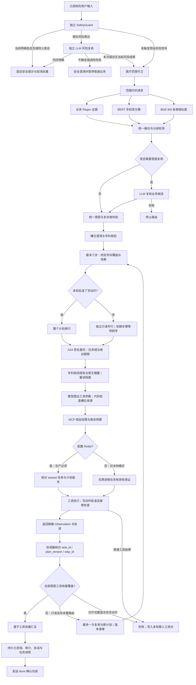

# 三路融合与 Sigmoid 多意图路由（2026-10-10）

当前采用独立安全入口与普通意图三路融合：入口完成身份及患者授权后，SafetyGuard 先检查急症关键词与疑似风险表达，必要时独立调用 LLM 风险复核；仅在本次描述未发现支持当下风险的信号时，继续医疗范围守卫、Regex/BERT + Sigmoid/BGE-M3 业务意图融合。关键槽位、规划及工具权限仍分别校验。



API 在普通链路开始前选择任务模式、设置 task_id / plan_version 和绝对 deadline_at；A2A 与 MCP 新调用按剩余预算执行。生产签名委托必须包含会话、任务、版本、步骤和期限，缺任一项拒绝；Redis 不可用时不跳过生产任务检查。本地无 Redis 的 TTL 状态不能提供跨进程有效性保证。工具覆盖验收检查有成功且非空的对应工具依据，尚不能证明结论医学正确；最终由院内人员复核。

## 独立安全入口：职责、字段与限制

本次采用两种方案的结合：安全判断独立且优先，普通意图保留三路互补证据。已有工程回归没有提供相同条件下移除业务 Regex 的消融结果，因此不宣称改成 BERT/BGE 双路会提高效果。安全风险与意图匹配分数分别处理，药品或指南候选不能覆盖安全分支。

`backend/safety.py` 定义受限的 SafetyDecision；`SafetyGuard.assess` 在协调器同步入口与原生 SSE 入口都先执行。原有胸痛、呼吸困难、大量出血、意识模糊、抽搐、晕厥六类词及喘不上气、喘不过气、透不过气、叫不醒、血流不止等强同义表达，在没有显式否定、历史、已缓解或知识查询限定时直接安全响应，不调用意图模型、规划或工具，也不允许 LLM 下调规则命中的策略。显式否定、历史、已缓解、指南/知识查询限定只改变是否需要独立风险复核，不直接放行。每次出现逐一核对上下文；当前明确阳性信号优先于同句否定或历史背景。限定词与同义词仍是有限的工程规则，不能称为已解决全部上下文误报。

胸口发紧/发闷/压住、出血不止、突然倒下及部分危机表达等预设疑似信号进入独立 LLM 风险复核；强同义表达若被否定/历史限定也进入此分支。有历史时先将当前请求和历史用户文本组成 JSON，再对整个输入脱敏；系统提示与用户输入分离；返回值仅允许风险级别、枚举信号及原文证据。证据必须逐字来自输入，不能让模型选择路由策略或给出药物/诊断。复核等待最多 8 秒且不超过配置的模型超时；调用失败、超时、无效结构或不实证据返回 uncertain 并暂停普通查询，不把失败当作低风险。用户断开导致的取消继续向上传播。

独立结果保存在 `safety` 字段中，与业务 `intent/intents` 分开：

| 字段 | 取值与策略 |
|---|---|
| risk_level | high：进入固定安全提示；uncertain：请现场医务人员核对，暂停业务；no_signal：本次描述未发现预设或复核支持的当前风险信号 |
| risk_signals | 受限信号代码列表，例如 chest_distress、breathing_distress；不记录原始医疗证据正文 |
| route_policy | 由代码按风险级别产生 urgent_safety、safety_clarification 或 normal，模型不能自由填写 |
| source | rule、llm 或 failsafe |

同步结果及 SSE 元信息携带这些字段，业务入口审计只保留信号代码与策略。安全澄清不生成普通咨询结果，仍可保存会话及审计；所有分支沿用持久化完成后确认 done 的顺序。急症响应提供固定提示和卡片，不等于程序已通知责任医生或调用医院急救系统。

no_signal 不是患者低风险结论；规则未触发也不等于完成全面临床风险筛查。语义复核在当前预设疑似信号、上下文限定或最近用户轮的风险背景触发时执行；没有这些信号的普通查询不增加风险模型调用。安全入口取最近两轮用户文本，每轮最多 2,000 字符，先与当前请求组成明确区分的 JSON 上下文，再整体脱敏，助手答复不作为患者证据。前轮风险未明确解除而当前转查药品时要先核对风险，不自动把前轮症状当成当前急症；上下文 JSON 的字段名不能充当原文证据。这是有界上下文补充，不能替代完整病历或持久化风险状态管理。本次新增 43 项工程回归，覆盖两种入口、混合请求优先级、疑似表达、复核失败/超时、结构与证据校验、取消和脱敏；这些测试使用测试桩，不构成临床敏感度或特异度验证；与当前或最近背景均不匹配的危险表达仍可能漏入普通路由，需用独立标注集单独记录预筛触发覆盖、临床风险漏报/误报、意图集合匹配、LLM 调用比例及入口延迟。不能将选择性复核描述成全面语义风险筛查。临床团队仍需用独立标注样本审核词表、语义触发范围、误报/漏报及模型版本。

该设计是本项目工程判断；WHO 的医疗生成式 AI 指引强调模型可能给出不准确或不完整信息，需明确用途与开展安全评估，不提供本项目架构的效果背书。[WHO 指引说明](https://www.who.int/news/item/18-01-2024-who-releases-ai-ethics-and-governance-guidance-for-large-multi-modal-models)。

## 职责和接受条件

- Regex 输出已命中的任务和匹配依据。未命中是无证据，不能当作对其他通道的否定；规则不再提前返回。
- BERT 是主要分类器。十个标签各自使用 Sigmoid，各标签依据自己的验证阈值选择；不依赖“同时、另外”才能输出多个标签。
- BGE-M3 匹配版本化意图原型，返回全部十类相似度，按每类阈值筛选补充候选。原型分数是语义相似度，不能直接与 BERT 分数比较或相加。
- BERT 的多个意图与规则/向量的子集兼容，不要求三个结果完全相同。规则或向量提出 BERT 未接受的候选时，保留候选并触发复核。
- BERT 分数距离本类阈值不超过 `INTENT_BERT_UNCERTAINTY_MARGIN`（默认 0.08）、有否定或限制表达、有多任务线索但 BERT 只接受不足两项、没有候选、任何模型通道不可用或分数非法时，进入 LLM。
- LLM 输出必须是已注册的非空意图集合。后端统一去重、排序并重新计算复杂度；复核失败不回退到可能矛盾的规则结果。

例：BERT 识别“症状评估 + 药品信息查询”、Regex 只识别药品、向量只识别症状，属于互补；“不需要药品说明书，只评估症状”中的药品命中则需要核对否定范围。

## 训练、配置与评测

训练不是把旧 Softmax 改成 Sigmoid：需要多热浮点标签、`problem_type=multi_label_classification` 和 `BCEWithLogitsLoss`，损失接收 logits，推理才调用 Sigmoid。运行时明确拒绝旧单标签权重。

旧 3,800 条数据保留作为历史。`scripts/build_multilabel_intent_dataset.py` 新生成独立版本：训练 3,100（含 1,000 多意图）、验证 640（含 200 多意图）、测试 1,340（含 300 多意图）。各集合有不同模板前缀并检查归一化文本精确重复；合成模板仍可能高度相似，不能视为真实泛化证明。旧 400 条挑战集不参与训练。

```powershell
python scripts/build_multilabel_intent_dataset.py
python scripts/train_intent_bert.py --base-model "本机 bert-base-chinese 目录" --output models/medical_intent_bert_multilabel_v4
python scripts/evaluate_intent_bert.py --model models/medical_intent_bert_multilabel_v4 --dataset evaluation/datasets/multilabel_v4/intent_test.jsonl --output artifacts/bert_multilabel_test.json
python scripts/evaluate_intent.py --output artifacts/intent_fusion_eval.json
```

训练按验证集 Micro-F1 保存最佳 epoch，再用该权重按标签在验证集选择 F1 最优阈值，同分优先靠近 0.5。阈值选择不等于概率校准。保存于模型目录 `intent_thresholds.json`；显式 `INTENT_BERT_THRESHOLDS` JSON 配置可覆盖。未提供模型阈值时使用默认 0.5；不能沿用旧 Softmax 的 0.95。

[2026-10-12 阈值复测](bert-threshold-evaluation-2026-10-12.md)重新推理验证、测试和挑战共 2,380 条样本，在验证集搜索 101 个网格值与全部分数断点，并比较逐类阈值。0.20–0.69 的网格值并列满分，逐类调整没有提升，因此项目继续使用已生效的十类 0.5；这不代表真实请求上的唯一最优阈值。

BGE 默认阈值 0.78 作为待验证的配置起点，可通过 `INTENT_VECTOR_THRESHOLDS` 逐类覆盖；旧残余挑战集的校准不能证明三路融合的最优设置。`INTENT_VECTOR_MARGIN` 保留配置兼容，但不再参与路由。

训练输入上限由 128 增为 256 词元；在线分词超出 256 时不采用截断的 BERT 结果，而是交给完整文本复核。评测同时报告完整意图集合匹配、Micro-P/R/F1、单/多意图子集、漏标签及错误增加标签，完整融合还报告 LLM 复核比例、复核原因及延迟。历史单标签 98.8% 覆盖率、33 条级联回归成绩不代表新方案效果。

## Git 与本地产物

提交源码、测试、合成数据及无患者信息的评测摘要；`models/`、权重、`.env`、简历 HTML/PDF、浏览器与 PDF 排版中间产物放在 `artifacts/`、`output/`、`tmp/`，由 `.gitignore` 排除。使用 `git check-ignore` 验证命中规则，同时确认新模块和新合成数据未误忽略。Git 忽略不会自动取消已跟踪文件；本次不移除用户已有提交、不自动推送。

## 本次实测（2026-10-10）

- 完整自动化回归：首轮 203 项、修复后 221 项通过。首轮 Git 预检曾因新文件未入索引失败，该句原先称已通过不准确；修复后预检结果单独记录如下。单元测试使用隔离的模型结果或测试桩，不能替代真实云端与医院服务验收。
- 新多标签 BERT：完成 8 轮本地训练，按验证集 Micro-F1 保存最佳权重；验证集逐类阈值选择结果均为 0.5。
- [1,340 条独立合成测试](../evaluation/bert_multilabel_test_summary.json)：完整集合匹配率 100%，Micro-F1 1.0000；其中 300 条多意图匹配率 100%。
- [旧 400 条未训练挑战](../evaluation/bert_multilabel_challenge_summary.json)：总体集合匹配率 87%，Micro-F1 0.9461；250 条多意图集合匹配率 97.2%；100 条否定/模糊单意图集合匹配率仅 60%；50 条域外样本空集合拒识率 90%。这些分母必须分开，不能只展示容易样本的满分。
- [33 条完整意图路由复测](../evaluation/intent_fusion_summary.json)：28 条本地融合、5 条真实 LLM 复核，供应商均返回 HTTP 200；33/33 的完整意图集合与复杂度匹配，Micro-F1 为 1.0000，错误为 0，复核比例 15.15%。本次平均延迟 0.967 秒、P95 2.380 秒、最大 13.667 秒（包含首次加载模型）；单次运行不能外推为生产延迟承诺。
- [5 条复核请求的连续验证](../evaluation/intent_review_repeat_summary.json)：同一组请求各执行 3 轮，15/15 意图集合与复杂度匹配，全部来自真实 LLM，错误为 0；这是重复稳定性检查，不是额外 15 条独立样本。
- [最初 HTTP 402 记录](../evaluation/intent_fusion_402_historical_summary.json)保留：28/33 成功、5 条供应商阻断，集合匹配率 84.85%、Micro-F1 0.8615。后续供应商恢复后，一次复测为 32/33、修复前连续复核为 13/15；诊断确认 LLM 偶尔将 `normalized_terms` 返回为字符串映射。现在提示词明确字段类型，代码仅将合法字符串映射的值转换为去空白、去重数组；未知意图和非法辅助字段仍拒绝，新增 8 项回归保护。
- 上述实测范围是意图路由，未执行真实医院工具写入，也不能声称完整 A2A/MCP 业务链或临床有效性已全部验收。
- 简历 HTML/PDF 同步采用新架构与新模型实测，旧文件备份保留在已忽略的本地产物目录。两页 PDF 已渲染逐页检查。

旧 v3 权重与[历史指纹](../evaluation/model_artifacts_v3_historical.json)保留；[当前指纹](../evaluation/model_artifacts.json)记录 v4 与逐类阈值，运行时本地环境已指向新的模型目录。需要复核的真实请求仍依赖可用的 LLM 服务；后续实际调用已返回 HTTP 200，本次未进行充值或更换账户。

## 2026-10-10 核查修复与部署要求

向量余弦分数允许 1e-6 范围内的浮点舍入误差，并夹回 [-1, 1]；超范围、非有限或非数值分数仍触发复核。BERT 概率继续严格限制为 [0, 1]。融合函数验证全部标签的阈值及不确定性边界，避免缺键导致 KeyError。

模型启动加载与配置脚本都检查十类原型覆盖；配置脚本同时验证已保存的逐类阈值。内部训练拆分按所有标签覆盖选择验证样本并保留训练样本，共现约束不满足时要求独立验证集；默认独立验证文件路径不变。LLM 的 normalized_terms 兼容字符串数组或字符串值映射，嵌套对象仍明确拒绝。

本地部署需同时准备 v4 多标签 BERT、BGE-M3、十类原型及可用的 LLM 服务。空模型路径不会形成规则单独接受路径；复核失败抛出 IntentReviewError，不能继续将冲突候选交给专科。

新评测摘要补充原报告路径、SHA-256 和摘要转换范围；原始报告仍保存在被忽略的 artifacts 下。BERT 摘要去除了逐条 cases、统一相对路径并补记模型指纹及整理日期，未改写实测分数。重复复核原报告没有生成时间，摘要不再借用 33 条报告时间。初次 HTTP 402 摘要的复核原因来自随后本地诊断，其字段来源单独标注，不冒充当次云端输出。

OOD 子集真值为空集合时，exact_match 表示空集合拒识率；Micro-P/R/F1 只统计正标签，零分母按 0.0 记录。因此挑战 OOD 的 Micro-F1 0.0 与拒识率 90% 并不矛盾。

交付预检现要求所有新增关键源码、数据和摘要纳入 Git 索引，Markdown 本地链接目标也必须在索引中，并验证声明 LF 的工作区文件没有 CR。新增文件只纳入索引，未创建提交或推送；已有改动保留。换行修复保留原字节备份并校验正文一致，模型权重和历史指标不改写。当前仓库 15 份 Markdown、桌面 16 份；桌面主文档与调度题库同步后重新核对 9 个收据目标，历史收据继续保留。

历史快照（融合修复后、独立安全入口引入前）：221 项完整回归通过；当时完整上传前检查 15 项全部通过（含 pytest 与 pip check）；按本机配置的实际模型目录核对 15 个模型文件指纹全部匹配。该段不是当前预检项目数。未重新训练模型或重复调用云端评测，已有路由与 BERT 指标仍为当日早前记录。

补充数据指纹核验：v4 生成清单保留 CRLF 生成字节的 sha256，增加 repository_sha256 记录仅规范换行的 LF 字节；新 BERT 摘要同样补充 repository_dataset_sha256。三份数据的备份均匹配原指纹，去除 CR 后逐字节等于仓库文件。数据生成脚本以后显式输出 LF；原模型的验证集指纹不修改。

2026-10-10 独立安全入口补充：此前 221 项为引入 SafetyGuard 前的完整回归快照；新增 43 项后当时完整回归为 264 项通过。此前 33 条意图路由与 15 次复核记录仅评价 IntentClassifier，不包含新安全入口，未重新调用云端评测或据此宣称端到端安全效果。桌面同步及新收据位于 `artifacts/safety_routing_20261010/`，此前收据作为历史保留。


## 2026-10-10 部署与指纹复核修复

Kubernetes 清单原先仍指向运行时拒绝的旧 v3 权重，现改为 `/models/medical_intent_bert_multilabel_v4`，默认阈值为 0.5；PVC 准备说明同步更新。上传预检增加独立的清单配置门，在 quick 与完整模式均执行，避免本机 .env 正确掩盖交付清单错误。它只证明清单一致性；目标 PVC、实际模型加载和医院集成仍需部署环境验收。

训练脚本现统一输出 validation_sha256（输入原字节）、repository_validation_sha256（仅 CRLF 转 LF）和 validation_rows_sha256（默认 json.dumps(rows, ensure_ascii=False) 的 UTF-8 字节，保留样本、标签及行顺序）。外部验证文件与内部拆分均输出相同字段。现有模型保留原阈值、文件及 SHA-256；当前模型清单增加 validation_data，模型指纹校验脚本同时核对仓库 LF、可还原的原始 CRLF 和实际训练输入行，补齐验证集来源链。本次没有重新训练或改变历史评测数值。

急症 trace 改为 event=urgent_safety_prompt、status=issued，表示固定安全提示已发出，不是 MCP 工具执行记录；工作台展示名称同步调整。向量校准使用全量独立校准集，移除无关的 bert_threshold 字段，分别输出 Top-1 是否在目标集合内、单标签集合完全匹配率及接受覆盖率。多意图与 OOD 不会与单个预测标签完全相等；这项校准不代表完整多标签融合效果。

本轮新增 11 项部署、指纹与校准回归；安全入口原有 43 项仍全部通过。上一轮部署与指纹复核快照为 275 项测试、16 项完整预检通过；264 为本轮修复前快照。简历当前 HTML/PDF 与桌面主文档同步，旧版及收据作为历史保留。新备份与验证证据保存在被忽略的 artifacts/deployment_review_20261010/。


## 2026-10-10 依赖与重新训练交付补充

PyYAML 是仓库 Kubernetes 清单门的开发依赖，已从 requirements.txt 移到 requirements-dev.txt，pyproject 的 dev 分组保持一致；constraints.txt 固定为本机本轮验证的 6.0.3。开发、预检和 CI 均安装 requirements-dev.txt，Docker 继续安装 requirements.txt。新增依赖约束门覆盖运行与开发的全部直接声明，防止新增依赖漏入固定清单。

重新训练后的权重和 intent_thresholds.json 指纹应产生新版本；新训练脚本添加来源字段及 LF 输出，JSON 字节不同是预期现象。不得覆盖当前模型清单或用旧历史分数描述新权重。默认独立验证文件训练完成后，按 README 的 --record-output 命令创建新清单，再使用 --manifest 指向它核对，并生成新评测报告。生成工具校验实际验证输入行与阈值来源指纹，支持原验证数据 LF 或 CRLF；模板文件只提供模型文件清单，全部大小和 SHA-256 重新计算。输出文件采用排他创建，已有清单不会被覆盖。本轮仅验证记录/校验流程，未重新训练模型。

新增文件暂存一致性门在 quick 和完整预检中均执行；检测 AM 这类新增文件的暂存内容落后，提示重新 git add。本轮已更新 docs/intent-fusion.md、tests/test_safety.py 的暂存内容，并纳入新开发依赖文件，用户其他已有未暂存改动保留。该门不声称整个暂存快照通过了 pytest；现有完整测试检查工作区。

上一轮新增 5 项模型清单与交付门回归，当时为 280 项测试、18 项完整预检通过；此前 275 项和 16 项为上一轮快照。桌面主文档与当前简历 HTML/PDF 已同步，历史收据与旧版备份保留。证据位于 artifacts/dependency_review_20261010/。


## 2026-10-10 开发环境入口补强

README 安装主流程、本地启动和 GitHub 上传前检查均显式安装 requirements-dev.txt，并说明 quick 提交钩子同样依赖 PyYAML；Docker 运行依赖入口不变。缺少 yaml 模块时，预检直接报告缺少开发依赖并提供同一解释器环境的安装命令，避免将此环境问题误报为 Kubernetes 清单校验失败。

固定依赖门只核对直接声明是否都有精确版本条目，未校验固定版本与声明范围的兼容性；安装时的 pip 解析与随后 pip check 分别负责安装约束和已安装包的依赖一致性。代码通过输出限定语说明该边界，不冒充完整依赖求解器。

临时目录与历史核查产物的管理统一见[测试临时数据与历史核查产物](#测试临时数据与历史核查产物)。

新增 1 项缺少 PyYAML 时的提示回归，当时完整回归 281 项、完整预检 18 项通过。桌面项目文档及当前简历 HTML/PDF 同步，备份与收据保存在 artifacts/dev_setup_review_20261010/。

## 2026-10-10 运行与开发依赖分类统一

2026-10-10 运行与开发依赖分类统一：pytest、pytest-asyncio、locust 与 PyYAML 均位于 requirements-dev.txt 和 pyproject.toml 的 dev 分组，运行依赖声明保持一致；生产 Docker 只安装 requirements.txt。开发、CI、预检及压测使用 requirements-dev.txt，并保留 constraints.txt 中的精确版本约束。本次分类调整快照为 281 项、完整预检 18 项；此前融合阶段的 15 项预检已明确标记为历史快照。

## 2026-10-10 依赖分类防回归

此前依赖分类检查仅在被忽略的本机证据脚本中执行，提交预检只检查精确固定条目，无法阻断开发工具被重新加入运行依赖。现已将独立分类门接入 quick 和完整预检；提交钩子运行 quick，CI 运行完整预检，克隆者可直接执行同一检查。

该门分别比较 requirements.txt 与 pyproject core、requirements-dev.txt 的直接开发声明与 pyproject dev，核对开发入口通过 -r 恰好一次包含仓库根目录的 requirements.txt（包括 ./requirements.txt 等价写法），并拒绝重复声明、运行/开发重复分类及 pytest、pytest-asyncio、locust、PyYAML 混入运行依赖。使用标准库解析当前仓库的包名、extras 和版本约束；不支持的 pip 指令、URL 或环境标记会报错，避免静默漏检。它不是依赖求解器，也不替代 pip 安装解析或 pip check。

新增 10 项工程回归（正常配置、7 种错误配置、quick/完整入口阻断），当时完整回归 291 项、完整预检 19 项通过；quick 为 17 项。此前 281/18 为历史快照。桌面项目文档与简历 HTML/PDF 同步，历史收据和旧产物保留，该轮收据位于 artifacts/dependency_gate_review_20261010/latest_desktop_receipt.json。

## 2026-10-10 依赖安装入口复核

当前 quick、提交钩子与完整预检均执行两个独立检查：依赖分类门核对清单与 pyproject 分组；安装入口门核对生产 Dockerfile 与验证 CI 的直接 pip install 命令。生产入口须使用 requirements.txt，验证 CI 须使用 requirements-dev.txt，两者都须带 constraints.txt；追加开发清单、直接包、遗漏约束或移除可检查入口均会失败。可识别 pip/pip3 与 python -m pip、换行/分号/&& 分隔和相对清单路径；脚本、变量或外部 action 中的间接安装不属于该静态检查范围，变更安装方式时须同步调整检查。

开发工具政策集中在 scripts/preflight_git.py 的 DEV_ONLY_TOOLS，目前明确管理 pytest、pytest-asyncio、locust、PyYAML。它不是自动判断任意包用途的分类器；新增开发工具必须扩展名单，并加入两套 dev 声明及约束。未知包若被同时错误放入两套运行声明，不能单靠一致性证明用途正确。开发清单的 -r 引用按实际路径核对，允许 -r ./requirements.txt，仍拒绝重复包含、错误文件或不支持的 pip 指令。版本兼容仍由安装解析验证，pip check 检查已安装包的依赖一致性。

**安装写法约定。** 此预检采用仓库约定的受限语法，不是 pip 或 Docker 的通用语法合法性检查。pip/Docker 可以接受的某些写法仍会被预检拒绝；拒绝表示需要使用下述约定或先扩展检查，不表示该写法本身非法。

**requirements 文件中的语法：** requirements.txt 直接列出运行依赖，requirements-dev.txt 仅通过一次 `-r requirements.txt` 或 `-r ./requirements.txt` 包含运行清单，`-r` 后必须有空白；清单内不接受粘连的 `-r./requirements.txt` 或长选项 `--requirement requirements.txt`。其余为直接开发依赖；允许空行和独立的整行 `#` 注释。声明支持包名、extras 和版本范围，不支持依赖行尾注释、递归拆分运行清单、URL、环境标记、`-e` 或 wheel 路径。

**Docker/CI shell 命令中的语法：** 生产 Docker 使用 shell 式 RUN，验证 CI 使用明确的 shell run。可识别的安装程序为 `pip`、`pip3`、`python -m pip`、`python3 -m pip` 与 `python3.11 -m pip` 等带版本的 Python 模块调用；不接受没有版本分隔点的 `python311 -m pip`。每条可检查安装命令须包含一份指定清单和一份 constraints.txt。仅在这些命令参数中，`-r X`、`-rX`（本轮测试示例为 `-r./requirements.txt`）、`--requirement X`、`--requirement=X` 及对应的 constraint 写法、`./` 相对路径均可使用，这不表示 requirements-dev.txt 内也支持这些变体。当前附加 pip 选项仅允许 `--no-cache-dir`、`--upgrade`、`--quiet`/`-q`、`--disable-pip-version-check`；其他安装选项也须先扩展检查。

| pip/Docker 可用但当前预检拒绝的写法 | 本仓库的替代方式 |
| --- | --- |
| `fastapi>=0.141 # 说明` | 将说明移到单独的整行注释 |
| requirements.txt 中 `-r requirements-runtime.txt` | 将运行依赖直接列在 requirements.txt，避免递归清单 |
| Docker JSON/exec 式 `RUN ["pip", "install", ...]` | 使用 shell 式 `RUN python -m pip install -r requirements.txt -c constraints.txt` |
| `pip3.11 install ...` | 使用 `python3.11 -m pip install ...` |
| `-e .` 或直接安装本地 wheel | 先扩展声明与安装入口检查并补充反向回归，再变更安装流程 |

变更清单结构、安装语法或构建方式时，须同步更新预检、支持与拒绝分支的回归及本节说明，不能将严格拒绝误写成对全部 pip/Docker 合法语法的支持。本次限制复现记录位于 artifacts/install_policy_docs_20261010/policy_probe.json；未安装包、构建镜像或改变当前安装入口，该说明补充轮次的工程回归快照仍为 306 项。

新增 15 项回归覆盖安装入口变更、等价路径及两种预检入口阻断，当时完整回归 306 项、完整预检 20 项通过；quick 为 18 项。此前 291/19、281/18 均为历史快照。仓库和桌面其他说明引用本节维护检查范围，避免多处重复整段说明。临时数据管理见[测试临时数据与历史核查产物](#测试临时数据与历史核查产物)。本轮证据、备份和桌面/简历统一收据位于 artifacts/install_entry_review_20261010/。

**当前支持语法回归。** 安装入口门的允许分支已纳入仓库测试，覆盖粘连短选项、长选项的空格/等号形式、pip3、python3.11 -m pip，以及全部受支持附加 pip 选项。每例先断言原安装命令的注入锚点唯一，再断言替换后文本确实变化、目标被测命令恰好出现一次，最后断言预检无错误并产生通过记录。Docker/CI 的源安装行变更而测试未同步时，会在注入阶段明确失败。requirements-dev.txt 内粘连 -r 与长选项的拒绝回归，与空格 -r/相对路径的允许回归共同区分两种解析范围。

### 历史修复与证据

下列目录各自记录对应轮次，不将早期新增用例与后续断言修复混写成同一次修改：

| 轮次 | 实际改动 | 证据目录 |
| --- | --- | --- |
| 允许语法回归补强 | 新增 8 项允许分支及 2 项清单语法限制测试，项目测试总数由 306 增至 316 | artifacts/allowed_spellings_review_20261010/ |
| 注入断言修复 | 加强现有 8 项测试的注入前后断言，项目测试总数保持 316 | artifacts/test_injection_review_20261010/ |
| 核查证据修订 | 使用合法重复 RUN/CI step 和真实临时文件验证注入保护，未修改项目测试或安装入口 | artifacts/anchor_evidence_review_20261010/ |
| 证据工具回归补强 | 新增 19 项仓库回归，恢复同步源文件及正文比对，项目测试总数由 316 增至 335 | artifacts/evidence_regression_review_20261010/ |
| 拒绝分支回归补齐（2026-10-10） | 新增 15 项带具体错误信息断言的拒绝回归，工具回归共 34 项，项目测试总数由 335 增至 350 | artifacts/evidence_validation_review_20261010/ |
| 记录器自动回归补齐（2026-10-11） | 新增 13 项记录器回归，并要求脚本与测试文件纳入 Git；项目测试总数由 350 增至 363 | artifacts/evidence_validation_review_20261010/post_commit_review/ |

**核查脚本范围。** 新核查脚本直接提取当前测试函数，在隔离目录中写入真实 Dockerfile/CI 文件，并将测试根目录指向该隔离目录；不替换全局 Path.read_text。重复场景分别追加合法 RUN 行或 CI step。所有 6 个场景先确认配置可被安装入口门接受，再核对正常配置通过、锚点缺失/重复在注入阶段失败。新结果替代旧脚本对重复 RUN 场景的证明；旧脚本及报告仅保留为历史记录。被忽略的本机核查脚本不计入交付的 pytest 用例。

**工程验证记录与证据来源。** 最近一次完整验证的通过数量统一见 [README 验证记录](../README.md#验证)。2026-10-10 拒绝分支回归阶段新增 15 项测试，工具回归合计 34 项；该阶段执行了完整预检及工程测试，结果保存于 artifacts/evidence_validation_review_20261010/。后续文档修订保留这些报告，不将读取既有记录描述成重新生成或重新运行全部测试。

2026-10-11 文档修订检查分为初次检查和最终检查。初次检查后仍补充了说明文字，因此初次结果不能代表最终文档版本。当时的最终检查在 README.md 与本文件的说明全部修改完成后执行；快速预检日志与链接报告的运行标识、UTC、HEAD、命令及 SHA-256 均由未保存到仓库的本机临时包装代码追加，直接执行 preflight_git.py 不会自动产生这些字段。旧记录保留其实际来源，不作为仓库原生记录功能的证明。旧链接报告的 input_sha256 包含 31 份文档及 1 份本机检查器源码，共 32 项；源码哈希不计入文档数。当时两种检查均核对运行前后输入是否保持一致，结果对应这些哈希标识的工作区文件，而非仅凭文件名或修改时间判断。该次文档修订未重新执行完整 pytest；其测试数量来自下表保留的历史完整预检日志。这些本机元数据用于追溯运行及输入，不构成防篡改证明。各文件的生成或核对阶段分别列明：

| 验证内容 | 生成或核对阶段 | 保存文件 |
| --- | --- | --- |
| 完整预检、pytest 与 pip check | 2026-10-10 拒绝分支回归阶段，保留原始执行日志 | artifacts/evidence_validation_review_20261010/preflight.log |
| 快速预检 | 同一回归阶段，保留原始执行日志 | artifacts/evidence_validation_review_20261010/quick.log |
| Docker/CI 注入锚点的 6 个隔离场景 | 同一回归阶段生成，后续保留 | artifacts/evidence_validation_review_20261010/anchor_drift.json |
| 仓库与桌面文档本地链接检查 | 同一回归阶段生成，后续保留 | artifacts/evidence_validation_review_20261010/document_links.json |
| 同步投影及目标字节、主文档正文比对输入 | 同一回归阶段的同步快照，后续保留 | artifacts/evidence_validation_review_20261010/desktop_manifest.json |
| 桌面文档及简历目标的同步哈希 | 同一回归阶段合并收据，后续保留 | artifacts/evidence_validation_review_20261010/latest_desktop_receipt.json |
| 改写前提交 d97d3a5 时的核对快照 | 读取既有报告并检查当时目标；没有重新执行全量测试；旧 SHA 的改写对应关系见下文 | artifacts/evidence_validation_review_20261010/evidence_summary_after_commit_d97d3a5.json |
| 证据工具单独回归 | 2026-10-10 拒绝分支回归阶段的 34 项工具测试日志，保留作历史记录 | artifacts/evidence_validation_review_20261010/focused.log |
| 后续提交文档修订快速预检 | 2026-10-10 后续文档修订检查，保留原始日志；不作为 2026-10-11 最终版本证据 | artifacts/evidence_validation_review_20261010/post_commit_review/quick.log |
| 后续提交文档本地链接检查 | 后续核查保留的报告，缺少运行元数据；不作为最终版本证据 | artifacts/evidence_validation_review_20261010/post_commit_review/document_links.json |
| 文档修订初次快速预检 | 2026-10-11 初次检查，早于后续收尾文字修订；未记录运行元数据，不作为最终版本证据 | artifacts/evidence_validation_review_20261010/post_commit_review/quick_20261011.log |
| 文档修订初次仓库与桌面链接检查 | 2026-10-11 初次检查，早于后续收尾文字修订；未记录运行元数据，不作为最终版本证据 | artifacts/evidence_validation_review_20261010/post_commit_review/document_links_20261011.json |
| 既有报告及桌面目标核对 | 2026-10-11 初次读取既有结果并检查目标，单独保存 | artifacts/evidence_validation_review_20261010/post_commit_review/target_verification_20261011.json |
| 前次文档修订最终快速预检 | 2026-10-11 前次说明修订后执行，本机未版本化包装代码追加元数据，保留历史记录 | artifacts/evidence_validation_review_20261010/post_commit_review/quick_final_20261011.log |
| 前次文档修订最终仓库与桌面链接检查 | 2026-10-11 前次说明修订后执行，同一本机包装方式；31 份文档及检查器源码共 32 个哈希 | artifacts/evidence_validation_review_20261010/post_commit_review/document_links_final_20261011.json |
| 仓库记录器快速预检 | 2026-10-11 使用 scripts/record_document_checks.py，保存可复现入口及输入哈希 | artifacts/evidence_validation_review_20261010/post_commit_review/quick_recorder_20261011.log |
| 仓库记录器仓库与桌面链接检查 | 2026-10-11 使用同一仓库脚本，文档哈希与检查器源码哈希分别记录 | artifacts/evidence_validation_review_20261010/post_commit_review/document_links_recorder_20261011.json |

**可复现的记录入口。** 仓库提供 [record_document_checks.py](../scripts/record_document_checks.py)，使用标准库执行快速预检、本地文档链接检查、代码回归或 desktop-snapshot(桌面字节采集)，并保存元数据。快速模式实际调用 preflight_git.py --quick；links(链接检查) 模式默认检查仓库 Markdown(轻量文档标记格式)，显式指定 --desktop(桌面目录) 会追加话术、理解指南、工程对照三份主文档及项目子目录。链接模式的 input_sha256(输入哈希清单) 只包含被检文档，检查器源码另存 checker_source_sha256(检查器代码哈希)；快速模式的输入哈希对应仓库候选工作区文件。脚本记录运行前后 HEAD(当前提交指针) 及输入哈希；输入变化、检查失败或输出文件已存在时返回非零，不覆盖旧证据。输出必须是被忽略的 artifacts/ 内的新文件；父目录需先创建。元数据属于工作区运行快照，不证明检查时工作区等于当前提交，也不改变预检、提交钩子及 CI(持续集成) 的默认输出。

```powershell
# 首次运行使用新文件名；再次执行时改用其他名称。
python scripts/record_document_checks.py --kind quick --output artifacts/evidence_validation_review_20261010/post_commit_review/quick_recorder_20261011.log
python scripts/record_document_checks.py --kind links --desktop "$env:USERPROFILE/Desktop" --output artifacts/evidence_validation_review_20261010/post_commit_review/document_links_recorder_20261011.json
```

初次记录器修订未执行完整 pytest；该阶段的快速预检和链接报告只证明各自记录的检查范围。2026-10-11 后续补齐自动回归后重新执行完整预检，最近一次完整验证的数量和日期见 README；原始日志按阶段保留。

**记录器自动回归。** [tests/test_record_document_checks.py](../tests/test_record_document_checks.py) 最初包含 13 项测试，2026-10-11 补充 7 项桌面采集回归后当时共 20 项；后续又补充代码回归记录及默认桌面范围检查，当前数量由测试收集确定。使用临时 Git 仓库及真实子进程，覆盖成功元数据、子进程非零退出、文档/候选集合/检查器源码/HEAD 在执行中变化、已有输出/仓库外输出/未忽略输出/缺失父目录、断链与锚点错误、文档及检查器哈希分开计数、桌面文档范围和必需交付路径。preflight_git.py 的必需路径清单包含记录器及测试文件，防止漏交付；桌面采集测试覆盖当前目标读取、保留既有桌面内容、基线重复/范围错误/文件缺失、采集期间变化、已有目录保护及 CLI(命令行接口) 必需输入。完整预检和 CI(持续集成) 的 pytest(测试框架) 自动收集这些测试，quick(快速检查) 不执行测试。

前次报告中的 6 个隔离检查是记录器的手工验证（成功、旧输出保护、子进程失败、输入变化、断链、未忽略输出拒绝）；这些检查当时没有纳入 pytest。它们与历史 anchor_drift.json 的 6 个 Docker/CI 安装锚点场景分别记录，不将后者计为记录器回归。

2026-10-11 记录器自动回归补齐阶段的证据目录为 artifacts/evidence_validation_review_20261010/post_commit_review/recorder_regression_20261011/。该目录中文件的用途如下，路径均相对于此目录；回归阶段的运行记录对应当时工作区，不将后续文档说明修订称为重跑完整测试：

| 文件或目录 | 来源与用途 |
| --- | --- |
| preflight.log | 最终测试版本的完整预检日志，363 项 pytest 及 pip check 通过 |
| preflight_initial.log | 较早一次完整预检日志，同为 363 项通过；之后加强了交付路径测试的行为断言，再执行 preflight.log，不以旧日志替代最终测试版本的验证 |
| quick.log | 自动回归补齐阶段的快速预检快照，由仓库记录器保存当时输入哈希 |
| document_links.json | 同一阶段仓库与桌面链接报告，31 份文档、0 个本地断链；元数据对应当时文档版本 |
| quick_inventory_20261011.log | 本次补齐目录说明后执行的快速预检，附运行元数据及最终输入哈希 |
| document_links_inventory_20261011.json | 本次补齐目录说明后执行的链接检查，附运行元数据及最终文档哈希 |
| desktop_receipt.json | 2026-10-11 本次简历 HTML/PDF 两个实际更新目标的同步来源及前后哈希；合并收据中这两项引用此文件 |
| latest_desktop_receipt.json | 合并前述两项更新和未改动目标的既有来源，逐项核对全部 11 个桌面目标 |
| desktop_manifest.json | 两份主文档及简历 HTML/PDF 的 4 项投影源/目标字节与哈希比对输入 |
| anchor_drift.json | 保留 2026-10-10 安装锚点报告的原始字节，未在本阶段重新执行这些场景 |
| evidence_summary.json | 从上述回归阶段日志与报告读取结果并核对目标的快照；不代表重新执行所有检查 |
| desktop_backup/ | 2026-10-11 覆盖桌面简历前备份的 HTML/PDF，保留更新前的 350 项口径；不是 2026-10-10 回归阶段的备份目录 |
| desktop_projected/MedAgent_项目理解指南.md、desktop_projected/MedAgent_AI_多Agent项目话术.md | 从先前投影保留的两份未改动主文档，供当前源/目标及仓库正文核对 |
| desktop_projected/ 中的简历 HTML | 当时更新为 363 项回归的 HTML 同步源，保留历史快照 |
| 目录根部的简历 PDF | 当时从上述 HTML 重新生成的两页简历 PDF 同步源，保留历史快照 |
| render_resume.cjs | 本机 PDF 生成辅助脚本，不属于项目运行代码或 pytest 回归 |
| resume-1.png、resume-2.png | 该回归阶段旧 PDF 的两页渲染图，仅与当时 PDF 哈希关联；不代表后续桌面版本的排版检查，不属于桌面交付目标 |

2026-10-10 回归阶段的原有收据、修改前快照和投影仍保留在上级 artifacts/evidence_validation_review_20261010/ 中；新目录内的备份、投影和渲染图则按上表的 2026-10-11 用途解释。未改动的桌面目标沿用先前同步来源，上述目录的合并收据记录当时逐项核对的字节，目标后来变化时该收据会过期。input_sha256 可能包含尚未跟踪的工作区文件，只有候选集合及相关输入保持一致时才可直接比较跨次结果。补齐目录说明的代码操作仅修改本文，未重跑完整 pytest。该阶段桌面简历也出现了其他编辑产生的字节变化，旧收据未包含这些更新，因此不能据此声明当时全部 11 个当前目标仍匹配。本机证据与辅助文件均受 Git 忽略规则管理，克隆者可运行仓库预检和测试，不能从 Git 获取这些本机报告。

**桌面后续版本核对（2026-10-11）。** 当前简历 HTML/PDF 与记录器回归阶段的投影字节不同，旧收据只匹配 9 个未变化的目标。旧 evidence_summary.json 的 11 项匹配仅是其生成时刻的结果，不作为持续有效的当前结论。本次保留桌面现有内容，未改写或重新生成简历；读取当前字节形成新投影，并重新核对全部桌面目标。新证据目录为 artifacts/evidence_validation_review_20261010/post_commit_review/desktop_refresh_20261011/，文件用途如下：

| 文件或目录 | 本次来源与用途 |
| --- | --- |
| preflight.log | 保留上一自动回归阶段的完整预检原始日志，363 项测试通过；本次未重跑完整测试 |
| anchor_drift.json | 保留原安装锚点报告字节，本次未重跑该历史场景 |
| quick.log、document_links.json | 文档修订完成后由仓库记录器重新运行，关联本次输入哈希与运行时刻 |
| desktop_projected/ | 读取当前桌面两份主文档及现有简历 HTML/PDF 的 4 份字节快照；简历快照使用通用文件名 resume.html、resume.pdf |
| desktop_snapshot.json | 记录读取时刻、目标、快照源及前后哈希；operation 表明仅采集现有字节，不表示本次改写桌面文件 |
| desktop_manifest.json | 新快照与 4 个当前目标的字节/哈希比对输入，并保留前一收据的哈希用于追溯 |
| latest_desktop_receipt.json | 重新读取全部 11 个桌面目标，变化的简历引用此次采集记录，未变化目标保留既有来源 |
| evidence_summary.json | 读取上述历史日志与本次报告，核对当前目标后生成的新汇总；不将历史完整测试称为本次重跑 |

公开文档仅使用通用简历描述；含个人文件名的目标路径保留在被忽略的本机收据中。2026-10-11 已改写 26 个提交，移除真实姓名路径及私人作者/提交者邮箱，并以绑定原远端 SHA 的 force-with-lease 更新 main。全部本地 Git 对象复查未命中这些个人标识；GitHub 缓存、PR 引用和第三方副本未获得删除确认，不将发布分支清理等同于服务器所有旧对象已清除。仓库外备份及恢复核验、旧新 SHA 映射和默认邮箱配置见[历史个人信息清理说明](history-cleanup.md#2026-10-11-姓名与提交邮箱清理)。任何目标后续再次变化，都应重新采集并核对；汇总中的 HEAD、UTC 和哈希只描述该次核对，不构成长期同步保证。

**桌面采集的仓库入口。** 前述 desktop_refresh_20261011/ 中 desktop_snapshot.json、desktop_manifest.json、latest_desktop_receipt.json 由未保存到仓库的本机一次性代码生成，保留为该阶段历史证据；不能据此声称其生成流程已经随 Git 分发。现在 record_document_checks.py 增加 desktop-snapshot 模式：显式读取既有收据的全部目标及清单声明的子集，复制现有目标字节到新目录 snapshots/，再输出上述三个 JSON。目标在采集中变化时返回非零并将验证结果标记为失败，输出目录已存在时拒绝，不改写桌面内容、不覆盖历史目录。基线收据和清单仍是本机输入，复现者需要提供它们；代码和回归测试随仓库交付。

```powershell
python scripts/record_document_checks.py --kind desktop-snapshot --receipt artifacts/evidence_validation_review_20261010/post_commit_review/desktop_refresh_20261011/latest_desktop_receipt.json --manifest artifacts/evidence_validation_review_20261010/post_commit_review/desktop_refresh_20261011/desktop_manifest.json --output artifacts/evidence_validation_review_20261010/post_commit_review/desktop_capture_repro_20261011
```

本次验证目录为 artifacts/evidence_validation_review_20261010/post_commit_review/desktop_capture_repro_20261011/：桌面采集的三个 JSON 和 snapshots/ 由以上仓库入口产生；preflight.log 对应新增 7 项回归后的完整预检，quick.log、document_links.json 为文档定稿后重新运行的检查；anchor_drift.json 保留历史原字节；evidence_summary.json 读取这些输入并核对目标。当前 PDF 的渲染检查记录使用该目录中的 PDF 快照，不引用旧目录的 PNG。任何旧日志/收据均保留其日期和生成方法，不用新目录名暗示旧结果重新生成。

当前 PDF 渲染可按 desktop_manifest.json 中后缀为 .pdf 的 source 定位输入，使用 Poppler 执行 pdftoppm -r 100 -png；生成的 current_pdf-1.png、current_pdf-2.png 和 pdf_render.json 记录该输入哈希、命令和检查时间，当前两页逐页进行视觉检查。本机需要安装 Poppler 才能复现渲染；渲染图不进入 Git，不计入自动化测试。

提交核对历史：evidence_summary.json 中的 e1304e2 对应改写前提交的核对时刻；evidence_summary_after_commit_d97d3a5.json 对应改写前 HEAD 为 d97d3a5 时的核对快照。2026-10-11 隐私历史改写后，旧 SHA 通常无法在当前克隆解析，文件名及 head/head_after 字段仍是原核对时刻的标识，不代表当前可解析提交。脱敏的完整旧新 SHA 对应表随仓库保存在 [git-history-rewrite-map.json](git-history-rewrite-map.json)：e1304e2 对应 7dc37d2，d97d3a5 对应 772ff62；映射只解释身份对应，不证明两个提交的全部历史字节相同。原始报告按各自时间保留，不批量改写它们的 HEAD 或重命名旧文件，否则会改变历史证据。旧原始提交只能在仓库外的私有 bundle 恢复副本中核对，不能把旧历史重新合并或推送到公开仓库。后者读取已记录的测试结果并检查当时桌面目标，不表示重新执行全量测试，也不证明日志来自该提交。下方旧证据目录命令仅用于历史格式；桌面目标变化后应失败，不能作为当前交付命令。当前交付入口见本节后续 2026-10-13 说明。

**证据汇总工具。** 仓库提供 scripts/verify_delivery_evidence.py；它从完整/快速预检日志读取通过数量，校验唯一的 pytest/pip check 成功记录及两种预检的静态检查结果一致，从链接报告与桌面收据读取文件数，并核对桌面目标的当前字节。desktop_manifest.json 为必需输入：每个声明的同步源文件须存在于本轮证据目录内，先比较源/目标字节，再校验清单/收据哈希，正文不同时明确报告字节不一致，避免该分支被前置哈希检查遮住。两份桌面主文档还直接与当前仓库正文比较，仅将文档链接按桌面映射转换；即使改写正文并同步改写收据和投影文件，也不能绕过正文校验。

三种核对范围分别记录：latest_desktop_receipt.json 核对全部 11 个目标的当前哈希；desktop_capture_repro_20261011/desktop_manifest.json 用于核对其中 4 个采集源/目标（两份主文档及简历 HTML/PDF），汇总输出 desktop_manifest_targets_matched；其中两份主文档再与仓库正文逐字节比对，输出 repository_desktop_documents_matched。其余 7 个目标仅做收据哈希核对，不声称全部 11 个目标都完成仓库正文比对。

历史格式的两份仓库正文比对仅对应 PRIMARY_DOCUMENTS(主文档名单) 指定的项目理解指南和项目话术。README.md 及本文件通过仓库 Markdown(轻量文档标记格式) 链接预检，属于另一个检查范围。2026-10-11 当时的文档修订涉及 README.md 与本文件，未改动桌面主文档；当时桌面比对通过表示那时两份主文档一致，不作为后来修订已同步到桌面的证明。桌面继续更新后，历史收据和投影会失效，旧核验应报告失败；不改写它们来掩盖目标变化。

tests/test_delivery_evidence.py 中的回归覆盖动态计数、异常/重复日志、完整/快速静态检查不一致、缺失清单/源文件、仓库或桌面正文变化、缺失/重复主文档映射及输出保护，并补齐清单为空/目标缺失/源路径越界/哈希错误、收据数量/重复目标/哈希错误、锚点结果/配置有效性/场景完整性、链接问题/无效数量、零通过测试及 quick 重复通过记录的拒绝回归。测试只替换本工具的 verification_head 函数，不修改共享的 subprocess 模块。完整预检通过 pytest 执行这些测试，CI 使用同一完整预检入口；quick 只执行静态检查，不运行 pytest。可单独执行 `python -m pytest tests/test_delivery_evidence.py -q`。

该工具采用严格证据格式：pip check 须有完整的 `No broken requirements found.` 成功行，快速预检不得包含 pytest/pip check 行；不接受非成功记录或混用两种模式。汇总数字不写死，但也不是任意日志格式的兼容解析器。核对时间及输出 head 仅表示核对时刻的仓库状态，不证明日志对应同一提交，也不等于重新运行测试。

```powershell
python scripts/verify_delivery_evidence.py --evidence-dir artifacts/evidence_validation_review_20261010/post_commit_review/desktop_capture_repro_20261011
```

上述命令保留为 2026-10-11 的历史格式示例，当前桌面字节更新后不保证成功。2026-10-13 当前 MedAgent(医疗智能体项目) 交付使用以下命令，它只读取现有交付记录并重算核验，不采集备份或修改桌面：

```powershell
python scripts/verify_delivery_evidence.py --delivery-pointer artifacts/medagent_upgrade_20261013/latest_document_delivery.json
```

参数说明：`--delivery-pointer`（当前交付记录入口）、`--evidence-dir`（历史证据目录）、`--output`（新核验报告路径）。当前模式会重算文档哈希、本地链接、原件行号、示例内容、桌面收据及正文映射，并核对话术、指南、工程对照与 README 宣称的回归数量是否符合当前成功的代码回归记录。桌面写入与核验共用仓库脚本的链接转换函数，代码围栏及行内代码保留原样。原件缺失、正文改动、回归记录不匹配或文档虚报数量均返回非零；新增拒绝回归随完整预检和 CI(持续集成) 执行。

2026-10-14 交付复核：2026-10-13 的 23 个同步目标及连续核验成功只说明当时字节。在本轮第一次同步前的快照中，共享简历 HTML/PDF 被其他会话更新，旧收据有这两个哈希漂移；随后本轮文档修订也会使旧收据对应目标发生变化，不能把“两处漂移”当作以后状态。旧命令拒绝通过是正确结果，不能把旧简历覆盖回桌面来掩盖变化。本轮默认文档交付单独核对 21 个项目文档与流程图目标，排除共享简历，旧收据按原时间戳保留。独立 med_rag 正文和共享简历的“未修改”仅指本仓库本轮的操作范围，不承诺其他会话没有更新。

快速和完整预检现在实际执行仓库文档核验；本机默认交付入口存在时，再执行上述当前交付命令。显式指定 `scripts/preflight_git.py --delivery-pointer <入口>` 时，缺失或失效的本机记录会阻止通过。CI 另有直接运行的可移植入口：

```powershell
python scripts/verify_delivery_evidence.py --repository-documents
```

可移植入口核对话术的问答锚点、显示题目、示例内容哈希、适配计数，以及 README 和 docs 目录的本地链接。部署和压测说明的链接另由现有全仓库链接门检查。它不读取本机原件、桌面文件、共享简历或历史回归记录，不宣称完成这些本机验收；克隆缺少私有记录时仍能执行。CI 执行该入口及完整预检，不能把核验器的单元测试通过等同于当前桌面交付通过。

本轮补充 LF/CRLF、反引号/波浪号围栏、缩进围栏和跨行代码片段的字节保留回归。先前普通 CRLF 样本在旧实现也可能通过，因此不再把正则增加 `\r?` 单独当成已复现的修复证据；这次实际补强不同围栏及代码片段边界，只转换正文链接。这些是防御性边界回归；当前同步文档没有对应特殊围栏或跨行代码实例，不能称为已经发生的线上故障修复。验证时点、执行命令和工作区输入哈希见本机 `artifacts/delivery_review_20261014/`；该证据目录受 Git 忽略、不随提交分发，此段不描述源码或文档当前是否已提交、推送。此前源码与文档于 2026-10-14 以提交 `0d6de57` 发布，本机 origin/main 引用的 reflog 记录为 update by push；后续状态以实际 Git 与远端核对为准。

命令默认只打印核验结果，可以重复执行。需要保存时添加 --output 并指定尚不存在的新文件；排他创建避免覆盖历史汇总。工具和测试随 Git(版本控制系统) 分发，本机报告与桌面目标仍是本地输入。交付报告中的 generation_script_sha256(本地生成脚本哈希) 只描述本机生成器，正式核验结果另存仓库核验脚本路径及哈希，不把未跟踪脚本当成可分发的核验依据。

**隐私清理后续核验（2026-10-11）。** 前次将备份查询失败归因于查询者使用沙箱 LOCALAPPDATA 的解释有误。实际是 Codex 应用将逻辑 AppData 路径重定向到了应用容器，宿主 PowerShell 查询原逻辑路径无法找到它。现已复制全部 22 个私有备份文件到仓库外的 `D:/CodexPrivacyBackups/Smart_Healthcare-20261011-114023`，逐文件核对哈希、用 Windows 文件句柄确认实际物理位置，并从该副本重新恢复核验全部 26 个原提交；原容器副本和旧核验报告保留。当前命令及私有迁移报告范围见[历史清理说明](history-cleanup.md#2026-10-11-姓名与提交邮箱清理)。旧报告继续保留原 SHA，不修改其历史字段。新增 7 项 SHA 映射回归后，当时项目总测试由 370 增至 377；映射校验合并在原有交付检查中，当时完整/快速检查为 20/18 项。2026-10-14 接入实际文档核验后，本机具备当前交付记录时完整/快速检查为 21/19 项；具体通过情况以对应运行记录为准，不能将旧数量当作当前结果。映射内容指纹、新 SHA 可达性和必需交付路径随仓库检查，不依赖本机 commit-map；私有 bundle 的实际恢复属于独立本机核验，不计为公开 pytest。

新增映射回归阶段的检查记录保存在 artifacts/history_backup_path_followup_20261011/，按当前目录实物列出全部 15 个顶层条目（14 个文件及 1 个子目录）；snapshots/ 内另有 4 个源文件。它们是该阶段的留档，不因本次备份路径文档修订而声称重新生成：

| 条目 | 来源及用途 |
| --- | --- |
| preflight.log | 新增映射回归后的完整检查，377 项测试及 20 项预检 |
| quick.log | 仓库记录器保存的该阶段最终输入快速检查，18 项预检 |
| document_links.json | 仓库记录器保存的该阶段文档链接检查 |
| desktop_snapshot.json | desktop-snapshot 采集命令、时间、输入哈希及稳定性记录 |
| desktop_manifest.json | 4 个采集源/目标的映射清单 |
| latest_desktop_receipt.json | 全部 11 个桌面目标的哈希收据 |
| snapshots/ | 4 个通用源文件快照，供清单与正文核对 |
| anchor_drift.json | 早期 6 个安装锚点场景的原字节留档，非本次重跑 |
| evidence_summary.json | 对该目录日志、收据、清单和场景结果的汇总核对 |
| current_pdf-1.png | 该阶段 PDF 第一页的渲染图 |
| current_pdf-2.png | 该阶段 PDF 第二页的渲染图 |
| pdf_render.json | PDF 输入哈希、渲染命令、时间及输出图片哈希 |
| clone_quick.log | 完整历史独立克隆的 18 项快速检查日志 |
| clone_verification.json | 独立克隆核验记录，确认不依赖私有 commit-map |
| publication.json | 该阶段提交、实际 Git 增删统计及远端发布核对 |

仓库外备份存储修订阶段（提交 08edaf5）仅修改本页及历史清理说明，不修改应用代码、桌面主文档或简历。私有迁移与恢复报告位于上述 D 盘备份目录。该阶段文档验证记录位于 artifacts/backup_storage_repair_20261011/，以下完整列出其 4 个文件及记录时点；同一目录的文件不必对应同一 HEAD，不能用目录名代替逐文件时间与输入核对：

| 文件 | HEAD 与记录时点（UTC，2026-10-11） | 范围 |
| --- | --- | --- |
| quick.log | 84a4fcc；05:19:46–05:19:55，提交前 | 18 项快速检查；检查的是当时修订后的工作区，输入哈希及稳定性见末尾 RUN 元数据 |
| document_links.json | 84a4fcc；05:19:56，提交前 | 31 份文档、0 个链接问题、46 个外部 URL；记录当时工作区文档哈希 |
| publication_preflight.log | 推送 08edaf5 前的 pre-push 钩子输出（.githooks/pre-push 调用 .githooks/run-preflight），归属见 publication.json；日志自身无 RUN 时间元数据 | 20 项完整预检、377 项测试和 pip check；不将保存时刻冒充运行起止时间 |
| publication.json | 08edaf5；05:22:07 的发布核对 | 远端 main 与 HEAD 一致、工作区干净；Git 实际差异为 2 个文件、28 行新增、6 行删除 |

此表是该阶段的历史清单，保留原文件与原 HEAD；后续提交不自动改写或重新归属这些记录。补充清单和权限说明后的文档检查只作为后续发布验证，不能声称上述 4 份文件因此重新生成。文件数及增删统计以 Git 实际差异为准，编辑徽章不是交付统计。

## 测试临时数据与历史核查产物

完整预检使用 tempfile.TemporaryDirectory 创建仓库外的系统临时目录，将 pytest 的 --basetemp 指向其中的子目录，执行结束后自动清理。手工核查也应使用新建的系统临时子目录；pytest 会清理 --basetemp 指定的目标，不能指向需要保留文件的目录。

`scripts/record_document_checks.py --kind tests` 同样使用仓库外的系统临时目录，正常或可捕获异常退出后清理；日志和 JUnit 报告另存指定的被忽略证据目录。记录包含实际临时根目录及清理结果。子进程无法启动或发生可捕获中断时写入明确的 aborted 记录，不发布成功指针，并移除本次预留的空 JUnit 文件。强制终止进程无法保证清理或写出记录，须按未完成尝试另行处理。2026-10-14 早期手工记录器仍曾在仓库内创建 full_tests_loopback_tmp；那是当时执行行为，不能借完整预检的规范描述成已经合规。新一轮记录验证此路径修复，未完成的空记录与历史临时数据单独处理，不改写旧成功日志或 JUnit 哈希。

记录保护也覆盖 JUnit 解析和输入稳定性检查。子进程退出码为 0，但 JUnit 为空、缺失或损坏时，整体记录仍失败：日志明确标注 aborted、原始子进程退出码及失败阶段，旧成功指针不替换。仅删除本次预留的空 JUnit；非空的损坏报告保留供排查，不冒充完整测试结果。准备阶段失败也留下明确记录，不删除此前已有的同名报告。历史仓库内的临时产物仍可能保留，不表示历史执行已经符合现行规范，也不表示本轮已清理全部旧目录。记录器的 elapsed_seconds 是采集阶段总耗时，包含元数据采集、启动、测试和清理；pytest 摘要中的测试耗时是另一种口径，应分别引用。

仓库内旧 artifacts/pytest_* 目录及 .pytest_cache 是被忽略的历史测试、核查或缓存产物，部分来自早期手工指定 basetemp 的执行；它们不是当前完整预检使用的临时存储位置，也不进入 Git。artifacts/ 中的证据、备份和收据按轮次保留，以便追溯，不将旧结果当作本轮验证。清理历史目录前应先核对具体内容和用途，保留仍需使用的证据及模型来源报告。

交付判断以实际文件差异及验证结果为准；编辑器显示的文件数、增删行数或编辑徽章不作为验证证据。

## 2026-10-12 项目、话术与简历复核

代码补充回答完整性检查：最终汇总要求有实际答复内容并以 `finish_reason=stop` 结束；空白、仅免责声明、截断、过滤和缺少结束标记按失败处理，不进入本轮正常答复保存，也不发送 `done`。专科拒绝空回答、未完成工具请求及明确的非正常结束；适配器缺少结束元数据时，仍不能仅凭该字段证明专科生成完整。此前已执行的 MCP 写工具不会被汇总失败撤销。范围、规划、BERT 和向量失败日志统一仅记录异常类型，避免异常正文带出医疗输入或返回。

汇总实际收到专科辅助回答和工具状态摘要，未收到原始 Observation；提示词与话术同步此边界，成功状态不能替代引用支持与逐项交付物验收。新增 22 项回归验证日志隐私、同步/流式结束标记、空答复、专科输出和不完整汇总不保存；完整回归 399 项通过，含应用、数据、部署和交付检查。当前预检结果见 [README](../README.md#验证)。

话术修正旧级联排错说法、Sigmoid/OOD 描述和优化表中的历史口径；开场使用当前融合证据。理解指南保留六节主线，将重复历史流水集中链接到本页。合成挑战总体为 348/400=87%，多意图为 243/250=97.2%，Micro-F1 为 0.9461；挑战集已用于历次排错，不能称为新的盲测临床集。无业务基线的 20% 改为纯计算示例，不再给出未经确认的试点目标。

本轮按保存的原报告重新计算 BERT 测试与挑战指标，核对四份当前摘要的来源报告哈希、数据集仓库字节及实际配置的 BERT/BGE-M3 文件指纹；未重新训练、未调用付费云端评测。最初按 README 示例位置寻找 BGE-M3 未找到文件，随后按实际配置位置核对通过，不能用示例路径失败推断本机运行模型缺失。新证据保存在被 Git 忽略的 `artifacts/audit_20261012/`。

简历保留用户确认的任职时间；技术表述限定实际服务接入，模型指标注明合成样本及历史冻结评测，工程回归注明包含交付检查。简历其他项目仅依据本地代码、数据和既有留档核对，没有在本轮重新评测这些项目，也没有验证个人学历、任职或具体分工。桌面材料与简历的交付和排版检查以本轮本机收据为准，后续文件变化会使该收据过期。医院接口和医疗数据上云批准仍未齐备；生产严格检查按设计拒绝放行，本轮没有部署或真实医院写入。
